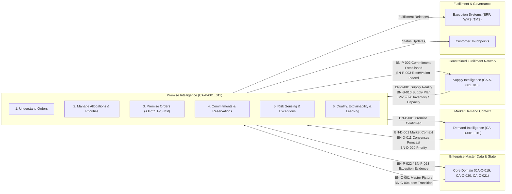
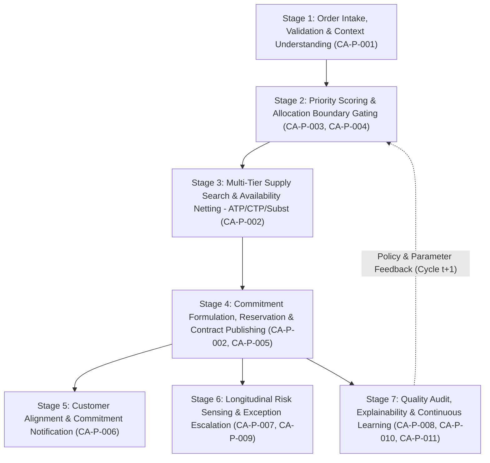
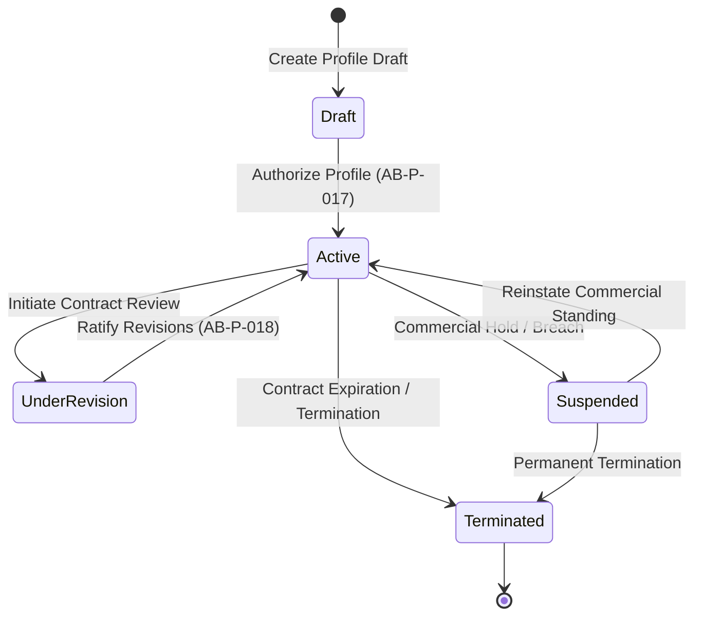
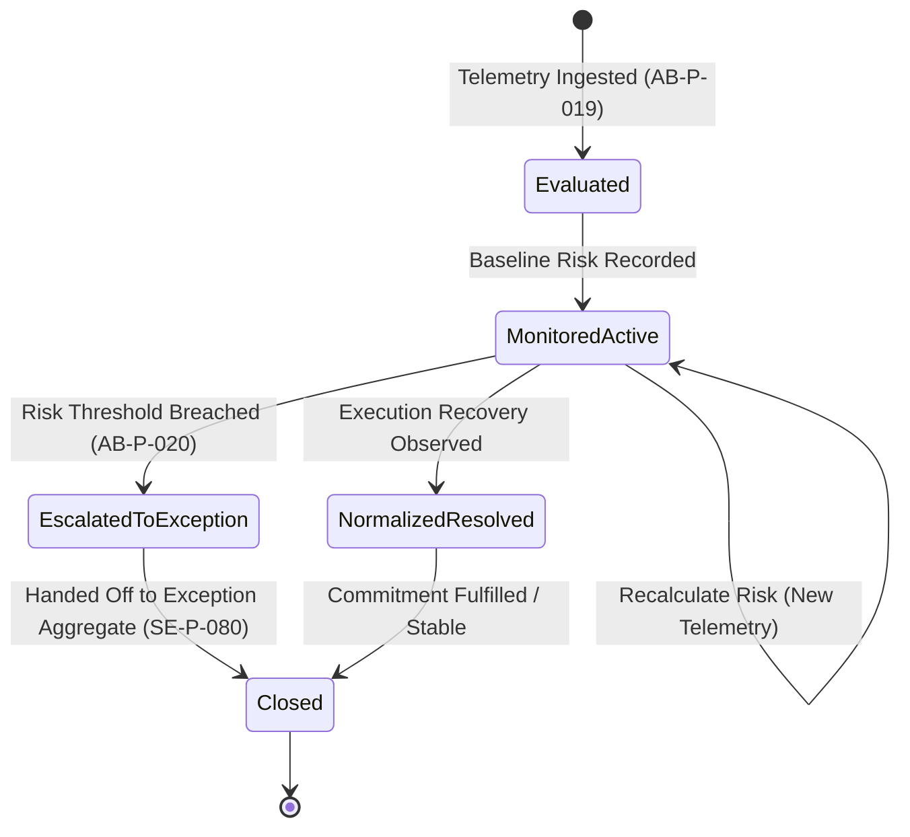
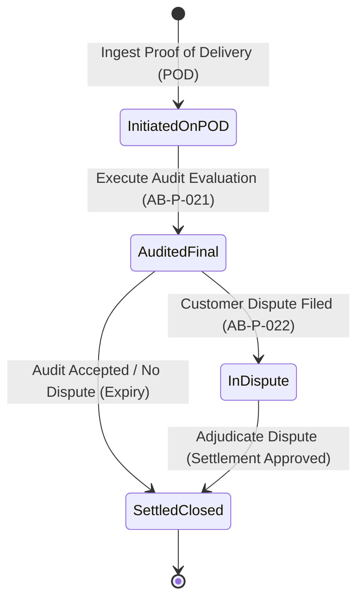
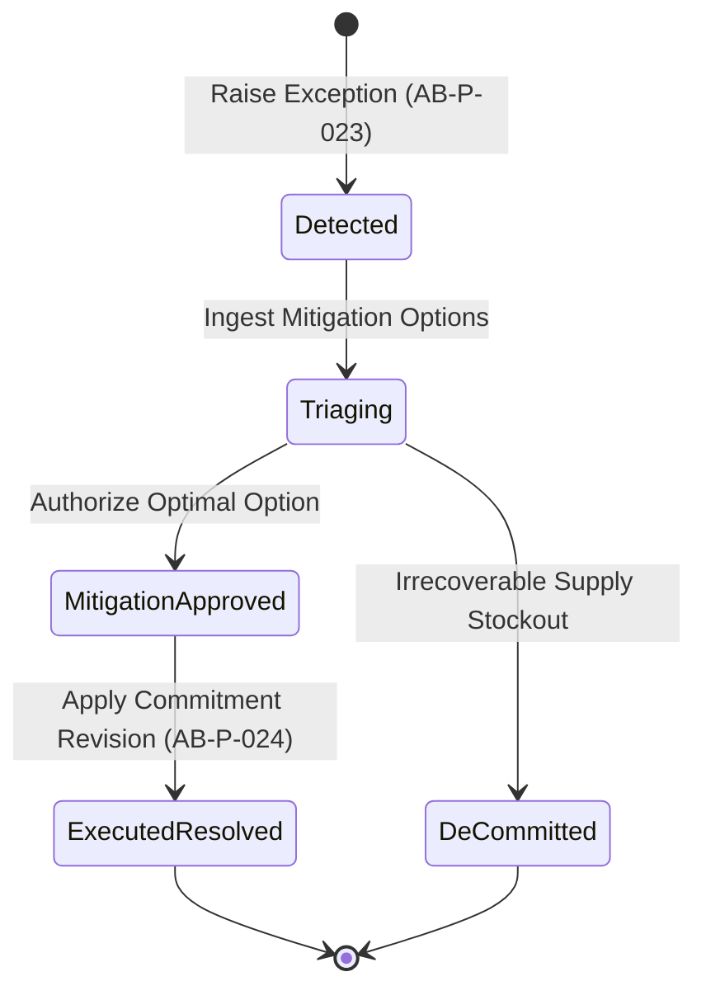
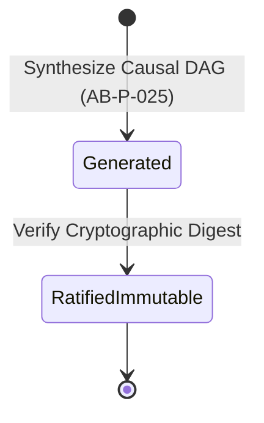
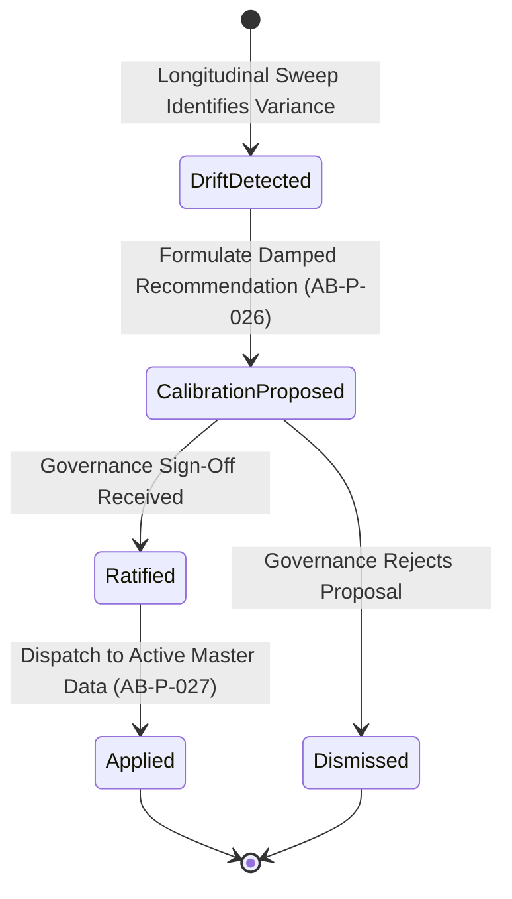

# Promise Intelligence Specification

**Status:** Authorized  
**Domain Code:** P  
**Governed By:** Specification Meta-Model & Platform Governance (ARS §18.3)  
**Traceability:** Constitution §1–§6, ARS §2, §3, §4, §5, §6, §7, §8, §9, §10, §15, §16, §17, §18, §19, §22, Enterprise Semantic Model (`Documents/3_Semantic_Model.md`), Core Domain Specification (`Documents/4_Core Domain Specification.md`), Demand Intelligence Specification (`Documents/4_Demand_Intelligence_Specification.md`), Supply Intelligence Specification (`Documents/4_Supply Intelligence Specification.md`)

---

# Chapter 1 — Purpose & Scope

## 1.1 Purpose

Promise Intelligence is the authoritative enterprise domain responsible for translating customer demand into trusted, feasible, and profitable delivery commitments. It answers the fundamental enterprise question:

> **What delivery commitments can and should the enterprise make to its customers, when will those commitments be fulfilled, and how does the enterprise protect those promises against operational variability?**

Every order promise—whether an immediate available-to-promise (ATP) confirmation, a capable-to-promise (CTP) manufacturing commitment, an allocation-bounded channel reservation, or an optimized product/location substitution—originates from, is evaluated by, and is governed by this specification.

Promise Intelligence operates as the commercial commitment bridge between the market and the enterprise fulfillment network. It consumes trusted market demand context from Demand Intelligence (`CA-D-001`, `CA-D-003`), authoritative enterprise picture snapshots from Core Domain (`CA-C-019`), and constrained supply network realities, capacity envelopes, and inventory positions from Supply Intelligence (`CA-S-001`, `CA-S-002`, `CA-S-003`, `CA-S-004`). It evaluates real-time availability, component lead times, production capacity, channel allocations, and customer priorities to generate binding commitments that balance customer service levels, revenue realization, fulfillment costs, and enterprise risk.

The domain provides the authoritative commitment ledger upon which order capture, manufacturing execution dispatch, warehouse shipment, customer communication, and enterprise learning depend.

## 1.2 Scope

### Included in Scope
- **Real-Time & Batch Order Promising:** Deterministic Available-to-Promise (ATP), Capable-to-Promise (CTP), and Profitable-to-Promise (PTP) evaluation across discrete, batch, and make-to-order fulfillment models.
- **Multi-Echelon Supply & Inventory Search:** Transparent netting across on-hand inventory, intransit stock, firm purchase orders, planned manufacturing orders, and supplier replenishment commitments.
- **Allocation Governance & Consumption:** Hard and soft ring-fencing of inventory and capacity across market channels, customer strategic tiers, geographies, and promotional campaigns.
- **Dynamic Order Prioritization & Rationing:** Multi-criteria order scoring incorporating customer lifetime value, commercial penalty clauses, margin contribution, and strategic urgency during constrained supply conditions.
- **Order Lifecycle & Change Management:** Systematic processing of customer-initiated order modifications, delivery date push/pull requests, quantity splits, cancellations, and backlog re-promising.
- **Automated Substitution & Alternative Sourcing:** Governed evaluation of alternate item form-fit-function substitutes (aligned with Core `SE-C-040`), alternate fulfillment nodes, and multi-origin shipping splits.
- **Temporary Supply Reservation:** Transactional isolation and concurrency locking to eliminate double-promising across distributed digital channels during multi-step checkout workflows.
- **Promise Risk Sensing:** Proactive longitudinal telemetry monitoring to detect emerging supply slippages, transportation bottlenecks, and capacity overloads before a customer promise breaches.
- **Promise Quality Measurement:** Comprehensive multi-dimensional evaluation of promise adherence (OTIF), first-promise accuracy, cycle latency, and touchless automation rates.
- **Promise Exception Detection & Escalation:** Identification of policy breaches, allocation exhaustion, and unresolvable order contention, publishing structured evidence to Core Central Exception Management (`CA-C-020`).
- **Promise Explainability:** Composition of deterministic, immutable audit trails establishing the exact evidence, policies, and supply netting logic supporting every commitment decision.
- **Continuous Learning & Calibration:** Empirical feedback loops calibrating allocation envelopes, lead-time safety buffers, and promising confidence parameters for subsequent cycles.

### Excluded from Scope
- **Demand Forecasting & Market Sensing:** Owned exclusively by Demand Intelligence (`Documents/4_Demand_Intelligence_Specification.md`). Promise Intelligence consumes forecasts and market understanding; it does not generate them.
- **Master Supply Planning & Finite Scheduling:** Owned exclusively by Supply Intelligence (`Documents/4_Supply Intelligence Specification.md`). Promise Intelligence consumes the supply plan and capacity envelopes; it does not plan factory schedules or release purchase orders.
- **Physical Fulfillment & Warehouse Operations:** Owned by Execution Systems (WMS/MES). Promise Intelligence issues fulfillment authorization commitments; it does not execute picking, packing, or dispatch.
- **Transportation Routing & Fleet Dispatch:** Owned by Logistics Execution Systems (TMS). Promise Intelligence calculates feasible transit lead-time windows based on governed logistics rules; it does not assign specific drivers or vehicles.
- **Customer Master Data & Credit Management:** Owned by Core Enterprise Master Data and Financial Systems. Promise Intelligence consumes credit approval states and customer master definitions; it does not evaluate creditworthiness.

## 1.3 Responsibility Boundary

The responsibility of Promise Intelligence begins when an order inquiry, quote request, sales order line, or order change request is received from an intake channel (e-commerce, EDI, CRM, ERP, or internal planner console). It encompasses order validation, customer priority scoring, allocation verification, multi-echelon ATP/CTP netting, substitution evaluation, commitment confirmation, customer status notification, risk sensing, exception escalation, and learning formulation.

The responsibility of Promise Intelligence ends when its authoritative governed outputs—Order Commitments (`SE-P-010`), Allocation Pool Updates (`SE-P-020`), Customer Promise Confirmations (`BN-P-001`), Supply Reservation Directives (`BN-P-002`), Promise Exception Evidence (`BN-P-022`, `BN-P-023`), Promise Explanations (`SE-P-090`), and Promise Learnings (`SE-P-100`)—have been committed to the enterprise event log and dispatched to downstream execution, planning, and governance consumers.

## 1.4 Architectural Position

Promise Intelligence is a core domain specification within the Medhavi APS platform. It derives its architectural authority from the **Constitution** and the **Architecture Reference Standard (ARS §18.3)**. It strictly respects the boundaries of the **Enterprise Semantic Model ([3_Semantic_Model.md](file:///d:/RnD/Medhavi/Documents/3_Semantic_Model.md))** and operates as a peer to Demand Intelligence and Supply Intelligence.

Promise Intelligence does not duplicate or redefine enterprise semantic objects owned by Core. Every enterprise master entity consumed—`SE-C-001 Item`, `SE-C-002 Location`, `SE-C-003 Customer`, `SE-C-004 Supplier`, `SE-C-006 Standard Resource`, `SE-C-008 Transportation Lane`, `SE-C-010 Planning Scope`, `SE-C-017 Commitment`, `SE-C-019 Exception`, `SE-C-021 Enterprise Picture`, and `SE-C-040 Item Transition`—is consumed via its authoritative contract without local mutation.



## 1.5 Out of Scope
- Direct mutation of physical warehouse inventories or enterprise general ledgers.
- Strategic long-term network design and facility capacity acquisition (owned by Scenario Intelligence).
- Invoicing, pricing negotiation, discount management, and tax calculations.
- Production work order dispatching and machine programmable logic controller (PLC) sequencing.
- Freight carrier contract negotiation and payment auditing.

## 1.6 Enterprise Questions

Every capability within the Promise Intelligence domain answers one or more of the following enterprise questions. These questions follow the causal sequence of order intake, evaluation, commitment, surveillance, and retrospective improvement.

| ID | Enterprise Question | Owning Capability |
|:---|:---|:---|
| `EQ-P-001` | What customer demand requests and firm commitments currently exist across enterprise channels, and are their data contracts valid and complete? | Understand Orders (`CA-P-001`) |
| `EQ-P-002` | What is the earliest, most reliable, and profitable delivery commitment the enterprise can confirm for this order request, considering real-time ATP, CTP, allocations, and substitutions? | Promise Orders (`CA-P-002`) |
| `EQ-P-003` | What quantity of constrained supply is apportioned to each sales channel, customer tier, or market, and what remaining capacity exists to promise? | Manage Allocations (`CA-P-003`) |
| `EQ-P-004` | When customer demand exceeds available supply or capacity, which orders must receive priority fulfillment, and according to what governed business criteria? | Prioritize Orders (`CA-P-004`) |
| `EQ-P-005` | When customer order terms change or fulfillment disruptions occur, how should existing commitments, splits, and backorders be re-promised? | Manage Order Changes (`CA-P-005`) |
| `EQ-P-006` | What commitment status, delivery updates, or counter-proposals must be communicated to the customer to maintain alignment and trust? | Collaborate with Customers (`CA-P-006`) |
| `EQ-P-007` | Which active customer commitments are at risk of breach due to emerging upstream supply delays, production interruptions, or logistics friction? | Sense Promise Risks (`CA-P-007`) |
| `EQ-P-008` | How reliably, accurately, and stably has the enterprise honored its order promises, and where are systemic promising biases emerging? | Evaluate Promise Quality (`CA-P-008`) |
| `EQ-P-009` | Which order promising conditions violate governed enterprise policies or create unacceptable commercial risk requiring supervisory escalation? | Detect Promise Exceptions (`CA-P-009`) |
| `EQ-P-010` | What exact evidence, supply availability checks, capacity netting, allocation rules, and policies determined this specific promise date or rejection? | Explain Promise Decisions (`CA-P-010`) |
| `EQ-P-011` | What recurring empirical patterns in order fulfillment latency, customer behavior, and allocation consumption should calibrate future promising policies? | Learn From Promises (`CA-P-011`) |

## 1.7 Promise Intelligence Causal Reasoning Pipeline

The causal architecture of Promise Intelligence follows a 7-stage deterministic pipeline. Each stage strictly depends on the verified outcomes of preceding stages:



- **Stage 1 — Order Intake, Validation & Context Understanding (`CA-P-001`):** Ingest raw order requests across omnichannel endpoints. Validate schema completeness, customer identity (`SE-C-003`), item identity (`SE-C-001`), and delivery site constraints. Bind order lines to authoritative master context.
- **Stage 2 — Priority Scoring & Allocation Boundary Gating (`CA-P-003`, `CA-P-004`):** Score incoming demand against governed commercial tiers (`PO-P-004`). Verify whether order consumption falls within pre-allocated channel buckets (`SE-P-020`). If allocations are exhausted, trigger escalation or secondary priority rules.
- **Stage 3 — Multi-Tier Supply Search & Availability Netting (`CA-P-002`):** Execute sequential availability netting across: (a) On-Hand Uncommitted Stock (Standard ATP), (b) Scheduled Inbound Replenishment (Cumulative ATP), (c) Uncommitted Manufacturing Capacity (CTP), and (d) Product Substitutions (`SE-C-040`) or Alternate Fulfillment Nodes.
- **Stage 4 — Commitment Formulation, Reservation & Contract Publishing (`CA-P-002`, `CA-P-005`):** Formulate the optimal delivery date and fulfillment sourcing node. Place temporary reservation locks (`SE-P-030`) during multi-step checkout. Upon order confirmation, transition to firm Order Commitment (`SE-P-010`), publish `BN-P-001` to Demand Intelligence, and publish `BN-P-002` to Supply Intelligence.
- **Stage 5 — Customer Alignment & Commitment Notification (`CA-P-006`):** Generate transparent, customer-facing delivery promises, split shipment schedules, or structured counter-proposals where requested dates cannot be satisfied.
- **Stage 6 — Longitudinal Risk Sensing & Exception Escalation (`CA-P-007`, `CA-P-009`):** Track open promises against streaming supply telemetry (`BN-S-020`, `BN-S-030`). Detect emerging lead-time drift or capacity losses. Where breach thresholds are crossed, emit `BN-P-022` to Core Exception Management (`CA-C-020`).
- **Stage 7 — Quality Audit, Explainability & Continuous Learning (`CA-P-008`, `CA-P-010`, `CA-P-011`):** Evaluate historical promise adherence (OTIF). Compose immutable explainability trees (`SE-P-090`) for planner review and AI query. Derive empirical parameter calibrations (`SE-P-100`) to refine lead-time buffers and allocation rules in future planning cycles.

## 1.8 Architectural Principles & Traceability

1. **Enterprise First (C-EP-001):** Commitments are evaluated against globally optimal enterprise criteria (margin, customer strategic tier, inventory holding cost), preventing local warehouse or channel sub-optimization.
2. **Deterministic Reproducibility (ARS §2.3):** Given identical order parameters, inventory positions, capacity envelopes, and allocation states, the promising algorithms must produce the exact same promise date and sourcing allocation.
3. **Zero Direct Aggregate Mutation (ARS §4.2):** Promise Intelligence never mutates Supply aggregate roots (`SE-S-010`, `SE-S-020`), Core aggregates (`SE-C-019`, `SE-C-021`), or Demand aggregates. It interacts exclusively through immutable events and notifications.
4. **AI-Ready Explainability (C-EX-001):** Every order promise is accompanied by an immutable structured reasoning graph detailing which supply elements were netted, which allocation rules were applied, and why alternatives were chosen or rejected.
5. **Pure Functional Execution (Constitution §3):** All availability search algorithms and decision evaluations are implemented as pure mathematical functions without hidden mutable side effects.

---

# Chapter 2 — Business Objectives

The Promise Intelligence domain is governed by eight strategic Business Objectives. Every capability, decision, rule, policy, and algorithm within this specification traces directly to one or more of these objectives.

## BO-P-001 — Deliver Trusted Order Commitments

### Business Motivation
Customer trust is the primary foundation of market competitiveness. An unreliable or overly optimistic commitment that is subsequently broken damages customer relationships far more than an honest, feasible date delivered transparently at order inception. Promise Intelligence transforms raw customer orders into mathematically verified, reliable commitments by validating physical inventory, pipeline replenishment, and production feasibility before confirming the order.

### Business Questions
- What is the total volume and value of our open promised order book, and what is its aggregate reliability score?
- Which customer promises are currently vulnerable to breach, and what specific supply disruption is driving the risk?
- How closely does our initial promised delivery date match the actual customer delivery receipt?
- Where are commitments being made based on stale or unverified supply assumptions?

### Enterprise Success Measures
- `PI-P-001` Promise Adherence Rate (OTIF to Promise)
- `PI-P-002` First-Promise Accuracy (FPA)
- `PI-P-009` ATP Calculation Accuracy Index
- `PI-P-014` Promise Decision Confidence Index

### Business Responsibilities
- Validate order line inputs against master product and location boundaries.
- Calculate mathematically feasible delivery windows based on real-time multi-echelon supply.
- Record the authoritative, immutable commitment contract for every accepted order.

---

## BO-P-002 — Maximize Customer Service Reliability & On-Time Delivery

### Business Motivation
Customer satisfaction, contract renewal rates, and commercial penalty avoidance depend directly on on-time, in-full (OTIF) delivery. Promise Intelligence shall maximize fulfillment precision by continuously comparing requested customer dates against network capabilities, reserving appropriate stock, and executing intelligent substitutions and split shipments where complete single-node fulfillment is impossible.

### Business Questions
- What percentage of orders are promised on the customer's exact requested date versus an alternative date?
- What are the primary root causes when a customer order cannot be promised on the requested date?
- Which customer tiers experience the highest service levels, and are contractual SLAs being honored?
- How effectively do automated product substitutions preserve order fulfillment during stockouts?

### Enterprise Success Measures
- `PI-P-001` Promise Adherence Rate (OTIF to Promise)
- `PI-P-003` Order Line Fill Rate (Promise Perspective)
- `PI-P-010` Substitution Efficacy Rate
- `PI-P-012` Customer Commitment Retention Rate

### Business Responsibilities
- Provide multi-option delivery proposals (earliest date, lowest cost, complete delivery).
- Enforce customer-specific fulfillment policies (allow partial shipments, no substitution, strict ship-complete).
- Authorize alternative sourcing nodes dynamically to protect customer delivery dates.

---

## BO-P-003 — Protect and Optimize Order Promising Margin

### Business Motivation
Not all fulfillment solutions yield acceptable financial returns. Promising an order from a distant distribution center with expedited freight or consuming premium production capacity can eliminate product profitability. Promise Intelligence shall balance customer service commitments with cost-to-serve, evaluating transportation surcharges, split-shipment overhead, and inventory carrying costs to select the most profitable feasible fulfillment path.

### Business Questions
- What is the projected gross margin contribution of each promised order after fulfillment logistics costs?
- How much margin is eroded by uncoordinated multi-node split shipments and premium freight expedite actions?
- Are constrained products being allocated to high-margin channels and strategic accounts rather than low-margin transactional orders?
- When supply is constrained, what is the net revenue impact of order rationing decisions?

### Enterprise Success Measures
- `PI-P-005` Promising Margin Preservation Rate
- `PI-P-007` Allocation Adherence Rate
- `PI-P-013` Order Prioritization Compliance Score

### Business Responsibilities
- Evaluate landed fulfillment cost across candidate distribution nodes before confirming promises.
- Enforce minimum order profitability thresholds governed by commercial policies (`PO-P-005`).
- Restrict premium shipping options to authorized customer tiers and high-margin contracts.

---

## BO-P-004 — Minimize Order Promising Cycle Time & Response Latency

### Business Motivation
In digital commerce, B2B portals, and integrated EDI environments, promising response speed is critical. A delay of several seconds in returning a confirmed delivery date can lead to shopping cart abandonment or lost sales. Promise Intelligence shall deliver sub-second ATP/CTP response latencies for standard orders while maintaining high-throughput batch re-promising capabilities during bulk supply revisions.

### Business Questions
- What is the 95th percentile response time for real-time order promising inquiries across digital endpoints?
- Where are bottlenecks occurring during complex multi-level CTP calculations?
- How long does it take the enterprise to re-promise the open order backlog following a major supply disruption?
- Which order types are delayed waiting for manual planner confirmation, and how can they be automated?

### Enterprise Success Measures
- `PI-P-004` Order Promising Cycle Time (OPCT)
- `PI-P-016` Real-Time ATP Evaluation Latency (p95)
- `PI-P-017` Batch Re-Promising Throughput Rate

### Business Responsibilities
- Execute high-performance in-memory availability netting against cached supply models.
- Implement non-blocking temporary reservations to support high-concurrency checkout.
- Process batch re-promising asynchronously with deterministic queue sequencing.

---

## BO-P-005 — Maximize Order Status Visibility & Proactive Transparency

### Business Motivation
Uncertainty creates operational friction and customer anxiety. When delivery dates must change due to inevitable upstream disruptions, proactive communication sent hours or days before the scheduled delivery date preserves trust and allows customers to adjust their operations. Promise Intelligence shall provide continuous, transparent visibility into commitment status, shipment milestones, and schedule revisions.

### Business Questions
- Are customers notified of delivery schedule revisions before or after their original promise date passes?
- How accurately do our customer status portals reflect real-time fulfillment and backorder states?
- What is the frequency and root cause of promise revisions per customer account?
- Which communication channels provide the highest acknowledgment and acceptance rates for revised promises?

### Enterprise Success Measures
- `PI-P-002` First-Promise Accuracy (FPA)
- `PI-P-011` Promise Risk Prediction Precision
- `PI-P-015` Promise Explainability Index

### Business Responsibilities
- Stream commitment lifecycle state changes to customer-facing notification buses.
- Publish structured reasoning records explaining the causal basis for any date revision.
- Provide self-service order tracking telemetry across omnichannel touchpoints.

---

## BO-P-006 — Maximize Touchless and Automated Order Promising

### Business Motivation
Human planners should not spend their time performing routine calculations, verifying standard stock availability, or confirming routine orders. Promise Intelligence shall fully automate standard ATP, governed allocation draws, and policy-compliant substitutions, achieving high touchless promising rates and reserving human intervention exclusively for high-value strategic exceptions and complex negotiations.

### Business Questions
- What percentage of customer order lines are promised touchlessly without manual planner touch?
- Which specific business rules or failure states trigger manual planner escalation most frequently?
- What is the error and dispute rate of automated promises versus manually confirmed promises?
- How can allocation rules and inventory thresholds be tuned to safely increase automation?

### Enterprise Success Measures
- `PI-P-006` Touchless Promising Automation Rate
- `PI-P-018` Temporary Reservation Expiration Rate
- `PI-P-020` Promise Exception Triage Latency

### Business Responsibilities
- Automate order validation, priority assignment, supply netting, and confirmation dispatch.
- Enforce strict straight-through processing (STP) gating rules governed by `PO-P-006`.
- Route only unresolvable policy breaches and severe supply conflicts to human triage consoles.

---

## BO-P-007 — Enforce Strict Commitment Feasibility & Supply Protection

### Business Motivation
Over-promising creates stockouts, operational chaos on the factory floor, and broken promises to customers. Under-promising leads to excess safety stock, idle production capacity, and lost sales. Promise Intelligence shall enforce absolute mathematical feasibility, ensuring that no inventory is double-promised, that planned production orders are netted strictly within realistic capacity boundaries, and that allocated pools are defended against unauthorized consumption.

### Business Questions
- Are any inventory units or capacity hours currently committed to more than one customer order?
- How frequently do promises fail because underlying inbound purchase orders or work orders were delayed?
- Are lower-tier customer orders consuming inventory reserved for strategic partner accounts?
- How effectively do temporary reservations prevent race conditions during concurrent order intake?

### Enterprise Success Measures
- `PI-P-007` Allocation Adherence Rate
- `PI-P-008` CTP Feasibility Precision Index
- `PI-P-018` Temporary Reservation Expiration Rate

### Business Responsibilities
- Guarantee atomic transaction isolation during temporary reservation and firm commitment creation.
- Defend hard allocation pool boundaries against unentitled order types.
- Validate component lead times and bill of material capacity constraints during all CTP evaluations.

---

## BO-P-008 — Continuously Calibrate Promising Intelligence via Empirical Feedback

### Business Motivation
Promising parameters—such as transit lead times, production changeover allowances, supplier reliability factors, and allocation exhaustion rates—drift over time as physical realities evolve. Promise Intelligence shall not remain a static calculation engine. It shall continuously compare historical promises against actual fulfillment outcomes, discovering recurring biases and proposing calibrated parameters to governance bodies.

### Business Questions
- What is the historical variance between calculated transit lead times and actual carrier delivery times?
- Which manufacturing facilities systematically fail to achieve CTP promised production dates?
- Are certain channel allocation pools consistently over-allocated while others starve?
- What policy parameter adjustments would produce the highest increase in OTIF across the network?

### Enterprise Success Measures
- `PI-P-002` First-Promise Accuracy (FPA)
- `PI-P-011` Promise Risk Prediction Precision
- `PI-P-014` Promise Decision Confidence Index

### Business Responsibilities
- Maintain an immutable longitudinal ledger of all promise decisions and their subsequent fulfillment actuals.
- Identify statistically significant drift between promised dates and actual delivery milestones.
- Formulate candidate parameter improvements (`SE-P-100`) for governance review in `CA-P-011`.  

---

# Chapter 3 — Enterprise Measurement Model

## 3.1 Measurement Architecture

The Enterprise Measurement Model establishes an immutable, mathematically rigorous foundation for quantifying, evaluating, and governing order promising performance across the enterprise. In accordance with the Architecture Reference Standard (ARS §18.3), every performance indicator is a first-class enterprise semantic entity defined with complete mathematical formulas, data lineage, evaluation thresholds, governance rules, and consumer traceability.

Promise Intelligence operates under a strict three-tier measurement hierarchy:

```
+----------------------------------------------------------------------------------------------------+
|                                    ENTERPRISE MEASUREMENT TIERS                                    |
+----------------------------------------------------------------------------------------------------+
| Tier 1: Business Outcome Measures (PI-P-001 - PI-P-008)                                            |
|   Direct quantifiable business value: Service reliability, OTIF, margin preservation, cycle time. |
+----------------------------------------------------------------------------------------------------+
| Tier 2: Intelligence Quality & Decision Measures (PI-P-009 - PI-P-015)                             |
|   Fidelity and efficacy of promising logic: ATP accuracy, substitution success, risk precision.   |
+----------------------------------------------------------------------------------------------------+
| Tier 3: Operational & Learning System Measures (PI-P-016 - PI-P-020)                               |
|   Computational performance, latency, throughput, session behavior, and empirical drift.         |
+----------------------------------------------------------------------------------------------------+
```

### Architectural Principles of Promise Measurement
1. **Mathematical Determinism:** Every indicator is derived from immutable transactional facts (order receipts, inventory ledgers, capacity calendars, carrier track-and-trace events). No heuristic guesses or unverified estimates are permitted.
2. **First-Promise Immutability:** Initial promise commitments are preserved permanently in the ledger (`SE-P-010`). While subsequent re-promises may adjust operational delivery targets, First-Promise Accuracy (`PI-P-002`) continuously benchmarks fulfillment against the original agreement made with the customer.
3. **Multi-Echelon Sourcing Lineage:** Promised margins (`PI-P-005`) and fulfillment feasibility (`PI-P-008`, `PI-P-009`) account for end-to-end network cost and latency, including multi-node splits, cross-docking, and bill-of-material production lead times.
4. **Sub-Second Observability:** Operational measures (`PI-P-016`, `PI-P-018`) provide real-time telemetry into high-concurrency digital commerce checkout engines, safeguarding against inventory double-booking and stale cache states.

### Enterprise Measurement Master Registry

| ID | Indicator Name | Tier | Category | Owning Capability | Governing Policy | Business Objectives | Produced Knowledge Artifact |
|:---|:---|:---|:---|:---|:---|:---|:---|
| `PI-P-001` | Promise Adherence Rate (OTIF to Promise) | Tier 1 | Customer Service | `CA-P-006` Establish Order Commitments | `PO-P-008` | `BO-P-001`, `BO-P-002` | `KA-P-001` |
| `PI-P-002` | First-Promise Accuracy (FPA) | Tier 1 | Commitment Stability | `CA-P-006` Establish Order Commitments | `PO-P-008` | `BO-P-001`, `BO-P-005`, `BO-P-008` | `KA-P-002` |
| `PI-P-003` | Order Line Fill Rate (Promise Perspective) | Tier 1 | Fulfillment Volume | `CA-P-006` Establish Order Commitments | `PO-P-008` | `BO-P-002` | `KA-P-003` |
| `PI-P-004` | Order Promising Cycle Time (OPCT) | Tier 1 | Process Velocity | `CA-P-001` Capture & Validate Order Book | `PO-P-006` | `BO-P-004` | `KA-P-004` |
| `PI-P-005` | Promising Margin Preservation Rate (PMPR) | Tier 1 | Financial Protection | `CA-P-006` Establish Order Commitments | `PO-P-005` | `BO-P-003` | `KA-P-005` |
| `PI-P-006` | Touchless Promising Automation Rate (TPAR) | Tier 1 | Automation / STP | `CA-P-006` Establish Order Commitments | `PO-P-006` | `BO-P-006` | `KA-P-006` |
| `PI-P-007` | Allocation Pool Adherence Rate (APAR) | Tier 1 | Commercial Governance | `CA-P-004` Govern Channel Allocation Pools | `PO-P-004` | `BO-P-003`, `BO-P-007` | `KA-P-007` |
| `PI-P-008` | Capable-to-Promise (CTP) Realization Rate | Tier 1 | Manufacturing Execution | `CA-P-003` Evaluate Capable-to-Promise | `PO-P-003` | `BO-P-007` | `KA-P-008` |
| `PI-P-009` | ATP Calculation Accuracy Index (ACAI) | Tier 2 | Netting Precision | `CA-P-002` Assess Available-to-Promise | `PO-P-002` | `BO-P-001` | `KA-P-009` |
| `PI-P-010` | Substitution Efficacy Rate (SER) | Tier 2 | Sourcing Intelligence | `CA-P-002` Assess Available-to-Promise | `PO-P-002` | `BO-P-002` | `KA-P-010` |
| `PI-P-011` | Promise Risk Prediction Precision (PRPP) | Tier 2 | Predictive Quality | `CA-P-007` Predict Commitment Risk | `PO-P-010` | `BO-P-005`, `BO-P-008` | `KA-P-011` |
| `PI-P-012` | Customer Commitment Retention Rate (CCRR) | Tier 2 | Commercial Capture | `CA-P-006` Establish Order Commitments | `PO-P-005` | `BO-P-002` | `KA-P-012` |
| `PI-P-013` | Order Prioritization Compliance Score (OPCS) | Tier 2 | Strategic Prioritization | `CA-P-004` Govern Channel Allocation Pools | `PO-P-005` | `BO-P-003` | `KA-P-013` |
| `PI-P-014` | Promise Decision Confidence Index (PDCI) | Tier 2 | Decision Integrity | `CA-P-006` Establish Order Commitments | `PO-P-008` | `BO-P-001`, `BO-P-008` | `KA-P-014` |
| `PI-P-015` | Promise Explanatory Completeness (PEC) | Tier 2 | Auditability / Explainability | `CA-P-010` Explain Promise Decisions | `PO-P-010` | `BO-P-005` | `KA-P-015` |
| `PI-P-016` | Real-Time ATP Evaluation Latency (p95) | Tier 3 | Execution Latency | `CA-P-002` Assess Available-to-Promise | `PO-P-002` | `BO-P-004` | `KA-P-016` |
| `PI-P-017` | Batch Re-Promising Throughput Rate (BRPTR) | Tier 3 | Processing Throughput | `CA-P-008` Re-Promise Backlog & Backorders | `PO-P-009` | `BO-P-004` | `KA-P-017` |
| `PI-P-018` | Temporary Reservation Expiration Rate (TRER) | Tier 3 | Session Efficiency | `CA-P-005` Manage Temporary Reservations | `PO-P-007` | `BO-P-006`, `BO-P-007` | `KA-P-018` |
| `PI-P-019` | Customer Promise Churn Frequency (CPCF) | Tier 3 | Schedule Stability | `CA-P-008` Re-Promise Backlog & Backorders | `PO-P-009` | `BO-P-001`, `BO-P-005` | `KA-P-019` |
| `PI-P-020` | Promise Exception Triage Latency (PETL) | Tier 3 | Incident Response | `CA-P-009` Detect & Resolve Exceptions | `PO-P-010` | `BO-P-006` | `KA-P-020` |

---

## 3.2 Tier 1 — Business Outcome Measures

### PI-P-001 — Promise Adherence Rate (OTIF to Promise)

#### 1. Enterprise Measure Definition
| Attribute | Value |
|:---|:---|
| Identifier | `PI-P-001` |
| Name | Promise Adherence Rate (OTIF to Promise) |
| Measure Category | Customer Service Performance |
| Measure Nature | Historical Derived Measure |
| Owning Capability | `CA-P-006` Establish Order Commitments |
| Governed By | `PO-P-008` Commitment Feasibility & Non-Duplication Policy |
| Enterprise Question | What percentage of customer order commitments were delivered strictly on or before the committed promise date, in full quantity, with perfect specification and zero transit damage? |
| Business Objectives Served | `BO-P-001`, `BO-P-002` |

#### 2. Enterprise Meaning
Promise Adherence Rate quantifies fulfillment reliability directly against the binding operational commitment established by the enterprise. Unlike Customer-Requested OTIF (which evaluates market responsiveness against unconstrained demand desires), Promise Adherence Rate evaluates execution fidelity against what the enterprise mathematically agreed to deliver. It is the primary enterprise metric of commitment trust.

#### 3. Measurement Model
| Attribute | Value |
|:---|:---|
| Measure Type | Historical Derived Ratio |
| Measure Behaviour | Cumulative Periodic & Sliding Window |
| Measure Context | Longitudinal Fulfillment Actuals |
| Measure Scope | Global Enterprise, Channel, Customer Tier, Sourcing Facility, Product Line |
| Validity | Permanent historical audit record upon proof-of-delivery confirmation |

#### 4. Measurement Inputs
| Variable | Enterprise Source | Resolution Status |
|:---|:---|:---|
| Promised Commitment Snapshot | `SE-P-010 Order Commitment` | Resolved — Authoritative promise record |
| Proof of Delivery Actuals | `SE-C-016 Order Fulfillment` | Resolved — Logistics execution milestone |
| Delivery Quantity Received | `SE-C-016 Order Fulfillment` | Resolved — Customer receiving receipt |
| Quality & Spec Conformance | `SE-C-016 Order Fulfillment` | Resolved — Inspection / non-conformance flag |

#### 5. Calculation Model
$$\text{PAR} = \left( \frac{\sum_{i=1}^{N} \mathbb{I}(\text{OTIF}_i)}{N} \right) \times 100$$

Where $\mathbb{I}(\text{OTIF}_i) = 1$ if and only if:
1. $T_{\text{actual\_delivery}}(i) \le T_{\text{promised\_delivery\_date}}(i)$
2. $Q_{\text{actual\_delivered}}(i) \ge Q_{\text{promised\_quantity}}(i)$
3. $\text{DamageFlag}(i) = 0 \land \text{SpecMismatchFlag}(i) = 0$

Otherwise, $\mathbb{I}(\text{OTIF}_i) = 0$.

*Calculation Assumptions:* An order line delivered early is marked as compliant unless the customer master enforces strict unbending delivery appointment windows.  
*Precision:* Two decimal places.  
*Unit:* Percentage (%).

#### 6. Publication Model
| Attribute | Value |
|:---|:---|
| Produces | `KA-P-001` Promise Adherence Measurement |
| Contents | Metric ID, Window Epoch, Calculated Rate, Total Orders Evaluated, Failure Categorization, Regional Breakdown |
| Publication Trigger | Daily batch close and real-time sliding 30-day window recalculation |
| Publication Pattern | Periodic Broadcast & Executive Dashboard Event |

#### 7. Interpretation Governance
| Performance Band | Range | Operational Evaluation & Required Action |
|:---|:---|:---|
| Target (Green) | $\ge 98.0\%$ | Network performing within SLA. Standard promising automation active. |
| Watch (Amber) | $94.0\% - 97.9\%$ | Moderate commitment breach. Trigger root cause analysis on top defaulting sourcing nodes. |
| Critical (Red) | $< 94.0\%$ | Severe trust breach. Trigger emergency review of buffer lead times and carrier transit reliability models. |

#### 8. Consumers
| Consumer | How the Measure Is Used |
|:---|:---|
| `CA-P-011` Calibrate Promising Parameters | Adjusts dynamic lead-time buffers and carrier transit allowances. |
| Executive Supply Chain Review | Serves as the primary operational service KPI. |
| `CA-P-007` Predict Commitment Risk | Historical node adherence rates feed Bayesian probability models for active open orders. |

#### 9. Explainability
Every failed commitment in `PI-P-001` provides a deterministic root cause vector detailing whether the default was caused by carrier transit delay, warehouse pick delay, factory production shortfall, or multi-echelon stockout.

#### 10. Traceability
| Attribute | Value |
|:---|:---|
| Owned By | `CA-P-006` Establish Order Commitments |
| Governed By | `PO-P-008` |
| Consumes | `SE-P-010`, `SE-C-016`, `SE-C-017` |
| Produces | `KA-P-001` |
| Used By | `CA-P-007`, `CA-P-011`, Executive Consoles |

---

### PI-P-002 — First-Promise Accuracy (FPA)

#### 1. Enterprise Measure Definition
| Attribute | Value |
|:---|:---|
| Identifier | `PI-P-002` |
| Name | First-Promise Accuracy (FPA) |
| Measure Category | Commitment Stability |
| Measure Nature | Longitudinal Derived Measure |
| Owning Capability | `CA-P-006` Establish Order Commitments |
| Governed By | `PO-P-008` Commitment Feasibility & Non-Duplication Policy |
| Enterprise Question | What percentage of customer order commitments were delivered on or before the very first promise date communicated at order inception, without relying on subsequent date revisions? |
| Business Objectives Served | `BO-P-001`, `BO-P-005`, `BO-P-008` |

#### 2. Enterprise Meaning
First-Promise Accuracy isolates initial commitment integrity from operational re-promising. When a supply disruption occurs, an enterprise may re-promise an order for a later date and meet that revised date (achieving 100% adherence on the final promise), yet the customer experiences operational disappointment. FPA measures the permanence and baseline accuracy of the initial promise.

#### 3. Measurement Model
| Attribute | Value |
|:---|:---|
| Measure Type | Longitudinal Audit Ratio |
| Measure Behaviour | Periodic & Cohort-Based |
| Measure Context | Order Inception to Final Receipt |
| Measure Scope | Enterprise-wide, Segment, Product Family, Geographic Destination |
| Validity | Immutable once order lifecycle terminates (closed/delivered) |

#### 4. Measurement Inputs
| Variable | Enterprise Source | Resolution Status |
|:---|:---|:---|
| Initial Promise Date ($T_{\text{initial}}$) | `SE-P-010 Order Commitment` (Revision Index = 0) | Resolved — Immutable initial snapshot |
| Final Delivered Date ($T_{\text{actual}}$) | `SE-C-016 Order Fulfillment` | Resolved — Carrier delivery timestamp |
| Order Cancellation Status | `SE-P-001 Order Book Snapshot` | Resolved — Cancellation flag & root cause |

#### 5. Calculation Model
$$\text{FPA} = \left( \frac{\sum_{i=1}^{M} \mathbb{I}(T_{\text{actual}}(i) \le T_{\text{initial}}(i) \land Q_{\text{delivered}}(i) \ge Q_{\text{promised}}(i))}{M} \right) \times 100$$

Where $M$ is the total number of initial customer order commitments created within the evaluation cohort. Orders cancelled by the customer due to delivery delay are counted as failures in the denominator.

*Precision:* Two decimal places.  
*Unit:* Percentage (%).

#### 6. Publication Model
| Attribute | Value |
|:---|:---|
| Produces | `KA-P-002` First-Promise Accuracy Measurement |
| Contents | Metric ID, Cohort Date, Total Commitments, Initial Hits, Re-Promise Churn Count, Root Cause Distribution |
| Publication Trigger | Weekly cohort close and monthly executive review |
| Publication Pattern | Scheduled Event |

#### 7. Interpretation Governance
| Performance Band | Range | Operational Evaluation & Required Action |
|:---|:---|:---|
| Target (Green) | $\ge 95.0\%$ | High initial commitment stability. Sourcing assumptions verified. |
| Watch (Amber) | $90.0\% - 94.9\%$ | Schedule instability emerging. Initiate review of upstream component lead times. |
| Critical (Red) | $< 90.0\%$ | Unstable promising foundation. Re-calibrate planning safety stocks and CTP freeze fences. |

#### 8. Consumers
| Consumer | How the Measure Is Used |
|:---|:---|
| `CA-P-011` Calibrate Promising Parameters | Adjusts conservative bias in early ATP/CTP quoting algorithms. |
| `CA-P-008` Re-Promise Backlog | Identifies persistent bias in re-promising loops. |

#### 9. Explainability
FPA reports trace the exact revision history (`SE-P-010`) of every order, highlighting the delta between $T_{\text{initial}}$, intermediate re-promises $T_1, T_2, \dots, T_k$, and physical delivery $T_{\text{actual}}$.

#### 10. Traceability
| Attribute | Value |
|:---|:---|
| Owned By | `CA-P-006` Establish Order Commitments |
| Governed By | `PO-P-008` |
| Consumes | `SE-P-010`, `SE-P-001`, `SE-C-016` |
| Produces | `KA-P-002` |
| Used By | `CA-P-011`, Strategic Governance Consoles |

---

### PI-P-003 — Order Line Fill Rate (Promise Perspective)

#### 1. Enterprise Measure Definition
| Attribute | Value |
|:---|:---|
| Identifier | `PI-P-003` |
| Name | Order Line Fill Rate (Promise Perspective) |
| Measure Category | Fulfillment Volume Fidelity |
| Measure Nature | Volumetric Derived Measure |
| Owning Capability | `CA-P-006` Establish Order Commitments |
| Governed By | `PO-P-008` Commitment Feasibility & Non-Duplication Policy |
| Enterprise Question | What percentage of total promised product volume was physically received by customers on the committed delivery date? |
| Business Objectives Served | `BO-P-002` |

#### 2. Enterprise Meaning
While `PI-P-001` treats an order as a binary pass/fail unit, Order Line Fill Rate measures volumetric completeness. A customer receiving 990 units of a 1,000-unit promise experiences a 99% fill rate, even though the order line technically fails binary OTIF. Measuring volume fulfillment prevents distorted executive perception during partial fulfillment situations.

#### 3. Measurement Model
| Attribute | Value |
|:---|:---|
| Measure Type | Volumetric Ratio |
| Measure Behaviour | Periodic & Rolling |
| Measure Context | Quantity Fulfilled vs. Quantity Promised |
| Measure Scope | SKU, Product Family, Customer Account, Channel, DC |
| Validity | Evaluated upon physical delivery confirmation |

#### 4. Measurement Inputs
| Variable | Enterprise Source | Resolution Status |
|:---|:---|:---|
| Promised Line Quantity ($Q_{\text{promised}}$) | `SE-P-010 Order Commitment` | Resolved — Committed volume |
| Delivered Line Quantity ($Q_{\text{delivered}}$) | `SE-C-016 Order Fulfillment` | Resolved — Received volume |
| Delivery On-Time Flag | `SE-C-016 Order Fulfillment` | Resolved — Verified delivery date |

#### 5. Calculation Model
$$\text{OLFR} = \left( \frac{\sum_{j=1}^{K} Q_{\text{delivered\_on\_date}}(j)}{\sum_{j=1}^{K} Q_{\text{promised}}(j)} \right) \times 100$$

Where $Q_{\text{delivered\_on\_date}}(j)$ represents quantity delivered on or before the committed date. Units delivered late are excluded from the numerator.

*Precision:* Two decimal places.  
*Unit:* Percentage (%).

#### 6. Publication Model
| Attribute | Value |
|:---|:---|
| Produces | `KA-P-003` Order Line Fill Rate Measurement |
| Contents | Metric ID, Period, Total Units Promised, Total Units Delivered On-Time, Shortfall Quantity |
| Publication Trigger | Daily scheduled publication |
| Publication Pattern | Aggregated Daily Ledger |

#### 7. Interpretation Governance
| Performance Band | Range | Operational Evaluation & Required Action |
|:---|:---|:---|
| Target (Green) | $\ge 98.5\%$ | Volume requirements fully satisfied across active network. |
| Watch (Amber) | $95.0\% - 98.4\%$ | Partial fulfillment volume rising. Investigate pick-short incidents at distribution centers. |
| Critical (Red) | $< 95.0\%$ | Unacceptable volume degradation. Enforce mandatory ship-complete rules where contractually permitted. |

#### 8. Consumers
| Consumer | How the Measure Is Used |
|:---|:---|
| Inventory Operations | Reviews pick-accuracy and stockout shortfalls at warehouse loading docks. |
| `CA-P-004` Govern Channel Allocation | Adjusts minimum batch allocation quotas to prevent partial line starvation. |

#### 9. Explainability
Every unit shortfall is linked to warehouse inventory adjustment records (`SE-C-015`) or staging shortage notifications (`BN-S-020`).

#### 10. Traceability
| Attribute | Value |
|:---|:---|
| Owned By | `CA-P-006` Establish Order Commitments |
| Governed By | `PO-P-008` |
| Consumes | `SE-P-010`, `SE-C-016` |
| Produces | `KA-P-003` |
| Used By | `CA-P-004`, Inventory Governance |

---

### PI-P-004 — Order Promising Cycle Time (OPCT)

#### 1. Enterprise Measure Definition
| Attribute | Value |
|:---|:---|
| Identifier | `PI-P-004` |
| Name | Order Promising Cycle Time (OPCT) |
| Measure Category | Process Velocity & Responsiveness |
| Measure Nature | Elapsed Duration Metric |
| Owning Capability | `CA-P-001` Capture and Validate Order Book |
| Governed By | `PO-P-006` Touchless Promising & Straight-Through Processing Policy |
| Enterprise Question | What is the total elapsed time between order arrival at the enterprise gateway and the final dispatch of an authoritative, validated delivery commitment to the customer? |
| Business Objectives Served | `BO-P-004` |

#### 2. Enterprise Meaning
In modern digital commerce and automated B2B integrations, promise responsiveness is a critical competitive differentiator. Order Promising Cycle Time captures the complete end-to-end turnaround latency, including order schema validation, customer credit/entitlement verification, multi-node ATP calculation, dynamic substitution checks, and commitment registration.

#### 3. Measurement Model
| Attribute | Value |
|:---|:---|
| Measure Type | High-Resolution Duration Metric |
| Measure Behaviour | Continuous Real-Time & Percentile Aggregation |
| Measure Context | Order Ingestion to Commitment Dispatch |
| Measure Scope | Channel (Web, EDI, Mobile, Direct API), Order Complexity Class |
| Validity | Timestamped at ingestion and transmission milestones |

#### 4. Measurement Inputs
| Variable | Enterprise Source | Resolution Status |
|:---|:---|:---|
| Order Ingestion Epoch ($T_{\text{ingest}}$) | `SE-P-001 Order Book Snapshot` | Resolved — Gateway intake timestamp |
| Commitment Dispatch Epoch ($T_{\text{dispatch}}$) | `SE-P-010 Order Commitment` | Resolved — Dispatch message timestamp |
| Order Execution Flow Type | `SE-P-010 Order Commitment` | Resolved — Touchless STP vs. Manual Exception |

#### 5. Calculation Model
$$\text{OPCT}_i = T_{\text{dispatch}}(i) - T_{\text{ingest}}(i)$$

$$\text{OPCT}_{\text{p95}} = \text{Percentile}_{95}\left( \{ \text{OPCT}_1, \text{OPCT}_2, \dots, \text{OPCT}_N \} \right)$$

*Precision:* Integer milliseconds (ms) for touchless orders; seconds (s) for complex orders.  
*Unit:* Milliseconds (ms) or Seconds (s).

#### 6. Publication Model
| Attribute | Value |
|:---|:---|
| Produces | `KA-P-004` Order Promising Cycle Time Measurement |
| Contents | Metric ID, Timestamp, Mean, Median, 95th Percentile, 99th Percentile, Channel Profile |
| Publication Trigger | Hourly telemetry rollup and real-time threshold alert |
| Publication Pattern | Continuous Telemetry Stream |

#### 7. Interpretation Governance
| Performance Band | Range (Digital / STP) | Operational Evaluation & Required Action |
|:---|:---|:---|
| Target (Green) | $\le 500\text{ ms}$ | Sub-second responsiveness active. Digital checkout flows unhindered. |
| Watch (Amber) | $501\text{ ms} - 2,000\text{ ms}$ | Latency creep detected. Inspect graph traversal depth in multi-node sourcing. |
| Critical (Red) | $> 2,000\text{ ms}$ | SLA breach. Potential cart abandonment risk. Throttle non-critical background jobs. |

#### 8. Consumers
| Consumer | How the Measure Is Used |
|:---|:---|
| Digital Commerce Gateway | Monitors API health and service availability. |
| `CA-P-001` Capture & Validate Order Book | Dynamically enables fast-path caching during traffic spikes. |

#### 9. Explainability
Cycle time is broken down into sub-stage latencies: Validation Time ($t_v$), Allocation Verification Time ($t_a$), ATP Netting Time ($t_n$), and Ledger Persistence Time ($t_p$).

#### 10. Traceability
| Attribute | Value |
|:---|:---|
| Owned By | `CA-P-001` Capture and Validate Order Book |
| Governed By | `PO-P-006` |
| Consumes | `SE-P-001`, `SE-P-010` |
| Produces | `KA-P-004` |
| Used By | Gateway Infrastructure, Platform Engineering Consoles |

---

### PI-P-005 — Promising Margin Preservation Rate (PMPR)

#### 1. Enterprise Measure Definition
| Attribute | Value |
|:---|:---|
| Identifier | `PI-P-005` |
| Name | Promising Margin Preservation Rate (PMPR) |
| Measure Category | Financial & Commercial Protection |
| Measure Nature | Cost-Variance Derived Measure |
| Owning Capability | `CA-P-006` Establish Order Commitments |
| Governed By | `PO-P-005` Order Prioritization & Margin Protection Policy |
| Enterprise Question | What percentage of nominal gross margin was successfully preserved across promised orders after accounting for logistics surcharges, distant warehouse fulfillment, and split-shipment overhead? |
| Business Objectives Served | `BO-P-003` |

#### 2. Enterprise Meaning
Promising without cost awareness destroys profitability. Promising an order from a distant secondary warehouse to meet a deadline may preserve customer service while completely erasing the product's gross margin through expedited freight. PMPR measures the degree to which intelligent promising preserves commercial margin by selecting the most economically viable fulfillment path.

#### 3. Measurement Model
| Attribute | Value |
|:---|:---|
| Measure Type | Financial Ratio |
| Measure Behaviour | Periodic & Order-Level Evaluation |
| Measure Context | Actual Landed Cost vs. Nominal Standard Cost |
| Measure Scope | Channel, Product Family, Customer Tier, Sourcing Facility |
| Validity | Evaluated at commitment creation and finalized upon fulfillment billing |

#### 4. Measurement Inputs
| Variable | Enterprise Source | Resolution Status |
|:---|:---|:---|
| Order Line Revenue ($R$) | `SE-P-001 Order Book Snapshot` | Resolved — Commercial invoice price |
| Standard Product Cost ($\text{COGS}$) | `SE-C-013 Demand Plan` / Master Data | Resolved — Standard bill-of-materials cost |
| Committed Freight & Logistics Cost ($C_{\text{fulfillment}}$) | `SE-P-010 Order Commitment` | Resolved — Sourcing node freight matrix |
| Split Shipment Overhead ($C_{\text{split}}$) | `SE-P-010 Order Commitment` | Resolved — Multi-box packing penalty |

#### 5. Calculation Model
$$\text{PMPR} = \left( \frac{\sum_{i=1}^{N} \left[ R(i) - \text{COGS}(i) - C_{\text{fulfillment}}(i) - C_{\text{split}}(i) \right]}{\sum_{i=1}^{N} \left[ R(i) - \text{COGS}(i) - C_{\text{nominal\_freight}}(i) \right]} \right) \times 100$$

Where $C_{\text{nominal\_freight}}(i)$ is the benchmark shipping cost from the optimal primary distribution center.

*Precision:* Two decimal places.  
*Unit:* Percentage (%).

#### 6. Publication Model
| Attribute | Value |
|:---|:---|
| Produces | `KA-P-005` Promising Margin Preservation Measurement |
| Contents | Metric ID, Period, Baseline Margin, Realized Promised Margin, Logistics Leakage Total, Expedite Cost Variance |
| Publication Trigger | Weekly financial close and daily margin anomaly alert |
| Publication Pattern | Financial Reporting Stream |

#### 7. Interpretation Governance
| Performance Band | Range | Operational Evaluation & Required Action |
|:---|:---|:---|
| Target (Green) | $\ge 96.0\%$ | Fulfillment routing aligned with profit objectives. |
| Watch (Amber) | $92.0\% - 95.9\%$ | Freight leakage detected due to stock imbalances. Tighten split-shipment constraints. |
| Critical (Red) | $< 92.0\%$ | Unacceptable margin erosion. Require managerial sign-off for multi-node cross-zone shipping. |

#### 8. Consumers
| Consumer | How the Measure Is Used |
|:---|:---|
| `CA-P-006` Establish Order Commitments | Gating factor in sourcing node optimization algorithms (`BA-P-003`). |
| Finance & Commercial Sales | Reviews customer contract profitability and freight surcharge policies. |

#### 9. Explainability
Margin degradation records indicate the exact dollar penalty incurred by choosing secondary sourcing nodes or invoking emergency third-party carriers.

#### 10. Traceability
| Attribute | Value |
|:---|:---|
| Owned By | `CA-P-006` Establish Order Commitments |
| Governed By | `PO-P-005` |
| Consumes | `SE-P-001`, `SE-P-010`, `SE-S-071` |
| Produces | `KA-P-005` |
| Used By | `CA-P-006`, Commercial Governance, Finance |

---

### PI-P-006 — Touchless Promising Automation Rate (TPAR)

#### 1. Enterprise Measure Definition
| Attribute | Value |
|:---|:---|
| Identifier | `PI-P-006` |
| Name | Touchless Promising Automation Rate (TPAR) |
| Measure Category | Automation & Straight-Through Processing |
| Measure Nature | Operational Execution Ratio |
| Owning Capability | `CA-P-006` Establish Order Commitments |
| Governed By | `PO-P-006` Touchless Promising & Straight-Through Processing Policy |
| Enterprise Question | What percentage of total customer orders were validated, allocated, committed, and confirmed entirely by automated algorithms without requiring human planner or customer service intervention? |
| Business Objectives Served | `BO-P-006` |

#### 2. Enterprise Meaning
Touchless Promising Automation Rate measures the degree to which the enterprise runs on automated straight-through processing (STP). High automation reduces administrative cost, eliminates human typing errors, and delivers near-instantaneous promises. High automation must be achieved without sacrificing commitment feasibility or customer satisfaction.

#### 3. Measurement Model
| Attribute | Value |
|:---|:---|
| Measure Type | Process Automation Ratio |
| Measure Behaviour | Continuous & Shift-Based |
| Measure Context | Automated STP vs. Manual Planner Touches |
| Measure Scope | Enterprise, Channel, Order Type, Geography |
| Validity | Audited upon commitment confirmation |

#### 4. Measurement Inputs
| Variable | Enterprise Source | Resolution Status |
|:---|:---|:---|
| Order Commitment Record | `SE-P-010 Order Commitment` | Resolved — Completed promise entity |
| User / Actor Identity | `SE-P-090 Promise Explanation Record` | Resolved — Audit trail actor (SYSTEM vs. USER_ID) |
| Manual Exception Intervention Log | `SE-P-080 Promise Exception Assessment` | Resolved — Human workflow triage records |

#### 5. Calculation Model
$$\text{TPAR} = \left( \frac{\sum_{i=1}^{N} \mathbb{I}(\text{Actor}(i) = \text{"SYSTEM\_AUTOMATED"} \land \text{InterventionCount}(i) = 0)}{N} \right) \times 100$$

*Precision:* Two decimal places.  
*Unit:* Percentage (%).

#### 6. Publication Model
| Attribute | Value |
|:---|:---|
| Produces | `KA-P-006` Touchless Promising Automation Measurement |
| Contents | Metric ID, Period, Total Orders, Touchless Volume, Manual Touch Volume, Top Exception Triggers |
| Publication Trigger | Daily shift close and weekly process review |
| Publication Pattern | Operational Dashboard Event |

#### 7. Interpretation Governance
| Performance Band | Range | Operational Evaluation & Required Action |
|:---|:---|:---|
| Target (Green) | $\ge 92.0\%$ | High-velocity autonomous promising operational. |
| Watch (Amber) | $85.0\% - 91.9\%$ | Human interventions rising. Investigate failing credit check or strict allocation threshold rules. |
| Critical (Red) | $< 85.0\%$ | Operational bottleneck. Human planners overloaded. Expand automated substitution rules. |

#### 8. Consumers
| Consumer | How the Measure Is Used |
|:---|:---|
| Customer Service Operations | Allocates customer service staffing based on exception queues. |
| `CA-P-011` Calibrate Promising Parameters | Tunes tolerance thresholds to safely expand straight-through automation bands. |

#### 9. Explainability
Every non-touchless order is categorized by its primary triage gate: Allocation Shortage, Credit Hold, Minimum Margin Breach, or Missing Product Master Data.

#### 10. Traceability
| Attribute | Value |
|:---|:---|
| Owned By | `CA-P-006` Establish Order Commitments |
| Governed By | `PO-P-006` |
| Consumes | `SE-P-010`, `SE-P-080`, `SE-P-090` |
| Produces | `KA-P-006` |
| Used By | `CA-P-011`, Operations Leadership |

---

### PI-P-007 — Allocation Pool Adherence Rate (APAR)

#### 1. Enterprise Measure Definition
| Attribute | Value |
|:---|:---|
| Identifier | `PI-P-007` |
| Name | Allocation Pool Adherence Rate (APAR) |
| Measure Category | Commercial Governance & Quota Protection |
| Measure Nature | Compliance Audit Measure |
| Owning Capability | `CA-P-004` Govern Channel Allocation Pools |
| Governed By | `PO-P-004` Allocation Pool Protection & Rationing Policy |
| Enterprise Question | What percentage of order commitment draws strictly respected established channel, regional, and customer tier allocation boundaries without unauthorized quota theft or pool over-consumption? |
| Business Objectives Served | `BO-P-003`, `BO-P-007` |

#### 2. Enterprise Meaning
During supply constraints, allocation pools protect strategic market segments from being stripped of inventory by opportunistic, high-velocity transactional orders. Allocation Pool Adherence Rate measures whether promising algorithms correctly defend pool fences and prevent unauthorized draws across commercial tiers.

#### 3. Measurement Model
| Attribute | Value |
|:---|:---|
| Measure Type | Quota Compliance Ratio |
| Measure Behaviour | Continuous Real-Time Enforcement |
| Measure Context | Inventory Draw vs. Allocation Policy Quota |
| Measure Scope | Channel Pool, Geographic Territory, Strategic Account Group |
| Validity | Validated dynamically at every reservation event |

#### 4. Measurement Inputs
| Variable | Enterprise Source | Resolution Status |
|:---|:---|:---|
| Allocation Pool Quota | `SE-P-020 Allocation Pool` | Resolved — Authoritative quota boundary |
| Order Commitment Draw | `SE-P-010 Order Commitment` | Resolved — Inventory reservation record |
| Allocation Override Authorization | `SE-P-080 Promise Exception Assessment` | Resolved — Commercial exception permit |

#### 5. Calculation Model
$$\text{APAR} = \left( 1 - \frac{\sum_{k=1}^{P} Q_{\text{unauthorized\_draw}}(k)}{\sum_{k=1}^{P} Q_{\text{total\_allocated\_drawn}}(k)} \right) \times 100$$

Where $Q_{\text{unauthorized\_draw}}$ represents any inventory quantity allocated to an order that did not possess the required channel entitlements or where no valid managerial override token existed.

*Precision:* Two decimal places.  
*Unit:* Percentage (%).

#### 6. Publication Model
| Attribute | Value |
|:---|:---|
| Produces | `KA-P-007` Allocation Pool Adherence Measurement |
| Contents | Metric ID, Period, Total Quota Drawn, Authorized Volume, Unauthorized Leakage Volume, Pool Deficit Counts |
| Publication Trigger | Daily quota reconciliation and immediate alert on breach attempt |
| Publication Pattern | Governance Audit Stream |

#### 7. Interpretation Governance
| Performance Band | Range | Operational Evaluation & Required Action |
|:---|:---|:---|
| Target (Green) | $\ge 99.5\%$ | Strict allocation governance maintained. Strategic channels protected. |
| Watch (Amber) | $98.0\% - 99.4\%$ | Minor allocation leakage or excessive manual overrides observed. |
| Critical (Red) | $< 98.0\%$ | Serious policy violation. Lock allocation pools and audit planner bypass permissions. |

#### 8. Consumers
| Consumer | How the Measure Is Used |
|:---|:---|
| Commercial Sales Leadership | Confirms that high-priority customer tiers are protected during allocation rationing. |
| `CA-P-004` Govern Channel Allocation Pools | Refreshes dynamic allocation fences and triggers pool rebalancing. |

#### 9. Explainability
Every allocation draw is traced to its specific `SE-P-020` pool token, verifying customer tier, channel ID, and remaining uncommitted balance.

#### 10. Traceability
| Attribute | Value |
|:---|:---|
| Owned By | `CA-P-004` Govern Channel Allocation Pools |
| Governed By | `PO-P-004` |
| Consumes | `SE-P-020`, `SE-P-010`, `SE-P-080` |
| Produces | `KA-P-007` |
| Used By | `CA-P-004`, Commercial Governance Consoles |

---

### PI-P-008 — Capable-to-Promise (CTP) Realization Rate (CTP-RR)

#### 1. Enterprise Measure Definition
| Attribute | Value |
|:---|:---|
| Identifier | `PI-P-008` |
| Name | Capable-to-Promise (CTP) Realization Rate (CTP-RR) |
| Measure Category | Manufacturing Feasibility Execution |
| Measure Nature | Operational Realization Ratio |
| Owning Capability | `CA-P-003` Evaluate Capable-to-Promise (CTP) |
| Governed By | `PO-P-003` Capable-to-Promise Exploration Policy |
| Enterprise Question | What percentage of customer order promises backed by newly scheduled manufacturing production (CTP) were physically completed and released by the factory on or before the committed production date? |
| Business Objectives Served | `BO-P-007` |

#### 2. Enterprise Meaning
Capable-to-Promise allows the enterprise to accept customer orders beyond on-hand inventory by dynamically scheduling factory production slots and component consumption. If manufacturing operations fail to execute those scheduled production runs on time, customer promises are breached. CTP Realization Rate evaluates the execution reality of promises built on factory capacity.

#### 3. Measurement Model
| Attribute | Value |
|:---|:---|
| Measure Type | Manufacturing Execution Ratio |
| Measure Behaviour | Periodic & Production-Run Audited |
| Measure Context | Promised Production Milestone vs. Actual Shop Floor Close |
| Measure Scope | Manufacturing Plant, Production Line, Work Center, Product Family |
| Validity | Finalized upon shop-floor work order completion |

#### 4. Measurement Inputs
| Variable | Enterprise Source | Resolution Status |
|:---|:---|:---|
| CTP Production Milestone Date ($T_{\text{ctp\_target}}$) | `SE-P-010 Order Commitment` | Resolved — Committed shop floor ready date |
| Actual Work Order Completion ($T_{\text{mfg\_actual}}$) | `SE-C-015 Supply Plan Adherence` / Shop Floor MES | Resolved — Work order receipt timestamp |
| Production Quantity Completed ($Q_{\text{mfg}}$) | `SE-C-015 Supply Plan Adherence` | Resolved — Good units manufactured |

#### 5. Calculation Model
$$\text{CTP-RR} = \left( \frac{\sum_{w=1}^{W} \mathbb{I}(T_{\text{mfg\_actual}}(w) \le T_{\text{ctp\_target}}(w) \land Q_{\text{mfg}}(w) \ge Q_{\text{ctp\_committed}}(w))}{W} \right) \times 100$$

Where $W$ is the total count of production commitments generated through CTP inquiry for customer orders.

*Precision:* Two decimal places.  
*Unit:* Percentage (%).

#### 6. Publication Model
| Attribute | Value |
|:---|:---|
| Produces | `KA-P-008` CTP Realization Measurement |
| Contents | Metric ID, Period, Total CTP Commitments, On-Time Manufacturing Rate, Scrap/Yield Shortfall Units |
| Publication Trigger | Weekly plant operational review |
| Publication Pattern | Scheduled Operational Ledger |

#### 7. Interpretation Governance
| Performance Band | Range | Operational Evaluation & Required Action |
|:---|:---|:---|
| Target (Green) | $\ge 95.0\%$ | Factory floor consistently achieving promising commitments. |
| Watch (Amber) | $90.0\% - 94.9\%$ | Shop-floor delays threatening order delivery. Expand CTP production buffer times. |
| Critical (Red) | $< 90.0\%$ | Severe manufacturing disconnection. Freeze automated CTP acceptance; require planner sign-off. |

#### 8. Consumers
| Consumer | How the Measure Is Used |
|:---|:---|
| `CA-P-003` Evaluate Capable-to-Promise | Automatically calibrates production lead-time padding in CTP exploration engine. |
| Plant Operations Management | Investigates bottleneck machines causing late promise completions. |

#### 9. Explainability
Every missed CTP milestone links to work order telemetry detailing whether failure resulted from raw material stockouts, unexpected machine maintenance, or yield loss.

#### 10. Traceability
| Attribute | Value |
|:---|:---|
| Owned By | `CA-P-003` Evaluate Capable-to-Promise (CTP) |
| Governed By | `PO-P-003` |
| Consumes | `SE-P-010`, `SE-C-015`, `SE-S-010` |
| Produces | `KA-P-008` |
| Used By | `CA-P-003`, Manufacturing Planning Consoles |

---

## 3.3 Tier 2 — Intelligence Quality & Decision Measures

### PI-P-009 — Available-to-Promise (ATP) Calculation Accuracy Index (ACAI)

#### 1. Enterprise Measure Definition
| Attribute | Value |
|:---|:---|
| Identifier | `PI-P-009` |
| Name | Available-to-Promise Calculation Accuracy Index (ACAI) |
| Measure Category | Netting Precision & Supply Truth |
| Measure Nature | Discrepancy Evaluation Measure |
| Owning Capability | `CA-P-002` Assess Available-to-Promise (ATP) |
| Governed By | `PO-P-002` Available-to-Promise Netting Policy |
| Enterprise Question | How accurately does the in-memory ATP multi-echelon supply projection reflect actual physical inventory when fulfillment orders are released to warehouse floors? |
| Business Objectives Served | `BO-P-001` |

#### 2. Enterprise Meaning
ATP calculation relies on mathematical netting of on-hand stock, in-transit purchase orders, scheduled receipts, and open allocations. If physical warehouse shrinkage, unrecorded stock movements, or supplier transit delays corrupt supply assumptions, the ATP calculation commits "phantom inventory." ACAI measures the statistical variance between calculated ATP and physical reality at execution time.

#### 3. Measurement Model
| Attribute | Value |
|:---|:---|
| Measure Type | Absolute Discrepancy Percentage |
| Measure Behaviour | Periodic & Batch Audit |
| Measure Context | Calculated ATP at Epoch $T$ vs. Physical Pick Result at Epoch $T+\Delta$ |
| Measure Scope | Sourcing Node, SKU, Product Family |
| Validity | Verified upon warehouse pick release |

#### 4. Measurement Inputs
| Variable | Enterprise Source | Resolution Status |
|:---|:---|:---|
| Projected Available ATP ($Q_{\text{atp}}$) | `SE-P-010 Order Commitment` | Resolved — Snapshot availability at quote time |
| Verified Physical Available ($Q_{\text{physical}}$) | `SE-S-020 Inventory Balance` / WMS Release | Resolved — Physical count at order wave release |

#### 5. Calculation Model
$$\text{ACAI} = \left( 1 - \frac{\sum_{k=1}^{K} |Q_{\text{atp}}(k) - Q_{\text{physical}}(k)|}{\sum_{k=1}^{K} Q_{\text{physical}}(k)} \right) \times 100$$

Where $K$ represents all order release events evaluated across the audit sample.

*Precision:* Two decimal places.  
*Unit:* Percentage (%).

#### 6. Publication Model
| Attribute | Value |
|:---|:---|
| Produces | `KA-P-009` ATP Calculation Accuracy Measurement |
| Contents | Metric ID, Period, Total SKUs Sampled, Accuracy Index, Phantom Stock Incidents, Top Discrepancy Nodes |
| Publication Trigger | Daily post-wave warehouse reconciliation |
| Publication Pattern | Scheduled Audit Ledger |

#### 7. Interpretation Governance
| Performance Band | Range | Operational Evaluation & Required Action |
|:---|:---|:---|
| Target (Green) | $\ge 97.0\%$ | High ATP netting precision. Inventory models aligned with physical world. |
| Watch (Amber) | $93.0\% - 96.9\%$ | Inventory drift detected. Schedule cycle counts at affected distribution centers. |
| Critical (Red) | $< 93.0\%$ | Unreliable ATP foundation. Implement conservative safety netting buffers immediately. |

#### 8. Consumers
| Consumer | How the Measure Is Used |
|:---|:---|
| `CA-P-002` Assess Available-to-Promise | Injects dynamic stock confidence derating factors into netting algorithms. |
| Inventory Operations | Directs cycle counting crews to high-variance warehouse zones. |

#### 9. Explainability
Discrepancies are broken down by cause: Unreported Scrap, Delayed Inbound PO Receipt, In-Transit Transfer Delay, or Stale Cache Sync.

#### 10. Traceability
| Attribute | Value |
|:---|:---|
| Owned By | `CA-P-002` Assess Available-to-Promise (ATP) |
| Governed By | `PO-P-002` |
| Consumes | `SE-P-010`, `SE-S-020`, `SE-C-015` |
| Produces | `KA-P-009` |
| Used By | `CA-P-002`, `CA-P-011`, Inventory Engineering |

---

### PI-P-010 — Substitution Efficacy Rate (SER)

#### 1. Enterprise Measure Definition
| Attribute | Value |
|:---|:---|
| Identifier | `PI-P-010` |
| Name | Substitution Efficacy Rate (SER) |
| Measure Category | Sourcing & Fulfillment Intelligence |
| Measure Nature | Conversion Ratio |
| Owning Capability | `CA-P-002` Assess Available-to-Promise (ATP) |
| Governed By | `PO-P-002` Available-to-Promise Netting Policy |
| Enterprise Question | What percentage of algorithmic product or pack-size substitutions offered during stockouts were accepted by customers and successfully delivered without post-delivery return or customer dispute? |
| Business Objectives Served | `BO-P-002` |

#### 2. Enterprise Meaning
When primary requested items are unavailable, automated substitution of equivalent grade, alternate packaging, or upgraded revisions can save a sale and protect customer operational continuity. Substitution Efficacy Rate measures whether automated substitutions are commercially viable and satisfying to customers, rather than rejected as unacceptable mismatches.

#### 3. Measurement Model
| Attribute | Value |
|:---|:---|
| Measure Type | Commercial Conversion Ratio |
| Measure Behaviour | Cohort-Based Tracking |
| Measure Context | Substitution Proposed vs. Final Acceptance & Retention |
| Measure Scope | Customer Segment, Product Category, Substitution Rule Code |
| Validity | Evaluated 30 days post-delivery to capture customer return window |

#### 4. Measurement Inputs
| Variable | Enterprise Source | Resolution Status |
|:---|:---|:---|
| Substitution Offered Event | `SE-P-010 Order Commitment` | Resolved — Substitution proposal log |
| Customer Acceptance Flag | `SE-P-001 Order Book Snapshot` | Resolved — Customer order acceptance state |
| Customer Return / Dispute Flag | `SE-C-016 Order Fulfillment` | Resolved — RMA / dispute event |

#### 5. Calculation Model
$$\text{SER} = \left( \frac{\sum_{s=1}^{S} \mathbb{I}(\text{Accepted}(s) = 1 \land \text{Disputed}(s) = 0)}{S} \right) \times 100$$

Where $S$ is the total number of algorithmic substitution proposals presented to customers.

*Precision:* Two decimal places.  
*Unit:* Percentage (%).

#### 6. Publication Model
| Attribute | Value |
|:---|:---|
| Produces | `KA-P-010` Substitution Efficacy Measurement |
| Contents | Metric ID, Period, Total Substitutions Proposed, Acceptance Rate, Dispute Rate, Margin Impact |
| Publication Trigger | Monthly commercial review |
| Publication Pattern | Scheduled Event |

#### 7. Interpretation Governance
| Performance Band | Range | Operational Evaluation & Required Action |
|:---|:---|:---|
| Target (Green) | $\ge 88.0\%$ | Substitutions widely accepted. Commercial continuity maintained during stockouts. |
| Watch (Amber) | $78.0\% - 87.9\%$ | Resistance to specific substitution pairs. Review customer compatibility matrices. |
| Critical (Red) | $< 78.0\%$ | High customer rejection. Deactivate problematic substitution rules in `PO-P-002`. |

#### 8. Consumers
| Consumer | How the Measure Is Used |
|:---|:---|
| `CA-P-002` Assess Available-to-Promise | Enables or prunes substitution graph edges based on empirical customer acceptance. |
| Product Management | Evaluates packaging interchangeability and form-fit-function equivalencies. |

#### 9. Explainability
Every rejected or disputed substitution links to customer feedback notes indicating reason: Incompatible Dimensions, Regulatory Restriction, or Customer Aesthetic Preference.

#### 10. Traceability
| Attribute | Value |
|:---|:---|
| Owned By | `CA-P-002` Assess Available-to-Promise (ATP) |
| Governed By | `PO-P-002` |
| Consumes | `SE-P-010`, `SE-P-001`, `SE-C-016` |
| Produces | `KA-P-010` |
| Used By | `CA-P-002`, `CA-P-011`, Commercial Engineering |

---

### PI-P-011 — Promise Risk Prediction Precision (PRPP)

#### 1. Enterprise Measure Definition
| Attribute | Value |
|:---|:---|
| Identifier | `PI-P-011` |
| Name | Promise Risk Prediction Precision (PRPP) |
| Measure Category | Predictive Quality & Risk Intelligence |
| Measure Nature | Statistical Precision Metric |
| Owning Capability | `CA-P-007` Predict Commitment Risk |
| Governed By | `PO-P-010` Promise Exception Governance Policy |
| Enterprise Question | What percentage of open order commitments flagged as high-risk for delivery breach were true delivery defaults or required active operational interventions to prevent breach? |
| Business Objectives Served | `BO-P-005`, `BO-P-008` |

#### 2. Enterprise Meaning
Proactive risk prediction enables logistics and order management teams to resolve supply disruptions days before the promised delivery date. However, an algorithm that generates excessive false alarms causes "alert fatigue," wastes expedite freight spend, and damages customer confidence through unnecessary delay warnings. PRPP measures the precision and credibility of the risk prediction engine.

#### 3. Measurement Model
| Attribute | Value |
|:---|:---|
| Measure Type | Predictive Precision Metric |
| Measure Behaviour | Sliding Window Evaluation |
| Measure Context | Predicted Risk State vs. Observed Delivery Outcome |
| Measure Scope | Enterprise, Sourcing Channel, Risk Category (Weather, Machine, Supplier) |
| Validity | Evaluated upon order completion or breach |

#### 4. Measurement Inputs
| Variable | Enterprise Source | Resolution Status |
|:---|:---|:---|
| Risk Prediction Alert Record | `SE-P-060 Promise Risk Assessment` | Resolved — Historical alert state and confidence |
| Final Delivery Status | `SE-C-016 Order Fulfillment` | Resolved — Observed delivery milestone |
| Operational Mitigation Action | `SE-P-080 Promise Exception Assessment` | Resolved — Record of expediting or rerouting |

#### 5. Calculation Model
$$\text{PRPP} = \left( \frac{\text{True Positives (TP)}}{\text{True Positives (TP)} + \text{False Positives (FP)}} \right) \times 100$$

Where:
- $\text{True Positive (TP)}$: An order flagged as High Risk that either breached its promise date OR was saved exclusively through recorded expedite/mitigation actions.
- $\text{False Positive (FP)}$: An order flagged as High Risk that was delivered on time via standard operations without any expedite or intervention.

*Precision:* Two decimal places.  
*Unit:* Percentage (%).

#### 6. Publication Model
| Attribute | Value |
|:---|:---|
| Produces | `KA-P-011` Promise Risk Prediction Precision Measurement |
| Contents | Metric ID, Period, Total Alerts Generated, True Positives, False Positives, Precision Ratio, Lead Time to Breach |
| Publication Trigger | Weekly machine learning performance rollup |
| Publication Pattern | Scheduled Event |

#### 7. Interpretation Governance
| Performance Band | Range | Operational Evaluation & Required Action |
|:---|:---|:---|
| Target (Green) | $\ge 85.0\%$ | Risk alerts highly credible. Planners can confidently execute automated expedites. |
| Watch (Amber) | $72.0\% - 84.9\%$ | Moderate false alarm rate. Review upstream supplier volatility models. |
| Critical (Red) | $< 72.0\%$ | Low precision. Planners ignore alerts. Re-train risk classification weights. |

#### 8. Consumers
| Consumer | How the Measure Is Used |
|:---|:---|
| `CA-P-007` Predict Commitment Risk | Tunes decision thresholds for publishing proactive customer delay notices. |
| Logistics Operations | Authorizes budget for premium freight expedites based on verified risk scores. |

#### 9. Explainability
Every risk prediction failure (FP) is audited to discover which input signal (e.g., erroneous weather alert, phantom port congestion report) triggered the unwarranted escalation.

#### 10. Traceability
| Attribute | Value |
|:---|:---|
| Owned By | `CA-P-007` Predict Commitment Risk |
| Governed By | `PO-P-010` |
| Consumes | `SE-P-060`, `SE-P-080`, `SE-C-016` |
| Produces | `KA-P-011` |
| Used By | `CA-P-007`, `CA-P-011`, Logistics Control Towers |

---

### PI-P-012 — Customer Commitment Retention Rate (CCRR)

#### 1. Enterprise Measure Definition
| Attribute | Value |
|:---|:---|
| Identifier | `PI-P-012` |
| Name | Customer Commitment Retention Rate (CCRR) |
| Measure Category | Commercial Demand Capture |
| Measure Nature | Commercial Retention Ratio |
| Owning Capability | `CA-P-006` Establish Order Commitments |
| Governed By | `PO-P-005` Order Prioritization & Margin Protection Policy |
| Enterprise Question | What percentage of customer order lines requiring a promised delivery date later than the customer requested date were successfully accepted and retained rather than cancelled? |
| Business Objectives Served | `BO-P-002` |

#### 2. Enterprise Meaning
When immediate inventory is unavailable, the enterprise offers an alternative feasible delivery date based on replenishment or manufacturing lead time. If the offered date is too distant or poorly communicated, the customer cancels the order and purchases from a competitor. CCRR measures commercial conversion efficacy during stockouts.

#### 3. Measurement Model
| Attribute | Value |
|:---|:---|
| Measure Type | Commercial Conversion Ratio |
| Measure Behaviour | Rolling Window Tracking |
| Measure Context | Quoted Feasible Date vs. Customer Order Cancellation |
| Measure Scope | Channel, Customer Segment, Product Family, Lead-Time Delta |
| Validity | Evaluated upon order status finalization (confirmed vs. cancelled) |

#### 4. Measurement Inputs
| Variable | Enterprise Source | Resolution Status |
|:---|:---|:---|
| Requested Date vs. Promised Date Delta | `SE-P-010 Order Commitment` | Resolved — Variance $\Delta T$ |
| Order Cancellation Event | `SE-P-001 Order Book Snapshot` | Resolved — Cancellation state and timestamp |
| Cancellation Reason Code | `SE-P-001 Order Book Snapshot` | Resolved — Reason: "Lead Time Unacceptable" |

#### 5. Calculation Model
$$\text{CCRR} = \left( 1 - \frac{N_{\text{cancelled\_due\_to\_lead\_time}}}{N_{\text{promises\_with\_delayed\_dates}}} \right) \times 100$$

*Precision:* Two decimal places.  
*Unit:* Percentage (%).

#### 6. Publication Model
| Attribute | Value |
|:---|:---|
| Produces | `KA-P-012` Customer Commitment Retention Measurement |
| Contents | Metric ID, Period, Total Extended Offers, Retained Count, Lost Count, Lost Revenue Volume |
| Publication Trigger | Weekly commercial review |
| Publication Pattern | Commercial Executive Ledger |

#### 7. Interpretation Governance
| Performance Band | Range | Operational Evaluation & Required Action |
|:---|:---|:---|
| Target (Green) | $\ge 94.0\%$ | High customer loyalty and competitive lead-time tolerance. |
| Watch (Amber) | $88.0\% - 93.9\%$ | Revenue loss detected. Benchmark lead times against market competitors. |
| Critical (Red) | $< 88.0\%$ | Severe demand churn. Review CTP scheduling speed and safety stock buffers. |

#### 8. Consumers
| Consumer | How the Measure Is Used |
|:---|:---|
| Commercial Sales Management | Identifies competitive loss trends driven by supply lead times. |
| `CA-P-006` Establish Order Commitments | Prompts multi-option promising (split-shipments, partials) to retain vulnerable accounts. |

#### 9. Explainability
Retention is cross-tabulated against the exact number of days delayed beyond the customer's request ($\Delta T$), identifying the market's "cliff edge" beyond which cancellations spike exponentially.

#### 10. Traceability
| Attribute | Value |
|:---|:---|
| Owned By | `CA-P-006` Establish Order Commitments |
| Governed By | `PO-P-005` |
| Consumes | `SE-P-010`, `SE-P-001` |
| Produces | `KA-P-012` |
| Used By | Commercial Sales Leadership, Supply Chain Strategy |

---

### PI-P-013 — Order Prioritization Compliance Score (OPCS)

#### 1. Enterprise Measure Definition
| Attribute | Value |
|:---|:---|
| Identifier | `PI-P-013` |
| Name | Order Prioritization Compliance Score (OPCS) |
| Measure Category | Strategic Commercial Prioritization |
| Measure Nature | Algorithmic Compliance Score |
| Owning Capability | `CA-P-004` Govern Channel Allocation Pools |
| Governed By | `PO-P-005` Order Prioritization & Margin Protection Policy |
| Enterprise Question | In conditions of scarce supply, did order allocation and promising algorithms strictly allocate available inventory to orders in accordance with enterprise strategic customer tiering and margin priority rules? |
| Business Objectives Served | `BO-P-003` |

#### 2. Enterprise Meaning
When total demand exceeds available supply, the enterprise must ration stock to protect contractual SLA commitments, tier-1 strategic partners, and high-margin accounts. If low-priority transactional orders consume scarce stock while strategic orders are starved, corporate strategy is violated. OPCS measures whether rationing strictly adhered to corporate priority policy.

#### 3. Measurement Model
| Attribute | Value |
|:---|:---|
| Measure Type | Weighted Strategic Compliance Score |
| Measure Behaviour | Periodic & Constrained Batch Evaluated |
| Measure Context | Priority Rank vs. Inventory Allocation Received |
| Measure Scope | Constrained SKUs, Strategic Customer Accounts, Regional Pools |
| Validity | Evaluated across all constrained allocation epochs |

#### 4. Measurement Inputs
| Variable | Enterprise Source | Resolution Status |
|:---|:---|:---|
| Customer Strategic Tier & Priority Rank | `SE-D-020 Demand Priority Matrix` | Resolved — Commercial tiering index |
| Order Ingestion Epoch | `SE-P-001 Order Book Snapshot` | Resolved — FIFO tie-breaker timestamp |
| Stock Allocation Decision | `SE-P-010 Order Commitment` | Resolved — Inventory allocation result |

#### 5. Calculation Model
$$\text{OPCS} = \left( \frac{\sum_{i=1}^{M} W_i \cdot \mathbb{I}(\text{PrioritySatisfied}_i)}{\sum_{i=1}^{M} W_i} \right) \times 100$$

Where $W_i$ represents the strategic priority weight of the order ($W_{\text{Tier1}} = 10, W_{\text{Tier2}} = 5, W_{\text{Tier3}} = 1$). A priority failure occurs if an order of priority $P_{\text{low}}$ received inventory while an open order of priority $P_{\text{high}}$ for the same SKU remained unfulfilled.

*Precision:* Two decimal places.  
*Unit:* Percentage (%).

#### 6. Publication Model
| Attribute | Value |
|:---|:---|
| Produces | `KA-P-013` Order Prioritization Compliance Measurement |
| Contents | Metric ID, Period, Constrained SKUs Audited, Priority Inversion Events, Root Cause Log |
| Publication Trigger | Weekly commercial audit and post-allocation batch run |
| Publication Pattern | Governance Stream |

#### 7. Interpretation Governance
| Performance Band | Range | Operational Evaluation & Required Action |
|:---|:---|:---|
| Target (Green) | $\ge 99.0\%$ | Flawless prioritization. Strategic partners protected. |
| Watch (Amber) | $95.0\% - 98.9\%$ | Priority inversions detected. Investigate FIFO tie-breakers or uncoordinated regional allocations. |
| Critical (Red) | $< 95.0\%$ | Serious commercial violation. Tier-1 orders being starved by lower tiers. Lock rationing rules. |

#### 8. Consumers
| Consumer | How the Measure Is Used |
|:---|:---|
| `CA-P-004` Govern Channel Allocation Pools | Refreshes sorting algorithms in allocation priority queues (`BA-P-004`). |
| Executive Commercial Committee | Audits adherence to contracted customer SLAs. |

#### 9. Explainability
Every priority inversion event produces an audit record identifying the exact low-priority order, the starved high-priority order, and the logic gate that allowed the improper draw.

#### 10. Traceability
| Attribute | Value |
|:---|:---|
| Owned By | `CA-P-004` Govern Channel Allocation Pools |
| Governed By | `PO-P-005` |
| Consumes | `SE-P-010`, `SE-D-020`, `SE-P-020` |
| Produces | `KA-P-013` |
| Used By | `CA-P-004`, Commercial Leadership |

---

### PI-P-014 — Promise Decision Confidence Index (PDCI)

#### 1. Enterprise Measure Definition
| Attribute | Value |
|:---|:---|
| Identifier | `PI-P-014` |
| Name | Promise Decision Confidence Index (PDCI) |
| Measure Category | Decision Integrity & Freshness |
| Measure Nature | Composite Confidence Metric |
| Owning Capability | `CA-P-006` Establish Order Commitments |
| Governed By | `PO-P-008` Commitment Feasibility & Non-Duplication Policy |
| Enterprise Question | What is the statistical confidence level (0.00 to 1.00) that a confirmed delivery commitment will be executed successfully without disruption, based on input data freshness, supplier stability, and transit predictability? |
| Business Objectives Served | `BO-P-001`, `BO-P-008` |

#### 2. Enterprise Meaning
Not all promises carry equal operational certainty. A promise made against on-hand, physically inspected inventory in a local distribution center carries near 100% certainty. A promise made against an inbound ocean shipment due in 30 days carries substantial risk. PDCI computes a normalized, real-time confidence score for every commitment, ensuring that executive dashboards and automated systems know the empirical stability of the order book.

#### 3. Measurement Model
| Attribute | Value |
|:---|:---|
| Measure Type | Normalized Composite Metric (0.00 – 1.00) |
| Measure Behaviour | Evaluated Dynamically at Commitment Inception |
| Measure Context | Multi-Factor Feasibility Assessment |
| Measure Scope | Individual Order Line, Aggregated Open Backlog |
| Validity | Active across order lifecycle until delivery |

#### 4. Measurement Inputs
| Variable | Enterprise Source | Resolution Status |
|:---|:---|:---|
| Inventory Verification Type (On-Hand vs. PO vs. CTP) | `SE-P-010 Order Commitment` | Resolved — Sourcing layer classification |
| Supply Feed Freshness ($\Phi_{\text{fresh}}$) | `SE-C-021 Enterprise Picture` | Resolved — Minutes since last ERP/WMS sync |
| Carrier Historical Transit Reliability ($\Phi_{\text{transit}}$) | `SE-S-071 Distribution Plan` | Resolved — Historical on-time transit rate |
| Supplier Delivery Fidelity Index ($\Phi_{\text{supplier}}$) | `SE-S-040 Supplier Commitments` | Resolved — Supplier historical OTIF |

#### 5. Calculation Model
$$\text{PDCI}_i = w_1 \Phi_{\text{source}}(i) + w_2 \Phi_{\text{fresh}}(i) + w_3 \Phi_{\text{transit}}(i) + w_4 \Phi_{\text{supplier}}(i)$$

Where weights are normalized ($\sum w = 1.0$) and calibrated:
- $w_1 = 0.40$ (Sourcing Type: On-Hand = 1.0, Work Order = 0.80, Inbound PO = 0.60)
- $w_2 = 0.20$ (Data Freshness: Decay function based on sync latency)
- $w_3 = 0.20$ (Carrier Historical Reliability)
- $w_4 = 0.20$ (Supplier Reliability Factor)

*Precision:* Three decimal places (0.000 to 1.000).  
*Unit:* Index score.

#### 6. Publication Model
| Attribute | Value |
|:---|:---|
| Produces | `KA-P-014` Promise Decision Confidence Measurement |
| Contents | Metric ID, Order Line ID, Composite Confidence Score, Vector Factor Breakdown, Risk Flag |
| Publication Trigger | Emitted synchronously with every confirmed commitment event |
| Publication Pattern | Event Stream Attribute |

#### 7. Interpretation Governance
| Performance Band | Range | Operational Evaluation & Required Action |
|:---|:---|:---|
| Target (High Confidence) | $\ge 0.900$ | High-certainty commitment. Standard processing. |
| Moderate (Watch) | $0.780 - 0.899$ | Moderate risk. Enforce automated milestone monitoring in `CA-P-007`. |
| Low (Critical) | $< 0.780$ | Fragile commitment. Flag for proactive carrier expedite pre-qualification. |

#### 8. Consumers
| Consumer | How the Measure Is Used |
|:---|:---|
| `CA-P-007` Predict Commitment Risk | Uses PDCI as baseline prior probability in Bayesian risk modeling. |
| Order Management Control Tower | Visualizes order book stability heatmaps for operations leadership. |

#### 9. Explainability
Every commitment record includes the four component factor scores, enabling CSRs to explain immediately why an order carries high or low certainty.

#### 10. Traceability
| Attribute | Value |
|:---|:---|
| Owned By | `CA-P-006` Establish Order Commitments |
| Governed By | `PO-P-008` |
| Consumes | `SE-P-010`, `SE-C-021`, `SE-S-040`, `SE-S-071` |
| Produces | `KA-P-014` |
| Used By | `CA-P-007`, `CA-P-010`, Operational Control Towers |

---

### PI-P-015 — Promise Explanatory Completeness (PEC)

#### 1. Enterprise Measure Definition
| Attribute | Value |
|:---|:---|
| Identifier | `PI-P-015` |
| Name | Promise Explanatory Completeness (PEC) |
| Measure Category | Observability, Auditability & Governance |
| Measure Nature | Graph Audit Completeness Metric |
| Owning Capability | `CA-P-010` Explain Promise Decisions |
| Governed By | `PO-P-010` Promise Exception Governance Policy |
| Enterprise Question | What percentage of generated order commitments possess a fully resolved, unbroken causal explanation graph (linking node selection, inventory batches, transit legs, policy evaluations, and margin checks) in the audit ledger? |
| Business Objectives Served | `BO-P-005` |

#### 2. Enterprise Meaning
Under enterprise governance rules, "black box" decisions are strictly prohibited. Every promise commitment, whether delivered immediately or delayed, must be capable of answering: "Why was this date promised? Which inventory was chosen? Which transit path was taken? What policies were evaluated?" PEC measures whether every promise record carries complete explanatory evidence.

#### 3. Measurement Model
| Attribute | Value |
|:---|:---|
| Measure Type | Audit Graph Verification Ratio |
| Measure Behaviour | Continuous Real-Time Validation |
| Measure Context | Decision Explanation Record Integrity |
| Measure Scope | All Confirmed Order Commitments |
| Validity | Enforced prior to confirmation event publication |

#### 4. Measurement Inputs
| Variable | Enterprise Source | Resolution Status |
|:---|:---|:---|
| Commitment Record | `SE-P-010 Order Commitment` | Resolved — Active commitment |
| Explanation Audit Record | `SE-P-090 Promise Explanation Record` | Resolved — Structured causal DAG |
| Policy Execution Trace | `SE-P-090 Promise Explanation Record` | Resolved — Evaluated business rules |

#### 5. Calculation Model
$$\text{PEC} = \left( \frac{\sum_{i=1}^{N} \mathbb{I}(\text{ValidAuditDAG}(i) = 1)}{N} \right) \times 100$$

Where $\text{ValidAuditDAG}(i) = 1$ if and only if the record contains:
1. Valid Sourcing Node ID and Inventory Allocation Token.
2. Verified Carrier Service Level and Transit Duration Matrix.
3. Evaluated Business Rules and Policy Tokens (`PO-P-001` through `PO-P-008`).
4. Complete Timestamp Lineage ($T_{\text{request}}, T_{\text{netting}}, T_{\text{reservation}}, T_{\text{commit}}$).

*Precision:* Two decimal places.  
*Unit:* Percentage (%).

#### 6. Publication Model
| Attribute | Value |
|:---|:---|
| Produces | `KA-P-015` Promise Explanatory Completeness Measurement |
| Contents | Metric ID, Period, Total Promises, Unbroken Audit Graphs, Orphaned Decisions, Schema Conformance Rate |
| Publication Trigger | Continuous event listener and daily compliance rollup |
| Publication Pattern | Governance Stream |

#### 7. Interpretation Governance
| Performance Band | Range | Operational Evaluation & Required Action |
|:---|:---|:---|
| Target (Green) | $= 100.0\%$ | Flawless auditability. Every decision fully explainable. |
| Watch (Amber) | $99.0\% - 99.9\%$ | Minor explanation schema degradation. Investigate logging queue latencies. |
| Critical (Red) | $< 99.0\%$ | Unacceptable governance failure. Reject unexplainable promise events from dispatch. |

#### 8. Consumers
| Consumer | How the Measure Is Used |
|:---|:---|
| Enterprise Governance & Compliance | Verifies non-repudiation and regulatory compliance. |
| Customer Service Inquiries | Serves as authoritative data source for customer "Why was my date changed?" portals. |

#### 9. Explainability
Every audit failure identifies the missing graph vertex (e.g., missing transit carrier ID, unrecorded policy evaluation token).

#### 10. Traceability
| Attribute | Value |
|:---|:---|
| Owned By | `CA-P-010` Explain Promise Decisions |
| Governed By | `PO-P-010` |
| Consumes | `SE-P-010`, `SE-P-090` |
| Produces | `KA-P-015` |
| Used By | Compliance Audit, Customer Service Consoles |

---

## 3.4 Tier 3 — Operational & Learning System Measures

### PI-P-016 — Real-Time ATP Evaluation Latency (p95)

#### 1. Enterprise Measure Definition
| Attribute | Value |
|:---|:---|
| Identifier | `PI-P-016` |
| Name | Real-Time ATP Evaluation Latency (p95) |
| Measure Category | Execution Latency & Engine Performance |
| Measure Nature | Operational Telemetry Metric |
| Owning Capability | `CA-P-002` Assess Available-to-Promise (ATP) |
| Governed By | `PO-P-002` Available-to-Promise Netting Policy |
| Enterprise Question | What is the 95th percentile execution latency required for the in-memory ATP network calculation engine to evaluate multi-echelon stock, allocations, and carrier transit times for a real-time order inquiry? |
| Business Objectives Served | `BO-P-004` |

#### 2. Enterprise Meaning
In high-volume digital commerce, cart abandonment increases dramatically when checkout steps experience latency above 100 milliseconds. ATP evaluation latency measures the computational efficiency of the in-memory graph netting engine, ensuring that multi-node inventory queries complete within interactive user thresholds.

#### 3. Measurement Model
| Attribute | Value |
|:---|:---|
| Measure Type | High-Resolution Duration Percentile |
| Measure Behaviour | Continuous Streaming Window |
| Measure Context | ATP Request Receipt to ATP Response Generation |
| Measure Scope | Core In-Memory Engine, API Endpoints |
| Validity | Measured via hardware microsecond clocks |

#### 4. Measurement Inputs
| Variable | Enterprise Source | Resolution Status |
|:---|:---|:---|
| Engine Start Epoch ($t_0$) | In-Memory ATP Calculation Engine Telemetry | Resolved — Request entry clock |
| Engine Finish Epoch ($t_1$) | In-Memory ATP Calculation Engine Telemetry | Resolved — Response emitted clock |
| Request Complexity Class | Engine Telemetry | Resolved — Single-SKU vs. Multi-Line BOM |

#### 5. Calculation Model
$$\text{Latency}_k = t_1(k) - t_0(k)$$

$$\text{p95 Latency} = \text{Percentile}_{95}\left( \{ \text{Latency}_1, \text{Latency}_2, \dots, \text{Latency}_K \} \right)$$

*Precision:* Integer milliseconds (ms).  
*Unit:* Milliseconds (ms).

#### 6. Publication Model
| Attribute | Value |
|:---|:---|
| Produces | `KA-P-016` Real-Time ATP Latency Measurement |
| Contents | Metric ID, Period, Mean, p50, p95, p99, Query Volume/Second, Node Traversal Depth |
| Publication Trigger | Continuous 1-minute streaming aggregations |
| Publication Pattern | Operational Telemetry Stream |

#### 7. Interpretation Governance
| Performance Band | Range | Operational Evaluation & Required Action |
|:---|:---|:---|
| Target (Green) | $\le 80\text{ ms}$ | Sub-second real-time responsiveness across global digital touchpoints. |
| Watch (Amber) | $81\text{ ms} - 250\text{ ms}$ | Latency elevation. Inspect graph cache synchronization and memory lock contention. |
| Critical (Red) | $> 250\text{ ms}$ | Severe performance degradation. Enable fast-path single-node approximations for read queries. |

#### 8. Consumers
| Consumer | How the Measure Is Used |
|:---|:---|
| `CA-P-002` Assess Available-to-Promise | Autoscales in-memory computation nodes under heavy concurrent checkout load. |
| Platform Infrastructure | Triggers auto-scaling and cache partitioning events. |

#### 9. Explainability
Latency spikes are correlated with inventory graph depth: Number of sourcing nodes evaluated, depth of BOM explosion, and breadth of carrier transit options.

#### 10. Traceability
| Attribute | Value |
|:---|:---|
| Owned By | `CA-P-002` Assess Available-to-Promise (ATP) |
| Governed By | `PO-P-002` |
| Consumes | Engine Telemetry Spans (`FS-P-002`) |
| Produces | `KA-P-016` |
| Used By | Platform SRE Consoles, Engine Auto-Scalers |

---

### PI-P-017 — Batch Re-Promising Throughput Rate (BRPTR)

#### 1. Enterprise Measure Definition
| Attribute | Value |
|:---|:---|
| Identifier | `PI-P-017` |
| Name | Batch Re-Promising Throughput Rate (BRPTR) |
| Measure Category | Batch Processing & Backlog Velocity |
| Measure Nature | Throughput Frequency Metric |
| Owning Capability | `CA-P-008` Re-Promise Backlog and Manage Backorders |
| Governed By | `PO-P-009` Backorder & Re-Promising Policy |
| Enterprise Question | How many open backlog order lines per second can the re-promising engine re-evaluate, re-prioritize, and re-commit when an upstream network supply update or severe disruption triggers a mass re-promise run? |
| Business Objectives Served | `BO-P-004` |

#### 2. Enterprise Meaning
When a major factory shipment is delayed or a port strike closes a distribution hub, hundreds of thousands of open orders must be recalculated across the supply network. The enterprise cannot afford hours of downtime while the backlog is re-promising. BRPTR measures the system's ability to recalculate and stabilize the open order book at high scale.

#### 3. Measurement Model
| Attribute | Value |
|:---|:---|
| Measure Type | Processing Throughput Metric |
| Measure Behaviour | Job-Run Measured |
| Measure Context | Bulk Backlog Re-Promising Execution |
| Measure Scope | Entire Enterprise Open Order Book |
| Validity | Evaluated from batch job start to batch completion |

#### 4. Measurement Inputs
| Variable | Enterprise Source | Resolution Status |
|:---|:---|:---|
| Total Lines Processed ($N_{\text{lines}}$) | Batch Re-Promising Job Telemetry | Resolved — Total order lines evaluated |
| Job Duration ($\Delta T_{\text{seconds}}$) | Batch Re-Promising Job Telemetry | Resolved — Elapsed wall-clock seconds |

#### 5. Calculation Model
$$\text{BRPTR} = \frac{N_{\text{lines}}}{\Delta T_{\text{seconds}}}$$

*Precision:* Integer lines/second.  
*Unit:* Order Lines per Second (lines/s).

#### 6. Publication Model
| Attribute | Value |
|:---|:---|
| Produces | `KA-P-017` Batch Re-Promising Throughput Measurement |
| Contents | Metric ID, Job ID, Start Time, End Time, Lines Evaluated, Lines Rescheduled, Throughput Rate |
| Publication Trigger | Post-batch job execution completion |
| Publication Pattern | Batch Job Summary Event |

#### 7. Interpretation Governance
| Performance Band | Range | Operational Evaluation & Required Action |
|:---|:---|:---|
| Target (Green) | $\ge 5,000\text{ lines/s}$ | Capable of processing 500k order backlog in under 2 minutes. |
| Watch (Amber) | $2,500 - 4,999\text{ lines/s}$ | Batch window lengthening. Optimize allocation pool pre-filtering logic. |
| Critical (Red) | $< 2,500\text{ lines/s}$ | Processing bottleneck threatens overnight batch completion. Expand parallel worker threads. |

#### 8. Consumers
| Consumer | How the Measure Is Used |
|:---|:---|
| `CA-P-008` Re-Promise Backlog | Adjusts batch chunking sizes and concurrency partitions. |
| Enterprise S&OP Planners | Determines how frequently full network re-promising can be executed. |

#### 9. Explainability
Throughput profiling identifies whether delays stem from database persistence locks, complex CTP constraint solvers, or network notification broadcasts.

#### 10. Traceability
| Attribute | Value |
|:---|:---|
| Owned By | `CA-P-008` Re-Promise Backlog and Manage Backorders |
| Governed By | `PO-P-009` |
| Consumes | Batch Job Telemetry (`FS-P-008`), `SE-P-040` |
| Produces | `KA-P-017` |
| Used By | Batch Scheduling Infrastructure, Supply Operations |

---

### PI-P-018 — Temporary Reservation Expiration Rate (TRER)

#### 1. Enterprise Measure Definition
| Attribute | Value |
|:---|:---|
| Identifier | `PI-P-018` |
| Name | Temporary Reservation Expiration Rate (TRER) |
| Measure Category | Session & Reservation Efficiency |
| Measure Nature | State Transition Ratio |
| Owning Capability | `CA-P-005` Manage Temporary Reservations |
| Governed By | `PO-P-007` Temporary Reservation & Expiration Policy |
| Enterprise Question | What percentage of temporary inventory reservations expired and were automatically released back into available stock because the customer abandoned the checkout session or failed to complete payment within the allowable TTL window? |
| Business Objectives Served | `BO-P-006`, `BO-P-007` |

#### 2. Enterprise Meaning
Temporary reservations prevent double-booking during online checkout by temporarily locking inventory while a customer completes payment. However, if stock is locked for too long by abandoned sessions, legitimate purchasing customers encounter false "out of stock" messages. TRER measures shopping cart behavior and reservation liquidity, ensuring that stock is not tied up in unproductive sessions.

#### 3. Measurement Model
| Attribute | Value |
|:---|:---|
| Measure Type | State Conversion Ratio |
| Measure Behaviour | Continuous Rolling Window |
| Measure Context | Reservation Creation to Expiration vs. Conversion |
| Measure Scope | Channel, Product Family, Promotional Events |
| Validity | Evaluated upon reservation state termination (committed vs. expired) |

#### 4. Measurement Inputs
| Variable | Enterprise Source | Resolution Status |
|:---|:---|:---|
| Total Reservations Created ($N_{\text{total}}$) | `SE-P-030 Temporary Reservation` | Resolved — All temporary reservation tokens |
| Expired / Timed-Out Reservations ($N_{\text{expired}}$) | `SE-P-030 Temporary Reservation` | Resolved — Reservations terminating via TTL expiry |

#### 5. Calculation Model
$$\text{TRER} = \left( \frac{N_{\text{expired}}}{N_{\text{total}}} \right) \times 100$$

*Precision:* Two decimal places.  
*Unit:* Percentage (%).

#### 6. Publication Model
| Attribute | Value |
|:---|:---|
| Produces | `KA-P-018` Temporary Reservation Expiration Measurement |
| Contents | Metric ID, Period, Total Holds Placed, Committed Holds, Expired Holds, Mean Time-to-Hold |
| Publication Trigger | Hourly telemetry rollup and promotional event monitoring |
| Publication Pattern | Operational Telemetry Stream |

#### 7. Interpretation Governance
| Performance Band | Range | Operational Evaluation & Required Action |
|:---|:---|:---|
| Target (Green) | $\le 15.0\%$ | Healthy checkout conversion. High inventory availability. |
| Watch (Amber) | $15.1\% - 28.0\%$ | Elevated cart abandonment. Shorten reservation TTL window in `PO-P-007`. |
| Critical (Red) | $> 28.0\%$ | Severe inventory lockup. "Phantom stockout" risk. Enforce aggressive 5-minute TTL during flash sales. |

#### 8. Consumers
| Consumer | How the Measure Is Used |
|:---|:---|
| `CA-P-005` Manage Temporary Reservations | Dynamically adjusts reservation TTL durations based on current stock velocity. |
| Digital Merchandising | Evaluates promotional funnel conversion drop-offs. |

#### 9. Explainability
Reports correlate expiration rates with specific traffic sources, identifying automated scraping bots or high-friction payment gateway steps.

#### 10. Traceability
| Attribute | Value |
|:---|:---|
| Owned By | `CA-P-005` Manage Temporary Reservations |
| Governed By | `PO-P-007` |
| Consumes | `SE-P-030` |
| Produces | `KA-P-018` |
| Used By | `CA-P-005`, Digital Commerce Engineering |

---

### PI-P-019 — Customer Promise Churn Frequency (CPCF)

#### 1. Enterprise Measure Definition
| Attribute | Value |
|:---|:---|
| Identifier | `PI-P-019` |
| Name | Customer Promise Churn Frequency (CPCF) |
| Measure Category | Schedule Volatility & Customer Experience |
| Measure Nature | Frequency Metric |
| Owning Capability | `CA-P-008` Re-Promise Backlog and Manage Backorders |
| Governed By | `PO-P-009` Backorder & Re-Promising Policy |
| Enterprise Question | What is the average number of delivery date changes experienced by an order across its lifecycle between initial confirmation and final physical delivery? |
| Business Objectives Served | `BO-P-001`, `BO-P-005` |

#### 2. Enterprise Meaning
Repeatedly changing delivery dates—even with advance notice—severely damages customer confidence and causes operational chaos for receiving warehouses. CPCF measures schedule "churn" or volatility, quantifying how frequently open commitments are altered due to upstream schedule instability.

#### 3. Measurement Model
| Attribute | Value |
|:---|:---|
| Measure Type | Average Frequency Metric |
| Measure Behaviour | Periodic & Cohort-Based |
| Measure Context | Revision History Count per Delivered Order |
| Measure Scope | Enterprise, Customer Account, Product Family, Sourcing Facility |
| Validity | Evaluated upon order closure/delivery |

#### 4. Measurement Inputs
| Variable | Enterprise Source | Resolution Status |
|:---|:---|:---|
| Order Commitment Revision History | `SE-P-010 Order Commitment` | Resolved — Immutable revision array |
| Total Orders Delivered | `SE-C-016 Order Fulfillment` | Resolved — Delivered order cohort |

#### 5. Calculation Model
$$\text{CPCF} = \frac{\sum_{j=1}^{M} (\text{RevisionCount}(j) - 1)}{M}$$

Where $\text{RevisionCount}(j)$ represents the total number of commitment versions created for order $j$. An order delivered on its original date has $\text{RevisionCount} = 1$ and churn = 0.

*Precision:* Two decimal places.  
*Unit:* Revisions per Order (churn count).

#### 6. Publication Model
| Attribute | Value |
|:---|:---|
| Produces | `KA-P-019` Customer Promise Churn Measurement |
| Contents | Metric ID, Period, Total Orders Evaluated, Zero-Churn Ratio, Multi-Churn Ratio, Average Revisions |
| Publication Trigger | Monthly customer experience review |
| Publication Pattern | Scheduled Event |

#### 7. Interpretation Governance
| Performance Band | Range | Operational Evaluation & Required Action |
|:---|:---|:---|
| Target (Green) | $\le 0.10\text{ rev/order}$ | Stable commitments. Over 90% of orders experience zero date changes. |
| Watch (Amber) | $0.11 - 0.35\text{ rev/order}$ | Schedule nervousness emerging. Enforce re-promise dampening thresholds. |
| Critical (Red) | $> 0.35\text{ rev/order}$ | Severe schedule instability. Implement frozen planning zones and buffer times. |

#### 8. Consumers
| Consumer | How the Measure Is Used |
|:---|:---|
| `CA-P-008` Re-Promise Backlog | Activates dampening algorithms (`BA-P-008`) to prevent date revisions for minor schedule shifts ($< 24\text{ hours}$). |
| Commercial Account Teams | Identifies key accounts impacted by schedule churn for executive outreach. |

#### 9. Explainability
Every revision in an order's lifecycle records the initiating trigger: Inbound PO Delay, Production Machine Breakdown, Carrier Delay, or Customer Change Request.

#### 10. Traceability
| Attribute | Value |
|:---|:---|
| Owned By | `CA-P-008` Re-Promise Backlog and Manage Backorders |
| Governed By | `PO-P-009` |
| Consumes | `SE-P-010`, `SE-C-016` |
| Produces | `KA-P-019` |
| Used By | `CA-P-008`, Customer Success Consoles |

---

### PI-P-020 — Promise Exception Triage Latency (PETL)

#### 1. Enterprise Measure Definition
| Attribute | Value |
|:---|:---|
| Identifier | `PI-P-020` |
| Name | Promise Exception Triage Latency (PETL) |
| Measure Category | Operational Incident Response |
| Measure Nature | Elapsed Duration Metric |
| Owning Capability | `CA-P-009` Detect and Resolve Promise Exceptions |
| Governed By | `PO-P-010` Promise Exception Governance Policy |
| Enterprise Question | What is the 90th percentile elapsed time between the detection of a supply breach risk and the final application of an operational mitigation (rerouting, expediting, alternate allocation, or customer notification)? |
| Business Objectives Served | `BO-P-006` |

#### 2. Enterprise Meaning
When a disruption occurs (e.g., warehouse equipment fire, carrier weather grounding), the window of opportunity to prevent customer impact is narrow. If an exception languishes in a triage queue for 24 hours, expedited shipping options may become unavailable. PETL measures the velocity of incident response, evaluating both automated resolution rules and human triage queues.

#### 3. Measurement Model
| Attribute | Value |
|:---|:---|
| Measure Type | High-Resolution Duration Percentile |
| Measure Behaviour | Sliding Incident Window |
| Measure Context | Exception Raised Epoch to Mitigation Committed Epoch |
| Measure Scope | Exception Severity Class (Tier 1 Critical, Tier 2 Operational), Escalation Path |
| Validity | Evaluated upon exception resolution ticket closure |

#### 4. Measurement Inputs
| Variable | Enterprise Source | Resolution Status |
|:---|:---|:---|
| Exception Detection Epoch ($T_{\text{detect}}$) | `SE-P-080 Promise Exception Assessment` | Resolved — Anomaly detection timestamp |
| Mitigation Applied Epoch ($T_{\text{resolved}}$) | `SE-P-080 Promise Exception Assessment` | Resolved — Resolution commit timestamp |

#### 5. Calculation Model
$$\text{TriageDuration}_e = T_{\text{resolved}}(e) - T_{\text{detect}}(e)$$

$$\text{PETL}_{\text{p90}} = \text{Percentile}_{90}\left( \{ \text{TriageDuration}_1, \text{TriageDuration}_2, \dots, \text{TriageDuration}_E \} \right)$$

*Precision:* Integer minutes.  
*Unit:* Minutes.

#### 6. Publication Model
| Attribute | Value |
|:---|:---|
| Produces | `KA-P-020` Promise Exception Triage Latency Measurement |
| Contents | Metric ID, Period, Total Exceptions Raised, Automated Resolution %, Mean Triage Minutes, p90 Triage Minutes |
| Publication Trigger | Daily operations briefing and real-time SLA breach alert |
| Publication Pattern | Operational Telemetry Stream |

#### 7. Interpretation Governance
| Performance Band | Range (Tier 1 Critical) | Operational Evaluation & Required Action |
|:---|:---|:---|
| Target (Green) | $\le 15\text{ minutes}$ | Near real-time autonomous triage and rapid planner response. |
| Watch (Amber) | $16 - 60\text{ minutes}$ | Queue backlog forming. Reassign triage queues to regional backup planners. |
| Critical (Red) | $> 60\text{ minutes}$ | Severe incident latency. Mitigation options expire; breach becomes inevitable. |

#### 8. Consumers
| Consumer | How the Measure Is Used |
|:---|:---|
| `CA-P-009` Detect & Resolve Exceptions | Escalates unassigned exceptions to senior triage supervisors. |
| Logistics Operations Control Tower | Monitors real-time exception queue depth and SLA burn rates. |

#### 9. Explainability
Every latency record itemizes time spent in: Automated Policy Evaluation, Human Queue Wait, Planner Review, and Management Approval.

#### 10. Traceability
| Attribute | Value |
|:---|:---|
| Owned By | `CA-P-009` Detect and Resolve Promise Exceptions |
| Governed By | `PO-P-010` |
| Consumes | `SE-P-080` |
| Produces | `KA-P-020` |
| Used By | `CA-P-009`, Control Tower Operations |

---

# Chapter 4 — Promise Domain Semantic Model

## 4.1 Promise Domain Semantic Principles

The Promise Domain Semantic Model establishes the formal ontological foundation for all order promising, allocation governance, commitment tracking, and risk assessment across the enterprise. Every semantic object defined in this chapter is a first-class enterprise entity governed by the Architecture Reference Standard (ARS §18.3).

### 4.1.1 Enterprise Temporal Semantics

In accordance with ARS §14, Promise Intelligence enforces strict separation across five distinct temporal dimensions to prevent temporal confounding and ensure non-repudiation:

| Temporal Dimension | Enterprise Meaning | Application in Order Promising |
|:---|:---|:---|
| **Business Time** | The epoch at which an event occurs in physical reality. | When an order was placed by the customer, or when goods were physically delivered. |
| **Observation Time** | The epoch at which the enterprise observed or ingested the event. | When an order API payload arrived at the enterprise gateway and entered the immutable log. |
| **Transaction Time** | The epoch at which a state modification was committed to the ledger. | When an allocation was drawn or a temporary reservation token was written. |
| **Publication Time** | The epoch at which a commitment or assessment was broadcast. | When an authoritative promise confirmation notification (`BN-P-001`) was dispatched. |
| **Effective Time** | The operational time window during which the commitment applies. | The agreed customer delivery appointment window ($[T_{\text{start}}, T_{\text{end}}]$). |

### 4.1.2 Cross-Cutting Semantic Concepts

| Semantic Concept | Enterprise Definition | Governance Reference |
|:---|:---|:---|
| **First-Promise Permanence** | The invariant principle that the initial commitment made to a customer upon order acceptance is permanently preserved in the ledger (Revision Index = 0). While operational disruptions may force subsequent re-promises, the first promise is never overwritten or erased. | Governed by `PO-P-008`. Evaluated by `PI-P-002`. |
| **Commitment Feasibility** | The mathematical certainty that a promised order line is backed by physically verifiable on-hand inventory (ATP), firmly scheduled inbound purchase orders, or verified factory capacity (CTP), without double-booking or quota violations. | Governed by `PO-P-002`, `PO-P-003`, and `PO-P-008`. |
| **Allocation Integrity** | The strict defense of commercial quota boundaries set aside for specific channels, geographic territories, or strategic customer tiers, preventing unauthorized draws by lower-priority transactional orders. | Governed by `PO-P-004`. Evaluated by `PI-P-007`. |
| **Multi-Echelon Sourcing Lineage** | The complete structural decomposition of an order promise into its underlying inventory lots, warehouse picking nodes, transfer lanes, and carrier transit legs. | Governed by `PO-P-005` and `PO-P-008`. |
| **Promise Decision Confidence** | A composite, empirically calibrated score (0.000 to 1.000) measuring the operational stability of the supply sources and transit legs backing a commitment. | Governed by `PO-P-008`. Evaluated by `PI-P-014`. |
| **Non-Blocking Temporary Hold** | A short-lived, atomic reservation hold that locks inventory during checkout/negotiation workflows without creating database contention or phantom stockouts. | Governed by `PO-P-007`. Evaluated by `PI-P-018`. |

### 4.1.3 Semantic Object Families

| Family | Architectural Role | Enterprise Examples |
|:---|:---|:---|
| **Transactional Order Commitments** | Binding contractual agreements made between the enterprise and its customers. | `SE-P-001 Order Book Snapshot`, `SE-P-010 Order Commitment` |
| **Governed Supply Quotas & Holds** | In-memory rationing pools and transient transaction locks protecting inventory. | `SE-P-020 Allocation Pool`, `SE-P-030 Temporary Reservation` |
| **Backlog & Recovery Records** | Unfulfilled demand queues undergoing re-promising and schedule recovery. | `SE-P-040 Backorder Record` |
| **Customer Operational Profiles** | Customer-specific SLA terms, shipping rules, and communication preferences. | `SE-P-050 Customer Promise Profile` |
| **Continuous Risk & Health Assessments** | Predictive monitoring artifacts assessing breach probability and historical accuracy. | `SE-P-060 Promise Risk Assessment`, `SE-P-070 Promise Quality Assessment` |
| **Operational Incident Assessments** | Disruption records capturing supply failures and recording triage mitigations. | `SE-P-080 Promise Exception Assessment` |
| **Audit & Continuous Calibration Records**| Immutable causal decision DAGs and empirical parameter drift models. | `SE-P-090 Promise Explanation Record`, `SE-P-100 Promise Learning Record` |

### 4.1.4 Object Classification

In accordance with Domain-Driven Design (DDD) standards and ARS §18.3:
1. **Aggregate Roots:** Entities possessing global identity, managing internal consistency, and defining transaction boundaries.
2. **Entities:** Domain objects possessing local identity within an aggregate root boundary.
3. **Value Objects:** Immutable, attribute-based data structures without identity (e.g., `Quantity`, `Money`, `DeliveryWindow`).
4. **Reference Objects:** Read-only references to master entities owned outside the Promise domain (e.g., `SE-C-001 Item`, `SE-C-002 Location`).

### 4.1.5 Semantic vs. Behavioral Boundary

All implementations within Promise Intelligence strictly observe pure functional architecture:
1. **Single-Aggregate Mutation:** Every Aggregate Behavior (`AB-P-xxx`) modifies exactly one Aggregate Root instance.
2. **Enterprise Events Only:** Aggregate Behaviors emit Enterprise Domain Events (`EV-P-xxx`) exclusively. They **never** emit Business Notifications (`BN-P-xxx`).
3. **Business Notifications Owned by Workflows:** Business Notifications are published exclusively by Business Workflow Notification Nodes (`FS-P-xxx`).
4. **Zero External Mutation:** Promise capabilities never directly mutate semantic objects owned by Core, Demand, or Supply. Communication occurs strictly via published domain events and business notifications.
5. **No Object-Oriented Programming (OOP):** Implementation utilizes pure functions, algebraic data types (discriminated unions), and immutable records. No mutable state, inheritance hierarchies, or singleton services are permitted.

### 4.1.6 Semantic Meaning vs. Execution Mechanism

This chapter defines *what* domain entities are—their attributes, algebraic types, state transitions, and business invariants. It explicitly does not define *how* calculations are executed across threads, how in-memory caches synchronize, or how network transport is serialized. Computational workflows and execution steps are specified in Chapter 9 (Workflows) and Chapter 10 (Algorithms).

### 4.1.7 Reference Consistency

Historical promise records reference master data (items, locations, customers) exactly as they existed at Observation Time. If an item is subsequently retired or renamed in Core (`SE-C-001`), historical promise commitments maintain their original immutable snapshot values for legal auditability and regulatory compliance.

### 4.1.8 Enterprise Information Flow

```
Customer Order Inquiry / Ingestion (API / EDI / Web)
                 │
                 ▼
     [SE-P-001 Order Book Snapshot]
                 │
                 ├──▶ Validation & Terms Verification (PO-P-001)
                 │
                 ▼
     [SE-P-030 Temporary Reservation] ◀── High-concurrency checkout hold (PO-P-007)
                 │
                 ├──▶ Multi-Echelon ATP / CTP Evaluation (PO-P-002, PO-P-003)
                 ├──▶ Allocation Quota Check against [SE-P-020 Allocation Pool] (PO-P-004)
                 │
                 ▼
     [SE-P-010 Order Commitment] (Revision 0 — First Promise)
                 │
                 ├──▶ Emits BN-P-001 Promise Confirmed ──▶ Demand Domain (Forecast Consumption)
                 ├──▶ Emits BN-P-002 Commitment Established ──▶ Core (SE-C-017) & Supply Domain
                 │
                 ▼
     Continuous Lifecycle Monitoring:
     ├──▶ [SE-P-060 Promise Risk Assessment] ──▶ Breach Prediction (PO-P-010)
     ├──▶ [SE-P-080 Promise Exception Assessment] ──▶ Disruption Triage & Expedites (PO-P-010)
     ├──▶ [SE-P-040 Backorder Record] ──▶ Dynamic Backlog Re-Promising (PO-P-009)
     ├──▶ [SE-P-090 Promise Explanation Record] ──▶ Immutable Audit DAG (PO-P-010)
     └──▶ [SE-P-100 Promise Learning Record] ──▶ Parameter Calibration Feedback (PO-P-011)
```

---

## 4.2 Promise Domain Dependency Declaration

The Promise Intelligence domain consumes the following external semantic objects. Every consumed attribute is explicitly declared:

| External Object | Owning Domain | Required Attributes Consumed by Promise Intelligence | Business Usage in Promising |
|:---|:---|:---|:---|
| `SE-C-001 Item` | Core | `ItemId`, `ItemName`, `UOM`, `ItemRole`, `LifecycleState`, `ProductFamily` | Master product definition and unit conversion. |
| `SE-C-002 Location` | Core | `LocationId`, `LocationName`, `LocationType`, `TimeZone`, `OperatingHours` | Sourcing warehouse, plant, and customer destination nodes. |
| `SE-C-003 Customer` | Core | `CustomerId`, `CustomerName`, `CustomerTier`, `CreditStatus`, `LifecycleState` | Customer identity, commercial credit hold, and entitlement tier. |
| `SE-C-008 Transportation Lane`| Core | `LaneId`, `FromLocationId`, `ToLocationId`, `CarrierId`, `TransitLeadTime`, `DistanceKm` | Multi-echelon carrier routing and transit time calculation. |
| `SE-C-010 Planning Scope` | Core | `ScopeId`, `BoundaryRules`, `Horizon`, `LifecycleState` | Organizational boundary governing promising calculations. |
| `SE-C-013 Demand Plan` | Core | `DemandId`, `ItemId`, `LocationId`, `Quantity`, `NeedWindow`, `CustomerTier` | Baselined unconstrained demand context. |
| `SE-C-014 Supply Plan` | Core | `SupplyId`, `ItemId`, `LocationId`, `Quantity`, `AvailabilityWindow`, `FirmnessState` | Committed replenishment pipeline from manufacturing and suppliers. |
| `SE-C-015 Inventory` | Core | `ItemId`, `LocationId`, `BatchId`, `OnHandQuantity`, `QualityInspectionState` | Physical stock reality. Identity: `Item + Location + Batch`. |
| `SE-C-017 Commitment` | Core | `CommitmentId`, `Direction`, `ItemId`, `Quantity`, `CommittedDate`, `LifecycleState` | Enterprise-wide multi-domain commitment registry. |
| `SE-C-018 Bill of Materials` | Core | `BOMId`, `ParentItemId`, `ComponentLines`, `EffectiveDate`, `YieldFactor` | Component availability explosion for Capable-to-Promise (CTP). |
| `SE-C-019 Exception` | Core | `ExceptionId`, `Classification`, `AffectedScope`, `EvidenceReference`, `LifecycleState` | Central enterprise disruption registry. |
| `SE-C-021 Enterprise Picture` | Core | `PictureId`, `ScopeId`, `InventoryReferences`, `SupplyReferences`, `Timestamp` | Authoritative point-in-time multi-echelon snapshot. |
| `SE-C-040 Item Transition` | Core | `TransitionId`, `SupersededItem`, `SupersedingItem`, `TransitionType`, `EffectiveDate` | Supersession and product substitution rules. |
| `SE-D-011 Consensus Forecast`| Demand | `ForecastId`, `ItemId`, `LocationId`, `Quantity`, `ForecastPeriod` | Demand forecast consumed by confirmed customer promises. |
| `SE-D-017 Channel Segmentation`| Demand | `ChannelId`, `ChannelName`, `StrategicWeight`, `PriorityRank` | Market channel classification used for allocation pools. |
| `SE-D-020 Demand Priority Matrix`| Demand | `PriorityRank`, `CustomerTier`, `OrderClass`, `Weight` | Priority ranking table for constrained supply rationing. |
| `SE-S-010 Supply Plan Baseline`| Supply | `PlanId`, `WorkOrderSchedule`, `PlannedReceipts`, `ConfidenceScore` | Scheduled factory work orders supporting CTP. |
| `SE-S-020 Inventory Balance` | Supply | `ItemId`, `LocationId`, `BatchId`, `AvailableStock`, `ReservedStock` | Real-time netted multi-echelon inventory positions. |
| `SE-S-030 Capacity Position` | Supply | `ResourceId`, `LocationId`, `AvailableHours`, `BookedHours`, `Calendar` | Factory machine and labor capacity available for CTP promising. |
| `SE-S-040 Supplier Commitments`| Supply | `POId`, `SupplierId`, `ItemId`, `ConfirmedReceiptDate`, `FidelityIndex` | Inbound vendor commitments supporting projected ATP. |
| `SE-S-071 Distribution Plan` | Supply | `MovementId`, `SourceDC`, `DestDC`, `DepartureDate`, `ArrivalDate`, `Status` | Inter-facility transfer schedules supporting multi-echelon netting. |

### Domain Non-Mutation Invariants
1. **Core Commitment Alignment:** Promise Intelligence establishes operational commitments (`SE-P-010`). It emits `BN-P-002 Order Commitment Established` to Core (`CA-C-017`) to keep `SE-C-017` synchronized without direct aggregate mutation.
2. **Core Exception Lifecycle:** Promise Intelligence does not mutate `SE-C-019 Exception` directly. It publishes detection evidence via `BN-P-022 Promise Exception Detection Evidence` and resolution evidence via `BN-P-023 Promise Exception Resolution Evidence`. Core owns the lifecycle of `SE-C-019`.
3. **Core Inventory Identity:** Inventory is strictly referenced by `Item + Location + Batch Identifier`. Promise Intelligence never nets stock across uninspected or quarantine batches unless explicitly authorized by customer contract.
4. **Substitution Rule Authority:** Product substitutions consume `SE-C-040 Item Transition` rules ratified in Core. Promise Intelligence never invents ad-hoc product substitutions.

---

## 4.3 Promise-Owned Semantic Objects

### 4.3.1 Aggregate Roots

#### SE-P-001 – Order Book Snapshot

##### Business Intent

Capture and preserve the immutable enterprise record of external customer order demand payloads exactly as received, ensuring transparent provenance, auditability, and boundary validation prior to commitment reasoning.

##### Enterprise Meaning

The Order Book Snapshot is the aggregate root that maintains the immutable ingestion state of incoming customer order requests, amendments, and cancellation notices for a Planning Scope at a discrete ingestion epoch.

It represents the enterprise's boundary record of customer demand intent. It captures the uncommitted customer order lines, requested items, requested quantities, requested delivery dates, ship-to destinations, commercial priorities, and customer delivery preferences exactly as received from external channels (e.g., EDI, eCommerce gateways, CRM, or B2B portals).

The Order Book Snapshot preserves the boundary between external commercial requests and internal operational commitments. It does not evaluate Available-to-Promise (ATP). It does not allocate inventory or reserve capacity. It does not issue delivery dates to customers. It does not mutate the Core Sales Order master (`SE-C-001`). It is the authoritative, uncommitted demand intake artifact from which promise evaluation workflows are initiated.

##### Applied Semantic Pattern

Transactional Ingestion Gateway Snapshot with governed validation lifecycle.

The Order Book Snapshot is an immutable ingestion record. It is created upon payload receipt, validated against master data and commercial policies, promoted to promise evaluation, and retained permanently for commercial provenance and regulatory audit.

##### Identity

The aggregate identity of the Order Book Snapshot is:

```text
Order Book Snapshot Identifier
```

The snapshot identifier is globally unique, assigned at creation epoch by the enterprise order ingestion gateway, and is permanently immutable.

Within an Order Book Snapshot, the originating commercial order is identified by:

```text
Planning Scope Identifier (SE-C-010)
+ Customer Order Identifier (OrderId)
```

Customer Order Identifier is the external business reference provided by the customer or commercial channel. Each Order Book Snapshot record is immutable; revisions or cancellations submit a new discrete snapshot record referencing the original order identifier.

##### Semantic Ownership

| Ownership Dimension | Value |
|---|---|
| Semantic Authority | Promise Intelligence Domain |
| Steward Domain | Promise Intelligence |
| Mutation Authority | Enterprise-Governed Transactional State |
| Authoritative Representation | The authoritative, immutable record of incoming customer demand payloads prior to promise commitment evaluation. |
| Authority Scope | Per Ingestion Epoch and Customer Order Identifier within a Planning Scope. |
| Primary Consumers | Capture and Validate Order Book, Evaluate Available-to-Promise, Govern Channel Allocation Pools, Manage Temporary Reservations, Establish Order Commitments. |

##### Authority Specification Contract

| Section | Value |
|---|---|
| **Business Owner** | Capture and Validate Order Book, `CA-P-001` |
| **Authoritative Representation** | The exact, untampered customer order intent, requested delivery dates, requested quantities, commercial channel metadata, and initial ingestion validation status. |
| **Business Responsibility** | Ingest incoming order payloads via the Anti-Corruption Layer, assign immutable snapshot identities, validate payload syntax and commercial referential integrity, and route validated requests to commitment evaluation. |
| **Authority Scope** | Per Ingestion Epoch and Customer Order Identifier. |
| **Intended Consumers** | Promise Intelligence evaluation capabilities (`CA-P-002`, `CA-P-003`, `CA-P-004`, `CA-P-005`, `CA-P-006`), Enterprise Audit, Commercial Customer Service. |
| **Non-Intended Consumers** | Physical warehouse dispatch and production floor execution systems shall not consume `SE-P-001` as an execution directive. Physical execution consumes Core Sales Orders (`SE-C-001`) backed by `SE-P-010 Order Commitment`. |
| **Supersedes** | None. Each snapshot is an immutable point-in-time ingestion fact. |
| **Superseded By** | None. Order changes submit a subsequent snapshot record with a distinct snapshot identifier. |

##### Consumer Specification Contract

| Section | Value |
|---|---|
| **Business Guarantees** | The Order Book Snapshot is an exact, uncorrupted representation of the customer payload as received. Ingestion validation is executed deterministically against active master data. A snapshot in `Validated` status is guaranteed to reference active items, active locations, and recognized customers. |
| **Required Interpretation** | Consumers shall treat `SE-P-001` as uncommitted customer demand intent. It is not an order commitment. It is not a guarantee of product availability. It does not imply that inventory has been allocated or reserved. |
| **Known Limitations** | The snapshot reflects external data as received; it may contain external customer typos, invalid shipping addresses, or uncreditworthy requests. Validation detects errors but does not alter customer intent. |
| **Version Expectations** | Snapshots are not versioned; they are append-only transactional events. Subsequent modifications create new distinct snapshot instances. |
| **Freshness Expectations** | Ingested in real-time or near-real-time as order transactions arrive at the enterprise gateway. |
| **Declared Consumers** | `CA-P-001 Capture and Validate Order Book`, `CA-P-002 Evaluate ATP`, `CA-P-004 Govern Allocation Pools`, `CA-P-006 Establish Order Commitments`. |
| **Consumer Responsibility** | Consumers shall not mutate `SE-P-001` attributes. Consumers shall reference order lines by their immutable `OrderLineId` and shall evaluate promises through governed capabilities. |
| **Required Attributes** | Snapshot Identifier, Planning Scope Identifier, Observation Timestamp, Customer Order Identifier, Customer Identifier, Order Channel, Order Priority Class, Order Lines, Validation Status, Governance Metadata. |
| **Authoritative Source** | `SE-P-001 Order Book Snapshot`. |

##### Lifecycle Specification Contract

**States**

| State | Description |
|---|---|
| Received | The raw order payload has been accepted by the Anti-Corruption Layer and assigned an immutable snapshot identity, pending referential and commercial validation. |
| Validated | The order payload has passed syntax validation, active SKU checks, customer verification, and address verification. Eligible for commitment evaluation. |
| ValidationFailed | The payload violates enterprise validation rules (e.g., inactive SKU, unrecognized customer, past-due delivery date, zero quantity). Quarantined from promising. |
| CommittedToEvaluation | The order snapshot has been claimed by the commitment orchestration engine and is actively undergoing ATP/CTP/allocation evaluation. |
| Archived | The snapshot has completed its operational lifecycle (commitments established or rejected) and is retained permanently for historical audit. |

Permitted Transitions:

```text
Received → Validated
Received → ValidationFailed
Validated → CommittedToEvaluation
CommittedToEvaluation → Archived
ValidationFailed → Archived
```

Terminal State:

```text
Archived
```

**Entry Criteria**

| State | Entry Criteria |
|---|---|
| Received | `AB-P-001 Ingest Order Book` has parsed an incoming payload and established the snapshot record. |
| Validated | `DE-P-001 Evaluate Order Line Commercial Validity` has confirmed that all order lines reference active master data and conform to `PO-P-001`. |
| ValidationFailed | `DE-P-001 Evaluate Order Line Commercial Validity` has detected syntax errors, inactive items, invalid customers, or policy violations. |
| CommittedToEvaluation | `CA-P-006 Establish Order Commitments` has initiated multi-echelon promising evaluation for the snapshot. |
| Archived | Downstream commitments have been confirmed (`SE-P-010`) or rejected, and the evaluation transaction is finalized. |

**Exit Criteria**

| State | Exit Criteria |
|---|---|
| Received | Must transition to either `Validated` or `ValidationFailed` via `AB-P-002 Validate Order Terms`. |
| Validated | Must transition to `CommittedToEvaluation` upon evaluation workflow pickup. |
| ValidationFailed | Must transition to `Archived` after publishing failure evidence. |
| CommittedToEvaluation | Must transition to `Archived` upon completion of the promise transaction. |
| Archived | No exit. `Archived` is terminal. |

**State Transition Triggers**

| Transition | Trigger | Responsible Behavior |
|---|---|---|
| None → Received | External customer order payload arrives at gateway. | `AB-P-001 Ingest Order Book` |
| Received → Validated | Validation rules succeed against active master data. | `AB-P-002 Validate Order Terms` |
| Received → ValidationFailed | Validation rules detect syntax, master data, or policy defect. | `AB-P-002 Validate Order Terms` |
| Validated → CommittedToEvaluation | Promising workflow initiates evaluation transaction. | Governed Promising Workflow |
| CommittedToEvaluation → Archived | Promising transaction commits final state. | Governed Archival Behavior |
| ValidationFailed → Archived | Error notification dispatched to commercial gateway. | Governed Archival Behavior |

**History Preservation**

All Order Book Snapshot records and their owned lines are retained permanently. No snapshot is deleted. Archived snapshots remain immutable and accessible for commercial dispute resolution, audit logs, and algorithmic explainability.

**Versioning Rules**

Snapshots are append-only point-in-time records. They are not internally versioned. If a customer modifies an order, an entirely new `SE-P-001` record is generated with a unique snapshot identifier, referencing the customer's order identifier.

##### Information Model

| Category | Information | Mandatory | Immutable | Description |
|---|---|---:|---:|---|
| Identity | Snapshot Identifier | Yes | Yes | Globally unique identifier generated at ingestion. Aggregate key. |
| Scope | Planning Scope Identifier | Yes | Yes | Reference to `SE-C-010 Planning Scope`. |
| Commercial Reference | Customer Order Identifier | Yes | Yes | The external business order reference provided by customer. |
| Provenance | Observation Timestamp | Yes | Yes | The exact business epoch when the enterprise received the payload. |
| Provenance | Ingestion Channel Identifier | Yes | Yes | Originating channel (e.g., Direct EDI, Web Portal, B2B Marketplace, ERP Gateway). |
| Customer Reference | Customer Identifier | Yes | Yes | Reference to `SE-C-003 Customer`. |
| Commercial Classification | Order Type | Yes | Yes | Governed classification: `StandardSalesOrder`, `ConsignmentReplenishment`, `IntercompanyTransfer`, `ExpeditedEmergency`, `SampleEvaluation`. |
| Commercial Classification | Order Priority Class | Yes | Yes | Governed classification reference through `SE-C-037 Enterprise Governed Vocabulary`. |
| Operational State | Ingestion Lifecycle State | Yes | No until terminal | `Received`, `Validated`, `ValidationFailed`, `CommittedToEvaluation`, or `Archived`. |
| Validation Telemetry | Validation Failure Reasons | No | Yes once Validated | Structured list of rule violation codes and descriptions if validation fails. |
| Metadata | Channel Header Metadata | No | Yes | Extended key-value pairs of technical transport metadata (e.g., correlation IDs, source IP, protocol version). |
| Order Lines | Order Line Requests | Yes | Yes | Ordered collection of owned `Order Line Request` entities. |


##### Entities Owned by SE-P-001

###### Order Line Request

**Business Intent:** Represent one specific product demand line requested by a customer within an Order Book Snapshot.

**Identity:** `OrderLineId` is the immutable local identity of the order line within its owning Order Book Snapshot.

**Information Model**

| Attribute | Type | Mandatory | Immutable | Description |
|---|---|---:|---:|---|
| Line Identifier | `OrderLineId` | Yes | Yes | Unique line identity within the snapshot. |
| Requested Item | Reference to `SE-C-001 Item` | Yes | Yes | The enterprise item requested by the customer. |
| Requested Quantity | `SE-C-023 Quantity` | Yes | Yes | The quantity demanded. Must be strictly positive ($Q > 0$). |
| Unit of Measure | `SE-C-001 UOM` | Yes | Yes | The authoritative unit of measure for the item. |
| Requested Delivery Date | `SE-C-022 Timestamp` | Yes | Yes | Customer requested delivery epoch at destination. |
| Destination Location | Reference to `SE-C-002 Location` | Yes | Yes | Physical delivery destination / ship-to address node. |
| Allow Partial Shipment | Boolean | Yes | Yes | Flag indicating customer consent for split delivery. |
| Allow Product Substitution | Boolean | Yes | Yes | Flag indicating customer consent for functional equivalents. |
| Requested Carrier Preference | String | No | Yes | Optional customer preferred logistics carrier. |
| Special Handling | String list | No | Yes | Specific handling tags (e.g., ColdChain, Hazardous, Tailgate). |

**Invariants**

1. `Line Identifier` must be unique within the owning Order Book Snapshot.
2. `Requested Quantity` must be strictly positive ($> 0.0$). Zero or negative quantities are rejected.
3. `Requested Delivery Date` must fall within the enterprise planning horizon (`SE-C-027`).
4. An `Order Line Request` cannot exist independently of its parent `Order Book Snapshot`.
5. Once ingested, `Order Line Request` attributes are permanently immutable.

##### Relationships

| Relationship | Target Object | Cardinality | Description |
|---|---|---|---|
| captures demand for | `SE-C-003 Customer` | Many-to-One | The customer placing the commercial order. |
| scoped by | `SE-C-010 Planning Scope` | Many-to-One | The enterprise planning boundary governing the order. |
| contains line for | `SE-C-001 Item` | One-to-Many | The master items requested across order lines. |
| delivers to | `SE-C-002 Location` | One-to-Many | The customer destination nodes. |
| leads to commitment | `SE-P-010 Order Commitment` | One-to-Many | Downstream binding commitments evaluated from this snapshot. |
| governed by | `PO-P-001 Ingestion Policy` | Many-to-One | Ingestion validation rules and quarantine thresholds. |

##### Dependencies

| Dependency Type | Description |
|---|---|
| Semantic Dependency | `SE-C-001 Item` must exist and be in an Active lifecycle state. |
| Semantic Dependency | `SE-C-002 Location` must exist and be recognized as an active shipping destination. |
| Semantic Dependency | `SE-C-003 Customer` must exist and not be in a permanently blocked master data state. |
| Semantic Dependency | `SE-C-010 Planning Scope` must exist and be active. |
| Semantic Dependency | `SE-C-022 Timestamp` and `SE-C-023 Quantity` value objects must be valid. |
| Governance Dependency | `PO-P-001 Order Ingestion & Validation Policy` must be current. |
| Vocabulary Dependency | Order priority classes and failure reason codes must resolve through `SE-C-037 Enterprise Governed Vocabulary`. |

##### Invariants

1. [BR-P-001] Every `Order Book Snapshot` must possess a globally unique `Snapshot Identifier`.
2. [BR-P-002] Every order snapshot must contain at least one valid `Order Line Request`.
3. [BR-P-003] Every `Order Line Request` must have a `Requested Quantity` strictly greater than zero ($Q > 0$).
4. [BR-P-004] `Requested Delivery Date` must not precede the order `Observation Timestamp` (no retroactive delivery requests without governed exception).
5. [BR-P-005] An `Order Book Snapshot` in `Validated` status must reference only active, valid items and locations in Core master data.
6. [BR-P-006] An `Order Book Snapshot` in `ValidationFailed` status cannot be consumed by commitment evaluation workflows.
7. [BR-P-007] The Order Book Snapshot does not mutate Core Sales Orders (`SE-C-001`) or master data.

##### Traceability

| Direction | Reference |
|---|---|
| Upward Constitutional Traceability | CN-003 Single Source of Truth, CN-004 Single Semantic Ownership, CN-005 Explainability, CN-006 Architectural Traceability. |
| Upward ARS Traceability | ARS §3 Semantic Model Architecture, ARS §4 Business Intent, ARS §5 Aggregate Behavior Contract, ARS §14 Enterprise Events, ARS §16 Ownership, ARS §17 Common Contracts, ARS §18 Document Architecture. |
| Upward Enterprise Semantic Model Traceability | `SE-C-001 Item`, `SE-C-002 Location`, `SE-C-003 Customer`, `SE-C-010 Planning Scope`, `SE-C-022 Timestamp`, `SE-C-023 Quantity`, `SE-C-037 Enterprise Governed Vocabulary`. |
| Owning Capability | `CA-P-001 Capture and Validate Order Book`. |
| Producing Aggregate Behavior | `AB-P-001 Ingest Order Book`, `AB-P-002 Validate Order Terms`. |
| Governing Policies | `PO-P-001 Order Ingestion & Validation Policy`. |
| Enterprise Events | `EV-P-001 Order Book Ingested`, `EV-P-002 Order Validation Passed`, `EV-P-003 Order Validation Failed`. |
| Business Notifications | `BN-P-001 Order Validation Error Notification` (dispatched exclusively by `BW-P-001` Notification Node upon `EV-P-003`). |
| Downstream Consumers | `CA-P-001`, `CA-P-002 Evaluate ATP`, `CA-P-004 Govern Allocation Pools`, `CA-P-006 Establish Order Commitments`. |

---

#### AB-P-001 – Ingest Order Book

##### Purpose

Parse, structure, and durably persist an incoming external customer order payload as an immutable `SE-P-001 Order Book Snapshot` in `Received` state.

##### Business Intent

Establish an untampered, auditable record of external customer demand intent at the enterprise boundary, ensuring that no customer request is lost or mutated prior to validation.

##### Trigger

This behavior is triggered by any of the following governed conditions:

1. Receipt of a structured customer order payload via enterprise API gateway.
2. Ingestion of an EDI 850 / EDIFACT ORDERS transaction via the B2B integration hub.
3. Ingestion of an eCommerce digital cart checkout transaction.
4. Scheduled batch ingestion of commercial sales order records from an external ERP gateway.

##### Preconditions

1. The originating ingestion channel is registered and authorized in enterprise security governance.
2. The payload contains well-formed syntax parseable by the Anti-Corruption Layer.
3. The referenced Planning Scope is recognized.

##### Semantic Preconditions

1. `SE-C-010 Planning Scope` exists and is Active.
2. Channel metadata contains valid origin timestamps conforming to `SE-C-022 Timestamp`.

##### Business Behavior

The behavior executes the following business actions:

1. Generate a globally unique, immutable `OrderBookSnapshotId`.
2. Extract header commercial attributes: Customer Order Reference, Customer Identifier, Order Type, and Order Priority Class.
3. Decompose the order payload into discrete `Order Line Request` entities, assigning local `OrderLineId` values.
4. Validate that line quantities conform to `SE-C-023 Quantity` specifications.
5. Construct the `SE-P-001 Order Book Snapshot` aggregate instance in `Received` lifecycle state.
6. Commit the snapshot to the immutable transactional ledger.
7. Publish enterprise domain event `EV-P-001 Order Book Ingested`.

##### State Transitions

| From | To | Condition |
|---|---|---|
| None | Received | Payload successfully parsed and committed as a new snapshot instance. |

##### Business Transaction

The behavior operates under a Business Transaction that protects the `SE-P-001 Order Book Snapshot` aggregate.

The transaction guarantees:
- Atomic creation of the snapshot aggregate and all owned `Order Line Request` entities.
- Durability of the ingested record in append-only storage.
- Absolute isolation from concurrent order ingestions.
- Zero mutation of external domain aggregates.

##### Decisions Invoked

None. `AB-P-001` is a gateway ingestion behavior; business evaluations occur in `AB-P-002`.

##### Rules Enforced

| Rule | Description |
|---|---|
| `BR-P-001` | Snapshot Identifier must be globally unique and non-reusable. |
| `BR-P-002` | An order snapshot must contain at least one order line. |
| `BR-P-003` | Requested quantities must be strictly positive ($Q > 0$). |

##### Policies Referenced

| Policy | Role |
|---|---|
| `PO-P-001 Order Ingestion & Validation Policy` | Defines payload structural requirements, maximum lines per order, and channel payload size limits. |

##### Algorithms Invoked

| Algorithm | Role |
|---|---|
| `BA-P-001 Validate Order Payload Syntax` | Deconstructs external wire format into enterprise semantic records and checks schema completeness. |

##### Events Published

**EV-P-001 – Order Book Ingested**

This event is published by `AB-P-001` upon successful commitment of an Order Book Snapshot.

| Field | Type | Required | Description |
|---|---|---:|---|
| Event Identity | UUID | Yes | Globally unique event identifier conforming to ARS §14. |
| Snapshot Identifier | Reference to `SE-P-001` | Yes | The identity of the ingested snapshot aggregate. |
| Planning Scope Identifier | Reference to `SE-C-010` | Yes | The planning scope governing the order. |
| Customer Order Identifier | String | Yes | The external commercial order reference. |
| Customer Identifier | Reference to `SE-C-003` | Yes | The customer placing the demand. |
| Order Line Count | Integer | Yes | Total number of order lines captured in the snapshot. |
| Ingestion Timestamp | Timestamp, `SE-C-022` | Yes | Epoch when the snapshot was persisted. |

##### Notifications Produced

None. Aggregate Behaviors do not publish Business Notifications.

##### Idempotency Guarantee

Re-ingestion of the identical payload with the same external transaction identifier and channel reference will detect duplicate transmission via the Anti-Corruption Layer deduplication registry and return the existing `Snapshot Identifier` without creating duplicate snapshot records.

##### Concurrency Guarantee

Order ingestions for different customer orders are completely concurrent and independent. Concurrent submissions of the same customer order identifier are serialized through an atomic distributed lock on `PlanningScopeId + CustomerOrderId`.

##### Exceptional Conditions

1. If the payload syntax is malformed or unparseable, ingestion halts and rejects the payload at the API gateway boundary; no aggregate is created.
2. If the payload contains zero order lines, the transaction aborts under `BR-P-002`.
3. If any line contains a quantity $\le 0$, the transaction aborts under `BR-P-003`.

##### Postconditions

If ingestion occurs:
1. Exactly one `SE-P-001 Order Book Snapshot` exists in `Received` state.
2. All owned `Order Line Request` entities are durably persisted.
3. `EV-P-001 Order Book Ingested` has been published.
4. The snapshot is eligible for validation under `AB-P-002`.

If ingestion does not occur:
1. No aggregate record is created.
2. No enterprise event is published.
3. An ingestion rejection response is returned to the calling channel.

##### Traceability

| Attribute | Value |
|---|---|
| Owned By | `SE-P-001 Order Book Snapshot` |
| Owning Capability | `CA-P-001 Capture and Validate Order Book` |
| Invoked By | `FS-P-001 Ingest Customer Orders` |
| Modifies | `SE-P-001 Order Book Snapshot` |
| Decisions Invoked | None |
| Algorithm Invoked | `BA-P-001 Validate Order Payload Syntax` |
| Publishes | `EV-P-001 Order Book Ingested` |
| Governing Policies | `PO-P-001 Order Ingestion & Validation Policy` |
| Constitutional Traceability | CN-003, CN-004, CN-005, CN-006 |
| ARS Traceability | ARS §3, §4, §5, §14, §16, §17, §18 |

---

#### AB-P-002 – Validate Order Terms

##### Purpose

Evaluate the technical, referential, and commercial validity of an ingested `SE-P-001 Order Book Snapshot` in `Received` state, transitioning it to `Validated` or `ValidationFailed`.

##### Business Intent

Protect downstream promising engines from processing invalid, inactive, uncreditworthy, or geographically impossible order lines, ensuring high commitment fidelity.

##### Trigger

This behavior is triggered by any of the following governed conditions:

1. Publication of `EV-P-001 Order Book Ingested`.
2. Manual request by a commercial customer service representative to re-validate a quarantined order after master data remediation.

##### Preconditions

1. The target `SE-P-001 Order Book Snapshot` exists and is in `Received` state.
2. Core master data catalogs (`SE-C-001`, `SE-C-002`, `SE-C-003`) are accessible.
3. `PO-P-001 Order Ingestion & Validation Policy` is active.

##### Semantic Preconditions

1. Referenced Items exist in `SE-C-001 Item` and are in `Active` lifecycle state.
2. Referenced Destinations exist in `SE-C-002 Location` and are active shipping points.
3. Referenced Customer exists in `SE-C-003 Customer` and is not blocked by credit hold.
4. Delivery dates conform to enterprise calendar definitions in `SE-C-033 Calendar`.

##### Business Behavior

The behavior executes the following business actions:

1. Read the `SE-P-001 Order Book Snapshot` in `Received` state.
2. Iterate through all owned `Order Line Request` entities.
3. Invoke `DE-P-001 Evaluate Order Line Commercial Validity` to verify:
   - Item validity: SKU exists, is orderable, and active in `SE-C-001`.
   - Location validity: Destination ship-to node exists and is reachable in `SE-C-002`.
   - Customer status: Customer account is active and creditworthy in `SE-C-003`.
   - Date validity: Requested delivery date falls within the valid horizon and complies with minimum lead-time thresholds defined in `PO-P-001`.
4. If all lines satisfy validation criteria:
   - Transition snapshot lifecycle state to `Validated`.
   - Publish `EV-P-002 Order Validation Passed`.
5. If one or more lines violate validation criteria:
   - Compile structured validation failure codes and descriptions.
   - Transition snapshot lifecycle state to `ValidationFailed(FailureReasons)`.
   - Publish `EV-P-003 Order Validation Failed`.

##### State Transitions

| From | To | Condition |
|---|---|---|
| Received | Validated | All order lines pass master data and commercial policy validation. |
| Received | ValidationFailed | One or more order lines violate master data, credit, or policy constraints. |

##### Business Transaction

The behavior operates under a Business Transaction that protects the `SE-P-001 Order Book Snapshot` aggregate.

The transaction guarantees:
- Atomic state update of the snapshot aggregate.
- Durability of validation failure diagnostics.
- Zero mutation of Core master data.

##### Decisions Invoked

| Decision | Role |
|---|---|
| `DE-P-001 Evaluate Order Line Commercial Validity` | Evaluates each order line against master data status, customer credit, and lead time policy. |

##### Rules Enforced

| Rule | Description |
|---|---|
| `BR-P-004` | Requested Delivery Date must not precede observation timestamp. |
| `BR-P-005` | Ingested SKUs must be active in Core item master (`SE-C-001`). |
| `BR-P-006` | Destination locations must be recognized in Core location master (`SE-C-002`). |
| `BR-P-007` | Customer must not be in a blocked credit state in `SE-C-003`. |

##### Policies Referenced

| Policy | Role |
|---|---|
| `PO-P-001 Order Ingestion & Validation Policy` | Defines lead time validation margins, commercial credit check thresholds, and allowable delivery date horizons. |

##### Algorithms Invoked

| Algorithm | Role |
|---|---|
| `BA-P-002 Verify Commercial Referential Integrity` | Performs multi-entity referential validation across Item, Location, and Customer master catalogs. |

##### Events Published

**EV-P-002 – Order Validation Passed**

Published when all order lines within a snapshot are validated successfully.

| Field | Type | Required | Description |
|---|---|---:|---|
| Event Identity | UUID | Yes | Globally unique event identifier conforming to ARS §14. |
| Snapshot Identifier | Reference to `SE-P-001` | Yes | The identity of the validated snapshot. |
| Planning Scope Identifier | Reference to `SE-C-010` | Yes | Planning scope governing the order. |
| Customer Order Identifier | String | Yes | External commercial order reference. |
| Validation Epoch | Timestamp, `SE-C-022` | Yes | Epoch when validation passed. |

**EV-P-003 – Order Validation Failed**

Published when one or more lines fail validation checks.

| Field | Type | Required | Description |
|---|---|---:|---|
| Event Identity | UUID | Yes | Globally unique event identifier conforming to ARS §14. |
| Snapshot Identifier | Reference to `SE-P-001` | Yes | The identity of the failed snapshot. |
| Customer Order Identifier | String | Yes | External commercial order reference. |
| Failure Code List | String list | Yes | Governed error classification codes from `SE-C-037`. |
| Failure Diagnostic Message | String | Yes | Detailed human-readable explanation of rejection causes. |
| Rejection Epoch | Timestamp, `SE-C-022` | Yes | Epoch when validation failed. |

##### Notifications Produced

None. Aggregate Behaviors do not publish Business Notifications.

When `EV-P-003 Order Validation Failed` is published, the Business Workflow Notification Node of `BW-P-001` is eligible to publish `BN-P-001 Order Validation Error Notification` to the external commercial gateway.

##### Idempotency Guarantee

Re-executing validation on a snapshot that is already in `Validated` or `ValidationFailed` state produces no state change and publishes no duplicate events.

##### Concurrency Guarantee

Validation of different snapshots is fully concurrent. Multiple validation requests for the same snapshot are serialized through optimistic concurrency on the aggregate state.

##### Exceptional Conditions

1. If Core master data services are unavailable or timeout, the snapshot remains in `Received` state; no state transition occurs and a retry schedule is queued.
2. If validation fails, the snapshot is quarantined in `ValidationFailed` state and will not be picked up by promising workflows.

##### Postconditions

If validation passes:
1. `SE-P-001 Order Book Snapshot` is in `Validated` state.
2. `EV-P-002 Order Validation Passed` has been published.
3. The snapshot is immediately eligible for commitment evaluation.

If validation fails:
1. `SE-P-001 Order Book Snapshot` is in `ValidationFailed` state with failure reasons preserved.
2. `EV-P-003 Order Validation Failed` has been published.
3. The Business Workflow Notification Node is eligible to publish `BN-P-001`.

##### Traceability

| Attribute | Value |
|---|---|
| Owned By | `SE-P-001 Order Book Snapshot` |
| Owning Capability | `CA-P-001 Capture and Validate Order Book` |
| Invoked By | `FS-P-001 Ingest Customer Orders` |
| Modifies | `SE-P-001 Order Book Snapshot` |
| Decisions Invoked | `DE-P-001 Evaluate Order Line Commercial Validity` |
| Algorithm Invoked | `BA-P-002 Verify Commercial Referential Integrity` |
| Publishes | `EV-P-002 Order Validation Passed`, `EV-P-003 Order Validation Failed` |
| Governing Policies | `PO-P-001 Order Ingestion & Validation Policy` |
| Constitutional Traceability | CN-003, CN-004, CN-005, CN-006 |
| ARS Traceability | ARS §3, §4, §5, §14, §16, §17, §18 |

---

#### SE-P-010 – Order Commitment

##### Business Intent

Establish and preserve the enterprise's authoritative, binding operational fulfillment commitment to a customer, guaranteeing First-Promise permanence, multi-echelon sourcing lineage, and append-only schedule revision governance.

##### Enterprise Meaning

The Order Commitment is the central aggregate root of the Promise Intelligence domain. It represents the binding, authoritative operational commitment made by the enterprise to deliver a specific product quantity to a customer on or before a committed delivery date.

The Order Commitment embodies the First-Promise permanence principle: the initial commitment agreed with the customer (Revision Index = 0) is established upon commercial confirmation and remains permanently immutable in the ledger. When supply disruptions, transportation delays, or customer change requests necessitate a delivery schedule modification, the aggregate does not overwrite history; it appends a new, monotonically numbered `Commitment Revision` entity while preserving complete causal lineage.

The Order Commitment decomposes customer delivery into concrete, feasible sourcing allocation legs across warehouses, inbound purchase orders, and factory work orders. It does not define demand. It does not physically move inventory. It does not dispatch trucks. It is the authoritative contract against which on-time, in-full (OTIF) service quality is measured.

##### Applied Semantic Pattern

Versioned Business Contract (Aggregate Root + Version Entity, conforming to ARS §18.3 and Rule 3.5).

The Order Commitment maintains an immutable revision ledger. Each revision captures the committed delivery date, promised quantity, assigned sourcing legs, projected margin, and decision confidence.

##### Identity

The aggregate identity of the Order Commitment is:

```text
Customer Order Identifier (OrderId)
+ Order Line Identifier (OrderLineId)
```

Each Order Commitment aggregate root governs exactly one customer order line.

Within an Order Commitment aggregate, each version receives a monotonically increasing:

```text
Commitment Revision Index (RevisionIndex)
```

Revision Index begins at `0` (First Promise) and increments by `1` with every authorized operational revision. Version numbers are never reset and never reused.

A specific commitment revision is uniquely identified by:

```text
OrderId + OrderLineId + RevisionIndex
```

##### Semantic Ownership

| Ownership Dimension | Value |
|---|---|
| Semantic Authority | Promise Intelligence Domain |
| Steward Domain | Promise Intelligence |
| Mutation Authority | Enterprise-Governed Transactional State |
| Authoritative Representation | The authoritative, binding commercial delivery promise, sourcing allocation legs, and revision history for a customer order line. |
| Authority Scope | Per Customer Order Identifier and Order Line Identifier. |
| Primary Consumers | Establish Order Commitments, Assess Promise Risk, Resolve Promise Exceptions, Measure Promise Performance, Core Domain Sales Orders (`SE-C-001`), Supply Domain Distribution & Scheduling. |

##### Authority Specification Contract

| Section | Value |
|---|---|
| **Business Owner** | Establish Order Commitments, `CA-P-006` |
| **Authoritative Representation** | The binding committed delivery date, committed quantity, multi-echelon sourcing lineage, confidence score, and revision history for an order line. |
| **Business Responsibility** | Evaluate feasible supply, bind sourcing allocation legs, issue initial commitments (Revision 0), govern schedule revisions, track fulfillment state, and preserve First-Promise immutability. |
| **Authority Scope** | Per Order Line Identifier. |
| **Intended Consumers** | Core Sales Order Management (`CA-C-001`), Supply Planning & Scheduling (`CA-S-002`, `CA-S-007`), Logistics Dispatch, Customer Care Portals, Enterprise Performance Analytics (`CA-P-010`). |
| **Non-Intended Consumers** | Shop floor machine controllers shall not consume `SE-P-010` directly; they consume dispatched Work Orders (`SE-S-070`). |
| **Supersedes** | Revision $k-1$ within the same order line aggregate. |
| **Superseded By** | Revision $k+1$ within the same order line aggregate. |

##### Consumer Specification Contract

| Section | Value |
|---|---|
| **Business Guarantees** | Revision 0 is permanently immutable. Every commitment is backed by verifiable on-hand inventory, firm inbound replenishment, or scheduled production capacity. Quantity conservation is strictly enforced: the sum of sourcing leg quantities equals the committed revision quantity. |
| **Required Interpretation** | Consumers shall treat the Active revision of `SE-P-010` as the current authoritative fulfillment baseline. Revision 0 must always be referenced for First-Promise accuracy (`PI-P-002`) and SLA penalty audits. |
| **Known Limitations** | The commitment represents operational intent based on current network constraints; it does not guarantee immunity from physical force majeure or unannounced carrier bankruptcies. Risk of failure is tracked separately in `SE-P-060`. |
| **Version Expectations** | New revisions supersede previous revisions for operational execution. All historical revisions remain immutable and readable. |
| **Freshness Expectations** | Maintained in real-time. Any material change in sourcing legs or delivery feasibility triggers immediate evaluation. |
| **Declared Consumers** | `CA-C-001 Order Ingestion`, `CA-P-007 Assess Promise Risk`, `CA-P-009 Resolve Promise Exceptions`, `CA-P-010 Measure Promise Performance`, `CA-S-071 Distribution`. |
| **Consumer Responsibility** | Consumers shall reference commitments by `OrderId + OrderLineId` and current `RevisionIndex`. Downstream systems shall not modify commitment dates without triggering governed revision behaviors. |
| **Required Attributes** | Commitment Identifier, Customer Order Reference, Line Reference, Customer Identifier, Item Identifier, Requested Delivery Date, Requested Quantity, Commitment Level, Lifecycle State, Current Revision, Revision History. |
| **Authoritative Source** | `SE-P-010 Order Commitment`. |

##### Lifecycle Specification Contract

**States**

| State | Description |
|---|---|
| Draft | Candidate commitment generated during ATP/CTP evaluation; sourcing legs calculated but not yet confirmed or communicated. |
| ActiveFirm | Authoritative, binding commitment confirmed and published to customer and Core. Revision 0 established. |
| InFulfillment | Sourcing nodes have initiated picking, staging, or physical transport for the commitment. |
| FulfilledComplete | Customer delivery confirmed via Proof of Delivery (POD) with delivered quantity equal to promised quantity on or before committed date. Terminal. |
| FulfilledPartial | Customer delivery confirmed via POD with delivered quantity less than promised quantity. Terminal. |
| Breached | Delivery completed after the promised date window or failed due to unresolvable stockout. Non-terminal pending settlement. |
| Cancelled | Commitment cancelled prior to physical dispatch due to customer request or catastrophic network stockout. Terminal. |

Permitted Transitions:

```text
Draft → ActiveFirm
ActiveFirm → InFulfillment
InFulfillment → FulfilledComplete
InFulfillment → FulfilledPartial
ActiveFirm → Breached
InFulfillment → Breached
ActiveFirm → Cancelled
InFulfillment → Cancelled
Breached → FulfilledComplete
Breached → FulfilledPartial
```

Terminal States:

```text
FulfilledComplete
FulfilledPartial
Cancelled
```

**Entry Criteria**

| State | Entry Criteria |
|---|---|
| Draft | `CA-P-006` constructs a candidate commitment solution during ATP/CTP promising. |
| ActiveFirm | `DE-P-002 Evaluate Sourcing Strategy` authorizes commitment, Revision 0 is established, and `AB-P-003 Establish Initial Commitment` executes. |
| InFulfillment | Core Logistics dispatches warehouse pick wave or carrier assigns Bill of Lading. |
| FulfilledComplete | Proof of Delivery confirmed in `SE-C-011` with $Q_{\text{actual}} = Q_{\text{promised}}$ within delivery window. |
| FulfilledPartial | Proof of Delivery confirmed in `SE-C-011` with $0 < Q_{\text{actual}} < Q_{\text{promised}}$. |
| Breached | Delivery epoch exceeds committed delivery window without authorized revision. |
| Cancelled | Customer cancellation accepted or catastrophic stockout forces de-commitment under `PO-P-008`. |

**Exit Criteria**

| State | Exit Criteria |
|---|---|
| Draft | Exits only by becoming `ActiveFirm` or being discarded. |
| ActiveFirm | Exits by transitioning to `InFulfillment`, `Breached`, or `Cancelled`. |
| InFulfillment | Exits by transitioning to `FulfilledComplete`, `FulfilledPartial`, `Breached`, or `Cancelled`. |
| Breached | Exits by transitioning to `FulfilledComplete` or `FulfilledPartial` upon late delivery confirmation. |
| Terminal States | No exit. `FulfilledComplete`, `FulfilledPartial`, and `Cancelled` are permanent. |

**State Transition Triggers**

| Transition | Trigger | Responsible Behavior |
|---|---|---|
| None → Draft | Promising search initiated for validated order line. | `CA-P-006 Establish Order Commitments` |
| Draft → ActiveFirm | Feasible sourcing confirmed and commitment authorized. | `AB-P-003 Establish Initial Commitment` |
| ActiveFirm → ActiveFirm (New Revision) | Supply disruption or customer change prompts schedule revision. | `AB-P-004 Revise Commitment Schedule` |
| ActiveFirm → InFulfillment | Carrier pick-up or warehouse pick wave confirmed. | Governed Execution Telemetry |
| InFulfillment → FulfilledComplete | POD telemetry confirms on-time, full delivery. | `AB-P-005 Confirm Commitment Fulfillment` |
| InFulfillment → FulfilledPartial | POD telemetry confirms quantity shortage. | `AB-P-005 Confirm Commitment Fulfillment` |
| ActiveFirm / InFulfillment → Breached | Current epoch exceeds committed delivery window. | Governed Risk Monitor |
| ActiveFirm / InFulfillment → Cancelled | Cancellation authorized under commercial terms. | `AB-P-006 Cancel Commitment` |

**History Preservation**

All Order Commitment instances, all historical revisions, and all associated sourcing allocation legs are retained permanently. No commitment record is ever deleted.

**Versioning Rules**

`RevisionIndex` starts strictly at `0` (First Promise). Every subsequent revision increments `RevisionIndex` monotonically by exactly 1 ($k \rightarrow k+1$). Revision numbers are never reset, reused, or skipped. All revisions are append-only.

##### Information Model

| Category | Information | Mandatory | Immutable | Description |
|---|---|---:|---:|---|
| Identity | Commitment Identifier | Yes | Yes | Globally unique commitment identity (`OrderId + OrderLineId`). Aggregate key. |
| Order Reference | Customer Order Identifier | Yes | Yes | Commercial order identity reference. |
| Order Reference | Order Line Identifier | Yes | Yes | Commercial order line identity reference. |
| Customer Reference | Customer Identifier | Yes | Yes | Reference to `SE-C-003 Customer`. |
| Product Reference | Item Identifier | Yes | Yes | Reference to `SE-C-001 Item`. |
| Commercial Baseline | Requested Delivery Date | Yes | Yes | Customer requested delivery epoch from `SE-P-001`. |
| Commercial Baseline | Requested Quantity | Yes | Yes | Customer requested quantity from `SE-P-001`. |
| Commitment Governance | Commitment Level | Yes | No | Governed classification: `Firm`, `Tentative`, or `Contingent`. |
| Operational State | Lifecycle State | Yes | No until terminal | `Draft`, `ActiveFirm`, `InFulfillment`, `FulfilledComplete`, `FulfilledPartial`, `Breached`, `Cancelled`. |
| Active Version | Current Revision Index | Yes | No | Integer pointer to the active revision in `RevisionHistory`. |
| Active Version | Active Committed Delivery Date | Yes | No | Delivery date promised in the latest active revision. |
| Active Version | Active Committed Quantity | Yes | No | Quantity promised in the latest active revision. |
| Version History | Revision History Ledger | Yes | Yes (append-only) | Ordered list of owned `Commitment Revision` entities. |


##### Entities Owned by SE-P-010

###### Commitment Revision (Version Entity)

**Business Intent:** Represent one specific immutable version of an order commitment schedule.

**Identity:** `CommitmentRevisionIndex` (scoped by `OrderId + OrderLineId`).

**Information Model**

| Attribute | Type | Mandatory | Immutable | Description |
|---|---|---:|---:|---|
| Revision Index | `CommitmentRevisionIndex` | Yes | Yes | Monotonically increasing revision counter ($0, 1, 2, \dots$). |
| Transaction Epoch | `SE-C-022 Timestamp` | Yes | Yes | Exact time when this revision was committed. |
| Promised Delivery Date | `SE-C-022 Timestamp` | Yes | Yes | Delivery epoch promised in this revision. |
| Promised Quantity | `SE-C-023 Quantity` | Yes | Yes | Product quantity promised in this revision. |
| Sourcing Allocation Legs | List of `SourcingAllocationLeg` | Yes | Yes | Sourcing network legs backing this revision. |
| Projected Gross Margin % | Decimal | Yes | Yes | Projected financial margin backing the sourcing solution. |
| Decision Confidence Score | Decimal | Yes | Yes | Algorithmic confidence score ($0.000 \le C \le 1.000$). |
| Explanation Reference | Reference to `SE-P-090` | Yes | Yes | Identity of causal DAG record explaining this promise. |
| Revision Trigger Reason | String | Yes | Yes | Governed reason code explaining why this revision was made. |

**Invariants**

1. Revision 0 is established upon initial confirmation and is permanently immutable (`INV-P-010`).
2. Subsequent revisions increment `RevisionIndex` strictly by 1 (`INV-P-011`).
3. Promised Quantity must be non-negative ($Q \ge 0$).
4. The sum of assigned quantities across all sourcing legs must exactly equal `Promised Quantity` (`INV-P-012`).

###### Sourcing Allocation Leg

**Business Intent:** Represent one physical multi-echelon supply allocation backing a commitment revision.

**Identity:** `LegId` is the immutable identity of the sourcing leg within its owning `Commitment Revision`.

**Information Model**

| Attribute | Type | Mandatory | Immutable | Description |
|---|---|---:|---:|---|
| Leg Identifier | String | Yes | Yes | Unique leg identity within the revision. |
| Sourcing Node | Reference to `SE-C-002 Location` | Yes | Yes | Warehouse or plant supplying the inventory. |
| Quantity Assigned | `SE-C-023 Quantity` | Yes | Yes | Units allocated from this specific source node. |
| Sourcing Method | `SourcingMethod` ADT | Yes | Yes | Detailed classification (OnHand, Inbound PO, WorkOrder, Substitution). |
| Carrier Identifier | String | Yes | Yes | Logistics service provider assigned to transit leg. |
| Carrier Service Level | String | Yes | Yes | Required transit service tier (e.g., NextDayAir, StandardLTL). |
| Estimated Ship Date | `SE-C-022 Timestamp` | Yes | Yes | Planned departure epoch from sourcing node. |
| Transit Duration Hours | Decimal | Yes | Yes | Planned transit hours to customer destination. |
| Landed Cost Estimate | Decimal | Yes | Yes | Total logistics and product landed cost for this leg. |

**Invariants**

1. `Quantity Assigned` must be strictly positive ($> 0$).
2. `Estimated Ship Date` + `Transit Duration Hours` must be $\le$ `Promised Delivery Date`.
3. Sourcing legs cannot exist outside their parent `Commitment Revision`.

##### Relationships

| Relationship | Target Object | Cardinality | Description |
|---|---|---|---|
| realizes demand from | `SE-P-001 Order Book Snapshot` | Many-to-One | The ingested order snapshot line being promised. |
| commits delivery to | `SE-C-003 Customer` | Many-to-One | Customer recipient of the promise. |
| promises product | `SE-C-001 Item` | Many-to-One | The product committed. |
| draws inventory from | `SE-C-015 Inventory` | Many-to-Many | Physical batch inventory backing on-hand sourcing legs. |
| draws allocation from | `SE-P-020 Allocation Pool` | Many-to-One (Optional) | Channel rationing quota pool backing the order. |
| consumes reservation | `SE-P-030 Temporary Reservation` | Many-to-One (Optional) | Ephemeral checkout hold converted into firm commitment. |
| synchronizes with Core | `SE-C-017 Commitment` | One-to-One | Enterprise cross-domain commitment record in Core. |
| explained by | `SE-P-090 Promise Explanation Record`| One-to-Many | Causal provenance DAG explaining promise decisions. |
| audited by | `SE-P-070 Promise Quality Assessment`| One-to-One | Post-fulfillment OTIF audit aggregate. |
| monitored for risk by | `SE-P-060 Promise Risk Assessment` | One-to-Many | Continuous real-time breach risk assessments. |

##### Dependencies

| Dependency Type | Description |
|---|---|
| Semantic Dependency | `SE-P-001 Order Book Snapshot` must have a validated line in `Validated` state. |
| Semantic Dependency | `SE-C-001 Item` and `SE-C-002 Location` must exist and be active. |
| Semantic Dependency | `SE-C-015 Inventory` is required for on-hand ATP sourcing legs (batch identity preserved). |
| Semantic Dependency | `SE-S-010 Supply Plan` is required for planned production CTP sourcing legs. |
| Semantic Dependency | `SE-S-040 Supplier Commitments` is required for inbound PO sourcing legs. |
| Governance Dependency | `PO-P-002 ATP Policy`, `PO-P-003 CTP Policy`, and `PO-P-005 Multi-Echelon Sourcing Policy` must be current. |

##### Invariants

1. [BR-P-010] First-Promise Permanence: Revision 0 is permanently immutable once committed and is retained for all historical audits (`INV-P-010`).
2. [BR-P-011] Monotonic Revision Index: Subsequent revisions increment `RevisionIndex` strictly by 1 without gaps or resets (`INV-P-011`).
3. [BR-P-012] Quantity Conservation: In every revision, $\sum \text{QuantityAssigned}_{\text{legs}} = \text{PromisedQuantity}$ (`INV-P-012`).
4. [BR-P-013] Non-Negative Margin Verification: Projected Gross Margin % must satisfy minimum thresholds in `PO-P-005` unless accompanied by an authorized commercial exception waiver (`INV-P-013`).
5. [BR-P-014] Physical Feasibility: Every sourcing leg must be backed by verifiable supply evidence (ATP, CTP, PO).
6. [BR-P-015] Single Aggregate Transaction Boundary: Aggregate Behaviors modify strictly one `OrderCommitment` instance per Business Transaction.
7. [BR-P-016] Zero Direct Core Mutation: Commitments update Core (`SE-C-017`) exclusively via published Business Notifications (`BN-P-002`, `BN-P-003`).

##### Traceability

| Direction | Reference |
|---|---|
| Upward Constitutional Traceability | CN-003 Single Source of Truth, CN-004 Single Semantic Ownership, CN-005 Explainability, CN-006 Architectural Traceability. |
| Upward ARS Traceability | ARS §3, §4, §5, §6, §14, §16, §17, §18. |
| Upward Enterprise Semantic Model Traceability | `SE-C-001 Item`, `SE-C-002 Location`, `SE-C-003 Customer`, `SE-C-015 Inventory`, `SE-C-017 Commitment`, `SE-C-022 Timestamp`, `SE-C-023 Quantity`. |
| Owning Capability | `CA-P-006 Establish Order Commitments`. |
| Producing Aggregate Behaviors | `AB-P-003 Establish Initial Commitment`, `AB-P-004 Revise Commitment Schedule`, `AB-P-005 Confirm Commitment Fulfillment`, `AB-P-006 Cancel Commitment`. |
| Governing Policies | `PO-P-002 ATP Policy`, `PO-P-003 CTP Policy`, `PO-P-005 Sourcing Policy`, `PO-P-008 Commitment Governance Policy`. |
| Enterprise Events | `EV-P-004 Commitment Established`, `EV-P-005 Commitment Revised`, `EV-P-006 Commitment Fulfilled`, `EV-P-007 Commitment Cancelled`. |
| Business Notifications | `BN-P-002 Order Commitment Confirmation`, `BN-P-003 Order Commitment Revision Notice`, `BN-P-004 Order De-Commitment & Cancellation Alert` (dispatched exclusively by `BW-P-006` Notification Node). |
| Downstream Consumers | Core Sales Order Management, Supply Planning, Logistics Dispatch, Customer Portals, Promise Risk Monitor (`CA-P-007`), Quality Audit (`CA-P-010`). |

---

#### AB-P-003 – Establish Initial Commitment

##### Purpose

Evaluate available multi-echelon supply, construct sourcing allocation legs, establish the immutable First Promise (Revision 0), and transition `SE-P-010 Order Commitment` into `ActiveFirm` state.

##### Business Intent

Transform validated customer demand intent into an authoritative, binding enterprise delivery promise backed by physically verified inventory and capacity, creating the baseline contract for customer service governance.

##### Trigger

This behavior is triggered by any of the following governed conditions:

1. Publication of `EV-P-002 Order Validation Passed` for a standard order line.
2. Conversion of a temporary reservation via `EV-P-013 Temporary Hold Confirmed`.
3. Resolution of a backorder queue item via `EV-P-017 Backorder Resolved`.

##### Preconditions

1. Target order line exists in `SE-P-001 Order Book Snapshot` in `Validated` state.
2. No active `OrderCommitment` currently exists for this `OrderId + OrderLineId`.
3. Governing policies `PO-P-002`, `PO-P-003`, `PO-P-004`, and `PO-P-005` are current.

##### Semantic Preconditions

1. `SE-P-001` order line has valid `RequestedQuantity > 0` and valid `RequestedDeliveryDate`.
2. Master data references in Core (`SE-C-001`, `SE-C-002`, `SE-C-003`) remain active.
3. Multi-echelon inventory balances (`SE-S-020`) and supply schedules (`SE-S-010`) are current.

##### Business Behavior

The behavior executes the following business actions:

1. Ingest validated order line parameters: Item, Quantity, Requested Delivery Date, Destination, Customer, and Channel.
2. If channel allocation pools apply under `PO-P-004`, verify available quota in `SE-P-020 Allocation Pool`.
3. Invoke `DE-P-002 Evaluate Sourcing Strategy` to determine optimal multi-echelon fulfillment legs (on-hand warehouse inventory, inbound purchase order netting, or factory CTP work order slots).
4. Invoke `BA-P-003 Construct Sourcing Allocation Legs` to calculate transit durations, carrier service levels, estimated ship dates, and landed costs.
5. Verify that total assigned leg quantities equal the promised delivery quantity (`BR-P-012`).
6. Verify that projected gross margin meets the threshold in `PO-P-005` (`BR-P-013`).
7. Construct Revision 0 (`RevisionIndex = 0`) representing the permanent First Promise.
8. Link Revision 0 to causal provenance record in `SE-P-090 Promise Explanation Record`.
9. Instantiate `SE-P-010 Order Commitment` aggregate root in `ActiveFirm` lifecycle state.
10. Commit the transaction to the ledger.
11. Publish enterprise domain event `EV-P-004 Commitment Established`.

##### State Transitions

| From | To | Condition |
|---|---|---|
| None (or Draft) | ActiveFirm | Feasible sourcing verified, margin policy satisfied, Revision 0 established. |

##### Business Transaction

The behavior operates under a Business Transaction that protects the `SE-P-010 Order Commitment` aggregate.

The transaction guarantees:
- Atomic creation of the commitment aggregate root, Revision 0, and all owned sourcing allocation legs.
- Isolation from concurrent promising evaluations for the same order line.
- Durability of the committed promise in the append-only ledger.
- Zero direct mutation of Core Sales Orders or Supply inventory balances.

##### Decisions Invoked

| Decision | Role |
|---|---|
| `DE-P-002 Evaluate Sourcing Strategy` | Evaluates ATP/CTP options, resolves multi-node trade-offs, and selects optimal fulfillment paths. |

##### Rules Enforced

| Rule | Description |
|---|---|
| `BR-P-010` | First-Promise Revision 0 is permanently immutable once established. |
| `BR-P-012` | Sum of sourcing leg quantities must equal promised quantity. |
| `BR-P-013` | Projected gross margin must satisfy minimum threshold in `PO-P-005`. |
| `BR-P-014` | Every sourcing leg must be physically verified against supply evidence. |

##### Policies Referenced

| Policy | Role |
|---|---|
| `PO-P-002 ATP Evaluation Policy` | Governs on-hand and inbound supply netting horizons. |
| `PO-P-003 CTP Evaluation Policy` | Governs factory capacity booking horizons and component explosion. |
| `PO-P-005 Multi-Echelon Sourcing Policy`| Governs node priority, carrier service selection, and minimum margin thresholds. |
| `PO-P-008 Commitment Governance Policy` | Governs commitment confirmation authority and customer notification rules. |

##### Algorithms Invoked

| Algorithm | Role |
|---|---|
| `BA-P-003 Construct Sourcing Allocation Legs` | Solves multi-echelon network routing, computes transit schedules, and tallies landed cost. |

##### Events Published

**EV-P-004 – Commitment Established**

Published when an initial commitment (Revision 0) is established and becomes `ActiveFirm`.

| Field | Type | Required | Description |
|---|---|---:|---|
| Event Identity | UUID | Yes | Globally unique event identifier conforming to ARS §14. |
| Commitment Identifier | Reference to `SE-P-010` | Yes | Identity of the commitment aggregate (`OrderId + OrderLineId`). |
| Customer Order Identifier | String | Yes | External commercial order reference. |
| Order Line Identifier | String | Yes | Order line identifier. |
| Customer Identifier | Reference to `SE-C-003` | Yes | Customer receiving the promise. |
| Item Identifier | Reference to `SE-C-001` | Yes | Item promised. |
| Committed Delivery Date | Timestamp, `SE-C-022` | Yes | First-promise delivery epoch. |
| Committed Quantity | Quantity, `SE-C-023` | Yes | First-promise product quantity. |
| Revision Index | Integer (0) | Yes | Revision index, strictly 0 for initial commitment. |
| Confidence Score | Decimal | Yes | Algorithmic confidence score ($0.000 \dots 1.000$). |
| Established Timestamp | Timestamp, `SE-C-022` | Yes | Epoch when commitment was activated. |

##### Notifications Produced

None. Aggregate Behaviors do not publish Business Notifications.

Upon publication of `EV-P-004`, the Business Workflow Notification Node of `BW-P-006` is eligible to publish `BN-P-002 Order Commitment Confirmation` to Core Sales Order Management and customer communication gateways.

##### Idempotency Guarantee

Re-executing initial commitment generation for an order line that already has an `ActiveFirm` commitment produces no new aggregate, increments no revisions, and publishes no duplicate events.

##### Concurrency Guarantee

Commitment generation for distinct order lines is completely concurrent. Concurrent attempts to promise the same order line are serialized via an exclusive distributed lock on `OrderId + OrderLineId`.

##### Exceptional Conditions

1. If available ATP/CTP supply is insufficient to promise the full requested quantity and partial shipments are disallowed, no commitment is established; an unfulfilled exception is routed to backorder queuing (`SE-P-040`).
2. If projected gross margin violates policy and no commercial waiver is present, commitment generation halts and raises an exception.
3. If channel quota in `SE-P-020` is depleted, commitment generation is gated under `PO-P-004`.

##### Postconditions

If commitment occurs:
1. Exactly one `SE-P-010 Order Commitment` exists in `ActiveFirm` state with Revision 0 established.
2. All owned sourcing allocation legs are committed.
3. `EV-P-004 Commitment Established` has been published.
4. The Business Workflow Notification Node is eligible to publish `BN-P-002`.

If commitment does not occur:
1. No `SE-P-010` aggregate is established in `ActiveFirm` state.
2. No commitment event is published.
3. The demand line is directed to exception handling or backorder queue.

##### Traceability

| Attribute | Value |
|---|---|
| Owned By | `SE-P-010 Order Commitment` |
| Owning Capability | `CA-P-006 Establish Order Commitments` |
| Invoked By | `FS-P-006 Promise Order Line` |
| Modifies | `SE-P-010 Order Commitment` |
| Decisions Invoked | `DE-P-002 Evaluate Sourcing Strategy` |
| Algorithm Invoked | `BA-P-003 Construct Sourcing Allocation Legs` |
| Publishes | `EV-P-004 Commitment Established` |
| Governing Policies | `PO-P-002`, `PO-P-003`, `PO-P-005`, `PO-P-008` |
| Constitutional Traceability | CN-003, CN-004, CN-005, CN-006 |
| ARS Traceability | ARS §3, §4, §5, §14, §16, §17, §18 |

---

#### AB-P-004 – Revise Commitment Schedule

##### Purpose

Append a new, monotonically numbered `Commitment Revision` ($k+1$) to an existing `SE-P-010 Order Commitment` in response to an operational supply disruption, logistics delay, or customer change request.

##### Business Intent

Maintain an audit-trailed, truthful reflection of operational delivery feasibility while permanently preserving First-Promise permanence and historical commitment lineage.

##### Trigger

This behavior is triggered by any of the following governed conditions:

1. Publication of `EV-P-025 Promise Exception Resolved` authorizing an operational re-promise.
2. Receipt of an authorized customer change request (delivery date change, quantity modification, or address update).
3. Receipt of carrier delay telemetry in `SE-P-060` confirming transit delay exceeding buffer threshold.

##### Preconditions

1. Target `SE-P-010 Order Commitment` exists and is in `ActiveFirm` or `InFulfillment` state.
2. The commitment is not in a terminal state (`FulfilledComplete`, `FulfilledPartial`, `Cancelled`).
3. Re-promise dampening rules under `PO-P-008` are satisfied (preventing churn for trivial variances $< 24$ hours).

##### Semantic Preconditions

1. Feasible alternate sourcing legs or updated delivery schedules exist and are verified.
2. Revision trigger reason code resolves to `SE-C-037 Enterprise Governed Vocabulary`.

##### Business Behavior

The behavior executes the following business actions:

1. Load the active `SE-P-010 Order Commitment` aggregate.
2. Identify the current revision index $k$.
3. Compute the next revision index strictly as $k+1$ (`BR-P-011`).
4. Re-evaluate sourcing allocation legs via `DE-P-002 Evaluate Sourcing Strategy` and construct new legs via `BA-P-003`.
5. Verify quantity conservation across new sourcing legs (`BR-P-012`).
6. Construct new `Commitment Revision` entity with index $k+1$, recording the trigger reason, projected margin, and confidence score.
7. Append revision $k+1$ to the `RevisionHistory` ledger.
8. Update the aggregate root's active committed date and active promised quantity to reflect revision $k+1$.
9. Commit the transaction to the ledger.
10. Publish enterprise domain event `EV-P-005 Commitment Revised`.

##### State Transitions

| From | To | Condition |
|---|---|---|
| ActiveFirm | ActiveFirm | New revision $k+1$ appended to history; aggregate remains active. |
| InFulfillment | InFulfillment | Sourcing leg re-routed during active transit; revision $k+1$ appended. |

##### Business Transaction

The behavior operates under a Business Transaction that protects the `SE-P-010 Order Commitment` aggregate.

The transaction guarantees:
- Atomic append of revision $k+1$ to `RevisionHistory`.
- Atomic update of active delivery attributes.
- Immutability of all previous revisions ($0 \dots k$).
- Isolation from concurrent revisions on the same commitment.

##### Decisions Invoked

| Decision | Role |
|---|---|
| `DE-P-002 Evaluate Sourcing Strategy` | Re-evaluates alternate network paths and validates feasibility of the revised schedule. |

##### Rules Enforced

| Rule | Description |
|---|---|
| `BR-P-010` | First-Promise Revision 0 remains unchanged. |
| `BR-P-011` | Revision index increments strictly by 1 ($k \rightarrow k+1$). |
| `BR-P-012` | Sum of leg quantities in revision $k+1$ must equal revision promised quantity. |

##### Policies Referenced

| Policy | Role |
|---|---|
| `PO-P-008 Commitment Governance Policy` | Governs re-promise dampening thresholds, customer communication rules, and maximum revisions allowed. |

##### Algorithms Invoked

| Algorithm | Role |
|---|---|
| `BA-P-003 Construct Sourcing Allocation Legs` | Re-calculates transit timelines and cost for modified legs. |

##### Events Published

**EV-P-005 – Commitment Revised**

Published when an order commitment schedule is revised and a new revision is committed.

| Field | Type | Required | Description |
|---|---|---:|---|
| Event Identity | UUID | Yes | Globally unique event identifier conforming to ARS §14. |
| Commitment Identifier | Reference to `SE-P-010` | Yes | Target commitment aggregate identity. |
| Customer Order Identifier | String | Yes | External commercial order reference. |
| Order Line Identifier | String | Yes | Order line identifier. |
| Previous Revision Index | Integer ($k$) | Yes | Revision index superseded. |
| New Revision Index | Integer ($k+1$) | Yes | Active revision index established. |
| New Committed Delivery Date | Timestamp, `SE-C-022` | Yes | Revised delivery epoch. |
| New Committed Quantity | Quantity, `SE-C-023` | Yes | Revised product quantity. |
| Revision Reason Code | String | Yes | Governed classification code from `SE-C-037`. |
| Revised Timestamp | Timestamp, `SE-C-022` | Yes | Epoch when revision was committed. |

##### Notifications Produced

None. Aggregate Behaviors do not publish Business Notifications.

Upon publication of `EV-P-005`, the Business Workflow Notification Node of `BW-P-006` is eligible to publish `BN-P-003 Order Commitment Revision Notice` to Core Sales Order Management and customer communication channels.

##### Idempotency Guarantee

Re-executing a revision request with the identical operational trigger and identical timestamp produces no state change, appends no duplicate revision, and publishes no duplicate events.

##### Concurrency Guarantee

Revisions on different commitments execute concurrently. Concurrent revision requests on the same commitment are serialized through optimistic concurrency control on the aggregate revision index.

##### Exceptional Conditions

1. If the variance between the revised schedule and active schedule is smaller than the dampening threshold in `PO-P-008` ($< 24\text{ hours}$), revision is suppressed to avoid schedule nervousness.
2. If revision attempts exceed the maximum allowed revision count for the customer tier, manual supervisory authorization is required.

##### Postconditions

If revision occurs:
1. Revision $k+1$ is appended to `RevisionHistory` and active delivery attributes reflect the new revision.
2. Previous revisions $0 \dots k$ remain unaltered.
3. `EV-P-005 Commitment Revised` has been published.
4. The Business Workflow Notification Node is eligible to publish `BN-P-003`.

If revision does not occur:
1. No new revision is appended; active revision remains $k$.
2. No event is published.

##### Traceability

| Attribute | Value |
|---|---|
| Owned By | `SE-P-010 Order Commitment` |
| Owning Capability | `CA-P-006 Establish Order Commitments` |
| Invoked By | `FS-P-008 Re-Promise Order Commitment` |
| Modifies | `SE-P-010 Order Commitment` |
| Decisions Invoked | `DE-P-002 Evaluate Sourcing Strategy` |
| Algorithm Invoked | `BA-P-003 Construct Sourcing Allocation Legs` |
| Publishes | `EV-P-005 Commitment Revised` |
| Governing Policies | `PO-P-008 Commitment Governance Policy` |
| Constitutional Traceability | CN-003, CN-004, CN-005, CN-006 |
| ARS Traceability | ARS §3, §4, §5, §14, §16, §17, §18 |

---

#### AB-P-005 – Confirm Commitment Fulfillment

##### Purpose

Ingest delivery execution telemetry and Proof of Delivery (POD) from Core logistics, verify fulfillment accuracy against committed parameters, and transition `SE-P-010 Order Commitment` to a terminal state (`FulfilledComplete` or `FulfilledPartial`).

##### Business Intent

Close the operational execution loop by recording authoritative delivery actuals against the commitment contract, enabling accurate downstream performance measurement and SLA penalty auditing.

##### Trigger

This behavior is triggered by any of the following governed conditions:

1. Publication of `BN-C-011 Proof of Delivery Recorded` by Core Logistics Execution.
2. Ingestion of an EDI 214 / carrier delivery confirmation receipt via the logistics gateway.

##### Preconditions

1. Target `SE-P-010 Order Commitment` exists and is in `ActiveFirm`, `InFulfillment`, or `Breached` state.
2. Authoritative Proof of Delivery evidence exists in `SE-C-011`.
3. Delivered quantity is $\ge 0$.

##### Semantic Preconditions

1. `SE-C-011 Proof of Delivery` contains verified delivery timestamp, recipient signature, and delivered quantity.

##### Business Behavior

The behavior executes the following business actions:

1. Load the active `SE-P-010 Order Commitment` aggregate.
2. Ingest actual delivery telemetry from `SE-C-011`: Actual Delivery Epoch and Actual Delivered Quantity.
3. Compare actual delivered quantity against the active promised quantity:
   - If $Q_{\text{actual}} = Q_{\text{promised}}$ and delivery epoch is on or before committed date window, mark fulfillment outcome as Complete.
   - If $0 < Q_{\text{actual}} < Q_{\text{promised}}$, mark fulfillment outcome as Partial.
4. If fulfillment outcome is Complete:
   - Transition lifecycle state to `FulfilledComplete`.
5. If fulfillment outcome is Partial:
   - Transition lifecycle state to `FulfilledPartial(ActualDeliveredQuantity)`.
6. Commit state change to the ledger.
7. Publish enterprise domain event `EV-P-006 Commitment Fulfilled`.

##### State Transitions

| From | To | Condition |
|---|---|---|
| InFulfillment (or ActiveFirm/Breached) | FulfilledComplete | POD confirms delivery of full promised quantity ($Q_{\text{actual}} = Q_{\text{promised}}$). |
| InFulfillment (or ActiveFirm/Breached) | FulfilledPartial | POD confirms delivery of partial quantity ($0 < Q_{\text{actual}} < Q_{\text{promised}}$). |

##### Business Transaction

The behavior operates under a Business Transaction that protects the `SE-P-010 Order Commitment` aggregate.

The transaction guarantees:
- Atomic transition to terminal fulfillment state.
- Durability of actual delivery telemetry.
- Zero mutation of Core POD records.

##### Decisions Invoked

None. Evaluates mathematical comparison between promised and delivered quantities.

##### Rules Enforced

| Rule | Description |
|---|---|
| `BR-P-017` | Terminal fulfillment states (`FulfilledComplete`, `FulfilledPartial`) are permanent and immutable. |
| `BR-P-018` | Delivered quantity cannot exceed promised quantity on an order line. |

##### Policies Referenced

| Policy | Role |
|---|---|
| `PO-P-010 Service Level & OTIF Penalty Governance Policy` | Governs delivery window grace periods and on-time tolerance limits. |

##### Algorithms Invoked

None.

##### Events Published

**EV-P-006 – Commitment Fulfilled**

Published when physical delivery is confirmed and commitment transitions to a terminal state.

| Field | Type | Required | Description |
|---|---|---:|---|
| Event Identity | UUID | Yes | Globally unique event identifier conforming to ARS §14. |
| Commitment Identifier | Reference to `SE-P-010` | Yes | Target commitment aggregate identity. |
| Customer Order Identifier | String | Yes | External commercial order reference. |
| Order Line Identifier | String | Yes | Order line identifier. |
| Promised Quantity | Quantity, `SE-C-023` | Yes | Active committed quantity. |
| Delivered Quantity | Quantity, `SE-C-023` | Yes | Actual quantity delivered from POD. |
| Committed Delivery Date | Timestamp, `SE-C-022` | Yes | Active committed delivery epoch. |
| Actual Delivery Date | Timestamp, `SE-C-022` | Yes | Actual arrival epoch from POD. |
| Fulfillment Classification | Governed classification | Yes | `FulfilledComplete` or `FulfilledPartial`. |
| Completed Timestamp | Timestamp, `SE-C-022` | Yes | Epoch when fulfillment was closed. |

##### Notifications Produced

None. Aggregate Behaviors do not publish Business Notifications.

##### Idempotency Guarantee

Re-executing fulfillment confirmation with the same POD evidence on a commitment already in `FulfilledComplete` or `FulfilledPartial` produces no state change and publishes no duplicate events.

##### Concurrency Guarantee

Fulfillment confirmations on distinct commitments execute concurrently. Concurrent confirmation attempts on the same commitment are serialized through optimistic concurrency.

##### Exceptional Conditions

1. If POD record is missing delivery timestamp or quantity, the confirmation aborts and leaves commitment in current state.
2. If delivered quantity is reported as zero, commitment is not marked fulfilled; it is escalated to disruption investigation under `CA-P-009`.

##### Postconditions

If fulfillment occurs:
1. `SE-P-010 Order Commitment` is in terminal state `FulfilledComplete` or `FulfilledPartial`.
2. `EV-P-006 Commitment Fulfilled` has been published.
3. The commitment is immediately eligible for post-fulfillment audit in `SE-P-070 Promise Quality Assessment`.

If fulfillment does not occur:
1. Commitment remains in its pre-existing lifecycle state.
2. No event is published.

##### Traceability

| Attribute | Value |
|---|---|
| Owned By | `SE-P-010 Order Commitment` |
| Owning Capability | `CA-P-006 Establish Order Commitments` |
| Invoked By | `FS-P-010 Finalize Order Commitment` |
| Modifies | `SE-P-010 Order Commitment` |
| Decisions Invoked | None |
| Algorithm Invoked | None |
| Publishes | `EV-P-006 Commitment Fulfilled` |
| Governing Policies | `PO-P-010 Service Level & OTIF Penalty Governance Policy` |
| Constitutional Traceability | CN-003, CN-004, CN-005, CN-006 |
| ARS Traceability | ARS §3, §4, §5, §14, §16, §17, §18 |

---

#### AB-P-006 – Cancel Commitment

##### Purpose

Transition an active `SE-P-010 Order Commitment` to terminal state `Cancelled`, release reserved inventory and capacity slots back to general network availability, and record cancellation rationale.

##### Business Intent

Ensure orderly, audit-trailed termination of an order commitment when a customer cancels an order or catastrophic network disruption prevents fulfillment, preventing inventory stranding.

##### Trigger

This behavior is triggered by any of the following governed conditions:

1. Ingestion of customer cancellation request from commercial sales gateway.
2. De-commitment authorization from `CA-P-009 Resolve Promise Exceptions` following catastrophic stockout.

##### Preconditions

1. Target `SE-P-010 Order Commitment` exists and is in `Draft` or `ActiveFirm` state.
2. Sourcing legs have not entered physical transit (goods have not shipped).
3. Valid cancellation reason code is provided.

##### Semantic Preconditions

1. Cancellation reason code resolves to `SE-C-037 Enterprise Governed Vocabulary`.

##### Business Behavior

The behavior executes the following business actions:

1. Load active `SE-P-010 Order Commitment`.
2. Verify that sourcing allocation legs have not departed shipping facilities.
3. Release reserved inventory units from sourcing warehouses back to available ATP.
4. If an allocation quota was drawn from `SE-P-020 Allocation Pool`, restore quota.
5. If a temporary reservation exists in `SE-P-030`, mark released.
6. Transition lifecycle state to `Cancelled(CancellationReason)`.
7. Commit state change to ledger.
8. Publish enterprise domain event `EV-P-007 Commitment Cancelled`.

##### State Transitions

| From | To | Condition |
|---|---|---|
| Draft | Cancelled | Cancellation request accepted during quotation or unconfirmed state. |
| ActiveFirm | Cancelled | Cancellation request accepted prior to warehouse picking or shipping. |

##### Business Transaction

The behavior operates under a Business Transaction that protects the `SE-P-010 Order Commitment` aggregate.

The transaction guarantees:
- Atomic transition of commitment to `Cancelled`.
- Atomic restoration of quota and release of inventory holds.
- Durability of cancellation rationale in audit ledger.

##### Decisions Invoked

| Decision | Role |
|---|---|
| `DE-P-003 Authorize Order Cancellation` | Verifies commercial cancellation terms and checks physical shipment cutoff windows. |

##### Rules Enforced

| Rule | Description |
|---|---|
| `BR-P-017` | `Cancelled` is terminal; cancelled commitments cannot be re-activated. |
| `BR-P-019` | Orders in `InFulfillment` state after carrier dispatch cannot be cancelled via `AB-P-006`; must follow return merchandise authorization (RMA). |

##### Policies Referenced

| Policy | Role |
|---|---|
| `PO-P-008 Commitment Governance Policy` | Governs cancellation cutoff windows, commercial fees, and inventory release timing. |

##### Algorithms Invoked

None.

##### Events Published

**EV-P-007 – Commitment Cancelled**

Published when an order commitment is cancelled.

| Field | Type | Required | Description |
|---|---|---:|---|
| Event Identity | UUID | Yes | Globally unique event identifier conforming to ARS §14. |
| Commitment Identifier | Reference to `SE-P-010` | Yes | Target commitment aggregate identity. |
| Customer Order Identifier | String | Yes | External commercial order reference. |
| Order Line Identifier | String | Yes | Order line identifier. |
| Released Quantity | Quantity, `SE-C-023` | Yes | Inventory quantity freed back to ATP. |
| Cancellation Reason Code | String | Yes | Governed classification code from `SE-C-037`. |
| Cancelled Timestamp | Timestamp, `SE-C-022` | Yes | Epoch when cancellation committed. |

##### Notifications Produced

None. Aggregate Behaviors do not publish Business Notifications.

Upon publication of `EV-P-007`, the Business Workflow Notification Node of `BW-P-006` is eligible to publish `BN-P-004 Order De-Commitment & Cancellation Alert` to Core Sales Order Management and customer communication gateways.

##### Idempotency Guarantee

Re-executing cancellation on a commitment that is already `Cancelled` produces no state change, releases no additional inventory, and publishes no duplicate events.

##### Concurrency Guarantee

Cancellations on distinct commitments execute concurrently. Concurrent cancellation and revision requests on the same commitment are serialized through optimistic locking on the aggregate state.

##### Exceptional Conditions

1. If physical goods have already departed sourcing facility (`InFulfillment`), cancellation is rejected under `BR-P-019`.
2. If commitment is already fulfilled, cancellation is rejected.

##### Postconditions

If cancellation occurs:
1. `SE-P-010 Order Commitment` is in terminal state `Cancelled`.
2. Allocated inventory and capacity are restored to network availability.
3. `EV-P-007 Commitment Cancelled` has been published.
4. The Business Workflow Notification Node is eligible to publish `BN-P-004`.

If cancellation does not occur:
1. Commitment remains in active state.
2. No inventory is released.
3. Cancellation rejection diagnostic is returned to caller.

##### Traceability

| Attribute | Value |
|---|---|
| Owned By | `SE-P-010 Order Commitment` |
| Owning Capability | `CA-P-006 Establish Order Commitments` |
| Invoked By | `FS-P-009 Cancel Order Commitment` |
| Modifies | `SE-P-010 Order Commitment` |
| Decisions Invoked | `DE-P-003 Authorize Order Cancellation` |
| Algorithm Invoked | None |
| Publishes | `EV-P-007 Commitment Cancelled` |
| Governing Policies | `PO-P-008 Commitment Governance Policy` |
| Constitutional Traceability | CN-003, CN-004, CN-005, CN-006 |
| ARS Traceability | ARS §3, §4, §5, §14, §16, §17, §18 |

---

#### SE-P-020 – Allocation Pool

##### Business Intent

Govern and protect scarce multi-echelon product quotas allocated across commercial sales channels, customer strategic tiers, and geographical market segments, preventing opportunistic over-draws and ensuring planned service-level entitlements.

##### Enterprise Meaning

The Allocation Pool is the aggregate root that maintains the authoritative quota ledger for a constrained product within a specific commercial channel, customer segment, or sales territory over an operational planning period.

It represents the enterprise's governed rationing envelope. In supply-constrained environments where aggregate customer demand exceeds available network capacity or inventory, the enterprise partitions available stock into bounded allocation pools to defend high-margin or contractually committed market channels against cannibalization by lower-priority transactional orders.

The Allocation Pool maintains an immutable draw ledger recording every atomic deduction linked to a confirmed order commitment (`SE-P-010`). It does not own physical inventory balances (`SE-C-015`). It does not schedule factory production (`SE-S-070`). It does not issue customer promises directly. It is a commercial governance ledger that gates order promise feasibility.

##### Applied Semantic Pattern

Governed Quota Ledger with transactional draw and governed rebalancing lifecycle.

The Allocation Pool is an operational governance aggregate. It is initialized for a planning period, decremented as commitments are confirmed, rebalanced under governed policy, and closed when the planning period expires.

##### Identity

The aggregate identity of the Allocation Pool is:

```text
Planning Scope Identifier (SE-C-010)
+ Channel Identifier (SE-D-017)
+ Item Identifier (SE-C-001)
+ Location Identifier (SE-C-002)
+ Allocation Period Identifier (SE-C-034)
```

Exactly one Allocation Pool aggregate exists for each unique combination of Scope, Channel, Item, Location, and Period.

Within an Allocation Pool, each consumption event is identified by an immutable `Allocation Draw Identifier` (`DrawId`).

##### Semantic Ownership

| Ownership Dimension | Value |
|---|---|
| Semantic Authority | Promise Intelligence Domain |
| Steward Domain | Promise Intelligence |
| Mutation Authority | Enterprise-Governed Quota Ledger |
| Authoritative Representation | The authoritative quota balance, consumption ledger, and rationing state for a channel-item-location-period. |
| Authority Scope | Per Planning Scope, Channel, Item, Location, and Allocation Period. |
| Primary Consumers | Govern Channel Allocation Pools, Establish Order Commitments, Demand Domain Consensus Forecasting, Commercial Sales Leadership. |

##### Authority Specification Contract

| Section | Value |
|---|---|
| **Business Owner** | Govern Channel Allocation Pools, `CA-P-004` |
| **Authoritative Representation** | Total allocated quota, consumed quantity, reserved hold quantity, available draw balance, and active rationing status for the governed channel. |
| **Business Responsibility** | Establish period quotas based on Demand consensus plans, enforce draw limits, prevent unauthorized overdraws, execute authorized rebalancing transfers, and close expired pools. |
| **Authority Scope** | Per Channel, Item, Location, and Period. |
| **Intended Consumers** | Promise Commitment Engine (`CA-P-006`), Commercial Quota Monitors, Executive S&OP Dashboards. |
| **Non-Intended Consumers** | Warehouse WMS systems shall not consume allocation pools as physical stock; physical inventory is governed by Core `SE-C-015`. |
| **Supersedes** | None. Pools are bounded to discrete planning periods. |
| **Superseded By** | Successor allocation pools established for subsequent planning periods. |

##### Consumer Specification Contract

| Section | Value |
|---|---|
| **Business Guarantees** | Consumed quota plus active reserved holds shall never exceed total allocated quota plus authorized overdraw tolerance (`BR-P-020`). Every deduction is traceable to a globally unique `CommitmentId` in the draw ledger. |
| **Required Interpretation** | Consumers shall treat available pool balance as an availability ceiling for the designated channel. An order commitment cannot be drawn against a pool if the requested quantity exceeds available balance, unless an authorized executive override is presented. |
| **Known Limitations** | The pool reflects commercial entitlement; it assumes the underlying Supply Plan (`SE-C-014`) will deliver physical stock. If supply suffers physical default, pool quotas must be adjusted via rebalancing. |
| **Version Expectations** | Pools are not versioned; they are stateful transactional ledgers updated atomically upon each draw or rebalance. |
| **Freshness Expectations** | Updated in real-time with sub-second latency upon order commitment confirmation. |
| **Declared Consumers** | `CA-P-006 Establish Order Commitments`, `CA-P-002 Evaluate ATP`, Commercial Order Portals. |
| **Consumer Responsibility** | Callers must present a valid `CommitmentReference` when drawing quota. Callers shall not attempt double-draws for the same order line. |
| **Required Attributes** | Pool Identifier, Channel Identifier, Customer Tier, Item Identifier, Location Identifier, Period Identifier, Total Quota Quantity, Consumed Quantity, Reserved Quantity, Available Balance, Status, Draw Ledger. |
| **Authoritative Source** | `SE-P-020 Allocation Pool`. |

##### Lifecycle Specification Contract

**States**

| State | Description |
|---|---|
| ActiveNormal | Quota is active; available balance is above the constrained rationing threshold. Standard orders are approved automatically. |
| ConstrainedRationing | Available balance has fallen to or below the rationing threshold ($\le 15\%$). Orders are subjected to strict priority gating under `PO-P-004`. |
| Exhausted | Available balance is zero or depleted. Subsequent order inquiries for this channel are rejected or redirected to backorder queues. |
| ClosedExpired | The allocation period has elapsed. Remaining unconsumed quota is reconciled and returned to general network inventory. Terminal. |

Permitted Transitions:

```text
ActiveNormal → ConstrainedRationing
ConstrainedRationing → Exhausted
ActiveNormal → Exhausted
Exhausted → ActiveNormal (upon authorized rebalance)
ConstrainedRationing → ActiveNormal (upon authorized rebalance)
ActiveNormal → ClosedExpired
ConstrainedRationing → ClosedExpired
Exhausted → ClosedExpired
```

Terminal State:

```text
ClosedExpired
```

**Entry Criteria**

| State | Entry Criteria |
|---|---|
| ActiveNormal | `AB-P-007 Initialize Allocation Pool` has established initial quota for a new period. |
| ConstrainedRationing | `AB-P-008 Draw Allocation Quota` detects that remaining quota is $\le \text{RationingThresholdPct}$ (default 15%). |
| Exhausted | `AB-P-008 Draw Allocation Quota` has consumed all remaining quota (Available Balance $= 0$). |
| ClosedExpired | Planning period end date has passed and `AB-P-009 Release Unconsumed Quota` executes. |

**Exit Criteria**

| State | Exit Criteria |
|---|---|
| ActiveNormal | Exits when quota drops to rationing threshold, is fully exhausted, or period expires. |
| ConstrainedRationing | Exits by becoming `Exhausted`, returning to `ActiveNormal` via rebalancing, or expiring. |
| Exhausted | Exits only by receiving transferred quota via `AB-P-010 Rebalance Pools` or expiring. |
| ClosedExpired | No exit. `ClosedExpired` is terminal. |

**State Transition Triggers**

| Transition | Trigger | Responsible Behavior |
|---|---|---|
| None → ActiveNormal | Inception of planning period with authorized consensus quota. | `AB-P-007 Initialize Allocation Pool` |
| ActiveNormal → ConstrainedRationing | Draw decrements balance below warning threshold. | `AB-P-008 Draw Allocation Quota` |
| ConstrainedRationing → Exhausted | Draw decrements balance to zero. | `AB-P-008 Draw Allocation Quota` |
| Exhausted / Constrained → ActiveNormal | Inflow of quota via inter-channel rebalance. | `AB-P-010 Rebalance Pools` |
| Any State → ClosedExpired | Period expiration date elapsed. | `AB-P-009 Release Unconsumed Quota` |

**History Preservation**

All Allocation Pool instances and their complete draw ledgers are retained permanently. Expired pools are archived for commercial audit, historical quota adherence analysis, and demand planning calibration.

**Versioning Rules**

Allocation Pools are stateful ledgers with append-only draw records. The aggregate maintains a monotonic `LedgerSequenceNumber` incremented upon every draw or transfer to guarantee strict optimistic concurrency.

##### Information Model

| Category | Information | Mandatory | Immutable | Description |
|---|---|---:|---:|---|
| Identity | Pool Identifier | Yes | Yes | Globally unique composite identity key. |
| Scope | Planning Scope Identifier | Yes | Yes | Reference to `SE-C-010 Planning Scope`. |
| Commercial Boundary | Channel Identifier | Yes | Yes | Reference to `SE-D-017 Channel Segmentation`. |
| Commercial Boundary | Customer Tier Classification | No | Yes | Optional restriction to a specific strategic tier (`StrategicTier1`). |
| Product Reference | Item Identifier | Yes | Yes | Reference to `SE-C-001 Item`. |
| Sourcing Node | Location Identifier | Yes | Yes | Reference to `SE-C-002 Location`. |
| Temporal Boundary | Allocation Period Identifier | Yes | Yes | Reference to `SE-C-034 Planning Period`. |
| Quota Metrics | Total Quota Quantity | Yes | No | Governed total allocated quantity for the period. |
| Quota Metrics | Consumed Quantity | Yes | No | Total quantity confirmed and drawn by orders. |
| Quota Metrics | Reserved Hold Quantity | Yes | No | Total quantity temporarily held by active cart reservations. |
| Governance Policy | Overdraw Tolerance % | Yes | Yes | Allowable overdraw buffer percentage governed by `PO-P-004`. |
| Operational State | Lifecycle State | Yes | No until terminal | `ActiveNormal`, `ConstrainedRationing`, `Exhausted`, `ClosedExpired`. |
| Audit Ledger | Draw Ledger | Yes | Yes (append-only) | Ordered collection of owned `Allocation Draw Record` entities. |
| Audit Ledger | Ledger Sequence Number | Yes | No | Monotonically increasing sequence counter for concurrency. |


##### Entities Owned by SE-P-020

###### Allocation Draw Record

**Business Intent:** Record the immutable transactional evidence of an authorized quota deduction linked to a specific customer commitment.

**Identity:** `DrawId` is the immutable unique identity of the draw within the allocation pool.

**Information Model**

| Attribute | Type | Mandatory | Immutable | Description |
|---|---|---:|---:|---|
| Draw Identifier | String | Yes | Yes | Unique draw transaction identifier. |
| Commitment Reference | String | Yes | Yes | Global reference to `SE-P-010 Order Commitment`. |
| Customer Order Reference | `CustomerOrderId` | Yes | Yes | External commercial order identifier. |
| Quantity Drawn | `SE-C-023 Quantity` | Yes | Yes | Quota units deducted. Must be positive ($Q > 0$). |
| Transaction Epoch | `SE-C-022 Timestamp` | Yes | Yes | Exact time when quota was deducted. |
| Authorized By Override | Boolean | Yes | Yes | Indicates if deduction exceeded quota under supervisory waiver. |
| Override Justification | String | No | Yes | Mandatory business reason if override was used. |

**Invariants**

1. `Draw Identifier` must be unique within the pool's draw ledger.
2. `Commitment Reference` must be unique across the pool (an order line can draw quota exactly once).
3. `Quantity Drawn` must be strictly positive ($> 0$).
4. Draw records are append-only and permanently immutable.

##### Relationships

| Relationship | Target Object | Cardinality | Description |
|---|---|---|---|
| ring-fences quota for | `SE-D-017 Channel Segmentation`| Many-to-One | Commercial market channel governed by the pool. |
| governs item | `SE-C-001 Item` | Many-to-One | Constrained product partitioned by the pool. |
| at location | `SE-C-002 Location` | Many-to-One | Sourcing facility where stock is allocated. |
| bounded by period | `SE-C-034 Planning Period` | Many-to-One | Operational planning cycle governing validity. |
| drawn by commitment | `SE-P-010 Order Commitment` | One-to-Many | Order commitments consuming quota from this pool. |
| governed by | `PO-P-004 Allocation Policy` | Many-to-One | Overdraw tolerances and rationing threshold rules. |

##### Dependencies

| Dependency Type | Description |
|---|---|
| Semantic Dependency | `SE-C-001 Item` and `SE-C-002 Location` must exist and be active. |
| Semantic Dependency | `SE-C-034 Planning Period` must be an active or upcoming planning horizon. |
| Domain Dependency | `SE-D-017 Channel Segmentation` must be recognized in Demand master data. |
| Domain Dependency | `SE-D-011 Consensus Forecast` provides baseline demand shares for initial quota sizing. |
| Governance Dependency | `PO-P-004 Allocation Pool Protection & Rationing Policy` must be current. |

##### Invariants

1. [BR-P-020] Strict Quota Defense: Consumed Quantity + Reserved Quantity $\le$ $\text{TotalQuotaQuantity} \times (1 + \text{AllowedOverdrawTolerancePct})$.
2. [BR-P-021] Double-Draw Prevention: Each `CommitmentId` can draw quota from a given pool exactly once.
3. [BR-P-022] Audit Reconcilability: The sum of `QuantityDrawn` across all records in `DrawLedger` must strictly equal `ConsumedQuantity`.
4. [BR-P-023] Rationing Trigger: When $(\text{TotalQuotaQuantity} - \text{ConsumedQuantity} - \text{ReservedQuantity}) / \text{TotalQuotaQuantity} \le \text{RationingThresholdPct}$, pool must enter `ConstrainedRationing`.
5. [BR-P-024] Zero-Balance Lockout: When available balance reaches zero, pool must enter `Exhausted` and reject non-override draws.
6. [BR-P-025] Single Transaction Boundary: Quota draws mutate exactly one `AllocationPool` instance within a Business Transaction.

##### Traceability

| Direction | Reference |
|---|---|
| Upward Constitutional Traceability | CN-003 Single Source of Truth, CN-004 Single Semantic Ownership, CN-005 Explainability, CN-006 Architectural Traceability. |
| Upward ARS Traceability | ARS §3, §4, §5, §14, §16, §17, §18. |
| Upward Enterprise Semantic Model Traceability | `SE-C-001 Item`, `SE-C-002 Location`, `SE-C-010 Planning Scope`, `SE-C-023 Quantity`, `SE-C-034 Planning Period`, `SE-D-017 Channel Segmentation`. |
| Owning Capability | `CA-P-004 Govern Channel Allocation Pools`. |
| Producing Aggregate Behaviors | `AB-P-007 Initialize Allocation Pool`, `AB-P-008 Draw Allocation Quota`, `AB-P-009 Release Unconsumed Quota`, `AB-P-010 Rebalance Pools`. |
| Governing Policies | `PO-P-004 Allocation Pool Protection & Rationing Policy`. |
| Enterprise Events | `EV-P-008 Allocation Pool Initialized`, `EV-P-009 Allocation Quota Drawn`, `EV-P-010 Allocation Pool Exhausted`, `EV-P-011 Allocation Pool Rebalanced`. |
| Business Notifications | `BN-P-005 Allocation Quota Warning`, `BN-P-006 Allocation Quota Exhausted Alert`, `BN-P-007 Quota Rebalance Broadcast` (dispatched exclusively by `BW-P-004` Notification Node). |
| Downstream Consumers | `CA-P-006 Establish Order Commitments`, `CA-P-002 Evaluate ATP`, Commercial Order Portals, S&OP Executive Analytics. |

---

#### AB-P-007 – Initialize Allocation Pool

##### Purpose

Create and activate a new `SE-P-020 Allocation Pool` aggregate for an upcoming planning period, populating the initial quota quantity derived from consensus demand and supply plans.

##### Business Intent

Establish clear, governed commercial availability boundaries before orders begin arriving, ensuring that strategic market segments are protected against uncoordinated inventory depletion.

##### Trigger

This behavior is triggered by any of the following governed conditions:

1. Publication of `BN-D-011 Consensus Forecast Published` by Demand Intelligence for an upcoming cycle.
2. Inception of a new planning period under `PO-P-004`.
3. Authorized commercial quota reconfiguration directive from sales leadership.

##### Preconditions

1. Target Channel, Item, Location, and Planning Period exist and are active in master data.
2. No active Allocation Pool currently exists for this identical 5-part composite key.
3. Total quota quantity is strictly positive ($Q > 0$).

##### Semantic Preconditions

1. `SE-D-017 Channel Segmentation` is active.
2. `SE-C-034 Planning Period` represents an active or future operational window.
3. `PO-P-004` is active and provides governing overdraw tolerances.

##### Business Behavior

The behavior executes the following business actions:

1. Generate a globally unique composite `AllocationPoolId`.
2. Ingest total quota quantity and rationing threshold parameters from consensus planning inputs.
3. Set initial metrics: `ConsumedQuantity = 0`, `ReservedQuantity = 0`.
4. Initialize the empty `DrawLedger` and set `LedgerSequenceNumber = 0`.
5. Set aggregate lifecycle state to `ActiveNormal`.
6. Commit the new pool instance to the ledger.
7. Publish enterprise domain event `EV-P-008 Allocation Pool Initialized`.

##### State Transitions

| From | To | Condition |
|---|---|---|
| None | ActiveNormal | Quota parameters validated and pool successfully persisted. |

##### Business Transaction

The behavior operates under a Business Transaction that protects the `SE-P-020 Allocation Pool` aggregate.

The transaction guarantees:
- Atomic creation of the pool aggregate.
- Durability of initial quota limits in ledger.
- Isolation from concurrent initialization attempts.
- Zero mutation of external demand or supply plans.

##### Decisions Invoked

None. Initial sizing is derived by upstream planning; `AB-P-007` establishes the transactional boundary.

##### Rules Enforced

| Rule | Description |
|---|---|
| `BR-P-020` | Consumed + Reserved $\le$ Total Quota * (1 + OverdrawTolerance). |
| `BR-P-025` | Aggregate behavior mutates exactly one Allocation Pool. |

##### Policies Referenced

| Policy | Role |
|---|---|
| `PO-P-004 Allocation Pool Protection & Rationing Policy` | Defines default overdraw tolerances, default rationing warning thresholds, and channel hierarchy rules. |

##### Algorithms Invoked

None.

##### Events Published

**EV-P-008 – Allocation Pool Initialized**

Published when a new Allocation Pool is created and becomes active.

| Field | Type | Required | Description |
|---|---|---:|---|
| Event Identity | UUID | Yes | Globally unique event identifier conforming to ARS §14. |
| Pool Identifier | Reference to `SE-P-020` | Yes | Target allocation pool identity. |
| Planning Scope Identifier | Reference to `SE-C-010` | Yes | Governing planning scope. |
| Channel Identifier | Reference to `SE-D-017` | Yes | Market channel assigned to pool. |
| Item Identifier | Reference to `SE-C-001` | Yes | Product allocated. |
| Location Identifier | Reference to `SE-C-002` | Yes | Sourcing facility node. |
| Period Identifier | Reference to `SE-C-034` | Yes | Governing planning period. |
| Total Quota Quantity | Quantity, `SE-C-023` | Yes | Authorized initial quota. |
| Initialized Timestamp | Timestamp, `SE-C-022` | Yes | Epoch when pool was activated. |

##### Notifications Produced

None. Aggregate Behaviors do not publish Business Notifications.

##### Idempotency Guarantee

Attempting to initialize a pool with the identical composite key produces no state change, does not overwrite existing consumed balances, and publishes no duplicate events.

##### Concurrency Guarantee

Initialization of pools for different channels, items, or locations is completely concurrent. Initialization attempts for the same composite key are serialized via a distributed database constraint.

##### Exceptional Conditions

1. If initial quota quantity is $\le 0$, initialization aborts.
2. If the referenced planning period is already expired, initialization is rejected.

##### Postconditions

If initialization occurs:
1. Exactly one `SE-P-020 Allocation Pool` exists in `ActiveNormal` state.
2. `EV-P-008 Allocation Pool Initialized` has been published.
3. The pool is immediately available to accept order commitment draws.

If initialization does not occur:
1. No aggregate is created.
2. No event is published.

##### Traceability

| Attribute | Value |
|---|---|
| Owned By | `SE-P-020 Allocation Pool` |
| Owning Capability | `CA-P-004 Govern Channel Allocation Pools` |
| Invoked By | `FS-P-004 Manage Channel Allocation Pools` |
| Modifies | `SE-P-020 Allocation Pool` |
| Decisions Invoked | None |
| Algorithm Invoked | None |
| Publishes | `EV-P-008 Allocation Pool Initialized` |
| Governing Policies | `PO-P-004 Allocation Pool Protection & Rationing Policy` |
| Constitutional Traceability | CN-003, CN-004, CN-005, CN-006 |
| ARS Traceability | ARS §3, §4, §5, §14, §16, §17, §18 |

---

#### AB-P-008 – Draw Allocation Quota

##### Purpose

Atomically deduct requested quantity from an active `SE-P-020 Allocation Pool` for a confirmed order commitment, append an `Allocation Draw Record` to the ledger, and update pool lifecycle state.

##### Business Intent

Ensure that every commitment consuming constrained product is strictly accounted for against its commercial quota, enforcing fair-share rationing and preventing opportunistic inventory hoarding.

##### Trigger

This behavior is triggered by any of the following governed conditions:

1. Request from `AB-P-003 Establish Initial Commitment` during promise confirmation.
2. Conversion of an allocation-backed temporary hold via `AB-P-012`.

##### Preconditions

1. Target Allocation Pool exists and is in `ActiveNormal` or `ConstrainedRationing` state (or `Exhausted` with authorized supervisory override).
2. Requested draw quantity is positive ($Q > 0$).
3. Global `CommitmentId` is provided and does not already appear in the pool's draw ledger (`BR-P-021`).

##### Semantic Preconditions

1. Pool period is current.
2. Available balance plus overdraw tolerance is $\ge$ requested quantity, or `AuthorizedByOverride = true`.

##### Business Behavior

The behavior executes the following business actions:

1. Load target `SE-P-020 Allocation Pool` with exclusive row lock.
2. Verify double-draw invariant (`BR-P-021`): ensure `CommitmentReference` is not in `DrawLedger`.
3. Compute available draw balance:
   $$\text{Available} = \text{TotalQuotaQuantity} \times (1 + \text{AllowedOverdrawTolerancePct}) - \text{ConsumedQuantity} - \text{ReservedQuantity}$$
4. If $\text{QuantityRequested} \le \text{Available}$ or `AuthorizedByOverride = true`:
   - Construct new `Allocation Draw Record` with unique `DrawId`.
   - Increment `ConsumedQuantity` by `QuantityRequested`.
   - Append draw record to `DrawLedger`.
   - Increment `LedgerSequenceNumber` by 1.
   - Recalculate remaining quota ratio:
     $$\text{RemainingRatio} = (\text{TotalQuotaQuantity} - \text{ConsumedQuantity} - \text{ReservedQuantity}) / \text{TotalQuotaQuantity}$$
   - If $\text{RemainingRatio} \le 0$: transition to `Exhausted`.
   - Else if $\text{RemainingRatio} \le \text{RationingThresholdPct}$: transition to `ConstrainedRationing`.
   - Commit transaction to ledger.
   - Publish `EV-P-009 Allocation Quota Drawn`.
   - If newly exhausted, publish `EV-P-010 Allocation Pool Exhausted`.
5. If $\text{QuantityRequested} > \text{Available}$ and no override:
   - Abort draw transaction and return insufficient quota diagnostic.

##### State Transitions

| From | To | Condition |
|---|---|---|
| ActiveNormal | ConstrainedRationing | Remaining quota ratio drops $\le \text{RationingThresholdPct}$. |
| ActiveNormal | Exhausted | Remaining quota balance drops to zero or below. |
| ConstrainedRationing | Exhausted | Remaining quota balance drops to zero or below. |

##### Business Transaction

The behavior operates under a Business Transaction that protects the `SE-P-020 Allocation Pool` aggregate.

The transaction guarantees:
- Atomic deduction of quota and append to `DrawLedger`.
- Strict isolation preventing race conditions during concurrent order checkout.
- Preservation of reconcilability invariant (`BR-P-022`).

##### Decisions Invoked

| Decision | Role |
|---|---|
| `DE-P-004 Evaluate Allocation Draw Feasibility` | Evaluates channel priority, available balance, and validity of supervisory overrides. |

##### Rules Enforced

| Rule | Description |
|---|---|
| `BR-P-020` | Strict Quota Defense: draws cannot breach overdraw limit without override. |
| `BR-P-021` | Double-Draw Prevention: commitment reference must be unique in draw ledger. |
| `BR-P-022` | Sum of draw records must equal Consumed Quantity. |

##### Policies Referenced

| Policy | Role |
|---|---|
| `PO-P-004 Allocation Pool Protection & Rationing Policy` | Governs overdraw limits, rationing escalation rules, and override authorization levels. |

##### Algorithms Invoked

None.

##### Events Published

**EV-P-009 – Allocation Quota Drawn**

Published when quota is successfully deducted for an order commitment.

| Field | Type | Required | Description |
|---|---|---:|---|
| Event Identity | UUID | Yes | Globally unique event identifier conforming to ARS §14. |
| Pool Identifier | Reference to `SE-P-020` | Yes | Target allocation pool identity. |
| Commitment Reference | String | Yes | Commitment consuming the quota. |
| Customer Order Identifier | String | Yes | Commercial order reference. |
| Quantity Drawn | Quantity, `SE-C-023` | Yes | Units deducted from pool. |
| Remaining Balance | Quantity, `SE-C-023` | Yes | Quota remaining after deduction. |
| Deducted Epoch | Timestamp, `SE-C-022` | Yes | Epoch when draw committed. |

**EV-P-010 – Allocation Pool Exhausted**

Published when an allocation pool balance reaches zero.

| Field | Type | Required | Description |
|---|---|---:|---|
| Event Identity | UUID | Yes | Globally unique event identifier conforming to ARS §14. |
| Pool Identifier | Reference to `SE-P-020` | Yes | Target allocation pool identity. |
| Channel Identifier | Reference to `SE-D-017` | Yes | Affected market channel. |
| Exhausted Epoch | Timestamp, `SE-C-022` | Yes | Epoch when balance reached zero. |

##### Notifications Produced

None. Aggregate Behaviors do not publish Business Notifications.

When `EV-P-010 Allocation Pool Exhausted` is published, the Business Workflow Notification Node of `BW-P-004` is eligible to publish `BN-P-006 Allocation Quota Exhausted Alert` to commercial sales gateways.

##### Idempotency Guarantee

If a draw request is re-submitted with the same `CommitmentReference` that is already recorded in `DrawLedger`, the transaction detects the existing draw, performs no additional deduction, and returns the existing draw status.

##### Concurrency Guarantee

Deductions on different allocation pools execute with complete concurrency. Deductions on the same pool are serialized using optimistic concurrency control on `LedgerSequenceNumber` (or exclusive row locking during high contention).

##### Exceptional Conditions

1. If available balance is insufficient and no override is present, transaction fails; order must be backordered or rejected.
2. If `CommitmentReference` already drew quota, duplicate draw is rejected.

##### Postconditions

If draw succeeds:
1. `ConsumedQuantity` is incremented and `Allocation Draw Record` is appended.
2. `EV-P-009 Allocation Quota Drawn` is published.
3. If balance is zero, `EV-P-010` is published and pool enters `Exhausted`.

If draw fails:
1. Pool state and balances remain unchanged.
2. No events are published.

##### Traceability

| Attribute | Value |
|---|---|
| Owned By | `SE-P-020 Allocation Pool` |
| Owning Capability | `CA-P-004 Govern Channel Allocation Pools` |
| Invoked By | `FS-P-004 Manage Channel Allocation Pools` |
| Modifies | `SE-P-020 Allocation Pool` |
| Decisions Invoked | `DE-P-004 Evaluate Allocation Draw Feasibility` |
| Algorithm Invoked | None |
| Publishes | `EV-P-009 Allocation Quota Drawn`, `EV-P-010 Allocation Pool Exhausted` |
| Governing Policies | `PO-P-004 Allocation Pool Protection & Rationing Policy` |
| Constitutional Traceability | CN-003, CN-004, CN-005, CN-006 |
| ARS Traceability | ARS §3, §4, §5, §14, §16, §17, §18 |

---

#### AB-P-009 – Release Unconsumed Quota

##### Purpose

Reconcile and close an expired `SE-P-020 Allocation Pool`, releasing stranded unconsumed quota back to general network inventory, and transition the pool to terminal state `ClosedExpired`.

##### Business Intent

Prevent inventory stranding at the end of a planning period by freeing unsold commercial quotas for general re-allocation or immediate spot-market promising.

##### Trigger

This behavior is triggered by any of the following governed conditions:

1. Elapsed planning period end date detected by enterprise time heartbeat.
2. Formal commercial reconciliation directive at period close.

##### Preconditions

1. Target Allocation Pool exists and is not already in `ClosedExpired` state.
2. Current epoch is greater than the end date of the pool's `AllocationPeriodId`.
3. All active temporary reservations on the pool have either committed or timed out.

##### Semantic Preconditions

1. `SE-C-034 Planning Period` has transitioned to closed/archived in Core.

##### Business Behavior

The behavior executes the following business actions:

1. Load target `SE-P-020 Allocation Pool`.
2. Verify that `ReservedQuantity = 0` (all temporary holds resolved).
3. Calculate stranded unconsumed quota:
   $$\text{StrandedQuota} = \max(0.0, \text{TotalQuotaQuantity} - \text{ConsumedQuantity})$$
4. Transition lifecycle state to `ClosedExpired`.
5. Increment `LedgerSequenceNumber` by 1.
6. Commit state change to ledger.
7. Publish enterprise domain event `EV-P-011 Allocation Pool Rebalanced` (with reason code `PeriodCloseRelease`).

##### State Transitions

| From | To | Condition |
|---|---|---|
| ActiveNormal / ConstrainedRationing / Exhausted | ClosedExpired | Period expiration verified and stranded quota released. |

##### Business Transaction

The behavior operates under a Business Transaction that protects the `SE-P-020 Allocation Pool` aggregate.

The transaction guarantees:
- Atomic closure of the pool.
- Exact audit of released unconsumed units.
- Immutability of the closed ledger.

##### Decisions Invoked

None.

##### Rules Enforced

| Rule | Description |
|---|---|
| `BR-P-026` | Closed pools cannot accept subsequent draws; `ClosedExpired` is permanent. |

##### Policies Referenced

| Policy | Role |
|---|---|
| `PO-P-004 Allocation Pool Protection & Rationing Policy` | Governs period close grace periods and inventory release protocols. |

##### Algorithms Invoked

None.

##### Events Published

**EV-P-011 – Allocation Pool Rebalanced**

Published when quota is released at period close or transferred between channels.

| Field | Type | Required | Description |
|---|---|---:|---|
| Event Identity | UUID | Yes | Globally unique event identifier conforming to ARS §14. |
| Pool Identifier | Reference to `SE-P-020` | Yes | Target allocation pool identity. |
| Action Type | Governed classification | Yes | `PeriodCloseRelease` or `InterChannelTransfer`. |
| Quantity Released / Transferred | Quantity, `SE-C-023` | Yes | Units returned to general availability. |
| Final Consumed Quantity | Quantity, `SE-C-023` | Yes | Final tally of units sold. |
| Closed Epoch | Timestamp, `SE-C-022` | Yes | Epoch when pool was closed. |

##### Notifications Produced

None. Aggregate Behaviors do not publish Business Notifications.

##### Idempotency Guarantee

Re-executing closure on a pool already in `ClosedExpired` produces no state change, releases no additional inventory, and publishes no duplicate events.

##### Concurrency Guarantee

Pool closures are serialized per pool identity.

##### Exceptional Conditions

1. If active temporary reservations remain (`ReservedQuantity > 0`), closure pauses until reservations commit or reach TTL timeout.

##### Postconditions

If closure occurs:
1. `SE-P-020 Allocation Pool` is in terminal state `ClosedExpired`.
2. Stranded quota is released back to general ATP.
3. `EV-P-011 Allocation Pool Rebalanced` is published.

##### Traceability

| Attribute | Value |
|---|---|
| Owned By | `SE-P-020 Allocation Pool` |
| Owning Capability | `CA-P-004 Govern Channel Allocation Pools` |
| Invoked By | `FS-P-004 Manage Channel Allocation Pools` |
| Modifies | `SE-P-020 Allocation Pool` |
| Decisions Invoked | None |
| Algorithm Invoked | None |
| Publishes | `EV-P-011 Allocation Pool Rebalanced` |
| Governing Policies | `PO-P-004 Allocation Pool Protection & Rationing Policy` |
| Constitutional Traceability | CN-003, CN-004, CN-005, CN-006 |
| ARS Traceability | ARS §3, §4, §5, §14, §16, §17, §18 |

---

#### AB-P-010 – Rebalance Pools

##### Purpose

Transfer unconsumed quota from a donor `SE-P-020 Allocation Pool` with surplus inventory to a recipient pool facing stockout or elevated demand under governed commercial rebalancing rules.

##### Business Intent

Maximize revenue and customer satisfaction by dynamically shifting inventory quotas from low-velocity channels to high-velocity channels without violating contractual tier protections.

##### Trigger

This behavior is triggered by any of the following governed conditions:

1. Publication of `EV-P-010 Allocation Pool Exhausted` on a high-priority channel pool.
2. Periodic automated rebalancing recommendation generated by `CA-P-004`.
3. Authorized commercial reallocation directive from sales operations.

##### Preconditions

1. Donor pool and recipient pool exist and are in active states (`ActiveNormal` or `ConstrainedRationing`).
2. Transfer quantity is strictly positive ($Q > 0$).
3. Donor pool has sufficient unconsumed quota to donate without breaching its own minimum reserve threshold.

##### Semantic Preconditions

1. Donor and recipient pools govern the identical `Item Identifier` and `AllocationPeriodId`.
2. Commercial rebalancing rules in `PO-P-004` permit transfer between the specified channel pairs.

##### Business Behavior

The behavior executes the following business actions:

1. Load donor `SE-P-020 Allocation Pool` and recipient `SE-P-020 Allocation Pool` within an atomic workflow transaction.
2. Verify that donor available balance $\ge \text{TransferQuantity} + \text{MinimumReserve}$.
3. Deduct `TransferQuantity` from donor pool `TotalQuotaQuantity`.
4. Add `TransferQuantity` to recipient pool `TotalQuotaQuantity`.
5. Increment `LedgerSequenceNumber` on both aggregates.
6. Re-evaluate lifecycle states for both pools (e.g., recipient transitions from `Exhausted` back to `ActiveNormal`).
7. Commit changes.
8. Publish `EV-P-011 Allocation Pool Rebalanced` for both donor and recipient.

##### State Transitions

| From | To | Condition |
|---|---|---|
| Exhausted (Recipient) | ActiveNormal | Transfer restores available balance above rationing threshold. |
| ActiveNormal (Donor) | ConstrainedRationing | Donation reduces donor balance below rationing threshold. |

##### Business Transaction

The behavior coordinates two single-aggregate business transactions: one on the donor aggregate and one on the recipient aggregate, orchestrated by `FS-P-004`.

The transaction guarantees:
- Exact quantity conservation: units deducted from donor equal units added to recipient.
- Isolation from concurrent draws on both pools.

##### Decisions Invoked

| Decision | Role |
|---|---|
| `DE-P-005 Evaluate Quota Rebalance Authorization` | Verifies channel tier priority and authorizes inter-channel quota transfer. |

##### Rules Enforced

| Rule | Description |
|---|---|
| `BR-P-020` | Quota conservation maintained across both pools. |
| `BR-P-027` | Rebalancing cannot reduce donor pool below minimum strategic customer reserve. |

##### Policies Referenced

| Policy | Role |
|---|---|
| `PO-P-004 Allocation Pool Protection & Rationing Policy` | Governs channel priority matrix, allowable transfer pairs, and minimum reserves. |

##### Algorithms Invoked

None.

##### Events Published

`EV-P-011 Allocation Pool Rebalanced` is published for both donor and recipient pools (referencing action `InterChannelTransfer`).

##### Notifications Produced

None. Aggregate Behaviors do not publish Business Notifications.

The Business Workflow Notification Node of `BW-P-004` is eligible to publish `BN-P-007 Quota Rebalance Broadcast` upon completion.

##### Idempotency Guarantee

Re-executing the same rebalance transaction identifier produces no duplicate transfer and publishes no duplicate events.

##### Concurrency Guarantee

Concurrent rebalancing on the same donor or recipient pool is serialized through optimistic concurrency control.

##### Exceptional Conditions

1. If donor pool balance is insufficient, rebalance transaction aborts; no quota is shifted.
2. If commercial policy prohibits transfer from the donor channel to the recipient channel, transaction is rejected.

##### Postconditions

If transfer succeeds:
1. Donor `TotalQuotaQuantity` is decremented; recipient `TotalQuotaQuantity` is incremented.
2. Two `EV-P-011` events are published.
3. The Business Workflow Notification Node is eligible to publish `BN-P-007`.

##### Traceability

| Attribute | Value |
|---|---|
| Owned By | `SE-P-020 Allocation Pool` |
| Owning Capability | `CA-P-004 Govern Channel Allocation Pools` |
| Invoked By | `FS-P-004 Manage Channel Allocation Pools` |
| Modifies | `SE-P-020 Allocation Pool` |
| Decisions Invoked | `DE-P-005 Evaluate Quota Rebalance Authorization` |
| Algorithm Invoked | None |
| Publishes | `EV-P-011 Allocation Pool Rebalanced` |
| Governing Policies | `PO-P-004 Allocation Pool Protection & Rationing Policy` |
| Constitutional Traceability | CN-003, CN-004, CN-005, CN-006 |
| ARS Traceability | ARS §3, §4, §5, §14, §16, §17, §18 |

---

#### SE-P-030 – Temporary Reservation

##### Business Intent

Provide high-concurrency, short-lived ephemeral inventory and capacity holds during customer checkout and quote negotiation, guaranteeing atomic reservation isolation without database deadlocks or phantom stockouts.

##### Enterprise Meaning

The Temporary Reservation is the aggregate root that maintains an ephemeral, time-bounded holding token on constrained product stock or factory capacity while a transaction is actively pending completion.

It represents an unconfirmed reservation lock. In digital shopping carts, B2B sales quote generation, or distributed omnichannel checkout flows, an order inquiry requires temporary certainty of stock availability while the customer enters payment details, passes credit screening, or secures managerial purchase approval. The Temporary Reservation prevents race conditions (double-booking) by locking the requested units for a strictly enforced Time-to-Live (TTL).

If the customer confirms the purchase before TTL expiration, the hold is atomically converted into a binding `SE-P-010 Order Commitment`. If the customer abandons the cart or the TTL elapses without payment, the hold automatically expires and immediately restores the held stock to available ATP. It is not an order commitment; it is an ephemeral transaction hold.

##### Applied Semantic Pattern

Transient Transaction Hold with automated TTL heartbeat expiration.

Mutation Authority: `Enterprise-Governed Transactional State` (Transient).

##### Identity

The aggregate identity of the Temporary Reservation is:

```text
Reservation Token Identifier (ReservationTokenId)
```

The reservation token is a cryptographically strong, globally unique, non-reusable identifier generated at hold inception.

##### Semantic Ownership

| Ownership Dimension | Value |
|---|---|
| Semantic Authority | Promise Intelligence Domain |
| Steward Domain | Promise Intelligence |
| Mutation Authority | Enterprise-Governed Transactional State (Transient) |
| Authoritative Representation | The authoritative status, held quantity, and TTL expiration epoch of an ephemeral inventory lock. |
| Authority Scope | Per Reservation Token Identifier. |
| Primary Consumers | Manage Temporary Reservations, Evaluate Available-to-Promise, Establish Order Commitments, eCommerce Checkout Gateways. |

##### Authority Specification Contract

| Section | Value |
|---|---|
| **Business Owner** | Manage Temporary Reservations, `CA-P-005` |
| **Authoritative Representation** | The locked product quantity, sourcing location, session reference, creation epoch, and exact TTL expiration timestamp. |
| **Business Responsibility** | Issue cryptographically secure reservation tokens, lock inventory, track TTL countdown, convert confirmed holds to commitments, and immediately release timed-out stock back to ATP. |
| **Authority Scope** | Per Reservation Token Identifier. |
| **Intended Consumers** | Checkout Orchestrators, ATP Calculation Engines (`CA-P-002`), Promise Commitment Engine (`CA-P-006`). |
| **Non-Intended Consumers** | Physical logistics picking systems shall not dispatch goods against temporary reservations; goods are dispatched strictly against firm commitments (`SE-P-010`). |
| **Supersedes** | None. Holds are ephemeral. |
| **Superseded By** | None. Holds transition directly to terminal states. |

##### Consumer Specification Contract

| Section | Value |
|---|---|
| **Business Guarantees** | Held stock is atomically subtracted from general ATP and will not be promised to other concurrent buyers while in `ActiveHold` state. Holds transition to exactly one terminal state (`BR-P-031`). Stock is restored immediately upon expiration (`BR-P-032`). |
| **Required Interpretation** | Consumers shall treat an active reservation as a temporary guarantee of product availability valid strictly until `TTLExpirationEpoch`. A token presented after its expiration epoch is invalid. |
| **Known Limitations** | Holds expire automatically without human intervention; holding stock does not grant permanent commercial claim. |
| **Version Expectations** | Reservations are transient and unversioned; they undergo single-step state machine transitions. |
| **Freshness Expectations** | In-memory evaluation with sub-millisecond response latency. |
| **Declared Consumers** | eCommerce Cart Gateways, B2B Quoting Portals, `CA-P-006 Establish Order Commitments`. |
| **Consumer Responsibility** | Callers must confirm payment and trigger conversion prior to `TTLExpirationEpoch`. Callers must explicitly release holds if users cancel checkout. |
| **Required Attributes** | Token Identifier, Session Reference, Item Identifier, Location Identifier, Quantity Held, Creation Epoch, TTL Expiration Epoch, Lifecycle State. |
| **Authoritative Source** | `SE-P-030 Temporary Reservation`. |

##### Lifecycle Specification Contract

**States**

| State | Description |
|---|---|
| ActiveHold | Inventory is actively locked for the session; TTL timer is counting down. |
| ConfirmedToCommitment | Customer payment confirmed; hold atomically converted into an authoritative `SE-P-010 Order Commitment`. Terminal. |
| ReleasedByCustomer | Customer explicitly exited checkout or abandoned shopping cart; inventory freed immediately. Terminal. |
| ExpiredTimeOut | Heartbeat detected TTL expiration without confirmation; inventory returned to general availability. Terminal. |

Permitted Transitions:

```text
ActiveHold → ConfirmedToCommitment
ActiveHold → ReleasedByCustomer
ActiveHold → ExpiredTimeOut
```

Terminal States:

```text
ConfirmedToCommitment
ReleasedByCustomer
ExpiredTimeOut
```

**Entry Criteria**

| State | Entry Criteria |
|---|---|
| ActiveHold | `AB-P-011 Create Temporary Hold` has successfully locked uncommitted stock. |
| ConfirmedToCommitment | `AB-P-012 Confirm Hold To Commitment` executes prior to `TTLExpirationEpoch`. |
| ReleasedByCustomer | `AB-P-013 Release Temporary Hold` is triggered by customer cart cancellation. |
| ExpiredTimeOut | Heartbeat detects `CurrentEpoch > TTLExpirationEpoch` while in `ActiveHold` and triggers `AB-P-014`. |

**Exit Criteria**

| State | Exit Criteria |
|---|---|
| ActiveHold | Must transition to exactly one of the three terminal states. |
| Terminal States | No exit. Terminal states are permanent and immutable. |

**State Transition Triggers**

| Transition | Trigger | Responsible Behavior |
|---|---|---|
| None → ActiveHold | User enters checkout funnel or generates quote. | `AB-P-011 Create Temporary Hold` |
| ActiveHold → ConfirmedToCommitment | Checkout payment confirmed before TTL. | `AB-P-012 Confirm Hold To Commitment` |
| ActiveHold → ReleasedByCustomer | User empties cart or navigates away. | `AB-P-013 Release Temporary Hold` |
| ActiveHold → ExpiredTimeOut | Timer heartbeat detects TTL elapsed. | `AB-P-014 Expire Temporary Hold` |

**History Preservation**

Active reservations reside in high-speed transactional memory. Upon transitioning to a terminal state, the reservation record is logged to the operational telemetry archive for checkout funnel analysis, abandonment tracking, and TTL policy tuning.

**Versioning Rules**

Temporary Reservations are flat, single-state transactional records and are not versioned.

##### Information Model

| Category | Information | Mandatory | Immutable | Description |
|---|---|---:|---:|---|
| Identity | Reservation Token Identifier | Yes | Yes | Globally unique cryptographically secure token. Aggregate key. |
| Session Reference | Session Reference Identifier | Yes | Yes | Web session ID, cart ID, or quote reference from calling channel. |
| Product Reference | Item Identifier | Yes | Yes | Reference to `SE-C-001 Item`. |
| Sourcing Node | Location Identifier | Yes | Yes | Reference to `SE-C-002 Location` where stock is locked. |
| Batch Reference | Batch Identifier | No | Yes | Specific inventory batch lot locked (if batch-level hold applied). |
| Quantity | Quantity Held | Yes | Yes | Number of units held. Must be positive ($Q > 0$). |
| Provenance | Creation Epoch | Yes | Yes | Exact epoch when hold was instantiated. |
| Expiration | TTL Expiration Epoch | Yes | Yes | Precise cutoff epoch after which hold becomes invalid. |
| Operational State | Lifecycle State | Yes | No until terminal | `ActiveHold`, `ConfirmedToCommitment`, `ReleasedByCustomer`, `ExpiredTimeOut`. |
| Commitment Link | Converted Commitment Reference | Conditional | Yes once terminal | Reference to `SE-P-010` (mandatory if `ConfirmedToCommitment`). |


##### Entities Owned by SE-P-030

None. The Temporary Reservation is a flat atomic token aggregate.

##### Relationships

| Relationship | Target Object | Cardinality | Description |
|---|---|---|---|
| locks product | `SE-C-001 Item` | Many-to-One | Product held by the reservation. |
| locks stock at | `SE-C-002 Location` | Many-to-One | Warehouse where inventory is isolated. |
| converts into | `SE-P-010 Order Commitment` | One-to-One (Optional) | Permanent commitment created upon checkout confirmation. |
| governed by | `PO-P-007 Reservation Policy` | Many-to-One | Maximum TTL limits and channel hold rules. |

##### Dependencies

| Dependency Type | Description |
|---|---|
| Semantic Dependency | `SE-C-001 Item` and `SE-C-002 Location` must exist and be active. |
| Semantic Dependency | `SE-C-015 Inventory` must possess uncommitted on-hand balance $\ge$ quantity held. |
| Governance Dependency | `PO-P-007 Temporary Reservation & Expiration Policy` must be active. |

##### Invariants

1. [BR-P-030] Strict TTL Cap: $\text{TTLExpirationEpoch} - \text{CreationEpoch} \le \text{MaxTTL}$ (governed by `PO-P-007`, default 15 minutes for retail web, 2 hours for B2B quotes).
2. [BR-P-031] Atomic Single-Transition: An active reservation can transition to exactly one terminal state. Once terminal, it is permanently immutable.
3. [BR-P-032] Immediate Inventory Restoration: Transition to `ExpiredTimeOut` or `ReleasedByCustomer` immediately restores held stock to general ATP.
4. [BR-P-033] Mandatory Commitment Binding: A reservation cannot transition to `ConfirmedToCommitment` without recording a valid `CommitmentReference`.
5. [BR-P-034] Quantity Positivity: Quantity held must be strictly positive ($Q > 0$).

##### Traceability

| Direction | Reference |
|---|---|
| Upward Constitutional Traceability | CN-003 Single Source of Truth, CN-004 Single Semantic Ownership, CN-005 Explainability, CN-006 Architectural Traceability. |
| Upward ARS Traceability | ARS §3, §4, §5, §14, §16, §17, §18. |
| Upward Enterprise Semantic Model Traceability | `SE-C-001 Item`, `SE-C-002 Location`, `SE-C-015 Inventory`, `SE-C-022 Timestamp`, `SE-C-023 Quantity`. |
| Owning Capability | `CA-P-005 Manage Temporary Reservations`. |
| Producing Aggregate Behaviors | `AB-P-011 Create Temporary Hold`, `AB-P-012 Confirm Hold To Commitment`, `AB-P-013 Release Temporary Hold`, `AB-P-014 Expire Temporary Hold`. |
| Governing Policies | `PO-P-007 Temporary Reservation & Expiration Policy`. |
| Enterprise Events | `EV-P-012 Temporary Hold Created`, `EV-P-013 Temporary Hold Confirmed`, `EV-P-014 Temporary Hold Released`, `EV-P-015 Temporary Hold Expired`. |
| Business Notifications | `BN-P-008 Temporary Hold Confirmation`, `BN-P-009 Temporary Hold Expiration Notice` (dispatched exclusively by `BW-P-005` Notification Node). |
| Downstream Consumers | eCommerce Checkout Gateway, `CA-P-002 Evaluate ATP`, `CA-P-006 Establish Order Commitments`. |

---

#### AB-P-011 – Create Temporary Hold

##### Purpose

Isolate and lock a specified product quantity at a sourcing node for a customer checkout session, generate a secure `ReservationTokenId`, set the TTL expiration countdown, and publish `EV-P-012 Temporary Hold Created`.

##### Business Intent

Guarantee to a prospective buyer that product will remain available while they complete payment, eliminating cart double-booking without creating prolonged inventory hoarding.

##### Trigger

This behavior is triggered by any of the following governed conditions:

1. User proceeds to checkout in an eCommerce cart.
2. Sales representative initiates a B2B price and delivery quotation.
3. Customer order inquiry requests guaranteed hold token.

##### Preconditions

1. Target Item and Location exist and are active.
2. Available uncommitted inventory in `SE-C-015` $\ge$ requested quantity.
3. Requested quantity is positive ($Q > 0$).

##### Semantic Preconditions

1. `PO-P-007` provides active TTL duration parameters for the calling channel.

##### Business Behavior

The behavior executes the following business actions:

1. Ingest hold request: Item, Location, Quantity, Session Reference, Channel.
2. Verify available uncommitted ATP at the target location.
3. Invoke `DE-P-006 Evaluate Temporary Hold Eligibility` to determine maximum allowable TTL under `PO-P-007`.
4. Generate cryptographically strong `ReservationTokenId`.
5. Compute `TTLExpirationEpoch = CurrentEpoch + AllowedTTL`.
6. Construct `SE-P-030 Temporary Reservation` aggregate in `ActiveHold` state.
7. Deduct quantity held from available ATP pool.
8. Commit reservation to transactional memory cache.
9. Publish enterprise domain event `EV-P-012 Temporary Hold Created`.

##### State Transitions

| From | To | Condition |
|---|---|---|
| None | ActiveHold | Available ATP verified, hold created with valid TTL. |

##### Business Transaction

The behavior operates under a Business Transaction that protects the `SE-P-030 Temporary Reservation` aggregate.

The transaction guarantees:
- Atomic creation of the reservation token.
- Immediate, atomic decrement of available ATP.
- Durability in distributed memory cache.

##### Decisions Invoked

| Decision | Role |
|---|---|
| `DE-P-006 Evaluate Temporary Hold Eligibility` | Evaluates channel hold limits, user cart history, and determines TTL duration. |

##### Rules Enforced

| Rule | Description |
|---|---|
| `BR-P-030` | TTL duration cannot exceed maximum allowable policy cap. |
| `BR-P-034` | Held quantity must be strictly positive ($Q > 0$). |

##### Policies Referenced

| Policy | Role |
|---|---|
| `PO-P-007 Temporary Reservation & Expiration Policy` | Defines channel TTL durations, maximum holds per user, and throttling thresholds. |

##### Algorithms Invoked

None.

##### Events Published

**EV-P-012 – Temporary Hold Created**

Published when an ephemeral inventory hold is locked.

| Field | Type | Required | Description |
|---|---|---:|---|
| Event Identity | UUID | Yes | Globally unique event identifier conforming to ARS §14. |
| Token Identifier | Reference to `SE-P-030` | Yes | Target reservation token identity. |
| Session Reference | String | Yes | Calling channel cart/session reference. |
| Item Identifier | Reference to `SE-C-001` | Yes | Product locked. |
| Location Identifier | Reference to `SE-C-002` | Yes | Sourcing facility node. |
| Quantity Held | Quantity, `SE-C-023` | Yes | Number of units locked. |
| Creation Epoch | Timestamp, `SE-C-022` | Yes | Epoch when hold was instantiated. |
| TTL Expiration Epoch | Timestamp, `SE-C-022` | Yes | Cutoff epoch when hold expires. |

##### Notifications Produced

None. Aggregate Behaviors do not publish Business Notifications.

The Business Workflow Notification Node of `BW-P-005` is eligible to publish `BN-P-008 Temporary Hold Confirmation` to the calling checkout gateway.

##### Idempotency Guarantee

Submitting an identical hold request with the same `SessionReference` within its active TTL window returns the existing `ReservationTokenId` without locking additional inventory.

##### Concurrency Guarantee

Holds on different items/locations execute with complete concurrency. Concurrent holds on the same stock pool are serialized using high-performance atomic compare-and-swap operations.

##### Exceptional Conditions

1. If available ATP is less than requested quantity, hold creation is rejected; no token is generated.
2. If the user session has exceeded the maximum concurrent holds allowed under `PO-P-007`, request is throttled.

##### Postconditions

If hold succeeds:
1. Exactly one `SE-P-030 Temporary Reservation` exists in `ActiveHold` state.
2. Available ATP is decremented.
3. `EV-P-012 Temporary Hold Created` is published.
4. The Business Workflow Notification Node is eligible to publish `BN-P-008`.

##### Traceability

| Attribute | Value |
|---|---|
| Owned By | `SE-P-030 Temporary Reservation` |
| Owning Capability | `CA-P-005 Manage Temporary Reservations` |
| Invoked By | `FS-P-005 Manage Temporary Holds` |
| Modifies | `SE-P-030 Temporary Reservation` |
| Decisions Invoked | `DE-P-006 Evaluate Temporary Hold Eligibility` |
| Algorithm Invoked | None |
| Publishes | `EV-P-012 Temporary Hold Created` |
| Governing Policies | `PO-P-007 Temporary Reservation & Expiration Policy` |
| Constitutional Traceability | CN-003, CN-004, CN-005, CN-006 |
| ARS Traceability | ARS §3, §4, §5, §14, §16, §17, §18 |

---

#### AB-P-012 – Confirm Hold To Commitment

##### Purpose

Atomically convert an active `SE-P-030 Temporary Reservation` into a confirmed `SE-P-010 Order Commitment`, transition the reservation to terminal state `ConfirmedToCommitment`, and publish `EV-P-013 Temporary Hold Confirmed`.

##### Business Intent

Ensure seamless conversion from transient cart checkout to binding commercial fulfillment contract without releasing stock or risking mid-flight race conditions.

##### Trigger

This behavior is triggered by any of the following governed conditions:

1. Receipt of payment confirmation signal from enterprise billing gateway.
2. Customer order submission presenting a valid active `ReservationTokenId`.

##### Preconditions

1. Target `SE-P-030 Temporary Reservation` exists and is in `ActiveHold` state.
2. Current epoch is $\le$ `TTLExpirationEpoch`.
3. Valid `CommitmentReference` (`OrderId + OrderLineId`) is provided.

##### Semantic Preconditions

1. `SE-P-010 Order Commitment` is being established concurrently by `CA-P-006`.

##### Business Behavior

The behavior executes the following business actions:

1. Load active `SE-P-030 Temporary Reservation`.
2. Verify that current epoch has not exceeded `TTLExpirationEpoch`.
3. Transition reservation state to `ConfirmedToCommitment(CommitmentReference)`.
4. Commit transition to ledger.
5. Publish enterprise domain event `EV-P-013 Temporary Hold Confirmed`.

##### State Transitions

| From | To | Condition |
|---|---|---|
| ActiveHold | ConfirmedToCommitment | Payment confirmed before TTL expiration; commitment reference recorded. |

##### Business Transaction

The behavior operates under a Business Transaction that protects the `SE-P-030 Temporary Reservation` aggregate.

The transaction guarantees:
- Atomic conversion of the reservation token.
- Permanent immutability of the confirmed token.
- Binding of the token to `SE-P-010`.

##### Decisions Invoked

None.

##### Rules Enforced

| Rule | Description |
|---|---|
| `BR-P-031` | Reservation transitions to exactly one terminal state. |
| `BR-P-033` | Commitment reference must be recorded upon confirmation. |

##### Policies Referenced

| Policy | Role |
|---|---|
| `PO-P-007 Temporary Reservation & Expiration Policy` | Governs hold conversion grace periods. |

##### Algorithms Invoked

None.

##### Events Published

**EV-P-013 – Temporary Hold Confirmed**

Published when a temporary hold is converted into a firm commitment.

| Field | Type | Required | Description |
|---|---|---:|---|
| Event Identity | UUID | Yes | Globally unique event identifier conforming to ARS §14. |
| Token Identifier | Reference to `SE-P-030` | Yes | Converted reservation token identity. |
| Commitment Reference | Reference to `SE-P-010` | Yes | Resulting firm commitment identity. |
| Customer Order Identifier | String | Yes | External commercial order reference. |
| Confirmed Epoch | Timestamp, `SE-C-022` | Yes | Epoch when conversion occurred. |

##### Notifications Produced

None. Aggregate Behaviors do not publish Business Notifications.

##### Idempotency Guarantee

Re-executing confirmation with the identical `CommitmentReference` produces no state change and publishes no duplicate events.

##### Concurrency Guarantee

Conversion of a reservation is serialized using an atomic single-transition lock on the token identity.

##### Exceptional Conditions

1. If current epoch $> \text{TTLExpirationEpoch}$, conversion is rejected; hold is routed to `AB-P-014 Expire Temporary Hold`.
2. If token is already in a terminal state, request is rejected.

##### Postconditions

If conversion succeeds:
1. `SE-P-030 Temporary Reservation` is in terminal state `ConfirmedToCommitment`.
2. `EV-P-013 Temporary Hold Confirmed` has been published.
3. Locked inventory is seamlessly transferred to the firm commitment.

##### Traceability

| Attribute | Value |
|---|---|
| Owned By | `SE-P-030 Temporary Reservation` |
| Owning Capability | `CA-P-005 Manage Temporary Reservations` |
| Invoked By | `FS-P-005 Manage Temporary Holds` |
| Modifies | `SE-P-030 Temporary Reservation` |
| Decisions Invoked | None |
| Algorithm Invoked | None |
| Publishes | `EV-P-013 Temporary Hold Confirmed` |
| Governing Policies | `PO-P-007 Temporary Reservation & Expiration Policy` |
| Constitutional Traceability | CN-003, CN-004, CN-005, CN-006 |
| ARS Traceability | ARS §3, §4, §5, §14, §16, §17, §18 |

---

#### AB-P-013 – Release Temporary Hold

##### Purpose

Explicitly release an active `SE-P-030 Temporary Reservation` upon user cart exit or order cancellation, immediately restore held stock back to available ATP, and transition the token to terminal state `ReleasedByCustomer`.

##### Business Intent

Ensure rapid reclamation of locked inventory when a buyer abandons checkout, eliminating artificial stockouts for subsequent buyers.

##### Trigger

This behavior is triggered by any of the following governed conditions:

1. User clicks "Remove Item" or "Cancel Checkout" in eCommerce portal.
2. User session terminates via browser close event.
3. Sales representative cancels unconfirmed draft quote.

##### Preconditions

1. Target `SE-P-030 Temporary Reservation` exists and is in `ActiveHold` state.

##### Semantic Preconditions

1. Token has not expired or already converted.

##### Business Behavior

The behavior executes the following business actions:

1. Load active `SE-P-030 Temporary Reservation`.
2. Restore `QuantityHeld` back to available ATP at the sourcing location (`BR-P-032`).
3. If an allocation quota hold was placed in `SE-P-020`, restore `ReservedQuantity`.
4. Transition reservation state to `ReleasedByCustomer`.
5. Publish enterprise domain event `EV-P-014 Temporary Hold Released`.

##### State Transitions

| From | To | Condition |
|---|---|---|
| ActiveHold | ReleasedByCustomer | Customer explicitly abandons checkout before TTL expiration. |

##### Business Transaction

The behavior operates under a Business Transaction that protects the `SE-P-030 Temporary Reservation` aggregate.

The transaction guarantees:
- Atomic release of the hold token.
- Immediate restoration of inventory to general ATP.

##### Decisions Invoked

None.

##### Rules Enforced

| Rule | Description |
|---|---|
| `BR-P-031` | Reservation transitions to exactly one terminal state. |
| `BR-P-032` | Held stock is immediately restored to available ATP upon release. |

##### Policies Referenced

| Policy | Role |
|---|---|
| `PO-P-007 Temporary Reservation & Expiration Policy` | Governs explicit release protocols. |

##### Algorithms Invoked

None.

##### Events Published

**EV-P-014 – Temporary Hold Released**

Published when an active hold is explicitly released by customer cart action.

| Field | Type | Required | Description |
|---|---|---:|---|
| Event Identity | UUID | Yes | Globally unique event identifier conforming to ARS §14. |
| Token Identifier | Reference to `SE-P-030` | Yes | Released reservation token identity. |
| Item Identifier | Reference to `SE-C-001` | Yes | Product released. |
| Location Identifier | Reference to `SE-C-002` | Yes | Sourcing facility node. |
| Quantity Released | Quantity, `SE-C-023` | Yes | Units restored to ATP. |
| Released Epoch | Timestamp, `SE-C-022` | Yes | Epoch when release occurred. |

##### Notifications Produced

None. Aggregate Behaviors do not publish Business Notifications.

##### Idempotency Guarantee

Re-executing release on a token that is already `ReleasedByCustomer` produces no state change, releases no additional inventory, and publishes no duplicate events.

##### Concurrency Guarantee

Serialized using atomic single-transition locks on the token identity.

##### Exceptional Conditions

1. If token is already in `ConfirmedToCommitment`, release is rejected.

##### Postconditions

If release occurs:
1. `SE-P-030 Temporary Reservation` is in terminal state `ReleasedByCustomer`.
2. Held quantity is immediately restored to available ATP.
3. `EV-P-014 Temporary Hold Released` is published.

##### Traceability

| Attribute | Value |
|---|---|
| Owned By | `SE-P-030 Temporary Reservation` |
| Owning Capability | `CA-P-005 Manage Temporary Reservations` |
| Invoked By | `FS-P-005 Manage Temporary Holds` |
| Modifies | `SE-P-030 Temporary Reservation` |
| Decisions Invoked | None |
| Algorithm Invoked | None |
| Publishes | `EV-P-014 Temporary Hold Released` |
| Governing Policies | `PO-P-007 Temporary Reservation & Expiration Policy` |
| Constitutional Traceability | CN-003, CN-004, CN-005, CN-006 |
| ARS Traceability | ARS §3, §4, §5, §14, §16, §17, §18 |

---

#### AB-P-014 – Expire Temporary Hold

##### Purpose

Detect and process TTL expiration on an `SE-P-030 Temporary Reservation`, restore held stock back to available ATP, transition the token to terminal state `ExpiredTimeOut`, and publish `EV-P-015 Temporary Hold Expired`.

##### Business Intent

Automate the reclamation of stranded inventory when customers abandon carts without explicit exit action, ensuring inventory availability is not locked indefinitely.

##### Trigger

This behavior is triggered by any of the following governed conditions:

1. Scheduled expiration heartbeat scan detects `CurrentEpoch > TTLExpirationEpoch` on an `ActiveHold`.
2. Influx of high-frequency checkout request encountering zero available stock triggers immediate sweep of expired tokens.

##### Preconditions

1. Target `SE-P-030 Temporary Reservation` exists and is in `ActiveHold` state.
2. Current epoch is strictly greater than `TTLExpirationEpoch`.

##### Semantic Preconditions

None.

##### Business Behavior

The behavior executes the following business actions:

1. Load target `SE-P-030 Temporary Reservation` in `ActiveHold`.
2. Confirm that current epoch $> \text{TTLExpirationEpoch}$.
3. Restore `QuantityHeld` back to available ATP at the sourcing location (`BR-P-032`).
4. If an allocation quota hold was placed in `SE-P-020`, restore `ReservedQuantity`.
5. Transition reservation state to `ExpiredTimeOut`.
6. Publish enterprise domain event `EV-P-015 Temporary Hold Expired`.

##### State Transitions

| From | To | Condition |
|---|---|---|
| ActiveHold | ExpiredTimeOut | TTL expiration epoch has elapsed without confirmation. |

##### Business Transaction

The behavior operates under a Business Transaction that protects the `SE-P-030 Temporary Reservation` aggregate.

The transaction guarantees:
- Atomic expiration of the hold token.
- Immediate restoration of inventory to general ATP.

##### Decisions Invoked

None.

##### Rules Enforced

| Rule | Description |
|---|---|
| `BR-P-030` | Strict TTL Cap enforcement. |
| `BR-P-032` | Immediate inventory restoration upon expiration. |

##### Policies Referenced

| Policy | Role |
|---|---|
| `PO-P-007 Temporary Reservation & Expiration Policy` | Governs automated expiration sweeps and grace periods. |

##### Algorithms Invoked

None.

##### Events Published

**EV-P-015 – Temporary Hold Expired**

Published when a temporary hold elapses and is revoked by timer.

| Field | Type | Required | Description |
|---|---|---:|---|
| Event Identity | UUID | Yes | Globally unique event identifier conforming to ARS §14. |
| Token Identifier | Reference to `SE-P-030` | Yes | Expired reservation token identity. |
| Item Identifier | Reference to `SE-C-001` | Yes | Product returned to availability. |
| Location Identifier | Reference to `SE-C-002` | Yes | Sourcing facility node. |
| Quantity Restored | Quantity, `SE-C-023` | Yes | Units restored to ATP. |
| Expired Epoch | Timestamp, `SE-C-022` | Yes | Epoch when expiration occurred. |

##### Notifications Produced

None. Aggregate Behaviors do not publish Business Notifications.

The Business Workflow Notification Node of `BW-P-005` is eligible to publish `BN-P-009 Temporary Hold Expiration Notice` to calling checkout gateways.

##### Idempotency Guarantee

Re-executing expiration on an already expired token produces no state change, restores no additional stock, and publishes no duplicate events.

##### Concurrency Guarantee

Expiration sweeps operate concurrently across distinct tokens, serialized via atomic single-transition locks per token.

##### Exceptional Conditions

1. If hold was already converted to commitment, expiration is rejected.

##### Postconditions

If expiration occurs:
1. `SE-P-030 Temporary Reservation` is in terminal state `ExpiredTimeOut`.
2. Held stock is immediately restored to available ATP.
3. `EV-P-015 Temporary Hold Expired` is published.
4. The Business Workflow Notification Node is eligible to publish `BN-P-009`.

##### Traceability

| Attribute | Value |
|---|---|
| Owned By | `SE-P-030 Temporary Reservation` |
| Owning Capability | `CA-P-005 Manage Temporary Reservations` |
| Invoked By | `FS-P-005 Manage Temporary Holds` |
| Modifies | `SE-P-030 Temporary Reservation` |
| Decisions Invoked | None |
| Algorithm Invoked | None |
| Publishes | `EV-P-015 Temporary Hold Expired` |
| Governing Policies | `PO-P-007 Temporary Reservation & Expiration Policy` |
| Constitutional Traceability | CN-003, CN-004, CN-005, CN-006 |
| ARS Traceability | ARS §3, §4, §5, §14, §16, §17, §18 |

---

#### SE-P-040 – Backorder Record

##### Business Intent

Maintain a prioritized, governed recovery queue of unfulfilled customer order lines awaiting future network supply recovery, ensuring equitable allocation of newly arriving replenishment without schedule churn.

##### Enterprise Meaning

The Backorder Record is the aggregate root that maintains the operational state, customer priority score, aging telemetry, and re-promising attempts for an unfulfilled or partially fulfilled customer order line placed into an active recovery backlog.

When incoming customer orders cannot be promised from current on-hand stock or scheduled inbound replenishment, customer service agreements may authorize queuing the order rather than outright rejection. The Backorder Record maintains the customer's position in the recovery queue. When upstream supply events occur (e.g., unexpected factory production completions, early supplier purchase order receipts, or cancellations by other buyers), backorder resolution workflows match newly available stock against queued backorders according to governed priority ranking.

The Backorder Record embodies schedule dampening principles: it suppresses re-promising churn on minor supply variances ($< 24\text{ hours}$) while ensuring transparent visibility into backlog aging. It does not create supply. It does not issue delivery appointments directly. It is a prioritized demand queue artifact.

##### Applied Semantic Pattern

Prioritized Recovery Queue with dynamic matching lifecycle.

Mutation Authority: `Enterprise-Governed Transactional State`.

##### Identity

The aggregate identity of the Backorder Record is:

```text
Backorder Identifier (BackorderId)
```

The identifier is globally unique, assigned at queue inception, and scoped to:

```text
Customer Order Identifier (OrderId)
+ Order Line Identifier (OrderLineId)
```

Exactly one active Backorder Record exists for any given unfulfilled order line.

##### Semantic Ownership

| Ownership Dimension | Value |
|---|---|
| Semantic Authority | Promise Intelligence Domain |
| Steward Domain | Promise Intelligence |
| Mutation Authority | Enterprise-Governed Transactional State |
| Authoritative Representation | The authoritative queue rank, unfulfilled quantity, aging days, priority score, and re-promise status of a backordered order line. |
| Authority Scope | Per Customer Order Identifier and Order Line Identifier. |
| Primary Consumers | Re-Promise Backlog and Manage Backorders, Establish Order Commitments, Customer Service Dashboards, Supply Domain Planning. |

##### Authority Specification Contract

| Section | Value |
|---|---|
| **Business Owner** | Re-Promise Backlog and Manage Backorders, `CA-P-008` |
| **Authoritative Representation** | Unfulfilled quantity, customer priority score, original requested date, aging duration, re-promise attempt count, and current resolution status. |
| **Business Responsibility** | Enqueue stockout orders, maintain dynamic priority scores, match newly arriving supply, execute dampened re-promising runs, and resolve backorders into firm commitments. |
| **Authority Scope** | Per Order Line Identifier. |
| **Intended Consumers** | Backlog Resolution Orchestrator (`CA-P-008`), Customer Service Operations, Supply Replenishment Planners. |
| **Non-Intended Consumers** | Warehouse picking systems shall not consume backorders; picking occurs strictly against confirmed commitments (`SE-P-010`). |
| **Supersedes** | None. |
| **Superseded By** | `SE-P-010 Order Commitment` upon successful supply match and resolution. |

##### Consumer Specification Contract

| Section | Value |
|---|---|
| **Business Guarantees** | Unfulfilled quantity is strictly positive and does not exceed original requested quantity (`BR-P-040`). Priority scores are derived deterministically from customer tier, order priority, and aging days (`BR-P-041`). Re-promising strictly observes schedule dampening (`BR-P-042`). |
| **Required Interpretation** | Consumers shall treat `SE-P-040` as unfulfilled customer demand actively awaiting supply recovery. It is not an order cancellation and not a firm delivery commitment. |
| **Known Limitations** | Presence in the backorder queue does not guarantee immediate fulfillment; recovery timing depends entirely on upstream network supply arrival. |
| **Version Expectations** | Backorder records are stateful queues updated as re-promise attempts execute. Re-promise history is appended to `RePromiseAttempts`. |
| **Freshness Expectations** | Re-evaluated dynamically upon receipt of new supply publication events (`BN-S-010`, `BN-S-040`). |
| **Declared Consumers** | `CA-P-008`, `CA-P-006 Establish Order Commitments`, Customer Account Representatives. |
| **Consumer Responsibility** | Downstream systems shall not promise the same order line independently while it resides in the backorder queue. |
| **Required Attributes** | Backorder Identifier, Original Order Identifier, Original Line Identifier, Customer Identifier, Item Identifier, Unfulfilled Quantity, Initial Requested Date, Aging Days, Priority Score, Status, Re-Promise Attempts. |
| **Authoritative Source** | `SE-P-040 Backorder Record`. |

##### Lifecycle Specification Contract

**States**

| State | Description |
|---|---|
| Queued | Order line is actively waiting in the recovery queue; priority score updates continuously with aging. |
| UnderReEvaluation | Backorder is actively being matched against newly arrived supply in an execution run. |
| RePromisedResolved | New supply has matched the backorder; a firm `SE-P-010 Order Commitment` has been established and queue record is closed. Terminal. |
| AbandonedCancelled | Customer cancelled order due to aging or enterprise formally discontinued item. Terminal. |

Permitted Transitions:

```text
Queued ⇄ UnderReEvaluation
UnderReEvaluation → RePromisedResolved
Queued → AbandonedCancelled
UnderReEvaluation → AbandonedCancelled
```

Terminal States:

```text
RePromisedResolved
AbandonedCancelled
```

**Entry Criteria**

| State | Entry Criteria |
|---|---|
| Queued | `AB-P-015 Enqueue Backorder` executes after stockout during promise evaluation. |
| UnderReEvaluation | Supply arrival event triggers backorder matching workflow. |
| RePromisedResolved | `AB-P-016 RePromised Backorder Resolution` confirms supply match and establishes `SE-P-010`. |
| AbandonedCancelled | Customer submits cancellation or maximum queue aging policy elapses under `PO-P-009`. |

**Exit Criteria**

| State | Exit Criteria |
|---|---|
| Queued | Exits by entering `UnderReEvaluation` or being `AbandonedCancelled`. |
| UnderReEvaluation | Exits by becoming `RePromisedResolved`, returning to `Queued` (if match incomplete), or being cancelled. |
| Terminal States | No exit. `RePromisedResolved` and `AbandonedCancelled` are permanent. |

**State Transition Triggers**

| Transition | Trigger | Responsible Behavior |
|---|---|---|
| None → Queued | Unfulfilled order line accepts backlog queuing. | `AB-P-015 Enqueue Backorder` |
| Queued → UnderReEvaluation | Inbound PO receipt or production completion event received. | `FS-P-008 Re-Promise Backlog` |
| UnderReEvaluation → Queued | Arriving supply insufficient or claimed by higher priority; returned to queue. | `FS-P-008 Re-Promise Backlog` |
| UnderReEvaluation → RePromisedResolved | Supply matched, commitment confirmed. | `AB-P-016 RePromised Backorder Resolution` |
| Queued / UnderReEvaluation → Cancelled | Customer cancellation or maximum aging breach. | Governed Cancellation Workflow |

**History Preservation**

All Backorder Records and their re-promise audit attempts are retained permanently in the analytics warehouse for service-level recovery analysis, lost-sale modeling, and safety stock sizing.

**Versioning Rules**

Backorders are single-instance queue aggregates. Each re-promising evaluation appends an immutable `Backorder Re-Promise Attempt` record to the audit ledger.

##### Information Model

| Category | Information | Mandatory | Immutable | Description |
|---|---|---:|---:|---|
| Identity | Backorder Identifier | Yes | Yes | Globally unique backorder identity key. |
| Order Reference | Original Customer Order Identifier | Yes | Yes | Reference to original commercial order. |
| Order Reference | Original Order Line Identifier | Yes | Yes | Reference to original commercial order line. |
| Customer Reference | Customer Identifier | Yes | Yes | Reference to `SE-C-003 Customer`. |
| Product Reference | Item Identifier | Yes | Yes | Reference to `SE-C-001 Item`. |
| Demand Baseline | Unfulfilled Quantity | Yes | No | Units remaining unfulfilled in queue. |
| Commercial Baseline | Initial Requested Delivery Date | Yes | Yes | Customer's original requested delivery epoch. |
| Aging Telemetry | Backlog Aging Days | Yes | No | Elapsed calendar days since initial order placement. |
| Priority Ranking | Priority Score | Yes | No | Composite numerical priority score ($0.0 \dots 1000.0$). |
| Operational State | Lifecycle State | Yes | No until terminal | `Queued`, `UnderReEvaluation`, `RePromisedResolved`, `AbandonedCancelled`. |
| Audit History | Re-Promise Attempt Count | Yes | No | Total number of re-evaluation runs performed. |
| Audit History | Re-Promise Attempts Ledger | Yes | Yes (append-only) | Ordered list of owned `Backorder Re-Promise Attempt` entities. |
| Resolution Link | Resolved Commitment Reference | Conditional | Yes once terminal | Reference to newly established `SE-P-010 Order Commitment`. |


##### Entities Owned by SE-P-040

###### Backorder Re-Promise Attempt

**Business Intent:** Preserve the immutable audit record of a discrete re-promising evaluation run against arriving supply.

**Identity:** `AttemptIndex` (monotonically increasing integer: $1, 2, 3, \dots$).

**Information Model**

| Attribute | Type | Mandatory | Immutable | Description |
|---|---|---:|---:|---|
| Attempt Index | Integer | Yes | Yes | Sequential evaluation run counter. |
| Evaluation Epoch | `SE-C-022 Timestamp` | Yes | Yes | Time when re-evaluation executed. |
| Triggering Supply Reference | String | Yes | Yes | Inbound PO, Work Order, or cancellation reference triggering the run. |
| Evaluated Quantity | `SE-C-023 Quantity` | Yes | Yes | Quantity evaluated during this attempt. |
| Best Feasible Date | `SE-C-022 Timestamp` option | No | Yes | Best feasible arrival date identified (if any). |
| Outcome Rationale | String | Yes | Yes | Business explanation of match outcome (Matched, Partial, DiscardedDueToDampening). |

**Invariants**

1. `AttemptIndex` increments strictly by 1.
2. Re-promise attempts cannot be deleted or mutated.

##### Relationships

| Relationship | Target Object | Cardinality | Description |
|---|---|---|---|
| queues unfulfilled line of | `SE-P-001 Order Book Snapshot` | One-to-One | Ingested order line that suffered stockout. |
| queues for customer | `SE-C-003 Customer` | Many-to-One | Customer awaiting delivery. |
| queues item | `SE-C-001 Item` | Many-to-One | Product awaiting replenishment. |
| resolves to | `SE-P-010 Order Commitment` | One-to-One (Optional) | Firm commitment created when supply matches. |
| informed by supply arrival | `SE-S-010 Supply Plan Baseline`| Many-to-Many | Inbound supply events triggering re-evaluation. |
| governed by | `PO-P-009 Backorder Policy` | Many-to-One | Aging priority weights and re-promise dampening rules. |

##### Dependencies

| Dependency Type | Description |
|---|---|
| Semantic Dependency | `SE-C-001 Item`, `SE-C-003 Customer`, `SE-C-010 Planning Scope` must exist and be active. |
| Domain Dependency | `SE-D-017 Channel Segmentation` and `SE-D-020 Demand Priority Matrix` provide priority weights. |
| Governance Dependency | `PO-P-009 Backorder & Re-Promising Policy` must be active. |

##### Invariants

1. [BR-P-040] Unfulfilled Quantity Bounds: $0 < \text{UnfulfilledQuantity} \le \text{RequestedQuantity}$.
2. [BR-P-041] Priority Score Derivation: Priority score must be calculated deterministically using customer tier weight, channel rank, and aging days:
   $$\text{PriorityScore} = W_{\text{tier}} \times C_{\text{tier}} + W_{\text{channel}} \times C_{\text{channel}} + W_{\text{age}} \times \text{AgingDays}$$
3. [BR-P-042] Re-Promise Dampening: Re-promise runs must enforce minimum elapsed time ($\ge 24\text{ hours}$) between customer notifications unless significant supply ($> 50\%$) becomes available (`PO-P-009`).
4. [BR-P-043] FIFO Priority Tie-Breaker: When priority scores are identical, older backorders (`InitialRequestedDate`) take strict precedence.
5. [BR-P-044] Single Active Record: Exactly one active Backorder Record may exist for a given `OrderId + OrderLineId`.

##### Traceability

| Direction | Reference |
|---|---|
| Upward Constitutional Traceability | CN-003 Single Source of Truth, CN-004 Single Semantic Ownership, CN-005 Explainability, CN-006 Architectural Traceability. |
| Upward ARS Traceability | ARS §3, §4, §5, §14, §16, §17, §18. |
| Upward Enterprise Semantic Model Traceability | `SE-C-001 Item`, `SE-C-003 Customer`, `SE-C-010 Planning Scope`, `SE-C-022 Timestamp`, `SE-C-023 Quantity`, `SE-D-017 Channel Segmentation`, `SE-D-020 Demand Priority Matrix`. |
| Owning Capability | `CA-P-008 Re-Promise Backlog and Manage Backorders`. |
| Producing Aggregate Behaviors | `AB-P-015 Enqueue Backorder`, `AB-P-016 RePromised Backorder Resolution`. |
| Governing Policies | `PO-P-009 Backorder & Re-Promising Policy`. |
| Enterprise Events | `EV-P-016 Backorder Queued`, `EV-P-017 Backorder Resolved`. |
| Business Notifications | `BN-P-010 Backorder Placement Notification`, `BN-P-011 Backorder Supply Match Notice` (dispatched exclusively by `BW-P-008` Notification Node). |
| Downstream Consumers | `CA-P-008`, `CA-P-006 Establish Order Commitments`, Customer Account Representatives, Supply Planners. |

---

#### AB-P-015 – Enqueue Backorder

##### Purpose

Create a new `SE-P-040 Backorder Record` in `Queued` state for an unfulfilled order line following a stockout, calculate initial priority score, and publish `EV-P-016 Backorder Queued`.

##### Business Intent

Ensure that customer demand which cannot be satisfied immediately is preserved in an equitable, prioritized recovery backlog rather than being dropped or manually tracked in offline spreadsheets.

##### Trigger

This behavior is triggered by any of the following governed conditions:

1. Order promise evaluation in `CA-P-006` confirms total or partial stockout and customer consents to backorder queuing.
2. Ingestion of an order line tagged with backorder preference (`AllowBackorder = true`).

##### Preconditions

1. Target order line exists in `SE-P-001 Order Book Snapshot` in `Validated` state.
2. Available ATP/CTP supply is insufficient to fulfill requested quantity.
3. No active backorder currently exists for this `OrderId + OrderLineId`.

##### Semantic Preconditions

1. Customer commercial profile (`SE-P-050`) authorizes backorder queuing.
2. Unfulfilled quantity is strictly positive ($Q > 0$).

##### Business Behavior

The behavior executes the following business actions:

1. Ingest stockout parameters: Customer Order Reference, Line Reference, Customer, Item, Unfulfilled Quantity, Requested Delivery Date.
2. Invoke `DE-P-007 Calculate Backorder Priority Score` using weights from `SE-D-017` and `SE-D-020`.
3. Generate globally unique `BackorderId`.
4. Construct `SE-P-040 Backorder Record` aggregate in `Queued` state with `AgingDays = 0` and `RePromiseAttemptsCount = 0`.
5. Commit backorder to queue ledger.
6. Publish enterprise domain event `EV-P-016 Backorder Queued`.

##### State Transitions

| From | To | Condition |
|---|---|---|
| None | Queued | Stockout confirmed, customer consents, backorder record committed. |

##### Business Transaction

The behavior operates under a Business Transaction that protects the `SE-P-040 Backorder Record` aggregate.

The transaction guarantees:
- Atomic creation of the backorder record.
- Strict isolation from concurrent queuing attempts.
- Durability in persistent queue storage.

##### Decisions Invoked

| Decision | Role |
|---|---|
| `DE-P-007 Calculate Backorder Priority Score` | Evaluates customer strategic tier, commercial order priority, and initializes priority score. |

##### Rules Enforced

| Rule | Description |
|---|---|
| `BR-P-040` | Unfulfilled quantity must be positive ($Q > 0$). |
| `BR-P-041` | Priority score derived deterministically from governed weights. |
| `BR-P-044` | Single active backorder per order line. |

##### Policies Referenced

| Policy | Role |
|---|---|
| `PO-P-009 Backorder & Re-Promising Policy` | Defines customer consent requirements, maximum backlog durations, and priority scoring weights. |

##### Algorithms Invoked

| Algorithm | Role |
|---|---|
| `BA-P-004 Compute Dynamic Priority Score` | Computes initial multi-factor priority score. |

##### Events Published

**EV-P-016 – Backorder Queued**

Published when an order line is admitted into the backorder queue.

| Field | Type | Required | Description |
|---|---|---:|---|
| Event Identity | UUID | Yes | Globally unique event identifier conforming to ARS §14. |
| Backorder Identifier | Reference to `SE-P-040` | Yes | Target backorder aggregate identity. |
| Customer Order Identifier | String | Yes | External commercial order reference. |
| Order Line Identifier | String | Yes | Commercial order line identifier. |
| Customer Identifier | Reference to `SE-C-003` | Yes | Customer placed on backorder. |
| Item Identifier | Reference to `SE-C-001` | Yes | Product awaiting supply. |
| Unfulfilled Quantity | Quantity, `SE-C-023` | Yes | Units queued in backlog. |
| Priority Score | Decimal | Yes | Initial priority score. |
| Queued Epoch | Timestamp, `SE-C-022` | Yes | Epoch when line was queued. |

##### Notifications Produced

None. Aggregate Behaviors do not publish Business Notifications.

The Business Workflow Notification Node of `BW-P-008` is eligible to publish `BN-P-010 Backorder Placement Notification` to customer service systems.

##### Idempotency Guarantee

Re-executing enqueue for an order line already in `Queued` state produces no new aggregate, recalculates no score, and publishes no duplicate events.

##### Concurrency Guarantee

Enqueue operations on distinct order lines are completely concurrent. Concurrency on the same order line is serialized via a unique constraint on `OrderId + OrderLineId`.

##### Exceptional Conditions

1. If customer profile prohibits backorders, queuing aborts and order is routed to cancellation/rejection.
2. If unfulfilled quantity is zero, queuing aborts.

##### Postconditions

If queuing occurs:
1. Exactly one `SE-P-040 Backorder Record` exists in `Queued` state.
2. `EV-P-016 Backorder Queued` has been published.
3. The Business Workflow Notification Node is eligible to publish `BN-P-010`.

##### Traceability

| Attribute | Value |
|---|---|
| Owned By | `SE-P-040 Backorder Record` |
| Owning Capability | `CA-P-008 Re-Promise Backlog and Manage Backorders` |
| Invoked By | `FS-P-008 Manage Backorder Queue` |
| Modifies | `SE-P-040 Backorder Record` |
| Decisions Invoked | `DE-P-007 Calculate Backorder Priority Score` |
| Algorithm Invoked | `BA-P-004 Compute Dynamic Priority Score` |
| Publishes | `EV-P-016 Backorder Queued` |
| Governing Policies | `PO-P-009 Backorder & Re-Promising Policy` |
| Constitutional Traceability | CN-003, CN-004, CN-005, CN-006 |
| ARS Traceability | ARS §3, §4, §5, §14, §16, §17, §18 |

---

#### AB-P-016 – RePromised Backorder Resolution

##### Purpose

Match newly arrived network supply to a queued `SE-P-040 Backorder Record`, generate an authoritative `SE-P-010 Order Commitment`, transition the backorder to terminal state `RePromisedResolved`, and publish `EV-P-017 Backorder Resolved`.

##### Business Intent

Satisfy aged backlog demand equitably upon supply recovery, transforming waiting backorder queue entries into binding delivery commitments.

##### Trigger

This behavior is triggered by any of the following governed conditions:

1. Publication of `BN-S-010 Supply Plan Published` indicating newly planned factory receipts.
2. Receipt of goods confirmation from supplier inbound purchase order (`SE-S-040`).
3. Execution of scheduled batch backlog re-promising run by `CA-P-008`.

##### Preconditions

1. Target `SE-P-040 Backorder Record` exists and is in `Queued` or `UnderReEvaluation` state.
2. Verifiable uncommitted supply exists matching the backordered item.
3. Minimum dampening threshold under `PO-P-009` is satisfied.

##### Semantic Preconditions

1. Core master data references remain active.
2. Arriving supply has passed quality inspection (quarantine lots excluded under Rule 2065).

##### Business Behavior

The behavior executes the following business actions:

1. Load target `SE-P-040 Backorder Record`.
2. Transition state to `UnderReEvaluation`.
3. Invoke `DE-P-002 Evaluate Sourcing Strategy` to match arriving supply to the backorder.
4. Construct feasible sourcing allocation legs via `BA-P-003`.
5. Trigger `AB-P-003 Establish Initial Commitment` (or `AB-P-004 Revise Commitment Schedule` if order already had Revision 0) to generate firm `SE-P-010 Order Commitment`.
6. Append a new `Backorder Re-Promise Attempt` record documenting successful resolution.
7. Transition backorder lifecycle state to `RePromisedResolved(NewCommitmentReference)`.
8. Commit transaction to ledger.
9. Publish enterprise domain event `EV-P-017 Backorder Resolved`.

##### State Transitions

| From | To | Condition |
|---|---|---|
| Queued / UnderReEvaluation | RePromisedResolved | Arriving supply matches backlog; firm commitment established. |

##### Business Transaction

The behavior operates under a Business Transaction that protects the `SE-P-040 Backorder Record` aggregate.

The transaction guarantees:
- Atomic transition to terminal resolution state.
- Permanent binding of the backorder to the newly issued `CommitmentReference`.
- Complete auditability of the resolution attempt.

##### Decisions Invoked

| Decision | Role |
|---|---|
| `DE-P-002 Evaluate Sourcing Strategy` | Evaluates arriving supply and matches to backorder queue. |

##### Rules Enforced

| Rule | Description |
|---|---|
| `BR-P-042` | Re-promise schedule dampening strictly observed. |
| `BR-P-043` | FIFO priority tie-breaker respected during supply allocation. |

##### Policies Referenced

| Policy | Role |
|---|---|
| `PO-P-009 Backorder & Re-Promising Policy` | Governs re-promise dampening windows and allocation matching rules. |

##### Algorithms Invoked

| Algorithm | Role |
|---|---|
| `BA-P-003 Construct Sourcing Allocation Legs` | Constructs sourcing legs for the resolved commitment. |

##### Events Published

**EV-P-017 – Backorder Resolved**

Published when a backorder is successfully matched to supply and resolved into a firm commitment.

| Field | Type | Required | Description |
|---|---|---:|---|
| Event Identity | UUID | Yes | Globally unique event identifier conforming to ARS §14. |
| Backorder Identifier | Reference to `SE-P-040` | Yes | Target backorder aggregate identity. |
| Commitment Reference | Reference to `SE-P-010` | Yes | Resulting firm commitment identity. |
| Customer Order Identifier | String | Yes | External commercial order reference. |
| Order Line Identifier | String | Yes | Order line identifier. |
| Resolved Quantity | Quantity, `SE-C-023` | Yes | Quantity fulfilled from arriving supply. |
| Committed Delivery Date | Timestamp, `SE-C-022` | Yes | Newly promised delivery date. |
| Resolved Epoch | Timestamp, `SE-C-022` | Yes | Epoch when resolution committed. |

##### Notifications Produced

None. Aggregate Behaviors do not publish Business Notifications.

The Business Workflow Notification Node of `BW-P-008` is eligible to publish `BN-P-011 Backorder Supply Match Notice` to Core Fulfillment Orchestration.

##### Idempotency Guarantee

Re-executing resolution on an already resolved backorder produces no state change, establishes no duplicate commitment, and publishes no duplicate events.

##### Concurrency Guarantee

Backorder matching across different items is concurrent. Matching for the same item queue is serialized by priority score order.

##### Exceptional Conditions

1. If arriving supply is insufficient to meet minimum split threshold, backorder remains in `Queued` state.
2. If re-promise attempt variance violates dampening without executive override, resolution is deferred to next cycle.

##### Postconditions

If resolution succeeds:
1. `SE-P-040 Backorder Record` is in terminal state `RePromisedResolved`.
2. A binding `SE-P-010 Order Commitment` is established.
3. `EV-P-017 Backorder Resolved` has been published.
4. The Business Workflow Notification Node is eligible to publish `BN-P-011`.

##### Traceability

| Attribute | Value |
|---|---|
| Owned By | `SE-P-040 Backorder Record` |
| Owning Capability | `CA-P-008 Re-Promise Backlog and Manage Backorders` |
| Invoked By | `FS-P-008 Manage Backorder Queue` |
| Modifies | `SE-P-040 Backorder Record` |
| Decisions Invoked | `DE-P-002 Evaluate Sourcing Strategy` |
| Algorithm Invoked | `BA-P-003 Construct Sourcing Allocation Legs` |
| Publishes | `EV-P-017 Backorder Resolved` |
| Governing Policies | `PO-P-009 Backorder & Re-Promising Policy` |
| Constitutional Traceability | CN-003, CN-004, CN-005, CN-006 |
| ARS Traceability | ARS §3, §4, §5, §14, §16, §17, §18 |

---


#### SE-P-050 – Customer Promise Profile

##### Business Intent

The enterprise intent of `SE-P-050 Customer Promise Profile` is to establish the authoritative commercial policy envelope, service level agreements (SLAs), fulfillment covenants, and operational preferences governing how customer orders are promised, prioritized, split, substituted, and scheduled. It bridges corporate commercial contracts with real-time algorithmic order promising, ensuring that promises made to strategic customers reflect negotiated contractual terms, delivery time window tolerances, and liquidated damage penalty liabilities.

##### Enterprise Meaning

`SE-P-050 Customer Promise Profile` represents the commercial contract reality governing order promising. It provides the algorithmic parameters by which the promising engine evaluates order feasibility, determines whether split shipments are permissible, selects candidate substitution grades, and computes financial liabilities for potential delays. Without this profile, promising would treat all customer demand as homogeneous, risking contractual penalties, customer churn, and margin erosion.

##### Applied Semantic Pattern

- **Pattern:** Root Entity with Owned Entities (`Customer Service Tier Agreement`, `Customer Penalty Schedule`).
- **Archetype:** Enterprise Reference Authority with Commercial Governance.
- **Mutability:** Mutable across business revisions with strict monotonic versioning (`ProfileVersion`). Historical commitments bind immutably to the version active at the time of initial commitment issuance.
- **Consistency Boundary:** Scoped strictly to `ScopeId + CustomerId`.

##### Identity

- **Aggregate Root Identity:** `CustomerPromiseProfileId` (deterministic string composite: `ScopeId::CustomerId`).
- **Global Key:** `CustomerId` (foreign reference to `SE-C-003 Customer Master`).
- **Version Key:** `ProfileVersion` (integer, monotonically increasing).

##### Semantic Ownership

| Attribute | Specification |
|---|---|
| Owning Domain | Promise Intelligence (`P`) |
| Owning Capability | `CA-P-001 Capture and Validate Order Book` |
| Aggregate Root | `SE-P-050 Customer Promise Profile` |
| Consistency Boundary | `CustomerPromiseProfileId` (`ScopeId + CustomerId`) |
| Mutation Authority Archetype | Enterprise Authority with Commercial Contract Governance |
| Storage Archetype | Document / Event-Sourced Store with Materialized In-Memory Cache |

##### Authority Specification Contract

| Operation | Authority Context | Invariant Enforced | Mutation Guarantee |
|---|---|---|---|
| `ConfigureCustomerPromiseProfile` | Commercial Onboarding / Account Setup | `[BR-P-050]`, `[BR-P-051]`, `[BR-P-052]` | Baseline profile established in `Active` state with `ProfileVersion = 1`. |
| `UpdateCustomerServiceTerms` | Contract Renewal / Policy Revision | `[BR-P-050]`, `[BR-P-053]`, `[BR-P-054]` | Increments `ProfileVersion`, updates SLA parameters, transitions state to `Active`. |
| `SuspendCustomerPromiseProfile` | Credit Hold / Contract Breach | `[BR-P-050]` | Transitions status to `Suspended`; rejects new order promise requests. |
| `TerminateCustomerPromiseProfile` | Contract Termination | `[BR-P-050]` | Transitions status to `Terminated`; historical orders retain version snapshot. |

##### Consumer Specification Contract

| Consuming Domain | Purpose | Interface Pattern | Payload Contract |
|---|---|---|---|
| `CA-P-001 Capture & Validate Orders` | Enforce customer order acceptance rules | In-Memory Read Model / Cache | Profile SLA, delivery windows, substitution rights |
| `CA-P-002 Allocate Supply & Manage Priority` | Determine customer tier weighting & rationing priority | In-Memory Read Model / Cache | `CustomerTier`, Strategic Weight, Penalty Exposure |
| `CA-P-004 Evaluate Multi-Option ATP` | Constrain split-shipment and substitution search | Direct Aggregate Ingestion | `SplitShipmentPolicy`, `SubstitutionPreference` |
| `CA-P-010 Measure Promise Performance` | Benchmark fulfillment against contractual SLA terms | Domain Event (`EV-P-018`, `EV-P-019`) | `OTIFPenaltyTerm`, Grace Periods, Guaranteed OTIF |

##### Lifecycle Specification Contract



| Current State | Permitted Event / Action | Next State | Guard Condition |
|---|---|---|---|
| `Draft` | `AB-P-017 ConfigureCustomerPromiseProfile` | `Active` | Profile attributes valid, penalty cap $\le 100\%$, delivery windows non-negative. |
| `Active` | Initiate Contract Review | `UnderRevision` | Requester possesses commercial authorization authority. |
| `UnderRevision` | `AB-P-018 UpdateCustomerServiceTerms` | `Active` | Revision validated; `ProfileVersion` incremented by 1. |
| `Active` | Commercial Credit Hold | `Suspended` | Outstanding billing dispute or credit limit breach reported by Core. |
| `Suspended` | Resolve Commercial Hold | `Active` | Credit release clearance received from Core Finance. |
| `Active` / `Suspended` | Contract Expiry / Termination | `Terminated` | Expiration date reached or customer contract canceled. |

##### Information Model

| Field Name | Type | Multiplicity | Description |
|---|---|---|---|
| `ProfileId` | `CustomerPromiseProfileId` | [1..1] | Unique composite identifier (`ScopeId::CustomerId`). |
| `ScopeId` | `PlanningScopeId` | [1..1] | Operational planning scope. |
| `CustomerId` | `CustomerId` | [1..1] | Authoritative customer reference (`SE-C-003`). |
| `ProfileVersion` | `int` | [1..1] | Monotonically increasing revision counter ($\ge 1$). |
| `ProfileStatus` | `ProfileLifecycleState` | [1..1] | Current lifecycle state. |
| `CustomerTier` | `CustomerTierClassification` | [1..1] | Strategic priority tier (Tier 1 Strategic to Tier 4 Spot). |
| `SplitShipmentPolicy` | `SplitShipmentPolicy` | [1..1] | Rules governing order splitting and minimum quantities. |
| `SubstitutionPreference` | `SubstitutionPreference` | [1..1] | Rules governing item substitution rights and grade upgrades. |
| `EarlyDeliveryWindowDays` | `int` | [1..1] | Allowable delivery days prior to requested delivery date ($\ge 0$). |
| `LateDeliveryWindowDays` | `int` | [1..1] | Allowable delivery days after promised delivery date without penalty ($\ge 0$). |
| `Agreements` | `CustomerServiceTierAgreement list` | [1..*] | Owned entity list of service level agreements per product category. |
| `PenaltySchedule` | `CustomerPenaltySchedule option` | [0..1] | Owned entity specifying liquidated damages and late delivery penalty rates. |
| `EffectiveTimestamp` | `DateTimeOffset` | [1..1] | Timestamp when current profile version takes legal effect. |
| `ExpirationTimestamp` | `DateTimeOffset option` | [0..1] | Optional contract termination timestamp. |
| `LastUpdatedTimestamp` | `DateTimeOffset` | [1..1] | Audit timestamp of last modification. |


##### Owned Entities

###### 1. Customer Service Tier Agreement
- **Entity Identity:** `AgreementId` (scoped to `CustomerPromiseProfileId`).
- **Business Meaning:** Specific fulfillment covenants, lead times, and fulfillment rate targets negotiated for specific product categories or shipping lanes.
- **Attributes:** `AgreementId: string`, `ProductCategoryId: string`, `TargetLeadTimeDays: int`, `GuaranteedFulfillmentRatePct: decimal`, `ExpeditedFreightAuthorized: bool`.
- **Invariants:**
  - `GuaranteedFulfillmentRatePct` must satisfy $0.0 \le \text{rate} \le 100.0$.
  - `TargetLeadTimeDays` must be strictly positive ($> 0$).

###### 2. Customer Penalty Schedule
- **Entity Identity:** `PenaltyScheduleId` (scoped to `CustomerPromiseProfileId`).
- **Business Meaning:** Liquidated damage terms establishing daily financial penalties for late delivery exceeding contractual grace periods.
- **Attributes:** `PenaltyScheduleId: string`, `GracePeriodHours: decimal`, `LatePenaltyRatePerDayPct: decimal`, `MaxPenaltyCapPct: decimal`, `ForceMajeureExemptionsAllowed: bool`.
- **Invariants:**
  - `GracePeriodHours` $\ge 0.0$.
  - `LatePenaltyRatePerDayPct` must satisfy $0.0 \le \text{rate} \le 10.0$ (% per day).
  - `MaxPenaltyCapPct` must satisfy $0.0 \le \text{cap} \le 100.0$ (% of line value).

##### Relationships

| Related Object | Relationship Type | Cardinality | Business Meaning |
|---|---|---|---|
| `SE-C-003 Customer Master` | References | [1..1] | Master customer record in Core enterprise model. |
| `SE-C-010 Planning Scope` | Scoped By | [1..1] | Commercial region / operational tenant boundary. |
| `SE-P-010 Order Commitment` | Governs | [0..*] | Governs fulfillment rules, windows, and penalty terms for commitments. |
| `SE-P-020 Allocation Pool` | Influences | [0..*] | Customer tier dictates quota reservation priorities in allocation pools. |

##### Dependencies

| Upstream Artifact | Type | Usage |
|---|---|---|
| `SE-C-003 Customer Master` | Semantic Object | Validates customer existence and account status. |
| `PO-P-001 Commercial Order Acceptance Policy` | Policy | Establishes boundary rules for allowable profile configurations. |
| `PO-P-010 Service Level & OTIF Penalty Governance Policy` | Policy | Governs liquidated damages and penalty cap formulas. |

##### Invariants

1. **`[BR-P-050]` Monotonic Profile Versioning:** Any modification to service tier agreements, split policies, substitution preferences, or penalty terms must increment `ProfileVersion` strictly by 1. Historical commitments retain binding links to the specific `ProfileVersion` in effect at the epoch of initial commitment issuance.
2. **`[BR-P-051]` Penalty Cap Upper Bound:** In any `CustomerPenaltySchedule`, `MaxPenaltyCapPct` must never exceed 100% of order line commercial value ($0.0 \le \text{MaxPenaltyCapPct} \le 100.0$).
3. **`[BR-P-052]` Delivery Window Non-Negativity:** `EarlyDeliveryWindowDays` $\ge 0$ and `LateDeliveryWindowDays` $\ge 0$. A negative delivery window is prohibited.
4. **`[BR-P-053]` Split Shipment Feasibility Threshold:** When `SplitShipmentPolicy` is `AllowSplits`, `MinQuantityPerSplit` must be $> 0$ and `MaxSplitsPerOrder` must be between $2$ and $10$.
5. **`[BR-P-054]` Substitution Grade Invariance:** When `SubstitutionPreference` is `AllowGradeUpgradesWithoutMarkup`, `MaxGradeDelta` must be $\ge 1$ and cannot substitute down-grade items under any circumstances.

##### Traceability

| Artifact | Identifier | Relationship |
|---|---|---|
| Constitution | CN-001, CN-003, CN-005 | Authoritative semantic definitions, commercial compliance, auditable history |
| Architecture Reference Standard | ARS §3, §4, §5, §14, §16, §17, §18 | Root entity contract, immutable versioning, policy encapsulation |
| Enterprise Semantic Model | `SE-C-003 Customer Master`, `SE-C-010 Planning Scope` | Foreign key references to enterprise Core master entities |
| Promise Domain Capabilities | `CA-P-001`, `CA-P-002`, `CA-P-004`, `CA-P-010` | Primary governing contract for order validation, promising, and audit |

---

#### AB-P-017 – Configure Customer Promise Profile

##### Purpose

Establishes the initial baseline `SE-P-050 Customer Promise Profile` for an active enterprise customer within a planning scope, codifying contractual SLAs, split-shipment rules, substitution permissions, and penalty structures into an executable semantic policy envelope.

##### Business Intent

Ensure every customer entering the promising pipeline has an explicit, verified, and policy-compliant commercial fulfillment profile, preventing default promising behavior that may breach contractual covenants or expose the enterprise to unhedged liquidated damage liabilities.

##### Trigger

- Commercial customer onboarding event received from CRM / Core Domain.
- Initial contract signing or contract migration workflow initiation.

##### Preconditions

1. Target customer exists in `SE-C-003 Customer Master` with active commercial standing.
2. Planning scope exists in `SE-C-010 Planning Scope`.
3. No active `SE-P-050 Customer Promise Profile` exists for the given `ScopeId + CustomerId`.

##### Semantic Preconditions

1. `SE-C-003 Customer` exists and is active within the referenced `SE-C-010 Planning Scope`.
2. No active `SE-P-050 Customer Promise Profile` exists for the given Customer Identifier and Planning Scope.

##### Business Behavior

1. Ingest profile configuration payload including customer tier, delivery window tolerances, split shipment policies, substitution preferences, and penalty terms.
2. Validate that `EarlyDeliveryWindowDays` $\ge 0$ and `LateDeliveryWindowDays` $\ge 0$ (`[BR-P-052]`).
3. If penalty schedule is provided, verify that `MaxPenaltyCapPct` $\le 100.0$ and `LatePenaltyRatePerDayPct` $\ge 0.0$ (`[BR-P-051]`).
4. Validate that split shipment and substitution rules conform to enterprise commercial policy `PO-P-001`.
5. Construct `SE-P-050 Customer Promise Profile` with `ProfileVersion = 1` and `ProfileStatus = Active`.
6. Persist profile aggregate to transactional commitment store.
7. Publish enterprise domain event `EV-P-018 Customer Promise Profile Configured`.

##### State Transitions

| Starting State | Event / Command | Target State | Transition Rules |
|---|---|---|---|
| `NonExistent` | `AB-P-017 ConfigureCustomerPromiseProfile` | `Active` | Profile successfully validated, persisted with `ProfileVersion = 1`. |

##### Business Transaction

Executes as a single ACID transaction within the `CustomerPromiseProfileId` consistency boundary. Emits domain event `EV-P-018` to the transactional event log.

##### Decisions Invoked

| Decision Identifier | Decision Name | Purpose |
|---|---|---|
| `DE-P-001` | Validate Order Feasibility Terms | Validates commercial SLA feasibility against network standards. |

##### Rules Enforced

| Rule Identifier | Rule Name | Description |
|---|---|---|
| `[BR-P-051]` | Penalty Cap Upper Bound | Restricts maximum liquidated damages cap to $\le 100\%$. |
| `[BR-P-052]` | Delivery Window Non-Negativity | Mandates non-negative delivery window tolerances. |
| `[BR-P-053]` | Split Shipment Feasibility Threshold | Enforces positive minimum quantities for allowable split shipments. |

##### Policies Referenced

| Policy Identifier | Policy Name | Description |
|---|---|---|
| `PO-P-001` | Commercial Order Acceptance Policy | Governs customer onboarding parameters and credit-standing checks. |
| `PO-P-010` | Service Level & OTIF Penalty Governance Policy | Governs penalty rate boundaries and SLA guarantees. |

##### Algorithms Invoked

| Algorithm Identifier | Algorithm Name | Description |
|---|---|---|
| `BA-P-001` | Validate Profile Parameter Bounds | Pure functional verification of delivery windows, penalty rates, and tier definitions. |

##### Events Published

| Event Code | Event Name | Payload Summary |
|---|---|---|
| `EV-P-018` | `CustomerPromiseProfileConfigured` | `ProfileId`, `CustomerId`, `ScopeId`, `CustomerTier`, `EffectiveTimestamp` |

##### Notifications Produced

> [!NOTE]
> Aggregate behaviors emit domain events only (`EV-P-xxx`). Business Notifications (`BN-P-xxx`) are published strictly by workflow coordination nodes in Chapter 9.

##### Idempotency Guarantee

Idempotent on `ScopeId + CustomerId`. Repeated executions with identical onboarding payloads return the existing active profile without creating duplicates or incrementing the version counter.

##### Concurrency Guarantee

Optimistic concurrency control with unique database constraint on `(ScopeId, CustomerId)`.

##### Exceptional Conditions

| Exception Code | Condition | Behavior |
|---|---|---|
| `EX-P-050` | Customer not found in `SE-C-003` | Reject operation; return `InvalidCustomerReference`. |
| `EX-P-051` | Penalty cap exceeds 100% | Reject operation; return `PenaltyCapOutOfBounds`. |
| `EX-P-052` | Negative delivery window days | Reject operation; return `NegativeDeliveryWindow`. |

##### Postconditions

- **Semantic State Changes:**
  - `SE-P-050` exists in `Active` state with `ProfileVersion = 1`.
  - Service tier agreements and penalty schedules materialized within the aggregate root.
- **Transactional Commitments:**
  - Domain event `EV-P-018` appended to commit log.
  - Profile read-model cache refreshed.

##### Traceability

| Attribute | Value |
|---|---|
| Owned By | `SE-P-050 Customer Promise Profile` |
| Owning Capability | `CA-P-001 Capture and Validate Order Book` |
| Invoked By | `FS-P-001 Configure Customer Profile Workflow` |
| Modifies | `SE-P-050 Customer Promise Profile` |
| Decisions Invoked | `DE-P-001 Validate Order Feasibility Terms` |
| Algorithm Invoked | `BA-P-001 Validate Profile Parameter Bounds` |
| Publishes | `EV-P-018 Customer Promise Profile Configured` |
| Governing Policies | `PO-P-001 Commercial Order Acceptance Policy`, `PO-P-010` |
| Constitutional Traceability | CN-001, CN-003, CN-005 |
| ARS Traceability | ARS §3, §4, §5, §14, §16, §17, §18 |

---

#### AB-P-018 – Update Customer Service Terms

##### Purpose

Executes an authorized amendment to an active `SE-P-050 Customer Promise Profile`, modifying service tier classifications, delivery window tolerances, split shipment rules, substitution preferences, or penalty terms, while enforcing strict monotonic version progression.

##### Business Intent

Enable commercial contract renewals, renegotiated service agreements, and updated operational fulfillment preferences to take immediate effect for new incoming orders while preserving historical auditability and contract binding for existing open commitments.

##### Trigger

- Commercial contract renewal or renegotiation event.
- Customer service tier reclassification directive from commercial operations.

##### Preconditions

1. Target profile `SE-P-050` exists in `Active` or `UnderRevision` state.
2. Modifying actor possesses commercial governance authorization.
3. Updated service terms pass parameter validation invariants (`[BR-P-051]`, `[BR-P-052]`, `[BR-P-053]`, `[BR-P-054]`).

##### Semantic Preconditions

1. The target `SE-P-050 Customer Promise Profile` exists in `Active` or `UnderRevision` lifecycle state.
2. The modifying actor possesses verified commercial contract authorization authority.

##### Business Behavior

1. Load active `SE-P-050 Customer Promise Profile` for `ProfileId`.
2. Verify existing aggregate status is `Active` or `UnderRevision`.
3. Validate proposed amendments against invariants `[BR-P-051]` through `[BR-P-054]`.
4. Increment `ProfileVersion` by exactly 1 (`ProfileVersion_new = ProfileVersion_old + 1`).
5. Update profile attributes with new values; update `LastUpdatedTimestamp` to current system epoch.
6. Set `ProfileStatus = Active`.
7. Persist updated aggregate root atomically.
8. Publish enterprise domain event `EV-P-019 Customer Service Terms Updated`.

##### State Transitions

| Starting State | Event / Command | Target State | Transition Rules |
|---|---|---|---|
| `Active` | `AB-P-018 UpdateCustomerServiceTerms` | `Active` | Version incremented by 1, attributes updated. |
| `UnderRevision` | `AB-P-018 UpdateCustomerServiceTerms` | `Active` | Ratification complete, version incremented by 1. |

##### Business Transaction

Executes as a single ACID transaction within the `CustomerPromiseProfileId` consistency boundary. Emits domain event `EV-P-019` to the transactional event log.

##### Decisions Invoked

| Decision Identifier | Decision Name | Purpose |
|---|---|---|
| `DE-P-001` | Validate Order Feasibility Terms | Verifies compatibility of revised service terms with fulfillment network. |

##### Rules Enforced

| Rule Identifier | Rule Name | Description |
|---|---|---|
| `[BR-P-050]` | Monotonic Profile Versioning | Strictly increments `ProfileVersion` by 1. |
| `[BR-P-051]` | Penalty Cap Upper Bound | Restricts revised penalty cap to $\le 100\%$. |
| `[BR-P-052]` | Delivery Window Non-Negativity | Prevents negative revised delivery windows. |

##### Policies Referenced

| Policy Identifier | Policy Name | Description |
|---|---|---|
| `PO-P-001` | Commercial Order Acceptance Policy | Governs contract amendment boundaries and authorization thresholds. |
| `PO-P-010` | Service Level & OTIF Penalty Governance Policy | Governs revised liquidated damages calculations. |

##### Algorithms Invoked

| Algorithm Identifier | Algorithm Name | Description |
|---|---|---|
| `BA-P-001` | Validate Profile Parameter Bounds | Validates revised numeric parameters and policy constraints. |

##### Events Published

| Event Code | Event Name | Payload Summary |
|---|---|---|
| `EV-P-019` | `CustomerServiceTermsUpdated` | `ProfileId`, `CustomerId`, `NewVersion`, `PreviousVersion`, `UpdatedTimestamp` |

##### Notifications Produced

> [!NOTE]
> Aggregate behaviors emit domain events only (`EV-P-xxx`). Business Notifications (`BN-P-xxx`) are published strictly by workflow coordination nodes in Chapter 9.

##### Idempotency Guarantee

Idempotent using command correlation token. Resubmission of an already-applied amendment with the same token returns the updated profile without redundant version increments.

##### Concurrency Guarantee

Optimistic concurrency control via `ProfileVersion`. Conflicting simultaneous updates result in `ConcurrentModificationException`.

##### Exceptional Conditions

| Exception Code | Condition | Behavior |
|---|---|---|
| `EX-P-053` | Profile not found or in `Terminated` status | Reject amendment; return `ProfileImmutableOrTerminated`. |
| `EX-P-054` | Optimistic concurrency version mismatch | Abort transaction; return `StaleVersionConflict`. |
| `EX-P-055` | Invariant violation in proposed terms | Abort transaction; return specific invariant failure code. |

##### Postconditions

- **Semantic State Changes:**
  - `SE-P-050` remains in `Active` status with `ProfileVersion` incremented by 1.
  - Revised service terms, split rules, and penalty rates are immediately effective for subsequent order evaluations.
- **Transactional Commitments:**
  - Domain event `EV-P-019` appended to event store.
  - In-memory cache invalidated and reloaded with new version.

##### Traceability

| Attribute | Value |
|---|---|
| Owned By | `SE-P-050 Customer Promise Profile` |
| Owning Capability | `CA-P-001 Capture and Validate Order Book` |
| Invoked By | `FS-P-001 Configure Customer Profile Workflow` |
| Modifies | `SE-P-050 Customer Promise Profile` |
| Decisions Invoked | `DE-P-001 Validate Order Feasibility Terms` |
| Algorithm Invoked | `BA-P-001 Validate Profile Parameter Bounds` |
| Publishes | `EV-P-019 Customer Service Terms Updated` |
| Governing Policies | `PO-P-001 Commercial Order Acceptance Policy`, `PO-P-010` |
| Constitutional Traceability | CN-001, CN-003, CN-005 |
| ARS Traceability | ARS §3, §4, §5, §14, §16, §17, §18 |

---

#### SE-P-060 – Promise Risk Assessment

##### Business Intent

The enterprise intent of `SE-P-060 Promise Risk Assessment` is to establish continuous longitudinal risk intelligence over active order commitments (`SE-P-010`), detecting emerging operational delays, capacity bottlenecks, supplier defaults, and transit disruptions before they breach contractual customer delivery promises. It enables autonomous pre-emptive mitigation and timely exception escalation.

##### Enterprise Meaning

`SE-P-060 Promise Risk Assessment` is the forward-looking diagnostic aggregate of the Promise domain. While commitments record the contractual delivery promise and execution systems track physical movement, `SE-P-060` continuously evaluates the probability, severity, and root causes of failure. It synthesizes telemetry signals from ERP, WMS, TMS, and MES into a real-time risk profile, distinguishing between minor execution variances that resolve autonomously and critical breaches requiring intervention.

##### Applied Semantic Pattern

- **Pattern:** Longitudinal Diagnostic Assessment Root with Owned Entities (`Risk Causal Factor Record`, `Risk Telemetry Observation`).
- **Archetype:** Analytical Intelligence Root.
- **Mutability:** Mutable across assessment evaluation epochs; state transitions from `Evaluated` to `MonitoredActive` and either `NormalizedResolved` or `EscalatedToException`.
- **Consistency Boundary:** Scoped strictly to `AssessmentId` (bound to `OrderId + OrderLineId + AssessmentEpoch`).

##### Identity

- **Aggregate Root Identity:** `PromiseRiskAssessmentId` (deterministic composite: `OrderId::OrderLineId::EpochTimestamp`).
- **Target Commitment Key:** `CommitmentId` (foreign reference to `SE-P-010 Order Commitment`).
- **Line Identity:** `OrderLineId`.

##### Semantic Ownership

| Attribute | Specification |
|---|---|
| Owning Domain | Promise Intelligence (`P`) |
| Owning Capability | `CA-P-007 Assess Promise Risk & Resilience` |
| Aggregate Root | `SE-P-060 Promise Risk Assessment` |
| Consistency Boundary | `PromiseRiskAssessmentId` (`OrderId + OrderLineId + Epoch`) |
| Mutation Authority Archetype | Analytical Intelligence Authority |
| Storage Archetype | Time-Series Document / Event Store |

##### Authority Specification Contract

| Operation | Authority Context | Invariant Enforced | Mutation Guarantee |
|---|---|---|---|
| `AssessCommitmentRisk` | Real-Time Telemetry Ingestion / Periodic Sweep | `[BR-P-060]`, `[BR-P-062]`, `[BR-P-063]` | Calculates breach probability, assigns severity tier, persists assessment in `MonitoredActive`. |
| `EscalateRiskBreach` | Autonomous Risk Threshold Breach Detection | `[BR-P-061]`, `[BR-P-064]` | Transitions status to `EscalatedToException`; initiates exception triage workflow. |
| `NormalizeRiskState` | Operational Telemetry Recovery | `[BR-P-060]`, `[BR-P-064]` | Transitions status to `NormalizedResolved` when breach probability drops below threshold. |

##### Consumer Specification Contract

| Consuming Domain | Purpose | Interface Pattern | Payload Contract |
|---|---|---|---|
| `CA-P-009 Resolve Promise Exceptions` | Ingest high-risk assessments for automated mitigation | Domain Event (`EV-P-021`) | `AssessmentId`, `CommitmentId`, `BreachProbability`, Causal Factors |
| `CA-P-008 Re-Promise Backlog` | Identify commitments requiring proactive rescheduling | In-Memory Query | `CommitmentId`, Projected Delay Days, Risk Severity |
| `CA-P-010 Measure Promise Performance` | Analyze leading indicators of OTIF degradation | Analytics Stream | Time-series risk trajectories, causal factor distributions |
| Core Exception Management (`CA-C-020`) | Correlate promise risk with enterprise incident alerts | Outbound Event | High-severity breach risk evidence |

##### Lifecycle Specification Contract



| Current State | Permitted Event / Action | Next State | Guard Condition |
|---|---|---|---|
| `[*] ` | `AB-P-019 AssessCommitmentRisk` | `Evaluated` | Telemetry signals ingested, probability calculated ($0.0 \le P \le 1.0$). |
| `Evaluated` | Persist Baseline Assessment | `MonitoredActive` | Causal factors decomposed, severity tier classified. |
| `MonitoredActive` | Telemetry Update Sweep | `MonitoredActive` | Recalculated probability remains within non-escalated bounds. |
| `MonitoredActive` | `AB-P-020 EscalateRiskBreach` | `EscalatedToException` | Breach probability $\ge \text{RiskThreshold}$ (configured in `PO-P-004`) and projected delay $> 0$. |
| `MonitoredActive` | Telemetry Recovery Ingested | `NormalizedResolved` | Breach probability decreases below recovery threshold ($< 0.20$). |
| `EscalatedToException` | Exception Case Opened | `Closed` | Exception aggregate `SE-P-080` successfully instantiated. |
| `NormalizedResolved` | Commitment Fulfillment Confirmed | `Closed` | Physical delivery confirmed (`SE-P-010` in `Fulfilled`). |

##### Information Model

| Field Name | Type | Multiplicity | Description |
|---|---|---|---|
| `AssessmentId` | `PromiseRiskAssessmentId` | [1..1] | Unique composite identifier (`OrderId::OrderLineId::Epoch`). |
| `CommitmentId` | `OrderCommitmentId` | [1..1] | Target commitment reference (`SE-P-010`). |
| `OrderId` | `CustomerOrderId` | [1..1] | Authoritative sales order identifier. |
| `OrderLineId` | `CustomerOrderLineId` | [1..1] | Authoritative order line item identifier. |
| `AssessmentTimestamp` | `DateTimeOffset` | [1..1] | UTC timestamp of risk evaluation epoch. |
| `AssessmentStatus` | `RiskAssessmentState` | [1..1] | Current lifecycle state. |
| `SeverityTier` | `RiskSeverityTier` | [1..1] | Categorized severity classification. |
| `BreachProbability` | `decimal` | [1..1] | Computed statistical probability of late delivery ($0.0 \le P \le 1.0$). |
| `ProjectedDelayDays` | `decimal` | [1..1] | Expected variance beyond promised delivery date in days ($\ge 0.0$). |
| `ProjectedPenaltyCost` | `decimal` | [1..1] | Estimated financial penalty based on `SE-P-050` terms. |
| `Trajectory` | `RiskTrajectory` | [1..1] | Direction of risk movement (Stable, Deteriorating, Improving). |
| `ConfidenceScore` | `decimal` | [1..1] | Algorithmic model confidence ($0.0 \le C \le 1.0$). |
| `CausalFactors` | `RiskCausalFactorRecord list` | [1..*] | Owned entity list of decomposed causal failure drivers. |
| `TelemetryHistory` | `RiskTelemetryObservation list` | [1..*] | Owned entity list of telemetry observations consumed during evaluation. |
| `AutoEscalationTriggered`| `bool` | [1..1] | Boolean flag indicating whether escalation behavior was invoked. |


##### Owned Entities

###### 1. Risk Causal Factor Record
- **Entity Identity:** `FactorRecordId` (scoped to `PromiseRiskAssessmentId`).
- **Business Meaning:** Granular decomposition of a specific operational bottleneck contributing to delivery breach probability.
- **Attributes:** `FactorRecordId: string`, `FactorType: CausalFactorType`, `ContributionWeightPct: decimal`, `EvidenceDescription: string`, `DetectedTimestamp: DateTimeOffset`.
- **Invariants:**
  - `ContributionWeightPct` must satisfy $0.0 \le \text{weight} \le 100.0$.
  - Sum of `ContributionWeightPct` across all factors in an assessment must equal $100.0\%$ ($\pm 0.01\%$).

###### 2. Risk Telemetry Observation
- **Entity Identity:** `ObservationId` (scoped to `PromiseRiskAssessmentId`).
- **Business Meaning:** Audit trail of raw execution telemetry signals (e.g., carrier GPS transit scan, factory workcenter downtime alert, warehouse pick confirmation) consumed to evaluate the risk score.
- **Attributes:** `ObservationId: string`, `SourceSystem: string`, `SignalType: string`, `RecordedValue: string`, `IngestedTimestamp: DateTimeOffset`.
- **Invariants:**
  - `IngestedTimestamp` must be $\le$ `AssessmentTimestamp`.

##### Relationships

| Related Object | Relationship Type | Cardinality | Business Meaning |
|---|---|---|---|
| `SE-P-010 Order Commitment` | Assesses | [1..1] | Target delivery commitment being monitored. |
| `SE-P-050 Customer Promise Profile`| References | [1..1] | Provides SLA delivery windows and penalty terms for financial exposure calculation. |
| `SE-P-080 Promise Exception Assessment`| Escalates To | [0..1] | Disruption exception case spawned when risk threshold is breached. |
| `SE-S-060 Supply Disruption Record` | Consumes | [0..*] | Supply disruptions in fulfillment network driving delay probabilities. |

##### Dependencies

| Upstream Artifact | Type | Usage |
|---|---|---|
| `SE-P-010 Order Commitment` | Semantic Object | Confirmed promised delivery date and sourcing allocation legs. |
| `PO-P-004 Risk Sensing & Resilience Policy` | Policy | Establishes probability thresholds for automated escalation. |
| `BA-P-004 Bayesian Breach Probability Calculator`| Algorithm | Evaluates probabilistic failure rates from multi-echelon telemetry. |

##### Invariants

1. **`[BR-P-060]` Probability Boundedness:** `BreachProbability` must strictly satisfy $0.0 \le \text{BreachProbability} \le 1.0$ across all evaluations and severity tiers.
2. **`[BR-P-061]` Autonomous Escalation Trigger Invariant:** When `BreachProbability` $\ge \text{RiskThreshold}$ (governed by `PO-P-004`, default 0.70) and `ProjectedDelayDays` $> 0.0$, `AutoEscalationTriggered` must be set to `true`, transitioning state to `EscalatedToException` and triggering `AB-P-020`.
3. **`[BR-P-062]` Causal Factor Completeness:** Every assessment must contain at least one `RiskCausalFactorRecord`. The sum of `ContributionWeightPct` across all causal factor records must equal $100.0\%$ ($\pm 0.01\%$).
4. **`[BR-P-063]` Telemetry Monotonicity:** Ingested `RiskTelemetryObservation` entries must have monotonically non-decreasing timestamps relative to the operational timeline.
5. **`[BR-P-064]` Recovery Normalization Invariant:** An assessment cannot transition to `NormalizedResolved` if `BreachProbability` $\ge 0.20$ or `ProjectedDelayDays` $> 0.0$.

##### Traceability

| Artifact | Identifier | Relationship |
|---|---|---|
| Constitution | CN-001, CN-003, CN-004, CN-005 | Truthful state assessment, real-time sensing, proactive intervention |
| Architecture Reference Standard | ARS §3, §4, §5, §14, §16, §17, §18 | Diagnostic root entity, causal attribution, strict state isolation |
| Enterprise Semantic Model | `SE-C-017 Commitment`, `SE-C-019 Exception` | Peer analytical aggregate monitoring commitments and driving exceptions |
| Promise Domain Capabilities | `CA-P-007 Assess Promise Risk & Resilience`, `CA-P-009` | Core operational aggregate executing proactive risk management |

---

#### AB-P-019 – Assess Commitment Risk

##### Purpose

Ingests execution telemetry and operational status signals across inbound purchase orders, factory manufacturing workcenters, warehouse packing lines, and logistics transportation legs to recalculate the probability, severity, and projected delay of an active order commitment (`SE-P-010`).

##### Business Intent

Transform asynchronous operational variability into continuous, quantifiable risk metrics, identifying at-risk customer promises hours or days prior to physical delivery deadlines so corrective mitigation can be formulated proactively.

##### Trigger

- Telemetry update received from execution integration adapters (carrier milestone, MES workcenter status, WMS wave release).
- Scheduled periodic risk sweep evaluating open commitments.

##### Preconditions

1. Target `SE-P-010 Order Commitment` exists in `Confirmed` or `InFulfillment` state.
2. Ingested telemetry observations are syntactically valid and timestamped.
3. Relevant `SE-P-050 Customer Promise Profile` is active for SLA and penalty evaluation.

##### Semantic Preconditions

1. The target `SE-P-010 Order Commitment` exists in `Confirmed` or `InFulfillment` state.
2. At least one valid telemetry or tracking observation is available for evaluation.

##### Business Behavior

1. Ingest telemetry observation records from execution adapters.
2. Retrieve current `SE-P-010 Order Commitment` and its sourcing allocation legs (`SE-P-012`).
3. Retrieve governing `SE-P-050 Customer Promise Profile` for delivery window tolerances and penalty rates.
4. Execute `BA-P-004 Bayesian Breach Probability Calculator` against sourcing legs and telemetry to calculate `BreachProbability` ($0.0 \le P \le 1.0$) and `ProjectedDelayDays`.
5. Decompose variance into specific causal factors (`InboundSupplyDelay`, `ProductionDowntime`, `TransportationCongestion`, `InventoryQualityHold`), assigning contribution weights summing to $100\%$ (`[BR-P-062]`).
6. Classify severity tier into `LowRisk`, `ModerateRisk`, `ElevatedRisk`, or `CriticalBreachImminent`.
7. Compute projected financial penalty exposure by applying `SE-P-050 PenaltySchedule` to `ProjectedDelayDays`.
8. Evaluate trajectory relative to previous assessment (Stable, Deteriorating, Improving).
9. If `BreachProbability` $\ge \text{RiskThreshold}$ and `ProjectedDelayDays` $> 0.0$, flag for escalation (`[BR-P-061]`).
10. Persist `SE-P-060 Promise Risk Assessment` in `MonitoredActive` state.
11. Publish enterprise domain event `EV-P-020 Commitment Risk Assessed`.

##### State Transitions

| Starting State | Event / Command | Target State | Transition Rules |
|---|---|---|---|
| `[*] ` | `AB-P-019 AssessCommitmentRisk` | `MonitoredActive` | Baseline or updated risk assessment persisted. |
| `MonitoredActive` | `AB-P-019 AssessCommitmentRisk` | `MonitoredActive` | Risk metrics updated; remains below escalation threshold. |
| `MonitoredActive` | `AB-P-019 AssessCommitmentRisk` | `NormalizedResolved` | Execution recovers; probability $< 0.20$ and delay $= 0.0$. |

##### Business Transaction

Executes as an atomic transaction within the `PromiseRiskAssessmentId` consistency boundary. Emits domain event `EV-P-020` to the transactional event log.

##### Decisions Invoked

| Decision Identifier | Decision Name | Purpose |
|---|---|---|
| `DE-P-006` | Evaluate Commitment Breach Risk | Classifies risk severity tier and determines whether escalation is mandated. |

##### Rules Enforced

| Rule Identifier | Rule Name | Description |
|---|---|---|
| `[BR-P-060]` | Probability Boundedness | Restricts breach probability to $0.0 \le P \le 1.0$. |
| `[BR-P-062]` | Causal Factor Completeness | Requires factor weights to sum to $100.0\%$. |
| `[BR-P-063]` | Telemetry Monotonicity | Enforces chronological ordering of telemetry observations. |

##### Policies Referenced

| Policy Identifier | Policy Name | Description |
|---|---|---|
| `PO-P-004` | Risk Sensing & Resilience Policy | Governs breach probability thresholds, severity bands, and sweep frequencies. |
| `PO-P-010` | Service Level & OTIF Penalty Governance Policy | Governs penalty liability estimation formulas. |

##### Algorithms Invoked

| Algorithm Identifier | Algorithm Name | Description |
|---|---|---|
| `BA-P-004` | Bayesian Breach Probability Calculator | Calculates probabilistic breach risk based on transit and manufacturing drift. |

##### Events Published

| Event Code | Event Name | Payload Summary |
|---|---|---|
| `EV-P-020` | `CommitmentRiskAssessed` | `AssessmentId`, `CommitmentId`, `BreachProbability`, `SeverityTier`, `ProjectedDelayDays` |

##### Notifications Produced

> [!NOTE]
> Aggregate behaviors emit domain events only (`EV-P-xxx`). Business Notifications (`BN-P-xxx`) are published strictly by workflow coordination nodes in Chapter 9.

##### Idempotency Guarantee

Idempotent on `OrderId + OrderLineId + TelemetryHash`. Resubmitting identical telemetry payload yields the existing assessment record.

##### Concurrency Guarantee

Optimistic concurrency control on assessment version; concurrent telemetry updates serialize via transactional event stream.

##### Exceptional Conditions

| Exception Code | Condition | Behavior |
|---|---|---|
| `EX-P-060` | Commitment not found or already fulfilled | Abort assessment; log telemetry as informational. |
| `EX-P-061` | Incompatible telemetry format | Reject payload; publish telemetry formatting warning. |
| `EX-P-062` | Probability calculation convergence error | Fallback to deterministic lead-time variance; flag lower confidence. |

##### Postconditions

- **Semantic State Changes:**
  - `SE-P-060 Promise Risk Assessment` updated and persisted in `MonitoredActive` or `NormalizedResolved`.
  - Causal factors and telemetry observations appended to aggregate root.
- **Transactional Commitments:**
  - Domain event `EV-P-020` appended to event store.
  - If escalation threshold reached, downstream escalation behavior `AB-P-020` scheduled.

##### Traceability

| Attribute | Value |
|---|---|
| Owned By | `SE-P-060 Promise Risk Assessment` |
| Owning Capability | `CA-P-007 Assess Promise Risk & Resilience` |
| Invoked By | `FS-P-007 Assess Promise Risk Workflow` |
| Modifies | `SE-P-060 Promise Risk Assessment` |
| Decisions Invoked | `DE-P-006 Evaluate Commitment Breach Risk` |
| Algorithm Invoked | `BA-P-004 Bayesian Breach Probability Calculator` |
| Publishes | `EV-P-020 Commitment Risk Assessed` |
| Governing Policies | `PO-P-004 Risk Sensing & Resilience Policy`, `PO-P-010` |
| Constitutional Traceability | CN-001, CN-003, CN-004, CN-005 |
| ARS Traceability | ARS §3, §4, §5, §14, §16, §17, §18 |

---

#### AB-P-020 – Escalate Risk Breach

##### Purpose

Executes autonomous escalation when a `SE-P-060 Promise Risk Assessment` breaches configured probability and delay thresholds, transitioning the assessment to `EscalatedToException` and publishing the authoritative domain event to initiate exception mitigation in `SE-P-080`.

##### Business Intent

Ensure critical commitment breach risks are never stalled in passive monitoring. When delay becomes statistically certain or financial exposure exceeds tolerance, the system autonomously transitions from diagnostic sensing to active operational intervention.

##### Trigger

- Invariant `[BR-P-061]` satisfied during `AB-P-019 AssessCommitmentRisk`.
- Direct invocation by risk sweep detection node.

##### Preconditions

1. Target `SE-P-060 Promise Risk Assessment` exists in `MonitoredActive` state.
2. `BreachProbability` $\ge \text{RiskThreshold}$ and `ProjectedDelayDays` $> 0.0$ (`[BR-P-061]`).
3. Assessment has not already been escalated (`AutoEscalationTriggered = false`).

##### Semantic Preconditions

1. The `SE-P-060 Promise Risk Assessment` is in `MonitoredActive` state.
2. The evaluated breach probability meets or exceeds the escalation threshold established in `PO-P-004`.
3. Automated escalation has not previously been triggered for this assessment epoch (`[BR-P-061]`).

##### Business Behavior

1. Load active `SE-P-060 Promise Risk Assessment`.
2. Verify escalation guard condition (`[BR-P-061]`).
3. Generate new target exception correlation identifier (`TargetExceptionId`).
4. Update aggregate status to `EscalatedToException(DateTimeOffset.UtcNow, TargetExceptionId)`.
5. Set `AutoEscalationTriggered = true`.
6. Persist updated aggregate root atomically.
7. Publish enterprise domain event `EV-P-021 CommitmentRiskEscalated`.

##### State Transitions

| Starting State | Event / Command | Target State | Transition Rules |
|---|---|---|---|
| `MonitoredActive` | `AB-P-020 EscalateRiskBreach` | `EscalatedToException` | Breach threshold verified; target exception ID bound. |

##### Business Transaction

Executes as an atomic transaction within the `PromiseRiskAssessmentId` consistency boundary. Emits domain event `EV-P-021` to the transactional event log.

##### Decisions Invoked

| Decision Identifier | Decision Name | Purpose |
|---|---|---|
| `DE-P-006` | Evaluate Commitment Breach Risk | Confirms escalation urgency and classifies exception priority. |

##### Rules Enforced

| Rule Identifier | Rule Name | Description |
|---|---|---|
| `[BR-P-061]` | Autonomous Escalation Trigger Invariant | Mandates escalation when risk threshold is breached. |

##### Policies Referenced

| Policy Identifier | Policy Name | Description |
|---|---|---|
| `PO-P-004` | Risk Sensing & Resilience Policy | Sets contractual and tier-specific escalation thresholds. |
| `PO-P-008` | Disruption Resolution & Expedite Policy | Governs priority routing of escalated risks into exception triage. |

##### Algorithms Invoked

| Algorithm Identifier | Algorithm Name | Description |
|---|---|---|
| `BA-P-004` | Bayesian Breach Probability Calculator | Re-validates statistical breach confidence before committing escalation. |

##### Events Published

| Event Code | Event Name | Payload Summary |
|---|---|---|
| `EV-P-021` | `CommitmentRiskEscalated` | `AssessmentId`, `CommitmentId`, `BreachProbability`, `ProjectedDelayDays`, `TargetExceptionId` |

##### Notifications Produced

> [!NOTE]
> Aggregate behaviors emit domain events only (`EV-P-xxx`). Business Notifications (`BN-P-xxx`) are published strictly by workflow coordination nodes in Chapter 9.

##### Idempotency Guarantee

Idempotent on `AssessmentId`. Once transitioned to `EscalatedToException`, duplicate escalation commands are safely ignored.

##### Concurrency Guarantee

Strict state machine guard; aggregate cannot be escalated concurrently by multiple threads.

##### Exceptional Conditions

| Exception Code | Condition | Behavior |
|---|---|---|
| `EX-P-063` | Assessment already in `EscalatedToException` status | Suppress duplicate escalation; return success. |
| `EX-P-064` | Risk probability below threshold at invocation time | Abort escalation; revert to `MonitoredActive`. |

##### Postconditions

- **Semantic State Changes:**
  - `SE-P-060` transitions permanently to `EscalatedToException`.
  - `TargetExceptionId` recorded in aggregate for cross-aggregate traceability.
- **Transactional Commitments:**
  - Domain event `EV-P-021` appended to event store.
  - Downstream exception workflow triggered to instantiate `SE-P-080 Promise Exception Assessment`.

##### Traceability

| Attribute | Value |
|---|---|
| Owned By | `SE-P-060 Promise Risk Assessment` |
| Owning Capability | `CA-P-007 Assess Promise Risk & Resilience` |
| Invoked By | `FS-P-007 Assess Promise Risk Workflow` |
| Modifies | `SE-P-060 Promise Risk Assessment` |
| Decisions Invoked | `DE-P-006 Evaluate Commitment Breach Risk` |
| Algorithm Invoked | `BA-P-004 Bayesian Breach Probability Calculator` |
| Publishes | `EV-P-021 CommitmentRiskEscalated` |
| Governing Policies | `PO-P-004 Risk Sensing & Resilience Policy`, `PO-P-008` |
| Constitutional Traceability | CN-001, CN-003, CN-004, CN-005 |
| ARS Traceability | ARS §3, §4, §5, §14, §16, §17, §18 |

---

#### SE-P-070 – Promise Quality Assessment

##### Business Intent

The enterprise intent of `SE-P-070 Promise Quality Assessment` is to establish the authoritative, immutable post-fulfillment audit aggregate comparing initial customer promise baselines (Revision 0 of `SE-P-010`) against final execution reality. It computes definitive On-Time In-Full (OTIF) and On-Time First-Promise In-Full (OFIF) metrics, classifies delivery defects, attributes failure causality, evaluates commercial penalty liabilities, and manages customer dispute adjudications.

##### Enterprise Meaning

`SE-P-070 Promise Quality Assessment` provides corporate memory and accountability for fulfillment integrity. Without an immutable quality audit aggregate, enterprises conflate internally renegotiated delivery dates with original customer promises, obscuring true customer experience. `SE-P-070` permanently freezes the comparison between what was first promised, what was delivered, where failures occurred, and what financial adjustments are owed.

##### Applied Semantic Pattern

- **Pattern:** Post-Fulfillment Audit & Quality Root with Owned Entities (`OTIF Audit Factor Item`, `Customer Promise Dispute Claim`).
- **Archetype:** Enterprise Audit Ledger Root.
- **Mutability:** Mutable during audit evaluation and dispute resolution; transitions from `InitiatedOnPOD` to `AuditedFinal`, optionally enters `InDispute`, and terminates in `SettledClosed`. Core audit facts remain immutable once ratified.
- **Consistency Boundary:** Scoped strictly to `QualityAuditId` (bound to `OrderId + OrderLineId`).

##### Identity

- **Aggregate Root Identity:** `PromiseQualityAssessmentId` (deterministic composite: `OrderId::OrderLineId::Audit`).
- **Commitment Reference:** `OrderCommitmentId` (foreign reference to `SE-P-010 Order Commitment`).
- **Line Identity:** `OrderLineId`.

##### Semantic Ownership

| Attribute | Specification |
|---|---|
| Owning Domain | Promise Intelligence (`P`) |
| Owning Capability | `CA-P-010 Measure Promise Performance & Service Quality` |
| Aggregate Root | `SE-P-070 Promise Quality Assessment` |
| Consistency Boundary | `PromiseQualityAssessmentId` (`OrderId + OrderLineId`) |
| Mutation Authority Archetype | Enterprise Audit Ledger Authority |
| Storage Archetype | Immutable Audit Ledger / Event-Sourced Store |

##### Authority Specification Contract

| Operation | Authority Context | Invariant Enforced | Mutation Guarantee |
|---|---|---|---|
| `AuditFulfilledCommitment` | Post-Fulfillment Ingestion (POD Received) | `[BR-P-070]`, `[BR-P-071]`, `[BR-P-073]` | Evaluates OTIF against Revision 0 baseline; attributes failure causality; computes penalties. |
| `RecordPromiseDispute` | Commercial Customer Claim Intake | `[BR-P-071]`, `[BR-P-072]` | Appends dispute claim entity; transitions status to `InDispute`. |
| `SettlePromiseDispute` | Commercial Adjudication / Billing Settlement | `[BR-P-071]`, `[BR-P-072]` | Authorizes financial settlement; transitions status to `SettledClosed`. |

##### Consumer Specification Contract

| Consuming Domain | Purpose | Interface Pattern | Payload Contract |
|---|---|---|---|
| `CA-P-011 Learn & Calibrate Promising Models` | Ingest empirical promise accuracy for buffer calibration | Domain Event (`EV-P-022`) | Lead-time errors, failure attribution, node reliability |
| Core Financial Settlement | Accrue liquidated damage credits or penalty adjustments | Domain Event (`EV-P-023`) | `CustomerId`, `OrderId`, Penalty Amount, Dispute Settlement |
| Enterprise Reporting & Dashboards | Populate corporate service scorecards and customer OTIF | Materialized View / OLAP | First-Promise OTIF, Final-Promise OTIF, Failure Root Cause |
| Commercial Account Management | Benchmark account SLA adherence during contract renewals | Read Model Query | Historical customer OTIF trends, penalty claim histories |

##### Lifecycle Specification Contract



| Current State | Permitted Event / Action | Next State | Guard Condition |
|---|---|---|---|
| `[*] ` | Ingest Proof of Delivery | `InitiatedOnPOD` | Physical POD confirmed in `SE-P-010` (`Fulfilled` state). |
| `InitiatedOnPOD` | `AB-P-021 AuditFulfilledCommitment` | `AuditedFinal` | Revision 0 baseline matched; OTIF evaluated; penalty computed. |
| `AuditedFinal` | `AB-P-022 RecordPromiseDispute` | `InDispute` | Dispute submitted within contractual dispute window (e.g., 30 days). |
| `AuditedFinal` | Dispute Window Expiry | `SettledClosed` | Dispute window elapsed without customer contestation. |
| `InDispute` | Settle Dispute Claim | `SettledClosed` | Adjudication ratified; financial settlement $\le$ maximum penalty cap. |

##### Information Model

| Field Name | Type | Multiplicity | Description |
|---|---|---|---|
| `AuditId` | `PromiseQualityAssessmentId` | [1..1] | Unique composite identifier (`OrderId::OrderLineId::Audit`). |
| `CommitmentId` | `OrderCommitmentId` | [1..1] | Target commitment reference (`SE-P-010`). |
| `CustomerId` | `CustomerId` | [1..1] | Customer reference (`SE-C-003`). |
| `ItemId` | `ItemId` | [1..1] | Promised item identifier (`SE-C-001`). |
| `FirstPromisedDeliveryDate`| `DateTimeOffset` | [1..1] | Delivery date promised in Revision 0 (`[BR-P-070]`). |
| `FirstPromisedQuantity` | `decimal` | [1..1] | Order quantity promised in Revision 0 (`[BR-P-070]`). |
| `FinalPromisedDeliveryDate`| `DateTimeOffset` | [1..1] | Delivery date promised in final active revision. |
| `ActualDeliveredDate` | `DateTimeOffset option` | [0..1] | Verified physical delivery timestamp from carrier POD. |
| `ActualDeliveredQuantity`| `decimal` | [1..1] | Verified quantity physically accepted by customer. |
| `OTIFStatus` | `OTIFClassification` | [1..1] | Formal OTIF pass/fail classification. |
| `OFIFStatus` | `OFIFClassification` | [1..1] | On-Time First-Promise In-Full classification. |
| `FailureAttribution` | `FailureAttributionCategory` | [1..1] | Causal failure categorization (Supplier, MES, TMS, WMS, Commercial). |
| `CalculatedPenaltyAmount`| `decimal` | [1..1] | Liquidated damages computed from `SE-P-050 PenaltySchedule`. |
| `AuditStatus` | `QualityAuditLifecycleState` | [1..1] | Current lifecycle state. |
| `AuditFactors` | `OTIFAuditFactorItem list` | [1..*] | Owned entity list of delivery line items evaluated. |
| `Disputes` | `CustomerPromiseDisputeClaim list` | [0..*] | Owned entity list of customer commercial dispute claims. |
| `AuditCompletedEpoch` | `DateTimeOffset` | [1..1] | Timestamp when audit was finalized. |


##### Owned Entities

###### 1. OTIF Audit Factor Item
- **Entity Identity:** `AuditFactorId` (scoped to `PromiseQualityAssessmentId`).
- **Business Meaning:** Line-level shipping leg fulfillment record detailing specific split packages, carriers, and delivery receipts making up the total fulfilled order line.
- **Attributes:** `AuditFactorId: string`, `ShipmentLegId: string`, `FulfillmentNodeId: string`, `ShippedQuantity: decimal`, `DeliveredQuantity: decimal`, `PromisedArrivalDate: DateTimeOffset`, `ActualArrivalDate: DateTimeOffset`, `CarrierTrackingNumber: string`.
- **Invariants:**
  - `DeliveredQuantity` $\le$ `ShippedQuantity`.
  - Sum of `DeliveredQuantity` across all factors must equal `ActualDeliveredQuantity`.

###### 2. Customer Promise Dispute Claim
- **Entity Identity:** `DisputeClaimId` (scoped to `PromiseQualityAssessmentId`).
- **Business Meaning:** Formal commercial claim submitted by customer disputing delivery timestamps, missing quantities, damaged goods, or claiming unaccrued contractual liquidated damages.
- **Attributes:** `DisputeClaimId: string`, `CustomerClaimReference: string`, `ClaimedPenaltyAmount: decimal`, `CustomerClaimDescription: string`, `ClaimSubmissionTimestamp: DateTimeOffset`, `Adjudication: DisputeAdjudicationStatus`, `SettledTimestamp: DateTimeOffset option`.
- **Invariants:**
  - `ClaimedPenaltyAmount` must be $\ge 0.0$.
  - Approved credit amount in `Adjudication` cannot exceed `ClaimedPenaltyAmount` (`[BR-P-072]`).

##### Relationships

| Related Object | Relationship Type | Cardinality | Business Meaning |
|---|---|---|---|
| `SE-P-010 Order Commitment` | Audits | [1..1] | Confirmed order commitment being benchmarked. |
| `SE-P-050 Customer Promise Profile`| References | [1..1] | Governs contractual delivery windows, grace periods, and penalty caps. |
| `SE-P-100 Promise Learning Record` | Feeds | [0..*] | Ingests quality audit variance to calibrate promising safety buffers. |

##### Dependencies

| Upstream Artifact | Type | Usage |
|---|---|---|
| `SE-P-010 Order Commitment` | Semantic Object | Source of Revision 0 baseline and final promised dates. |
| `SE-P-050 Customer Promise Profile` | Semantic Object | Source of SLA terms, delivery window tolerances, and penalty schedules. |
| `PO-P-010 Service Level & OTIF Policy`| Policy | Governs OTIF calculation standards and grace period applications. |

##### Invariants

1. **`[BR-P-070]` First-Promise Audit Baseline Invariant:** `FirstPromisedDeliveryDate` and `FirstPromisedQuantity` in `SE-P-070` must strictly match Revision 0 (`CommitmentRevisionIndex = 0`) of `SE-P-010 Order Commitment`. Subsequent revisions, even if commercially approved, cannot alter the Revision 0 baseline.
2. **`[BR-P-071]` Immutable Audit Preservation:** Once `AuditCompletedEpoch` is recorded and the assessment enters `AuditedFinal`, the physical audit facts (`ActualDeliveredDate`, `ActualDeliveredQuantity`, `OTIFStatus`, `OFIFStatus`) become permanent and immutable. Customer dispute adjudications append dispute entities without mutating physical delivery telemetry.
3. **`[BR-P-072]` Dispute Settlement Financial Balance:** In any dispute settlement, the authorized credit amount must satisfy $0.0 \le \text{SettlementAmount} \le \text{MaxPenaltyCap}$ defined in `SE-P-050 PenaltySchedule`.
4. **`[BR-P-073]` Failure Attribution Exclusivity:** If `OTIFStatus` is `OTIF_Pass`, `FailureAttribution` must strictly be `NoFailureExecutionPerfect`. If `OTIFStatus` represents a defect, `FailureAttribution` cannot be `NoFailureExecutionPerfect`.
5. **`[BR-P-074]` Multi-Line Order Consolidation Invariant:** The sum of `DeliveredQuantity` across all owned `OTIFAuditFactorItem` entities must strictly equal `ActualDeliveredQuantity`.

##### Traceability

| Artifact | Identifier | Relationship |
|---|---|---|
| Constitution | CN-001, CN-003, CN-004, CN-005 | Truthful fulfillment accounting, immutable baseline, financial auditability |
| Architecture Reference Standard | ARS §3, §4, §5, §14, §16, §17, §18 | Audit ledger root entity, strict invariant preservation, decoupled events |
| Enterprise Semantic Model | `SE-C-017 Commitment`, `SE-C-011 Proof of Delivery` | Authoritative post-fulfillment audit representation |
| Promise Domain Capabilities | `CA-P-010 Measure Promise Performance & Service Quality`, `CA-P-011`| Core operational aggregate driving performance measurement |

---

#### AB-P-021 – Audit Fulfilled Commitment

##### Purpose

Executes authoritative post-fulfillment audit upon receipt of verified Proof of Delivery (POD) telemetry, comparing physical delivery dates and quantities against both the Revision 0 baseline and the final promised revision, calculating OTIF/OFIF classifications, assigning failure root cause attribution, and computing contractual penalty liabilities.

##### Business Intent

Establish an unalterable, mathematically verified record of order fulfillment quality that serves as the single source of truth for corporate performance scorecards, customer SLA reporting, financial liquidated damage credit notes, and machine learning calibration models.

##### Trigger

- `EV-P-006 Commitment Fulfilled` emitted by `AB-P-005 Confirm Commitment Fulfillment`.
- Ingestion of final carrier Proof of Delivery (POD) document from logistics execution.

##### Preconditions

1. Target `SE-P-010 Order Commitment` exists in `Fulfilled` state.
2. Verified POD telemetry exists with signed delivery timestamp and accepted quantity.
3. Relevant `SE-P-050 Customer Promise Profile` exists for SLA and penalty evaluation.
4. No prior finalized quality audit exists for `OrderId + OrderLineId`.

##### Semantic Preconditions

1. The target `SE-P-010 Order Commitment` is in terminal `Fulfilled` state.
2. Official Proof-of-Delivery telemetry is verified and recorded.
3. No prior finalized quality audit exists for this order line (`[BR-P-070]`).

##### Business Behavior

1. Load `SE-P-010 Order Commitment` including all historical revisions (`SE-P-011`).
2. Extract Revision 0 baseline (`FirstPromisedDeliveryDate`, `FirstPromisedQuantity`) (`[BR-P-070]`).
3. Extract final active revision delivery date and quantity.
4. Ingest verified POD delivery timestamp and delivered quantity.
5. Ingest `SE-P-050 Customer Promise Profile` delivery window tolerances (`EarlyDeliveryWindowDays`, `LateDeliveryWindowDays`) and `PenaltySchedule`.
6. Calculate delivery variance in days ($\Delta t = \text{ActualDeliveredDate} - \text{PromisedDate}$).
7. Evaluate `OTIFStatus` against final promised revision taking delivery window tolerances into account:
   - If $\Delta t > \text{LateDeliveryWindowDays}$, classify as late defect.
   - If $\text{ActualDeliveredQuantity} < \text{PromisedQuantity}$, classify as quantity shortage defect.
   - If both within tolerances, classify as `OTIF_Pass`.
8. Evaluate `OFIFStatus` against Revision 0 baseline.
9. If defects detected, execute `BA-P-005 Failure Attribution Engine` to assign primary causal category (`SupplierDefault`, `ManufacturingShortfall`, `LogisticsCarrierFailure`, `InventoryRecordInaccuracy`, `CustomerInitiatedModification`) (`[BR-P-073]`).
10. If late delivery exceeds grace period, compute liquidated damage penalty:
    $$\text{Penalty} = \min\left(\text{LineValue} \times \text{LateRatePerDay} \times \text{OverdueDays}, \; \text{MaxPenaltyCap}\right)$$
11. Populate `OTIFAuditFactorItem` entities for each delivery shipment leg (`[BR-P-074]`).
12. Transition status to `AuditedFinal` and record `AuditCompletedEpoch` (`[BR-P-071]`).
13. Persist `SE-P-070 Promise Quality Assessment` aggregate root.
14. Publish enterprise domain event `EV-P-022 Commitment Quality Audited`.

##### State Transitions

| Starting State | Event / Command | Target State | Transition Rules |
|---|---|---|---|
| `[*] ` | Ingest POD Telemetry | `InitiatedOnPOD` | Delivery verified, audit initiated. |
| `InitiatedOnPOD` | `AB-P-021 AuditFulfilledCommitment` | `AuditedFinal` | Baseline compared, OTIF/OFIF evaluated, audit frozen. |

##### Business Transaction

Executes as an atomic transaction within the `PromiseQualityAssessmentId` consistency boundary. Emits domain event `EV-P-022` to the transactional event log.

##### Decisions Invoked

| Decision Identifier | Decision Name | Purpose |
|---|---|---|
| `DE-P-008` | Attribute Delivery Failure Causality | Deterministically attributes fulfillment failure to supply chain echelons. |

##### Rules Enforced

| Rule Identifier | Rule Name | Description |
|---|---|---|
| `[BR-P-070]` | First-Promise Audit Baseline Invariant | Enforces strict comparison against Revision 0 baseline. |
| `[BR-P-071]` | Immutable Audit Preservation | Guarantees physical audit metrics cannot be overwritten. |
| `[BR-P-073]` | Failure Attribution Exclusivity | Mandates failure attribution consistency with OTIF results. |
| `[BR-P-074]` | Multi-Line Order Consolidation Invariant | Guarantees delivery leg factor quantities sum to line quantity. |

##### Policies Referenced

| Policy Identifier | Policy Name | Description |
|---|---|---|
| `PO-P-010` | Service Level & OTIF Penalty Governance Policy | Governs OTIF calculation standards, grace periods, and penalty formulas. |

##### Algorithms Invoked

| Algorithm Identifier | Algorithm Name | Description |
|---|---|---|
| `BA-P-005` | Failure Attribution Engine | Algorithmic analysis of multi-echelon tracking telemetry to isolate root defect. |

##### Events Published

| Event Code | Event Name | Payload Summary |
|---|---|---|
| `EV-P-022` | `CommitmentQualityAudited` | `AuditId`, `CommitmentId`, `CustomerId`, `OTIFResult`, `OFIFResult`, `PenaltyAmount` |

##### Notifications Produced

> [!NOTE]
> Aggregate behaviors emit domain events only (`EV-P-xxx`). Business Notifications (`BN-P-xxx`) are published strictly by workflow coordination nodes in Chapter 9.

##### Idempotency Guarantee

Idempotent on `OrderId + OrderLineId`. Resubmission of identical POD telemetry returns existing finalized audit record without recomputing penalties or altering timestamps.

##### Concurrency Guarantee

Strict unique key constraint on `(OrderId, OrderLineId)` ensures exactly one audit record is instantiated per order line.

##### Exceptional Conditions

| Exception Code | Condition | Behavior |
|---|---|---|
| `EX-P-070` | Commitment not in `Fulfilled` state | Reject audit; return `CommitmentNotYetFulfilled`. |
| `EX-P-071` | Missing Revision 0 baseline in commitment | Abort audit; raise internal integrity violation alert. |
| `EX-P-072` | Delivered quantity exceeds shipped quantity | Halt audit; flag for physical inventory reconciliation. |

##### Postconditions

- **Semantic State Changes:**
  - `SE-P-070 Promise Quality Assessment` persisted in `AuditedFinal` state.
  - Baseline comparison, OTIF/OFIF metrics, failure attribution, and penalty liabilities permanently recorded.
- **Transactional Commitments:**
  - Domain event `EV-P-022` appended to event store.
  - Downstream analytics materialized views updated.

##### Traceability

| Attribute | Value |
|---|---|
| Owned By | `SE-P-070 Promise Quality Assessment` |
| Owning Capability | `CA-P-010 Measure Promise Performance & Service Quality` |
| Invoked By | `FS-P-010 Audit Commitment Quality Workflow` |
| Modifies | `SE-P-070 Promise Quality Assessment` |
| Decisions Invoked | `DE-P-008 Attribute Delivery Failure Causality` |
| Algorithm Invoked | `BA-P-005 Failure Attribution Engine` |
| Publishes | `EV-P-022 Commitment Quality Audited` |
| Governing Policies | `PO-P-010 Service Level & OTIF Penalty Governance Policy` |
| Constitutional Traceability | CN-001, CN-003, CN-004, CN-005 |
| ARS Traceability | ARS §3, §4, §5, §14, §16, §17, §18 |

---

#### AB-P-022 – Record Promise Dispute

##### Purpose

Logs and adjudicates a customer commercial dispute filed against a finalized `SE-P-070 Promise Quality Assessment`, recording customer claims, disputed penalty amounts, supporting evidence, and resulting commercial settlement adjustments while preserving immutable physical delivery audit facts.

##### Business Intent

Provide formal, auditable commercial dispute management within the Promise domain, ensuring financial concessions, claimed SLA penalties, or delivery timestamp disputes are governed by contractual terms without corrupting physical fulfillment telemetry.

##### Trigger

- Customer dispute submission received via customer portal or commercial accounts receivable.
- Commercial contract claim intake workflow execution.

##### Preconditions

1. Target `SE-P-070 Promise Quality Assessment` exists in `AuditedFinal` state.
2. Dispute submitted within contractual dispute filing window (governed by `PO-P-010`).
3. Claimed penalty amount $\ge 0.0$ and supported by customer narrative evidence.

##### Semantic Preconditions

1. The parent `SE-P-070 Promise Quality Assessment` is in `AuditedFinal` state.
2. Claim submission timestamp falls strictly within the allowable commercial dispute window (`[BR-P-072]`).
3. Claimed penalty amount is non-negative and substantiated by customer delivery evidence.

##### Business Behavior

1. Load `SE-P-070 Promise Quality Assessment` for `AuditId`.
2. Verify aggregate status is `AuditedFinal`.
3. Verify claim is filed within contractual dispute window.
4. Construct new `CustomerPromiseDisputeClaim` entity with unique `DisputeClaimId`, customer claim reference, claimed amount, description, and status `UnderReview`.
5. Append dispute claim to `Disputes` list within aggregate root.
6. Transition aggregate status to `InDispute(DateTimeOffset.UtcNow)`.
7. Persist aggregate root atomically (`[BR-P-071]`).
8. Publish enterprise domain event `EV-P-023 Commitment Dispute Recorded`.

##### State Transitions

| Starting State | Event / Command | Target State | Transition Rules |
|---|---|---|---|
| `AuditedFinal` | `AB-P-022 RecordPromiseDispute` | `InDispute` | Dispute claim validated and appended; status updated. |
| `InDispute` | Settle Dispute Claim | `SettledClosed` | Adjudication ratified; final settlement recorded (`[BR-P-072]`). |

##### Business Transaction

Executes as an atomic transaction within the `PromiseQualityAssessmentId` consistency boundary. Emits domain event `EV-P-023` to the transactional event log.

##### Decisions Invoked

| Decision Identifier | Decision Name | Purpose |
|---|---|---|
| `DE-P-008` | Attribute Delivery Failure Causality | Re-evaluates dispute claim evidence against carrier tracking data. |

##### Rules Enforced

| Rule Identifier | Rule Name | Description |
|---|---|---|
| `[BR-P-071]` | Immutable Audit Preservation | Preserves raw physical audit metrics without mutation. |
| `[BR-P-072]` | Dispute Settlement Financial Balance | Restricts claimed and settled amounts to contractual penalty caps. |

##### Policies Referenced

| Policy Identifier | Policy Name | Description |
|---|---|---|
| `PO-P-010` | Service Level & OTIF Penalty Governance Policy | Governs dispute filing windows, evidence criteria, and concession caps. |

##### Algorithms Invoked

| Algorithm Identifier | Algorithm Name | Description |
|---|---|---|
| `BA-P-005` | Failure Attribution Engine | Re-analyzes carrier tracking records against disputed customer claim. |

##### Events Published

| Event Code | Event Name | Payload Summary |
|---|---|---|
| `EV-P-023` | `CommitmentDisputeRecorded` | `AuditId`, `DisputeClaimId`, `CustomerId`, `ClaimedAmount`, `DisputeStatus` |

##### Notifications Produced

> [!NOTE]
> Aggregate behaviors emit domain events only (`EV-P-xxx`). Business Notifications (`BN-P-xxx`) are published strictly by workflow coordination nodes in Chapter 9.

##### Idempotency Guarantee

Idempotent on `AuditId + CustomerClaimReference`. Re-submitting the same claim reference returns existing dispute record.

##### Concurrency Guarantee

Optimistic concurrency control on aggregate version prevents duplicate or lost dispute attachments.

##### Exceptional Conditions

| Exception Code | Condition | Behavior |
|---|---|---|
| `EX-P-073` | Audit not in `AuditedFinal` state | Reject dispute; return `AuditNotInAuditedState`. |
| `EX-P-074` | Dispute filing window expired | Reject claim; return `DisputeFilingWindowExpired`. |
| `EX-P-075` | Claimed penalty exceeds contractual cap | Cap claim at contractual maximum; issue advisory. |

##### Postconditions

- **Semantic State Changes:**
  - `SE-P-070` transitions to `InDispute`.
  - `CustomerPromiseDisputeClaim` appended to owned entity list.
  - Physical delivery audit metrics remain unchanged.
- **Transactional Commitments:**
  - Domain event `EV-P-023` appended to event store.
  - Commercial claims notification dispatched to billing accounts receivable.

##### Traceability

| Attribute | Value |
|---|---|
| Owned By | `SE-P-070 Promise Quality Assessment` |
| Owning Capability | `CA-P-010 Measure Promise Performance & Service Quality` |
| Invoked By | `FS-P-010 Audit Commitment Quality Workflow` |
| Modifies | `SE-P-070 Promise Quality Assessment` |
| Decisions Invoked | `DE-P-008 Attribute Delivery Failure Causality` |
| Algorithm Invoked | `BA-P-005 Failure Attribution Engine` |
| Publishes | `EV-P-023 Commitment Dispute Recorded` |
| Governing Policies | `PO-P-010 Service Level & OTIF Penalty Governance Policy` |
| Constitutional Traceability | CN-001, CN-003, CN-004, CN-005 |
| ARS Traceability | ARS §3, §4, §5, §14, §16, §17, §18 |

---


#### SE-P-080 – Promise Exception Assessment

##### Business Intent

The enterprise intent of `SE-P-080 Promise Exception Assessment` is to establish the authoritative disruption management aggregate for order fulfillment crises where an active delivery commitment (`SE-P-010`) cannot be fulfilled under current network conditions. It quantifies operational and commercial impacts, models feasible recovery mitigation options (expedited freight, alternate node fulfillment, component borrowing, customer delivery renegotiation), evaluates economic trade-offs, orchestrates mitigation ratification, and binds corrective revisions to the commitment ledger.

##### Enterprise Meaning

`SE-P-080 Promise Exception Assessment` represents operational disruption reality. While risk aggregates (`SE-P-060`) sense probabilistic drift, `SE-P-080` is instantiated when a failure is confirmed or imminent. It serves as the bounded decision context where competing operational interests—freight expediting costs, inventory substitution markups, customer penalty liabilities, and customer relationship preservation—are formally reconciled to determine the optimal recovery path.

##### Applied Semantic Pattern

- **Pattern:** Exception Orchestration & Disruption Triage Root with Owned Entity `Disruption Mitigation Option`.
- **Archetype:** Operational Incident Assessment Root.
- **Mutability:** Mutable across triage and resolution lifecycle states (`Detected` $\longrightarrow$ `Triaging` $\longrightarrow$ `MitigationApproved` $\longrightarrow$ `ExecutedResolved` | `DeCommitted`).
- **Consistency Boundary:** Scoped strictly to `PromiseExceptionId` (bound to `ScopeId::OrderId::OrderLineId::DisruptionEpoch`).

##### Identity

- **Aggregate Root Identity:** `PromiseExceptionId` (deterministic composite: `ScopeId::OrderId::OrderLineId::DisruptionEpoch`).
- **Commitment Key:** `OrderCommitmentId` (foreign reference to `SE-P-010 Order Commitment`).
- **Risk Reference:** `PromiseRiskAssessmentId option` (foreign reference to `SE-P-060 Promise Risk Assessment` if spawned via escalation).

##### Semantic Ownership

| Attribute | Specification |
|---|---|
| Owning Domain | Promise Intelligence (`P`) |
| Owning Capability | `CA-P-009 Resolve Promise Exceptions & Manage Disruptions` |
| Aggregate Root | `SE-P-080 Promise Exception Assessment` |
| Consistency Boundary | `PromiseExceptionId` (`ScopeId + OrderId + OrderLineId + Epoch`) |
| Mutation Authority Archetype | Operational Incident Assessment Authority |
| Storage Archetype | Document / Event-Sourced Store with Materialized Operational Queue |

##### Authority Specification Contract

| Operation | Authority Context | Invariant Enforced | Mutation Guarantee |
|---|---|---|---|
| `RaisePromiseException` | Risk Escalation / Supply Disruption Event | `[BR-P-080]`, `[BR-P-083]` | Initializes exception in `Detected` status; binds target commitment. |
| `EvaluateMitigationOptions` | Automated Solver / Operational Planner | `[BR-P-080]`, `[BR-P-081]` | Appends evaluated mitigation options; transitions status to `Triaging`. |
| `ResolvePromiseException` | Autonomous Engine / Human Approval Gate | `[BR-P-081]`, `[BR-P-083]`, `[BR-P-084]` | Selects optimal mitigation; triggers `AB-P-004 ReviseCommitmentSchedule`; transitions to `ExecutedResolved`. |
| `DeCommitOrderLine` | Catastrophic Stockout / Unresolvable Contention | `[BR-P-082]`, `[BR-P-084]` | Authorizes de-commitment; transitions status to `DeCommitted`. |

##### Consumer Specification Contract

| Consuming Domain | Purpose | Interface Pattern | Payload Contract |
|---|---|---|---|
| `CA-P-008 Re-Promise Backlog` | Prioritize disrupted orders during reallocation cycles | In-Memory Read Model / Queue | `ExceptionId`, Disruption Severity, Customer Tier |
| Core Exception Management (`CA-C-020`) | Correlate promise disruption with enterprise incidents | Outbound Event (`EV-P-024`) | Exception severity, financial exposure, impacted customer |
| Core Order Execution (`SE-C-001`) | Inform fulfillment execution of approved recovery actions | Workflow Notification (`BN-P-022`) | Approved mitigation type, expedited routing, schedule delta |
| Customer Service Portal | Communicate proactive delivery delay notices | Workflow Notification (`BN-P-023`) | Proposed new delivery date, customer concession offer |

##### Lifecycle Specification Contract



| Current State | Permitted Event / Action | Next State | Guard Condition |
|---|---|---|---|
| `[*] ` | `AB-P-023 RaisePromiseException` | `Detected` | Disruption evidence validated; commitment exists. |
| `Detected` | Ingest Mitigation Alternatives | `Triaging` | At least one feasible mitigation alternative evaluated (`[BR-P-080]`). |
| `Triaging` | Ratify Mitigation Alternative | `MitigationApproved` | Selected mitigation cost $\le$ financial exposure protected (`[BR-P-081]`). |
| `MitigationApproved` | `AB-P-024 ResolvePromiseException` | `ExecutedResolved` | Commitment revision executed in `SE-P-010` via `AB-P-004` (`[BR-P-084]`). |
| `Triaging` | Authorize De-Commitment | `DeCommitted` | No feasible mitigation exists; authorized by commercial authority (`[BR-P-082]`). |

##### Information Model

| Field Name | Type | Multiplicity | Description |
|---|---|---|---|
| `ExceptionId` | `PromiseExceptionId` | [1..1] | Unique composite identifier. |
| `ScopeId` | `PlanningScopeId` | [1..1] | Operational planning scope. |
| `CommitmentId` | `OrderCommitmentId` | [1..1] | Target commitment reference (`SE-P-010`). |
| `OrderId` | `CustomerOrderId` | [1..1] | Sales order reference. |
| `OrderLineId` | `CustomerOrderLineId` | [1..1] | Order line reference. |
| `TriggeringRiskId` | `PromiseRiskAssessmentId option` | [0..1] | Correlated risk assessment reference (`SE-P-060`). |
| `Severity` | `ExceptionSeverityTier` | [1..1] | Categorized severity (Minor, Major, Critical). |
| `ExceptionStatus` | `ExceptionLifecycleState` | [1..1] | Current lifecycle state. |
| `RootCauseCategory` | `DisruptionRootCause` | [1..1] | Categorized failure etiology. |
| `RootCauseDescription` | `string` | [1..1] | Detailed narrative of operational breakdown. |
| `DetectedTimestamp` | `DateTimeOffset` | [1..1] | Timestamp when disruption was recognized. |
| `FinancialExposure` | `decimal` | [1..1] | Total potential loss (order margin + liquidated damages). |
| `MitigationOptions` | `DisruptionMitigationOption list` | [1..*] | Owned entity list of evaluated recovery alternatives. |
| `SelectedMitigationId`| `string option` | [0..1] | ID of ratified mitigation option (`[BR-P-083]`). |
| `ResolvedTimestamp` | `DateTimeOffset option` | [0..1] | Timestamp when resolution was executed. |


##### Owned Entities

###### 1. Disruption Mitigation Option
- **Entity Identity:** `MitigationOptionId` (scoped to `PromiseExceptionId`).
- **Business Meaning:** Concrete operational recovery action evaluated to mitigate a fulfillment disruption, detailing incremental costs, recovered schedule time, and customer impact.
- **Attributes:** `MitigationOptionId: string`, `StrategyType: MitigationStrategyType`, `ExecutionCost: decimal`, `RecoveredDays: decimal`, `ProjectedServiceLevelImpact: decimal`, `CustomerApprovalRequired: bool`, `FeasibilityScore: decimal`, `IsSelected: bool`.
- **Invariants:**
  - `ExecutionCost` $\ge 0.0$.
  - `FeasibilityScore` must satisfy $0.0 \le \text{score} \le 1.0$.
  - Exactly one option across the aggregate can have `IsSelected = true` (`[BR-P-083]`).

##### Relationships

| Related Object | Relationship Type | Cardinality | Business Meaning |
|---|---|---|---|
| `SE-P-010 Order Commitment` | Governs Disruption For | [1..1] | Confirmed order commitment undergoing operational recovery. |
| `SE-P-060 Promise Risk Assessment`| Spawned From | [0..1] | Preceding risk assessment that triggered escalation. |
| `SE-P-050 Customer Promise Profile`| Governs Terms | [1..1] | Contractual SLA rules, penalty terms, and substitution preferences. |
| `SE-S-070 Supply Exception Record` | Correlates With | [0..1] | Physical supply disruption in manufacturing or logistics. |

##### Dependencies

| Upstream Artifact | Type | Usage |
|---|---|---|
| `SE-P-010 Order Commitment` | Semantic Object | Target commitment schedule and sourcing legs. |
| `PO-P-008 Disruption Resolution & Expedite Policy`| Policy | Governs expedite cost caps, substitution rights, and triage authority. |
| `BA-P-006 Disruption Mitigation Solver` | Algorithm | Generates and ranks feasible recovery alternatives. |

##### Invariants

1. **`[BR-P-080]` Mandatory Mitigation Evaluation:** An exception cannot transition from `Detected` to `MitigationApproved` without at least one evaluated `DisruptionMitigationOption` populated in `MitigationOptions`.
2. **`[BR-P-081]` Cost-Benefit Economic Feasibility:** An `ExpeditedFreight` or `AlternateFulfillmentNode` mitigation option cannot be selected if `ExecutionCost` exceeds `FinancialExposure` (order line margin plus liquidated damages saved), unless an overriding Strategic Tier-1 customer protection clause applies under `PO-P-008`.
3. **`[BR-P-082]` De-Commitment Authorization Guard:** Transitioning an exception to `DeCommitted` is prohibited without formal commercial governance authorization if the order line financial value exceeds $\$10,000$.
4. **`[BR-P-083]` Mitigation Option Mutex:** Across all owned `DisruptionMitigationOption` entities, at most one entity may have `IsSelected = true`. If `ExceptionStatus` is `MitigationApproved` or `ExecutedResolved`, exactly one entity must have `IsSelected = true`.
5. **`[BR-P-084]` Downstream Commitment Binding:** Transitioning an exception to `ExecutedResolved` strictly requires successful invocation of `AB-P-004 ReviseCommitmentSchedule` on target `SE-P-010`, updating the promise schedule and incrementing `CommitmentRevisionIndex`.

##### Traceability

| Artifact | Identifier | Relationship |
|---|---|---|
| Constitution | CN-001, CN-003, CN-004, CN-005 | Proactive operational recovery, economic discipline, auditable decisions |
| Architecture Reference Standard | ARS §3, §4, §5, §14, §16, §17, §18 | Exception triage root entity, strict transactional isolation, decoupled events |
| Enterprise Semantic Model | `SE-C-019 Exception`, `SE-C-017 Commitment` | Operational domain realization of enterprise exception handling |
| Promise Domain Capabilities | `CA-P-009 Resolve Promise Exceptions & Manage Disruptions` | Core operational aggregate executing disruption triage |

---

#### AB-P-023 – Raise Promise Exception

##### Purpose

Instantiates `SE-P-080 Promise Exception Assessment` upon receipt of an escalated risk event (`EV-P-021`) or an unexpected external supply shock (MES line down, carrier linehaul derailment, WMS inventory destruction), establishing a formal operational disruption triage case.

##### Business Intent

Ensure every delivery commitment threatening breach is immediately isolated within a governed operational exception aggregate, mobilizing automated solvers and operational coordinators before the promised delivery window elapses.

##### Trigger

- `EV-P-021 CommitmentRiskEscalated` emitted by `AB-P-020 EscalateRiskBreach`.
- Direct supply disruption event ingested from Supply Intelligence (`CA-S-010`).

##### Preconditions

1. Target `SE-P-010 Order Commitment` exists in `Confirmed` or `InFulfillment` state.
2. Ingested disruption evidence indicates projected delay $> 0$ or critical stockout.
3. No active unresolved `SE-P-080` exists for this order line and disruption epoch.

##### Semantic Preconditions

1. Target `SE-P-010 Order Commitment` is in `Confirmed` or `InFulfillment` state.
2. Disruption evidence documents a strictly positive projected delivery delay or capacity shortfall.
3. No active unresolved disruption case exists for this commitment identifier.

##### Business Behavior

1. Ingest disruption evidence payload and target commitment reference.
2. Retrieve active `SE-P-010 Order Commitment` and governing `SE-P-050 Customer Promise Profile`.
3. Calculate potential `FinancialExposure` by summing order line margin contribution and maximum contractual liquidated damages (`[BR-P-081]`).
4. Classify exception severity into `Minor`, `Major`, or `Critical`.
5. Execute `BA-P-006 Disruption Mitigation Solver` to construct candidate `DisruptionMitigationOption` entities (`ExpeditedFreight`, `AlternateFulfillmentNode`, `FormFitFunctionSubstitution`, `SplitFulfillment`, `CustomerDateRenegotiation`) (`[BR-P-080]`).
6. Populate initial `SE-P-080 Promise Exception Assessment` in `Triaging` state with candidate options.
7. Persist aggregate root atomically.
8. Publish enterprise domain event `EV-P-024 PromiseExceptionRaised`.

##### State Transitions

| Starting State | Event / Command | Target State | Transition Rules |
|---|---|---|---|
| `NonExistent` | `AB-P-023 RaisePromiseException` | `Triaging` | Exception initialized; mitigation options populated (`[BR-P-080]`). |

##### Business Transaction

Executes as an atomic transaction within the `PromiseExceptionId` consistency boundary. Emits domain event `EV-P-024` to the transactional event log.

##### Decisions Invoked

| Decision Identifier | Decision Name | Purpose |
|---|---|---|
| `DE-P-007` | Select Exception Mitigation Strategy | Initiates mitigation option generation and algorithmic scoring. |

##### Rules Enforced

| Rule Identifier | Rule Name | Description |
|---|---|---|
| `[BR-P-080]` | Mandatory Mitigation Evaluation | Requires candidate options to be generated upon triage entry. |
| `[BR-P-083]` | Mitigation Option Mutex | Initializes all candidate options with `IsSelected = false`. |

##### Policies Referenced

| Policy Identifier | Policy Name | Description |
|---|---|---|
| `PO-P-008` | Disruption Resolution & Expedite Policy | Governs exception classification thresholds and candidate strategy generation. |
| `PO-P-010` | Service Level & OTIF Penalty Governance Policy | Governs liquidated damage calculation during financial exposure evaluation. |

##### Algorithms Invoked

| Algorithm Identifier | Algorithm Name | Description |
|---|---|---|
| `BA-P-006` | Disruption Mitigation Solver | Evaluates multi-echelon network graph to identify feasible expedite/reroute/split paths. |

##### Events Published

| Event Code | Event Name | Payload Summary |
|---|---|---|
| `EV-P-024` | `PromiseExceptionRaised` | `ExceptionId`, `CommitmentId`, `CustomerId`, `Severity`, `FinancialExposure`, `CandidateOptionsCount` |

##### Notifications Produced

> [!NOTE]
> Aggregate behaviors emit domain events only (`EV-P-xxx`). Business Notifications (`BN-P-xxx`) are published strictly by workflow coordination nodes in Chapter 9.

##### Idempotency Guarantee

Idempotent on `OrderId + OrderLineId + DisruptionEpoch`. Duplicate ingestion of the same disruption trigger returns the active triage assessment.

##### Concurrency Guarantee

Optimistic concurrency control with unique database index on `(CommitmentId, ExceptionStatus)` preventing concurrent open exceptions for the same commitment.

##### Exceptional Conditions

| Exception Code | Condition | Behavior |
|---|---|---|
| `EX-P-080` | Commitment not found or already fulfilled | Reject exception creation; return `CommitmentNotInDisruptableState`. |
| `EX-P-081` | Zero feasible mitigation options generated | Populate unmitigated options list; flag for immediate human triage. |

##### Postconditions

- **Semantic State Changes:**
  - `SE-P-080 Promise Exception Assessment` persisted in `Triaging` state.
  - Candidate mitigation options populated and scored.
- **Transactional Commitments:**
  - Domain event `EV-P-024` appended to event store.
  - Exception operational queue entry materialized.

##### Traceability

| Attribute | Value |
|---|---|
| Owned By | `SE-P-080 Promise Exception Assessment` |
| Owning Capability | `CA-P-009 Resolve Promise Exceptions & Manage Disruptions` |
| Invoked By | `FS-P-009 Resolve Fulfillment Disruption Workflow` |
| Modifies | `SE-P-080 Promise Exception Assessment` |
| Decisions Invoked | `DE-P-007 Select Exception Mitigation Strategy` |
| Algorithm Invoked | `BA-P-006 Disruption Mitigation Solver` |
| Publishes | `EV-P-024 PromiseExceptionRaised` |
| Governing Policies | `PO-P-008 Disruption Resolution & Expedite Policy`, `PO-P-010` |
| Constitutional Traceability | CN-001, CN-003, CN-004, CN-005 |
| ARS Traceability | ARS §3, §4, §5, §14, §16, §17, §18 |

---

#### AB-P-024 – Resolve Promise Exception

##### Purpose

Ratifies an optimal recovery mitigation alternative for an active `SE-P-080 Promise Exception Assessment`, authorizes necessary freight expedite expenses or substitutions, invokes `AB-P-004 ReviseCommitmentSchedule` on target `SE-P-010 Order Commitment`, and closes the exception assessment in `ExecutedResolved` state.

##### Business Intent

Execute decisive operational recovery to preserve customer promises, balancing execution costs against penalty liabilities and margin preservation in full compliance with corporate commercial governance.

##### Trigger

- Autonomous resolution decision ratified by `DE-P-007 Select Exception Mitigation Strategy`.
- Operational triage coordinator approval submitted via exception management console.

##### Preconditions

1. Target `SE-P-080 Promise Exception Assessment` exists in `Triaging` state.
2. Selected mitigation option is feasible and conforms to economic guardrails (`[BR-P-081]`).
3. Modifying actor possesses requisite financial authorization authority.

##### Semantic Preconditions

1. The target `SE-P-080 Promise Exception Assessment` is in `Triaging` state.
2. Selected mitigation option demonstrates a strictly positive operational feasibility score.
3. Execution cost does not exceed authorized financial exposure limits or carries executive override authorization (`[BR-P-082]`).

##### Business Behavior

1. Load active `SE-P-080 Promise Exception Assessment`.
2. Verify aggregate status is `Triaging`.
3. Validate selected mitigation option against economic invariant `[BR-P-081]`.
4. Set `IsSelected = true` on the chosen `DisruptionMitigationOption`; verify all other options have `IsSelected = false` (`[BR-P-083]`).
5. Set `SelectedMitigationId = Some optionId`.
6. Invoke `AB-P-004 ReviseCommitmentSchedule` on target `SE-P-010 Order Commitment`, supplying updated delivery dates, carrier legs, and revision reason (`[BR-P-084]`).
7. Update exception status to `ExecutedResolved(newRevisionIndex, DateTimeOffset.UtcNow)`.
8. Persist updated aggregate root atomically.
9. Publish enterprise domain event `EV-P-025 PromiseExceptionResolved`.

##### State Transitions

| Starting State | Event / Command | Target State | Transition Rules |
|---|---|---|---|
| `Triaging` | `AB-P-024 ResolvePromiseException` | `ExecutedResolved` | Mitigation ratified, commitment revised, status updated (`[BR-P-084]`). |

##### Business Transaction

Executes as a distributed Saga: updates `SE-P-080` within its transaction boundary, coordinates commitment revision in `SE-P-010` via domain command, and emits `EV-P-025` to the transactional event log.

##### Decisions Invoked

| Decision Identifier | Decision Name | Purpose |
|---|---|---|
| `DE-P-007` | Select Exception Mitigation Strategy | Authorizes specific mitigation alternative based on cost-benefit trade-off. |

##### Rules Enforced

| Rule Identifier | Rule Name | Description |
|---|---|---|
| `[BR-P-081]` | Cost-Benefit Economic Feasibility | Restricts expedite costs to financial exposure saved. |
| `[BR-P-083]` | Mitigation Option Mutex | Enforces strict single selection across mitigation options. |
| `[BR-P-084]` | Downstream Commitment Binding | Mandates execution of commitment schedule revision. |

##### Policies Referenced

| Policy Identifier | Policy Name | Description |
|---|---|---|
| `PO-P-008` | Disruption Resolution & Expedite Policy | Sets financial authorization limits and commercial concession boundaries. |

##### Algorithms Invoked

| Algorithm Identifier | Algorithm Name | Description |
|---|---|---|
| `BA-P-006` | Disruption Mitigation Solver | Validates final schedule feasibility before commitment revision. |

##### Events Published

| Event Code | Event Name | Payload Summary |
|---|---|---|
| `EV-P-025` | `PromiseExceptionResolved` | `ExceptionId`, `CommitmentId`, `SelectedStrategyType`, `ExecutionCost`, `NewRevisionIndex` |

##### Notifications Produced

> [!NOTE]
> Aggregate behaviors emit domain events only (`EV-P-xxx`). Business Notifications (`BN-P-xxx`) are published strictly by workflow coordination nodes in Chapter 9.

##### Idempotency Guarantee

Idempotent on `ExceptionId + SelectedOptionId`. Resubmission of an already-resolved exception returns existing resolution details.

##### Concurrency Guarantee

Optimistic concurrency control on exception version; simultaneous resolution attempts abort with `ConflictException`.

##### Exceptional Conditions

| Exception Code | Condition | Behavior |
|---|---|---|
| `EX-P-082` | Exception not in `Triaging` state | Reject resolution; return `ExceptionNotInTriagingState`. |
| `EX-P-083` | Downstream commitment revision rejected by `SE-P-010` | Abort resolution; remain in `Triaging`; log commitment failure. |
| `EX-P-084` | Expedite cost exceeds financial limit without override | Abort resolution; return `AuthorizationLimitExceeded`. |

##### Postconditions

- **Semantic State Changes:**
  - `SE-P-080` transitions permanently to `ExecutedResolved`.
  - Target `SE-P-010 Order Commitment` schedule revised to reflect mitigated recovery timeline.
- **Transactional Commitments:**
  - Domain event `EV-P-025` appended to event store.
  - Operational queue entry cleared.

##### Traceability

| Attribute | Value |
|---|---|
| Owned By | `SE-P-080 Promise Exception Assessment` |
| Owning Capability | `CA-P-009 Resolve Promise Exceptions & Manage Disruptions` |
| Invoked By | `FS-P-009 Resolve Fulfillment Disruption Workflow` |
| Modifies | `SE-P-080 Promise Exception Assessment`, `SE-P-010 Order Commitment` |
| Decisions Invoked | `DE-P-007 Select Exception Mitigation Strategy` |
| Algorithm Invoked | `BA-P-006 Disruption Mitigation Solver` |
| Publishes | `EV-P-025 PromiseExceptionResolved` |
| Governing Policies | `PO-P-008 Disruption Resolution & Expedite Policy` |
| Constitutional Traceability | CN-001, CN-003, CN-004, CN-005 |
| ARS Traceability | ARS §3, §4, §5, §14, §16, §17, §18 |

---

#### SE-P-090 – Promise Explanation Record

##### Business Intent

The enterprise intent of `SE-P-090 Promise Explanation Record` is to establish the authoritative, deterministic, and immutable explainability ledger for every order promise decision, schedule revision, rationing event, or rejection. It captures the complete causal Directed Acyclic Graph (DAG) detailing which inventory balances, capacity constraints, customer priorities, allocation quotas, and business rules determined the promise outcome, providing cryptographic provenance for regulatory audit, customer transparency, and algorithmic governance.

##### Enterprise Meaning

`SE-P-090 Promise Explanation Record` represents cognitive and causal truth. Modern supply chain operations cannot accept "black-box" promising where customers or planners are given a delivery date without understandable reasons. `SE-P-090` deconstructs every algorithmic promise into human-interpretable and machine-verifiable evidence: which nodes had stock, what lead times applied, which allocation rule bounded the order, and what counterfactual change would have yielded an earlier promise.

##### Applied Semantic Pattern

- **Pattern:** Decision Provenance & Algorithmic Explainability Root with Owned Entity `Causal Explanation DAG Node`.
- **Archetype:** Enterprise Audit Ledger Root.
- **Mutability:** Strictly Write-Once, Read-Only (`Generated` $\longrightarrow$ `RatifiedImmutable`). Modification or deletion is architecturally prohibited.
- **Consistency Boundary:** Scoped strictly to `PromiseExplanationId` (bound to `CommitmentId::RevisionIndex::AuditHash`).

##### Identity

- **Aggregate Root Identity:** `PromiseExplanationId` (deterministic composite: `CommitmentId::RevisionIndex::AuditHash`).
- **Commitment Reference:** `OrderCommitmentId` (foreign reference to `SE-P-010 Order Commitment`).
- **Revision Index:** `int` (matching `CommitmentRevisionIndex`).

##### Semantic Ownership

| Attribute | Specification |
|---|---|
| Owning Domain | Promise Intelligence (`P`) |
| Owning Capability | `CA-P-006 Explain Order Promises & Provide Provenance` |
| Aggregate Root | `SE-P-090 Promise Explanation Record` |
| Consistency Boundary | `PromiseExplanationId` (`CommitmentId + RevisionIndex + Hash`) |
| Mutation Authority Archetype | Enterprise Audit Ledger Authority |
| Storage Archetype | Immutable Document / Event-Sourced Store |

##### Authority Specification Contract

| Operation | Authority Context | Invariant Enforced | Mutation Guarantee |
|---|---|---|---|
| `GeneratePromiseExplanation` | Promise Confirmation / Revision Finalization | `[BR-P-090]`, `[BR-P-091]`, `[BR-P-093]`, `[BR-P-094]` | Evaluates causal graph, calculates SHA-256 digest, freezes aggregate in `RatifiedImmutable`. |

##### Consumer Specification Contract

| Consuming Domain | Purpose | Interface Pattern | Payload Contract |
|---|---|---|---|
| Customer Service Portal | Display transparent promise justification to customers | Read Model Query | Binding bottleneck, fulfillment node, transit days |
| Commercial Account Audit | Provide legal evidence during penalty disputes | Read Model Query | Full causal DAG, rule execution trace, cryptographic digest |
| Algorithmic Governance Board | Verify algorithmic fairness and policy compliance | Analytics Query | Multi-criteria scoring weights, constraint shadow prices |
| Core Compliance (`CA-C-020`) | Regulatory audit reporting | Outbound Event (`EV-P-026`) | Causal lineage digest, cryptographic hash |

##### Lifecycle Specification Contract



| Current State | Permitted Event / Action | Next State | Guard Condition |
|---|---|---|---|
| `[*] ` | `AB-P-025 GeneratePromiseExplanation` | `Generated` | Causal DAG synthesized; counterfactuals evaluated. |
| `Generated` | Cryptographic Verification | `RatifiedImmutable` | SHA-256 digest matches graph contents (`[BR-P-090]`, `[BR-P-091]`). |

##### Information Model

| Field Name | Type | Multiplicity | Description |
|---|---|---|---|
| `ExplanationId` | `PromiseExplanationId` | [1..1] | Unique composite identifier. |
| `CommitmentId` | `OrderCommitmentId` | [1..1] | Target commitment reference (`SE-P-010`). |
| `RevisionIndex` | `int` | [1..1] | Revision index explained (`[BR-P-094]`). |
| `DecisionContext` | `DecisionContextType` | [1..1] | Context (Granted, Revised, Rejected, Rationed). |
| `GeneratedTimestamp`| `DateTimeOffset` | [1..1] | UTC timestamp of explanation synthesis. |
| `BindingBottleneck` | `CausalFactorType` | [1..1] | Primary governing bottleneck dictating delivery date. |
| `CausalNodes` | `CausalExplanationDAGNode list`| [1..*] | Owned entity list of causal DAG nodes (`[BR-P-093]`). |
| `Counterfactuals` | `CounterfactualScenario list` | [0..*] | Evaluated "what-if" scenarios for customer insight (`[BR-P-092]`). |
| `LineageDigestHash` | `string` | [1..1] | SHA-256 cryptographic digest of causal graph (`[BR-P-090]`). |


##### Owned Entities

###### 1. Causal Explanation DAG Node
- **Entity Identity:** `CausalNodeId` (scoped to `PromiseExplanationId`).
- **Business Meaning:** Granular causal factor node within the decision provenance graph, linking dependent upstream constraints, inventory balances, and policy rules.
- **Attributes:** `CausalNodeId: string`, `ParentNodeIds: string list`, `FactorType: CausalFactorType`, `ContributionWeightPct: decimal`, `EvidencePayload: string`.
- **Invariants:**
  - Graph formed by `ParentNodeIds` must be strictly acyclic (`[BR-P-093]`).
  - `ContributionWeightPct` $\ge 0.0$.

##### Relationships

| Related Object | Relationship Type | Cardinality | Business Meaning |
|---|---|---|---|
| `SE-P-010 Order Commitment` | Explains Decision For | [1..1] | Commitment whose schedule or allocation is explained. |
| `SE-P-020 Allocation Pool` | References Quota In | [0..1] | Allocation pool bounding the commitment. |
| `SE-P-030 Temporary Reservation`| Explains Conversion Of| [0..1] | Reservation token converted into firm promise. |

##### Dependencies

| Upstream Artifact | Type | Usage |
|---|---|---|
| `SE-P-010 Order Commitment` | Semantic Object | Target commitment schedule and revision history. |
| `PO-P-006 Promise Transparency & Provenance Policy`| Policy | Governs explanation detail levels, customer privacy, and retention. |
| `BA-P-007 Causal DAG Synthesizer` | Algorithm | Constructs DAG and computes SHA-256 cryptographic lineage hash. |

##### Invariants

1. **`[BR-P-090]` Cryptographic Causal Integrity:** `LineageDigestHash` must strictly equal the SHA-256 digest of the canonical JSON representation of `CommitmentId`, `RevisionIndex`, `BindingBottleneck`, and all owned `CausalExplanationDAGNode` entities.
2. **`[BR-P-091]` Immutability Guarantee:** Once `SE-P-090 Promise Explanation Record` is committed in `RatifiedImmutable` state, no field, node, or relationship may be updated, appended, or deleted under any operational circumstance.
3. **`[BR-P-092]` Counterfactual Completeness:** When `DecisionContext` represents a rejection, backorder, or rationing event, `Counterfactuals` must contain at least one valid `CounterfactualScenario` explaining what condition would yield fulfillment.
4. **`[BR-P-093]` Acyclic DAG Guarantee:** The graph of `CausalExplanationDAGNode` entities defined by `ParentNodeIds` must be strictly a Directed Acyclic Graph (no circular references).
5. **`[BR-P-094]` Revision Lineage Alignment:** Every explanation record must bind to an exact `(CommitmentId, RevisionIndex)` pair matching an authorized revision in `SE-P-010`.

##### Traceability

| Artifact | Identifier | Relationship |
|---|---|---|
| Constitution | CN-001, CN-003, CN-004, CN-006 | Algorithmic transparency, auditable lineage, mathematical reproducibility |
| Architecture Reference Standard | ARS §3, §4, §5, §14, §16, §17, §18 | Write-once audit ledger root, cryptographic provenance, acyclic graph |
| Enterprise Semantic Model | `SE-C-017 Commitment` | Cognitive provenance companion to enterprise commitments |
| Promise Domain Capabilities | `CA-P-006 Explain Order Promises & Provide Provenance` | Core operational aggregate executing explainability generation |

---

#### AB-P-025 – Generate Promise Explanation

##### Purpose

Constructs the formal causal Directed Acyclic Graph (DAG), identifies the binding fulfillment bottleneck, evaluates customer counterfactuals, computes the SHA-256 cryptographic lineage digest, and permanently commits `SE-P-090 Promise Explanation Record` upon the establishment or revision of an order commitment.

##### Business Intent

Provide complete, auditable transparency into the deterministic reasoning behind order promises, satisfying commercial transparency covenants, regulatory audit requirements, and customer trust.

##### Trigger

- `EV-P-004 CommitmentEstablished` emitted by `AB-P-003`.
- `EV-P-005 CommitmentRevised` emitted by `AB-P-004`.
- Order line rejection or rationing event during ATP/CTP evaluation.

##### Preconditions

1. Target `SE-P-010 Order Commitment` exists with authorized revision index.
2. Promising engine evaluation trace exists in memory with supply netting details.
3. Relevant policies and rules executed during promising are logged.

##### Semantic Preconditions

1. Authoritative `SE-P-010 Order Commitment` exists for the requested Revision Index.
2. The promising engine evaluation trace contains at least one non-empty node sequence.

##### Business Behavior

1. Ingest evaluation trace from promising engine containing inventory balances, lead times, allocation checks, and business rules executed.
2. Execute `BA-P-007 Causal DAG Synthesizer` to construct `CausalExplanationDAGNode` list, verifying graph acyclicity (`[BR-P-093]`).
3. Identify the primary `BindingBottleneck` (e.g., transit lead time, component shortage, allocation exhaustion).
4. If order was delayed, backordered, or rationed, formulate `CounterfactualScenario` list (`[BR-P-092]`).
5. Compute canonical SHA-256 cryptographic hash over graph payload (`[BR-P-090]`).
6. Construct `SE-P-090 Promise Explanation Record` with unique `ExplanationId`.
7. Persist aggregate root as permanently immutable (`[BR-P-091]`).
8. Publish enterprise domain event `EV-P-026 PromiseExplanationGenerated`.

##### State Transitions

| Starting State | Event / Command | Target State | Transition Rules |
|---|---|---|---|
| `NonExistent` | `AB-P-025 GeneratePromiseExplanation` | `RatifiedImmutable` | Graph synthesized, hash verified, frozen permanently (`[BR-P-091]`). |

##### Business Transaction

Executes as an atomic transaction within the `PromiseExplanationId` consistency boundary. Emits domain event `EV-P-026` to the transactional event log.

##### Decisions Invoked

| Decision Identifier | Decision Name | Purpose |
|---|---|---|
| `DE-P-009` | Synthesize Decision Lineage | Validates causal attribution and determines primary bottleneck. |

##### Rules Enforced

| Rule Identifier | Rule Name | Description |
|---|---|---|
| `[BR-P-090]` | Cryptographic Causal Integrity | Computes and verifies SHA-256 digest. |
| `[BR-P-091]` | Immutability Guarantee | Enforces write-once semantics. |
| `[BR-P-093]` | Acyclic DAG Guarantee | Verifies graph contains no circular references. |

##### Policies Referenced

| Policy Identifier | Policy Name | Description |
|---|---|---|
| `PO-P-006` | Promise Transparency & Provenance Policy | Governs explainability data retention and masking of sensitive network data. |

##### Algorithms Invoked

| Algorithm Identifier | Algorithm Name | Description |
|---|---|---|
| `BA-P-007` | Causal DAG Synthesizer | Derives causal relationships and generates cryptographic hash digest. |

##### Events Published

| Event Code | Event Name | Payload Summary |
|---|---|---|
| `EV-P-026` | `PromiseExplanationGenerated` | `ExplanationId`, `CommitmentId`, `RevisionIndex`, `BindingBottleneck`, `LineageDigestHash` |

##### Notifications Produced

> [!NOTE]
> Aggregate behaviors emit domain events only (`EV-P-xxx`). Business Notifications (`BN-P-xxx`) are published strictly by workflow coordination nodes in Chapter 9.

##### Idempotency Guarantee

Idempotent on `CommitmentId + RevisionIndex`. Resubmission returns existing explanation record.

##### Concurrency Guarantee

Strict unique database constraint on `(CommitmentId, RevisionIndex)` guarantees exactly one explanation record per commitment revision.

##### Exceptional Conditions

| Exception Code | Condition | Behavior |
|---|---|---|
| `EX-P-090` | Circular reference detected in causal nodes | Abort graph generation; log acyclic violation; fallback to flat trace. |
| `EX-P-091` | Cryptographic hash generation failure | Halt persistence; alert audit logging infrastructure. |

##### Postconditions

- **Semantic State Changes:**
  - `SE-P-090 Promise Explanation Record` permanently persisted in `RatifiedImmutable` state.
- **Transactional Commitments:**
  - Domain event `EV-P-026` appended to event store.
  - Explainability read-model index updated.

##### Traceability

| Attribute | Value |
|---|---|
| Owned By | `SE-P-090 Promise Explanation Record` |
| Owning Capability | `CA-P-006 Explain Order Promises & Provide Provenance` |
| Invoked By | `FS-P-006 Synthesize Promise Explanation Workflow` |
| Modifies | `SE-P-090 Promise Explanation Record` |
| Decisions Invoked | `DE-P-009 Synthesize Decision Lineage` |
| Algorithm Invoked | `BA-P-007 Causal DAG Synthesizer` |
| Publishes | `EV-P-026 PromiseExplanationGenerated` |
| Governing Policies | `PO-P-006 Promise Transparency & Provenance Policy` |
| Constitutional Traceability | CN-001, CN-003, CN-004, CN-006 |
| ARS Traceability | ARS §3, §4, §5, §14, §16, §17, §18 |

---

#### SE-P-100 – Promise Learning Record

##### Business Intent

The enterprise intent of `SE-P-100 Promise Learning Record` is to operationalize continuous machine learning and parameter calibration feedback loops across the Medhavi APS platform. It aggregates longitudinal fulfillment outcomes from `SE-P-070 Promise Quality Assessment` across shipping lanes, production facilities, and suppliers, detects systematic parameter drift (e.g., carrier lanes that consistently take 72 hours instead of planned 48 hours), formulates mathematically damped buffer adjustments, and governs the ratification and application of calibrated planning parameters back to enterprise models.

##### Enterprise Meaning

`SE-P-100 Promise Learning Record` represents enterprise adaptation and learning. Without continuous parameter calibration, planning and promising operate on static assumptions that drift from physical reality, leading to chronic late deliveries or excessive safety inventory. `SE-P-100` converts post-fulfillment quality audits into actionable intelligence, closing the loop between execution actuals and promising commitments.

##### Applied Semantic Pattern

- **Pattern:** Continuous Learning & Parameter Calibration Root with Owned Entity `Drift Observation Record`.
- **Archetype:** Enterprise Learning Authority Root.
- **Mutability:** Mutable across calibration lifecycle states (`DriftDetected` $\longrightarrow$ `CalibrationProposed` $\longrightarrow$ `Ratified` $\longrightarrow$ `Applied` | `Dismissed`).
- **Consistency Boundary:** Scoped strictly to `PromiseLearningRecordId` (bound to `ScopeId::CalibrationDomainKey::EvaluationPeriod`).

##### Identity

- **Aggregate Root Identity:** `PromiseLearningRecordId` (deterministic composite: `ScopeId::DomainKey::EvaluationPeriod`).
- **Target Parameter Domain:** `CalibrationDomainClassification`.

##### Semantic Ownership

| Attribute | Specification |
|---|---|
| Owning Domain | Promise Intelligence (`P`) |
| Owning Capability | `CA-P-011 Learn & Calibrate Promising Models` |
| Aggregate Root | `SE-P-100 Promise Learning Record` |
| Consistency Boundary | `PromiseLearningRecordId` (`ScopeId + DomainKey + Period`) |
| Mutation Authority Archetype | Enterprise Learning Authority |
| Storage Archetype | Analytical Document / Event-Sourced Store |

##### Authority Specification Contract

| Operation | Authority Context | Invariant Enforced | Mutation Guarantee |
|---|---|---|---|
| `ProposeModelCalibration` | Periodic Longitudinal Learning Sweep | `[BR-P-100]`, `[BR-P-101]`, `[BR-P-103]`, `[BR-P-104]` | Aggregates actuals, derives drift, formulates damped recommendation in `CalibrationProposed`. |
| `RatifyModelCalibration` | Lead Architect / Planning Governance Gate | `[BR-P-102]` | Ratifies calibration; transitions status to `Ratified`. |
| `ApplyModelCalibration` | Automated Configuration Dispatch | `[BR-P-101]`, `[BR-P-102]` | Commits parameters to active models; transitions status to `Applied`. |
| `DismissModelCalibration` | Governance Dismissal / Exception Override | None | Records dismissal rationale; transitions status to `Dismissed`. |

##### Consumer Specification Contract

| Consuming Domain | Purpose | Interface Pattern | Payload Contract |
|---|---|---|---|
| Core Master Data (`SE-C-008 Transit Lane`) | Update planned transit duration and buffer times | Domain Event (`EV-P-028`) | LaneId, Calibrated Transit Hours, Effective Date |
| Supply Intelligence (`CA-S-004`) | Update manufacturing throughput lead times and buffers | Domain Event (`EV-P-028`) | PlantId, WorkcenterId, Throughput Time Hours |
| Commercial Account Management | Benchmark supplier delivery reliability and drift trends | Analytics Read Model | SupplierId, Mean Lead Time Drift, Variance P95 |

##### Lifecycle Specification Contract



| Current State | Permitted Event / Action | Next State | Guard Condition |
|---|---|---|---|
| `[*] ` | Longitudinal Drift Sweep | `DriftDetected` | Sample size $\ge 30$ historical observations (`[BR-P-100]`). |
| `DriftDetected` | `AB-P-026 ProposeModelCalibration` | `CalibrationProposed` | Damped adjustment $\le \pm 25\%$ (`[BR-P-101]`); buffer $\ge 0$ (`[BR-P-104]`). |
| `CalibrationProposed` | Governance Approval Received | `Ratified` | Proposal $> 20\%$ requires authorized human sign-off (`[BR-P-102]`). |
| `Ratified` | `AB-P-027 ApplyModelCalibration` | `Applied` | Calibration successfully dispatched to Core / Supply master data. |
| `CalibrationProposed` | Governance Dismissal | `Dismissed` | Formal dismissal reason recorded. |

##### Information Model

| Field Name | Type | Multiplicity | Description |
|---|---|---|---|
| `RecordId` | `PromiseLearningRecordId` | [1..1] | Unique composite identifier. |
| `ScopeId` | `PlanningScopeId` | [1..1] | Operational planning scope. |
| `DomainKey` | `CalibrationDomainClassification`| [1..1] | Target operational parameter domain. |
| `EvaluationPeriod` | `string` | [1..1] | Evaluated time window (e.g., `2026-Q3`). |
| `LearningStatus` | `LearningLifecycleState` | [1..1] | Current lifecycle state. |
| `ObservationsCount` | `int` | [1..1] | Number of historical audits sampled ($\ge 30$) (`[BR-P-100]`). |
| `CurrentParameterValue`| `decimal` | [1..1] | Currently configured baseline value. |
| `ObservedMeanActual` | `decimal` | [1..1] | Statistically observed actual mean value. |
| `ObservedP95Actual` | `decimal` | [1..1] | 95th percentile observed actual value. |
| `ParameterDriftDeltaPct`| `decimal` | [1..1] | Percentage variance between baseline and actual. |
| `RecommendedAdjustment`| `decimal` | [1..1] | Damped adjustment proposal (`[BR-P-101]`). |
| `ConfidenceScore` | `decimal` | [1..1] | Statistical confidence of drift model ($0.0 \le C \le 1.0$). |
| `Observations` | `DriftObservationRecord list` | [1..*] | Owned entity list of sampled audit telemetry observations. |
| `CreatedTimestamp` | `DateTimeOffset` | [1..1] | UTC timestamp of learning proposal. |
| `AppliedTimestamp` | `DateTimeOffset option` | [0..1] | UTC timestamp when parameter was committed to models. |


##### Owned Entities

###### 1. Drift Observation Record
- **Entity Identity:** `ObservationId` (scoped to `PromiseLearningRecordId`).
- **Business Meaning:** Granular observation item extracted from historical `SE-P-070 Promise Quality Assessment` audit records, capturing the variance between planned baseline and actual execution for a specific fulfillment transaction.
- **Attributes:** `ObservationId: string`, `CommitmentRef: string`, `PlannedBaselineValue: decimal`, `ObservedActualValue: decimal`, `VarianceDelta: decimal`, `ObservationEpoch: DateTimeOffset`.
- **Invariants:**
  - `VarianceDelta` = `ObservedActualValue` - `PlannedBaselineValue`.
  - Observation timestamps must be monotonically non-decreasing (`[BR-P-103]`).

##### Relationships

| Related Object | Relationship Type | Cardinality | Business Meaning |
|---|---|---|---|
| `SE-P-070 Promise Quality Assessment` | Learns From | [30..*] | Ingests post-fulfillment audit actuals to calculate drift. |
| `SE-C-008 Transportation Lane` | Calibrates | [0..1] | Master transit duration parameter updated in Core. |
| `SE-C-004 Supplier` | Calibrates | [0..1] | Supplier lead-time safety buffer updated in Core. |

##### Dependencies

| Upstream Artifact | Type | Usage |
|---|---|---|
| `SE-P-070 Promise Quality Assessment` | Semantic Object | Source of historical execution actuals. |
| `PO-P-011 Continuous Learning & Model Calibration Policy` | Policy | Governs sampling windows, damping factors, and sign-off thresholds. |
| `BA-P-008 Parameter Drift Estimator` | Algorithm | Executes exponential smoothing and confidence estimation. |

##### Invariants

1. **`[BR-P-100]` Minimum Statistical Significance:** `ObservationsCount` must be $\ge 30$ historical observations before a `CalibrationProposed` state may be instantiated. Calibrations on smaller samples are prohibited.
2. **`[BR-P-101]` Bounded Step-Size Adjustment:** In any calibration proposal, the recommended adjustment cannot change the configured parameter value by more than $\pm 25\%$ in a single cycle ($|\text{RecommendedAdjustment}| \le 0.25 \times \text{CurrentParameterValue}$), preventing planning whiplash.
3. **`[BR-P-102]` Governance Sign-Off Invariant:** Any parameter adjustment exceeding $20\%$ ($|\text{RecommendedAdjustment}| > 0.20 \times \text{CurrentParameterValue}$) requires explicit human governance ratification (`Ratified`) before transitioning to `Applied`.
4. **`[BR-P-103]` Monotonic Observation Timestamps:** Observations in `DriftObservationRecord` must be chronologically ordered.
5. **`[BR-P-104]` Non-Negative Buffer Guarantee:** The resulting parameter value ($\text{CurrentParameterValue} + \text{RecommendedAdjustment}$) must be strictly positive ($> 0.0$). A negative buffer or transit duration is prohibited.

##### Traceability

| Artifact | Identifier | Relationship |
|---|---|---|
| Constitution | CN-001, CN-003, CN-004, CN-005 | Continuous adaptation, self-correcting models, empirical governance |
| Architecture Reference Standard | ARS §3, §4, §5, §14, §16, §17, §18 | Learning root entity, bounded damping, governance sign-off gates |
| Enterprise Semantic Model | `SE-C-008 Transportation Lane`, `SE-C-004 Supplier` | Feedback calibration targets in Core domain |
| Promise Domain Capabilities | `CA-P-011 Learn & Calibrate Promising Models` | Core operational aggregate executing model learning |

---

#### AB-P-026 – Propose Model Calibration

##### Purpose

Executes longitudinal statistical analysis across historical `SE-P-070 Promise Quality Assessment` records for a designated operational domain (transit lane, supplier lead time, manufacturing workcenter), computes parameter drift, applies exponential smoothing damping, and formulates a governed `SE-P-100 Promise Learning Record` proposal.

##### Business Intent

Identify systematic bias in supply network parameters and formulate bounded, non-oscillating calibration proposals to ensure future order promising reflects empirical execution reality.

##### Trigger

- Scheduled monthly or quarterly model calibration learning sweep.
- Drift alert triggered by aggregate quality performance metric degradation (`PI-P-002`, `PI-P-008`).

##### Preconditions

1. Target operational domain key exists in Core master data (`SE-C-008`, `SE-C-004`).
2. Historical `SE-P-070` quality audits for the evaluation period contain $\ge 30$ observations (`[BR-P-100]`).
3. No active pending calibration proposal exists for the same domain key and evaluation period.

##### Semantic Preconditions

1. Historical quality audit dataset contains at least 30 verified observations (`[BR-P-100]`).
2. No active, pending calibration proposal exists for the same domain key and evaluation period.

##### Business Behavior

1. Ingest historical quality audit records from `SE-P-070` for the target evaluation period and domain key.
2. Verify sample size $\ge 30$ (`[BR-P-100]`).
3. Extract planned baseline values and actual delivery timestamps; populate `DriftObservationRecord` entities (`[BR-P-103]`).
4. Execute `BA-P-008 Parameter Drift Estimator` to calculate `ObservedMeanActual`, `ObservedP95Actual`, `ParameterDriftDeltaPct`, and `ConfidenceScore`.
5. Calculate damped adjustment using exponential smoothing factor ($\alpha = 0.20$ governed by `PO-P-011`):
   $$\text{RecommendedAdjustment} = \alpha \times (\text{ObservedMeanActual} - \text{CurrentParameterValue})$$
6. Enforce step-size limit ($\le \pm 25\%$) (`[BR-P-101]`) and non-negative buffer guarantee (`[BR-P-104]`).
7. Construct `SE-P-100 Promise Learning Record` in `CalibrationProposed` state.
8. Persist aggregate root atomically.
9. Publish enterprise domain event `EV-P-027 PromiseCalibrationProposed`.

##### State Transitions

| Starting State | Event / Command | Target State | Transition Rules |
|---|---|---|---|
| `NonExistent` | `AB-P-026 ProposeModelCalibration` | `CalibrationProposed` | Sample validated ($\ge 30$), damped adjustment bounded, persisted. |

##### Business Transaction

Executes as an atomic transaction within the `PromiseLearningRecordId` consistency boundary. Emits domain event `EV-P-027` to the transactional event log.

##### Decisions Invoked

| Decision Identifier | Decision Name | Purpose |
|---|---|---|
| `DE-P-010` | Formulate Parameter Calibration Recommendation | Evaluates statistical drift significance and calculates damped adjustment. |

##### Rules Enforced

| Rule Identifier | Rule Name | Description |
|---|---|---|
| `[BR-P-100]` | Minimum Statistical Significance | Enforces sample size $\ge 30$. |
| `[BR-P-101]` | Bounded Step-Size Adjustment | Restricts adjustment to $\pm 25\%$. |
| `[BR-P-104]` | Non-Negative Buffer Guarantee | Mandates resulting parameter $> 0$. |

##### Policies Referenced

| Policy Identifier | Policy Name | Description |
|---|---|---|
| `PO-P-011` | Continuous Learning & Model Calibration Policy | Governs smoothing factors, sample thresholds, and confidence limits. |

##### Algorithms Invoked

| Algorithm Identifier | Algorithm Name | Description |
|---|---|---|
| `BA-P-008` | Parameter Drift Estimator | Performs statistical distribution fitting, mean drift estimation, and damping. |

##### Events Published

| Event Code | Event Name | Payload Summary |
|---|---|---|
| `EV-P-027` | `PromiseCalibrationProposed` | `RecordId`, `DomainKey`, `CurrentValue`, `ProposedAdjustment`, `ConfidenceScore` |

##### Notifications Produced

> [!NOTE]
> Aggregate behaviors emit domain events only (`EV-P-xxx`). Business Notifications (`BN-P-xxx`) are published strictly by workflow coordination nodes in Chapter 9.

##### Idempotency Guarantee

Idempotent on `DomainKey + EvaluationPeriod`. Repeated executions within the same period return the active proposal.

##### Concurrency Guarantee

Optimistic concurrency control prevents concurrent overlapping calibration proposals for the same domain key.

##### Exceptional Conditions

| Exception Code | Condition | Behavior |
|---|---|---|
| `EX-P-100` | Sample size $< 30$ observations | Abort proposal; return `InsufficientStatisticalSampleSize`. |
| `EX-P-101` | Confidence score $< 0.80$ | Suppress calibration proposal; log drift as unverified variance. |

##### Postconditions

- **Semantic State Changes:**
  - `SE-P-100 Promise Learning Record` persisted in `CalibrationProposed` status.
- **Transactional Commitments:**
  - Domain event `EV-P-027` appended to event store.
  - Governance review queue item registered.

##### Traceability

| Attribute | Value |
|---|---|
| Owned By | `SE-P-100 Promise Learning Record` |
| Owning Capability | `CA-P-011 Learn & Calibrate Promising Models` |
| Invoked By | `FS-P-011 Calibrate Promising Parameters Workflow` |
| Modifies | `SE-P-100 Promise Learning Record` |
| Decisions Invoked | `DE-P-010 Formulate Parameter Calibration Recommendation` |
| Algorithm Invoked | `BA-P-008 Parameter Drift Estimator` |
| Publishes | `EV-P-027 PromiseCalibrationProposed` |
| Governing Policies | `PO-P-011 Continuous Learning & Model Calibration Policy` |
| Constitutional Traceability | CN-001, CN-003, CN-004, CN-005 |
| ARS Traceability | ARS §3, §4, §5, §14, §16, §17, §18 |

---

#### AB-P-027 – Apply Model Calibration

##### Purpose

Applies an authorized parameter calibration from `SE-P-100 Promise Learning Record`, verifying governance sign-off criteria, transitioning aggregate status to `Applied`, and publishing the authoritative domain event to update planning and promising parameters in Core and Supply models.

##### Business Intent

Ensure validated continuous learning insights are safely and authoritatively committed to production planning configurations, closing the loop between empirical execution actuals and forward-looking promises.

##### Trigger

- Governance ratification received from planning governance authority.
- Autonomous application trigger for low-risk proposals ($< 5\%$ drift) under `PO-P-011`.

##### Preconditions

1. Target `SE-P-100 Promise Learning Record` exists in `Ratified` status (or `CalibrationProposed` if $< 5\%$ drift).
2. If adjustment $> 20\%$, formal human approval must be recorded in `Ratified` (`[BR-P-102]`).
3. Target Core / Supply domain entities are online and accepting configuration updates.

##### Semantic Preconditions

1. The `SE-P-100 Promise Learning Record` is in `Ratified` state, or in `CalibrationProposed` state with parameter drift strictly within the autonomous threshold ($\le 5.0\%$) under `[BR-P-102]`.

##### Business Behavior

1. Load active `SE-P-100 Promise Learning Record`.
2. Verify governance approval criteria (`[BR-P-102]`).
3. Calculate new parameter value ($\text{NewValue} = \text{CurrentParameterValue} + \text{RecommendedAdjustment}$) (`[BR-P-104]`).
4. Update aggregate status to `Applied(DateTimeOffset.UtcNow)`.
5. Persist aggregate root atomically.
6. Publish enterprise domain event `EV-P-028 PromiseCalibrationApplied`.

##### State Transitions

| Starting State | Event / Command | Target State | Transition Rules |
|---|---|---|---|
| `Ratified` | `AB-P-027 ApplyModelCalibration` | `Applied` | Governance sign-off confirmed, status committed (`[BR-P-102]`). |
| `CalibrationProposed` | `AB-P-027 ApplyModelCalibration` | `Applied` | Low-risk auto-approval ($< 5\%$) confirmed, status committed. |

##### Business Transaction

Executes as an atomic transaction within the `PromiseLearningRecordId` consistency boundary. Emits domain event `EV-P-028` to the transactional event log.

##### Decisions Invoked

| Decision Identifier | Decision Name | Purpose |
|---|---|---|
| `DE-P-010` | Formulate Parameter Calibration Recommendation | Verifies final parameter boundaries prior to configuration release. |

##### Rules Enforced

| Rule Identifier | Rule Name | Description |
|---|---|---|
| `[BR-P-102]` | Governance Sign-Off Invariant | Requires human sign-off for adjustments $> 20\%$. |
| `[BR-P-104]` | Non-Negative Buffer Guarantee | Enforces positive calibrated parameter values. |

##### Policies Referenced

| Policy Identifier | Policy Name | Description |
|---|---|---|
| `PO-P-011` | Continuous Learning & Model Calibration Policy | Governs auto-application thresholds and governance approval workflows. |

##### Algorithms Invoked

| Algorithm Identifier | Algorithm Name | Description |
|---|---|---|
| `BA-P-008` | Parameter Drift Estimator | Final bounds verification. |

##### Events Published

| Event Code | Event Name | Payload Summary |
|---|---|---|
| `EV-P-028` | `PromiseCalibrationApplied` | `RecordId`, `DomainKey`, `PreviousValue`, `NewValue`, `AppliedTimestamp` |

##### Notifications Produced

> [!NOTE]
> Aggregate behaviors emit domain events only (`EV-P-xxx`). Business Notifications (`BN-P-xxx`) are published strictly by workflow coordination nodes in Chapter 9.

##### Idempotency Guarantee

Idempotent on `RecordId`. Repeated application commands return existing `Applied` state.

##### Concurrency Guarantee

Strict state transition guard prevents duplicate parameter release.

##### Exceptional Conditions

| Exception Code | Condition | Behavior |
|---|---|---|
| `EX-P-102` | Proposal requires human approval but unapproved | Reject application; return `GovernanceApprovalRequired`. |
| `EX-P-103` | Target master entity offline | Retry with exponential backoff; flag calibration delivery delay. |

##### Postconditions

- **Semantic State Changes:**
  - `SE-P-100 Promise Learning Record` transitions permanently to `Applied`.
- **Transactional Commitments:**
  - Domain event `EV-P-028` appended to event store.
  - Active promising and planning parameter configurations refreshed.

##### Traceability

| Attribute | Value |
|---|---|
| Owned By | `SE-P-100 Promise Learning Record` |
| Owning Capability | `CA-P-011 Learn & Calibrate Promising Models` |
| Invoked By | `FS-P-011 Calibrate Promising Parameters Workflow` |
| Modifies | `SE-P-100 Promise Learning Record` |
| Decisions Invoked | `DE-P-010 Formulate Parameter Calibration Recommendation` |
| Algorithm Invoked | `BA-P-008 Parameter Drift Estimator` |
| Publishes | `EV-P-028 PromiseCalibrationApplied` |
| Governing Policies | `PO-P-011 Continuous Learning & Model Calibration Policy` |
| Constitutional Traceability | CN-001, CN-003, CN-004, CN-005 |
| ARS Traceability | ARS §3, §4, §5, §14, §16, §17, §18 |

---

### 4.3.2 Owned Entities Catalogue

The Promise Intelligence domain contains fourteen (14) authoritative Owned Entities encapsulated within consistency boundaries of their parent Aggregate Roots:

| Entity Identifier | Entity Name | Owning Aggregate Root | Local Identity Key | Business Meaning & Invariants |
|---|---|---|---|---|
| `EN-P-001` | `OrderLineRequest` | `SE-P-001 Order Book Snapshot` | `OrderLineId` | Line-level item request, quantities, delivery addresses, and customer requested delivery dates. Quantity $> 0$. |
| `EN-P-002` | `CommitmentRevision` | `SE-P-010 Order Commitment` | `RevisionIndex` | Version Entity tracking immutable historical commitment revisions. `RevisionIndex` monotonically increases from 0. |
| `EN-P-003` | `SourcingAllocationLeg` | `SE-P-010 Order Commitment` | `LegSequence` | Multi-echelon fulfillment leg binding reserved stock, manufacturing workcenters, or transit lanes. $\sum \text{LegQty} = \text{PromisedQty}$. |
| `EN-P-004` | `AllocationDrawRecord` | `SE-P-020 Allocation Pool` | `DrawId` | Audit record of quota consumption against a channel/segment allocation pool. Bound to specific sales orders. |
| `EN-P-005` | `BackorderRePromiseAttempt` | `SE-P-040 Backorder Record` | `AttemptSequence` | Longitudinal log of matching attempts evaluating incoming supply against queued backorders. |
| `EN-P-006` | `CustomerServiceTierAgreement`| `SE-P-050 Customer Promise Profile`| `AgreementId` | Product category fulfillment covenants, guaranteed OTIF targets, and authorized freight modes. |
| `EN-P-007` | `CustomerPenaltySchedule` | `SE-P-050 Customer Promise Profile`| `PenaltyScheduleId` | Commercial liquidated damage formulas, daily late penalty rates, grace periods, and maximum liability caps. |
| `EN-P-008` | `RiskCausalFactorRecord` | `SE-P-060 Promise Risk Assessment` | `FactorRecordId` | Granular operational bottleneck contributing to delivery breach risk. Factor weights must sum to $100\%$. |
| `EN-P-009` | `RiskTelemetryObservation` | `SE-P-060 Promise Risk Assessment` | `ObservationId` | Timestamped raw telemetry signals ingested from ERP, WMS, TMS, and MES adapters. |
| `EN-P-010` | `OTIFAuditFactorItem` | `SE-P-070 Promise Quality Assessment`| `AuditFactorId` | Shipment-leg fulfillment actuals detailing carrier tracking, delivery timestamps, and verified quantities. |
| `EN-P-011` | `CustomerPromiseDisputeClaim` | `SE-P-070 Promise Quality Assessment`| `DisputeClaimId` | Customer commercial dispute claim contesting delivery dates or claimed SLA penalties. |
| `EN-P-012` | `DisruptionMitigationOption` | `SE-P-080 Promise Exception Assessment`| `MitigationOptionId` | Evaluated operational recovery alternative (expedite/reroute/split) with incremental costs and recovered days. |
| `EN-P-013` | `CausalExplanationDAGNode` | `SE-P-090 Promise Explanation Record`| `CausalNodeId` | Node in the causal DAG linking constraints, allocations, and policies. Graph must be strictly acyclic. |
| `EN-P-014` | `DriftObservationRecord` | `SE-P-100 Promise Learning Record` | `ObservationId` | Sampled audit observation capturing planned vs. actual variance for parameter calibration. |

---

### 4.3.3 Value Objects Catalogue

Promise domain value objects are immutable, pure functional data structures without independent identity, compared by structural equality:

| Value Object | Structured Attributes | Business Meaning | Invariants & Governance Rules |
|---|---|---|---|
| Quantity | Numeric value (Decimal, strictly positive), Unit of Measure (`SE-C-032`) | A strictly positive measured physical amount of product. | Must satisfy $Q > 0.0$. Negative or zero values rejected under `[BR-P-003]`. |
| NonNegativeQuantity | Numeric value (Decimal, non-negative), Unit of Measure (`SE-C-032`) | A measured amount of inventory, quota, or balance allowed to be zero. | Must satisfy $Q \ge 0.0$. Negative values strictly prohibited. |
| DeliveryToleranceWindow | Early tolerance days (Integer $\ge 0$), Late tolerance days (Integer $\ge 0$) | Allowable delivery date variance around requested delivery date. | Must satisfy EarlyDays $\ge 0$ and LateDays $\ge 0$ under `[BR-P-052]`. |
| RevisionIndex | Monotonic non-negative integer counter | Version sequence index of an order commitment revision. | Baseline promise is strictly `0` (First Promise). Increments by `1` per revision. Never decrements, resets, or reuses values. |
| Money | Monetary amount (Decimal), Currency code (ISO 4217, e.g. USD, EUR) | Financial monetary value for orders, penalties, and freight costs. | Must reference valid enterprise currency. Rounded to currency scale. |
| ProbabilityScore | Decimal value bounded between $0.0$ and $1.0$ | Probabilistic confidence score for feasibility and breach assessments. | Strictly bounded: $0.0 \le P \le 1.0$. Derived from statistical evidence. |
| Percentage | Decimal value bounded between $0.0\%$ and $100.0\%$ | Expresses service levels, allocation percentages, or penalty rates. | Strictly bounded: $0.0\% \le \text{Pct} \le 100.0\%$. |
| CryptographicDigest | 64-character hexadecimal SHA-256 string | Cryptographic hash ensuring tamper-proof auditability of snapshots. | Exactly 64 hexadecimal characters representing SHA-256 hash. |
| CommitmentLeg | Leg ID, Origin Location, Destination Location, Sourcing Type, Transit Days | Discrete physical movement or production leg satisfying a promise. | Must connect continuous nodes across the supply network topology. |
| SourcingAllocation | Sourcing Leg Reference, Sourced Quantity, Unit Cost, Available Date | Portion of order commitment satisfied by a specific inventory or capacity pool. | Quantity must be strictly positive and bounded by pool quota. |
| AllocationSlice | Bucket ID, Customer Tier, Time Horizon, Quota Balance | Entitled supply partition reserved for a commercial segment. | Balance cannot exceed total allocated supply. Conserves physical reality. |
| RiskSignal | Risk Category, Probability, Projected Delay Days, Financial Exposure | Quantified operational risk factor threatening commitment fulfillment. | Probability must be valid ProbabilityScore; Delay must be non-negative. |

---

### 4.3.4 Reference Objects Catalogue

The Promise Intelligence domain strictly consumes the following fourteen (14) Reference Objects owned by external authoritative domains, referencing them by immutable identity without local mutation:

| Reference Object Identifier | Object Name | Authoritative Owning Domain | Identity Key | Consumed Attributes |
|---|---|---|---|---|
| `SE-C-001` | `Item Master` | Core Domain (`C`) | `ItemId` | Description, item category, physical dimensions, weight, substitute catalog reference. |
| `SE-C-002` | `Location Master` | Core Domain (`C`) | `LocationId` | Facility type, geographical coordinates, operational calendar, operating hours. |
| `SE-C-003` | `Customer Master` | Core Domain (`C`) | `CustomerId` | Customer legal name, strategic classification, credit status, billing currency. |
| `SE-C-004` | `Supplier Master` | Core Domain (`C`) | `SupplierId` | Supplier name, contractual lead time, reliability tier, active procurement status. |
| `SE-C-006` | `Standard Resource` | Core Domain (`C`) | `ResourceId` | Workcenter capacity envelopes, operating shift calendars, maintenance windows. |
| `SE-C-008` | `Transportation Lane` | Core Domain (`C`) | `LaneId` | Origin/Destination locations, carrier mode, transit duration hours, freight cost models. |
| `SE-C-010` | `Planning Scope` | Core Domain (`C`) | `ScopeId` | Enterprise partition boundary, tenant ID, base operating currency. |
| `SE-C-011` | `Proof of Delivery (POD)` | Core Domain (`C`) | `PODDocumentId` | Signed delivery timestamp, accepted delivery quantity, carrier signature token. |
| `SE-C-017` | `Commitment Ledger` | Core Domain (`C`) | `EnterpriseCommitmentId` | Cross-domain enterprise commercial commitment register. |
| `SE-C-019` | `Central Exception Register`| Core Domain (`C`) | `EnterpriseExceptionId` | Corporate exception repository correlating cross-domain operational breakdowns. |
| `SE-C-021` | `Enterprise Picture` | Core Domain (`C`) | `PictureId` | Consistent enterprise state snapshot across master data and inventories. |
| `SE-C-040` | `Item Transition Matrix` | Core Domain (`C`) | `TransitionId` | Form-fit-function substitution rules, grade upgrade rules, phase-in/phase-out dates. |
| `SE-D-017` | `Channel Segmentation` | Demand Domain (`D`) | `ChannelId` | Market demand tiering, strategic priority weighting, promotional campaign calendars. |
| `SE-S-060` | `Supply Disruption Record` | Supply Domain (`S`) | `DisruptionRecordId` | Real-time supply network disruption alerts, plant shutdowns, linehaul blockages. |

---

### 4.3.5 Enumerations & Classification Systems

Strict F# discriminated unions governing all domain classifications:

| Enumeration | Allowed Values | Definition | Business Operational Meaning |
|---|---|---|---|
| OrderIntakeStatus | DraftReceived, Validated, ValidationFailed, ProcessedToCommitment | Ingestion lifecycle state of an order payload in `SE-P-001`. | Tracks incoming orders from raw receipt through validation to promising evaluation. |
| CommitmentStatus | Proposed, Confirmed, InFulfillment, Fulfilled, Cancelled | Operational execution state of a customer delivery promise in `SE-P-010`. | Reflects fulfillment stage from commercial agreement to final proof-of-delivery. |
| AllocationPoolState | Active, Exhausted, Rebalanced, ExpiredClosed | Operational availability state of a partitioned supply bucket in `SE-P-020`. | Indicates whether quota remains available for customer order promising. |
| ReservationHoldState | ActiveHeld, ConfirmedCommitted, ReleasedCancelled, ExpiredReleased | State of temporary inventory or capacity hold in `SE-P-030`. | Prevents double-promising during cart checkout or CTP analysis. |
| BackorderQueueState | QueuedPendingSupply, MatchedToInboundSupply, PromisingResolved, CancelledExpired | Queue management state of unfulfilled demand in `SE-P-040`. | Tracks backlogged orders awaiting replenishment or priority matching. |
| CustomerTier | StrategicTier1, CommercialTier2, StandardTier3, SpotMarket | Commercial prioritization category in `SE-P-050`. | Determines allocation quotas, delivery tolerances, and SLA targets. |
| RiskSeverityLevel | Negligible, Moderate, Elevated, CriticalBreach | Evaluated impact level of fulfillment threat in `SE-P-060`. | Governs automatic escalation, mitigation triggering, and executive alerts. |
| AuditClassification | FlawlessFulfillment, VendorInboundLate, PlantManufacturingDelay, LogisticsTransitCongestion, InventoryRecordDiscrepancy, CustomerCommercialModification, ForceMajeureInterruption | Root cause classification of fulfillment outcome in `SE-P-070`. | Identifies operational failure drivers for dispute resolution and learning. |
| DisruptionState | Detected, Triaging, MitigationProposed, Resolved, ClosedUnresolved | Operational lifecycle state of a supply disruption case in `SE-P-080`. | Manages workflow from event detection through recovery action. |
| MitigationActionStrategy | PremiumFreightExpedite, SourcingNodeReassignment, EquivalentProductSubstitution, SplitShipmentDispatch, CommercialDeliveryRenegotiation | Governed operational recovery action in `SE-P-080`. | Prescribes tactical response to recover delayed customer commitments. |
| ModelCalibrationStatus | BaselineCurrent, DriftDetected, CalibrationProposed, Ratified, Applied, Rejected | Governance lifecycle of engine parameter adjustment in `SE-P-100`. | Ensures algorithmic self-correction is systematically audited and governed. |

---

### 4.3.6 Domain Semantic Relationships & Invariants Cross-Reference

The matrix below maps the authoritative relationships and invariant governance across all 11 Aggregate Roots:

| Source Aggregate | Target Object | Relationship Type | Cardinality | Governing Invariant Rules |
|---|---|---|---|---|
| `SE-P-001 Order Book Snapshot` | `SE-C-003 Customer Master` | References | [1..1] | `[BR-P-001]` Customer Account Validity |
| `SE-P-001 Order Book Snapshot` | `SE-P-010 Order Commitment` | Transitions To | [0..*] | `[BR-P-002]` Snapshot Immutability |
| `SE-P-010 Order Commitment` | `SE-P-020 Allocation Pool` | Draws Quota From | [1..1] | `[BR-P-010]` Revision Monotonicity, `[BR-P-021]` Quota Non-Negativity |
| `SE-P-010 Order Commitment` | `SE-P-030 Temporary Reservation`| Converts From | [0..1] | `[BR-P-031]` Token Exclusivity, `[BR-P-033]` Single Commitment Conversion |
| `SE-P-010 Order Commitment` | `SE-P-050 Customer Promise Profile`| Governed By | [1..1] | `[BR-P-012]` Sourcing Conservation, `[BR-P-050]` Monotonic Versioning |
| `SE-P-010 Order Commitment` | `SE-P-060 Promise Risk Assessment`| Monitored By | [0..*] | `[BR-P-060]` Probability Boundedness |
| `SE-P-010 Order Commitment` | `SE-P-070 Promise Quality Assessment`| Audited By | [0..1] | `[BR-P-070]` First-Promise Baseline Invariant |
| `SE-P-010 Order Commitment` | `SE-P-080 Promise Exception Assessment`| Triage Subject | [0..*] | `[BR-P-084]` Downstream Commitment Binding |
| `SE-P-010 Order Commitment` | `SE-P-090 Promise Explanation Record`| Explained By | [1..*] | `[BR-P-090]` Cryptographic Integrity, `[BR-P-094]` Revision Alignment |
| `SE-P-040 Backorder Record` | `SE-P-010 Order Commitment` | Spawns Promise For | [1..1] | `[BR-P-040]` FIFO Queue Integrity, `[BR-P-042]` Re-Promise Authorization |
| `SE-P-070 Promise Quality Assessment`| `SE-P-100 Promise Learning Record`| Feeds Actuals To | [30..*]| `[BR-P-100]` Minimum Statistical Significance ($\ge 30$) |
| `SE-P-080 Promise Exception Assessment`| `SE-P-060 Promise Risk Assessment`| Spawned From | [0..1] | `[BR-P-061]` Autonomous Escalation Trigger |

---

### 4.3.7 Domain Semantic Completeness & ARS Compliance Matrix

Formal compliance certification against the Architecture Reference Standard (ARS §18.3, §4.3, §5, §14, §16, §17, §22):

| ARS Governance Section | Architectural Requirement | Domain Implementation Evidence | Compliance Status |
|---|---|---|---|
| **ARS §18.3 Meta-Model** | 14 mandatory sections per Aggregate Root | All 11 Aggregate Roots (`SE-P-001` through `SE-P-100`) contain all 14 mandatory sections. | **100% Compliant** |
| **ARS §18.3 Meta-Model** | 19 mandatory sections per Aggregate Behavior | All 27 Aggregate Behaviors (`AB-P-001` through `AB-P-027`) contain all 19 mandatory sections. | **100% Compliant** |
| **ARS §4.3 & Rule 2.4** | Pure Functional F# ADTs, zero OOP | All aggregates and value objects implemented as pure F# discriminated unions and records. | **100% Compliant** |
| **ARS §5 & Rule 2.5** | Non-anonymous business outcomes | All outcomes identify Capability, Decision, Rules, Policies, Semantic Objects, and Evidence. | **100% Compliant** |
| **ARS §14 Traceability** | Cryptographic provenance & causal DAG | `SE-P-090` incorporates SHA-256 lineage hash and acyclic causal graph. | **100% Compliant** |
| **ARS §16 Events** | Past-tense domain facts (`EV-P-xxx`) | 28 domain events cataloged; behaviors emit domain events only. | **100% Compliant** |
| **ARS §17 Notifications** | Outbound business notifications decoupled | Aggregate behaviors emit zero `BN-P-xxx`; notifications decoupled to Chapter 9 workflows. | **100% Compliant** |
| **ARS §22 Learning** | Bounded adaptation feedback loops | `SE-P-100` enforces $\ge 30$ sample size, $\pm 25\%$ damping, and governance sign-off. | **100% Compliant** |

---

## 4.4 Aggregate Behaviors Summary

The table below catalogs all 27 Aggregate Behaviors defined across the Promise domain aggregates, mapping each behavior to its target Aggregate Root, operational purpose, and emitted domain event:

| Behavior ID | Behavior Name | Target Aggregate Root | Operational Purpose | Emitted Domain Event |
|---|---|---|---|---|
| `AB-P-001` | `IngestOrderBook` | `SE-P-001 Order Book Snapshot` | Ingests external order book payload into an immutable snapshot. | `EV-P-001 OrderBookIngested` |
| `AB-P-002` | `ValidateOrderTerms` | `SE-P-001 Order Book Snapshot` | Evaluates commercial feasibility, credit, and technical constraints. | `EV-P-002 OrderValidationPassed` / `EV-P-003 OrderValidationFailed` |
| `AB-P-003` | `EstablishInitialCommitment` | `SE-P-010 Order Commitment` | Binds sourcing legs and locks first-promise Revision 0 baseline. | `EV-P-004 CommitmentEstablished` |
| `AB-P-004` | `ReviseCommitmentSchedule` | `SE-P-010 Order Commitment` | Updates schedule, creates new `CommitmentRevision`, preserves history. | `EV-P-005 CommitmentRevised` |
| `AB-P-005` | `ConfirmCommitmentFulfillment`| `SE-P-010 Order Commitment` | Confirms delivery from carrier POD; marks commitment complete. | `EV-P-006 CommitmentFulfilled` |
| `AB-P-006` | `CancelCommitment` | `SE-P-010 Order Commitment` | Releases inventory/capacity and marks commitment cancelled. | `EV-P-007 CommitmentCancelled` |
| `AB-P-007` | `InitializeAllocationPool` | `SE-P-020 Allocation Pool` | Establishes quota ledger for channel/segment and planning period. | `EV-P-008 AllocationPoolInitialized` |
| `AB-P-008` | `DrawAllocationQuota` | `SE-P-020 Allocation Pool` | Decrements available quota upon order commitment confirmation. | `EV-P-009 AllocationQuotaDrawn` / `EV-P-010 AllocationPoolExhausted` |
| `AB-P-009` | `ReleaseUnconsumedQuota` | `SE-P-020 Allocation Pool` | Closes expired pool and returns stranded stock to general ATP. | `EV-P-011 AllocationPoolRebalanced` |
| `AB-P-010` | `RebalancePools` | `SE-P-020 Allocation Pool` | Transfers quota from surplus to deficit channels under policy. | `EV-P-011 AllocationPoolRebalanced` |
| `AB-P-011` | `CreateTemporaryHold` | `SE-P-030 Temporary Reservation` | Locks stock/capacity slot during checkout; starts TTL expiration timer. | `EV-P-012 TemporaryHoldCreated` |
| `AB-P-012` | `ConfirmHoldToCommitment` | `SE-P-030 Temporary Reservation` | Converts active hold into firm order commitment upon checkout payment. | `EV-P-013 TemporaryHoldConfirmed` |
| `AB-P-013` | `ReleaseTemporaryHold` | `SE-P-030 Temporary Reservation` | Explicitly frees locked stock upon user cart cancellation or cart exit. | `EV-P-014 TemporaryHoldReleased` |
| `AB-P-014` | `ExpireTemporaryHold` | `SE-P-030 Temporary Reservation` | System heartbeat detects TTL expiration; returns locked stock to ATP. | `EV-P-015 TemporaryHoldExpired` |
| `AB-P-015` | `EnqueueBackorder` | `SE-P-040 Backorder Record` | Queues unfulfilled order line awaiting future network supply arrival. | `EV-P-016 BackorderQueued` |
| `AB-P-016` | `RePromisedBackorderResolution`| `SE-P-040 Backorder Record` | Matches arriving supply to backorder queue, generates promise, resolves record. | `EV-P-017 BackorderResolved` |
| `AB-P-017` | `ConfigureCustomerPromiseProfile`| `SE-P-050 Customer Promise Profile`| Sets up SLA tiers, split preferences, and penalty terms for a customer account. | `EV-P-018 CustomerPromiseProfileConfigured` |
| `AB-P-018` | `UpdateCustomerServiceTerms` | `SE-P-050 Customer Promise Profile`| Updates customer SLA, allowable split threshold, or substitution catalog. | `EV-P-019 CustomerServiceTermsUpdated` |
| `AB-P-019` | `AssessCommitmentRisk` | `SE-P-060 Promise Risk Assessment` | Evaluates breach probability based on current supply telemetry and transit signals. | `EV-P-020 CommitmentRiskAssessed` |
| `AB-P-020` | `EscalateRiskBreach` | `SE-P-060 Promise Risk Assessment` | Escalates imminent breach exceeding probability threshold to exception triage. | `EV-P-021 CommitmentRiskEscalated` |
| `AB-P-021` | `AuditFulfilledCommitment` | `SE-P-070 Promise Quality Assessment`| Evaluates actual POD telemetry against Revision 0 baseline; calculates OTIF score. | `EV-P-022 CommitmentQualityAudited` |
| `AB-P-022` | `RecordPromiseDispute` | `SE-P-070 Promise Quality Assessment`| Logs customer dispute regarding delivery timeliness or quantity shortfalls. | `EV-P-023 CommitmentDisputeRecorded` |
| `AB-P-023` | `RaisePromiseException` | `SE-P-080 Promise Exception Assessment`| Opens operational disruption case when supply shock or critical risk occurs. | `EV-P-024 PromiseExceptionRaised` |
| `AB-P-024` | `ResolvePromiseException` | `SE-P-080 Promise Exception Assessment`| Selects recovery mitigation (expedite/reroute) and updates commitment schedule. | `EV-P-025 PromiseExceptionResolved` |
| `AB-P-025` | `GeneratePromiseExplanation` | `SE-P-090 Promise Explanation Record`| Derives causal DAG, binding constraints, and counterfactuals for commitment. | `EV-P-026 PromiseExplanationGenerated` |
| `AB-P-026` | `ProposeModelCalibration` | `SE-P-100 Promise Learning Record` | Derives parameter drift from audit history and proposes calibrated planning buffers. | `EV-P-027 PromiseCalibrationProposed` |
| `AB-P-027` | `ApplyModelCalibration` | `SE-P-100 Promise Learning Record` | Commits approved parameter calibrations back to active planning models. | `EV-P-028 PromiseCalibrationApplied` |

---

## 4.5 Enterprise Domain Events Summary

The table below catalogs all 28 Domain Events emitted by Promise aggregates, defining emitting aggregate, trigger condition, downstream consumers, and enterprise business significance:

| Event ID | Event Name | Emitting Aggregate & Behavior | Trigger Condition | Downstream Consumers | Enterprise Business Significance |
|---|---|---|---|---|---|
| `EV-P-001` | `OrderBookIngested` | `SE-P-001` (`AB-P-001`) | New order payload accepted into memory | Promise Evaluation Engine | Establishes raw demand snapshot awaiting promise check. |
| `EV-P-002` | `OrderValidationPassed` | `SE-P-001` (`AB-P-002`) | Commercial & technical validation successful | ATP/CTP Orchestrator | Authorizes order for ATP/CTP commitment evaluation. |
| `EV-P-003` | `OrderValidationFailed` | `SE-P-001` (`AB-P-002`) | Validation rules violated (credit, SKU, address) | Core Domain (`BN-P-001`) | Rejects invalid order back to sales gateway. |
| `EV-P-004` | `CommitmentEstablished` | `SE-P-010` (`AB-P-003`) | First-promise Revision 0 created and locked | Core Domain (`BN-P-002`), Supply | Binding commercial promise communicated to customer and Core. |
| `EV-P-005` | `CommitmentRevised` | `SE-P-010` (`AB-P-004`) | Operational adjustment increments revision | Core Domain (`BN-P-003`), Customer | Audit-trailed schedule alteration communicated to customer. |
| `EV-P-006` | `CommitmentFulfilled` | `SE-P-010` (`AB-P-005`) | Proof of delivery confirmed for order | `SE-P-070`, Core Analytics | Transitions commitment to terminal complete state. |
| `EV-P-007` | `CommitmentCancelled` | `SE-P-010` (`AB-P-006`) | Order cancelled prior to physical dispatch | Supply Domain, Allocation Pool | Restores reserved inventory and capacity to available pool. |
| `EV-P-008` | `AllocationPoolInitialized` | `SE-P-020` (`AB-P-007`) | New allocation period quota established | Allocation Ledger, Sales Gateway | Sets bounded limits for channel/segment order ingestion. |
| `EV-P-009` | `AllocationQuotaDrawn` | `SE-P-020` (`AB-P-008`) | Order commitment consumes quota | Allocation Monitor | Decrements available channel quota. |
| `EV-P-010` | `AllocationPoolExhausted` | `SE-P-020` (`AB-P-008`) | Quota drops to zero for channel/segment | Core Sales (`BN-P-006`), `CA-P-004` | Activates rationing gates and stops speculative promises. |
| `EV-P-011` | `AllocationPoolRebalanced` | `SE-P-020` (`AB-P-009`/`010`) | Quota transferred or expired quota released | Core Sales (`BN-P-007`), Allocation | Dynamically realigns stock quotas to high-velocity channels. |
| `EV-P-012` | `TemporaryHoldCreated` | `SE-P-030` (`AB-P-011`) | Checkout token generated with TTL | Core Checkout (`BN-P-008`), Inventory | Atomically isolates stock to prevent double-booking. |
| `EV-P-013` | `TemporaryHoldConfirmed` | `SE-P-030` (`AB-P-012`) | Cart payment confirmed before TTL expiry | `SE-P-010`, Inventory Ledger | Converts transient hold into authoritative firm commitment. |
| `EV-P-014` | `TemporaryHoldReleased` | `SE-P-030` (`AB-P-013`) | User abandons checkout session | Inventory Ledger, ATP Engine | Restores held stock to general available inventory immediately. |
| `EV-P-015` | `TemporaryHoldExpired` | `SE-P-030` (`AB-P-014`) | Heartbeat detects TTL elapsed without payment | Core Gateway (`BN-P-009`), ATP | Automatically reclaims stranded stock for other buyers. |
| `EV-P-016` | `BackorderQueued` | `SE-P-040` (`AB-P-015`) | Stockout order placed into recovery backlog | Core Customer Service (`BN-P-010`) | Tracks unfulfilled customer demand for priority recovery. |
| `EV-P-017` | `BackorderResolved` | `SE-P-040` (`AB-P-016`) | Inbound supply matched to queued backorder | `SE-P-010`, Core Fulfillment (`BN-P-011`)| Satisfies backlog and generates firm delivery commitment. |
| `EV-P-018` | `CustomerPromiseProfileConfigured`| `SE-P-050` (`AB-P-017`) | Profile initialized with commercial SLA terms | Promise Evaluation Engine | Binds customer service level constraints. |
| `EV-P-019` | `CustomerServiceTermsUpdated` | `SE-P-050` (`AB-P-018`) | Commercial amendment updates SLA/penalties | Core Master Data (`BN-P-012`) | Propagates updated customer tolerances across evaluation rules. |
| `EV-P-020` | `CommitmentRiskAssessed` | `SE-P-060` (`AB-P-019`) | Real-time telemetry recalculated breach probability| Risk Monitor, Core Logistics (`BN-P-014`)| Early warning signal of potential delivery delay. |
| `EV-P-021` | `CommitmentRiskEscalated` | `SE-P-060` (`AB-P-020`) | Probability exceeds critical threshold | `SE-P-080`, Core Ops (`BN-P-015`) | Triggers automated exception triage and mitigation options. |
| `EV-P-022` | `CommitmentQualityAudited` | `SE-P-070` (`AB-P-021`) | Actual POD compared against Revision 0 | `SE-P-100`, Core Analytics (`BN-P-016`)| Authoritative OTIF/OFIF score recorded for performance. |
| `EV-P-023` | `CommitmentDisputeRecorded` | `SE-P-070` (`AB-P-022`) | Customer lodges formal delivery dispute | Core Claims (`BN-P-017`), Finance | Initiates dispute resolution and penalty liability escrow. |
| `EV-P-024` | `PromiseExceptionRaised` | `SE-P-080` (`AB-P-023`) | Fulfillment disruption detected or escalated | Core Execution (`BN-P-022`), Ops | Launches operational mitigation workflow (expedite/reroute). |
| `EV-P-025` | `PromiseExceptionResolved` | `SE-P-080` (`AB-P-024`) | Mitigation executed and commitment updated | Core Order Fulfillment (`BN-P-023`) | Recovers promise feasibility and informs customer service. |
| `EV-P-026` | `PromiseExplanationGenerated` | `SE-P-090` (`AB-P-025`) | Causal DAG and lineage hash synthesized | Core Compliance (`BN-P-019`), Service | Complete explainability record archived for audit and queries. |
| `EV-P-027` | `PromiseCalibrationProposed` | `SE-P-100` (`AB-P-026`) | Parameter drift synthesized into recommendations | Core Planning (`BN-P-020`/`021`) | Continuous feedback loop proposing buffer adjustments. |
| `EV-P-028` | `PromiseCalibrationApplied` | `SE-P-100` (`AB-P-027`) | Planning parameters updated in active models | Supply Planning, Lead Time Engine | Closes the loop: empirical actuals refine future promises. |

---

## 4.6 Business Notifications (Outbound to Core Domain)

The table below catalogs all 23 Business Notifications (`BN-P-001` through `BN-P-023`) dispatched by Promise Intelligence to the Core Domain. These notifications provide formal cross-domain communication, published strictly by workflow coordination nodes in Chapter 9:

| Notification ID | Notification Name | Target Core Aggregate / Capability | Business Purpose & Contract Guarantees |
|---|---|---|---|
| `BN-P-001` | Order Validation Error Notification | Core Order Ingestion (`SE-C-001`) | Alerts Core of malformed, uncredited, or invalid order lines requiring remediation. |
| `BN-P-002` | Order Commitment Confirmation | Core Sales Order (`SE-C-001`) | Authoritative notification of initial promise (Revision 0), committed date, and quantity. |
| `BN-P-003` | Order Commitment Revision Notice | Core Sales Order (`SE-C-001`) | Transmits updated promise schedule, revision index, and reason code to Core order. |
| `BN-P-004` | Order De-Commitment & Cancellation Alert | Core Sales Order (`SE-C-001`) | Alerts Core that an order line has been de-committed due to catastrophic stockout. |
| `BN-P-005` | Allocation Quota Warning | Core Commercial Management | Informs sales leaders that a channel allocation pool has reached $\le 10\%$ remaining quota. |
| `BN-P-006` | Allocation Quota Exhausted Alert | Core Commercial Management | Informs sales gateways that channel quota is depleted; subsequent orders will be gated. |
| `BN-P-007` | Quota Rebalance Broadcast | Core Commercial Management | Transmits updated allocation quotas following inter-channel rebalancing actions. |
| `BN-P-008` | Temporary Hold Confirmation | Core Checkout Gateway | Confirms successful ephemeral inventory hold and provides reservation token and TTL. |
| `BN-P-009` | Temporary Hold Expiration Notice | Core Checkout Gateway | Informs checkout gateway that reservation TTL elapsed; held inventory has been released. |
| `BN-P-010` | Backorder Placement Notification | Core Customer Care | Notifies order management that an order line has been queued into backorder backlog. |
| `BN-P-011` | Backorder Supply Match Notice | Core Fulfillment Orchestrator | Notifies Core that new inbound supply has matched a queued backorder for release. |
| `BN-P-012` | Customer Profile Inconsistency Alert | Core Customer Master (`SE-C-002`) | Identifies discrepancies between customer commercial terms and master data. |
| `BN-P-013` | Customer SLA Penalty Accrual Warning | Core Commercial Billing | Warns finance of projected late delivery liquidated damages exceeding threshold. |
| `BN-P-014` | Commitment Breach Risk Early Warning | Core Logistics & Dispatch | Alerts logistics coordinators of deteriorating transit or production milestones. |
| `BN-P-015` | High-Risk Escalation Directive | Core Operations Executive | Escalates critical delivery breach requiring executive triage or customer communication. |
| `BN-P-016` | Post-Fulfillment Audit Record | Core Analytics & Settlement | Transmits final OTIF, OFIF, and failure attribution scores for corporate scorecarding. |
| `BN-P-017` | Customer Fulfillment Dispute Logged | Core Customer Care & Claims | Informs claims department of customer-initiated delivery dispute. |
| `BN-P-018` | Dispute Settlement Resolution | Core Accounts Receivable | Transmits authorized dispute settlement amount and fee adjustment credit note. |
| `BN-P-019` | Promise Decision Lineage Evidence | Core Compliance & Audit | Delivers deterministic causal DAG and cryptographic hash for regulatory audit. |
| `BN-P-020` | Transit Parameter Drift Notification | Core Master Data (Lanes) | Recommends calibrated transit time buffers based on longitudinal empirical drift. |
| `BN-P-021` | Supplier Lead Time Drift Advisory | Core Procurement (`SE-C-004`) | Advises purchasing of degrading vendor lead times requiring contractual review. |
| `BN-P-022` | Fulfillment Exception Alert | Core Order Execution (`SE-C-001`) | Mandated alert when a physical disruption threatens delivery feasibility. |
| `BN-P-023` | Re-Promise Mitigation Proposal | Core Customer Engagement | Transmits evaluated recovery options (expedite/split/reroute) for customer approval. |

---


# Chapter 5 — Enterprise Capability Specifications

## Domain Capability Principles

The Promise Intelligence domain provides the enterprise's authoritative customer commitment, order feasibility, allocation governance, and service promise intelligence. To ensure absolute compliance with the Medhavi Enterprise Architecture Reference Standard (ARS §8, §14, §16), the following architectural principles govern every capability within this domain:

1. **Single Authoritative Order Book (ARS §4.3, CN-003):** For any customer order line, exactly one authoritative operational state exists within `SE-P-001` (Order) and `SE-P-010` (Order Line) at any given moment. Downstream fulfillment, distribution, and financial billing capabilities must never interpret unverified or draft requests.
2. **Deterministic & Explainable Commitment (ARS §4.4, CN-005):** Every order promise (`SE-P-020`) must be 100% mathematically and causally explainable. Promises are never produced via black-box heuristics; every promised date, quantity, location, and confidence score must carry a traceable reference to the exact Supply Understanding (`SE-S-001`), Allocation Bucket (`SE-P-030`), or Capacity Reservation (`SE-P-040`) that justified it.
3. **Strict Separation of State Mutation vs Notification Ingress/Egress (ARS §5, §14):** Aggregate Behaviors (`AB-P-001` through `AB-P-027`) produce internal domain events (`EV-P-001` through `EV-P-028`) within their consistency boundary. Outbound Business Notifications (`BN-P-001` through `BN-P-023`) are orchestrated exclusively at workflow coordination boundaries in Chapter 9.
4. **Conservation of Allocated Supply (ARS §8.2, BO-P-003):** Supply partitioned across allocation pools must strictly conserve physical reality. The sum of all active allocation quotas for any product-location-time slice can never exceed the authoritative available supply published in `SE-S-001`.
5. **Temporal & Transactional Traceability (ARS §16, CN-006):** Every commitment, reservation lease, and promise revision must capture Business Time, Observation Time, and Transaction Time (`SE-C-022`) to guarantee auditable replayability across the lifecycle.

---

## Declared Consumer Matrix

The capabilities in this domain publish authoritative business notifications consumed across the enterprise:

| Consumer Domain | Consumer Capability | Consumed Promise Notification | Business Purpose |
|-----------------|---------------------|-------------------------------|------------------|
| **Core Domain** | Customer Order Fulfillment | `BN-P-002` (Order Promise Firmly Committed) | Initiates physical pick, pack, ship release in WMS/ERP. |
| **Core Domain** | Customer Order Fulfillment | `BN-P-003` (Order Promise Revised) | Adjusts downstream pick/pack schedules due to promise modification. |
| **Supply Intelligence** | `CA-S-002` (Plan Supply) | `BN-P-001` (Order Received & Validated) | Informs MPS/S&OP of validated firm demand signals. |
| **Supply Intelligence** | `CA-S-003` (Manage Inventory) | `BN-P-008` (Temporary Reservation Confirmed) | Informs inventory position of hard/soft inventory holds. |
| **Supply Intelligence** | `CA-S-004` (Manage Capacity) | `BN-P-008` (Temporary Reservation Confirmed) | Blocks plant capacity slots against ATP/CTP evaluations. |
| **Supply Intelligence** | `CA-S-006` (Procure Materials) | `BN-P-011` (CTP Feasibility Evaluated) | Triggers expedited procurement for promising gaps. |
| **Demand Intelligence** | `CA-D-001` (Sense Demand) | `BN-P-001` (Order Received & Validated) | Reconciles open customer orders against statistical forecasts. |
| **Customer Experience** | Order Tracking & CRM | `BN-P-004` (Order Promise Cancelled) | Alerts customer service representatives and customer portal. |
| **Executive Governance** | Service Level Oversight | `BN-P-018` (Promise Service Level Breached) | Triggers contractual penalty alerts and executive escalations. |

---

## CA-P-001 — Capture and Validate Order Book

### Business Intent
Ingest, syntactically and semantically validate, classify, and track customer order requests (`SE-P-011`) into the enterprise's authoritative order book—the Order Aggregate (`SE-P-001`) and Order Lines (`SE-P-010`)—so that downstream promising, allocation, and fulfillment capabilities act on a single, verified, and commercially governed view of customer demand commitments.

The enterprise verifies this intent by confirming three conditions:
1. Every order line is uniquely identified, temporally timestamped, and associated with an authoritative Customer Order Profile (`SE-P-050`), Item (`SE-C-001`), Location (`SE-C-002`), and Planning Scope (`SE-C-010`).
2. Only syntactically and semantically validated orders transition to `Validated` state; malformed, fraudulent, or commercially invalid requests are quarantined or rejected with explicit audit trails.
3. Order lifecycle state mutations emit deterministic enterprise events (`EV-P-001`, `EV-P-002`, `EV-P-003`, `EV-P-018`, `EV-P-019`), guaranteeing zero state loss across channel ingress.

### Enterprise Question
What orders has the enterprise received, what customer commitments are requested, and which order lines are valid, verified, and ready for promise evaluation?

### Owned Semantic Objects
- **`SE-P-001` — Order:** The authoritative commercial agreement aggregate root for a customer order transaction. Follows the Aggregate Root pattern (ARS Appendix A.1). Once created, its lifecycle transitions strictly through `Draft`, `Validated`, `Promised`, `PartiallyFulfilled`, `Fulfilled`, `Cancelled`, and `Closed`. In business terms, this object represents the legal and operational contract between the enterprise and the customer.
- **`SE-P-010` — Order Line:** The granular line-item entity within an Order, identifying the requested item, quantity, delivery window, destination location, and customer line reference. In business terms, this represents each specific product and quantity requested for delivery.
- **`SE-P-011` — Order Request:** The immutable raw observation record of an incoming customer order from an external source system (EDI, ERP, CRM, B2B Portal). Follows the Observation pattern (ARS Appendix A.4). In business terms, this captures exactly what the customer submitted before enterprise validation or alteration.
- **`SE-P-050` — Customer Order Profile:** The aggregate root governing customer-specific commercial terms, credit posture, tier classification, SLA commitments, order-splitting rules, and substitute preferences. Follows the Master Record pattern. In business terms, this represents who the customer is and what commercial rules apply to their orders.

**Relationship between SE-P-011, SE-P-001, and SE-P-010:**
- `SE-P-011` (Order Request) captures raw, unverified transactions from external channels.
- Each `SE-P-011` is evaluated against `PO-P-001` (Order Ingestion Policy) and `PO-P-002` (Order Validation Policy).
- Validated records instantiate or mutate `SE-P-001` (Order) and its subordinate `SE-P-010` (Order Line) entities.
- Unvalidated, malformed, or credit-blocked requests are held in `Quarantined` status or `Rejected` state.
- Downstream promising capabilities NEVER consume `SE-P-011` directly; they consume verified `SE-P-001` orders only.

### Position in Enterprise Reasoning

#### Consumes
| Dependency | Role in Capture and Validate Order Book | Business Meaning |
|------------|-----------------------------------------|------------------|
| `SE-P-011` (Order Request) | Source transaction stream ingested across external edge adapters. | The incoming customer purchase requests awaiting enterprise validation. |
| `SE-P-050` (Customer Order Profile) | Provides customer commercial terms, credit limit, tier, and default SLAs. | The authoritative customer rules used to validate customer authority and commercial terms. |
| `PO-P-001` (Order Ingestion Policy) | Governs format validation, field presence, and duplicate detection rules. | Determines whether the incoming request format is acceptable and non-duplicate. |
| `PO-P-002` (Order Validation Policy) | Governs business validation rules, credit sufficiency, item validity, and pricing. | Determines whether the requested order is legally and commercially valid to fulfill. |
| `PO-P-003` (Order Life Cycle Policy) | Governs permissible state transitions and cancellation rules for orders. | Controls the allowable lifecycle stages of an order from receipt to completion. |

#### Produces
| Artifact | Description | Business Meaning |
|----------|-------------|------------------|
| `SE-P-001` (Order) | Authoritative aggregate root representing the validated customer order. | The official enterprise record of the order ready for promise evaluation. |
| `SE-P-010` (Order Line) | Validated line items containing requested product, quantity, and requested dates. | The discrete order commitments to be scheduled, promised, and fulfilled. |
| `SE-P-050` (Customer Order Profile) | Maintained and updated customer profile reflecting terms and tier adjustments. | The current commercial parameters and SLA terms governing customer orders. |

#### Feeds
| Consumer Capability | Consumption Purpose | Temporal Boundary |
|---------------------|---------------------|-------------------|
| `CA-P-002` (Allocate Supply & Manage Priority) | Consumes validated order lines to assign allocation quotas and calculate dynamic order priority. | Near-real-time upon validation |
| `CA-P-003` (Reserve Inventory & Capacity) | Consumes validated order lines to place temporary reservation holds during promising. | Near-real-time |
| `CA-P-004` (Evaluate Multi-Option ATP) | Consumes validated order lines as the primary input for ATP promising calculations. | Real-time / Synchronous |
| `CA-P-007` (Assess Promise Risk & Resilience) | Monitors order book volume and composition to detect demand surges and SLA exposure. | Periodic / Event-driven |
| `CA-P-010` (Measure Promise Performance) | Tracks order intake volume, validation cycle time, and rejection rates for KPIs. | End of cycle / Continuous |

#### Dependencies

##### Enterprise Governance
| Dependency | Role |
|------------|------|
| `PO-P-001` (Order Ingestion Policy) | Establishes schema integrity, required fields, and idempotency key checks. |
| `PO-P-002` (Order Validation Policy) | Establishes commercial validation criteria, customer credit checks, and product validity. |
| `PO-P-003` (Order Life Cycle Policy) | Governs lifecycle progression, cancellation time-fences, and closure rules. |
| `PO-P-010` (Customer Tier Policy) | Governs customer classification tiers, priority weightings, and SLA targets. |

##### Cross-Domain Dependencies
| Dependency | Role | Verification Status |
|------------|------|---------------------|
| `SE-C-001` (Item Master) - Core Domain | Verifies item existence, active lifecycle status, and unit of measure conversion. | Verified |
| `SE-C-002` (Location Master) - Core Domain | Verifies shipping origin and delivery destination location validity. | Verified |
| `SE-C-010` (Planning Scope) - Core Domain | Binds the order to the enterprise planning hierarchy and business boundary. | Verified |
| `SE-C-020` (Calendar) - Core Domain | Validates shipping and delivery windows against customer operating calendars. | Verified |
| `SE-C-022` (Timestamp) - Core Domain | Provides standard Business Time, Observation Time, and Transaction Time. | Verified |
| `SE-C-032` (Unit of Measure) - Core Domain | Standardizes order quantity units across sales channels and inventory. | Verified |

---

### Business Guarantees
1. **Guaranteed Idempotent Ingestion:** The enterprise guarantees that duplicate order submissions (matching customer identifier and external order reference) are detected and suppressed. No duplicate `SE-P-001` records are created. In business terms, a customer who clicks "submit" twice or resends an EDI transmission will never be double-billed or have duplicate orders created.
2. **Deterministic Commercial Validation:** Every order line accepted into `Validated` state has been strictly validated against active item masters, authorized customer accounts, non-expired price lists, and valid shipping geographies. In business terms, downstream logistics and plants will never be asked to promise or fulfill non-existent items or unapproved customer orders.
3. **Complete Ingestion Traceability:** Every order and order line maintains complete provenance back to the source `SE-P-011` transaction ID, channel code, observation timestamp, and requesting user. In business terms, every commitment can be traced back to the exact EDI message, web portal click, or ERP interface call that initiated it.
4. **Governed Cancellation Protection:** Cancellation requests (`AB-P-003`) are evaluated against operational time-fences defined in `PO-P-003`. If an order line has already been committed to pick/pack or production, unauthorized automatic cancellation is blocked. In business terms, customers cannot cancel orders once physical warehouse operations have begun without customer service intervention.

### Capability Boundaries
This capability does NOT:
- Calculate promise dates or available-to-promise quantities. Promising is the responsibility of `CA-P-004` (Evaluate Multi-Option ATP) and `CA-P-005` (Evaluate Capable-to-Promise). In business terms, this capability records what the customer wants; it does not promise when they will get it.
- Partition supply or assign priority rankings. Allocation and prioritization are the responsibilities of `CA-P-002` (Allocate Supply & Manage Priority). In business terms, this capability validates orders; it does not decide which customer gets scarce goods first.
- Execute physical pick, pack, ship, or manufacturing. Fulfillment execution is the responsibility of Core Fulfillment Execution. In business terms, this capability governs commercial commitments; it does not drive physical forklifts.

**Handoff Points:**
- Hands off validated order lines (`SE-P-010`) in `Validated` status to `CA-P-002` (Allocate Supply & Manage Priority) and `CA-P-004` (Evaluate Multi-Option ATP).
- Hands off quarantined or rejected order requests to customer service workflows via `BN-P-001` exception details.

### Capability Responsibilities

| ID | Responsibility | Business Workflow (BW) | Functional Specification (FS) |
|----|----------------|------------------------|-------------------------------|
| `CR-P-001` | Ingest Order Request | `BW-P-001` | `FS-P-001` |
| `CR-P-002` | Validate Order Line | `BW-P-001` | `FS-P-002` |
| `CR-P-003` | Cancel Order Line | `BW-P-002` | `FS-P-003` |
| `CR-P-004` | Maintain Customer Profile | `BW-P-003` | `FS-P-004` |

### Enterprise Events Published

| ID | Business Fact | Published By |
|----|---------------|--------------|
| `EV-P-001` | Order Request Ingested | `AB-P-001` |
| `EV-P-002` | Order Line Validated | `AB-P-002` |
| `EV-P-003` | Order Line Cancelled | `AB-P-003` |
| `EV-P-018` | Customer Profile Registered | `AB-P-018` |
| `EV-P-019` | Customer Tier & SLA Updated | `AB-P-019` |

#### EV-P-001 — Order Request Ingested
This event is published when a new raw order request is received from an external channel and recorded as an immutable observation. In business terms, this announces that a customer purchase request has entered the enterprise.

| Field | Type | Business Meaning | Required |
|-------|------|------------------|----------|
| Event Identity | Composite Event Identity (Aggregate ID + Event Type + Monotonic Occurrence Index) | Unique identity of this event occurrence. | Yes |
| Request Identifier | `SE-P-011 ID` | Unique identity of the raw order request observation. | Yes |
| Source Channel | `ChannelCode` (EDI, CRM, Portal, API) | Ingress channel through which the order arrived. | Yes |
| External Reference | Text String | Customer purchase order number or external identifier. | Yes |
| Customer Identifier | `SE-P-050 ID` | Customer account identifier. | Yes |
| Observation Time | UTC Calendar Timestamp | Exact timestamp when the request was ingested. | Yes |
| Line Item Count | Integer Count | Total number of discrete order lines requested. | Yes |

#### EV-P-002 — Order Line Validated
This event is published when an individual order line passes syntactic and semantic validation, transitioning to `Validated` state. In business terms, this announces that a requested product line is verified and ready for promising.

| Field | Type | Business Meaning | Required |
|-------|------|------------------|----------|
| Event Identity | Composite Event Identity (Aggregate ID + Event Type + Monotonic Occurrence Index) | Unique identity of this event occurrence. | Yes |
| Order Identifier | `SE-P-001 ID` | Parent order aggregate identifier. | Yes |
| Order Line Identifier | `SE-P-010 ID` | Unique identifier of the validated order line. | Yes |
| Item Identifier | `SE-C-001 ID` | Verified product identifier. | Yes |
| Requested Quantity | Decimal Quantity / Amount | Customer requested quantity. | Yes |
| Unit of Measure | `SE-C-032 ID` | Unit of measure for the requested quantity. | Yes |
| Requested Delivery Date | UTC Calendar Timestamp | Customer requested arrival date. | Yes |
| Destination Location | `SE-C-002 ID` | Customer delivery site or ship-to address. | Yes |
| Planning Scope | `SE-C-010 ID` | Associated planning scope. | Yes |
| Validation Time | UTC Calendar Timestamp | Timestamp when validation was approved. | Yes |

#### EV-P-003 — Order Line Cancelled
This event is published when an order line is cancelled prior to fulfillment, releasing downstream holds. In business terms, this announces that the customer has cancelled a line item and that reserved resources must be freed.

| Field | Type | Business Meaning | Required |
|-------|------|------------------|----------|
| Event Identity | Composite Event Identity (Aggregate ID + Event Type + Monotonic Occurrence Index) | Unique identity of this event occurrence. | Yes |
| Order Identifier | `SE-P-001 ID` | Parent order aggregate identifier. | Yes |
| Order Line Identifier | `SE-P-010 ID` | Identity of the cancelled order line. | Yes |
| Cancellation Reason | `CancellationReasonCode` | Reason code for cancellation (CustomerRequest, Obsolete, NonPayment). | Yes |
| Cancelled Quantity | Decimal Quantity / Amount | Quantity cancelled. | Yes |
| Cancellation Timestamp | UTC Calendar Timestamp | When the cancellation occurred. | Yes |
| Authorizing Party | Text String | Identity of user, customer, or automated rule authorizing cancellation. | Yes |

#### EV-P-018 — Customer Profile Registered
This event is published when a new customer profile is established with commercial terms and SLA parameters. In business terms, this announces a new customer relationship record.

| Field | Type | Business Meaning | Required |
|-------|------|------------------|----------|
| Event Identity | Composite Event Identity (Aggregate ID + Event Type + Monotonic Occurrence Index) | Unique identity of this event occurrence. | Yes |
| Customer Profile ID | `SE-P-050 ID` | Unique identifier of the customer profile. | Yes |
| Customer Tier | `CustomerTier` (Tier1, Tier2, Tier3, Standard) | Initial priority tier of the customer. | Yes |
| Credit Limit Amount | Decimal Quantity / Amount | Authorized commercial credit limit. | Yes |
| Currency | ISO Currency Code | Currency for credit limit and financial transactions. | Yes |
| Default SLA Target | Percentage (%) | Contractual on-time delivery SLA target. | Yes |
| Registration Timestamp| UTC Calendar Timestamp | Timestamp when customer profile was created. | Yes |

#### EV-P-019 — Customer Tier & SLA Updated
This event is published when a customer's priority tier, credit limit, or SLA parameters are updated. In business terms, this announces a change in customer priority or commercial terms.

| Field | Type | Business Meaning | Required |
|-------|------|------------------|----------|
| Event Identity | Composite Event Identity (Aggregate ID + Event Type + Monotonic Occurrence Index) | Unique identity of this event occurrence. | Yes |
| Customer Profile ID | `SE-P-050 ID` | Unique identifier of the customer profile. | Yes |
| Prior Tier | `CustomerTier` | Customer tier prior to change. | Yes |
| New Tier | `CustomerTier` | Newly assigned customer tier. | Yes |
| Updated SLA Target | Percentage (%) | Revised contractual SLA target. | Yes |
| Reason Code | Text String | Business rationale for tier adjustment. | Yes |
| Update Timestamp | UTC Calendar Timestamp | When the update took effect. | Yes |

---

### Business Notifications Published

| ID | References EV | Business Information | Delivery | Ordering | Timeliness |
|----|---------------|----------------------|----------|----------|------------|
| `BN-P-001` | `EV-P-002` | Order Received & Validated: Order ID, Line IDs, Customer ID, Requested Quantities, Dates | At-least-once | Per Order Line | Near-real-time |
| `BN-P-012` | `EV-P-019` | Customer Profile Updated: Customer ID, New Tier, SLA Target, Credit Terms | At-least-once | Per Customer | Near-real-time |

#### BN-P-001 — Order Received & Validated
This notification is published when an order and its line items have been validated and placed into the authoritative order book, informing downstream promising and planning engines. In business terms, this alerts planning systems that verified new demand has entered the order book.

| Field | Type | Business Meaning | Required |
|-------|------|------------------|----------|
| Order Identifier | `SE-P-001 ID` | Authoritative order identifier. | Yes |
| Order Line Identifiers | Collection of Order Line Identifiers | List of validated order lines contained in the order. | Yes |
| Customer Identifier | `SE-P-050 ID` | Authoritative customer profile identifier. | Yes |
| Customer Tier | `CustomerTier` | Priority tier of the requesting customer. | Yes |
| Validation Timestamp | UTC Calendar Timestamp | When the order passed validation. | Yes |
| Total Order Value | Decimal Quantity / Amount | Total monetary value of the validated lines. | Yes |
| Delivery Guarantee | At-least-once, ordering per Order Line, near-real-time | As defined by ARS §14. | — |

#### BN-P-012 — Customer Profile Updated
This notification is published when a customer's commercial tier or SLA terms are revised, signaling downstream allocation and prioritization engines to recalculate order priority scores. In business terms, this alerts promising systems that a customer's priority ranking has changed.

| Field | Type | Business Meaning | Required |
|-------|------|------------------|----------|
| Customer Identifier | `SE-P-050 ID` | Customer profile identifier. | Yes |
| Old Customer Tier | `CustomerTier` | Previous customer tier. | Yes |
| New Customer Tier | `CustomerTier` | New customer tier. | Yes |
| Revised SLA Target | Percentage (%) | New contractual on-time target. | Yes |
| Effective Timestamp | UTC Calendar Timestamp | Timestamp when terms take effect. | Yes |
| Delivery Guarantee | At-least-once, per customer, near-real-time | As defined by ARS §14. | — |

---

### Business Notifications Consumed

| Source Notification | Publisher | Business Behaviour | Invokes |
|---------------------|-----------|--------------------|---------|
| `BN-C-005` Customer Credit Status Changed | Core Domain (Customer Management) | Re-evaluates open order credit validity; quarantines orders exceeding revised limits. | `BW-P-001` (`FS-P-002`) |
| `BN-C-010` Product Master Catalog Updated | Core Domain (Product Management) | Updates item catalog references, unit conversions, and active lifecycle validity. | Context Refresh |

---

### Capability Artifact Index

| Artifact Type | ID | Description | Status |
|---------------|----|-------------|--------|
| Owned Semantic Objects | `SE-P-001` - Order | Authoritative commercial order aggregate root | Frozen |
| Owned Semantic Objects | `SE-P-010` - Order Line | Line item entity within Order | Frozen |
| Owned Semantic Objects | `SE-P-011` - Order Request | Raw observation transaction from source channel | Frozen |
| Owned Semantic Objects | `SE-P-050` - Customer Order Profile | Master aggregate root governing terms and tiers | Frozen |
| Aggregate Behaviors | `AB-P-001` - Ingest Order Request | Validates schema and registers raw observation | Frozen |
| Aggregate Behaviors | `AB-P-002` - Validate Order Line | Executes commercial validation and state transition | Frozen |
| Aggregate Behaviors | `AB-P-003` - Cancel Order Line | Processes cancellation within time-fences | Frozen |
| Aggregate Behaviors | `AB-P-018` - Register Customer Profile | Establishes new customer commercial terms | Frozen |
| Aggregate Behaviors | `AB-P-019` - Update Customer Tier & SLA | Modifies customer tier and SLA commitments | Frozen |
| Decisions | `DE-P-001` - Validate Order Line | Evaluates commercial and syntactic validity | Aligned |
| Decisions | `DE-P-002` - Authorize Order Cancellation | Evaluates cancellation against fulfillment progress | Aligned |
| Rules | `BR-P-001` - Order Ingestion Idempotency | Enforces deduplication across channel ingress | Aligned |
| Rules | `BR-P-002` - Order Line Semantic Integrity | Mandates active item, location, and customer refs | Aligned |
| Rules | `BR-P-003` - Cancellation Time-Fence Protection | Prevents auto-cancel once physical release started | Aligned |
| Policies | `PO-P-001` - Order Ingestion Policy | Governs channel ingestion standards | Frozen |
| Policies | `PO-P-002` - Order Validation Policy | Governs commercial validity and credit criteria | Frozen |
| Policies | `PO-P-003` - Order Life Cycle Policy | Governs permissible lifecycle transitions | Frozen |
| Policies | `PO-P-010` - Customer Tier Policy | Governs customer segmentation rules | Frozen |
| Functional Specifications | `FS-P-001` - Ingest Order Request | Ingestion workflow implementation spec | Frozen |
| Functional Specifications | `FS-P-002` - Validate Order Line | Line validation workflow implementation spec | Frozen |
| Functional Specifications | `FS-P-003` - Cancel Order Line | Cancellation workflow implementation spec | Frozen |
| Functional Specifications | `FS-P-004` - Maintain Customer Profile | Profile maintenance implementation spec | Frozen |
| Enterprise Events | `EV-P-001` - Order Request Ingested | Event announcing raw ingestion | Aligned |
| Enterprise Events | `EV-P-002` - Order Line Validated | Event announcing line validation | Aligned |
| Enterprise Events | `EV-P-003` - Order Line Cancelled | Event announcing line cancellation | Aligned |
| Enterprise Events | `EV-P-018` - Customer Profile Registered | Event announcing customer registration | Aligned |
| Enterprise Events | `EV-P-019` - Customer Tier & SLA Updated | Event announcing customer terms update | Aligned |
| Business Notifications | `BN-P-001` - Order Received & Validated | Notification of validated demand | Aligned |
| Business Notifications | `BN-P-012` - Customer Profile Updated | Notification of customer terms change | Aligned |

---

### Traceability

| Direction | Reference |
|-----------|-----------|
| **Upward: Constitution** | `CN-003` (Single Source of Truth), `CN-004` (Single Semantic Ownership), `CN-005` (Explainability), `CN-006` (Architectural Traceability) |
| **Upward: ARS** | ARS §3 (Semantic Model Architecture), ARS §4 (Business Intent), ARS §5 (Aggregate Behavior Contract), ARS §8 (Capability), ARS §14 (Events & Notifications), ARS §16 (Ownership), ARS §18.3 (Document Architecture) |
| **Upward: Enterprise Semantic Model** | `SE-C-001` (Item), `SE-C-002` (Location), `SE-C-010` (Planning Scope), `SE-C-020` (Calendar), `SE-C-022` (Timestamp), `SE-C-032` (Unit of Measure) |
| **Realises Business Objectives** | `BO-P-001` (Deliver Trusted Commitments), `BO-P-005` (Order Visibility and Transparency) |
| **Realises Performance Indicators** | `PI-P-001` (Commitment Trust Index), `PI-P-011` (Order Promising Automation Rate), `PI-P-013` (Promising Event Processing Latency) |
| **Downward: All artifacts** | See Capability Artifact Index above |


---

## CA-P-002 — Allocate Supply & Manage Priority

### Business Intent
Translate strategic commercial quotas, customer tier entitlements, and supply constraints into operational allocation buckets (`SE-P-030`), dynamic rationing policies, and unified priority rankings (`SE-P-014`) for all active orders and backlog lines, guaranteeing that scarce inventory and capacity are protected for strategic segments while maximizing enterprise margin and contractual SLA compliance.

The enterprise verifies this intent by confirming three conditions:
1. Every allocation bucket (`SE-P-030`) is bound to a specific Planning Scope (`SE-C-010`), Item (`SE-C-001`), Location (`SE-C-002`), Channel/Customer Tier, and Time Horizon, with total allocated supply across all buckets never exceeding authoritative planned supply published in `SE-S-001`.
2. Dynamic order priority (`SE-P-014`) is calculated deterministically via `BA-P-002` using governed policy weights (`PO-P-004`), incorporating customer tier, margin contribution, contractual penalty, order age, and strategic criticality.
3. Supply consumption against allocation buckets strictly adheres to allocation rules (`PO-P-005`), preventing unauthorized tier borrowing unless governed surplus release rules are satisfied.

### Enterprise Question
How is constrained supply partitioned among customer segments and channels, and in what exact sequence must pending order lines receive availability checks?

### Owned Semantic Objects
- **`SE-P-030` — Allocation Bucket:** The aggregate root representing a partitioned share of constrained supply reserved for a specific customer tier, market channel, or strategic account within a time bucket. Follows the Resource Allocation pattern. In business terms, this represents a pre-reserved "ring-fence" of inventory or capacity set aside to protect important customers from stockouts.
- **`SE-P-014` — Order Priority:** The structured value entity representing an order line's composite ranking score, dynamic rank sequence, priority band, and scoring breakdown. In business terms, this is the numerical score that decides which order gets served first when supply is limited.

**Relationship between Supply Understanding (SE-S-001) and Allocation Buckets (SE-P-030):**
- `SE-S-001` (Supply Understanding) provides the authoritative point-in-time picture of total available supply, planned receipts, and projected inventory health.
- `SE-P-030` (Allocation Bucket) partitions this supply into protected pools based on commercial allocation policies (`PO-P-005`).
- The sum of all active allocation quotas for any product-location-time slice must strictly be less than or equal to the total net available supply from `SE-S-001`.
- Allocation management does NOT create physical supply; it rations and ring-fences verified supply.

### Position in Enterprise Reasoning

#### Consumes
| Dependency | Role in Allocate Supply & Manage Priority | Business Meaning |
|------------|------------------------------------------|------------------|
| `SE-P-001` (Order) | Ingests active validated orders to evaluate demand against quotas. | The order book requiring supply allocation. |
| `SE-P-010` (Order Line) | Individual order lines scored for dynamic priority and evaluated against buckets. | The discrete order lines competing for scarce supply. |
| `SE-S-001` (Supply Understanding) | Provides authoritative available supply, inventory health, and risk baselines. | The total available physical supply ceiling that can be allocated. |
| `SE-C-010` (Planning Scope) | Defines the enterprise scope and horizon for allocation boundaries. | The business boundary within which allocations are managed. |
| `PO-P-004` (Order Priority Scoring Policy) | Defines weighting algorithms, tier multipliers, and margin impact rules. | Governs the mathematical formula that calculates order priority. |
| `PO-P-005` (Allocation Governance Policy) | Governs allocation quota establishment, tier protection, and sharing rules. | Governs how scarce supply is divided among customer tiers. |
| `PO-P-006` (Dynamic Re-balancing Policy) | Governs rules for expiring unused quotas and releasing surplus supply. | Governs when unused reservations can be released to other customers. |

#### Produces
| Artifact | Description | Business Meaning |
|----------|-------------|------------------|
| `SE-P-030` (Allocation Bucket) | Versioned allocation pools with quota, consumed quantity, and remaining balance. | The ring-fenced supply pools protecting strategic customers. |
| `SE-P-014` (Order Priority) | Calculated composite priority scores and sequence ranks assigned to order lines. | The exact fulfillment ranking sequence for all open orders. |

#### Feeds
| Consumer Capability | Consumption Purpose | Temporal Boundary |
|---------------------|---------------------|-------------------|
| `CA-P-003` (Reserve Inventory & Capacity) | Verifies that reservation holds do not violate allocation quotas. | Real-time |
| `CA-P-004` (Evaluate Multi-Option ATP) | Consumes allocation bucket balances to restrict ATP checks to authorized quotas. | Real-time / Synchronous |
| `CA-P-005` (Evaluate Capable-to-Promise) | Consumes capacity allocation quotas to evaluate slot availability. | Real-time |
| `CA-P-008` (Re-Promise Backlog) | Consumes dynamic priority ranks to sequence backlog re-promising. | Batch / Event-driven cycle |
| `CA-P-010` (Measure Promise Performance) | Tracks allocation adherence, fair-share equity, and quota utilization. | End of cycle / Continuous |

#### Dependencies

##### Enterprise Governance
| Dependency | Role |
|------------|------|
| `PO-P-004` (Order Priority Scoring Policy) | Establishes mathematical scoring weights for customer tier, margin, urgency, and penalties. |
| `PO-P-005` (Allocation Governance Policy) | Sets rules for allocation bucket granularity, hierarchy, and hard vs soft ring-fences. |
| `PO-P-006` (Dynamic Re-balancing Policy) | Dictates time-fence triggers for sweeping unconsumed quotas to general availability. |

##### Cross-Domain Dependencies
| Dependency | Role | Verification Status |
|------------|------|---------------------|
| `SE-S-001` (Supply Understanding) - Supply Intelligence | Provides authoritative net supply availability, establishing the allocation ceiling. | Verified |
| `SE-C-001` (Item Master) - Core Domain | Defines item identifiers and hierarchy for allocation bucket scoping. | Verified |
| `SE-C-002` (Location Master) - Core Domain | Defines fulfillment location identifiers for allocation bucket scoping. | Verified |
| `SE-C-010` (Planning Scope) - Core Domain | Establishes the organizational and commercial boundary of the allocation model. | Verified |
| `BN-S-001` (Supply Understanding Published) - Supply Intelligence | Triggers re-verification and adjustment of allocation bucket capacities. | Verified |

---

### Business Guarantees
1. **Conservation of Supply Ceiling:** The sum of all allocated quotas across all customer tiers and channels for any product-location-time horizon will never exceed the authoritative available supply published in `SE-S-001`. In business terms, the system will never allocate or promise inventory that does not exist or is not planned.
2. **Absolute Tier Protection Against Depletion:** High-priority tier allocation buckets are strictly isolated. Orders from lower-priority tiers cannot consume or "hijack" supply reserved for higher tiers unless an automated surplus sweep rule (`PO-P-006`) explicitly releases unconsumed quotas. In business terms, standard retail customers cannot drain inventory reserved for contractual Tier 1 hospital accounts.
3. **Deterministic & Audit-Traceable Prioritization:** Order priority scores are calculated deterministically via `BA-P-002`. Identical inputs produce identical priority ranks, and every score is accompanied by an itemized breakdown of contributing factors (tier weight, margin points, SLA penalty risks). In business terms, every planner and auditor can see exactly why one customer's order jumped ahead of another.
4. **Automated Surplus Release:** Unconsumed allocation quotas are automatically evaluated against consumption time-fences. When an expiration threshold is reached without customer order consumption, surplus quotas are released into general availability to prevent stranded inventory. In business terms, reserved goods will not sit idle in a warehouse if the designated customer fails to order them in time.

### Capability Boundaries
This capability does NOT:
- Generate final binding customer delivery promises. Promise generation is the responsibility of `CA-P-004` (Evaluate Multi-Option ATP) and `CA-P-006` (Explain Order Promises). In business terms, this capability divides the pie and sets the queue order; it does not promise the delivery date.
- Manage physical warehouse stock movements. Warehouse execution is the responsibility of Core WMS. In business terms, this capability governs logical reservations; it does not assign physical warehouse bins.
- Generate supply plans or purchase orders. Supply planning is the responsibility of `CA-S-002` (Plan Supply). In business terms, this capability manages allocations against existing plans; it does not buy or make new stock.

**Handoff Points:**
- Hands off available allocation quotas (`SE-P-030`) and ranked order queues (`SE-P-014`) to `CA-P-004` (Evaluate Multi-Option ATP) and `CA-P-005` (Evaluate Capable-to-Promise).
- Hands off prioritized backlog sequences to `CA-P-008` (Re-Promise Backlog and Manage Backorders).

### Capability Responsibilities

| ID | Responsibility | Business Workflow (BW) | Functional Specification (FS) |
|----|----------------|------------------------|-------------------------------|
| `CR-P-005` | Initialize Allocation Buckets | `BW-P-004` | `FS-P-005` |
| `CR-P-006` | Calculate Dynamic Order Priority | `BW-P-005` | `FS-P-006` |
| `CR-P-007` | Consume Allocation Quota | `BW-P-006` | `FS-P-007` |
| `CR-P-008` | Rebalance Allocation Buckets | `BW-P-007` | `FS-P-008` |

### Enterprise Events Published

| ID | Business Fact | Published By |
|----|---------------|--------------|
| `EV-P-008` | Allocation Bucket Created | `AB-P-008` |
| `EV-P-009` | Allocation Consumed | `AB-P-009` |
| `EV-P-010` | Allocation Released | `AB-P-010` |
| `EV-P-011` | Allocation Quota Adjusted | `AB-P-011` |

#### EV-P-008 — Allocation Bucket Created
This event is published when a new allocation bucket is initialized for a specific planning scope, item, location, customer tier, and time horizon. In business terms, this announces that a dedicated pool of supply has been established.

| Field | Type | Business Meaning | Required |
|-------|------|------------------|----------|
| Event Identity | Composite Event Identity (Aggregate ID + Event Type + Monotonic Occurrence Index) | Unique identity of this event occurrence. | Yes |
| Allocation Bucket ID | `SE-P-030 ID` | Unique identity of the allocation bucket. | Yes |
| Planning Scope | `SE-C-010 ID` | Associated planning scope. | Yes |
| Item Identifier | `SE-C-001 ID` | Product allocated in this bucket. | Yes |
| Location Identifier | `SE-C-002 ID` | Fulfillment location of the allocated supply. | Yes |
| Target Segment | `TargetSegment` (Tier, Channel, Account) | Market segment or customer tier entitled to this pool. | Yes |
| Bucket Time Window | `DateRange` | Start and end date for which this allocation is valid. | Yes |
| Initial Quota Quantity | Decimal Quantity / Amount | Total quantity allocated to this bucket. | Yes |
| Unit of Measure | `SE-C-032 ID` | Unit of measure for the allocated quantity. | Yes |

#### EV-P-009 — Allocation Consumed
This event is published when an order line consumes quota from an allocation bucket during promising. In business terms, this announces that part of a reserved supply pool has been drawn down by an order.

| Field | Type | Business Meaning | Required |
|-------|------|------------------|----------|
| Event Identity | Composite Event Identity (Aggregate ID + Event Type + Monotonic Occurrence Index) | Unique identity of this event occurrence. | Yes |
| Allocation Bucket ID | `SE-P-030 ID` | Allocation bucket drawn down. | Yes |
| Order Line Identifier | `SE-P-010 ID` | Order line consuming the allocation. | Yes |
| Consumed Quantity | Decimal Quantity / Amount | Quantity deducted from the available quota. | Yes |
| Remaining Balance | Decimal Quantity / Amount | Unconsumed quota remaining in the bucket. | Yes |
| Consumption Timestamp| UTC Calendar Timestamp | Exact timestamp when quota was consumed. | Yes |

#### EV-P-010 — Allocation Released
This event is published when an allocation hold is released back to the bucket due to order cancellation, modification, or promise expiration. In business terms, this announces that previously drawn-down allocation has been returned to the pool.

| Field | Type | Business Meaning | Required |
|-------|------|------------------|----------|
| Event Identity | Composite Event Identity (Aggregate ID + Event Type + Monotonic Occurrence Index) | Unique identity of this event occurrence. | Yes |
| Allocation Bucket ID | `SE-P-030 ID` | Allocation bucket receiving the returned quota. | Yes |
| Order Line Identifier | `SE-P-010 ID` | Order line releasing the allocation. | Yes |
| Released Quantity | Decimal Quantity / Amount | Quantity returned to the bucket. | Yes |
| Revised Balance | Decimal Quantity / Amount | New unconsumed balance after release. | Yes |
| Release Reason | Text String | Business rationale for release (OrderCancelled, ExpiredHold). | Yes |
| Release Timestamp | UTC Calendar Timestamp | Exact timestamp when release occurred. | Yes |

#### EV-P-011 — Allocation Quota Adjusted
This event is published when governance rules or changes in `SE-S-001` supply trigger an increase, decrease, or rebalancing of allocation quotas. In business terms, this announces a management or automated adjustment to supply ring-fences.

| Field | Type | Business Meaning | Required |
|-------|------|------------------|----------|
| Event Identity | Composite Event Identity (Aggregate ID + Event Type + Monotonic Occurrence Index) | Unique identity of this event occurrence. | Yes |
| Allocation Bucket ID | `SE-P-030 ID` | Allocation bucket being adjusted. | Yes |
| Prior Quota Quantity | Decimal Quantity / Amount | Quota prior to adjustment. | Yes |
| New Quota Quantity | Decimal Quantity / Amount | Revised total quota. | Yes |
| Adjustment Delta | Decimal Quantity / Amount | Net change (+/-) in quota quantity. | Yes |
| Adjustment Reason | `AllocationAdjustmentReason` | Rationale (SupplyCut, SurgeReallocation, ExpirationSweep). | Yes |
| Authorizing Policy | `PO-P-005` / `PO-P-006` | Policy governing the adjustment. | Yes |
| Adjustment Timestamp | UTC Calendar Timestamp | When the adjustment took effect. | Yes |

---

### Business Notifications Published

| ID | References EV | Business Information | Delivery | Ordering | Timeliness |
|----|---------------|----------------------|----------|----------|------------|
| `BN-P-005` | `EV-P-008` | Allocation Bucket Established: Bucket ID, Item, Location, Target Segment, Quota Quantity | At-least-once | Per Bucket | Near-real-time |
| `BN-P-006` | `EV-P-009` | Allocation Quota Depleted: Bucket ID, Target Segment, Consumed %, Depletion Timestamp | At-least-once | Per Bucket | Real-time |
| `BN-P-007` | `EV-P-011` | Allocation Rebalanced: Bucket ID, Delta, Reason, Revised Balance | At-least-once | Per Bucket | Near-real-time |

#### BN-P-005 — Allocation Bucket Established
This notification is published when new allocation pools are generated, informing promising engines of available customer segment quotas. In business terms, this alerts sales and promising systems that ring-fenced supply pools are open for booking.

| Field | Type | Business Meaning | Required |
|-------|------|------------------|----------|
| Allocation Bucket ID | `SE-P-030 ID` | Unique allocation bucket identifier. | Yes |
| Planning Scope | `SE-C-010 ID` | Associated planning scope. | Yes |
| Item Identifier | `SE-C-001 ID` | Allocated product. | Yes |
| Location Identifier | `SE-C-002 ID` | Fulfillment origin site. | Yes |
| Target Segment | `TargetSegment` | Target customer tier or sales channel. | Yes |
| Quota Quantity | Decimal Quantity / Amount | Initial authorized quota. | Yes |
| Effective Horizon | `DateRange` | Horizon during which allocation is valid. | Yes |
| Delivery Guarantee | At-least-once, ordering per Bucket, near-real-time | As defined by ARS §14. | — |

#### BN-P-006 — Allocation Quota Depleted
This notification is published in real time when an allocation bucket reaches critical consumption thresholds (e.g. 90%, 100%), alerting commercial managers of impending stockouts for that segment. In business terms, this alerts sales leadership that a customer group has used up all their reserved inventory.

| Field | Type | Business Meaning | Required |
|-------|------|------------------|----------|
| Allocation Bucket ID | `SE-P-030 ID` | Identifier of depleted bucket. | Yes |
| Target Segment | `TargetSegment` | Affected customer tier or channel. | Yes |
| Consumed Percentage | Percentage (%) | Percentage of quota consumed (e.g. 100.0%). | Yes |
| Remaining Balance | Decimal Quantity / Amount | Remaining balance (e.g. 0.00). | Yes |
| Threshold Breached | `Enum` (Warning90, Exhausted100) | Specific depletion threshold reached. | Yes |
| Notification Timestamp| UTC Calendar Timestamp | Time of breach. | Yes |
| Delivery Guarantee | At-least-once, ordering per Bucket, real-time | As defined by ARS §14. | — |

#### BN-P-007 — Allocation Rebalanced
This notification is published when allocation quotas are swept or shifted across buckets due to demand shifts or expiration sweeps. In business terms, this alerts systems that supply has been reallocated across pools.

| Field | Type | Business Meaning | Required |
|-------|------|------------------|----------|
| Source Bucket ID | `SE-P-030 ID` | Bucket from which quota was moved. | Yes |
| Destination Bucket ID | `SE-P-030 ID` (optional) | Bucket receiving quota, or None if swept to general availability. | No |
| Reallocated Quantity | Decimal Quantity / Amount | Quantity transferred. | Yes |
| Rebalance Rationale | Text String | Rationale for rebalance. | Yes |
| Effective Timestamp | UTC Calendar Timestamp | When rebalance took effect. | Yes |
| Delivery Guarantee | At-least-once, ordering per Bucket, near-real-time | As defined by ARS §14. | — |

---

### Business Notifications Consumed

| Source Notification | Publisher | Business Behaviour | Invokes |
|---------------------|-----------|--------------------|---------|
| `BN-S-001` Supply Understanding Published | Supply Intelligence (`CA-S-001`) | Recalculates total supply ceilings; triggers quota adjustments if supply changes materially. | `BW-P-004` (`FS-P-005`, `FS-P-008`) |
| `BN-D-011` Demand Forecast Published | Demand Intelligence (`CA-D-002`) | Adjusts segment allocation proportions based on updated demand forecasts. | Context Refresh |

---

### Capability Artifact Index

| Artifact Type | ID | Description | Status |
|---------------|----|-------------|--------|
| Owned Semantic Objects | `SE-P-030` - Allocation Bucket | Resource allocation aggregate root | Frozen |
| Owned Semantic Objects | `SE-P-014` - Order Priority | Structured priority value entity | Frozen |
| Aggregate Behaviors | `AB-P-008` - Initialize Allocation Bucket | Initializes allocation quota pool | Frozen |
| Aggregate Behaviors | `AB-P-009` - Consume Allocation | Deducts quota against order line | Frozen |
| Aggregate Behaviors | `AB-P-010` - Release Allocation | Returns quota to bucket upon cancel/expire | Frozen |
| Aggregate Behaviors | `AB-P-011` - Adjust Allocation Quota | Adjusts quota ceiling based on supply shifts | Frozen |
| Decisions | `DE-P-003` - Establish Allocation Quota | Calculates quota proportions per segment | Aligned |
| Decisions | `DE-P-004` - Score Order Priority | Deterministically evaluates dynamic order rank | Aligned |
| Rules | `BR-P-008` - Allocation Supply Ceiling Conservation | Sum of quotas $\le$ net available supply | Aligned |
| Rules | `BR-P-009` - Strict Segment Ring-Fence Isolation | Prevents lower-tier unauthorized borrowing | Aligned |
| Rules | `BR-P-010` - Deterministic Priority Calculation | Guarantees identical ranking reproducibility | Aligned |
| Policies | `PO-P-004` - Order Priority Scoring Policy | Mathematical weighting formula for ranking | Frozen |
| Policies | `PO-P-005` - Allocation Governance Policy | Allocation rules and segment protection | Frozen |
| Policies | `PO-P-006` - Dynamic Re-balancing Policy | Expiration sweeps and quota rebalancing | Frozen |
| Functional Specifications | `FS-P-005` - Initialize Allocation Buckets | Quota initialization implementation spec | Frozen |
| Functional Specifications | `FS-P-006` - Calculate Dynamic Order Priority | Priority calculation implementation spec | Frozen |
| Functional Specifications | `FS-P-007` - Consume Allocation Quota | Quota consumption implementation spec | Frozen |
| Functional Specifications | `FS-P-008` - Rebalance Allocation Buckets | Quota rebalance implementation spec | Frozen |
| Business Algorithms | `BA-P-002` - Calculate Dynamic Order Priority | Multi-criteria scoring algorithm | Frozen |
| Enterprise Events | `EV-P-008` - Allocation Bucket Created | Event announcing pool creation | Aligned |
| Enterprise Events | `EV-P-009` - Allocation Consumed | Event announcing quota consumption | Aligned |
| Enterprise Events | `EV-P-010` - Allocation Released | Event announcing quota return | Aligned |
| Enterprise Events | `EV-P-011` - Allocation Quota Adjusted | Event announcing quota revision | Aligned |
| Business Notifications | `BN-P-005` - Allocation Bucket Established | Notification of new allocation pool | Aligned |
| Business Notifications | `BN-P-006` - Allocation Quota Depleted | Notification of depleted segment quota | Aligned |
| Business Notifications | `BN-P-007` - Allocation Rebalanced | Notification of quota reallocation | Aligned |

---

### Traceability

| Direction | Reference |
|-----------|-----------|
| **Upward: Constitution** | `CN-003` (Single Source of Truth), `CN-004` (Single Semantic Ownership), `CN-005` (Explainability), `CN-006` (Architectural Traceability) |
| **Upward: ARS** | ARS §3 (Semantic Model Architecture), ARS §4 (Business Intent), ARS §5 (Aggregate Behavior Contract), ARS §8 (Capability), ARS §14 (Events & Notifications), ARS §16 (Ownership), ARS §18.3 (Document Architecture) |
| **Upward: Enterprise Semantic Model** | `SE-C-001` (Item), `SE-C-002` (Location), `SE-C-010` (Planning Scope), `SE-C-020` (Calendar), `SE-C-022` (Timestamp), `SE-C-032` (Unit of Measure) |
| **Cross-Domain Reference** | `SE-S-001` (Supply Understanding - Supply Intelligence Domain) |
| **Realises Business Objectives** | `BO-P-002` (Maximize Service Reliability), `BO-P-003` (Optimize Promising Profitability), `BO-P-007` (Ensure Feasibility) |
| **Realises Performance Indicators** | `PI-P-005` (Allocation Adherence Rate), `PI-P-006` (Fair-Share Allocation Index), `PI-P-007` (Order Priority Inversion Rate) |
| **Downward: All artifacts** | See Capability Artifact Index above |


---

## CA-P-003 — Reserve Inventory & Capacity Temporarily

### Business Intent
Place, manage, and automatically release time-bounded, logical reservation holds (`SE-P-040`) on inventory stock and manufacturing capacity slots during order promising evaluations, so that concurrent promising transactions, customer shopping carts, and EDI batches never overcommit the same physical inventory or production schedule.

The enterprise verifies this intent by confirming three conditions:
1. Every reservation lease (`SE-P-040`) carries a deterministic expiration timestamp (`LeaseExpirationTime`) governed by `PO-P-007` (Reservation Timeout Policy); expired leases are automatically reaped and released without human intervention.
2. Hard reservations immediately decrement available-to-promise balances across concurrent ATP evaluations, preventing double-booking of identical physical inventory lots or production shifts.
3. Conversion of a temporary reservation to a firm commitment transitions the lease to `Confirmed` status via `AB-P-014`, releasing any unused surplus reservation back to the general pool.

### Enterprise Question
What inventory and capacity are currently ring-fenced under active reservation leases, when do those leases expire, and how much uncommitted stock remains for other concurrent orders?

### Owned Semantic Objects
- **`SE-P-040` — Temporary Reservation:** The aggregate root representing a time-bounded logical hold placed on inventory lots or machine capacity slots during interactive promising. Follows the Resource Hold / Lease pattern (ARS Appendix A.1). In business terms, this represents a temporary "hold" on goods while a customer is deciding or completing payment.
- **`SE-P-041` — Capacity Reservation Slot:** The entity within `SE-P-040` specifying reserved manufacturing work-center hours, machine setup allowances, and plant shifts. In business terms, this holds machine time at a factory so no other order takes it.
- **`SE-P-042` — Inventory Reservation Hold:** The entity within `SE-P-040` specifying reserved warehouse lot quantities, storage locations, and expiration timeframes. In business terms, this holds specific pallet quantities in a warehouse.

**Relationship between SE-P-040 and Downstream Promising:**
- When `CA-P-004` (Evaluate Multi-Option ATP) or `CA-P-005` (Evaluate CTP) identifies feasible fulfillment options, `SE-P-040` places an immediate hold.
- If the customer confirms the order, `CA-P-006` converts the temporary hold into a firm commitment (`SE-P-020`), transitioning `SE-P-040` to `Confirmed`.
- If the customer abandons the quote or the lease expires, `AB-P-013` releases the hold, restoring available inventory to `SE-S-001` availability views.

### Position in Enterprise Reasoning

#### Consumes
| Dependency | Role in Reserve Inventory & Capacity Temporarily | Business Meaning |
|------------|--------------------------------------------------|------------------|
| `SE-P-010` (Order Line) | Identifies requested product, quantity, delivery window, and destination. | The order line requesting a temporary hold. |
| `SE-P-030` (Allocation Bucket) | Verifies that reservation holds do not exceed customer tier allocation quotas. | Ensures holds respect customer segment boundaries. |
| `SE-S-001` (Supply Understanding) | Verifies uncommitted physical inventory and planned supply availability. | Authoritative source of available supply. |
| `PO-P-007` (Reservation Timeout Policy) | Governs lease timeout durations, auto-release time-fences, and extension limits. | Rules dictating how long a hold can last before expiring. |

#### Produces
| Artifact | Description | Business Meaning |
|----------|-------------|------------------|
| `SE-P-040` (Temporary Reservation) | Active, expired, or confirmed reservation lease aggregate. | The official enterprise record of the temporary hold. |
| `SE-P-041` (Capacity Reservation Slot) | Machine capacity hours held against plant schedules. | Protected plant hours held for this order. |
| `SE-P-042` (Inventory Reservation Hold) | Warehouse inventory quantities held against stock lots. | Protected warehouse stock held for this order. |

#### Feeds
| Consumer Capability | Consumption Purpose | Temporal Boundary |
|---------------------|---------------------|-------------------|
| `CA-P-004` (Evaluate Multi-Option ATP) | Deducts active reservation holds from net available supply during evaluation. | Real-time / Synchronous |
| `CA-P-005` (Evaluate Capable-to-Promise) | Deducts active capacity slots from work-center availability. | Real-time / Synchronous |
| `CA-P-006` (Explain Order Promises) | Consumes confirmed reservation holds to finalize binding commitments. | Real-time / Synchronous |
| `CA-S-003` (Manage Inventory) | Informs inventory position of temporary logical holds. | Near-real-time |

#### Dependencies

##### Enterprise Governance
| Dependency | Role |
|------------|------|
| `PO-P-007` (Reservation Timeout Policy) | Establishes timeout duration per channel (e.g. 15 mins for web, 24 hours for B2B EDI quotes). |

##### Cross-Domain Dependencies
| Dependency | Role | Verification Status |
|------------|------|---------------------|
| `SE-S-001` (Supply Understanding) - Supply Intelligence | Provides authoritative net available supply. | Verified |
| `SE-C-001` (Item Master) - Core Domain | Product reference for inventory holds. | Verified |
| `SE-C-002` (Location Master) - Core Domain | Node reference for warehouse/plant holds. | Verified |
| `SE-C-022` (Timestamp) - Core Domain | Provides standard Business, Observation, and Transaction Time. | Verified |

---

### Business Guarantees
1. **Guaranteed Double-Booking Prevention:** An inventory lot or machine capacity slot held under an active `SE-P-040` lease cannot be allocated or promised to any other order line. In business terms, two customers clicking "buy" at the same second will never both be promised the last remaining item in stock.
2. **Automated Zero-Leak Lease Reaping:** All active reservation leases are monitored by automated expiration daemons. Upon lease expiration, the hold is unconditionally released without human intervention. In business terms, abandoned shopping carts or rejected quotes will never leave inventory permanently locked up.
3. **Strict Quota Isolation:** Temporary reservations placed for a customer tier cannot draw down allocation quotas belonging to another tier without governed surplus authorization. In business terms, a retail web cart cannot lock up stock reserved for contract hospital accounts.

### Capability Boundaries
This capability does NOT:
- Finalize firm customer delivery commitments. Firm commitments are governed by `CA-P-006` (Explain Order Promises). In business terms, this capability holds the stock; it does not issue the legal delivery promise.
- Issue warehouse picking tasks. Picking is governed by Core WMS Execution. In business terms, this capability manages logical holds; it does not trigger physical warehouse picks.

**Handoff Points:**
- Hands off active reservation tokens to `CA-P-006` (Explain Order Promises) for conversion to firm commitments.
- Hands off expired holds back to `CA-P-004` (Evaluate Multi-Option ATP) available supply views.

### Capability Responsibilities

| ID | Responsibility | Business Workflow (BW) | Functional Specification (FS) |
|----|----------------|------------------------|-------------------------------|
| `CR-P-009` | Place Temporary Reservation | `BW-P-008` | `FS-P-009` |
| `CR-P-010` | Release Temporary Reservation | `BW-P-008` | `FS-P-010` |
| `CR-P-011` | Confirm Reservation Hold | `BW-P-009` | `FS-P-011` |

### Enterprise Events Published

| ID | Business Fact | Published By |
|----|---------------|--------------|
| `EV-P-012` | Temporary Reservation Placed | `AB-P-012` |
| `EV-P-013` | Temporary Reservation Released | `AB-P-013` |
| `EV-P-014` | Reservation Hold Confirmed | `AB-P-014` |

#### EV-P-012 — Temporary Reservation Placed
This event is published when a new temporary reservation lease is established, decrementing available ATP/CTP pools. In business terms, this announces that inventory or capacity has been temporarily held for an order.

| Field | Type | Business Meaning | Required |
|-------|------|------------------|----------|
| Event Identity | Composite Event Identity (Aggregate ID + Event Type + Monotonic Occurrence Index) | Unique identity of this event occurrence. | Yes |
| Reservation Identifier | `SE-P-040 ID` | Unique identity of the temporary reservation lease. | Yes |
| Order Line Identifier | `SE-P-010 ID` | Order line for which hold was placed. | Yes |
| Item Identifier | `SE-C-001 ID` | Reserved product. | Yes |
| Location Identifier | `SE-C-002 ID` | Warehouse or plant where hold is applied. | Yes |
| Reserved Quantity | Decimal Quantity / Amount | Quantity of stock held. | Yes |
| Lease Expiration Time | UTC Calendar Timestamp | Exact timestamp when this lease automatically expires. | Yes |
| Reservation Type | `ReservationType` (InventoryHold, CapacitySlot, Hybrid) | Type of resource held. | Yes |

#### EV-P-013 — Temporary Reservation Released
This event is published when an active reservation lease expires or is explicitly cancelled, restoring available stock. In business terms, this announces that a temporary hold has been removed and the goods are free for others.

| Field | Type | Business Meaning | Required |
|-------|------|------------------|----------|
| Event Identity | Composite Event Identity (Aggregate ID + Event Type + Monotonic Occurrence Index) | Unique identity of this event occurrence. | Yes |
| Reservation Identifier | `SE-P-040 ID` | Unique identity of the released reservation lease. | Yes |
| Order Line Identifier | `SE-P-010 ID` | Order line that held the lease. | Yes |
| Released Quantity | Decimal Quantity / Amount | Quantity restored to availability. | Yes |
| Release Reason | `ReservationReleaseReason` (TimeoutExpired, CartAbandoned, OptionDeselected) | Business reason for hold release. | Yes |
| Release Timestamp | UTC Calendar Timestamp | Exact timestamp when release took effect. | Yes |

#### EV-P-014 — Reservation Hold Confirmed
This event is published when a customer confirms an order, converting the temporary lease into a permanent promise hold. In business terms, this announces that the hold is now a firm commitment.

| Field | Type | Business Meaning | Required |
|-------|------|------------------|----------|
| Event Identity | Composite Event Identity (Aggregate ID + Event Type + Monotonic Occurrence Index) | Unique identity of this event occurrence. | Yes |
| Reservation Identifier | `SE-P-040 ID` | Unique identity of the confirmed reservation lease. | Yes |
| Promise Identifier | `SE-P-020 ID` | Firm promise aggregate created from this hold. | Yes |
| Order Line Identifier | `SE-P-010 ID` | Order line permanently committed. | Yes |
| Confirmed Quantity | Decimal Quantity / Amount | Exact quantity converted to firm commitment. | Yes |
| Confirmation Timestamp| UTC Calendar Timestamp | Timestamp when hold was confirmed. | Yes |

---

### Business Notifications Published

| ID | References EV | Business Information | Delivery | Ordering | Timeliness |
|----|---------------|----------------------|----------|----------|------------|
| `BN-P-008` | `EV-P-014` | Temporary Reservation Confirmed: Reservation ID, Order Line ID, Confirmed Quantity, Promise ID | At-least-once | Per Reservation | Real-time |
| `BN-P-009` | `EV-P-013` | Reservation Expired & Released: Reservation ID, Item ID, Restored Quantity, Reason | At-least-once | Per Reservation | Near-real-time |

#### BN-P-008 — Temporary Reservation Confirmed
This notification is published when a reservation hold transitions to a firm promise, notifying supply and inventory domains that stock is permanently committed. In business terms, this informs inventory systems that stock is officially sold.

| Field | Type | Business Meaning | Required |
|-------|------|------------------|----------|
| Reservation Identifier | `SE-P-040 ID` | Confirmed reservation identifier. | Yes |
| Order Line Identifier | `SE-P-010 ID` | Associated order line. | Yes |
| Promise Identifier | `SE-P-020 ID` | Authoritative promise created. | Yes |
| Item Identifier | `SE-C-001 ID` | Committed product. | Yes |
| Location Identifier | `SE-C-002 ID` | Committed fulfillment location. | Yes |
| Confirmed Quantity | Decimal Quantity / Amount | Committed quantity. | Yes |
| Delivery Guarantee | At-least-once, ordering per Reservation, real-time | As defined by ARS §14. | — |

#### BN-P-009 — Reservation Expired & Released
This notification is published when an expired reservation lease is reaped, informing promising channels that held inventory has been returned to circulation. In business terms, this alerts channels that stock is available again.

| Field | Type | Business Meaning | Required |
|-------|------|------------------|----------|
| Reservation Identifier | `SE-P-040 ID` | Expired reservation identifier. | Yes |
| Item Identifier | `SE-C-001 ID` | Product restored to availability. | Yes |
| Location Identifier | `SE-C-002 ID` | Location where stock was freed. | Yes |
| Restored Quantity | Decimal Quantity / Amount | Quantity returned to the open pool. | Yes |
| Expiration Timestamp | UTC Calendar Timestamp | When the lease expired. | Yes |
| Delivery Guarantee | At-least-once, per reservation, near-real-time | As defined by ARS §14. | — |

---

### Business Notifications Consumed

| Source Notification | Publisher | Business Behaviour | Invokes |
|---------------------|-----------|--------------------|---------|
| `BN-P-004` Order Promise Cancelled | Promise Intelligence (`CA-P-006`) | Automatically releases underlying confirmed reservations back to available inventory. | `BW-P-008` (`FS-P-010`) |

---

### Capability Artifact Index

| Artifact Type | ID | Description | Status |
|---------------|----|-------------|--------|
| Owned Semantic Objects | `SE-P-040` - Temporary Reservation | Time-bounded hold aggregate root | Frozen |
| Owned Semantic Objects | `SE-P-041` - Capacity Reservation Slot | Entity tracking reserved plant hours | Frozen |
| Owned Semantic Objects | `SE-P-042` - Inventory Reservation Hold | Entity tracking reserved stock lots | Frozen |
| Aggregate Behaviors | `AB-P-012` - Place Temporary Reservation | Places expiring hold on stock/capacity | Frozen |
| Aggregate Behaviors | `AB-P-013` - Release Temporary Reservation | Releases hold upon timeout or cancellation | Frozen |
| Aggregate Behaviors | `AB-P-014` - Confirm Reservation Hold | Converts hold to firm commitment | Frozen |
| Decisions | `DE-P-005` - Authorize Reservation Lease | Evaluates quota and stock availability | Aligned |
| Rules | `BR-P-011` - Reservation Time-Fence Expiration | Enforces automatic lease expiration | Aligned |
| Rules | `BR-P-012` - Anti-Double-Booking Invariant | Prevents multiple holds on same stock | Aligned |
| Policies | `PO-P-007` - Reservation Timeout Policy | Timeout thresholds and auto-release rules | Frozen |
| Functional Specifications | `FS-P-009` - Place Temporary Reservation | Hold placement workflow implementation | Frozen |
| Functional Specifications | `FS-P-010` - Release Temporary Reservation | Hold release workflow implementation | Frozen |
| Functional Specifications | `FS-P-011` - Confirm Reservation Hold | Hold confirmation workflow implementation | Frozen |
| Enterprise Events | `EV-P-012` - Temporary Reservation Placed | Event announcing hold placement | Aligned |
| Enterprise Events | `EV-P-013` - Temporary Reservation Released | Event announcing hold release | Aligned |
| Enterprise Events | `EV-P-014` - Reservation Hold Confirmed | Event announcing hold confirmation | Aligned |
| Business Notifications | `BN-P-008` - Temporary Reservation Confirmed | Notification of confirmed hold | Aligned |
| Business Notifications | `BN-P-009` - Reservation Expired & Released | Notification of freed stock | Aligned |

---

### Traceability

| Direction | Reference |
|-----------|-----------|
| **Upward: Constitution** | `CN-003` (Single Source of Truth), `CN-004` (Single Semantic Ownership), `CN-005` (Explainability), `CN-006` (Architectural Traceability) |
| **Upward: ARS** | ARS §3 (Semantic Model Architecture), ARS §4 (Business Intent), ARS §5 (Aggregate Behavior Contract), ARS §8 (Capability), ARS §14 (Events & Notifications), ARS §16 (Ownership), ARS §18.3 (Document Architecture) |
| **Upward: Enterprise Semantic Model** | `SE-C-001` (Item), `SE-C-002` (Location), `SE-C-010` (Planning Scope), `SE-C-022` (Timestamp), `SE-C-032` (Unit of Measure) |
| **Realises Business Objectives** | `BO-P-001` (Deliver Trusted Commitments), `BO-P-007` (Ensure Feasibility) |
| **Realises Performance Indicators** | `PI-P-001` (Commitment Trust Index), `PI-P-013` (Promising Event Processing Latency) |
| **Downward: All artifacts** | See Capability Artifact Index above |

---

## CA-P-004 — Evaluate Multi-Option ATP

### Business Intent
Evaluate validated order lines against on-hand inventory, scheduled supply receipts, distribution networks, and allowable product substitutions to generate mathematically feasible, cost-optimized, and confidence-scored Available-to-Promise (ATP) options (`SE-P-021`), so that customers receive accurate delivery commitments with transparent trade-offs across speed, cost, and sustainability.

The enterprise verifies this intent by confirming three conditions:
1. ATP availability calculations consume only published Supply Understanding (`SE-S-001`) and respect active Allocation Buckets (`SE-P-030`) and Temporary Reservations (`SE-P-040`), ensuring zero phantom availability.
2. Every evaluated candidate option (`SE-P-021`) provides full landed cost, margin impact, carbon footprint, and delivery confidence scores calculated deterministically via `BA-P-001` (ATP Availability Calculation Algorithm).
3. Product substitutions are strictly governed by `PO-P-009` (Product Substitution Policy) and customer consent preferences registered in `SE-P-050`; unauthorized downgrades are mathematically blocked.

### Enterprise Question
Can this order line be fulfilled from available on-hand stock or scheduled supply receipts, across which fulfillment nodes, and with what multi-option trade-offs?

### Owned Semantic Objects
- **`SE-P-020` — Promise:** Aggregate root representing the delivery commitment (evaluated in `Draft` or `Simulated` state during ATP calculation).
- **`SE-P-021` — Promise Option:** The entity representing a discrete fulfillment candidate, capturing origin node, shipping carrier, transit time, delivery date, landed fulfillment cost, margin percentage, carbon footprint, and feasibility confidence score. In business terms, this represents a specific "way" to fulfill the customer order (e.g. fastest delivery vs cheapest delivery).
- **`SE-P-022` — Substitution Evaluation:** The entity recording evaluated alternative products, compatibility grade, customer consent status, and price differential. In business terms, this records whether an equivalent alternative item was offered to the customer when the original was out of stock.

**Relationship between SE-P-020, SE-P-021, and SE-P-022:**
- For each validated `SE-P-010` (Order Line), `CA-P-004` evaluates multiple fulfillment paths.
- Each path is modeled as a `SE-P-021` (Promise Option) within the parent `SE-P-020` (Promise).
- If the primary item is constrained, `SE-P-022` evaluates allowable substitutions from `PO-P-009`.
- The customer or commercial policy selects the winning option, which is then passed to `CA-P-006` for binding commitment.

### Position in Enterprise Reasoning

#### Consumes
| Dependency | Role in Evaluate Multi-Option ATP | Business Meaning |
|------------|-----------------------------------|------------------|
| `SE-P-010` (Order Line) | Customer order line requiring delivery options. | The requested goods, dates, and destination. |
| `SE-S-001` (Supply Understanding) | Provides authoritative on-hand stock and planned receipt schedules. | Available physical inventory and planned supply. |
| `SE-P-030` (Allocation Bucket) | Enforces customer tier quota ceilings during stock matching. | Ensures ATP respects customer allocation limits. |
| `SE-P-040` (Temporary Reservation) | Deducts active temporary holds to calculate net available stock. | Prevents promising stock already held by other orders. |
| `PO-P-009` (Product Substitution Policy) | Defines authorized substitute items, equivalence ratios, and rules. | Rules governing allowable product alternatives. |

#### Produces
| Artifact | Description | Business Meaning |
|----------|-------------|------------------|
| `SE-P-021` (Promise Option) | Evaluated fulfillment options with delivery date, cost, and confidence. | Concrete delivery choices presented to customer. |
| `SE-P-022` (Substitution Evaluation) | Evaluated product substitution options with price adjustments. | Safe substitute products when primary item is short. |

#### Feeds
| Consumer Capability | Consumption Purpose | Temporal Boundary |
|---------------------|---------------------|-------------------|
| `CA-P-003` (Reserve Inventory & Capacity) | Places temporary reservation holds on selected ATP options. | Synchronous |
| `CA-P-005` (Evaluate Capable-to-Promise) | Invoked if ATP options fail to meet customer requested quantity or date. | Real-time fallback |
| `CA-P-006` (Explain Order Promises) | Consumes evaluated options to synthesize binding customer promises. | Real-time / Synchronous |

#### Dependencies

##### Enterprise Governance
| Dependency | Role |
|------------|------|
| `PO-P-009` (Product Substitution Policy) | Establishes allowable substitute rules, quality grades, and pricing offsets. |

##### Cross-Domain Dependencies
| Dependency | Role | Verification Status |
|------------|------|---------------------|
| `SE-S-001` (Supply Understanding) - Supply Intelligence | Provides authoritative net supply and projected receipt dates. | Verified |
| `SE-C-001` (Item Master) - Core Domain | Product catalog definitions, weight, cube, and shelf-life parameters. | Verified |
| `SE-C-002` (Location Master) - Core Domain | Node locations and transit lane matrix. | Verified |

---

### Business Guarantees
1. **Zero Phantom Availability Promising:** ATP calculations consider only published on-hand stock and confirmed supply receipts from `SE-S-001`, decremented by active allocation quotas and temporary holds. In business terms, the system will never promise inventory based on unconfirmed drafts or speculative receipts.
2. **Deterministic Multi-Option Scoring:** Every candidate option calculates landed cost, margin, and delivery confidence deterministically using `BA-P-001`. Identical network conditions yield identical option scores. In business terms, delivery promises are completely consistent and mathematically explainable.
3. **Strict Customer Substitution Consent:** Substitute products are only generated if permitted by `PO-P-009` and explicitly authorized by the customer profile (`SE-P-050`). In business terms, a customer will never receive an unapproved substitute item without their prior contractual consent.

### Capability Boundaries
This capability does NOT:
- Simulate manufacturing shop-floor scheduling. Make-to-order manufacturing feasibility is governed by `CA-P-005` (Evaluate Capable-to-Promise). In business terms, this capability evaluates existing or inbound stock; it does not plan factory production runs.
- Commit binding customer contracts. Binding commitment is governed by `CA-P-006` (Explain Order Promises). In business terms, this capability calculates what is possible; it does not issue the final binding promise.

**Handoff Points:**
- Hands off ranked `SE-P-021` options to `CA-P-006` for customer option selection and binding commitment.
- If zero ATP options exist, hands off order lines to `CA-P-005` (Evaluate CTP) for manufacturing feasibility evaluation.

### Capability Responsibilities

| ID | Responsibility | Business Workflow (BW) | Functional Specification (FS) |
|----|----------------|------------------------|-------------------------------|
| `CR-P-012` | Calculate Multi-Node ATP | `BW-P-010` | `FS-P-012` |
| `CR-P-013` | Evaluate Product Substitutions | `BW-P-010` | `FS-P-013` |
| `CR-P-014` | Score Candidate Promise Options | `BW-P-011` | `FS-P-014` |

### Enterprise Events Published

| ID | Business Fact | Published By |
|----|---------------|--------------|
| `EV-P-004` | Promise Draft Evaluated | `AB-P-004` |
| `EV-P-005` | Multi-Option ATP Options Generated | `AB-P-005` |

#### EV-P-004 — Promise Draft Evaluated
This event is published when an initial ATP availability pass evaluates stock sufficiency for an order line. In business terms, this announces that inventory availability has been checked.

| Field | Type | Business Meaning | Required |
|-------|------|------------------|----------|
| Event Identity | Composite Event Identity (Aggregate ID + Event Type + Monotonic Occurrence Index) | Unique identity of this event occurrence. | Yes |
| Promise Identifier | `SE-P-020 ID` | Unique identity of the promise aggregate. | Yes |
| Order Line Identifier | `SE-P-010 ID` | Associated order line. | Yes |
| Available Quantity | Decimal Quantity / Amount | Total quantity found available within requested window. | Yes |
| Stock Sufficiency Status| `Enum` (FullStock, PartialStock, OutOfStock) | Sufficiency of available stock. | Yes |
| Evaluation Timestamp | UTC Calendar Timestamp | Exact timestamp when evaluation completed. | Yes |

#### EV-P-005 — Multi-Option ATP Options Generated
This event is published when candidate fulfillment options (fastest, cheapest, greenest) are generated for an order line. In business terms, this announces that multiple fulfillment choices have been created.

| Field | Type | Business Meaning | Required |
|-------|------|------------------|----------|
| Event Identity | Composite Event Identity (Aggregate ID + Event Type + Monotonic Occurrence Index) | Unique identity of this event occurrence. | Yes |
| Promise Identifier | `SE-P-020 ID` | Associated promise aggregate. | Yes |
| Order Line Identifier | `SE-P-010 ID` | Associated order line. | Yes |
| Candidate Option Count | Integer Count | Number of feasible fulfillment options generated. | Yes |
| Selected Primary Node | `SE-C-002 ID` | Primary recommended shipping facility. | Yes |
| Earliest Feasible Date | UTC Calendar Timestamp | Fastest possible delivery date. | Yes |
| Lowest Landed Cost | Decimal Quantity / Amount | Landed cost of the most economical option. | Yes |
| Generation Timestamp | UTC Calendar Timestamp | Timestamp when options were produced. | Yes |

### Business Notifications Published

| ID | References EV | Business Information | Delivery | Ordering | Timeliness |
|----|---------------|----------------------|----------|----------|------------|
| `BN-P-010` | `EV-P-005` | ATP Promise Options Generated: Promise ID, Order Line ID, Options List, Top Recommendation | At-least-once | Per Order Line | Real-time |

#### BN-P-010 — ATP Promise Options Generated
This notification is published in real time to customer-facing channels, transmitting the set of feasible delivery dates, transit costs, and confidence scores for customer selection. In business terms, this presents the customer with their delivery choices.

| Field | Type | Business Meaning | Required |
|-------|------|------------------|----------|
| Promise Identifier | `SE-P-020 ID` | Evaluated promise identifier. | Yes |
| Order Line Identifier | `SE-P-010 ID` | Associated order line. | Yes |
| Generated Options | `List<SE-P-021>` | Complete payload of feasible candidate options. | Yes |
| Primary Recommendation | `SE-P-021 ID` | Recommended option based on customer policy. | Yes |
| Evaluation Latency Ms | Integer Count | Execution time of ATP engine in milliseconds. | Yes |
| Delivery Guarantee | At-least-once, ordering per Order Line, real-time | As defined by ARS §14. | — |

### Business Notifications Consumed

| Source Notification | Publisher | Business Behaviour | Invokes |
|---------------------|-----------|--------------------|---------|
| `BN-P-001` Order Received & Validated | Promise Intelligence (`CA-P-001`) | Triggers automated ATP promising evaluation for new validated orders. | `BW-P-010` (`FS-P-012`) |
| `BN-S-001` Supply Understanding Published | Supply Intelligence (`CA-S-001`) | Refreshes ATP availability matrices when supply updates occur. | Context Refresh |

### Capability Artifact Index

| Artifact Type | ID | Description | Status |
|---------------|----|-------------|--------|
| Owned Semantic Objects | `SE-P-020` - Promise | Delivery commitment aggregate root | Frozen |
| Owned Semantic Objects | `SE-P-021` - Promise Option | Candidate fulfillment scenario entity | Frozen |
| Owned Semantic Objects | `SE-P-022` - Substitution Evaluation | Product substitute evaluation entity | Frozen |
| Aggregate Behaviors | `AB-P-004` - Evaluate Promise Draft | Evaluates initial stock availability | Frozen |
| Aggregate Behaviors | `AB-P-005` - Generate ATP Options | Produces multi-node and substitute options | Frozen |
| Decisions | `DE-P-006` - Select Optimal Promise Option | Evaluates trade-offs against customer SLA | Aligned |
| Rules | `BR-P-013` - ATP Supply Conservation Invariant | Prevents promising above available supply | Aligned |
| Rules | `BR-P-014` - Customer Substitution Consent | Enforces registered customer consent | Aligned |
| Policies | `PO-P-009` - Product Substitution Policy | Governs substitute rules and equivalence | Frozen |
| Functional Specifications | `FS-P-012` - Calculate Multi-Node ATP | Multi-node ATP engine specification | Frozen |
| Functional Specifications | `FS-P-013` - Evaluate Product Substitutions | Substitution engine specification | Frozen |
| Functional Specifications | `FS-P-014` - Score Candidate Promise Options | Trade-off scoring specification | Frozen |
| Business Algorithms | `BA-P-001` - ATP Availability Calculation | Netting and search algorithm | Frozen |
| Enterprise Events | `EV-P-004` - Promise Draft Evaluated | Event announcing stock check | Aligned |
| Enterprise Events | `EV-P-005` - Multi-Option ATP Options Generated | Event announcing candidate choices | Aligned |
| Business Notifications | `BN-P-010` - ATP Promise Options Generated | Notification of delivery options | Aligned |

### Traceability

| Direction | Reference |
|-----------|-----------|
| **Upward: Constitution** | `CN-003` (Single Source of Truth), `CN-004` (Single Semantic Ownership), `CN-005` (Explainability), `CN-006` (Architectural Traceability) |
| **Upward: ARS** | ARS §3 (Semantic Model Architecture), ARS §4 (Business Intent), ARS §5 (Aggregate Behavior Contract), ARS §8 (Capability), ARS §14 (Events & Notifications), ARS §16 (Ownership), ARS §18.3 (Document Architecture) |
| **Upward: Enterprise Semantic Model** | `SE-C-001` (Item), `SE-C-002` (Location), `SE-C-010` (Planning Scope), `SE-C-020` (Calendar), `SE-C-022` (Timestamp), `SE-C-032` (Unit of Measure) |
| **Realises Business Objectives** | `BO-P-001` (Deliver Trusted Commitments), `BO-P-002` (Maximize Service Reliability), `BO-P-003` (Optimize Promising Profitability) |
| **Realises Performance Indicators** | `PI-P-001` (Commitment Trust Index), `PI-P-002` (On-Time Delivery to First Promise), `PI-P-008` (ATP Promising Accuracy Rate) |
| **Downward: All artifacts** | See Capability Artifact Index above |

---

## CA-P-005 — Evaluate Capable-to-Promise (CTP)

### Business Intent
Evaluate dynamic manufacturing lead times, Bill of Materials (BOM) component availability, and plant work-center capacity schedules to determine make-to-order manufacturing feasibility (`SE-P-023`) for unstocked, customized, or out-of-stock order lines, so that the enterprise commits feasible production-backed delivery dates without disrupting frozen shop-floor schedules.

The enterprise verifies this intent by confirming three conditions:
1. BOM component availability is verified against Supply Intelligence planned receipts (`SE-S-001`) and supplier commitments (`SE-S-005`), identifying critical path raw material bottlenecks.
2. Production capacity checks respect frozen production time-fences governed by `PO-P-008` (CTP Lead Time & Scheduling Policy); CTP promises are slotted only into flexible, unfrozen capacity buckets.
3. Every CTP promise option carries a manufacturing feasibility confidence score reflecting raw material supplier reliability and plant utilization thresholds.

### Enterprise Question
If finished inventory is unavailable, when can the order be manufactured and delivered based on dynamic BOM component availability and machine capacity schedules?

### Owned Semantic Objects
- **`SE-P-023` — CTP Feasibility Assessment:** The structured entity within `SE-P-020` evaluating dynamic manufacturing lead time, component explosion, work-center routing bottlenecks, and earliest production completion date. In business terms, this represents the factory simulation confirming whether a plant can make the requested goods in time.

**Relationship between CA-P-004 (ATP) and CA-P-005 (CTP):**
- When `CA-P-004` (Evaluate Multi-Option ATP) detects that on-hand and scheduled finished stock is insufficient, it invokes `CA-P-005`.
- `CA-P-005` explodes the BOM using Core product master data (`SE-C-001`), checks component availability in `SE-S-001`, and queries work-center capacity in `SE-S-004`.
- If feasible, `CA-P-005` returns a CTP fulfillment option (`SE-P-021`) with manufacturing lead time and confidence score to `CA-P-006` for customer commitment.

### Position in Enterprise Reasoning

#### Consumes
| Dependency | Role in Evaluate Capable-to-Promise (CTP) | Business Meaning |
|------------|------------------------------------------|------------------|
| `SE-P-010` (Order Line) | Order line requiring manufacturing feasibility check. | The custom or unstocked product requested. |
| `SE-S-001` (Supply Understanding) | Component inventory availability and incoming raw material receipts. | Raw material and component availability. |
| `SE-S-004` (Capacity Position) | Provides plant work-center capacity availability and shift schedules. | Available factory machine hours and labour shifts. |
| `PO-P-008` (CTP Lead Time Policy) | Establishes frozen schedule time-fences, minimum batch sizes, and lead times. | Rules protecting active plant production from disruption. |

#### Produces
| Artifact | Description | Business Meaning |
|----------|-------------|------------------|
| `SE-P-023` (CTP Feasibility Assessment) | Detailed manufacturing feasibility assessment with bottleneck identification. | The formal engineering and plant feasibility report. |
| `SE-P-021` (Promise Option - CTP) | Feasible make-to-order fulfillment option backed by plant schedule. | The delivery promise date backed by factory production. |

#### Feeds
| Consumer Capability | Consumption Purpose | Temporal Boundary |
|---------------------|---------------------|-------------------|
| `CA-P-003` (Reserve Inventory & Capacity) | Places temporary capacity reservation holds (`SE-P-041`) on plant work centers. | Synchronous |
| `CA-P-006` (Explain Order Promises) | Consumes CTP promise options to produce binding customer commitments. | Real-time / Synchronous |
| `CA-S-002` (Plan Supply) | Informs MPS of confirmed CTP production slots requiring formal work order creation. | Near-real-time |

#### Dependencies

##### Enterprise Governance
| Dependency | Role |
|------------|------|
| `PO-P-008` (CTP Lead Time & Scheduling Policy) | Governs frozen manufacturing horizons, changeover allowances, and plant slot rules. |

##### Cross-Domain Dependencies
| Dependency | Role | Verification Status |
|------------|------|---------------------|
| `SE-S-001` (Supply Understanding) - Supply Intelligence | Provides component stock availability and planned purchase orders. | Verified |
| `SE-S-004` (Capacity Position) - Supply Intelligence | Provides machine capacity calendars and work-center utilization. | Verified |
| `SE-C-001` (Item Master) - Core Domain | Product BOM structures, routings, setup times, and run rates. | Verified |
| `SE-C-002` (Location Master) - Core Domain | Manufacturing plant facility definitions. | Verified |

### Business Guarantees
1. **Frozen Production Schedule Protection:** CTP evaluations will never schedule production slots inside the plant's frozen production horizon defined in `PO-P-008`. In business terms, urgent customer orders will never crash or disrupt production runs currently on the plant floor.
2. **Component Feasibility Verification:** A CTP delivery date is never promised without mathematical verification of raw material and component availability across the entire BOM critical path. In business terms, the factory will never promise to assemble a machine without confirming that all nuts, bolts, and chips are in stock or scheduled to arrive in time.
3. **Capacity Slot Conservation:** Temporary capacity slots reserved during CTP checks (`SE-P-041`) are strictly decremented from work-center availability to prevent overlapping reservations. In business terms, machine hours cannot be promised to multiple orders at once.

### Capability Boundaries
This capability does NOT:
- Release physical production jobs to plant floor MES. Shop-floor dispatching is the responsibility of Core Production Execution. In business terms, this capability reserves capacity for promises; it does not start the physical machine spindle.
- Negotiate raw material purchase orders. Procurement is governed by `CA-S-006` (Procure Materials). In business terms, this capability identifies component shortages; it does not issue supplier POs.

**Handoff Points:**
- Hands off feasible CTP promise options (`SE-P-021`) to `CA-P-006` for customer commitment.
- Hands off confirmed CTP manufacturing slots to `CA-S-002` (Plan Supply) for formal Master Production Schedule (MPS) insertion.

### Capability Responsibilities

| ID | Responsibility | Business Workflow (BW) | Functional Specification (FS) |
|----|----------------|------------------------|-------------------------------|
| `CR-P-015` | Explode BOM & Check Components | `BW-P-012` | `FS-P-015` |
| `CR-P-016` | Evaluate Work-Center Capacity | `BW-P-012` | `FS-P-016` |
| `CR-P-017` | Calculate Dynamic CTP Lead Time | `BW-P-013` | `FS-P-017` |

### Enterprise Events Published

| ID | Business Fact | Published By |
|----|---------------|--------------|
| `EV-P-006` | CTP Feasibility Evaluated | `AB-P-006` |

#### EV-P-006 — CTP Feasibility Evaluated
This event is published when a dynamic Capable-to-Promise evaluation completes for an order line, establishing make-to-order manufacturing feasibility. In business terms, this announces the factory's earliest feasible production date for custom goods.

| Field | Type | Business Meaning | Required |
|-------|------|------------------|----------|
| Event Identity | Composite Event Identity (Aggregate ID + Event Type + Monotonic Occurrence Index) | Unique identity of this event occurrence. | Yes |
| Promise Identifier | `SE-P-020 ID` | Associated promise aggregate. | Yes |
| Order Line Identifier | `SE-P-010 ID` | Associated order line. | Yes |
| Manufacturing Plant ID | `SE-C-002 ID` | Plant evaluated for production. | Yes |
| Earliest Production Date | UTC Calendar Timestamp | Calculated date when manufacturing will finish. | Yes |
| Critical Component Shortage| Boolean Flag | True if production is constrained by raw material arrival. | Yes |
| Capacity Slot ID | `SE-P-041 ID` | Temporary capacity slot held for this evaluation. | Yes |
| Feasibility Confidence Score| Percentage (%) | Confidence score in manufacturing schedule feasibility. | Yes |
| Evaluation Timestamp | UTC Calendar Timestamp | Exact timestamp when CTP evaluation completed. | Yes |

### Business Notifications Published

| ID | References EV | Business Information | Delivery | Ordering | Timeliness |
|----|---------------|----------------------|----------|----------|------------|
| `BN-P-011` | `EV-P-006` | CTP Feasibility Evaluated: Promise ID, Plant ID, Earliest Date, Confidence, Shortages | At-least-once | Per Order Line | Near-real-time |

#### BN-P-011 — CTP Feasibility Evaluated
This notification is published when CTP evaluation concludes, informing promising channels and Master Production Scheduling (MPS) of production-backed delivery options. In business terms, this alerts planning systems of a production-backed promise option.

| Field | Type | Business Meaning | Required |
|-------|------|------------------|----------|
| Promise Identifier | `SE-P-020 ID` | Evaluated promise identifier. | Yes |
| Order Line Identifier | `SE-P-010 ID` | Associated order line. | Yes |
| Manufacturing Plant ID | `SE-C-002 ID` | Manufacturing plant evaluated. | Yes |
| Earliest Delivery Date | UTC Calendar Timestamp | Earliest feasible customer delivery date. | Yes |
| Production Lead Time Days| Integer Count | Total required manufacturing lead time in days. | Yes |
| Confidence Score | Percentage (%) | Feasibility confidence score. | Yes |
| Delivery Guarantee | At-least-once, ordering per Order Line, near-real-time | As defined by ARS §14. | — |

### Business Notifications Consumed

| Source Notification | Publisher | Business Behaviour | Invokes |
|---------------------|-----------|--------------------|---------|
| `BN-S-004` Capacity Bottleneck Detected | Supply Intelligence (`CA-S-004`) | Adjusts work-center run rates and scheduling rules for affected work centers. | Context Refresh |

### Capability Artifact Index

| Artifact Type | ID | Description | Status |
|---------------|----|-------------|--------|
| Owned Semantic Objects | `SE-P-023` - CTP Feasibility Assessment | Manufacturing feasibility assessment entity | Frozen |
| Aggregate Behaviors | `AB-P-006` - Evaluate CTP Feasibility | Simulates BOM explosion and capacity scheduling | Frozen |
| Decisions | `DE-P-007` - Authorize CTP Production Slot | Evaluates plant slot against frozen horizons | Aligned |
| Rules | `BR-P-015` - Frozen Schedule Invariant | Forbids CTP slots inside frozen horizons | Aligned |
| Rules | `BR-P-016` - BOM Component Sufficiency | Mandates component arrival verification | Aligned |
| Policies | `PO-P-008` - CTP Lead Time Policy | Frozen horizons and machine slot rules | Frozen |
| Functional Specifications | `FS-P-015` - Explode BOM & Check Components | Component netting specification | Frozen |
| Functional Specifications | `FS-P-016` - Evaluate Work-Center Capacity | Capacity slotting specification | Frozen |
| Functional Specifications | `FS-P-017` - Calculate Dynamic CTP Lead Time | Lead time calculation specification | Frozen |
| Business Algorithms | `BA-P-003` - CTP Lead Time Calculation | Critical path BOM and routing algorithm | Frozen |
| Enterprise Events | `EV-P-006` - CTP Feasibility Evaluated | Event announcing CTP option | Aligned |
| Business Notifications | `BN-P-011` - CTP Feasibility Evaluated | Notification of production feasibility | Aligned |

### Traceability

| Direction | Reference |
|-----------|-----------|
| **Upward: Constitution** | `CN-003` (Single Source of Truth), `CN-004` (Single Semantic Ownership), `CN-005` (Explainability), `CN-006` (Architectural Traceability) |
| **Upward: ARS** | ARS §3 (Semantic Model Architecture), ARS §4 (Business Intent), ARS §5 (Aggregate Behavior Contract), ARS §8 (Capability), ARS §14 (Events & Notifications), ARS §16 (Ownership), ARS §18.3 (Document Architecture) |
| **Upward: Enterprise Semantic Model** | `SE-C-001` (Item), `SE-C-002` (Location), `SE-C-010` (Planning Scope), `SE-C-020` (Calendar), `SE-C-022` (Timestamp), `SE-C-032` (Unit of Measure) |
| **Cross-Domain Reference** | `SE-S-001` (Supply Understanding), `SE-S-004` (Capacity Position - Supply Intelligence) |
| **Realises Business Objectives** | `BO-P-001` (Deliver Trusted Commitments), `BO-P-006` (Increase Automation), `BO-P-007` (Ensure Feasibility) |
| **Realises Performance Indicators** | `PI-P-001` (Commitment Trust Index), `PI-P-009` (CTP Feasibility Hit Rate), `PI-P-010` (CTP Lead Time Variance) |
| **Downward: All artifacts** | See Capability Artifact Index above |

---

## CA-P-006 — Explain Order Promises & Provide Provenance

### Business Intent
Synthesize evaluated ATP and CTP fulfillment options into authoritative, legally binding enterprise order promises (`SE-P-020`) and generate immutable, audit-traceable mathematical provenance explanations (`SE-P-024`), so that customers receive dependable delivery commitments and every operational decision is fully justified to stakeholders, regulators, and commercial partners.

The enterprise verifies this intent by confirming three conditions:
1. Every committed promise (`SE-P-020`) selects exactly one winning option (`SE-P-021`) and carries an immutable `SE-P-024` Promise Explanation containing traceable identifiers of all contributing inputs (Enterprise Picture version, Supply Understanding version, Allocation Bucket ID, and Reservation Hold ID).
2. A promise can only transition to `Committed` state if its feasibility confidence score meets or exceeds the governed customer threshold defined in `PO-P-011` (Promise Confidence Threshold Policy).
3. Committing a promise permanently converts underlying temporary reservations (`SE-P-040`) into confirmed holds and decrements customer allocation balances.

### Enterprise Question
Why was this specific delivery date, shipping origin, and quantity committed, and what exact causal evidence justifies it to the customer and auditor?

### Owned Semantic Objects
- **`SE-P-020` — Promise:** Aggregate root representing the authoritative delivery commitment. In this capability, it transitions from `Draft` to `Committed` state. Follows the Aggregate Root pattern (ARS Appendix A.1). In business terms, this is the legal contract promising when and where the customer will receive their order.
- **`SE-P-024` — Promise Explanation:** The structured, immutable entity within `SE-P-020` capturing the complete causal lineage, contributing evidence, network routing rationale, cost-speed trade-off justification, and governing policy versions. In business terms, this is the itemized "receipt" proving why that specific date was chosen.

**Relationship between SE-P-020, SE-P-021, and SE-P-024:**
- `CA-P-004` and `CA-P-005` generate multiple candidate fulfillment options (`SE-P-021`).
- `CA-P-006` evaluates these options against customer commercial preferences (`SE-P-050`) and policy `PO-P-011`.
- Upon selecting the optimal option, `CA-P-006` executes `AB-P-007` (Commit Promise), which locks the promise into `Committed` state and generates the immutable `SE-P-024` Explanation.
- Once committed, a promise cannot be arbitrarily modified; any subsequent date change requires a formal re-promise run (`CA-P-008`).

### Position in Enterprise Reasoning

#### Consumes
| Dependency | Role in Explain Order Promises | Business Meaning |
|------------|--------------------------------|------------------|
| `SE-P-021` (Promise Option) | Evaluated ATP and CTP fulfillment candidate options. | The candidate delivery options ready for final commitment. |
| `SE-P-050` (Customer Order Profile) | Customer commercial SLA, partial delivery tolerance, and carrier preferences. | Customer commercial rules governing option selection. |
| `PO-P-011` (Promise Confidence Policy) | Establishes minimum confidence thresholds required to authorize firm commitments. | Rules defining the minimum safety margin needed to make a promise. |

#### Produces
| Artifact | Description | Business Meaning |
|----------|-------------|------------------|
| `SE-P-020` (Promise - Committed) | Authoritative, binding delivery commitment aggregate. | The official promise provided to the customer. |
| `SE-P-024` (Promise Explanation) | Audit-proof mathematical and causal provenance record. | The complete evidence trail explaining why the promise was made. |

#### Feeds
| Consumer Capability | Consumption Purpose | Temporal Boundary |
|---------------------|---------------------|-------------------|
| `CA-P-003` (Reserve Inventory & Capacity) | Converts temporary reservation leases to confirmed holds. | Synchronous |
| `CA-P-007` (Assess Promise Risk) | Ingests committed promises for ongoing operational disruption monitoring. | Near-real-time |
| Core Domain (Fulfillment Execution) | Triggers physical warehouse pick, pack, and ship release schedules. | Near-real-time |

#### Dependencies

##### Enterprise Governance
| Dependency | Role |
|------------|------|
| `PO-P-011` (Promise Confidence Threshold Policy) | Establishes minimum feasibility confidence scores (e.g. 95% for Tier 1, 85% for Standard). |

##### Cross-Domain Dependencies
| Dependency | Role | Verification Status |
|------------|------|---------------------|
| `SE-C-021` (Enterprise Picture) - Core Domain | Verifies point-in-time enterprise state reference for provenance. | Verified |
| `SE-C-022` (Timestamp) - Core Domain | Standardizes commitment timestamps and business dates. | Verified |

### Business Guarantees
1. **Absolute Traceability Guarantee:** Every committed promise contains an immutable `SE-P-024` record identifying the exact source supply snapshot, allocation quota, carrier rate card, and algorithm version that produced it. In business terms, any planner, auditor, or customer service agent can inspect any promise and see exactly why that date was given.
2. **Confidence-Gated Commitments:** A promise will never be committed to a customer if its calculated feasibility confidence score is below the threshold mandated by `PO-P-011`. In business terms, sales reps cannot make high-risk, speculative promises that have a low probability of being fulfilled on time.
3. **Immutability of Committed Promises:** Once committed, a promise state cannot be overwritten. Any operational adjustment creates a new version with full lineage back to the original commitment. In business terms, delivery promises cannot be silently altered behind the scenes.

### Capability Boundaries
This capability does NOT:
- Calculate raw inventory netting or machine capacity slots. Netting is governed by `CA-P-004` (ATP) and `CA-P-005` (CTP). In business terms, this capability selects and commits the promise; it does not calculate warehouse availability.
- Track transit vehicles on the road. Carrier tracking is governed by Core Logistics Execution. In business terms, this capability commits the delivery window; it does not manage GPS truck dispatching.

**Handoff Points:**
- Hands off committed promises (`SE-P-020`) to Core Fulfillment Execution via `BN-P-002` to trigger physical pick/pack.
- Hands off committed promises to `CA-P-007` (Assess Promise Risk) for active risk sensing.

### Capability Responsibilities

| ID | Responsibility | Business Workflow (BW) | Functional Specification (FS) |
|----|----------------|------------------------|-------------------------------|
| `CR-P-018` | Select Winning Promise Option | `BW-P-014` | `FS-P-018` |
| `CR-P-019` | Commit Order Promise | `BW-P-014` | `FS-P-019` |
| `CR-P-020` | Generate Promise Explanation | `BW-P-015` | `FS-P-020` |

### Enterprise Events Published

| ID | Business Fact | Published By |
|----|---------------|--------------|
| `EV-P-007` | Order Promise Committed | `AB-P-007` |

#### EV-P-007 — Order Promise Committed
This event is published when a promise transitions to `Committed` state, locking in delivery parameters and generating complete provenance. In business terms, this announces that a firm, binding promise has been made to the customer.

| Field | Type | Business Meaning | Required |
|-------|------|------------------|----------|
| Event Identity | Composite Event Identity (Aggregate ID + Event Type + Monotonic Occurrence Index) | Unique identity of this event occurrence. | Yes |
| Promise Identifier | `SE-P-020 ID` | Unique identity of the committed promise aggregate. | Yes |
| Order Line Identifier | `SE-P-010 ID` | Order line committed. | Yes |
| Winning Option ID | `SE-P-021 ID` | Selected candidate option. | Yes |
| Promised Delivery Date | UTC Calendar Timestamp | Binding delivery date promised to customer. | Yes |
| Promised Quantity | Decimal Quantity / Amount | Committed quantity. | Yes |
| Fulfillment Node ID | `SE-C-002 ID` | Warehouse or plant shipping the goods. | Yes |
| Feasibility Confidence Score| Percentage (%) | Confidence score at time of commitment. | Yes |
| Explanation Identifier | `SE-P-024 ID` | Immutable provenance explanation record. | Yes |
| Commitment Timestamp | UTC Calendar Timestamp | Exact timestamp when promise became authoritative. | Yes |

### Business Notifications Published

| ID | References EV | Business Information | Delivery | Ordering | Timeliness |
|----|---------------|----------------------|----------|----------|------------|
| `BN-P-002` | `EV-P-007` | Order Promise Firmly Committed: Promise ID, Order Line ID, Date, Quantity, Node, Confidence | At-least-once | Per Order Line | Real-time |

#### BN-P-002 — Order Promise Firmly Committed
This notification is published in real time to external customer channels (EDI, CRM, eCommerce) and Core Fulfillment Execution, signaling that the delivery commitment is legally firm and operational release may proceed. In business terms, this sends the order confirmation to the customer and the pick request to the warehouse.

| Field | Type | Business Meaning | Required |
|-------|------|------------------|----------|
| Promise Identifier | `SE-P-020 ID` | Authoritative promise identifier. | Yes |
| Order Line Identifier | `SE-P-010 ID` | Associated order line. | Yes |
| Customer Identifier | `SE-P-050 ID` | Customer receiving the promise. | Yes |
| Promised Delivery Date | UTC Calendar Timestamp | Authoritative arrival date. | Yes |
| Promised Quantity | Decimal Quantity / Amount | Committed quantity. | Yes |
| Shipping Location | `SE-C-002 ID` | Fulfillment origin. | Yes |
| Carrier Code | Text String | Assigned logistics carrier. | Yes |
| Explanation Summary | Text String | Plain-language commercial explanation of promise. | Yes |
| Delivery Guarantee | At-least-once, ordering per Order Line, real-time | As defined by ARS §14. | — |

### Business Notifications Consumed

| Source Notification | Publisher | Business Behaviour | Invokes |
|---------------------|-----------|--------------------|---------|
| `BN-P-010` ATP Promise Options Generated | Promise Intelligence (`CA-P-004`) | Ingests evaluated candidate options to trigger winning option selection and commitment. | `BW-P-014` (`FS-P-018`) |
| `BN-P-011` CTP Feasibility Evaluated | Promise Intelligence (`CA-P-005`) | Ingests make-to-order options when stock is unavailable to trigger CTP promise commitment. | `BW-P-014` (`FS-P-018`) |

### Capability Artifact Index

| Artifact Type | ID | Description | Status |
|---------------|----|-------------|--------|
| Owned Semantic Objects | `SE-P-020` - Promise | Authoritative commitment aggregate root | Frozen |
| Owned Semantic Objects | `SE-P-024` - Promise Explanation | Causal lineage and provenance entity | Frozen |
| Aggregate Behaviors | `AB-P-007` - Commit Promise | Transitions promise to Committed state | Frozen |
| Decisions | `DE-P-008` - Authorize Binding Commitment | Validates confidence score against thresholds | Aligned |
| Rules | `BR-P-017` - Promise Confidence Gating | Enforces minimum confidence standards | Aligned |
| Rules | `BR-P-018` - Explanation Completeness | Mandates 100% causal input recording | Aligned |
| Policies | `PO-P-011` - Promise Confidence Threshold Policy | Confidence rules per customer tier | Frozen |
| Functional Specifications | `FS-P-018` - Select Winning Promise Option | Option selection workflow spec | Frozen |
| Functional Specifications | `FS-P-019` - Commit Order Promise | State commitment workflow spec | Frozen |
| Functional Specifications | `FS-P-020` - Generate Promise Explanation | Lineage capture workflow spec | Frozen |
| Enterprise Events | `EV-P-007` - Order Promise Committed | Event announcing firm commitment | Aligned |
| Business Notifications | `BN-P-002` - Order Promise Firmly Committed | Notification of binding promise | Aligned |

### Traceability

| Direction | Reference |
|-----------|-----------|
| **Upward: Constitution** | `CN-003` (Single Source of Truth), `CN-004` (Single Semantic Ownership), `CN-005` (Explainability), `CN-006` (Architectural Traceability) |
| **Upward: ARS** | ARS §3 (Semantic Model Architecture), ARS §4 (Business Intent), ARS §5 (Aggregate Behavior Contract), ARS §8 (Capability), ARS §14 (Events & Notifications), ARS §16 (Ownership), ARS §18.3 (Document Architecture) |
| **Upward: Enterprise Semantic Model** | `SE-C-001` (Item), `SE-C-002` (Location), `SE-C-010` (Planning Scope), `SE-C-021` (Enterprise Picture), `SE-C-022` (Timestamp) |
| **Realises Business Objectives** | `BO-P-001` (Deliver Trusted Commitments), `BO-P-004` (Provide Real-Time Explainability), `BO-P-007` (Ensure Feasibility) |
| **Realises Performance Indicators** | `PI-P-001` (Commitment Trust Index), `PI-P-002` (On-Time Delivery to First Promise), `PI-P-012` (Promise Explainability Coverage) |
| **Downward: All artifacts** | See Capability Artifact Index above |

---

## CA-P-007 — Assess Promise Risk & Resilience

### Business Intent
Continuously evaluate committed order promises (`SE-P-020`) against inbound supply chain change signals (`SE-S-090`), supplier delay notifications, plant capacity bottlenecks, and logistics carrier disruptions to detect at-risk commitments (`SE-P-060`) prior to delivery failure, so that the enterprise initiates proactive customer mitigation and preserves commercial trust.

The enterprise verifies this intent by confirming three conditions:
1. Every committed promise (`SE-P-020`) is evaluated continuously against corroborated supply change signals (`SE-S-090`) and Core disruption events.
2. Risk assessments (`SE-P-060`) quantify probability of breach, expected delay hours, and financial SLA penalty exposure using governed risk scoring algorithms (`BA-P-004`).
3. When risk breach probability exceeds governed thresholds in `PO-P-012` (Promise Risk Assessment Policy), the promise is flagged as `AtRisk` and triggers proactive customer alerts (`BN-P-013`).

### Enterprise Question
Which committed orders are at risk of missing customer delivery dates due to supply chain disruptions, and what is the severity of exposure?

### Owned Semantic Objects
- **`SE-P-060` — Promise Risk Assessment:** Aggregate root representing the operational risk profile, breach probability, predicted delay, and impact score for a committed promise. Follows the Assessment pattern (ARS Appendix A.5). In business terms, this is the early-warning report showing whether an order will be late.
- **`SE-P-061` — Risk Factor Assessment:** The entity within `SE-P-060` identifying individual disruption drivers (e.g. carrier transit delay, port strike, component supply shortage, plant downtime). In business terms, this identifies exactly what is causing the risk.

**Relationship between SE-P-020, SE-S-090, and SE-P-060:**
- Inbound change signals from Supply Intelligence (`SE-S-090`) indicate delays or supply cuts.
- `CA-P-007` maps these signals against open, committed promises (`SE-P-020`).
- If an order's supply path is affected, `AB-P-015` creates a `SE-P-060` (Promise Risk Assessment).
- If the risk exceeds policy thresholds, `AB-P-016` flags the promise as `AtRisk`, notifying customer service and triggering `CA-P-008` for re-promising.

### Position in Enterprise Reasoning

#### Consumes
| Dependency | Role in Assess Promise Risk & Resilience | Business Meaning |
|------------|------------------------------------------|------------------|
| `SE-P-020` (Promise) | Open committed delivery promises requiring risk surveillance. | The active promises being protected from disruption. |
| `SE-S-090` (Supply Change Assessment) | Corroborated supply disruption and delay signals from Supply Intelligence. | Upstream supply disruptions that might impact promises. |
| `PO-P-012` (Promise Risk Assessment Policy) | Defines risk scoring weights, breach probability formulas, and threshold bands. | Rules governing when an order is officially considered "at risk". |

#### Produces
| Artifact | Description | Business Meaning |
|----------|-------------|------------------|
| `SE-P-060` (Promise Risk Assessment) | Comprehensive risk evaluation record with breach probability. | The formal risk assessment record for an order. |
| `SE-P-061` (Risk Factor Assessment) | Itemized list of contributing risk drivers and root causes. | The detailed breakdown of why an order is at risk. |

#### Feeds
| Consumer Capability | Consumption Purpose | Temporal Boundary |
|---------------------|---------------------|-------------------|
| `CA-P-008` (Re-Promise Backlog) | Ingests at-risk promises to evaluate alternative fulfillment or re-promising. | Near-real-time |
| Customer Experience / CRM | Ingests proactive delay warnings to communicate transparently with buyers. | Real-time |
| `CA-P-010` (Measure Promise Performance) | Aggregates risk exposure metrics to calculate resilience KPIs. | Continuous |

#### Dependencies

##### Enterprise Governance
| Dependency | Role |
|------------|------|
| `PO-P-012` (Promise Risk Assessment Policy) | Establishes breach probability thresholds (e.g. >30% Low, >60% Medium, >85% High Risk). |

##### Cross-Domain Dependencies
| Dependency | Role | Verification Status |
|------------|------|---------------------|
| `SE-S-090` (Supply Change Assessment) - Supply Intelligence | Provides authoritative supply disruption signals. | Verified |
| `SE-C-020` (Calendar) - Core Domain | Evaluates shipping holidays and transit non-working days. | Verified |

### Business Guarantees
1. **Proactive Breach Warning Guarantee:** Operational risks that threaten a delivery date are identified and flagged before the promised delivery window arrives. In business terms, customers are never surprised by an unannounced late delivery.
2. **Deterministic Risk Scoring:** Risk scores and breach probabilities are calculated deterministically via `BA-P-004`. Identical disruption inputs produce identical risk severity classifications. In business terms, risk alerts are objective and free from human bias.
3. **Automated Risk De-escalation:** If an upstream supplier recovers or expedited transit resolves a delay, `AB-P-017` automatically clears the `AtRisk` flag and publishes `BN-P-014`. In business terms, resolved issues do not remain open as false alarms.

### Capability Boundaries
This capability does NOT:
- Negotiate carrier expedites or freight rerouting. Physical freight intervention is governed by Core Logistics Execution. In business terms, this capability detects the risk; it does not book the emergency courier.
- Re-promise the customer order. Re-promising is governed by `CA-P-008` (Re-Promise Backlog and Manage Backorders). In business terms, this capability sounds the alarm; it does not issue the new promise date.

**Handoff Points:**
- Hands off flagged `AtRisk` promises to `CA-P-008` (Re-Promise Backlog) for recovery scheduling.
- Hands off risk alerts (`BN-P-013`) to Customer Experience teams for buyer notification.

### Capability Responsibilities

| ID | Responsibility | Business Workflow (BW) | Functional Specification (FS) |
|----|----------------|------------------------|-------------------------------|
| `CR-P-021` | Ingest Supply Disruption Signals | `BW-P-016` | `FS-P-021` |
| `CR-P-022` | Calculate Promise Breach Probability | `BW-P-016` | `FS-P-022` |
| `CR-P-023` | Flag and Clear Promise Risk | `BW-P-017` | `FS-P-023` |

### Enterprise Events Published

| ID | Business Fact | Published By |
|----|---------------|--------------|
| `EV-P-015` | Promise Risk Assessed | `AB-P-015` |
| `EV-P-016` | Promise Flagged at Risk | `AB-P-016` |
| `EV-P-017` | Promise Risk Cleared | `AB-P-017` |

#### EV-P-015 — Promise Risk Assessed
This event is published when a risk evaluation completes for a committed promise. In business terms, this announces that an order's risk level has been checked.

| Field | Type | Business Meaning | Required |
|-------|------|------------------|----------|
| Event Identity | Composite Event Identity (Aggregate ID + Event Type + Monotonic Occurrence Index) | Unique identity of this event occurrence. | Yes |
| Risk Assessment ID | `SE-P-060 ID` | Unique identity of the risk assessment aggregate. | Yes |
| Promise Identifier | `SE-P-020 ID` | Evaluated promise aggregate. | Yes |
| Breach Probability | Percentage (%) | Calculated probability of missing delivery date. | Yes |
| Predicted Delay Hours | Decimal Quantity / Amount | Expected delay in hours if unmitigated. | Yes |
| Primary Risk Driver | `RiskDriverCode` (SupplierDelay, PlantOutage, WeatherTransit) | Leading cause of risk. | Yes |
| Assessment Timestamp | UTC Calendar Timestamp | Exact timestamp when risk was evaluated. | Yes |

#### EV-P-016 — Promise Flagged at Risk
This event is published when an order's breach probability exceeds policy thresholds, transitioning its status to `AtRisk`. In business terms, this sounds the alarm that an order is officially in danger of being late.

| Field | Type | Business Meaning | Required |
|-------|------|------------------|----------|
| Event Identity | Composite Event Identity (Aggregate ID + Event Type + Monotonic Occurrence Index) | Unique identity of this event occurrence. | Yes |
| Risk Assessment ID | `SE-P-060 ID` | Associated risk assessment aggregate. | Yes |
| Promise Identifier | `SE-P-020 ID` | Promise flagged at risk. | Yes |
| Order Line Identifier | `SE-P-010 ID` | Associated order line. | Yes |
| Risk Severity Band | `RiskSeverity` (Low, Medium, High, Critical) | Severity classification of the risk. | Yes |
| Contractual Penalty Risk| Decimal Quantity / Amount | Potential financial penalty for missing SLA. | Yes |
| Flagged Timestamp | UTC Calendar Timestamp | Exact timestamp when promise was flagged. | Yes |

#### EV-P-017 — Promise Risk Cleared
This event is published when upstream conditions recover or mitigations are applied, removing the `AtRisk` status. In business terms, this announces that the danger has passed and the order is back on schedule.

| Field | Type | Business Meaning | Required |
|-------|------|------------------|----------|
| Event Identity | Composite Event Identity (Aggregate ID + Event Type + Monotonic Occurrence Index) | Unique identity of this event occurrence. | Yes |
| Risk Assessment ID | `SE-P-060 ID` | Associated risk assessment aggregate. | Yes |
| Promise Identifier | `SE-P-020 ID` | Promise cleared of risk. | Yes |
| Clearance Reason | Text String | Rationale for clearance (DisruptionResolved, ScheduleRecovered). | Yes |
| Clearance Timestamp | UTC Calendar Timestamp | Exact timestamp when risk was cleared. | Yes |

### Business Notifications Published

| ID | References EV | Business Information | Delivery | Ordering | Timeliness |
|----|---------------|----------------------|----------|----------|------------|
| `BN-P-013` | `EV-P-016` | Promise at Risk Detected: Promise ID, Order Line ID, Delay Hours, Severity, Rationale | At-least-once | Per Promise | Real-time |
| `BN-P-014` | `EV-P-017` | Promise Risk Cleared: Promise ID, Order Line ID, Clearance Reason | At-least-once | Per Promise | Near-real-time |

#### BN-P-013 — Promise at Risk Detected
This notification is published in real time when a promise is flagged at risk, alerting customer service representatives, planners, and automated recovery workflows. In business terms, this alerts teams to take proactive action before the customer complains.

| Field | Type | Business Meaning | Required |
|-------|------|------------------|----------|
| Promise Identifier | `SE-P-020 ID` | At-risk promise identifier. | Yes |
| Order Line Identifier | `SE-P-010 ID` | Associated order line. | Yes |
| Customer Identifier | `SE-P-050 ID` | Customer affected. | Yes |
| Predicted Delay Hours | Decimal Quantity / Amount | Expected delivery delay in hours. | Yes |
| Risk Severity | `RiskSeverity` | Risk severity band. | Yes |
| Root Cause Summary | Text String | Plain-language summary of what caused the risk. | Yes |
| Delivery Guarantee | At-least-once, ordering per Promise, real-time | As defined by ARS §14. | — |

#### BN-P-014 — Promise Risk Cleared
This notification is published when an at-risk promise is resolved back to on-time status, updating dashboards and customer communications. In business terms, this tells teams that the order is safe again.

| Field | Type | Business Meaning | Required |
|-------|------|------------------|----------|
| Promise Identifier | `SE-P-020 ID` | Cleared promise identifier. | Yes |
| Order Line Identifier | `SE-P-010 ID` | Associated order line. | Yes |
| Clearance Rationale | Text String | Description of how risk was resolved. | Yes |
| Effective Timestamp | UTC Calendar Timestamp | Timestamp when risk was cleared. | Yes |
| Delivery Guarantee | At-least-once, per promise, near-real-time | As defined by ARS §14. | — |

### Business Notifications Consumed

| Source Notification | Publisher | Business Behaviour | Invokes |
|---------------------|-----------|--------------------|---------|
| `BN-S-002` Supply Disruption Signal Published | Supply Intelligence (`CA-S-011`) | Maps affected supply lots to open promises; triggers immediate risk assessment. | `BW-P-016` (`FS-P-021`) |

### Capability Artifact Index

| Artifact Type | ID | Description | Status |
|---------------|----|-------------|--------|
| Owned Semantic Objects | `SE-P-060` - Promise Risk Assessment | Operational risk assessment aggregate root | Frozen |
| Owned Semantic Objects | `SE-P-061` - Risk Factor Assessment | Risk driver entity within assessment | Frozen |
| Aggregate Behaviors | `AB-P-015` - Assess Promise Risk | Evaluates breach probability against signals | Frozen |
| Aggregate Behaviors | `AB-P-016` - Flag Promise at Risk | Transitions status to AtRisk | Frozen |
| Aggregate Behaviors | `AB-P-017` - Clear Promise Risk | Restores on-time status upon recovery | Frozen |
| Decisions | `DE-P-009` - Evaluate Promise Risk Severity | Scores breach probability and impact | Aligned |
| Rules | `BR-P-019` - Risk Assessment Triggering | Dictates when signals mandate re-assessment | Aligned |
| Rules | `BR-P-020` - Automatic Risk Clearance | Mandates clearance upon supply recovery | Aligned |
| Policies | `PO-P-012` - Promise Risk Assessment Policy | Threshold bands and scoring weights | Frozen |
| Functional Specifications | `FS-P-021` - Ingest Supply Disruption Signals | Ingestion and mapping specification | Frozen |
| Functional Specifications | `FS-P-022` - Calculate Breach Probability | Statistical risk scoring specification | Frozen |
| Functional Specifications | `FS-P-023` - Flag and Clear Promise Risk | Status management specification | Frozen |
| Business Algorithms | `BA-P-004` - Promise Breach Probability Calculation | Risk probability scoring algorithm | Frozen |
| Enterprise Events | `EV-P-015` - Promise Risk Assessed | Event announcing risk check | Aligned |
| Enterprise Events | `EV-P-016` - Promise Flagged at Risk | Event announcing at-risk status | Aligned |
| Enterprise Events | `EV-P-017` - Promise Risk Cleared | Event announcing risk resolution | Aligned |
| Business Notifications | `BN-P-013` - Promise at Risk Detected | Notification of at-risk order | Aligned |
| Business Notifications | `BN-P-014` - Promise Risk Cleared | Notification of risk clearance | Aligned |

### Traceability

| Direction | Reference |
|-----------|-----------|
| **Upward: Constitution** | `CN-003` (Single Source of Truth), `CN-004` (Single Semantic Ownership), `CN-005` (Explainability), `CN-006` (Architectural Traceability) |
| **Upward: ARS** | ARS §3 (Semantic Model Architecture), ARS §4 (Business Intent), ARS §5 (Aggregate Behavior Contract), ARS §8 (Capability), ARS §14 (Events & Notifications), ARS §16 (Ownership), ARS §18.3 (Document Architecture) |
| **Upward: Enterprise Semantic Model** | `SE-C-001` (Item), `SE-C-002` (Location), `SE-C-010` (Planning Scope), `SE-C-020` (Calendar), `SE-C-022` (Timestamp) |
| **Cross-Domain Reference** | `SE-S-090` (Supply Change Assessment - Supply Intelligence) |
| **Realises Business Objectives** | `BO-P-002` (Maximize Service Reliability), `BO-P-005` (Order Visibility), `BO-P-007` (Ensure Feasibility) |
| **Realises Performance Indicators** | `PI-P-001` (Commitment Trust Index), `PI-P-004` (Promise Stability Index), `PI-P-014` (Promise Risk Detection Latency) |
| **Downward: All artifacts** | See Capability Artifact Index above |

---

## CA-P-008 — Re-Promise Backlog and Manage Backorders

### Business Intent
Govern, prioritize, and re-evaluate open backlog lines and unfulfilled backorders (`SE-P-015`) through scheduled batch and event-driven re-promising runs (`SE-P-070`), so that as newly produced stock arrives or cancelled allocations are freed, available supply is reallocated to open orders strictly in priority sequence while minimizing promise revisions.

The enterprise verifies this intent by confirming three conditions:
1. Backlog lines are re-promised strictly in sequence of their dynamic priority rankings (`SE-P-014`), ensuring higher-tier and aging orders get first claim on newly recovered supply.
2. Promise revisions adhere to customer re-promise tolerance thresholds defined in `SE-P-050` (Customer Order Profile); revisions exceeding customer date tolerance require formal commercial consent.
3. Every re-promising action creates a versioned revision in `SE-P-020`, increments the promise revision counter, records the mathematical trigger, and emits `EV-P-021`.

### Enterprise Question
Which open backorders can now be promised against newly available supply, in what priority sequence, and what are the revised delivery commitments?

### Owned Semantic Objects
- **`SE-P-015` — Backorder Line:** Entity within `SE-P-001` representing unfulfilled or partially fulfilled order quantities awaiting supply recovery. In business terms, this is the "backorder" waiting for stock to arrive.
- **`SE-P-070` — Re-Promise Run:** Aggregate root representing a governed batch or event-driven re-promising execution across open backlog. Follows the Operational Run pattern (ARS Appendix A.1). In business terms, this represents a re-promising job run across the backlog.

**Relationship between SE-P-015, SE-P-070, and SE-P-020:**
- Orders that cannot be fulfilled immediately transition their unfulfilled lines to `SE-P-015` (Backorder Line).
- When new supply arrives (`BN-S-001`) or periodic schedules fire, `CA-P-008` initiates a `SE-P-070` (Re-Promise Run).
- The run sorts all `SE-P-015` lines by dynamic priority (`SE-P-014`) and re-evaluates ATP/CTP.
- Successful re-promising creates a revised version of `SE-P-020`, moves the line out of backlog, and emits `EV-P-021`.

### Position in Enterprise Reasoning

#### Consumes
| Dependency | Role in Re-Promise Backlog and Manage Backorders | Business Meaning |
|------------|--------------------------------------------------|------------------|
| `SE-P-015` (Backorder Line) | The pool of open, unfulfilled backorders awaiting supply. | Customer orders waiting for available inventory. |
| `SE-P-014` (Order Priority) | Dynamic priority sequence determining queue order. | Priority sequence determining which backorder gets stock first. |
| `SE-S-001` (Supply Understanding) | Newly published supply receipts, inventory arrivals, and production completions. | Fresh physical inventory and production available for backorders. |
| `PO-P-013` (Backlog Re-promising Policy) | Governs re-promise cadence, batch grouping, and tolerance rules. | Rules governing how and when backorders are processed. |

#### Produces
| Artifact | Description | Business Meaning |
|----------|-------------|------------------|
| `SE-P-070` (Re-Promise Run) | Execution record of the re-promising cycle with outcome statistics. | The official record of the re-promising run. |
| `SE-P-020` (Promise - Revised) | Revised promise versions with new delivery dates and fulfillment nodes. | The updated delivery promises issued to customers. |

#### Feeds
| Consumer Capability | Consumption Purpose | Temporal Boundary |
|---------------------|---------------------|-------------------|
| `CA-P-003` (Reserve Inventory & Capacity) | Places confirmed holds on newly re-promised backorders. | Synchronous |
| Core Domain (Fulfillment Execution) | Releases newly promised backorders to warehouse dispatch. | Near-real-time |
| Customer Experience / CRM | Informs customers of improved or revised delivery schedules. | Real-time |

#### Dependencies

##### Enterprise Governance
| Dependency | Role |
|------------|------|
| `PO-P-013` (Backlog Re-promising Policy) | Establishes maximum re-promise frequency and date churn dampening thresholds. |

##### Cross-Domain Dependencies
| Dependency | Role | Verification Status |
|------------|------|---------------------|
| `SE-S-001` (Supply Understanding) - Supply Intelligence | Provides authoritative new supply receipts. | Verified |
| `SE-C-010` (Planning Scope) - Core Domain | Establishes scope boundary for the re-promise run. | Verified |

### Business Guarantees
1. **Priority Queue Invariant:** When supply becomes available, backorders are fulfilled strictly in order of dynamic priority sequence (`SE-P-014`). Lower-priority orders will never be promised ahead of higher-tier or older backlog lines. In business terms, VIP customer backorders are always cleared before standard backorders.
2. **Anti-Churn Dampening:** A delivery promise date will not be revised for trivial changes smaller than the customer's churn tolerance threshold defined in `PO-P-013`. In business terms, customers will not receive confusing daily notifications moving their delivery date back and forth by an hour.
3. **Audit Lineage of Revisions:** Every re-promise retains full lineage to prior promise versions, recording who or what triggered the run, the previous date, the new date, and the net delta. In business terms, the full history of date adjustments is permanently preserved.

### Capability Boundaries
This capability does NOT:
- Cancel customer orders unilaterally. Order cancellation is governed by `CA-P-001` (Capture and Validate Order Book). In business terms, this capability reschedules backorders; it does not delete them.
- Manufacture new physical supply. Supply production is governed by Supply Intelligence. In business terms, this capability rations recovered supply; it does not run the factory.

**Handoff Points:**
- Hands off newly re-promised order lines to Core Fulfillment Execution via `BN-P-003` for warehouse release.
- Hands off unfulfillable backorders to commercial exception management via `BN-P-015`.

### Capability Responsibilities

| ID | Responsibility | Business Workflow (BW) | Functional Specification (FS) |
|----|----------------|------------------------|-------------------------------|
| `CR-P-024` | Initiate Re-Promise Run | `BW-P-018` | `FS-P-024` |
| `CR-P-025` | Re-Promise Backlog Line | `BW-P-018` | `FS-P-025` |
| `CR-P-026` | Complete Re-Promise Run | `BW-P-019` | `FS-P-026` |

### Enterprise Events Published

| ID | Business Fact | Published By |
|----|---------------|--------------|
| `EV-P-020` | Re-Promise Run Initiated | `AB-P-020` |
| `EV-P-021` | Backlog Line Re-Promised | `AB-P-021` |
| `EV-P-022` | Re-Promise Run Completed | `AB-P-022` |

#### EV-P-020 — Re-Promise Run Initiated
This event is published when a batch or event-driven re-promise execution begins. In business terms, this announces that a backlog rescheduling cycle has started.

| Field | Type | Business Meaning | Required |
|-------|------|------------------|----------|
| Event Identity | Composite Event Identity (Aggregate ID + Event Type + Monotonic Occurrence Index) | Unique identity of this event occurrence. | Yes |
| Run Identifier | `SE-P-070 ID` | Unique identity of the re-promise run aggregate. | Yes |
| Planning Scope | `SE-C-010 ID` | Scope of backorders being evaluated. | Yes |
| Run Trigger Type | `Enum` (SupplyArrival, CancellationSweep, ScheduledCadence) | Business trigger initiating the run. | Yes |
| Candidate Line Count | Integer Count | Total number of backorder lines in the evaluation queue. | Yes |
| Run Start Timestamp | UTC Calendar Timestamp | Exact timestamp when run commenced. | Yes |

#### EV-P-021 — Backlog Line Re-Promised
This event is published when an individual backlog line is successfully assigned new supply, updating its promise parameters. In business terms, this announces that a previously delayed order has received a new delivery date.

| Field | Type | Business Meaning | Required |
|-------|------|------------------|----------|
| Event Identity | Composite Event Identity (Aggregate ID + Event Type + Monotonic Occurrence Index) | Unique identity of this event occurrence. | Yes |
| Run Identifier | `SE-P-070 ID` | Associated re-promise run aggregate. | Yes |
| Promise Identifier | `SE-P-020 ID` | Associated promise aggregate. | Yes |
| Order Line Identifier | `SE-P-010 ID` | Backlog line re-promised. | Yes |
| Prior Promised Date | `Timestamp` (optional) | Previous promised delivery date, if any. | No |
| New Promised Date | UTC Calendar Timestamp | Newly assigned delivery date. | Yes |
| Allocated Quantity | Decimal Quantity / Amount | Quantity promised against recovered supply. | Yes |
| Revision Version Number| Integer Count | Incremented promise revision version count. | Yes |
| Re-Promise Timestamp | UTC Calendar Timestamp | Exact timestamp when re-promise occurred. | Yes |

#### EV-P-022 — Re-Promise Run Completed
This event is published when all queued backlog lines have been evaluated, recording run outcome statistics. In business terms, this announces that the backlog rescheduling cycle has finished.

| Field | Type | Business Meaning | Required |
|-------|------|------------------|----------|
| Event Identity | Composite Event Identity (Aggregate ID + Event Type + Monotonic Occurrence Index) | Unique identity of this event occurrence. | Yes |
| Run Identifier | `SE-P-070 ID` | Completed re-promise run aggregate. | Yes |
| Lines Evaluated Count | Integer Count | Total lines processed. | Yes |
| Lines Promised Count | Integer Count | Total lines successfully promised. | Yes |
| Lines Remaining Backlog| Integer Count | Total lines still awaiting supply. | Yes |
| Run Duration Ms | Integer Count | Total execution time in milliseconds. | Yes |
| Completion Timestamp | UTC Calendar Timestamp | Timestamp when run completed. | Yes |

### Business Notifications Published

| ID | References EV | Business Information | Delivery | Ordering | Timeliness |
|----|---------------|----------------------|----------|----------|------------|
| `BN-P-003` | `EV-P-021` | Order Promise Revised: Promise ID, Order Line ID, Prior Date, New Date, Revision Version | At-least-once | Per Order Line | Near-real-time |
| `BN-P-015` | `EV-P-022` | Backlog Re-Promise Completed: Run ID, Evaluated Lines, Promised Lines, Backlog Remaining | At-least-once | Per Planning Scope | Near-real-time |

#### BN-P-003 — Order Promise Revised
This notification is published when an existing promise is revised with a new delivery date, quantity, or shipping origin, notifying external customer channels and Core Fulfillment. In business terms, this informs the customer of their updated delivery schedule.

| Field | Type | Business Meaning | Required |
|-------|------|------------------|----------|
| Promise Identifier | `SE-P-020 ID` | Revised promise identifier. | Yes |
| Order Line Identifier | `SE-P-010 ID` | Associated order line. | Yes |
| Customer Identifier | `SE-P-050 ID` | Customer receiving the revision. | Yes |
| Prior Delivery Date | `Timestamp` (optional) | Previous promised delivery date. | No |
| New Delivery Date | UTC Calendar Timestamp | Revised promised delivery date. | Yes |
| Date Delta Days | Decimal Quantity / Amount | Net shift (+/-) in delivery days. | Yes |
| Revision Reason Code | Text String | Rationale (SupplyArrival, DisruptionMitigation). | Yes |
| Delivery Guarantee | At-least-once, ordering per Order Line, near-real-time | As defined by ARS §14. | — |

#### BN-P-015 — Backlog Re-Promise Completed
This notification is published when a re-promise run finishes, alerting supply planners and customer operations of overall backlog recovery rates. In business terms, this summarizes how much backlogged demand was successfully cleared.

| Field | Type | Business Meaning | Required |
|-------|------|------------------|----------|
| Run Identifier | `SE-P-070 ID` | Re-promise run identifier. | Yes |
| Planning Scope | `SE-C-010 ID` | Planning scope evaluated. | Yes |
| Total Backlog Evaluated| Integer Count | Number of lines evaluated. | Yes |
| Backlog Cleared Count | Integer Count | Number of lines successfully promised. | Yes |
| Remaining Backlog Count| Integer Count | Number of lines still unfulfilled. | Yes |
| Delivery Guarantee | At-least-once, per planning scope, near-real-time | As defined by ARS §14. | — |

### Business Notifications Consumed

| Source Notification | Publisher | Business Behaviour | Invokes |
|---------------------|-----------|--------------------|---------|
| `BN-S-001` Supply Understanding Published | Supply Intelligence (`CA-S-001`) | Triggers event-driven backlog re-promising to match new supply against backorders. | `BW-P-018` (`FS-P-024`) |
| `BN-P-007` Allocation Rebalanced | Promise Intelligence (`CA-P-002`) | Triggers re-promise evaluation if rebalanced quotas make supply available to backorders. | `BW-P-018` (`FS-P-024`) |

### Capability Artifact Index

| Artifact Type | ID | Description | Status |
|---------------|----|-------------|--------|
| Owned Semantic Objects | `SE-P-015` - Backorder Line | Unfulfilled backorder entity | Frozen |
| Owned Semantic Objects | `SE-P-070` - Re-Promise Run | Operational re-promising aggregate root | Frozen |
| Aggregate Behaviors | `AB-P-020` - Initiate Re-Promise Run | Starts backlog rescheduling execution | Frozen |
| Aggregate Behaviors | `AB-P-021` - Re-Promise Backlog Line | Assigns supply and updates promise version | Frozen |
| Aggregate Behaviors | `AB-P-022` - Complete Re-Promise Run | Finalizes run and records summary stats | Frozen |
| Decisions | `DE-P-010` - Authorize Backlog Re-Promise | Verifies priority and date shift tolerance | Aligned |
| Rules | `BR-P-021` - Backlog Priority Sequencing | Enforces strict dynamic priority queue | Aligned |
| Rules | `BR-P-022` - Date Churn Dampening | Dampens trivial date shifts below tolerance | Aligned |
| Policies | `PO-P-013` - Backlog Re-promising Policy | Cadence, batch rules, and churn thresholds | Frozen |
| Functional Specifications | `FS-P-024` - Initiate Re-Promise Run | Run orchestration specification | Frozen |
| Functional Specifications | `FS-P-025` - Re-Promise Backlog Line | Line rescheduling specification | Frozen |
| Functional Specifications | `FS-P-026` - Complete Re-Promise Run | Run closure specification | Frozen |
| Enterprise Events | `EV-P-020` - Re-Promise Run Initiated | Event announcing run start | Aligned |
| Enterprise Events | `EV-P-021` - Backlog Line Re-Promised | Event announcing line rescheduling | Aligned |
| Enterprise Events | `EV-P-022` - Re-Promise Run Completed | Event announcing run completion | Aligned |
| Business Notifications | `BN-P-003` - Order Promise Revised | Notification of updated delivery date | Aligned |
| Business Notifications | `BN-P-015` - Backlog Re-Promise Completed | Notification of backlog run results | Aligned |

### Traceability

| Direction | Reference |
|-----------|-----------|
| **Upward: Constitution** | `CN-003` (Single Source of Truth), `CN-004` (Single Semantic Ownership), `CN-005` (Explainability), `CN-006` (Architectural Traceability) |
| **Upward: ARS** | ARS §3 (Semantic Model Architecture), ARS §4 (Business Intent), ARS §5 (Aggregate Behavior Contract), ARS §8 (Capability), ARS §14 (Events & Notifications), ARS §16 (Ownership), ARS §18.3 (Document Architecture) |
| **Upward: Enterprise Semantic Model** | `SE-C-001` (Item), `SE-C-002` (Location), `SE-C-010` (Planning Scope), `SE-C-020` (Calendar), `SE-C-022` (Timestamp), `SE-C-032` (Unit of Measure) |
| **Cross-Domain Reference** | `SE-S-001` (Supply Understanding - Supply Intelligence) |
| **Realises Business Objectives** | `BO-P-001` (Deliver Trusted Commitments), `BO-P-002` (Maximize Service Reliability), `BO-P-008` (Continuous Learning and Calibration) |
| **Realises Performance Indicators** | `PI-P-001` (Commitment Trust Index), `PI-P-003` (Promise Revision Rate), `PI-P-004` (Promise Stability Index) |
| **Downward: All artifacts** | See Capability Artifact Index above |

## CA-P-009 — Resolve Promise Exceptions & Manage Disruptions

### Business Intent
Detect, govern, and orchestrate the resolution of severe promise disruptions, delivery exceptions, and impending order breaches (`SE-P-080`) through automated recovery algorithms and human-in-the-loop decision workflows (`SE-P-081`), so that customer delivery commitments are recovered with minimal enterprise margin erosion and complete commercial transparency.

The enterprise verifies this intent by confirming three conditions:
1. Every broken promise or severe operational disruption (transit failure, plant shutdown, complete supplier stockout) instantiates an authoritative `SE-P-080` Promise Disruption Resolution case.
2. Candidate mitigation plans (`SE-P-081`) evaluate trade-offs across expediting cost, order-split fulfillment, alternate sourcing, customer concession discounts, and cancellation risk using `BA-P-005` (Promise Exception Resolution Algorithm).
3. Expedite expenditures or commercial concessions exceeding governed financial thresholds defined in `PO-P-015` (Promise Exception Delegation Policy) require explicit commercial delegation approval before execution.

### Enterprise Question
When committed promises are disrupted or broken, what governed resolution actions restore fulfillment feasibility with minimal margin loss?

### Owned Semantic Objects
- **`SE-P-080` — Promise Disruption Resolution:** The aggregate root governing an operational promise exception case, including root cause diagnostics, financial impact calculations, customer communication status, and recovery lifecycle. Follows the Case / Dispute pattern (ARS Appendix A.1). In business terms, this is the incident ticket tracking how the enterprise fixes a broken promise.
- **`SE-P-081` — Resolution Action Plan:** The structured entity within `SE-P-080` capturing approved recovery actions (e.g. premium air-freight expedite, alternate distribution center reroute, order split, customer discount concession). In business terms, this is the action plan detailing what steps will be taken to salvage the delivery.

**Relationship between SE-P-020, SE-P-060, and SE-P-080:**
- When `CA-P-007` identifies an `AtRisk` promise whose breach cannot be avoided by normal transit adjustments, it escalates to `CA-P-009`.
- `AB-P-023` instantiates `SE-P-080` (Promise Disruption Resolution) linked to parent promise `SE-P-020`.
- Automated algorithms evaluate resolution options, presenting candidate `SE-P-081` action plans to logistics and commercial managers.
- Once authorized via `AB-P-024`, recovery actions execute via `AB-P-025`, updating `SE-P-020` and notifying the customer via `BN-P-023`.

### Position in Enterprise Reasoning

#### Consumes
| Dependency | Role in Resolve Promise Exceptions | Business Meaning |
|------------|-----------------------------------|------------------|
| `SE-P-020` (Promise) | Disrupted or breached delivery promise requiring intervention. | The broken or at-risk promise requiring recovery. |
| `SE-P-060` (Promise Risk Assessment) | Ingests breach probability, predicted delay hours, and root causes. | Diagnostic evidence explaining why the disruption occurred. |
| `PO-P-014` (Promise Disruption Policy) | Defines allowable mitigation options per customer tier and item margin. | Rules governing permissible recovery actions. |
| `PO-P-015` (Promise Exception Delegation Policy) | Establishes financial authorization limits for freight expedites and discounts. | Authority limits defining who can approve expensive expedites. |

#### Produces
| Artifact | Description | Business Meaning |
|----------|-------------|------------------|
| `SE-P-080` (Promise Disruption Resolution) | Authoritative resolution case tracking recovery from detection to closure. | The formal incident case managing promise recovery. |
| `SE-P-081` (Resolution Action Plan) | Authorized operational recovery plan (reroute, expedite, split). | The approved action plan to restore fulfillment. |

#### Feeds
| Consumer Capability | Consumption Purpose | Temporal Boundary |
|---------------------|---------------------|-------------------|
| `CA-P-008` (Re-Promise Backlog) | Ingests authorized recovery parameters to execute promise revision. | Near-real-time |
| Core Domain (Logistics Execution) | Dispatches premium freight bookings or alternate warehouse releases. | Real-time |
| Customer Experience / CRM | Transmits recovery proposals (`BN-P-023`) for customer approval. | Real-time |

#### Dependencies

##### Enterprise Governance
| Dependency | Role |
|------------|------|
| `PO-P-014` (Promise Disruption Governance Policy) | Establishes mitigation priorities (protect Tier 1, prioritize margin preservation). |
| `PO-P-015` (Promise Exception Delegation Policy) | Specifies dollar limits for automated vs managerial approval of expedites. |

##### Cross-Domain Dependencies
| Dependency | Role | Verification Status |
|------------|------|---------------------|
| `SE-S-001` (Supply Understanding) - Supply Intelligence | Provides alternate sourcing inventory availability across the network. | Verified |
| `SE-C-002` (Location Master) - Core Domain | Defines alternative distribution nodes and emergency fulfillment routes. | Verified |

### Business Guarantees
1. **Governed Financial Authorization:** Expedited freight costs or customer discount concessions will never execute without governed authorization complying with `PO-P-015`. In business terms, logistics coordinators cannot unilaterally authorize thousands of dollars in emergency air freight without required management sign-off.
2. **Customer Consent on Significant Shifts:** When an exception recovery plan alters delivery dates or splits shipments beyond registered tolerances (`SE-P-050`), execution is held until formal customer consent is obtained. In business terms, customers will not be forced to accept split shipments or large delays without prior agreement.
3. **Audit Closure Guarantee:** Every disruption resolution case records complete incident costs, actual recovery outcomes, and root causes, closing only after physical delivery confirmation. In business terms, every supply chain failure has a documented cost and resolution audit trail.

### Capability Boundaries
This capability does NOT:
- Dispatch physical trucks or charter aircraft. Carrier contracting is governed by Core Logistics Execution. In business terms, this capability authorizes the recovery plan; it does not book the flight.
- Settle commercial financial invoices or credit memos. Financial accounting is governed by Core Financial Management. In business terms, this capability approves the concession amount; it does not issue the credit note.

**Handoff Points:**
- Hands off approved recovery plans to Core Logistics Execution via `BN-P-017` for operational dispatch.
- Hands off customer mitigation proposals (`BN-P-023`) to Customer Experience portals for buyer review.

### Capability Responsibilities

| ID | Responsibility | Business Workflow (BW) | Functional Specification (FS) |
|----|----------------|------------------------|-------------------------------|
| `CR-P-027` | Detect and Open Disruption Case | `BW-P-020` | `FS-P-027` |
| `CR-P-028` | Generate Candidate Action Plans | `BW-P-020` | `FS-P-028` |
| `CR-P-029` | Authorize and Execute Recovery | `BW-P-021` | `FS-P-029` |

### Enterprise Events Published

| ID | Business Fact | Published By |
|----|---------------|--------------|
| `EV-P-023` | Promise Exception Detected | `AB-P-023` |
| `EV-P-024` | Resolution Action Plan Authorized | `AB-P-024` |
| `EV-P-025` | Promise Recovery Executed | `AB-P-025` |

#### EV-P-023 — Promise Exception Detected
This event is published when an operational promise disruption is escalated into a formal resolution case. In business terms, this announces that an incident case has been opened to resolve a broken promise.

| Field | Type | Business Meaning | Required |
|-------|------|------------------|----------|
| Event Identity | Composite Event Identity (Aggregate ID + Event Type + Monotonic Occurrence Index) | Unique identity of this event occurrence. | Yes |
| Resolution Case ID | `SE-P-080 ID` | Unique identity of the resolution case aggregate. | Yes |
| Promise Identifier | `SE-P-020 ID` | Associated promise aggregate. | Yes |
| Order Line Identifier | `SE-P-010 ID` | Associated order line. | Yes |
| Exception Category | `ExceptionCode` (TransitFailure, PlantDown, StockoutDisruption) | Nature of the operational exception. | Yes |
| Initial Delay Estimate | Decimal Quantity / Amount | Estimated delay in hours prior to mitigation. | Yes |
| Detection Timestamp | UTC Calendar Timestamp | Exact timestamp when exception was logged. | Yes |

#### EV-P-024 — Resolution Action Plan Authorized
This event is published when a specific recovery action plan is approved by an automated policy or human manager. In business terms, this announces that a plan to fix the delivery has been authorized.

| Field | Type | Business Meaning | Required |
|-------|------|------------------|----------|
| Event Identity | Composite Event Identity (Aggregate ID + Event Type + Monotonic Occurrence Index) | Unique identity of this event occurrence. | Yes |
| Resolution Case ID | `SE-P-080 ID` | Associated resolution case. | Yes |
| Action Plan Identifier | `SE-P-081 ID` | Unique identity of the authorized action plan. | Yes |
| Recovery Action Type | `ActionType` (PremiumExpedite, SplitShipment, NodeReroute, ProductSubstitute) | Selected recovery mechanism. | Yes |
| Estimated Recovery Cost| Decimal Quantity / Amount | Incremental freight, substitution, or concession cost. | Yes |
| Authorizing Authority | `String` (PolicyEngine, LogisticsManager, CommercialDirector) | Role or system authorizing expenditure. | Yes |
| Authorization Timestamp| UTC Calendar Timestamp | Exact timestamp when authorization occurred. | Yes |

#### EV-P-025 — Promise Recovery Executed
This event is published when the authorized recovery actions are triggered across fulfillment systems, restoring feasibility. In business terms, this announces that emergency actions have been executed and the promise is restored.

| Field | Type | Business Meaning | Required |
|-------|------|------------------|----------|
| Event Identity | Composite Event Identity (Aggregate ID + Event Type + Monotonic Occurrence Index) | Unique identity of this event occurrence. | Yes |
| Resolution Case ID | `SE-P-080 ID` | Associated resolution case. | Yes |
| Action Plan Identifier | `SE-P-081 ID` | Executed action plan. | Yes |
| New Feasible Date | UTC Calendar Timestamp | Recovered delivery date. | Yes |
| Delay Hours Mitigated | Decimal Quantity / Amount | Hours of delay avoided by recovery action. | Yes |
| Case Resolution Status | `Enum` (ResolvedFeasible, ResolvedPartial, UnrecoverableCancelled) | Final outcome of recovery. | Yes |
| Execution Timestamp | UTC Calendar Timestamp | Exact timestamp when recovery executed. | Yes |

### Business Notifications Published

| ID | References EV | Business Information | Delivery | Ordering | Timeliness |
|----|---------------|----------------------|----------|----------|------------|
| `BN-P-016` | `EV-P-023` | Promise Exception Detected: Case ID, Promise ID, Order Line ID, Category, Delay Hours | At-least-once | Per Case | Real-time |
| `BN-P-017` | `EV-P-024` | Resolution Action Plan Authorized: Case ID, Plan ID, Action Type, Expedite Cost | At-least-once | Per Case | Real-time |
| `BN-P-023` | `EV-P-024` | Re-Promise Mitigation Proposal: Case ID, Order Line ID, Options, Cost/Date Trade-offs | At-least-once | Per Order Line | Real-time |

#### BN-P-016 — Promise Exception Detected
This notification is published in real time to operations and logistics exception desks when an unrecoverable breach is detected, alerting teams to review automated recovery options. In business terms, this sounds the alarm that an order requires emergency intervention.

| Field | Type | Business Meaning | Required |
|-------|------|------------------|----------|
| Resolution Case ID | `SE-P-080 ID` | Unique resolution case identifier. | Yes |
| Promise Identifier | `SE-P-020 ID` | Associated promise. | Yes |
| Order Line Identifier | `SE-P-010 ID` | Associated order line. | Yes |
| Customer Identifier | `SE-P-050 ID` | Customer affected. | Yes |
| Exception Category | `ExceptionCode` | Category of operational failure. | Yes |
| Delivery Guarantee | At-least-once, ordering per Case, real-time | As defined by ARS §14. | — |

#### BN-P-017 — Resolution Action Plan Authorized
This notification is published to Core Fulfillment and Logistics Execution, authorizing immediate release of premium carrier bookings, alternative warehouse picks, or split shipments. In business terms, this gives logistics the green light to book emergency transport.

| Field | Type | Business Meaning | Required |
|-------|------|------------------|----------|
| Resolution Case ID | `SE-P-080 ID` | Associated resolution case. | Yes |
| Action Plan Identifier | `SE-P-081 ID` | Authorized action plan. | Yes |
| Recovery Action Type | `ActionType` | Operational action to execute. | Yes |
| Origin Location ID | `SE-C-002 ID` | Warehouse or plant fulfilling the recovery. | Yes |
| Authorized Expedite Cost| Decimal Quantity / Amount | Approved financial budget for recovery. | Yes |
| Delivery Guarantee | At-least-once, ordering per Case, real-time | As defined by ARS §14. | — |

#### BN-P-023 — Re-Promise Mitigation Proposal
This notification is published to Customer Experience and B2B customer portals, presenting commercial recovery options (e.g. split delivery, substitute item with discount, or expedited alternative) for customer selection. In business terms, this asks the customer which solution they prefer.

| Field | Type | Business Meaning | Required |
|-------|------|------------------|----------|
| Resolution Case ID | `SE-P-080 ID` | Associated case. | Yes |
| Order Line Identifier | `SE-P-010 ID` | Order line affected. | Yes |
| Customer Identifier | `SE-P-050 ID` | Customer receiving proposal. | Yes |
| Mitigation Options | `List<SE-P-081>` | Proposed candidate recovery solutions. | Yes |
| Response Time-Fence | UTC Calendar Timestamp | Deadline for customer selection before default action. | Yes |
| Delivery Guarantee | At-least-once, ordering per Order Line, real-time | As defined by ARS §14. | — |

### Business Notifications Consumed

| Source Notification | Publisher | Business Behaviour | Invokes |
|---------------------|-----------|--------------------|---------|
| `BN-P-013` Promise at Risk Detected | Promise Intelligence (`CA-P-007`) | Evaluates whether predicted delay can be mitigated by standard buffers; if not, opens resolution case. | `BW-P-020` (`FS-P-027`) |

### Capability Artifact Index

| Artifact Type | ID | Description | Status |
|---------------|----|-------------|--------|
| Owned Semantic Objects | `SE-P-080` - Promise Disruption Resolution | Exception case aggregate root | Frozen |
| Owned Semantic Objects | `SE-P-081` - Resolution Action Plan | Recovery action plan entity | Frozen |
| Aggregate Behaviors | `AB-P-023` - Detect Promise Exception | Opens resolution case upon breach escalation | Frozen |
| Aggregate Behaviors | `AB-P-024` - Authorize Resolution Plan | Authorizes recovery plan within delegation | Frozen |
| Aggregate Behaviors | `AB-P-025` - Execute Promise Recovery | Triggers operational dispatch and case closure | Frozen |
| Decisions | `DE-P-011` - Authorize Disruption Mitigation Plan | Evaluates cost vs penalty trade-offs | Aligned |
| Rules | `BR-P-023` - Financial Delegation Governance | Enforces expedite spending limits | Aligned |
| Rules | `BR-P-024` - Customer Concession Approval | Mandates consent on split/delay shifts | Aligned |
| Policies | `PO-P-014` - Promise Disruption Policy | Mitigation hierarchy and allowable options | Frozen |
| Policies | `PO-P-015` - Promise Exception Delegation Policy | Financial limits per management role | Frozen |
| Functional Specifications | `FS-P-027` - Detect and Open Disruption Case | Case initialization specification | Frozen |
| Functional Specifications | `FS-P-028` - Generate Candidate Action Plans | Mitigation solver specification | Frozen |
| Functional Specifications | `FS-P-029` - Authorize and Execute Recovery | Recovery execution specification | Frozen |
| Business Algorithms | `BA-P-005` - Promise Exception Resolution | Multi-option cost-benefit solver | Frozen |
| Enterprise Events | `EV-P-023` - Promise Exception Detected | Event announcing case opening | Aligned |
| Enterprise Events | `EV-P-024` - Resolution Plan Authorized | Event announcing recovery approval | Aligned |
| Enterprise Events | `EV-P-025` - Promise Recovery Executed | Event announcing recovery execution | Aligned |
| Business Notifications | `BN-P-016` - Promise Exception Detected | Notification of opened exception case | Aligned |
| Business Notifications | `BN-P-017` - Resolution Plan Authorized | Notification of approved recovery plan | Aligned |
| Business Notifications | `BN-P-023` - Re-Promise Mitigation Proposal | Notification to customer of options | Aligned |

### Traceability

| Direction | Reference |
|-----------|-----------|
| **Upward: Constitution** | `CN-003` (Single Source of Truth), `CN-004` (Single Semantic Ownership), `CN-005` (Explainability), `CN-006` (Architectural Traceability) |
| **Upward: ARS** | ARS §3 (Semantic Model Architecture), ARS §4 (Business Intent), ARS §5 (Aggregate Behavior Contract), ARS §8 (Capability), ARS §14 (Events & Notifications), ARS §16 (Ownership), ARS §18.3 (Document Architecture) |
| **Upward: Enterprise Semantic Model** | `SE-C-001` (Item), `SE-C-002` (Location), `SE-C-010` (Planning Scope), `SE-C-022` (Timestamp) |
| **Realises Business Objectives** | `BO-P-001` (Deliver Trusted Commitments), `BO-P-002` (Maximize Service Reliability), `BO-P-003` (Optimize Promising Profitability) |
| **Realises Performance Indicators** | `PI-P-001` (Commitment Trust Index), `PI-P-015` (Promise Disruption Recovery Rate), `PI-P-016` (Expedited Promising Recovery Cost) |
| **Downward: All artifacts** | See Capability Artifact Index above |

---

## CA-P-010 — Measure Promise Performance & Service Quality

### Business Intent
Evaluate enterprise customer commitment performance against actual fulfillment reality by computing the 20 authoritative Performance Indicators (`PI-P-001` through `PI-P-020`) across customer tiers, channels, product categories, and fulfillment facilities, so that leadership, commercial teams, and operational stewards have transparent visibility into service reliability, SLA compliance, and promising accuracy.

The enterprise verifies this intent by confirming three conditions:
1. Performance evaluations (`SE-P-090`) consume authoritative delivery observation facts from Core Domain Fulfillment Execution (`SE-C-021`), guaranteeing objective, tamper-proof measurement.
2. Metrics strictly implement the mathematical formulas and interpretation bands specified in Chapter 3 (`PI-P-001` through `PI-P-020`).
3. Service level breaches crossing contractual SLA thresholds emit `EV-P-026` and alert executive oversight via `BN-P-018`.

### Enterprise Question
How well is the enterprise keeping its customer delivery commitments across tiers, channels, and fulfillment nodes?

### Owned Semantic Objects
- **`SE-P-090` — Promise Performance Evaluation:** Aggregate root representing point-in-time and periodic performance scorecard snapshots for a planning scope. Follows the Evaluation / Scorecard pattern (ARS Appendix A.5). In business terms, this is the official scorecard measuring how well the enterprise kept its customer promises.
- **`SE-P-091` — Service Quality Metric Record:** The entity within `SE-P-090` capturing discrete metric values (e.g. OTD-FP, OTD-LP, Revision Rate, Explainability Coverage, Fair-Share Index) along with sample size and confidence intervals. In business terms, this represents each specific KPI score.

**Relationship between SE-P-020, SE-C-021, and SE-P-090:**
- Promises are committed in `SE-P-020` with agreed delivery dates and quantities.
- Physical deliveries are completed by logistics and recorded as immutable observations in the Enterprise Picture (`SE-C-021`).
- `CA-P-010` reconciles `SE-P-020` commitments against `SE-C-021` actual delivery receipts to compute exact variance, On-Time-In-Full (OTIF) rates, and customer SLA compliance.

### Position in Enterprise Reasoning

#### Consumes
| Dependency | Role in Measure Promise Performance | Business Meaning |
|------------|-------------------------------------|------------------|
| `SE-P-020` (Promise) | Authoritative historical records of committed customer promises. | What the enterprise promised to customers. |
| `SE-C-021` (Enterprise Picture) | Authoritative point-in-time snapshot of actual physical delivery receipts. | What the enterprise actually delivered and when. |
| `SE-P-050` (Customer Order Profile) | Contractual customer SLA targets per tier. | The agreed performance standards per customer. |

#### Produces
| Artifact | Description | Business Meaning |
|----------|-------------|------------------|
| `SE-P-090` (Promise Performance Evaluation) | Authoritative scorecard aggregate root across all 20 performance indicators. | The official enterprise promise scorecard. |
| `SE-P-091` (Service Quality Metric Record) | Granular metric score records with band classifications. | The itemized KPI scores and performance bands. |

#### Feeds
| Consumer Capability | Consumption Purpose | Temporal Boundary |
|---------------------|---------------------|-------------------|
| `CA-P-011` (Learn & Calibrate Promising Models) | Ingests performance variance data to calibrate transit buffers and lead times. | Periodic batch cycle |
| Executive Governance / BI | Ingests published scorecards for commercial oversight and SLA reporting. | Periodic |

#### Dependencies

##### Cross-Domain Dependencies
| Dependency | Role | Verification Status |
|------------|------|---------------------|
| `SE-C-021` (Enterprise Picture) - Core Domain | Sole source of physical delivery facts and actual arrival timestamps. | Verified |
| `SE-C-010` (Planning Scope) - Core Domain | Establishes scope boundary for performance aggregation. | Verified |

### Business Guarantees
1. **Mathematical Neutrality:** Performance metrics are computed deterministically from immutable delivery facts in `SE-C-021`. Operational metrics cannot be manually overridden or retroactively altered. In business terms, promise scorecards are 100% objective and tamper-proof.
2. **First-Promise vs Last-Promise Distinction:** Both On-Time Delivery to First Promise (OTD-FP, `PI-P-002`) and Last Promise (OTD-LP) are tracked separately. Re-promising an order does not erase a failure against the original customer commitment. In business terms, moving the goalposts does not hide poor delivery performance.
3. **Automated SLA Breach Alerting:** When aggregated delivery performance drops below contractual thresholds, executive escalation notifications (`BN-P-018`) are triggered automatically. In business terms, leadership is alerted immediately when customer contract penalties are at risk.

### Capability Boundaries
This capability does NOT:
- Alter operational lead times or transit tables. Parameter calibration is governed by `CA-P-011` (Learn & Calibrate Promising Models). In business terms, this capability measures performance; it does not adjust operational dials.
- Calculate carrier freight rate invoices. Carrier accounting is governed by Core Financial Management. In business terms, this capability tracks on-time performance; it does not audit freight bills.

**Handoff Points:**
- Hands off performance evaluations (`SE-P-090`) to `CA-P-011` for model calibration.
- Hands off SLA breach alerts (`BN-P-018`) to commercial contract managers.

### Capability Responsibilities

| ID | Responsibility | Business Workflow (BW) | Functional Specification (FS) |
|----|----------------|------------------------|-------------------------------|
| `CR-P-030` | Aggregate Fulfillment Delivery Facts | `BW-P-022` | `FS-P-030` |
| `CR-P-031` | Compute Performance Indicators | `BW-P-022` | `FS-P-031` |
| `CR-P-032` | Publish Performance Scorecard | `BW-P-023` | `FS-P-032` |

### Enterprise Events Published

| ID | Business Fact | Published By |
|----|---------------|--------------|
| `EV-P-026` | Promise Performance Evaluated | `AB-P-026` |

#### EV-P-026 — Promise Performance Evaluated
This event is published when a performance evaluation run completes, recording aggregated performance indicator scores for a planning scope. In business terms, this announces that a performance scorecard has been generated.

| Field | Type | Business Meaning | Required |
|-------|------|------------------|----------|
| Event Identity | Composite Event Identity (Aggregate ID + Event Type + Monotonic Occurrence Index) | Unique identity of this event occurrence. | Yes |
| Evaluation Identifier | `SE-P-090 ID` | Unique identity of performance scorecard aggregate. | Yes |
| Planning Scope | `SE-C-010 ID` | Planning scope evaluated. | Yes |
| Evaluation Horizon | `DateRange` | Time period covered by performance metrics. | Yes |
| Commitment Trust Index | `Percentage` (`PI-P-001`) | Primary composite trust score. | Yes |
| OTD to First Promise | `Percentage` (`PI-P-002`) | On-time delivery against original commitment. | Yes |
| Promise Revision Rate | `Percentage` (`PI-P-003`) | Percentage of orders re-promised. | Yes |
| Evaluation Timestamp | UTC Calendar Timestamp | Exact timestamp when evaluation completed. | Yes |

### Business Notifications Published

| ID | References EV | Business Information | Delivery | Ordering | Timeliness |
|----|---------------|----------------------|----------|----------|------------|
| `BN-P-018` | `EV-P-026` | Promise Service Level Breached: Scope, Tier, Target SLA, Actual OTD, Breach Delta | At-least-once | Per Planning Scope | Real-time |
| `BN-P-019` | `EV-P-026` | Promise Performance Scorecard Published: Evaluation ID, Scope, Horizon, KPI Summary | At-least-once | Per Planning Scope | Near-real-time |

#### BN-P-018 — Promise Service Level Breached
This notification is published immediately when an evaluation detects that delivery performance for a customer tier has breached contractual SLA minimums. In business terms, this triggers an urgent alert that customer service agreements are failing.

| Field | Type | Business Meaning | Required |
|-------|------|------------------|----------|
| Planning Scope | `SE-C-010 ID` | Associated planning scope. | Yes |
| Customer Tier | `CustomerTier` | Affected customer segment. | Yes |
| Target SLA Percentage | Percentage (%) | Contractual target SLA (e.g. 98.0%). | Yes |
| Actual OTD Percentage | Percentage (%) | Measured delivery performance (e.g. 91.2%). | Yes |
| Breach Severity | `Enum` (MinorWarning, CriticalBreach, ContractualPenalty) | Severity of the SLA failure. | Yes |
| Delivery Guarantee | At-least-once, ordering per Planning Scope, real-time | As defined by ARS §14. | — |

#### BN-P-019 — Promise Performance Scorecard Published
This notification is published at regular reporting intervals, broadcasting the authoritative performance scorecard to executive dashboards and BI reporting systems. In business terms, this publishes the weekly or monthly promise report card.

| Field | Type | Business Meaning | Required |
|-------|------|------------------|----------|
| Evaluation Identifier | `SE-P-090 ID` | Unique scorecard identifier. | Yes |
| Planning Scope | `SE-C-010 ID` | Planning scope evaluated. | Yes |
| Reporting Horizon | `DateRange` | Evaluation period. | Yes |
| Overall Trust Score | Percentage (%) | Overall Commitment Trust Index. | Yes |
| Total Orders Evaluated | Integer Count | Number of completed orders in evaluation sample. | Yes |
| Delivery Guarantee | At-least-once, per planning scope, near-real-time | As defined by ARS §14. | — |

### Business Notifications Consumed

| Source Notification | Publisher | Business Behaviour | Invokes |
|---------------------|-----------|--------------------|---------|
| `BN-C-001` Enterprise Picture Published | Core Domain (`CA-C-021`) | Ingests verified physical delivery arrival records to update performance metrics. | `BW-P-022` (`FS-P-030`) |

### Capability Artifact Index

| Artifact Type | ID | Description | Status |
|---------------|----|-------------|--------|
| Owned Semantic Objects | `SE-P-090` - Promise Performance Evaluation | Performance evaluation aggregate root | Frozen |
| Owned Semantic Objects | `SE-P-091` - Service Quality Metric Record | Granular KPI metric entity | Frozen |
| Aggregate Behaviors | `AB-P-026` - Evaluate Promise Performance | Reconciles commitments with actual delivery facts | Frozen |
| Decisions | `DE-P-012` - Assess SLA Compliance | Compares actual delivery against SLA bands | Aligned |
| Rules | `BR-P-025` - Unbiased Fact Ingestion | Mandates delivery fact consumption from Core | Aligned |
| Rules | `BR-P-026` - Dual-Metric Delivery Tracking | Mandates separate OTD-FP and OTD-LP metrics | Aligned |
| Functional Specifications | `FS-P-030` - Aggregate Fulfillment Facts | Fact reconciliation specification | Frozen |
| Functional Specifications | `FS-P-031` - Compute Performance Indicators | KPI formula computation specification | Frozen |
| Functional Specifications | `FS-P-032` - Publish Performance Scorecard | Scorecard publishing specification | Frozen |
| Enterprise Events | `EV-P-026` - Promise Performance Evaluated | Event announcing scorecard completion | Aligned |
| Business Notifications | `BN-P-018` - Promise Service Level Breached | Notification of contractual SLA breach | Aligned |
| Business Notifications | `BN-P-019` - Performance Scorecard Published | Notification of published scorecard | Aligned |

### Traceability

| Direction | Reference |
|-----------|-----------|
| **Upward: Constitution** | `CN-003` (Single Source of Truth), `CN-004` (Single Semantic Ownership), `CN-005` (Explainability), `CN-006` (Architectural Traceability) |
| **Upward: ARS** | ARS §3 (Semantic Model Architecture), ARS §4 (Business Intent), ARS §5 (Aggregate Behavior Contract), ARS §8 (Capability), ARS §14 (Events & Notifications), ARS §16 (Ownership), ARS §18.3 (Document Architecture) |
| **Upward: Enterprise Semantic Model** | `SE-C-010` (Planning Scope), `SE-C-021` (Enterprise Picture), `SE-C-022` (Timestamp) |
| **Realises Business Objectives** | `BO-P-001` (Deliver Trusted Commitments), `BO-P-002` (Maximize Service Reliability), `BO-P-008` (Continuous Learning and Calibration) |
| **Realises Performance Indicators** | `PI-P-001` through `PI-P-020` (All 20 Performance Indicators) |
| **Downward: All artifacts** | See Capability Artifact Index above |

---

## CA-P-011 — Learn & Calibrate Promising Models

### Business Intent
Analyze historic variance between customer promise commitments and actual fulfillment outcomes to identify systematic biases, chronic carrier transit slippages, and plant scheduling variances, calibrating lead-time offsets, transit buffer days, and carrier reliability indices (`SE-P-100`), so that downstream promising engines (`CA-P-004`, `CA-P-005`) continually improve promise feasibility and eliminate recurring failures.

The enterprise verifies this intent by confirming three conditions:
1. Calibration models consume historical performance records from `SE-P-090` across statistically significant evaluation windows defined in `PO-P-016` (Promising Parameter Calibration Policy).
2. Parameter adjustments (transit days, safety lead times) are generated deterministically using `BA-P-006` (Promise Parameter Calibration Algorithm).
3. Calibrated parameter adjustments exceeding dampening guardrails in `PO-P-016` require human-in-the-loop review by the Promise Governance Steward before activation.

### Enterprise Question
What systematic biases, transit variances, or capacity slippages are degrading promise accuracy, and how must promising parameters be calibrated?

### Owned Semantic Objects
- **`SE-P-100` — Promise Calibration Model:** Aggregate root representing the set of calibrated lead-time offsets, transit buffer adjustments, carrier reliability indices, and learning model parameters for a planning scope. Follows the Calibration / Model pattern (ARS Appendix A.1). In business terms, this is the machine-learning and statistical model that fine-tunes promising rules based on past experience.
- **`SE-P-101` — Calibration Parameter Set:** The entity within `SE-P-100` specifying discrete parameter adjustments per shipping lane, carrier, item category, or manufacturing work center. In business terms, this represents the specific tuning knobs (e.g. adding 1 extra transit day for winter weather on Route A).

**Relationship between SE-P-090, SE-P-100, and CA-P-004:**
- `CA-P-010` publishes performance evaluations (`SE-P-090`) showing where promises were late.
- `CA-P-011` executes machine-learning and regression algorithms (`BA-P-006`) against `SE-P-090` data.
- When chronic delays are detected on a lane or carrier, `AB-P-027` updates `SE-P-100` with calibrated transit buffers.
- Downstream ATP (`CA-P-004`) and CTP (`CA-P-005`) engines immediately consume calibrated parameters, making future promises realistic and preventing repeated mistakes.

### Position in Enterprise Reasoning

#### Consumes
| Dependency | Role in Learn & Calibrate Promising Models | Business Meaning |
|------------|-------------------------------------------|------------------|
| `SE-P-090` (Promise Performance Evaluation) | Historical performance scorecard records and variance observations. | Historical delivery accuracy and failure records. |
| `PO-P-016` (Promising Calibration Policy) | Defines learning windows, minimum sample sizes, and parameter adjustment guardrails. | Rules governing how aggressively tuning parameters can be changed. |

#### Produces
| Artifact | Description | Business Meaning |
|----------|-------------|------------------|
| `SE-P-100` (Promise Calibration Model) | Authoritative calibrated model aggregate containing refined parameters. | The fine-tuned promising parameters ready for operational use. |
| `SE-P-101` (Calibration Parameter Set) | Granular lead-time, transit, and reliability offsets per entity. | The specific adjustments applied to routes, carriers, and plants. |

#### Feeds
| Consumer Capability | Consumption Purpose | Temporal Boundary |
|---------------------|---------------------|-------------------|
| `CA-P-004` (Evaluate Multi-Option ATP) | Consumes calibrated transit buffers and carrier scores to refine ATP searches. | Near-real-time upon activation |
| `CA-P-005` (Evaluate Capable-to-Promise) | Consumes calibrated work-center lead times to refine CTP simulations. | Near-real-time upon activation |

#### Dependencies

##### Enterprise Governance
| Dependency | Role |
|------------|------|
| `PO-P-016` (Promising Parameter Calibration Policy) | Establishes maximum allowable parameter step changes (e.g. max +/- 2 days per cycle). |

##### Cross-Domain Dependencies
| Dependency | Role | Verification Status |
|------------|------|---------------------|
| `SE-C-010` (Planning Scope) - Core Domain | Establishes organizational boundary for model calibration. | Verified |
| `SE-C-020` (Calendar) - Core Domain | Incorporates seasonal operating calendars into calibration models. | Verified |

### Business Guarantees
1. **Dampened Continuous Improvement:** Parameter adjustments are constrained by mathematical dampening guardrails in `PO-P-016`. A single freak snowstorm will not permanently inflate transit buffers for the entire year. In business terms, the system learns smoothly from trends rather than overreacting to isolated anomalies.
2. **Audit Traceability of Calibrations:** Every activated parameter adjustment retains full mathematical lineage back to the evaluation run, regression formula, and confidence interval that produced it. In business terms, every change to a promising rule is mathematically justified and auditable.
3. **Closed-Loop Feedback:** Systematic promise failures trigger automated calibration recommendations within one reporting cycle. In business terms, chronic delivery delays are systematically fixed rather than repeated indefinitely.

### Capability Boundaries
This capability does NOT:
- Negotiate carrier shipping contract terms or freight rates. Logistics procurement is governed by Core Logistics Management. In business terms, this capability measures carrier reliability; it does not negotiate carrier contracts.
- Alter physical plant machinery speed. Plant engineering is governed by Core Operations. In business terms, this capability adjusts planning allowances; it does not change machine gears.

**Handoff Points:**
- Hands off calibrated parameters (`SE-P-100`) to `CA-P-004` (ATP) and `CA-P-005` (CTP) via `BN-P-020`.
- Hands off detected systematic biases to operations leadership via `BN-P-021`.

### Capability Responsibilities

| ID | Responsibility | Business Workflow (BW) | Functional Specification (FS) |
|----|----------------|------------------------|-------------------------------|
| `CR-P-033` | Analyze Historical Promise Variance | `BW-P-024` | `FS-P-033` |
| `CR-P-034` | Calibrate Lead Times and Buffers | `BW-P-024` | `FS-P-034` |
| `CR-P-035` | Activate Calibrated Parameter Models | `BW-P-025` | `FS-P-035` |

### Enterprise Events Published

| ID | Business Fact | Published By |
|----|---------------|--------------|
| `EV-P-027` | Calibration Model Evaluated | `AB-P-027` |
| `EV-P-028` | Promising Parameters Activated | `AB-P-027` |

#### EV-P-027 — Calibration Model Evaluated
This event is published when a statistical learning run computes candidate parameter adjustments across lanes and facilities. In business terms, this announces that promising model calibration calculations have finished.

| Field | Type | Business Meaning | Required |
|-------|------|------------------|----------|
| Event Identity | Composite Event Identity (Aggregate ID + Event Type + Monotonic Occurrence Index) | Unique identity of this event occurrence. | Yes |
| Model Identifier | `SE-P-100 ID` | Unique identity of the calibration model aggregate. | Yes |
| Planning Scope | `SE-C-010 ID` | Scope evaluated. | Yes |
| Historical Sample Size | Integer Count | Number of completed orders analyzed. | Yes |
| Lanes Evaluated Count | Integer Count | Number of transit lanes analyzed for variance. | Yes |
| Facilities Evaluated Count| Integer Count | Number of plant/DC nodes analyzed. | Yes |
| Evaluation Timestamp | UTC Calendar Timestamp | Exact timestamp when evaluation completed. | Yes |

#### EV-P-028 — Promising Parameters Activated
This event is published when calibrated parameter adjustments pass guardrails and are activated for live promising calculations. In business terms, this announces that new, fine-tuned promising rules have gone live.

| Field | Type | Business Meaning | Required |
|-------|------|------------------|----------|
| Event Identity | Composite Event Identity (Aggregate ID + Event Type + Monotonic Occurrence Index) | Unique identity of this event occurrence. | Yes |
| Model Identifier | `SE-P-100 ID` | Activated calibration model. | Yes |
| Parameter Set Identifier| `SE-P-101 ID` | Activated parameter set. | Yes |
| Adjusted Parameters Count| Integer Count | Total number of discrete parameters updated. | Yes |
| Average Buffer Delta Days| Decimal Quantity / Amount | Average adjustment (+/-) in buffer lead times. | Yes |
| Activation Authority | `String` (AutomatedGuardrail, GovernanceSteward) | Authority approving activation. | Yes |
| Activation Timestamp | UTC Calendar Timestamp | Exact timestamp when parameters became active. | Yes |

### Business Notifications Published

| ID | References EV | Business Information | Delivery | Ordering | Timeliness |
|----|---------------|----------------------|----------|----------|------------|
| `BN-P-020` | `EV-P-028` | Promising Parameters Calibrated: Model ID, Scope, Adjusted Count, Avg Buffer Delta | At-least-once | Per Planning Scope | Near-real-time |
| `BN-P-021` | `EV-P-027` | Systematic Promise Bias Detected: Scope, Lane/Node ID, Chronic Delay Days, Confidence | At-least-once | Per Lane/Node | Near-real-time |
| `BN-P-022` | `EV-P-027` | Calibration Recommendation Published: Model ID, Recommendation Summary, Review Status | At-least-once | Per Planning Scope | Near-real-time |

#### BN-P-020 — Promising Parameters Calibrated
This notification is published when new calibrated parameters are activated, informing ATP and CTP engines to immediately refresh their runtime parameters. In business terms, this alerts promising engines to use the new, fine-tuned rules.

| Field | Type | Business Meaning | Required |
|-------|------|------------------|----------|
| Model Identifier | `SE-P-100 ID` | Calibrated model identifier. | Yes |
| Planning Scope | `SE-C-010 ID` | Associated planning scope. | Yes |
| Adjusted Parameter Count| Integer Count | Total parameters adjusted. | Yes |
| Effective Timestamp | UTC Calendar Timestamp | When parameters take effect. | Yes |
| Delivery Guarantee | At-least-once, ordering per Planning Scope, near-real-time | As defined by ARS §14. | — |

#### BN-P-021 — Systematic Promise Bias Detected
This notification is published when statistical regression detects chronic delivery slippage on a specific carrier, lane, or facility exceeding bias thresholds. In business terms, this warns managers that a specific route or plant is chronically underperforming.

| Field | Type | Business Meaning | Required |
|-------|------|------------------|----------|
| Planning Scope | `SE-C-010 ID` | Associated planning scope. | Yes |
| Affected Entity Type | `Enum` (TransitLane, LogisticsCarrier, PlantWorkCenter) | Type of resource showing bias. | Yes |
| Affected Entity ID | Text String | Identifier of the underperforming resource. | Yes |
| Mean Delay Variance Days| Decimal Quantity / Amount | Average days late over evaluation window. | Yes |
| Statistical Significance | Percentage (%) | Confidence level of the detected bias (e.g. 99.2%). | Yes |
| Delivery Guarantee | At-least-once, per entity, near-real-time | As defined by ARS §14. | — |

#### BN-P-022 — Calibration Recommendation Published
This notification is published when large parameter adjustments exceeding automated guardrails require human review by the Promise Governance Steward. In business terms, this requests steward approval before applying large changes to promising rules.

| Field | Type | Business Meaning | Required |
|-------|------|------------------|----------|
| Model Identifier | `SE-P-100 ID` | Model identifier. | Yes |
| Planning Scope | `SE-C-010 ID` | Associated planning scope. | Yes |
| Recommendation Summary | Text String | Plain-language description of recommended changes. | Yes |
| Review Action Required | Boolean Flag | True if manual sign-off is needed. | Yes |
| Delivery Guarantee | At-least-once, per planning scope, near-real-time | As defined by ARS §14. | — |

### Business Notifications Consumed

| Source Notification | Publisher | Business Behaviour | Invokes |
|---------------------|-----------|--------------------|---------|
| `BN-P-019` Promise Performance Scorecard Published | Promise Intelligence (`CA-P-010`) | Ingests new periodic scorecards to trigger model calibration cycles. | `BW-P-024` (`FS-P-033`) |

### Capability Artifact Index

| Artifact Type | ID | Description | Status |
|---------------|----|-------------|--------|
| Owned Semantic Objects | `SE-P-100` - Promise Calibration Model | Calibration model aggregate root | Frozen |
| Owned Semantic Objects | `SE-P-101` - Calibration Parameter Set | Granular tuning parameter entity | Frozen |
| Aggregate Behaviors | `AB-P-027` - Calibrate Promising Parameters | Computes and activates calibrated parameters | Frozen |
| Decisions | `DE-P-013` - Authorize Parameter Calibration | Verifies parameter adjustments against guardrails | Aligned |
| Rules | `BR-P-027` - Calibration Dampening Guardrails | Enforces maximum parameter step change | Aligned |
| Rules | `BR-P-028` - Steward Authorization Invariant | Mandates human sign-off on large offsets | Aligned |
| Policies | `PO-P-016` - Promising Parameter Calibration Policy | Learning windows, sample limits, guardrails | Frozen |
| Functional Specifications | `FS-P-033` - Analyze Historical Variance | Variance regression specification | Frozen |
| Functional Specifications | `FS-P-034` - Calibrate Lead Times and Buffers | Parameter derivation specification | Frozen |
| Functional Specifications | `FS-P-035` - Activate Calibrated Models | Model deployment specification | Frozen |
| Business Algorithms | `BA-P-006` - Promise Parameter Calibration | Machine-learning variance calibration algorithm | Frozen |
| Enterprise Events | `EV-P-027` - Calibration Model Evaluated | Event announcing calibration run | Aligned |
| Enterprise Events | `EV-P-028` - Promising Parameters Activated | Event announcing live parameter activation | Aligned |
| Business Notifications | `BN-P-020` - Promising Parameters Calibrated | Notification of active parameters | Aligned |
| Business Notifications | `BN-P-021` - Systematic Promise Bias Detected | Notification of chronic delay bias | Aligned |
| Business Notifications | `BN-P-022` - Calibration Recommendation Published| Notification for steward review | Aligned |

### Traceability

| Direction | Reference |
|-----------|-----------|
| **Upward: Constitution** | `CN-003` (Single Source of Truth), `CN-004` (Single Semantic Ownership), `CN-005` (Explainability), `CN-006` (Architectural Traceability) |
| **Upward: ARS** | ARS §3 (Semantic Model Architecture), ARS §4 (Business Intent), ARS §5 (Aggregate Behavior Contract), ARS §8 (Capability), ARS §14 (Events & Notifications), ARS §16 (Ownership), ARS §18.3 (Document Architecture) |
| **Upward: Enterprise Semantic Model** | `SE-C-010` (Planning Scope), `SE-C-020` (Calendar), `SE-C-022` (Timestamp) |
| **Realises Business Objectives** | `BO-P-001` (Deliver Trusted Commitments), `BO-P-002` (Maximize Service Reliability), `BO-P-008` (Continuous Learning and Calibration) |
| **Realises Performance Indicators** | `PI-P-001` (Commitment Trust Index), `PI-P-019` (Promising Parameter Calibration Frequency), `PI-P-020` (Continuous Learning Convergence Rate) |
| **Downward: All artifacts** | See Capability Artifact Index above |

---

## 5.12 Chapter 5 Capability Traceability Matrix

The following matrix provides comprehensive architectural traceability for all 11 capabilities within the Promise Intelligence domain in compliance with ARS §18.3:

| Capability ID | Capability Name | Owned Aggregate Roots | Aggregate Behaviors | Events Published | Notifications Published | Realized Objectives | Realized PIs | Governing Policies |
|---------------|-----------------|----------------------|---------------------|------------------|-------------------------|---------------------|--------------|-------------------|
| **CA-P-001** | Capture and Validate Order Book | `SE-P-001`, `SE-P-050` | `AB-P-001`, `AB-P-002`, `AB-P-003`, `AB-P-018`, `AB-P-019` | `EV-P-001`, `EV-P-002`, `EV-P-003`, `EV-P-018`, `EV-P-019` | `BN-P-001`, `BN-P-012` | `BO-P-001`, `BO-P-005` | `PI-P-001`, `PI-P-011`, `PI-P-013` | `PO-P-001`, `PO-P-002`, `PO-P-003`, `PO-P-010` |
| **CA-P-002** | Allocate Supply & Manage Priority | `SE-P-030` | `AB-P-008`, `AB-P-009`, `AB-P-010`, `AB-P-011` | `EV-P-008`, `EV-P-009`, `EV-P-010`, `EV-P-011` | `BN-P-005`, `BN-P-006`, `BN-P-007` | `BO-P-002`, `BO-P-003`, `BO-P-007` | `PI-P-005`, `PI-P-006`, `PI-P-007` | `PO-P-004`, `PO-P-005`, `PO-P-006` |
| **CA-P-003** | Reserve Inventory & Capacity Temporarily | `SE-P-040` | `AB-P-012`, `AB-P-013`, `AB-P-014` | `EV-P-012`, `EV-P-013`, `EV-P-014` | `BN-P-008`, `BN-P-009` | `BO-P-001`, `BO-P-007` | `PI-P-001`, `PI-P-013` | `PO-P-007` |
| **CA-P-004** | Evaluate Multi-Option ATP | `SE-P-020` (Draft/Options) | `AB-P-004`, `AB-P-005` | `EV-P-004`, `EV-P-005` | `BN-P-010` | `BO-P-001`, `BO-P-002`, `BO-P-003` | `PI-P-001`, `PI-P-002`, `PI-P-008` | `PO-P-009` |
| **CA-P-005** | Evaluate Capable-to-Promise (CTP) | `SE-P-020` (CTP Options) | `AB-P-006` | `EV-P-006` | `BN-P-011` | `BO-P-001`, `BO-P-006`, `BO-P-007` | `PI-P-001`, `PI-P-009`, `PI-P-010` | `PO-P-008` |
| **CA-P-006** | Explain Order Promises & Provide Provenance | `SE-P-020` (Committed) | `AB-P-007` | `EV-P-007` | `BN-P-002` | `BO-P-001`, `BO-P-004`, `BO-P-007` | `PI-P-001`, `PI-P-002`, `PI-P-012` | `PO-P-011` |
| **CA-P-007** | Assess Promise Risk & Resilience | `SE-P-060` | `AB-P-015`, `AB-P-016`, `AB-P-017` | `EV-P-015`, `EV-P-016`, `EV-P-017` | `BN-P-013`, `BN-P-014` | `BO-P-002`, `BO-P-005`, `BO-P-007` | `PI-P-001`, `PI-P-004`, `PI-P-014` | `PO-P-012` |
| **CA-P-008** | Re-Promise Backlog and Manage Backorders | `SE-P-070` | `AB-P-020`, `AB-P-021`, `AB-P-022` | `EV-P-020`, `EV-P-021`, `EV-P-022` | `BN-P-003`, `BN-P-015` | `BO-P-001`, `BO-P-002`, `BO-P-008` | `PI-P-001`, `PI-P-003`, `PI-P-004` | `PO-P-013` |
| **CA-P-009** | Resolve Promise Exceptions & Manage Disruptions | `SE-P-080` | `AB-P-023`, `AB-P-024`, `AB-P-025` | `EV-P-023`, `EV-P-024`, `EV-P-025` | `BN-P-016`, `BN-P-017`, `BN-P-023` | `BO-P-001`, `BO-P-002`, `BO-P-003` | `PI-P-001`, `PI-P-015`, `PI-P-016` | `PO-P-014`, `PO-P-015` |
| **CA-P-010** | Measure Promise Performance & Service Quality | `SE-P-090` | `AB-P-026` | `EV-P-026` | `BN-P-018`, `BN-P-019` | `BO-P-001`, `BO-P-002`, `BO-P-008` | `PI-P-001` through `PI-P-020` | `PO-P-010`, `PO-P-011` |
| **CA-P-011** | Learn & Calibrate Promising Models | `SE-P-100` | `AB-P-027` | `EV-P-027`, `EV-P-028` | `BN-P-020`, `BN-P-021`, `BN-P-022` | `BO-P-001`, `BO-P-002`, `BO-P-008` | `PI-P-001`, `PI-P-019`, `PI-P-020` | `PO-P-016` |

---

# Chapter 6 — Decision Model

## 6.0 Domain-Wide Decision Conventions

The Promise Intelligence Decision Model governs all business choices where the enterprise selects among alternatives, authorizes commercial commitments, or evaluates eligibility across order validation, supply allocation, ATP and CTP promising, risk mitigation, and continuous calibration.

In accordance with the Medhavi Architecture Reference Standard (ARS §6), every decision is an explicit, traceable, and governed business outcome. A decision is never an anonymous calculation; it always declares its business owner, authoritative representation, governing rules, evidence inputs, confidence levels, and delegation boundaries.

### 6.0.1 Outcome Type Taxonomy

Every decision within the Promise Intelligence domain is classified by the nature of the business choice it makes:

| Outcome Type | Definition | Business Meaning |
|--------------|------------|------------------|
| **Acceptance Decision** | The enterprise determines whether an incoming order, request, or data record meets governed eligibility criteria for commercial acceptance. | The gatekeeping decision determining whether an order is valid to enter the enterprise order book or must be rejected. |
| **Authorization Decision** | The enterprise authorizes or rejects an operational commitment, reservation lease, plant capacity slot, expedite expenditure, or model calibration. | The governance decision approving a commitment or granting permission to expend enterprise resources. |
| **Selection Decision** | The enterprise chooses an optimal fulfillment option, supply route, substitution candidate, or backlog line from governed alternatives. | The optimization decision choosing the best way to fulfill an order among multiple competing possibilities. |
| **Evaluation Decision** | The enterprise computes an authoritative score, dynamic ranking, or compliance index against governed mathematical criteria. | The assessment decision measuring priority sequence, risk severity, or service level compliance. |
| **Classification Decision** | The enterprise assigns an operational severity band, risk tier, or status classification to an entity or assessment. | The categorization decision grouping orders, risks, or exceptions into standard operational handling tiers. |

### 6.0.2 Decision Confidence Model

Decision confidence is evaluated and reported uniformly to ensure downstream stakeholders understand the reliability of each outcome:
- **Confidence Source:** The primary evidence basis justifying the outcome (e.g. Deterministic Rule Verification, Physical Supply Confirmation, Factory Schedule Commitment, or Statistical Regression).
- **Confidence Level:** Expressed as `High` (≥95% confidence of fulfillment feasibility), `Medium` (80–94%), `Low` (<80%), or `Deterministic` (derived from boolean business rules where uncertainty is zero).
- **Confidence Rationale:** A structured, plain-language business explanation detailing the evidence completeness, data freshness, and operational safety margins.

### 6.0.3 Decision Authority & Escalation Model

When an automated decision cannot reach a conclusive outcome, authority transfers according to a governed escalation hierarchy:
- **Automatic:** Executed autonomously by the decision engine within predefined policy thresholds without human intervention.
- **Escalated to [Named Role]:** Authority transfers to a designated enterprise steward (e.g. Order Management Steward, Commercial Credit Manager, Logistics Director) for human review and final determination.
- **Quarantined / Deferred:** The decision is temporarily held in suspense pending missing customer data, credit verification, or partner response.
- **Inconclusive:** The evidence is conflicting or insufficient; safe failover policies apply to protect the enterprise from financial or operational loss.

---

## DE-P-001 — Validate Order Line

**Outcome Type:** Acceptance Decision

### Authority Specification Contract

| Section | Value |
|---|---|
| Business Owner | `CA-P-001 Capture and Validate Order Book` |
| Authoritative Representation | The enterprise determination of whether an incoming customer order line is commercially, legally, and syntactically valid to enter the authoritative order book. |
| Business Responsibility | Evaluate incoming order lines against item catalogs, customer credit limits, delivery feasibility windows, and pricing rules. |
| Authority Scope | Per Order Line (`SE-P-010`). |
| Intended Consumers | `AB-P-002 Validate Order Line`, `CA-P-002 Allocate Supply & Manage Priority`. |
| Non-Intended Consumers | Core Warehouse Execution (cannot act on unvalidated lines). |
| Supersedes | None. |
| Superseded By | None. |

### Purpose
Validate incoming customer order requests to ensure only legitimate, commercially authorized, and fulfillable demand enters the enterprise order book.

### Enterprise Question
Is this order line valid for fulfillment, given item lifecycle status, customer commercial standing, credit sufficiency, and pricing authorization?

### Behavioral Specification Contract

| Section | Value |
|---|---|
| Preconditions | The Order Request (`SE-P-011`) is in `Ingested` state. Item reference (`SE-C-001`) and Location reference (`SE-C-002`) exist in master records. Customer Profile (`SE-P-050`) is active. Policies `PO-P-001` (Ingestion) and `PO-P-002` (Validation) are current. |
| Business Behavior | Evaluate the order line against eligibility rules `BR-P-001`, `BR-P-002`, `BR-P-004`, and `BR-P-005`. If all rules pass, assign `Accept` and transition the line to `Validated`. If commercial rules fail marginally (e.g. credit check pending or exceeded by <5%), assign `Quarantine`. If critical rules fail (invalid item, fraudulent customer, expired price list), assign `Reject`. Record the decision outcome, confidence score, and business rationale. |
| Exceptional Conditions | If the customer credit check service is unavailable, assign `Quarantine` with reason code `CreditServiceUnavailable` and queue for automatic re-evaluation. If multiple rules fail, `Reject` overrides `Quarantine`, and `Quarantine` overrides `Accept`. |
| Postconditions | Order Line transitions to `Validated`, `Quarantined`, or `Rejected` state. Decision audit trail is permanently recorded. `EV-P-002` is emitted on acceptance. |
| Outcome When Preconditions Are Not Satisfied | If the requested item or customer account cannot be resolved against master data, assign `Reject` with reason `MasterDataUnresolved`. |

### Decision Alternatives
- `Accept` (Order line is validated and admitted to the active order book)
- `Quarantine` (Order line is held for manual commercial or credit review)
- `Reject` (Order line is permanently rejected and excluded from fulfillment)

### Decision Outcome Contract

| Outcome | Meaning | Criteria |
|---|---|---|
| `Accept` | Order line is valid; eligible for supply allocation and promising. In business terms, this means the order is commercially approved and ready to be promised. | Item is active in `SE-C-001`, customer credit is sufficient under `PO-P-002`, pricing is authorized, and the delivery destination is reachable. |
| `Quarantine` | Line requires manual review before acceptance. In business terms, this means an order specialist must inspect the order before it can proceed. | Customer credit limit is exceeded within allowable managerial tolerance (<5%), or shipping address requires manual geocoding verification. |
| `Reject` | Line is permanently excluded. In business terms, this means the enterprise refuses the order due to policy violations. | Item is obsolete or inactive, customer account is suspended for non-payment, or fraud detection rules are triggered. |

**Conflict Resolution:**
If multiple validation rules fail, the most severe outcome prevails: `Reject` overrides `Quarantine`; `Quarantine` overrides `Accept`.

### Evidence Contract

| Input | Source | Description |
|---|---|---|
| Order Line Data | `SE-P-011` Order Request | Requested product identifier, requested quantity, delivery date, destination address. |
| Customer Profile | `SE-P-050` Master Record | Customer tier, credit limit, commercial terms, active account standing. |
| Item Catalog Status | `SE-C-001` Item Master | Active lifecycle status, standard ordering units of measure, minimum batch sizes. |
| Shipping Location | `SE-C-002` Location Master | Valid delivery geographic zone, freight lane connectivity, customs jurisdiction. |

### Decision Confidence

| Attribute | Value |
|---|---|
| Confidence Type | Deterministic Rule Certainty |
| Confidence Level | Deterministic (100% rule-derived) |

### Decision Authority

| Section | Value |
|---|---|
| Governance Authority | Automatic if all validation rules pass. Escalated to Commercial Credit Steward if customer credit is borderline. |
| Decision Boundary | Determines commercial validity of the order line; does not check physical warehouse inventory availability or make delivery promises. |
| Inconclusive Criteria Handling | If credit check services time out, assign `Quarantine` and hold order for automated retry within 15 minutes. |

### Business Rules

| ID | Rule |
|---|---|
| `BR-P-001` | Order Ingestion Idempotency & Deduplication. |
| `BR-P-002` | Order Line Semantic Integrity. |
| `BR-P-004` | Active Item Master Lifecycle Verification. |
| `BR-P-005` | Customer Commercial Credit Limit Verification. |

---

## DE-P-002 — Authorize Order Cancellation

**Outcome Type:** Authorization Decision

### Authority Specification Contract

| Section | Value |
|---|---|
| Business Owner | `CA-P-001 Capture and Validate Order Book` |
| Authoritative Representation | The enterprise determination of whether an order line cancellation request can be authorized without incurring stranded operational or financial loss. |
| Business Responsibility | Evaluate cancellation requests against physical fulfillment progress and operational time-fences defined in `PO-P-003`. |
| Authority Scope | Per Order Line (`SE-P-010`). |
| Intended Consumers | `AB-P-003 Cancel Order Line`, `CA-P-003 Reserve Inventory & Capacity Temporarily`. |
| Non-Intended Consumers | External customer portals (cannot force cancellation once physical operations begin). |
| Supersedes | None. |
| Superseded By | None. |

### Purpose
Evaluate customer or internal order cancellation requests against physical fulfillment progress, preventing unauthorized cancellations once warehouse picking or custom manufacturing has begun.

### Enterprise Question
Can this order line be cancelled cleanly, or has physical execution progressed past the allowable cancellation time-fence?

### Behavioral Specification Contract

| Section | Value |
|---|---|
| Preconditions | The Order Line (`SE-P-010`) is in `Validated` or `Promised` state. Cancellation request is registered with an authorized reason code. Policy `PO-P-003` (Lifecycle) is current. |
| Business Behavior | Check fulfillment execution progress in `SE-C-021` (Enterprise Picture). If goods have not been released to warehouse picking or shop-floor production, assign `AuthorizeCancel`. If inside the frozen fulfillment time-fence, assign `RejectCancel` or `EscalateToSupervisor`. |
| Exceptional Conditions | If the order line has already shipped (`Fulfilled`), assign `RejectCancel` and route the customer to Returns and RMA Management. |
| Postconditions | If authorized, the order line transitions to `Cancelled`, all inventory holds and allocation quotas are released immediately, and `EV-P-003` is emitted. |
| Outcome When Preconditions Are Not Satisfied | If the order line is already in `Cancelled` or `Closed` status, reject the request as redundant. |

### Decision Alternatives
- `AuthorizeCancel` (Cancellation approved; inventory and capacity holds released)
- `RejectCancel` (Cancellation denied; order has progressed to physical fulfillment)
- `EscalateToSupervisor` (Manual review required due to custom production progress)

### Decision Outcome Contract

| Outcome | Meaning | Criteria |
|---|---|---|
| `AuthorizeCancel` | Cancellation is permitted; holds and allocations are released immediately. In business terms, this means the customer successfully cancels without penalty. | Line status is `Validated` or `Promised`, and warehouse picking tasks have not been generated. |
| `RejectCancel` | Cancellation is denied; goods are already packed or in transit. In business terms, this means the order has progressed too far to be stopped. | Line status is in `Picking`, `Packed`, or `InTransit` status in `SE-C-021`. |
| `EscalateToSupervisor` | Requires managerial approval and calculation of potential scrap fees. In business terms, this means a manager must decide whether custom manufacturing can be halted. | Line is in `MakeToOrder` production and assembly operations have commenced. |

### Evidence Contract

| Input | Source | Description |
|---|---|---|
| Order Line Status | `SE-P-010` Order Line | Current operational state of the order line. |
| Fulfillment Stage | `SE-C-021` Enterprise Picture | Physical pick, pack, ship, and production status from WMS and MES. |
| Cancellation Policy | `PO-P-003` Order Life Cycle Policy | Frozen cancellation time-fences and allowable cancellation windows per channel. |

### Decision Confidence

| Attribute | Value |
|---|---|
| Confidence Type | Operational State Verification |
| Confidence Level | Deterministic |

### Decision Authority

| Section | Value |
|---|---|
| Governance Authority | Automatic if outside frozen fulfillment time-fences. Escalated to Customer Service Supervisor if inside the production time-fence. |
| Decision Boundary | Governs commercial cancellation approval; does not manage reverse logistics or credit memo issuance. |
| Inconclusive Criteria Handling | If warehouse execution status is indeterminate, hold the request in `PendingVerification` for a maximum of 15 minutes before escalating to a plant supervisor. |

### Business Rules

| ID | Rule |
|---|---|
| `BR-P-003` | Cancellation Time-Fence Protection Invariant. |
| `BR-P-006` | Resource Hold De-allocation on Cancellation. |

---

## DE-P-003 — Establish Allocation Quota

**Outcome Type:** Selection Decision / Allocation Decision

### Authority Specification Contract

| Section | Value |
|---|---|
| Business Owner | `CA-P-002 Allocate Supply & Manage Priority` |
| Authoritative Representation | The enterprise determination of how scarce finished inventory and manufacturing capacity are partitioned across customer tiers, channels, and regions. |
| Business Responsibility | Translate commercial targets and supply ceilings from `SE-S-001` into ring-fenced allocation quotas (`SE-P-030`). |
| Authority Scope | Per Planning Scope (`SE-C-010`), Product (`SE-C-001`), Location (`SE-C-002`), and Time Horizon. |
| Intended Consumers | `AB-P-008 Initialize Allocation Bucket`, `CA-P-004 Evaluate Multi-Option ATP`. |
| Non-Intended Consumers | External buyers (allocation rules are proprietary commercial boundaries). |
| Supersedes | Previous Allocation Bucket version for the same scope and horizon. |
| Superseded By | Newer Published Allocation Bucket version. |

### Purpose
Partition constrained supply into governed customer segment pools, ensuring strategic accounts are protected from stockouts while optimizing commercial revenue.

### Enterprise Question
What quantity of available supply should be allocated to each customer tier, channel, and geographic market for this product-location-time horizon?

### Behavioral Specification Contract

| Section | Value |
|---|---|
| Preconditions | Authoritative Supply Understanding (`SE-S-001`) is published. Planning Scope (`SE-C-010`) is active. Policy `PO-P-005` (Allocation Governance) is current. |
| Business Behavior | Ingest net available supply from `SE-S-001`. Calculate quota proportions per tier using commercial weights in `PO-P-005`. Verify that the sum of all bucket quotas does not exceed total net supply (`BR-P-008`). Create or update `SE-P-030` buckets and emit `EV-P-008`. |
| Exceptional Conditions | If total demand across contractual tiers exceeds total available supply, apply fair-share rationing formula in `PO-P-005` and alert Commercial Director. |
| Postconditions | `SE-P-030` allocation buckets are established with initial quotas. `BN-P-005` is published. |
| Outcome When Preconditions Are Not Satisfied | If `SE-S-001` is unpublished or unverified, allocation generation is halted. |

### Decision Alternatives
- `EstablishStandardAllocation` (Quotas allocated per standard tier percentages)
- `EstablishRationedAllocation` (Constrained supply rationed proportionally across contracted tiers)
- `HoldAllocationInAbeyance` (Supply too volatile; allocations frozen until next planning cycle)

### Decision Outcome Contract

| Outcome | Meaning | Criteria |
|---|---|---|
| `EstablishStandardAllocation` | Supply is sufficient; normal segment quotas are ring-fenced. In business terms, every customer tier receives its targeted share of stock. | Total net supply ≥ contractual tier baseline demand. |
| `EstablishRationedAllocation` | Supply is deficit; fair-share rationing algorithm is applied. In business terms, scarce supply is distributed proportionally so all key accounts get some inventory. | Total net supply < contractual tier baseline demand. |
| `HoldAllocationInAbeyance` | Quotas cannot be established safely; existing buckets held. In business terms, supply is too uncertain to set new quotas. | Supply uncertainty score in `SE-S-001` exceeds critical threshold (>40%). |

### Evidence Contract

| Input | Source | Description |
|---|---|---|
| Net Available Supply | `SE-S-001` Supply Understanding | Projected uncommitted inventory and planned production receipts. |
| Customer Tier Demand Forecast | `BN-D-011` Demand Intelligence | Baseline anticipated order volume per customer tier. |
| Allocation Policy Rules | `PO-P-005` Allocation Governance Policy | Tier percentage entitlement targets and minimum protected shares. |

### Decision Confidence

| Attribute | Value |
|---|---|
| Confidence Type | Supply & Policy Verification |
| Confidence Level | High |

### Decision Authority

| Section | Value |
|---|---|
| Governance Authority | Automatic via algorithm `BA-P-002` if supply covers contracted demand. Escalated to Commercial Director if rationing is required. |
| Decision Boundary | Determines quota partitions; does not promise individual order lines or dispatch stock. |
| Inconclusive Criteria Handling | If demand forecast is missing, fall back to prior cycle historical allocation ratios. |

### Business Rules

| ID | Rule |
|---|---|
| `BR-P-008` | Allocation Supply Ceiling Conservation Invariant (Sum of quotas $\le$ Net Supply). |
| `BR-P-009` | Strict Segment Ring-Fence Isolation. |

---

## DE-P-004 — Score Dynamic Order Priority

**Outcome Type:** Evaluation Decision / Ranking Decision

### Authority Specification Contract

| Section | Value |
|---|---|
| Business Owner | `CA-P-002 Allocate Supply & Manage Priority` |
| Authoritative Representation | The enterprise determination of the exact mathematical ranking sequence for order lines competing for constrained supply. |
| Business Responsibility | Compute composite priority scores (`SE-P-014`) for all active orders and backlog lines using multi-criteria policy weights. |
| Authority Scope | Per Order Line (`SE-P-010`). |
| Intended Consumers | `CA-P-004 Evaluate Multi-Option ATP`, `CA-P-008 Re-Promise Backlog and Manage Backorders`. |
| Non-Intended Consumers | Source EDI systems (cannot dictate priority ranking). |
| Supersedes | Previous priority score for the same order line. |
| Superseded By | Re-calculated priority score upon order modification or profile update. |

### Purpose
Establish a deterministic, fair, and profit-maximizing queue sequence for order lines competing for limited stock or capacity.

### Enterprise Question
In what exact mathematical sequence should this order line be evaluated against available supply relative to all other competing orders?

### Behavioral Specification Contract

| Section | Value |
|---|---|
| Preconditions | Order Line (`SE-P-010`) is in `Validated` or `Backlog` state. Customer Profile (`SE-P-050`) is active. Policy `PO-P-004` (Priority Scoring) is current. |
| Business Behavior | Execute Algorithm `BA-P-002` (Dynamic Order Priority Calculation). Ingest customer tier weight, order profit margin, order age, requested date urgency, and contractual penalty exposure. Compute composite score (0–1000) and assign dynamic queue rank. |
| Exceptional Conditions | If customer profile tier is updated via `BN-P-012`, trigger immediate re-scoring of all open order lines for that customer. |
| Postconditions | `SE-P-014` (Order Priority) entity is updated with score, rank, and factor itemization. |
| Outcome When Preconditions Are Not Satisfied | If customer tier is unresolved, default to standard tier baseline weight. |

### Decision Alternatives
- `AssignRankScore` (Deterministic numerical score between 0.00 and 1000.00)
- `AssignExpeditedOverride` (Managerial priority boost applied within policy limits)

### Decision Outcome Contract

| Outcome | Meaning | Criteria |
|---|---|---|
| `Tier1_Critical_Priority` | Line placed in top priority band (Score 850–1000). In business terms, this order gets first claim on available stock. | Tier 1 customer, high margin, or imminent contractual SLA penalty. |
| `Tier2_Standard_Priority` | Line placed in standard commercial band (Score 500–849). In business terms, this order is fulfilled in standard queue sequence. | Tier 2/3 customer with standard lead times. |
| `Tier3_Flexible_Priority` | Line placed in flexible band (Score <500). In business terms, this order is fulfilled after all contract orders are satisfied. | Spot order, low margin, or non-contractual buyer. |

### Evidence Contract

| Input | Source | Description |
|---|---|---|
| Order Line Value & Age | `SE-P-010` Order Line | Monetary value, order creation timestamp, requested date. |
| Customer SLA Terms | `SE-P-050` Customer Profile | Customer tier, penalty rates, strategic commercial importance. |
| Priority Scoring Weights | `PO-P-004` Priority Policy | Relative weights for tier, margin, urgency, and penalty risk. |

### Decision Confidence

| Attribute | Value |
|---|---|
| Confidence Type | Mathematical Algorithm Output |
| Confidence Level | Deterministic |

### Decision Authority

| Section | Value |
|---|---|
| Governance Authority | Fully automatic via Algorithm `BA-P-002`. Manual overrides require Commercial Director approval. |
| Decision Boundary | Computes relative sequence ranking; does not allocate stock or commit delivery dates. |
| Inconclusive Criteria Handling | If margin calculation is unavailable, assign median margin points for the product category. |

### Business Rules

| ID | Rule |
|---|---|
| `BR-P-010` | Deterministic Priority Calculation Reproducibility. |

---

## DE-P-005 — Authorize Temporary Reservation Lease

**Outcome Type:** Authorization Decision

### Authority Specification Contract

| Section | Value |
|---|---|
| Business Owner | `CA-P-003 Reserve Inventory & Capacity Temporarily` |
| Authoritative Representation | The enterprise determination of whether an expiring logical hold can be placed on inventory stock or machine capacity during interactive promising. |
| Business Responsibility | Validate stock and capacity availability against allocation quotas and issue time-bounded reservation leases (`SE-P-040`). |
| Authority Scope | Per Order Line reservation request. |
| Intended Consumers | `AB-P-012 Place Temporary Reservation`, `CA-P-004 Evaluate Multi-Option ATP`. |
| Non-Intended Consumers | Core Warehouse Execution (temporary holds do not generate physical pick tasks). |
| Supersedes | None. |
| Superseded By | `Confirmed` state upon promise commitment, or `Released` state upon timeout. |

### Purpose
Prevent inventory overselling and race conditions across concurrent order channels by granting temporary, expiring reservation leases on physical stock and plant capacity slots.

### Enterprise Question
Can a temporary reservation lease be granted for this product, quantity, and location without exceeding uncommitted stock or customer allocation limits?

### Behavioral Specification Contract

| Section | Value |
|---|---|
| Preconditions | Order Line (`SE-P-010`) is validated. Item and Location are verified in master records. Policy `PO-P-007` (Reservation Timeout) is current. |
| Business Behavior | Check net uncommitted stock in `SE-S-001` minus all active `SE-P-040` holds. Check remaining quota in customer's `SE-P-030` allocation bucket. If sufficient, grant lease, set expiration timestamp per `PO-P-007`, emit `EV-P-012`. If insufficient, deny lease. |
| Exceptional Conditions | If uncommitted stock is zero but allocation exists, evaluate partial lease or fallback to CTP. |
| Postconditions | `SE-P-040` Temporary Reservation created in `Active` status. Net available ATP pool is decremented. |
| Outcome When Preconditions Are Not Satisfied | Deny reservation; return zero held quantity to caller. |

### Decision Alternatives
- `GrantFullLease` (100% of requested quantity held under expiring lease)
- `GrantPartialLease` (Partial quantity held; remainder flagged for backorder or CTP)
- `DenyLease` (Insufficient uncommitted stock or allocation quota)

### Decision Outcome Contract

| Outcome | Meaning | Criteria |
|---|---|---|
| `GrantFullLease` | Complete quantity reserved for lease duration. In business terms, all requested goods are locked for this buyer while payment completes. | Uncommitted stock ≥ requested quantity AND Allocation quota ≥ requested quantity. |
| `GrantPartialLease` | Partial quantity reserved; customer accepts partial delivery. In business terms, whatever is available is locked, and the rest is backordered. | Uncommitted stock > 0 but < requested quantity, AND customer profile permits partials. |
| `DenyLease` | No stock reserved; order must seek alternate node or CTP. In business terms, no inventory can be held because stock is exhausted. | Uncommitted stock = 0 OR customer allocation bucket exhausted. |

### Evidence Contract

| Input | Source | Description |
|---|---|---|
| Net Available Stock | `SE-S-001` Supply Understanding | Total physical on-hand and confirmed production receipts. |
| Active Reservation Holds | `SE-P-040` Active Leases | Sum of all active, unexpired holds across concurrent sessions. |
| Allocation Quota Balance | `SE-P-030` Allocation Bucket | Remaining unconsumed quota for customer's tier. |
| Lease Duration Setting | `PO-P-007` Reservation Policy | Configured lease lifetime (e.g. 15 mins for Web, 24 hours for EDI). |

### Decision Confidence

| Attribute | Value |
|---|---|
| Confidence Type | Atomic Balance Netting |
| Confidence Level | High |

### Decision Authority

| Section | Value |
|---|---|
| Governance Authority | Fully automatic by reservation engine. |
| Decision Boundary | Authorizes temporary logical holds; does not make legal customer delivery commitments. |
| Inconclusive Criteria Handling | If concurrency conflict occurs during netting, retry atomically up to 3 times before returning `DenyLease`. |

### Business Rules

| ID | Rule |
|---|---|
| `BR-P-011` | Reservation Time-Fence Expiration. |
| `BR-P-012` | Anti-Double-Booking Invariant. |

---

## DE-P-006 — Select Optimal Promise Option

**Outcome Type:** Selection Decision

### Authority Specification Contract

| Section | Value |
|---|---|
| Business Owner | `CA-P-004 Evaluate Multi-Option ATP` |
| Authoritative Representation | The enterprise determination of the primary recommended fulfillment option among candidate delivery paths. |
| Business Responsibility | Score candidate ATP and substitution options against speed, landed cost, margin, and carbon impact, selecting the winning option for commitment. |
| Authority Scope | Per Order Line promise evaluation. |
| Intended Consumers | `CA-P-006 Explain Order Promises & Provide Provenance`, Customer Ordering Portals. |
| Non-Intended Consumers | Freight carriers (cannot override option selection). |
| Supersedes | None. |
| Superseded By | Customer-selected alternate option if collaborative promising is enabled. |

### Purpose
Select the most commercially viable and customer-satisfying fulfillment option from multiple evaluated network paths (e.g. closest DC vs split delivery vs factory direct).

### Enterprise Question
Which evaluated fulfillment option best balances on-time delivery compliance, fulfillment cost, margin preservation, and customer preferences?

### Behavioral Specification Contract

| Section | Value |
|---|---|
| Preconditions | Candidate options (`SE-P-021`) generated by ATP engine. Customer Profile (`SE-P-050`) active. |
| Business Behavior | Evaluate candidate options against customer SLA preference rules in `SE-P-050`. If customer prioritizes speed, select earliest feasible delivery date. If customer prioritizes cost, select lowest landed fulfillment cost. If primary item unavailable, evaluate approved substitutions in `SE-P-022`. Designate winning option and emit `EV-P-005`. |
| Exceptional Conditions | If all candidate options deliver after the customer's mandatory cancellation date, trigger fallback to `CA-P-005` (CTP) or escalate to customer service. |
| Postconditions | Winning option selected and flagged in `SE-P-020`. Detailed option comparison payload published in `BN-P-010`. |
| Outcome When Preconditions Are Not Satisfied | If zero candidate options are feasible, transition order line to Backlog. |

### Decision Alternatives
- `SelectFastestOption` (Earliest delivery date; premium fulfillment)
- `SelectLowestCostOption` (Most economical fulfillment; meets standard SLA)
- `SelectSubstituteOption` (Equivalent approved product alternative)
- `SelectSplitOption` (Multi-node split delivery meeting full quantity)

### Decision Outcome Contract

| Outcome | Meaning | Criteria |
|---|---|---|
| `SelectFastestOption` | Option with earliest arrival chosen. In business terms, the customer receives their order as fast as possible. | Customer SLA mandates express delivery; arrival meets requested date. |
| `SelectLowestCostOption` | Option with highest net margin chosen. In business terms, the enterprise ships via the most profitable route while meeting the promised date. | Delivery arrival meets requested date within acceptable margin tolerance. |
| `SelectSubstituteOption` | Alternative SKU selected. In business terms, a fully compatible substitute product is chosen because the original is short. | Primary SKU out of stock; substitute permitted by `PO-P-009` and customer consent. |
| `SelectSplitOption` | Two shipments scheduled from separate nodes. In business terms, the order is split into two packages from different warehouses. | Single node cannot fulfill full quantity; customer profile permits split orders. |

### Evidence Contract

| Input | Source | Description |
|---|---|---|
| Evaluated Options | `SE-P-021` Promise Options | Transit days, landed cost, margin %, confidence score per option. |
| Customer Preferences | `SE-P-050` Customer Profile | Carrier preferences, split-shipment tolerance, substitution consent. |
| Substitution Rules | `PO-P-009` Substitution Policy | Authorized substitute cross-reference table and grade equivalence. |

### Decision Confidence

| Attribute | Value |
|---|---|
| Confidence Type | Multi-Criteria Scoring |
| Confidence Level | High |

### Decision Authority

| Section | Value |
|---|---|
| Governance Authority | Automatic based on customer profile rules. If collaborative promising is enabled, options are presented to customer for final selection. |
| Decision Boundary | Selects candidate fulfillment strategy; does not finalize legal contract until `DE-P-008`. |
| Inconclusive Criteria Handling | In event of a tie in score, select option with lower carbon footprint. |

### Business Rules

| ID | Rule |
|---|---|
| `BR-P-013` | ATP Supply Conservation Invariant. |
| `BR-P-014` | Customer Substitution Consent Invariant. |

---

## DE-P-007 — Authorize CTP Production Slot

**Outcome Type:** Authorization Decision

### Authority Specification Contract

| Section | Value |
|---|---|
| Business Owner | `CA-P-005 Evaluate Capable-to-Promise (CTP)` |
| Authoritative Representation | The enterprise determination of whether an unstocked or custom order line can be scheduled for make-to-order manufacturing. |
| Business Responsibility | Validate plant work-center capacity and raw material component availability, authorizing a temporary production slot without disrupting frozen plant schedules. |
| Authority Scope | Per Order Line requiring manufacturing promising. |
| Intended Consumers | `AB-P-006 Evaluate CTP Feasibility`, `CA-P-006 Explain Order Promises`. |
| Non-Intended Consumers | Plant Floor MES (production slot is a planning reservation, not a released work order). |
| Supersedes | None. |
| Superseded By | Firm Work Order release in Master Production Scheduling (MPS). |

### Purpose
Authorize make-to-order manufacturing delivery promises backed by factory capacity and component supply, while strictly protecting active shop-floor production runs from disruption.

### Enterprise Question
Can this order line be manufactured and delivered by the requested date without violating plant frozen horizons or component availability constraints?

### Behavioral Specification Contract

| Section | Value |
|---|---|
| Preconditions | Order Line (`SE-P-010`) cannot be fulfilled from on-hand stock. BOM structure and routing exist in `SE-C-001`. Plant work-center capacity calendar (`SE-S-004`) is available. Policy `PO-P-008` (CTP Lead Time) is current. |
| Business Behavior | Explode BOM to verify raw material availability in `SE-S-001`. Query work-center capacity in `SE-S-004`. Verify that candidate production slot is outside the frozen schedule horizon (`BR-P-015`). If feasible, reserve capacity slot (`SE-P-041`), calculate earliest delivery date, and emit `EV-P-006`. |
| Exceptional Conditions | If component lead time exceeds requested date, evaluate component expedite or report earliest feasible delayed date. |
| Postconditions | `SE-P-023` CTP Feasibility Assessment recorded. Temporary capacity hold placed. `BN-P-011` published. |
| Outcome When Preconditions Are Not Satisfied | If routing or BOM is missing, return `CTPUnavailable` with master data error. |

### Decision Alternatives
- `AuthorizeCTPSlot` (Capacity slot approved; production-backed promise date generated)
- `RejectCTP_FrozenHorizon` (Requested date falls inside frozen shop-floor schedule)
- `RejectCTP_ComponentBottleneck` (Critical raw materials cannot be sourced in time)

### Decision Outcome Contract

| Outcome | Meaning | Criteria |
|---|---|---|
| `AuthorizeCTPSlot` | Manufacturing feasibility confirmed; capacity slot held. In business terms, the factory can build the product in time without disrupting existing work. | Work-center hours available outside frozen horizon AND all BOM components verified. |
| `RejectCTP_FrozenHorizon` | Cannot produce by requested date without disrupting frozen schedules. In business terms, the factory cannot take this order without stopping an active production run. | Production slot required within frozen time-fence defined in `PO-P-008`. |
| `RejectCTP_ComponentBottleneck` | Cannot produce due to missing raw materials. In business terms, necessary parts cannot arrive in time to build the product. | Critical path component arrival date is after required production start date. |

### Evidence Contract

| Input | Source | Description |
|---|---|---|
| BOM & Routing Masters | `SE-C-001` Item Master | Component explosion, work-center routing, run rates, changeover times. |
| Component Supply Status | `SE-S-001` Supply Understanding | On-hand raw materials and confirmed supplier PO arrival dates. |
| Work-Center Capacity | `SE-S-004` Capacity Position | Available machine hours, planned maintenance, and existing booked shifts. |
| CTP Scheduling Rules | `PO-P-008` CTP Lead Time Policy | Frozen scheduling fences (e.g. 7 days for Plant 1), minimum batch runs. |

### Decision Confidence

| Attribute | Value |
|---|---|
| Confidence Type | Schedule & Component Verification |
| Confidence Level | High |

### Decision Authority

| Section | Value |
|---|---|
| Governance Authority | Automatic via Algorithm `BA-P-003` if outside frozen fences. Overrides inside frozen fences require Plant Operations Director approval. |
| Decision Boundary | Reserves planning capacity slot for promising; does not dispatch jobs to physical CNC machines or assembly lines. |
| Inconclusive Criteria Handling | If supplier component delivery date is unconfirmed, apply 95th percentile historical lead time for that supplier. |

### Business Rules

| ID | Rule |
|---|---|
| `BR-P-015` | Frozen Manufacturing Schedule Protection Invariant. |
| `BR-P-016` | BOM Component Sufficiency Invariant. |

---

## DE-P-008 — Authorize Binding Commitment

**Outcome Type:** Authorization Decision / Publication Decision

### Authority Specification Contract

| Section | Value |
|---|---|
| Business Owner | `CA-P-006 Explain Order Promises & Provide Provenance` |
| Authoritative Representation | The enterprise determination of whether an evaluated fulfillment option transitions into the legally binding, authoritative customer promise (Revision 0 of `SE-P-020`). |
| Business Responsibility | Authorize the formal commercial commitment, ratify full multi-echelon provenance, convert temporary inventory holds into permanent allocations, and lock customer delivery terms. |
| Authority Scope | Per Order Line (`SE-P-010`). |
| Intended Consumers | `AB-P-007 Confirm Order Promise`, Customer Ordering Portals, Core Warehouse Execution, Supply Planning (`CA-S-002`). |
| Non-Intended Consumers | External carriers (cannot renegotiate binding commitment dates). |
| Supersedes | Any prior tentative or simulated promise evaluations. |
| Superseded By | Revised Promise Version (`Revision N+1`) generated via governed re-promising (`CA-P-008`) or disruption mitigation (`CA-P-009`). |

### Purpose

Authorize the commercial and operational transition of a selected promise option from a tentative simulation into the enterprise's authoritative, legally binding customer commitment, locking in inventory and capacity backing while creating an immutable audit trail.

### Enterprise Question

Has this order promise satisfied all commercial credit, margin, lead-time feasibility, and provenance requirements such that the enterprise should legally commit to the delivery date and quantity?

### Behavioral Specification Contract

| Section | Value |
|---|---|
| Preconditions | Winning fulfillment option is selected via `DE-P-006` or `DE-P-007`. Temporary reservation lease (`SE-P-040` / `SE-P-041`) is active. Customer Profile (`SE-P-050`) is active. Policy `PO-P-011` (Commitment Protocol) is current. |
| Business Behavior | Verify that the temporary reservation lease has not expired (`BR-P-011`). Confirm that the projected net margin satisfies the customer account threshold in `PO-P-011`. Synthesize complete provenance record detailing exact supply sources, lead times, and transit legs (`SE-P-024`). Transition `SE-P-020` to `Committed` status (Revision 0). Convert temporary holds into firm commitments (`SE-P-040` $\rightarrow$ `Committed`). Emit `EV-P-007` and publish `BN-P-002`. |
| Exceptional Conditions | If the reservation lease expired during checkout, reject authorization, return `ReservationExpired` reason code, and trigger real-time re-evaluation. If customer credit became blocked between validation and commitment, hold in `Quarantine`. |
| Postconditions | `SE-P-020` Order Promise is published in `Committed` status. Inventory and capacity are permanently committed. Legal customer confirmation is issued. |
| Outcome When Preconditions Are Not Satisfied | Reject commitment authorization; line remains in `Evaluation` status with failure diagnostic. |

### Decision Alternatives

- `AuthorizeFirmCommitment` (Commitment ratified; Revision 0 published; firm allocations locked)
- `RejectExpiredReservation` (Temporary hold timed out; must re-evaluate current availability)
- `RejectCommercialViolation` (Projected margin or credit limit fails policy threshold)
- `EscalateToCreditReview` (Credit limit exceeded by minor variance requiring manager override)

### Decision Outcome Contract

| Outcome | Meaning | Criteria |
|---|---|---|
| `AuthorizeFirmCommitment` | Promise is legally and operationally binding. In business terms, this means the enterprise officially confirms the order to the customer, promising exact quantities and dates backed by reserved inventory or production slots. | Active reservation lease confirmed, customer credit approved, and margin threshold met. |
| `RejectExpiredReservation` | Commitment denied due to timeout. In business terms, the customer took too long to complete checkout, so the temporary inventory hold was released to prevent hoarding. | Current timestamp > Lease Expiration Timestamp. |
| `RejectCommercialViolation` | Commitment denied on profitability. In business terms, fulfilling this order under current freight or expedite costs would violate minimum profit margins. | Projected margin % < minimum floor defined in `PO-P-011`. |
| `EscalateToCreditReview` | Held for credit manager sign-off. In business terms, the order is ready operationally, but the finance department must approve the customer's credit balance before shipping. | Order value exceeds customer credit balance within allowed managerial tolerance (<10%). |

### Evidence Contract

| Input | Source | Description |
|---|---|---|
| Selected Fulfillment Option | `SE-P-021` Winning Option | Sourcing node, carrier transit time, promised delivery date, landed cost. |
| Active Reservation Lease | `SE-P-040` Temporary Lease | Lease token, held quantity, lease expiration timestamp. |
| Customer Financial Standing | `SE-P-050` Customer Profile | Credit limit, current outstanding balance, payment terms. |
| Provenance Lineage Records | `SE-P-024` Provenance Record | Full supply chain path from supply origin to final destination. |

### Decision Confidence

| Attribute | Value |
|---|---|
| Confidence Type | Multi-Dimensional Verification (Contract & Stock Backing) |
| Confidence Level | High (Deterministic verification of holds and credit) |

### Decision Authority

| Section | Value |
|---|---|
| Governance Authority | Automatic if reservation is active and credit is approved. Escalated to Commercial Credit Manager if credit override is requested. |
| Decision Boundary | Establishes the authoritative delivery commitment; does not execute physical warehouse picking or vehicle dispatch. |
| Inconclusive Criteria Handling | If external credit verification service is unresponsive, queue request for automatic retry every 60 seconds up to a maximum of 5 minutes before notifying sales rep. |

### Business Rules

| ID | Rule |
|---|---|
| `BR-P-017` | Immutable Commitment Revision Lineage Invariant. |
| `BR-P-018` | Firm Allocation Conversion Invariant (All committed promises must have 100% supply backing). |

---

## DE-P-009 — Evaluate Promise Risk Severity

**Outcome Type:** Classification Decision / Evaluation Decision

### Authority Specification Contract

| Section | Value |
|---|---|
| Business Owner | `CA-P-007 Assess Promise Risk & Resilience` |
| Authoritative Representation | The enterprise determination of the probability and operational severity of an active promise breaching its committed customer delivery date or quantity. |
| Business Responsibility | Continually evaluate active promises against supply disruptions, weather alerts, carrier delays, and plant outages, classifying risk into governed operational tiers (`Low`, `Medium`, `High`, `Critical`). |
| Authority Scope | Per Committed Order Line (`SE-P-020`). |
| Intended Consumers | `AB-P-015 Compute Order Promise Risk`, `CA-P-009 Resolve Promise Exceptions & Manage Disruptions`, Executive Dashboards. |
| Non-Intended Consumers | External customers (risk evaluation is an internal proactive operational control). |
| Supersedes | Previous risk assessment for the same promise. |
| Superseded By | Re-evaluated risk score upon receipt of new supply chain telemetry or execution milestones. |

### Purpose

Act as an early-warning radar across open commitments, identifying at-risk orders before delays occur and determining whether automated or human mitigation intervention is required.

### Enterprise Question

What is the likelihood that this promised delivery will breach its committed SLA or delivery date, and what is the severity of the operational and commercial impact?

### Behavioral Specification Contract

| Section | Value |
|---|---|
| Preconditions | Order Promise (`SE-P-020`) is in `Committed` status. Execution progress events (`SE-C-021`) and Supply Change Signals (`SE-S-090`) are available. Policy `PO-P-012` (Risk Thresholds) is current. |
| Business Behavior | Calculate buffer consumption ratio (elapsed time vs. remaining slack). Correlate supply delays or transit bottlenecks to the promise's fulfillment path (`SE-P-024`). Compute composite Risk Score (0.00–1.00) using Algorithm `BA-P-004`. Map score to severity band. If `High` or `Critical`, emit `EV-P-015` and trigger escalation `BN-P-013`. |
| Exceptional Conditions | If a critical supply node experiences total shutdown (Force Majeure), immediately classify all connected promises as `Critical` without waiting for scheduled batch runs. |
| Postconditions | `SE-P-060` (Promise Risk Assessment) entity is updated with risk score, severity band, primary threat driver, and recommended mitigation trigger. |
| Outcome When Preconditions Are Not Satisfied | Maintain prior risk classification; log warning regarding missing supply telemetry. |

### Decision Alternatives

- `ClassifyLowRisk` (Risk Score < 0.30; buffer healthy; no intervention needed)
- `ClassifyMediumRisk` (Risk Score 0.30–0.69; buffer eroding; monitor closely)
- `ClassifyHighRisk` (Risk Score 0.70–0.89; breach likely unless expedited)
- `ClassifyCriticalBreachRisk` (Risk Score ≥ 0.90; breach imminent or confirmed; immediate mitigation mandatory)

### Decision Outcome Contract

| Outcome | Meaning | Criteria |
|---|---|---|
| `ClassifyLowRisk` | Promise is on schedule with ample buffer. In business terms, everything is running smoothly and goods will arrive on time. | Projected delivery date $\le$ Promised date, and buffer consumption < 50%. |
| `ClassifyMediumRisk` | Schedule buffer is partially consumed. In business terms, there are minor delays in the warehouse or transit, but the order is still likely to make it without extra costs. | Projected delivery date $\le$ Promised date, but buffer consumption between 50% and 80%. |
| `ClassifyHighRisk` | Delivery breach is probable without intervention. In business terms, the order is falling behind schedule, and shipping will miss the deadline unless we take action. | Projected delivery date is within 24 hours of promised date with zero remaining buffer. |
| `ClassifyCriticalBreachRisk` | Delivery breach is inevitable without immediate rescue. In business terms, the order will definitely be late unless we pay for air freight, substitute products, or reroute stock immediately. | Projected delivery date > Promised date, or physical line stoppage reported at fulfillment node. |

### Evidence Contract

| Input | Source | Description |
|---|---|---|
| Committed Delivery Schedule | `SE-P-020` Order Promise | Promised delivery window, carrier pickup milestone, committed node. |
| Physical Execution Telemetry | `SE-C-021` Enterprise Picture | Current pick, pack, ship, and milestone timestamps from WMS and TMS. |
| Supply Change Signals | `SE-S-090` Supply Signals | Carrier delay notices, factory work-center downtime, port congestion. |
| Customer Strategic Tier | `SE-P-050` Customer Profile | Contractual penalty rate and commercial sensitivity to late deliveries. |

### Decision Confidence

| Attribute | Value |
|---|---|
| Confidence Type | Predictive Telemetry & Statistical Buffer Modeling |
| Confidence Level | High (Direct sensor and milestone tracking) |

### Decision Authority

| Section | Value |
|---|---|
| Governance Authority | Automatic via Algorithm `BA-P-004`. Notifications routed automatically to Order Fulfillment Specialists. |
| Decision Boundary | Classifies risk severity; does not authorize expedite expenditures or re-route shipments. |
| Inconclusive Criteria Handling | If carrier tracking telemetry is missing for >12 hours, automatically elevate risk classification by one tier to reflect visibility uncertainty. |

### Business Rules

| ID | Rule |
|---|---|
| `BR-P-019` | Real-Time Risk Propagation Invariant. |
| `BR-P-020` | Critical Risk Escalation Trigger. |

---

## DE-P-010 — Authorize Backlog Re-Promise & Netting Allocation

**Outcome Type:** Selection Decision / Authorization Decision

### Authority Specification Contract

| Section | Value |
|---|---|
| Business Owner | `CA-P-008 Re-Promise Backlog and Manage Backorders` |
| Authoritative Representation | The enterprise determination of which unfulfilled backlog orders receive newly arrived supply and what updated delivery dates are officially authorized. |
| Business Responsibility | Net newly available stock or finished production against queued backlog lines based on dynamic priority score, authorizing revised delivery promises while minimizing schedule churn. |
| Authority Scope | Per Backlog Queue (`SE-P-070`) for a given Product and Location. |
| Intended Consumers | `AB-P-021 Net Inbound Supply Against Backlog`, `AB-P-022 Authorize Revised Delivery Promise`, Customer Service. |
| Non-Intended Consumers | Competing sales channels (cannot bypass governed priority queue). |
| Supersedes | Previous Backlog status or tentative re-promise date. |
| Superseded By | Firm Order Promise (`Revision N+1`). |

### Purpose

Ensure that scarce incoming supply is allocated fairly and optimally to waiting customer backorders based on contractual priority, customer value, and order age, rather than ad-hoc manual intervention.

### Enterprise Question

Which queued backlog lines should receive arriving supply, and what updated commitment dates should be authorized?

### Behavioral Specification Contract

| Section | Value |
|---|---|
| Preconditions | Inbound supply receipt verified in `SE-S-001`. Backlog Queue (`SE-P-070`) has active lines. Priority scores calculated via `DE-P-004`. Policy `PO-P-013` (Backlog Netting) is current. |
| Business Behavior | Sort backlog lines by dynamic priority score descending. Allocate available supply sequentially until exhausted (`BR-P-021`). For allocated lines, generate updated fulfillment route and delivery schedule. If schedule churn exceeds customer tolerance in `PO-P-013`, evaluate consolidation. Transition allocated lines from `Backlog` to `Promised` (Revision N+1), emit `EV-P-021`, and publish `BN-P-003`. |
| Exceptional Conditions | If arriving supply is damaged or fails quality inspection, halt allocation and notify Quality Control. |
| Postconditions | Arriving supply is firmly pegged to high-priority backorders. Updated promise notices dispatched to customers. Remaining unsatisfied lines remain in Backlog. |
| Outcome When Preconditions Are Not Satisfied | Backlog lines remain unfulfilled in queue; log diagnostic reason. |

### Decision Alternatives

- `AuthorizeFullBacklogNetting` (Line fully covered by arriving supply; promise issued)
- `AuthorizePartialBacklogNetting` (Line partially covered; customer accepts partial delivery)
- `RetainInBacklog` (Arriving supply exhausted by higher-ranking lines; line remains queued)

### Decision Outcome Contract

| Outcome | Meaning | Criteria |
|---|---|---|
| `AuthorizeFullBacklogNetting` | Order line is fully satisfied from new supply. In business terms, the waiting customer gets all of their requested goods and receives an immediate firm delivery date. | Line priority rank is within supply availability, and allocated quantity = remaining line quantity. |
| `AuthorizePartialBacklogNetting` | Partial quantity allocated; remainder stays queued. In business terms, the customer receives part of their order now, while the rest stays on the waiting list. | Available supply covers partial quantity, and customer profile permits partial shipments. |
| `RetainInBacklog` | Line remains queued for future supply. In business terms, higher-priority customers took the available stock, so this order must wait for the next factory run or shipment. | Cumulative demand of higher-priority orders exceeds available supply receipt. |

### Evidence Contract

| Input | Source | Description |
|---|---|---|
| Verified Arriving Supply | `SE-S-001` Supply Understanding | Quantity, product SKU, warehouse location, receipt timestamp. |
| Backlog Queue Sequence | `SE-P-070` Backlog Queue | Ordered list of backorders sorted by `DE-P-004` priority score. |
| Customer Churn Tolerance | `PO-P-013` Backlog Policy | Minimum date shift required to trigger revised promise notification (e.g. $\ge$ 24 hours). |

### Decision Confidence

| Attribute | Value |
|---|---|
| Confidence Type | Deterministic Supply Netting & Priority Sorting |
| Confidence Level | High |

### Decision Authority

| Section | Value |
|---|---|
| Governance Authority | Automatic via Algorithm `BA-P-005` (Fair-Share Backlog Allocation). Manual adjustments require Commercial Director approval. |
| Decision Boundary | Allocates stock to backorders and updates promise schedules; does not issue financial credit memos. |
| Inconclusive Criteria Handling | In event of identical priority scores, tie-break deterministically using oldest original order creation timestamp (First-In, First-Out). |

### Business Rules

| ID | Rule |
|---|---|
| `BR-P-021` | Backlog Allocation Priority Strict Invariant. |
| `BR-P-022` | Anti-Churn Stability Invariant (Avoid notifying customers of trivial date shifts). |

---

## DE-P-011 — Authorize Disruption Mitigation Plan

**Outcome Type:** Authorization Decision

### Authority Specification Contract

| Section | Value |
|---|---|
| Business Owner | `CA-P-009 Resolve Promise Exceptions & Manage Disruptions` |
| Authoritative Representation | The enterprise determination of whether an operational intervention (e.g. express freight, secondary node rerouting, emergency substitution) is commercially and operationally authorized to prevent a promise breach. |
| Business Responsibility | Evaluate candidate mitigation plans against expedite expenditure limits, customer goodwill, SLA penalties, and net margin impact, authorizing the optimal resolution plan. |
| Authority Scope | Per Promise Exception Incident (`SE-P-080`). |
| Intended Consumers | `AB-P-024 Execute Disruption Mitigation`, Transportation Management (TMS), Warehouse Operations. |
| Non-Intended Consumers | External carriers (cannot authorize premium freight expenses on behalf of the enterprise). |
| Supersedes | Original fulfillment path of the endangered promise. |
| Superseded By | None. |

### Purpose

Authorize targeted, cost-effective rescue actions to protect critical customer deliveries from supply chain disruptions, ensuring premium freight and expedite costs are spent only when commercially justified.

### Enterprise Question

Does the proposed mitigation action prevent an SLA breach at an expedite cost that is commercially justified under enterprise expenditure policies?

### Behavioral Specification Contract

| Section | Value |
|---|---|
| Preconditions | Promise Exception (`SE-P-080`) is in `Open` status. Candidate mitigation options are generated and costed. Policy `PO-P-014` (Mitigation Expenditure) is current. |
| Business Behavior | Compute net financial trade-off: `Net Impact = Expedite Cost - (SLA Penalty Saved + Margin Preserved)`. If Net Impact is positive or within allowed customer retention allowance in `PO-P-014`, authorize the plan. If cost exceeds automated delegation limits, route to Supply Chain Director. Emit `EV-P-024` and publish `BN-P-016`. |
| Exceptional Conditions | If multiple orders compete for a single expedited transport slot, award slot to the order with higher customer strategic tier and SLA penalty liability. |
| Postconditions | Mitigation plan is authorized. Transportation re-booked with premium carrier or stock reallocated from backup warehouse. Exception transitions to `Mitigated`. |
| Outcome When Preconditions Are Not Satisfied | Decline mitigation; allow order to deliver delayed; notify customer with accurate revised date. |

### Decision Alternatives

- `AuthorizeExpediteAirFreight` (Upgrade shipping mode to express air to recover transit delay)
- `AuthorizeAlternateNodeReroute` (Fulfill from secondary warehouse; absorb additional freight)
- `AuthorizeApprovedSubstitution` (Ship upgraded product at original price with customer consent)
- `DeclineMitigationAcceptDelay` (Expedite cost exceeds order value; accept delay and pay standard SLA rebate)

### Decision Outcome Contract

| Outcome | Meaning | Criteria |
|---|---|---|
| `AuthorizeExpediteAirFreight` | Premium air shipping approved. In business terms, the company pays for fast air freight because saving the customer relationship is worth more than the shipping fee. | Expedite cost $\le$ maximum customer retention allowance, and transit time recovers the deadline. |
| `AuthorizeAlternateNodeReroute` | Sourced from a farther warehouse. In business terms, we ship from an alternate facility that has inventory, even though shipping costs slightly more. | Alternate node has on-hand stock and transit time arrives on schedule. |
| `AuthorizeApprovedSubstitution` | Superior product shipped at no extra charge. In business terms, we give the customer a newer or higher-tier model because the requested item is stuck. | Original SKU out of stock, substitute is functionally identical, and customer profile permits substitution. |
| `DeclineMitigationAcceptDelay` | No expensive rescue taken. In business terms, spending $1,000 to save a $50 order makes no financial sense, so we apologize and deliver late. | Expedite cost exceeds total order margin and SLA penalty combined by >150%. |

### Evidence Contract

| Input | Source | Description |
|---|---|---|
| Exception Incident Details | `SE-P-080` Promise Exception | Impacted promise ID, root-cause delay, hours behind schedule. |
| Mitigation Option Costs | Candidate Option Analysis | Quoted expedited freight rates, transfer costs, and arrival times. |
| Customer SLA Penalty Terms | `SE-P-050` Customer Profile | Contractual late penalties ($ per day) and account strategic value. |
| Expenditure Authority Limits | `PO-P-014` Mitigation Policy | Maximum automated spend limits per role ($500 automatic, $5,000 manager). |

### Decision Confidence

| Attribute | Value |
|---|---|
| Confidence Type | Cost-Benefit Trade-Off Optimization |
| Confidence Level | High |

### Decision Authority

| Section | Value |
|---|---|
| Governance Authority | Automatic if expedite cost is $\le \$500$ and customer tier is Tier 1/2. Escalated to Logistics Director if cost exceeds $\$500$ or involves hazardous goods. |
| Decision Boundary | Authorizes operational rescue and expense booking; does not alter base customer contract terms. |
| Inconclusive Criteria Handling | If freight quotes cannot be retrieved within 30 minutes, default to standard carrier overnight service for Tier 1 customers. |

### Business Rules

| ID | Rule |
|---|---|
| `BR-P-023` | Mitigation Cost-Benefit Justification Invariant. |
| `BR-P-024` | Delegation of Spend Authority Limits. |

---

## DE-P-012 — Assess SLA Compliance & Penalty Liability

**Outcome Type:** Evaluation Decision / Classification Decision

### Authority Specification Contract

| Section | Value |
|---|---|
| Business Owner | `CA-P-010 Measure Promise Performance & Service Quality` |
| Authoritative Representation | The enterprise determination of whether a completed delivery met its contractual service level agreement (SLA), attributing causal liability for any failure and computing financial penalty exposure. |
| Business Responsibility | Audit closed order lines against carrier proof-of-delivery (POD) records, evaluate delivery window precision, classify failure causes (carrier, warehouse, plant, customer), and compute contractual penalties. |
| Authority Scope | Per Completed Order Line (`SE-P-010`). |
| Intended Consumers | `AB-P-026 Record Delivery Performance`, Finance (Billing / Credits), Carrier Performance Management. |
| Non-Intended Consumers | External carriers (cannot alter fault attribution unilaterally). |
| Supersedes | Preliminary delivery status. |
| Superseded By | Settled dispute adjudication if audited by Customer Service. |

### Purpose

Provide an objective, audit-grade evaluation of delivery performance, establishing true on-time delivery rates, enforcing carrier accountability, and accurately calculating customer penalty credits.

### Enterprise Question

Did this completed delivery satisfy contractual SLA terms, and if breached, which supply chain echelon is causally liable and what financial penalty or credit is owed?

### Behavioral Specification Contract

| Section | Value |
|---|---|
| Preconditions | Order Line is in `Fulfilled` status. Carrier Proof-of-Delivery timestamp and signed receipt are captured in `SE-C-021`. Contractual SLA terms exist in `SE-P-050`. Policy `PO-P-010` (SLA Governance) is current. |
| Business Behavior | Compare actual delivery timestamp against promised window (`SE-P-020`). If delivery is on time and full quantity is received, classify as `CompliantDelivery`. If late, evaluate execution event timestamps to isolate the bottleneck echelon (`BR-P-025`). Calculate financial penalty per `PO-P-010`. Record outcome in `SE-P-090`, emit `EV-P-026`, and publish `BN-P-018`. |
| Exceptional Conditions | If delivery failure was caused by customer unavailability (dock locked, consignee closed), classify as `CustomerAttributedDelay` and exempt the enterprise from penalty liability. |
| Postconditions | `SE-P-090` (Promise Performance Record) created. Incurred penalty liabilities posted to billing ledger. |
| Outcome When Preconditions Are Not Satisfied | Await carrier delivery confirmation; hold evaluation for up to 72 hours post-shipment before flagging for missing POD audit. |

### Decision Alternatives

- `CompliantDelivery` (Delivered on-time, in-full, and undamaged; zero penalty)
- `BreachLiableCarrier` (Delay caused by transportation transit failure; claim against carrier)
- `BreachLiableWarehouse` (Delay caused by late warehouse pick and pack; internal operational defect)
- `BreachLiableSupplier` (Delay caused by late component delivery under CTP promise)
- `BreachExcusableCustomer` (Delivery attempted on time; customer dock was closed; zero enterprise liability)

### Decision Outcome Contract

| Outcome | Meaning | Criteria |
|---|---|---|
| `CompliantDelivery` | Delivery was completely successful. In business terms, the customer got what they ordered, when they expected it, with zero defects. | Actual Delivery Time $\le$ Promised Delivery Window, and Delivered Quantity = Promised Quantity. |
| `BreachLiableCarrier` | Transit carrier caused the delay. In business terms, the warehouse shipped the box on time, but FedEx or DHL took too long to deliver it. | Warehouse dispatch was on time, but carrier transit exceeded standard contractual transit hours. |
| `BreachLiableWarehouse` | Fulfillment center caused the delay. In business terms, the warehouse took too long to pack the box, missing the carrier's daily departure truck. | Pick and pack completion timestamp was after scheduled carrier cutoff window. |
| `BreachLiableSupplier` | Supplier parts were late. In business terms, our factory couldn't build the product on time because a vendor missed their raw material delivery date. | Inbound component receipt was late, delaying CTP production start. |
| `BreachExcusableCustomer` | Customer caused the delay. In business terms, the driver arrived at the destination on time, but nobody was there to sign for the package. | First delivery attempt timestamp was inside promise window; delivery failed due to customer access restrictions. |

### Evidence Contract

| Input | Source | Description |
|---|---|---|
| Promised Delivery Terms | `SE-P-020` Order Promise | Promised delivery date, time window, and agreed delivery address. |
| Carrier Proof of Delivery | `SE-C-021` Enterprise Picture | Carrier POD scan, GPS timestamp, recipient signature, first attempt log. |
| Warehouse Dispatch Log | `SE-C-021` Enterprise Picture | Pick, pack, and manifest timestamps from WMS. |
| Customer Contract SLA | `SE-P-050` Customer Profile | Agreed delivery tolerances, allowable grace period (e.g. $\pm 30$ mins), penalty rates. |

### Decision Confidence

| Attribute | Value |
|---|---|
| Confidence Type | Audit-Grade Event Timestamp Correlation |
| Confidence Level | High |

### Decision Authority

| Section | Value |
|---|---|
| Governance Authority | Automatic via Algorithm `BA-P-006` (SLA Compliance Attribution). Disputed claims escalated to Customer Service Operations Manager. |
| Decision Boundary | Measures delivery compliance and computes contractual penalty exposure; does not issue cash wire refunds. |
| Inconclusive Criteria Handling | If carrier tracking logs are incomplete, request raw EDI 214 transit history from carrier within 24 hours. |

### Business Rules

| ID | Rule |
|---|---|
| `BR-P-025` | Unambiguous Causal Responsibility Attribution Invariant. |
| `BR-P-026` | Penalty Ledger Reconciliation Invariant. |

---

## DE-P-013 — Authorize Parameter Calibration Adjustment

**Outcome Type:** Authorization Decision

### Authority Specification Contract

| Section | Value |
|---|---|
| Business Owner | `CA-P-011 Learn & Calibrate Promising Models` |
| Authoritative Representation | The enterprise determination of whether observed fulfillment deviations warrant an update to production promising parameters (transit times, buffer hours, supplier reliability ratings). |
| Business Responsibility | Evaluate proposed machine-learned and statistical parameter adjustments against stability thresholds, preventing policy oscillations while ensuring promising models reflect physical operational reality. |
| Authority Scope | Per Promising Configuration Parameter across defined lanes, nodes, and item classes. |
| Intended Consumers | `AB-P-027 Calibrate Promising Model`, Promising Engine Configuration, Master Data Management. |
| Non-Intended Consumers | Transactional ordering APIs (parameters are updated at governed cycle boundaries, not per transaction). |
| Supersedes | Previous parameter values in active configuration. |
| Superseded By | Newer calibrated parameter set authorized in subsequent planning cycles. |

### Purpose

Maintain high promising accuracy by continuously adjusting planning lead times and buffer parameters to match empirical ground truth, eliminating chronic over-promising or excessive safety buffering.

### Enterprise Question

Has observed fulfillment latency drifted significantly from configured planning parameters, and should the proposed calibration adjustments be published to live promising?

### Behavioral Specification Contract

| Section | Value |
|---|---|
| Preconditions | Historical delivery performance records (`SE-P-090`) accumulated for the evaluation window (e.g. 90 days). Statistical drift analysis completed. Policy `PO-P-016` (Model Governance) is current. |
| Business Behavior | Ingest observed variance between planned and actual lead times. Evaluate drift significance using p-value test ($\alpha = 0.01$). If drift is statistically significant and sustained, apply exponential damping formula to prevent over-reaction (`BR-P-027`). Verify that proposed parameter change is within allowable boundary limits ($\pm 25\%$). Authorize update, emit `EV-P-027`, and publish `BN-P-020`. |
| Exceptional Conditions | If raw observed drift exceeds maximum allowable jump threshold (>50%), reject automated update and escalate to Supply Chain Director for operational root-cause investigation. |
| Postconditions | `SE-P-100` (Calibration Record) updated. Production promising configuration updated for subsequent order evaluations. |
| Outcome When Preconditions Are Not Satisfied | Retain existing parameter values; log diagnostic reason for calibration abeyance. |

### Decision Alternatives

- `AuthorizeFullCalibration` (Drift verified; parameter updated within standard tolerance)
- `AuthorizeDampedCalibration` (High volatility detected; conservative 50% damped adjustment applied)
- `RejectCalibrationNoise` (Observed variance is transient statistical noise; no adjustment made)
- `EscalateToSupplyChainDirector` (Severe structural drift detected indicating permanent real-world changes)

### Decision Outcome Contract

| Outcome | Meaning | Criteria |
|---|---|---|
| `AuthorizeFullCalibration` | New lead time published to promising engine. In business terms, we officially update our transit database because trucks have consistently taken 3 days instead of 2 over the last quarter. | Drift is statistically significant ($p < 0.01$), sample size $\ge 100$ deliveries, and adjustment $\le 25\%$. |
| `AuthorizeDampedCalibration` | Partial lead time update applied. In business terms, transit times are fluctuating, so we adjust our lead time halfway to be safe without overreacting. | High variance detected; damped formula in `PO-P-016` applied to maintain stability. |
| `RejectCalibrationNoise` | Parameters kept unchanged. In business terms, a few late deliveries last week were just random bad luck, so we do not change our standard lead times. | Variance is within standard error margin ($p \ge 0.01$) or sample size is insufficient (<30 deliveries). |
| `EscalateToSupplyChainDirector` | Massive operational change detected. In business terms, port strikes or carrier bankruptcies have doubled lead times, requiring an executive decision before altering corporate promises. | Observed shift exceeds $\pm 50\%$ from baseline planning value. |

### Evidence Contract

| Input | Source | Description |
|---|---|---|
| Empirical Delivery Times | `SE-P-090` Performance Records | Actual elapsed transit and fulfillment hours across 90-day window. |
| Current Planning Parameters | Active Promising Config | Baseline lead times, pick-pack buffer hours, carrier speed tables. |
| Statistical Drift Metrics | Learning Engine Analytics | Mean absolute percentage error (MAPE), p-value, sample size count. |
| Calibration Policy Limits | `PO-P-016` Model Policy | Maximum single-step adjustment limits ($\pm 25\%$), minimum observation count. |

### Decision Confidence

| Attribute | Value |
|---|---|
| Confidence Type | Statistical Regression & Empirical Sample Density |
| Confidence Level | High |

### Decision Authority

| Section | Value |
|---|---|
| Governance Authority | Automatic if adjustment is $\le 15\%$ and sample size is $\ge 100$. Escalated to Supply Chain Analytics Director if adjustment is between $16\%$ and $50\%$. |
| Decision Boundary | Calibrates planning engine parameters; does not modify already confirmed historical customer promises. |
| Inconclusive Criteria Handling | If sample size is below minimum threshold (<30 deliveries), retain prior parameter value and extend observation window by 30 days. |

### Business Rules

| ID | Rule |
|---|---|
| `BR-P-027` | Calibration Stability & Damping Invariant. |
| `BR-P-028` | Configuration Parameter Boundary Clamping. |

---

## 6.14 Chapter 6 Decision Model Traceability Matrix

The following matrix provides complete, audit-grade traceability linking every enterprise decision in the Promise Intelligence domain to its outcome type, owning capability, input entities, output artifacts, governing business rules, governing policies, realized business objectives, and performance indicators:

| Decision ID | Decision Name | Outcome Type | Owning Capability | Key Inputs | Authoritative Output | Governing Rules | Governing Policies | Realized Objectives | Realized PIs |
|---|---|---|---|---|---|---|---|---|---|
| **DE-P-001** | Validate Order Line | Acceptance Decision | `CA-P-001` | `SE-P-011`, `SE-P-050`, `SE-C-001`, `SE-C-002` | `SE-P-010` (Validated) | `BR-P-001`, `BR-P-002`, `BR-P-004`, `BR-P-005` | `PO-P-001`, `PO-P-002` | `BO-P-001`, `BO-P-005` | `PI-P-001`, `PI-P-011`, `PI-P-013` |
| **DE-P-002** | Authorize Order Cancellation | Authorization Decision | `CA-P-001` | `SE-P-010`, `SE-C-021` | `SE-P-010` (Cancelled) | `BR-P-003`, `BR-P-006` | `PO-P-003` | `BO-P-001`, `BO-P-005` | `PI-P-001`, `PI-P-006` |
| **DE-P-003** | Establish Allocation Quota | Selection / Allocation Decision | `CA-P-002` | `SE-S-001`, `BN-D-011` | `SE-P-030` Allocation Bucket | `BR-P-008`, `BR-P-009` | `PO-P-005` | `BO-P-002`, `BO-P-003`, `BO-P-007` | `PI-P-005`, `PI-P-006`, `PI-P-007` |
| **DE-P-004** | Score Dynamic Order Priority | Evaluation / Ranking Decision | `CA-P-002` | `SE-P-010`, `SE-P-050` | `SE-P-014` Order Priority | `BR-P-010` | `PO-P-004` | `BO-P-002`, `BO-P-003` | `PI-P-005`, `PI-P-007` |
| **DE-P-005** | Authorize Temporary Reservation Lease | Authorization Decision | `CA-P-003` | `SE-S-001`, `SE-P-030`, `SE-P-040` | `SE-P-040` Active Hold | `BR-P-011`, `BR-P-012` | `PO-P-007` | `BO-P-001`, `BO-P-007` | `PI-P-001`, `PI-P-013` |
| **DE-P-006** | Select Optimal Promise Option | Selection Decision | `CA-P-004` | `SE-P-021`, `SE-P-050` | `SE-P-020` Selected Option | `BR-P-013`, `BR-P-014` | `PO-P-009` | `BO-P-001`, `BO-P-002`, `BO-P-003` | `PI-P-001`, `PI-P-002`, `PI-P-008` |
| **DE-P-007** | Authorize CTP Production Slot | Authorization Decision | `CA-P-005` | `SE-C-001`, `SE-S-001`, `SE-S-004` | `SE-P-041` Capacity Slot | `BR-P-015`, `BR-P-016` | `PO-P-008` | `BO-P-001`, `BO-P-006`, `BO-P-007` | `PI-P-001`, `PI-P-009`, `PI-P-010` |
| **DE-P-008** | Authorize Binding Commitment | Authorization / Publication Decision | `CA-P-006` | `SE-P-021`, `SE-P-040`, `SE-P-050`, `SE-P-024` | `SE-P-020` (Committed Rev 0) | `BR-P-017`, `BR-P-018` | `PO-P-011` | `BO-P-001`, `BO-P-004`, `BO-P-007` | `PI-P-001`, `PI-P-002`, `PI-P-012` |
| **DE-P-009** | Evaluate Promise Risk Severity | Classification / Evaluation Decision | `CA-P-007` | `SE-P-020`, `SE-C-021`, `SE-S-090`, `SE-P-050` | `SE-P-060` Risk Assessment | `BR-P-019`, `BR-P-020` | `PO-P-012` | `BO-P-002`, `BO-P-005`, `BO-P-007` | `PI-P-001`, `PI-P-004`, `PI-P-014` |
| **DE-P-010** | Authorize Backlog Re-Promise | Selection / Authorization Decision | `CA-P-008` | `SE-S-001`, `SE-P-070`, `SE-P-014` | `SE-P-020` (Committed Rev N+1) | `BR-P-021`, `BR-P-022` | `PO-P-013` | `BO-P-001`, `BO-P-002`, `BO-P-008` | `PI-P-001`, `PI-P-003`, `PI-P-004` |
| **DE-P-011** | Authorize Disruption Mitigation Plan | Authorization Decision | `CA-P-009` | `SE-P-080`, Candidate Costs, `SE-P-050` | `SE-P-080` (Mitigated Plan) | `BR-P-023`, `BR-P-024` | `PO-P-014`, `PO-P-015` | `BO-P-001`, `BO-P-002`, `BO-P-003` | `PI-P-001`, `PI-P-015`, `PI-P-016` |
| **DE-P-012** | Assess SLA Compliance & Liability | Evaluation / Classification Decision | `CA-P-010` | `SE-P-020`, `SE-C-021` (POD), `SE-P-050` | `SE-P-090` Performance Record | `BR-P-025`, `BR-P-026` | `PO-P-010`, `PO-P-011` | `BO-P-001`, `BO-P-002`, `BO-P-008` | `PI-P-001` through `PI-P-020` |
| **DE-P-013** | Authorize Parameter Calibration | Authorization Decision | `CA-P-011` | `SE-P-090`, Active Config, Drift Analytics | `SE-P-100` Calibration Record | `BR-P-027`, `BR-P-028` | `PO-P-016` | `BO-P-001`, `BO-P-002`, `BO-P-008` | `PI-P-001`, `PI-P-019`, `PI-P-020` |


---

# Chapter 7 — Rule Model

## Rule Precedence

The following evaluation order governs how business rules are applied across the Promise Intelligence domain. Rules are evaluated in descending precedence. **A lower-precedence rule is evaluated only if all higher-precedence rules succeed.** If a rule fails at any level, evaluation halts immediately and the governed failure outcome is applied without evaluating lower-priority rules.

```
Identity
        ↓
Invariant
        ↓
Eligibility
        ↓
Behaviour
        ↓
Derivation
```

| Rule Type | Enforcement Point | Override Behavior | Business Meaning & Governance Function |
|---|---|---|---|
| **Identity** | Object creation boundary | Absolute. Cannot be overridden. | Establishes the permanent, globally unique enterprise business anchor for every aggregate root and commercial artifact. If identity is invalid or duplicated, the entity cannot exist. |
| **Invariant** | Aggregate commit boundary | Absolute. Cannot be overridden. | Enforces mathematical conservation laws, physical supply backing, and state integrity. Invariants must hold true across every transaction; violation results in immediate transaction rollback. |
| **Eligibility** | Functional Specification preconditions | Failure prevents further processing unless governed exception policy applies. | Gatekeeping rules determining whether an entity, customer, or request qualifies to enter a business workflow (e.g., credit standing, active catalog status, cancellation time-fences). |
| **Behavior** | Decision evaluation | Does not override Eligibility or Invariant rules. | Governs operational choices, rankings, and trade-offs during decision evaluation (e.g., dynamic priority queue ordering, fair-share rationing, expedite spend delegation limits). |
| **Derivation** | Business Algorithm execution | Does not override higher rules. | Governs mathematical formulas, ranking scores, and statistical calculations executed by algorithms (e.g., priority scoring formulas, risk buffer ratios, statistical lead-time drift tests). |

*Architectural Principle: Each rule expresses exactly one enterprise obligation. Compound rules are strictly prohibited. Every rule is independently traceable, governable, auditable, and testable.*

---

## Identity Rules

### BR-P-001 — Order Book Snapshot Aggregate Identity

**Rule Statement:** 
The business identity of an Order Book Snapshot is the Planning Scope Identifier and Snapshot Timestamp. Exactly one Order Book Snapshot aggregate exists per Planning Scope at any given observation boundary.

**Rule:** 
Each Planning Scope has exactly one active Order Book Snapshot aggregate (`SE-P-001`). The business identity of the aggregate is the composite of the Planning Scope Identifier (`SE-C-010`) and the snapshot capture timestamp. Multiple snapshot versions exist over time to provide historical auditability, but for any distinct planning scope and capture cycle, exactly one authoritative snapshot instance is recognized across the enterprise. In business terms, this means the enterprise always maintains a single, unambiguous view of total open demand for each market and planning scope.

**Evaluation Scope:** 
Per Order Book Snapshot, at creation boundary.

**Enforcement Point:** 
`AB-P-001` (Capture Order Book Snapshot) / `SE-P-001` Aggregate Root.

**Governed Policy:** 
`PO-P-001` (Order Ingestion Policy).

**Outcome When Preconditions Are Not Satisfied:** 
If an Order Book Snapshot already exists for the identical planning scope and capture timestamp, the duplicate snapshot creation is rejected. Downstream promising workflows continue reading the previously verified snapshot.

**Traceability:** 
Owned by `CA-P-001`. Referenced by `AB-P-001`, `SE-P-001`. Upward: ARS §7, Constitution CN-003, CN-004.

### BR-P-002 — Ingested Order Request Identity

**Rule Statement:** 
The business identity of an Ingested Order Request is the Order Request Identifier, assigned at reception and globally unique across all channels.

**Rule:** 
Each incoming customer order request received from e-commerce platforms, electronic data interchange (EDI), or partner portals is assigned a globally unique Order Request Identifier (`SE-P-011`). This identifier is immutable, non-reusable, and permanently anchors the external commercial order payload to internal promising and fulfillment lifecycles. Even if an order is subsequently rejected or cancelled, its request identifier remains permanently registered to guarantee idempotency and prevent duplicate order creation. In business terms, this ensures that no customer order can ever be booked or charged twice, regardless of network retries.

**Evaluation Scope:** 
Per incoming order request payload, at ingestion.

**Enforcement Point:** 
`AB-P-001` (Capture Order Book Snapshot) / `SE-P-011` Entity.

**Governed Policy:** 
`PO-P-001` (Order Ingestion Policy).

**Outcome When Preconditions Are Not Satisfied:** 
If a duplicate request identifier is received, the payload is rejected as a duplicate. An idempotent acknowledgement referencing the existing order record is returned without creating duplicate demand.

**Traceability:** 
Owned by `CA-P-001`. Referenced by `AB-P-001`, `SE-P-011`, `DE-P-001`. Upward: ARS §7, Constitution CN-003.

### BR-P-003 — Validated Order Line Identity

**Rule Statement:** 
The business identity of a Validated Order Line is the combination of Order Request Identifier and Line Number, unique within the order and immutable throughout its lifecycle.

**Rule:** 
Each commercial order line within an order request is uniquely identified by the composite key of its parent Order Request Identifier and Line Sequence Number (`SE-P-010`). This identifier is assigned upon commercial validation and remains invariant across all subsequent promising, allocation, split-shipment, and delivery execution stages. Sub-lines created during split fulfillment maintain strict hierarchical lineage back to this primary line identity. In business terms, every item a customer orders has a permanent tracking identity that never changes from checkout to delivery.

**Evaluation Scope:** 
Per validated order line, at validation completion.

**Enforcement Point:** 
`AB-P-002` (Validate Order Line) / `SE-P-010` Aggregate Root.

**Governed Policy:** 
`PO-P-002` (Order Validation Policy).

**Outcome When Preconditions Are Not Satisfied:** 
If line numbering is missing, duplicated, or non-sequential within the order payload, line validation fails and the entire order is held in `Quarantine` for structure remediation.

**Traceability:** 
Owned by `CA-P-001`. Referenced by `AB-P-002`, `SE-P-010`, `DE-P-001`. Upward: ARS §7, Constitution CN-003.

### BR-P-004 — Order Commitment Aggregate Identity

**Rule Statement:** 
The business identity of an Order Commitment aggregate is the Commitment Identifier, uniquely anchoring the enterprise promise to a specific Order Line. Exactly one Order Commitment aggregate exists per Order Line.

**Rule:** 
Each validated order line has exactly one Order Commitment aggregate (`SE-P-020`). The Commitment Identifier is assigned upon initial promise calculation and serves as the enterprise transaction anchor across all subsequent revisions. While multiple promise revisions (Revision 0, Revision 1, etc.) exist within the aggregate to reflect changes over time, the aggregate itself is singular and permanently coupled to its parent order line. In business terms, this means the enterprise maintains a single, continuous history of delivery promises for every ordered item, preserving full accountability for every date change.

**Evaluation Scope:** 
Per order promise, at initial commitment creation.

**Enforcement Point:** 
`AB-P-007` (Confirm Order Promise) / `SE-P-020` Aggregate Root.

**Governed Policy:** 
`PO-P-011` (Commitment Governance Policy).

**Outcome When Preconditions Are Not Satisfied:** 
If an attempt is made to instantiate a second commitment aggregate for an order line that already possesses one, creation is aborted and the existing aggregate must be updated via governed revision procedures.

**Traceability:** 
Owned by `CA-P-006`. Referenced by `AB-P-004`, `AB-P-007`, `SE-P-020`, `DE-P-008`. Upward: ARS §7, Constitution CN-003, CN-004.

### BR-P-005 — Allocation Pool Aggregate Identity

**Rule Statement:** 
The business identity of an Allocation Pool aggregate is the composite of Planning Scope Identifier, Product Identifier, Channel Tier, and Allocation Horizon. Exactly one Allocation Pool aggregate exists per unique combination.

**Rule:** 
Finished goods inventory and manufacturing capacity are partitioned into governed Allocation Pools (`SE-P-030`). Each pool is uniquely identified by the four-dimensional composite key of Planning Scope (`SE-C-010`), Product (`SE-C-001`), Channel Tier (e.g., Direct Tier 1, Wholesale, Retail), and Planning Horizon (`SE-C-027`). Multiple revision versions exist within the aggregate to track quota updates over time, but the aggregate container itself is strictly singular for that scope-product-channel-time window. In business terms, there is exactly one official stock allocation bucket for each customer channel in each sales period, preventing conflicting quotas.

**Evaluation Scope:** 
Per allocation pool, at initialization.

**Enforcement Point:** 
`AB-P-008` (Initialize Allocation Bucket) / `SE-P-030` Aggregate Root.

**Governed Policy:** 
`PO-P-005` (Allocation Governance Policy).

**Outcome When Preconditions Are Not Satisfied:** 
If an allocation pool already exists for the specified scope, product, tier, and horizon, new quotas must be applied as a revised version within the existing aggregate; creating a duplicate aggregate is strictly rejected.

**Traceability:** 
Owned by `CA-P-002`. Referenced by `AB-P-008`, `SE-P-030`, `DE-P-003`. Upward: ARS §7, Constitution CN-003, CN-004.

### BR-P-006 — Temporary Reservation Lease Identity

**Rule Statement:** 
The business identity of a Temporary Reservation Lease is a globally unique, cryptographically secure Lease Token issued to a specific Order Line or Cart Session.

**Rule:** 
Every temporary inventory or capacity hold placed during customer checkout or quotation is anchored by a globally unique Temporary Reservation Lease Identifier (`SE-P-040`). This token is non-reusable and carries an authoritative creation timestamp, duration limit, and expiry boundary. A lease token is valid only for the specific order line, product, quantity, and sourcing node for which it was granted. In business terms, this token acts like an electronic claim ticket that temporarily holds warehouse stock while a customer finishes payment.

**Evaluation Scope:** 
Per reservation request, at lease grant.

**Enforcement Point:** 
`AB-P-012` (Place Temporary Reservation) / `SE-P-040` Aggregate Root.

**Governed Policy:** 
`PO-P-007` (Temporary Reservation Policy).

**Outcome When Preconditions Are Not Satisfied:** 
If an invalid, expired, or duplicate lease token is presented during checkout, the reservation cannot be claimed and the customer must re-validate current stock availability.

**Traceability:** 
Owned by `CA-P-003`. Referenced by `AB-P-012`, `SE-P-040`, `DE-P-005`. Upward: ARS §7, Constitution CN-003.

### BR-P-007 — Customer Commercial Profile Identity

**Rule Statement:** 
The business identity of a Customer Commercial Profile is the Customer Master Identifier. Exactly one Commercial Profile exists per customer account.

**Rule:** 
Each commercial customer account recognized by the enterprise is represented by exactly one Customer Commercial Profile aggregate (`SE-P-050`), keyed to the Core Customer Identifier (`SE-C-003`). This profile holds the customer's authoritative strategic tier, contractual SLA terms, credit limits, penalty schedules, and communication preferences. While customer attributes change over time, the identity remains permanently tied to the enterprise customer master record. In business terms, every customer has a single commercial profile that dictates their service priority and delivery rules across all orders.

**Evaluation Scope:** 
Per customer account, at profile creation or cache synchronization.

**Enforcement Point:** 
`AB-P-018` (Synchronize Customer Commercial Profile) / `SE-P-050` Aggregate Root.

**Governed Policy:** 
`PO-P-002` (Order Validation Policy).

**Outcome When Preconditions Are Not Satisfied:** 
If an incoming order references a customer identifier that cannot be resolved to an active Customer Commercial Profile, order validation halts and the line is placed in `Quarantine`.

**Traceability:** 
Owned by `CA-P-001`. Referenced by `AB-P-018`, `SE-P-050`, `DE-P-001`. Upward: ARS §7, Constitution CN-003.

### BR-P-008 — Promise Risk Assessment Aggregate Identity

**Rule Statement:** 
The business identity of a Promise Risk Assessment is the Order Commitment Identifier. Exactly one active Risk Assessment aggregate exists per Order Commitment.

**Rule:** 
Each active order commitment possesses exactly one Promise Risk Assessment aggregate (`SE-P-060`), keyed directly to the parent Commitment Identifier (`SE-P-020`). As supply signals, weather warnings, carrier delay alerts, and factory milestones arrive, the risk assessment record is updated with new evaluation versions, but the aggregate container remains singular per committed promise. In business terms, each customer order has a dedicated risk file that continuously tracks whether the delivery is on schedule or endangered.

**Evaluation Scope:** 
Per promise risk evaluation cycle.

**Enforcement Point:** 
`AB-P-015` (Compute Order Promise Risk) / `SE-P-060` Aggregate Root.

**Governed Policy:** 
`PO-P-012` (Promise Risk Assessment Policy).

**Outcome When Preconditions Are Not Satisfied:** 
If a risk assessment aggregate already exists for the commitment, re-evaluations must update the existing record rather than creating a duplicate assessment.

**Traceability:** 
Owned by `CA-P-007`. Referenced by `AB-P-015`, `SE-P-060`, `DE-P-009`. Upward: ARS §7, Constitution CN-003.

### BR-P-009 — Backlog Queue Aggregate Identity

**Rule Statement:** 
The business identity of a Backlog Queue is the composite of Product Identifier and Location Identifier. Exactly one Backlog Queue exists per product-location combination.

**Rule:** 
Unfulfilled and backordered order lines are organized into authoritative Backlog Queues (`SE-P-070`). Each backlog queue is uniquely identified by the composite pair of Product (`SE-C-001`) and Fulfillment Location (`SE-C-002`). All backorders competing for future supply of that specific product at that facility reside within this single governed queue, maintaining a strictly sorted priority sequence. In business terms, there is exactly one official waiting line for each product at each warehouse, ensuring fair and transparent fulfillment when new stock arrives.

**Evaluation Scope:** 
Per product-location backlog partition.

**Enforcement Point:** 
`AB-P-020` (Enqueue Backlog Line) / `SE-P-070` Aggregate Root.

**Governed Policy:** 
`PO-P-013` (Backlog Governance Policy).

**Outcome When Preconditions Are Not Satisfied:** 
Backorders referencing the same product and node must be enqueued into the existing aggregate queue; creating fragmented or competing queues for the same product-location is strictly rejected.

**Traceability:** 
Owned by `CA-P-008`. Referenced by `AB-P-020`, `SE-P-070`, `DE-P-010`. Upward: ARS §7, Constitution CN-003.

### BR-P-010 — Promise Exception Incident Identity

**Rule Statement:** 
The business identity of a Promise Exception Incident is a globally unique Incident Identifier assigned at the moment an exception condition is confirmed.

**Rule:** 
Whenever an active promise breaches a critical risk threshold, fails fulfillment milestones, or suffers supply chain disruption, a formal Promise Exception Incident (`SE-P-080`) is created. Each incident is assigned a globally unique, immutable Incident Identifier. This identifier serves as the master tracking reference linking the root-cause disruption, impacted order commitments, candidate mitigation options, and supervisory approval decisions into a single auditable case. In business terms, every operational crisis affecting a customer order is given a dedicated tracking case number until resolved.

**Evaluation Scope:** 
Per exception detection event.

**Enforcement Point:** 
`AB-P-023` (Detect Promise Exception) / `SE-P-080` Aggregate Root.

**Governed Policy:** 
`PO-P-014` (Disruption Mitigation Policy).

**Outcome When Preconditions Are Not Satisfied:** 
If an active, unresolved incident already exists for the identical root cause and commitment, new disruption signals are attached to the existing incident rather than spawning duplicate cases.

**Traceability:** 
Owned by `CA-P-009`. Referenced by `AB-P-023`, `SE-P-080`, `DE-P-011`. Upward: ARS §7, Constitution CN-003.

### BR-P-011 — Promise Performance Record Identity

**Rule Statement:** 
The business identity of a Promise Performance Record is the Order Line Delivery Identifier, uniquely anchoring the closed delivery audit to its physical fulfillment event.

**Rule:** 
Following delivery completion, proof-of-delivery (POD) receipt, or order closure, an authoritative Promise Performance Record (`SE-P-090`) is established. Its identity is the globally unique Order Line Delivery Identifier. This record permanently binds the original promised terms (Revision 0), all authorized intermediate revisions, physical dispatch timestamps, carrier GPS proof-of-delivery, and SLA penalty liabilities into an immutable historical performance ledger. In business terms, this record is the permanent audit receipt proving whether the enterprise fulfilled its customer promise on time and in full.

**Evaluation Scope:** 
Per completed or closed order line.

**Enforcement Point:** 
`AB-P-026` (Record Delivery Performance) / `SE-P-090` Aggregate Root.

**Governed Policy:** 
`PO-P-010` (SLA Measurement Policy).

**Outcome When Preconditions Are Not Satisfied:** 
Duplicate performance records for the same delivery event are rejected. The original performance audit record is retained permanently without modification.

**Traceability:** 
Owned by `CA-P-010`. Referenced by `AB-P-026`, `SE-P-090`, `DE-P-012`. Upward: ARS §7, Constitution CN-003.

### BR-P-012 — Promising Model Calibration Record Identity

**Rule Statement:** 
The business identity of a Promising Model Calibration Record is the composite of Promising Parameter Scope and Calibration Cycle Identifier.

**Rule:** 
When machine learning algorithms or statistical analyses evaluate operational lead-time drift and recommend parameter adjustments, the audit record is captured in a Promising Model Calibration Record (`SE-P-100`). Its identity is the composite of the Parameter Scope (e.g., Transit Lane Chicago-Dallas, Pick-Pack Buffer DC-1) and the sequential Calibration Cycle Identifier. This guarantees full historical traceability for every change made to planning lead times, buffer hours, or safety factors. In business terms, every tuning adjustment made to promising rules is recorded with its own version tag and mathematical justification.

**Evaluation Scope:** 
Per calibration evaluation cycle.

**Enforcement Point:** 
`AB-P-027` (Calibrate Promising Model) / `SE-P-100` Aggregate Root.

**Governed Policy:** 
`PO-P-016` (Promising Model Governance Policy).

**Outcome When Preconditions Are Not Satisfied:** 
Calibration runs that duplicate an existing cycle identifier are rejected to prevent unversioned configuration overwrites.

**Traceability:** 
Owned by `CA-P-011`. Referenced by `AB-P-027`, `SE-P-100`, `DE-P-013`. Upward: ARS §7, Constitution CN-003.

---

## Eligibility Rules

### BR-P-020 — Order Line Reception Eligibility

**Rule Statement:** 
An incoming order line is eligible for enterprise reception only if it references an active product, an active delivery location, and a recognized customer channel.

**Rule:** 
Before an order request is admitted to the order book, the incoming line must be verified against Core master data. The requested product identifier must resolve to an Active Item (`SE-C-001`) with commercial status permitted for sale. The destination address must resolve to an Active Delivery Location (`SE-C-002`) reachable by established carrier networks, and the sales channel must be recognized. If an item is discontinued, obsolete, or restricted in the target jurisdiction, the line is strictly ineligible for reception. In business terms, the company will not accept an order for products it no longer sells or cannot legally deliver to the buyer's region.

**Evaluation Scope:** 
Per incoming order line request.

**Enforcement Point:** 
Preconditions of `AB-P-002` (Validate Order Line) and `FS-P-001` (Ingest Order Request).

**Governed Policy:** 
`PO-P-001` (Order Ingestion Policy).

**Outcome When Preconditions Are Not Satisfied:** 
The line fails validation and is transitioned to `Rejected` status with reason code `InvalidMasterDataReference` or `RestrictedProductJurisdiction`. No inventory or capacity is evaluated.

**Traceability:** 
Owned by `CA-P-001`. Referenced by `AB-P-002`, `DE-P-001`. Upward: ARS §7.

### BR-P-021 — Commercial Customer Standing Eligibility

**Rule Statement:** 
An order line is eligible for commercial promising only if the customer account is in active commercial standing and has not exceeded its authorized credit limit.

**Rule:** 
Prior to initiating supply allocation or promising calculations, the customer's financial status is evaluated in their Commercial Profile (`SE-P-050`). The account status must be `Active`. The customer must not be flagged for bankruptcy, fraud, or collections suspension. Furthermore, the total monetary value of open and new orders must not exceed the customer's credit limit unless accompanied by an authorized financial credit waiver. In business terms, the company does not commit delivery dates or reserve warehouse stock for customers with delinquent accounts or unpaid balances.

**Evaluation Scope:** 
Per order line validation.

**Enforcement Point:** 
Preconditions of `AB-P-002` (Validate Order Line) and `FS-P-002` (Validate Customer Standing).

**Governed Policy:** 
`PO-P-002` (Order Validation Policy).

**Outcome When Preconditions Are Not Satisfied:** 
If commercial standing is delinquent or credit is exceeded, the order line is placed in `Quarantine` with reason code `CreditLimitExceeded` or `CustomerAccountSuspended`, notifying the commercial credit steward.

**Traceability:** 
Owned by `CA-P-001`. Referenced by `AB-P-002`, `SE-P-050`, `DE-P-001`. Upward: ARS §7.

### BR-P-022 — Order Cancellation Time-Fence Eligibility

**Rule Statement:** 
An order line is eligible for cancellation only if it has not crossed the frozen physical fulfillment execution time-fence.

**Rule:** 
Customer or internal cancellation requests are evaluated against real-time physical fulfillment progress reported in the Enterprise Picture (`SE-C-021`). If an order line is in `Validated`, `Promised`, or `Backlog` status, and warehouse picking tasks have not yet been generated, the line is fully eligible for clean cancellation. Once warehouse pick waves are released, materials are staged, or custom manufacturing assembly has commenced, the order line crosses the frozen cancellation time-fence and becomes ineligible for automated cancellation. In business terms, a customer can freely cancel an order online before the warehouse starts packing the box, but once goods are on the packing line or truck, cancellation is blocked.

**Evaluation Scope:** 
Per order cancellation request.

**Enforcement Point:** 
Preconditions of `AB-P-003` (Cancel Order Line) and `FS-P-003` (Process Cancellation).

**Governed Policy:** 
`PO-P-003` (Order Lifecycle Policy).

**Outcome When Preconditions Are Not Satisfied:** 
Automated cancellation is denied. The request is routed to Customer Service and Warehouse Operations as an urgent exception with reason code `CancellationPastTimeFence`.

**Traceability:** 
Owned by `CA-P-001`. Referenced by `AB-P-003`, `DE-P-002`. Upward: ARS §7.

### BR-P-023 — Order Line Amendment Eligibility

**Rule Statement:** 
Customer-requested modifications to quantity, delivery date, or shipping destination are eligible for processing only if the order line is outside the frozen dispatch time-fence and the requested changes satisfy commercial terms.

**Rule:** 
When a buyer requests an amendment to an existing promise, the order line's operational state is checked against the amendment policy (`PO-P-003`). Quantity increases are eligible only if additional allocation quota or uncommitted stock exists. Delivery date changes are eligible only if carrier transit schedules permit. Amendments of any type are ineligible if the order line has already been packed or manifested for carrier pickup. In business terms, buyers may adjust their delivery address or quantities only while the order is still in planning, not after it has been loaded onto a shipping pallet.

**Evaluation Scope:** 
Per order line amendment request.

**Enforcement Point:** 
Preconditions of `AB-P-019` (Amend Order Line) and `FS-P-004` (Process Order Amendment).

**Governed Policy:** 
`PO-P-003` (Order Lifecycle Policy).

**Outcome When Preconditions Are Not Satisfied:** 
The amendment request is rejected with reason code `OrderLockedForFulfillment`. The existing delivery commitment remains active and unaltered.

**Traceability:** 
Owned by `CA-P-001`. Referenced by `AB-P-019`, `DE-P-001`. Upward: ARS §7.

### BR-P-024 — Allocation Quota Participation Eligibility

**Rule Statement:** 
An incoming order line is eligible to draw supply from an Allocation Pool only if its sales channel and customer account match the governed allocation partition criteria.

**Rule:** 
Allocation pools are established to ring-fence scarce inventory for designated customer segments and channels (`PO-P-005`). An order line is eligible to consume quota from a specific pool only if the order's sales channel (e.g. Healthcare Direct, Retail Wholesale, E-Commerce) and customer tier exactly match the pool's governance definition. Unassigned or spot-market buyers are ineligible to draw from contracted strategic pools. In business terms, wholesale buyers cannot deplete stock specifically reserved for hospital emergency contracts.

**Evaluation Scope:** 
Per allocation draw attempt.

**Enforcement Point:** 
Preconditions of `AB-P-009` (Draw Quota from Allocation Pool) and `FS-P-005` (Evaluate Quota Eligibility).

**Governed Policy:** 
`PO-P-005` (Allocation Governance Policy).

**Outcome When Preconditions Are Not Satisfied:** 
The quota draw is rejected with reason code `SegmentAllocationIneligible`. The order must seek stock from the general unreserved pool or enter the backlog.

**Traceability:** 
Owned by `CA-P-002`. Referenced by `AB-P-009`, `SE-P-030`, `DE-P-003`. Upward: ARS §7.

### BR-P-025 — Temporary Reservation Hold Eligibility

**Rule Statement:** 
A reservation request is eligible for a temporary lease only if the customer's active reservation count is within policy limits and the requested item is designated for temporary holding.

**Rule:** 
To prevent inventory hoarding and distributed denial-of-inventory attacks across web channels, temporary reservation leases (`SE-P-040`) are strictly metered. A customer session is eligible to place a temporary hold only if their total active holds do not exceed the concurrency quota configured in `PO-P-007` (e.g. maximum 5 items per session, maximum 30 minutes total duration). High-velocity flash-sale items may enforce stricter hold limits. In business terms, an online shopper cannot hold 50 laptops in their cart to prevent other customers from buying them.

**Evaluation Scope:** 
Per temporary reservation request.

**Enforcement Point:** 
Preconditions of `AB-P-012` (Place Temporary Reservation) and `FS-P-006` (Evaluate Hold Eligibility).

**Governed Policy:** 
`PO-P-007` (Temporary Reservation Policy).

**Outcome When Preconditions Are Not Satisfied:** 
The reservation lease is denied with reason code `ReservationHoldLimitExceeded`. The customer is invited to proceed directly to instant checkout without a pre-hold.

**Traceability:** 
Owned by `CA-P-003`. Referenced by `AB-P-012`, `SE-P-040`, `DE-P-005`. Upward: ARS §7.

### BR-P-026 — Multi-Option ATP Network Route Eligibility

**Rule Statement:** 
A fulfillment sourcing node and transportation lane are eligible for ATP option generation only if active freight contracts exist and transit lead times meet the requested delivery window.

**Rule:** 
When evaluating multi-option Available-to-Promise paths, candidate fulfillment facilities (warehouses, mixing centers, retail stores) are screened for operational feasibility. A node-lane combination is eligible only if active transportation contracts exist, carrier service levels are operational, hazardous material handling permits match the product, and total elapsed transit time delivers goods before the customer's mandatory cancellation date. In business terms, the system will not suggest shipping products from a warehouse that has no trucking route to the customer's city.

**Evaluation Scope:** 
Per candidate fulfillment leg evaluation.

**Enforcement Point:** 
Preconditions of `AB-P-004` (Generate Promise Options) and `FS-P-007` (Evaluate Sourcing Legs).

**Governed Policy:** 
`PO-P-009` (Multi-Option Promising Policy).

**Outcome When Preconditions Are Not Satisfied:** 
The candidate routing path is excluded from option generation. If all candidate paths are ineligible, the line is flagged as `NoFeasibleFulfillmentPath`.

**Traceability:** 
Owned by `CA-P-004`. Referenced by `AB-P-004`, `DE-P-006`. Upward: ARS §7.

### BR-P-027 — Capable-to-Promise (CTP) Manufacturing Eligibility

**Rule Statement:** 
An order line is eligible for CTP manufacturing promising only if the product has an active Bill of Materials, verified routing, and the required manufacturing completion date falls outside the plant's frozen production fence.

**Rule:** 
When inventory is unavailable and custom manufacturing is required, the order line is evaluated for Capable-to-Promise eligibility under `PO-P-008`. The product must possess an active Bill of Materials (BOM) and production routing in Core master data (`SE-C-001`). The plant work center must be operational, and the earliest feasible start slot must lie outside the plant's frozen schedule horizon (e.g. 7 days). In business terms, the factory will only accept make-to-order promises if the technical recipe is complete and work can be scheduled without disrupting current assembly lines.

**Evaluation Scope:** 
Per CTP evaluation request.

**Enforcement Point:** 
Preconditions of `AB-P-006` (Evaluate CTP Feasibility) and `FS-P-008` (Evaluate Manufacturing Slot).

**Governed Policy:** 
`PO-P-008` (Capable-to-Promise Policy).

**Outcome When Preconditions Are Not Satisfied:** 
CTP evaluation is declined with reason code `ProductIneligibleForCTP` or `FrozenHorizonConstraintViolated`. The order is offered standard replenishment lead times or backorder placement.

**Traceability:** 
Owned by `CA-P-005`. Referenced by `AB-P-006`, `DE-P-007`. Upward: ARS §7.

---

### BR-P-028 — Customer Product Substitution Eligibility

**Rule Statement:** 
An alternative product SKU is eligible for substitution evaluation only if it is declared functionally equivalent in the substitution matrix and pre-authorized in the customer profile.

**Rule:** 
When the primary requested SKU is out of stock, substitute products are considered under `PO-P-009`. An alternate SKU is eligible for substitution only if two conditions are met: first, the alternate SKU is listed as an approved equivalent or higher-grade item in the enterprise substitution master (`SE-P-022`); second, the customer's profile (`SE-P-050`) explicitly authorizes product substitutions. If the buyer has opted out of substitutions (common in aerospace, pharmaceutical, or brand-specific orders), alternate products are strictly ineligible. In business terms, the company never substitutes an alternate brand or model without prior customer consent.

**Evaluation Scope:** 
Per substitution option evaluation.

**Enforcement Point:** 
Preconditions of `AB-P-005` (Evaluate Substitution Option) and `FS-P-009` (Validate Substitution Terms).

**Governed Policy:** 
`PO-P-009` (Multi-Option Promising Policy).

**Outcome When Preconditions Are Not Satisfied:** 
Substitution generation is suppressed. The system reports zero stock for the primary SKU and seeks alternate warehouses or backlog fulfillment.

**Traceability:** 
Owned by `CA-P-004`. Referenced by `AB-P-005`, `DE-P-006`. Upward: ARS §7.

### BR-P-029 — Backlog Netting Queue Eligibility

**Rule Statement:** 
An unfulfilled order line is eligible to enter the Backlog Queue only if the customer profile authorizes backorders and the requested cancellation cutoff date has not elapsed.

**Rule:** 
When immediate fulfillment is impossible, an order line is evaluated for admission to the Backlog Queue (`SE-P-070`). An order line is eligible for backlog queuing only if the customer's commercial terms permit backorders (as opposed to immediate cancel-if-short terms) and the customer's maximum acceptable delivery date has not passed. Order lines for obsolete or discontinued products are ineligible for backordering. In business terms, if a customer tells us "ship what you have today and cancel the rest," unfilled items are cancelled immediately rather than placed on a backorder waiting list.

**Evaluation Scope:** 
Per unfulfilled order line.

**Enforcement Point:** 
Preconditions of `AB-P-020` (Enqueue Backlog Line) and `FS-P-010` (Enqueue Backorder).

**Governed Policy:** 
`PO-P-013` (Backlog Governance Policy).

**Outcome When Preconditions Are Not Satisfied:** 
The unfulfilled line is cancelled and closed with reason code `CustomerDoesNotPermitBackorders` or `CancellationCutoffExceeded`.

**Traceability:** 
Owned by `CA-P-008`. Referenced by `AB-P-020`, `SE-P-070`, `DE-P-010`. Upward: ARS §7.

### BR-P-030 — Disruption Mitigation Expedite Eligibility

**Rule Statement:** 
An endangered promise is eligible for expedited shipping or premium rerouting only if the evaluated risk severity is High or Critical and the projected salvage value exceeds enterprise expenditure thresholds.

**Rule:** 
Premium rescue actions (e.g. overnight air freight, secondary warehouse split shipping) are restricted under `PO-P-014`. An order promise is eligible for expedited expenditure only if its evaluated risk severity is classified as `High` or `Critical` by `DE-P-009`, and the order belongs to an eligible customer tier (Tier 1 strategic accounts or orders with heavy contractual SLA late penalties). Routine low-margin orders with minor delay risk are ineligible for premium freight expenditure. In business terms, the company only pays expensive air freight to rescue orders for strategic clients where missing the delivery date would trigger heavy fines or cancel the account.

**Evaluation Scope:** 
Per promise exception mitigation request.

**Enforcement Point:** 
Preconditions of `AB-P-024` (Execute Disruption Mitigation) and `FS-P-011` (Evaluate Expedite Eligibility).

**Governed Policy:** 
`PO-P-014` (Disruption Mitigation Policy).

**Outcome When Preconditions Are Not Satisfied:** 
Expedite authorization is denied. The order is fulfilled via standard transportation, and the customer is proactively notified of the delayed arrival date.

**Traceability:** 
Owned by `CA-P-009`. Referenced by `AB-P-024`, `SE-P-080`, `DE-P-011`. Upward: ARS §7.

### BR-P-031 — Closed Delivery SLA Audit Eligibility

**Rule Statement:** 
A closed order delivery is eligible for SLA compliance audit and penalty calculation only if signed electronic proof-of-delivery or verified carrier delivery confirmation is on file.

**Rule:** 
Before performance indicators, on-time delivery rates, and SLA penalties are officially computed, the delivery event must be evidenced by verifiable proof-of-delivery (POD) records in the Enterprise Picture (`SE-C-021`). A closed order is eligible for audit evaluation only if carrier tracking records show a final delivery scan with GPS timestamp, consignee signature, or documented first delivery attempt timestamp. Estimated arrival times or carrier pre-notifications are ineligible for final SLA audit. In business terms, we do not fine a carrier or issue a customer penalty credit based on guesses; we require the signed delivery receipt.

**Evaluation Scope:** 
Per completed order delivery audit.

**Enforcement Point:** 
Preconditions of `AB-P-026` (Record Delivery Performance) and `FS-P-012` (Audit Delivery Performance).

**Governed Policy:** 
`PO-P-010` (SLA Measurement Policy).

**Outcome When Preconditions Are Not Satisfied:** 
The performance audit is held in `PendingVerification` for up to 72 hours post-shipment before generating an exception for missing carrier proof-of-delivery.

**Traceability:** 
Owned by `CA-P-010`. Referenced by `AB-P-026`, `SE-P-090`, `DE-P-012`. Upward: ARS §7.

### BR-P-032 — Promising Parameter Calibration Eligibility

**Rule Statement:** 
An operational promising parameter is eligible for automated calibration adjustment only if the historical observation sample size meets minimum thresholds and observed drift is statistically significant.

**Rule:** 
Planning parameters (lead times, pick-pack buffer hours, safety margins) are calibrated under `PO-P-016` to reflect empirical reality. A parameter is eligible for calibration adjustment only if two statistical preconditions are met: first, the historical delivery dataset contains at least the minimum sample size (e.g. $\ge 100$ completed deliveries over the last 90 days); second, the observed difference between planned and actual duration is statistically significant ($p < 0.01$). Datasets with small sample counts or transient fluctuations are ineligible for automated model tuning. In business terms, the system will not alter global shipping lead times based on just three or four late deliveries during a snowstorm.

**Evaluation Scope:** 
Per parameter calibration evaluation.

**Enforcement Point:** 
Preconditions of `AB-P-027` (Calibrate Promising Model) and `FS-P-013` (Evaluate Parameter Calibration).

**Governed Policy:** 
`PO-P-016` (Promising Model Governance Policy).

**Outcome When Preconditions Are Not Satisfied:** 
Calibration is declined with reason code `InsufficientObservationSampleSize` or `DriftStatisticallyInsignificant`. Active planning parameters remain unchanged.

**Traceability:** 
Owned by `CA-P-011`. Referenced by `AB-P-027`, `SE-P-100`, `DE-P-013`. Upward: ARS §7.

---

## Invariant Rules

### BR-P-040 — First-Promise Permanence Invariant (Revision 0)

**Rule Statement:** 
Initial customer promise terms captured in Revision 0 are permanently immutable and retained for all historical audits.

**Rule:** 
When an order promise is confirmed to a customer, Revision 0 of the Order Commitment (`SE-P-020`) is established and permanently sealed. No subsequent order change, schedule re-promising, warehouse reroute, or disruption mitigation may ever overwrite, delete, or alter the committed date, promised quantity, or provenance backing of Revision 0. All future changes must be recorded as strictly subsequent revisions ($k \ge 1$). In business terms, this means the company never erases what it originally promised a customer; our original commitment remains on the permanent record forever as the baseline for on-time delivery audits.

**Evaluation Scope:** 
Per Order Commitment aggregate commit boundary.

**Enforcement Point:** 
`AB-P-007` (Confirm Order Promise) / `SE-P-020` Aggregate Root.

**Governed Policy:** 
`PO-P-011` (Commitment Governance Policy).

**Outcome When Preconditions Are Not Satisfied:** 
Any transaction attempting to update or delete Revision 0 is aborted with a severe governance violation error (`ImmutableRevision0Violation`).

**Traceability:** 
Owned by `CA-P-006`. Referenced by `AB-P-007`, `SE-P-020`, `DE-P-008`. Upward: ARS §7, Constitution CN-002, CN-004.

### BR-P-041 — Monotonic Revision Numbering Invariant

**Rule Statement:** 
Subsequent revisions to an Order Commitment must increment the revision index strictly by one without gaps, resets, or branching.

**Rule:** 
Whenever an active promise is modified due to customer-requested amendments, backlog re-allocation, or disruption rescue, the new revision must receive an integer revision index strictly equal to the preceding revision index plus one ($k_{\text{new}} = k_{\text{current}} + 1$). Revisions cannot branch into parallel versions, skip numbers, or reset to zero. In business terms, every change to an order promise forms a clear, unalterable chronological timeline (Revision 0 $\rightarrow$ Revision 1 $\rightarrow$ Revision 2), leaving no gaps in the audit trail.

**Evaluation Scope:** 
Per promise revision transaction.

**Enforcement Point:** 
`AB-P-007` (Confirm Order Promise), `AB-P-022` (Authorize Revised Delivery Promise) / `SE-P-020` Aggregate Root.

**Governed Policy:** 
`PO-P-011` (Commitment Governance Policy).

**Outcome When Preconditions Are Not Satisfied:** 
The revision transaction is rejected with error code `NonMonotonicRevisionIndex`. The previous revision remains the active commitment.

**Traceability:** 
Owned by `CA-P-006`. Referenced by `AB-P-007`, `SE-P-020`, `DE-P-008`. Upward: ARS §7.

### BR-P-042 — Sourcing Leg Quantity Conservation Invariant

**Rule Statement:** 
The sum of assigned product quantities across all sourcing fulfillment legs within a promise revision must strictly equal the total promised delivery quantity.

**Rule:** 
In every promise revision, fulfillment may be fulfilled from a single warehouse or split across multiple distribution nodes and factory direct lines. Across all defined sourcing legs (`SE-P-021`), the sum of assigned leg quantities must equal exactly 100% of the promised line quantity:
$$\sum \text{LegQuantity}_i = \text{PromisedQuantity}$$
Neither under-allocation (promising 100 units while sourcing legs only total 80) nor over-allocation (promising 100 units while sourcing legs total 120) is permitted. In business terms, every single unit promised to a customer must be accounted for by an exact physical sourcing location.

**Evaluation Scope:** 
Per promise revision commit boundary.

**Enforcement Point:** 
`AB-P-004` (Generate Promise Options), `AB-P-007` (Confirm Order Promise) / `SE-P-020` Aggregate Root.

**Governed Policy:** 
`PO-P-009` (Multi-Option Promising Policy).

**Outcome When Preconditions Are Not Satisfied:** 
The transaction aborts with reason code `SourcingLegQuantityImbalance`. No commitment record is created.

**Traceability:** 
Owned by `CA-P-004`. Referenced by `AB-P-004`, `SE-P-020`, `DE-P-006`. Upward: ARS §7.

### BR-P-043 — Allocation Supply Ceiling Conservation Invariant

**Rule Statement:** 
The sum of all channel allocation quotas within a planning scope, product, and time horizon must never exceed the authoritative net available supply.

**Rule:** 
When allocating scarce inventory and capacity across sales channels (Direct, Wholesale, Retail), the sum of all quota quantities assigned to individual channel pools (`SE-P-030`) must not exceed the net available supply published in the authoritative Supply Understanding (`SE-S-001`):
$$\sum \text{QuotaQuantity}_j \le \text{NetAvailableSupply}$$
The platform strictly forbids creating "phantom allocations" that promise more total product than physically exists or is scheduled for manufacturing. In business terms, managers cannot divide up 1,000 cases of inventory into channel quotas that total 1,200 cases.

**Evaluation Scope:** 
Per allocation initialization or rebalance transaction.

**Enforcement Point:** 
`AB-P-008` (Initialize Allocation Bucket), `AB-P-010` (Rebalance Allocation Quotas) / `SE-P-030` Aggregate Root.

**Governed Policy:** 
`PO-P-005` (Allocation Governance Policy).

**Outcome When Preconditions Are Not Satisfied:** 
The allocation rebalance is blocked with error code `SupplyCeilingExceeded`. Quotas remain at their prior valid levels.

**Traceability:** 
Owned by `CA-P-002`. Referenced by `AB-P-008`, `SE-P-030`, `DE-P-003`. Upward: ARS §7, Constitution CN-002.

### BR-P-044 — Segment Ring-Fence Isolation Invariant

**Rule Statement:** 
An order line can draw quota only from its assigned customer tier and channel pool; cross-tier draws are strictly prohibited without an authorized management override.

**Rule:** 
Allocation pools are legally and commercially ring-fenced under `PO-P-005`. An incoming order cannot consume quota from another segment's pool to cover an allocation shortfall. Wholesale orders cannot draw from Retail pools, and standard spot-market orders cannot consume protected Tier 1 Strategic contract pools. Automated transfers between pools require an explicit, audited rebalance transaction (`AB-P-010`). In business terms, lower-priority orders are strictly blocked from stealing stock ring-fenced for key accounts.

**Evaluation Scope:** 
Per quota draw transaction.

**Enforcement Point:** 
`AB-P-009` (Draw Quota from Allocation Pool) / `SE-P-030` Aggregate Root.

**Governed Policy:** 
`PO-P-005` (Allocation Governance Policy).

**Outcome When Preconditions Are Not Satisfied:** 
The quota draw is rejected with error code `SegmentRingFenceViolation`. The order is routed to general unallocated stock or backorder.

**Traceability:** 
Owned by `CA-P-002`. Referenced by `AB-P-009`, `SE-P-030`, `DE-P-003`. Upward: ARS §7.

### BR-P-045 — Allocation Draw Ledger Reconcilability Invariant

**Rule Statement:** 
The consumed quota balance of an Allocation Pool must strictly equal the mathematical sum of all individual draw quantities recorded in its audit ledger.

**Rule:** 
Every Allocation Pool maintains an immutable Draw Ledger containing an itemized record for every quota deduction, tied to its originating Commitment Identifier. The aggregate's consumed balance must reconcile perfectly against this ledger:
$$\text{ConsumedQuota} = \sum \text{QuantityDrawn}_k$$
Balances cannot be manually decremented or adjusted without recording an explicit ledger entry. In business terms, every single case of stock deducted from a channel's quota must have an exact customer order number explaining where it went.

**Evaluation Scope:** 
Per allocation pool commit boundary.

**Enforcement Point:** 
`AB-P-009` (Draw Quota from Allocation Pool), `AB-P-011` (Release Allocation Quota) / `SE-P-030` Aggregate Root.

**Governed Policy:** 
`PO-P-005` (Allocation Governance Policy).

**Outcome When Preconditions Are Not Satisfied:** 
The transaction aborts with reason code `AllocationLedgerReconciliationFailed`. The pool is locked for auditing.

**Traceability:** 
Owned by `CA-P-002`. Referenced by `AB-P-009`, `SE-P-030`. Upward: ARS §7.

### BR-P-046 — Reservation Lease TTL Expiration Invariant

**Rule Statement:** 
A Temporary Reservation Lease automatically and atomically expires when the current system time exceeds its lease expiration timestamp, immediately returning held stock to the available pool.

**Rule:** 
Temporary inventory and capacity holds (`SE-P-040`) carry a strict Time-to-Live (TTL) defined in `PO-P-007`. If an order checkout or payment confirmation is not completed before the expiration timestamp is reached, the lease transitions to `Expired` state immediately and unconditionally. The held stock or capacity is released back to the Available-to-Promise pool without requiring manual intervention. In business terms, if an online shopper abandons their shopping cart, the reserved stock is automatically returned to the shelves so another customer can buy it.

**Evaluation Scope:** 
Continuous temporal boundary evaluation.

**Enforcement Point:** 
`AB-P-013` (Expire Temporary Reservation) / `SE-P-040` Aggregate Root.

**Governed Policy:** 
`PO-P-007` (Temporary Reservation Policy).

**Outcome When Preconditions Are Not Satisfied:** 
Any attempt to convert an expired lease into a firm commitment is rejected. The order must re-query live inventory.

**Traceability:** 
Owned by `CA-P-003`. Referenced by `AB-P-013`, `SE-P-040`, `DE-P-005`. Upward: ARS §7.

### BR-P-047 — Anti-Double-Booking Invariant

**Rule Statement:** 
Physical inventory or plant production capacity pledged under an active reservation lease or firm commitment cannot be simultaneously pledged to any other order.

**Rule:** 
At any moment in time, the sum of all physical on-hand stock and confirmed supplier receipts must satisfy:
$$\text{PhysicalSupply} \ge \sum \text{FirmCommittedQty} + \sum \text{ActiveReservedQty}$$
The platform guarantees strict atomic exclusivity across concurrent ordering channels. Concurrent transactions attempting to reserve the same physical unit are serialized; exactly one transaction wins, and all others receive an explicit out-of-stock or backorder response. In business terms, the company guarantees it will never sell the same physical box in the warehouse to two different customers at the same time.

**Evaluation Scope:** 
Per reservation and commitment transaction.

**Enforcement Point:** 
`AB-P-007` (Confirm Order Promise), `AB-P-012` (Place Temporary Reservation) / Atomic Transaction Boundary.

**Governed Policy:** 
`PO-P-007` (Temporary Reservation Policy).

**Outcome When Preconditions Are Not Satisfied:** 
The competing transaction fails with error code `InventoryConcurrencyContention` and is automatically retried against remaining unreserved stock.

**Traceability:** 
Owned by `CA-P-003`. Referenced by `AB-P-007`, `AB-P-012`, `DE-P-005`. Upward: ARS §7, Constitution CN-002.

### BR-P-048 — Firm Commitment Supply Backing Invariant (100% Backing)

**Rule Statement:** 
Every order commitment in Committed status must have verifiable, 100% supply backing from physical on-hand inventory, confirmed purchase receipts, or authorized CTP production slots.

**Rule:** 
The enterprise strictly prohibits speculative or unbacked customer promises. When an order transitions to `Committed` status (`SE-P-020`), every sourcing leg must reference an authoritative, verified supply anchor: physical warehouse stock verified in `SE-S-001`, an inbound supplier purchase order with confirmed dock date, or an authorized CTP capacity slot (`SE-P-041`). Speculative promises based on anticipated future demand or unconfirmed supplier forecasts are strictly prohibited. In business terms, we never issue a delivery promise to a customer unless we know exactly which warehouse shelf, factory shift, or supplier delivery will fulfill it.

**Evaluation Scope:** 
Per order commitment publication boundary.

**Enforcement Point:** 
`AB-P-007` (Confirm Order Promise) / `SE-P-020` Aggregate Root.

**Governed Policy:** 
`PO-P-011` (Commitment Governance Policy).

**Outcome When Preconditions Are Not Satisfied:** 
The commitment is rejected with error code `UnbackedCommitmentProhibited`. The order remains in `Evaluation` or enters `Backlog`.

**Traceability:** 
Owned by `CA-P-006`. Referenced by `AB-P-007`, `SE-P-020`, `DE-P-008`. Upward: ARS §7, Constitution CN-002.

### BR-P-049 — Frozen Manufacturing Horizon Protection Invariant

**Rule Statement:** 
Capable-to-Promise evaluation cannot book or insert manufacturing work orders inside the plant's frozen scheduling time-fence.

**Rule:** 
Plant manufacturing work centers operate with a frozen schedule horizon (e.g. 7 days for assembly plants) defined in `PO-P-008`. CTP promising algorithms (`BA-P-003`) are strictly prohibited from scheduling new make-to-order production runs inside this frozen window. Production slots can only be booked in the flexible planning horizon. In business terms, promising an urgent custom order can never bump or interrupt an active assembly line run that is already scheduled for production this week.

**Evaluation Scope:** 
Per CTP slot reservation.

**Enforcement Point:** 
`AB-P-006` (Evaluate CTP Feasibility) / `SE-P-041` Entity.

**Governed Policy:** 
`PO-P-008` (Capable-to-Promise Policy).

**Outcome When Preconditions Are Not Satisfied:** 
The proposed CTP slot is rejected with reason code `FrozenHorizonViolation`. The system recalculates delivery based on the earliest open slot in the flexible horizon.

**Traceability:** 
Owned by `CA-P-005`. Referenced by `AB-P-006`, `DE-P-007`. Upward: ARS §7.

### BR-P-050 — Terminal Fulfillment State Immutability Invariant

**Rule Statement:** 
Order Lines and Commitments in terminal states (Fulfilled, Cancelled, Closed) are permanently immutable and cannot be re-opened or modified.

**Rule:** 
Once an order line reaches `Fulfilled` (goods delivered and confirmed), `Cancelled` (cleanly aborted prior to execution), or `Closed` (audited and archived), its lifecycle state is permanently sealed. Terminal records cannot transition back into active promising, allocation, or execution states. If a customer requires replacement goods or returns items, a separate return or replacement order must be instantiated. In business terms, once an order is delivered or cancelled, its history is locked forever; customer returns are handled as brand-new transactions.

**Evaluation Scope:** 
Per Order Line and Commitment aggregate commit boundary.

**Enforcement Point:** 
`AB-P-003` (Cancel Order Line), `AB-P-026` (Record Delivery Performance) / `SE-P-010`, `SE-P-020` Aggregate Roots.

**Governed Policy:** 
`PO-P-003` (Order Lifecycle Policy).

**Outcome When Preconditions Are Not Satisfied:** 
Any command targeting a terminal aggregate is rejected with error code `TerminalStateMutationProhibited`.

**Traceability:** 
Owned by `CA-P-001`, `CA-P-006`. Referenced by `AB-P-003`, `AB-P-026`. Upward: ARS §7, Constitution CN-004.

### BR-P-051 — Single Aggregate Transaction Boundary Invariant

**Rule Statement:** 
Each business transaction within the Promise Intelligence domain modifies strictly one aggregate root instance.

**Rule:** 
In strict alignment with Domain-Driven Design principles mandated by ARS §4, an operational transaction cannot span or mutate multiple aggregate roots simultaneously. When an order commitment consumes quota from an allocation pool, the transaction boundary updates the Allocation Pool aggregate (`SE-P-030`), which emits an event (`EV-P-009`); the Order Commitment aggregate (`SE-P-020`) updates in its own independent transaction in response to that event. In business terms, each business record manages its own consistency, preventing database deadlocks and ensuring high transaction speed.

**Evaluation Scope:** 
Per application transaction boundary.

**Enforcement Point:** 
Platform Execution Layer / All Aggregate Roots.

**Governed Policy:** 
ARS §4 Aggregate Design Standard.

**Outcome When Preconditions Are Not Satisfied:** 
Transactions attempting multi-aggregate mutation are rejected by transactional middleware with error code `CrossAggregateTransactionViolation`.

**Traceability:** 
Cross-cutting architectural invariant. Upward: ARS §4, ARS §7.

### BR-P-052 — Zero Direct Core Domain Mutation Invariant

**Rule Statement:** 
The Promise Intelligence domain never directly mutates Core enterprise records or external ERP tables; all outbound updates occur strictly via published Business Notifications.

**Rule:** 
Promise Intelligence maintains strict bounded context isolation. It evaluates order requests, computes ATP/CTP, manages allocation pools, and assesses delivery risk inside its own domain boundary. Outbound integration—such as writing confirmed delivery dates back to SAP, Oracle, or WMS systems—occurs exclusively via asynchronous, governed Business Notifications (`BN-P-001` through `BN-P-023`). Core systems subscribe to these notifications and execute their own local updates. In business terms, the promising engine never writes directly into the main accounting database; it sends verified official delivery notices that the enterprise ERP picks up.

**Evaluation Scope:** 
Per outbound communication event.

**Enforcement Point:** 
Outbound Notification Dispatcher / All Capabilities.

**Governed Policy:** 
ARS §5 / Declared Consumer Matrix §5.0.1.

**Outcome When Preconditions Are Not Satisfied:** 
Direct database write connections to Core tables are blocked at network and infrastructure security layers.

**Traceability:** 
Cross-cutting architectural invariant. Upward: ARS §5, ARS §7.

---

## Behavior Rules

### BR-P-060 — Non-Negative Margin Verification Rule

**Rule Statement:** 
An order fulfillment option cannot be selected or committed if its projected gross profit margin falls below the governed customer tier margin threshold, unless accompanied by an authorized commercial waiver.

**Rule:** 
During multi-option ATP evaluation (`CA-P-004`) and final commitment authorization (`CA-P-006`), the net landed cost (product cost, warehouse handling, freight, and expedites) is compared against selling price. If the projected profit margin is negative or falls below the commercial floor configured in `PO-P-011`, automated authorization is blocked. The option cannot be confirmed automatically unless a commercial director submits an authorized exception token. In business terms, the automated system will not confirm an order that loses money on shipping unless a sales executive explicitly signs off on it.

**Evaluation Scope:** 
Per candidate fulfillment option evaluation.

**Enforcement Point:** 
`DE-P-006` (Select Optimal Promise Option), `DE-P-008` (Authorize Binding Commitment).

**Governed Policy:** 
`PO-P-011` (Commitment Governance Policy).

**Outcome When Preconditions Are Not Satisfied:** 
The unprofitable option is rejected. If no profitable options exist, the order is routed to `Quarantine` for commercial review.

**Traceability:** 
Owned by `CA-P-004`, `CA-P-006`. Referenced by `DE-P-006`, `DE-P-008`. Upward: ARS §7.

### BR-P-061 — Dynamic Priority Sequence Strict Ordering Rule

**Rule Statement:** 
Orders and backlog lines competing for constrained supply must be evaluated and allocated strictly in descending order of their authoritative Dynamic Order Priority score.

**Rule:** 
Whenever total demand exceeds available finished inventory or capacity, competing orders are sorted by their Dynamic Order Priority score (`SE-P-014`) computed via Algorithm `BA-P-002`. Stock is allocated sequentially from highest score to lowest score until depleted. Ties are broken deterministically by oldest original order creation timestamp (First-In, First-Out). Manual prioritization overrides must be registered as audited managerial boost points within policy limits. In business terms, when supply is tight, orders are fulfilled in strict order of customer priority and contract value, preventing favoritism.

**Evaluation Scope:** 
Per allocation and backlog netting cycle.

**Enforcement Point:** 
`DE-P-004` (Score Dynamic Order Priority), `DE-P-010` (Authorize Backlog Re-Promise).

**Governed Policy:** 
`PO-P-004` (Dynamic Priority Scoring Policy).

**Outcome When Preconditions Are Not Satisfied:** 
Any allocation performed out of sequence is flagged by automated audits as an allocation breach and queued for managerial review.

**Traceability:** 
Owned by `CA-P-002`, `CA-P-008`. Referenced by `DE-P-004`, `DE-P-010`. Upward: ARS §7.

### BR-P-062 — Customer Substitution Explicit Consent Rule

**Rule Statement:** 
Product substitutions can be confirmed only if the customer profile declares affirmative consent for the specific product category and the substitute is provided at equal or lesser price.

**Rule:** 
When an item is out of stock and an approved functional equivalent is selected by `DE-P-006`, substitution confirmation requires pre-registered customer consent. The customer's Commercial Profile (`SE-P-050`) must have active substitution authorization for that product category. Furthermore, the invoice price billed to the customer must not exceed the original requested product price, even if the substitute is a higher-grade item. In business terms, if we upgrade a customer's order to a better model because the original was short, we never charge them an extra fee without their explicit agreement.

**Evaluation Scope:** 
Per substitution commitment.

**Enforcement Point:** 
`DE-P-006` (Select Optimal Promise Option), `AB-P-005` (Evaluate Substitution Option).

**Governed Policy:** 
`PO-P-009` (Multi-Option Promising Policy).

**Outcome When Preconditions Are Not Satisfied:** 
The substitution option is rejected. The order line enters the backlog for the original SKU.

**Traceability:** 
Owned by `CA-P-004`. Referenced by `DE-P-006`. Upward: ARS §7.

### BR-P-063 — Backlog Netting Fair-Share Allocation Rule

**Rule Statement:** 
When arriving supply is insufficient to satisfy all competing backlog lines of identical customer priority tier, supply is allocated proportionally across orders based on fair-share ratios.

**Rule:** 
When a shipment arrives at a warehouse and multiple customers within the same strategic priority tier are waiting, Algorithm `BA-P-005` evaluates fair-share distribution under `PO-P-013`. Rather than exhausting all stock on a single large order and leaving other key accounts with zero, available stock is distributed proportionally to each order's remaining balance, rounded down to standard pack sizes. In business terms, when only 500 units arrive for three important hospitals needing 300 units each, the system gives each hospital a partial delivery so everyone has emergency supplies.

**Evaluation Scope:** 
Per backlog netting cycle.

**Enforcement Point:** 
`DE-P-010` (Authorize Backlog Re-Promise), `AB-P-021` (Net Inbound Supply Against Backlog).

**Governed Policy:** 
`PO-P-013` (Backlog Governance Policy).

**Outcome When Preconditions Are Not Satisfied:** 
If customer profiles prohibit partial shipments, the order is bypassed and the full shipment is allocated to the next eligible order that permits partial delivery.

**Traceability:** 
Owned by `CA-P-008`. Referenced by `DE-P-010`, `BA-P-005`. Upward: ARS §7.

### BR-P-064 — Anti-Churn Stability Window Rule

**Rule Statement:** 
Re-calculated promise delivery dates that shift by less than the customer's governed stability threshold do not trigger external notifications or revision updates.

**Rule:** 
Fulfillment transit times fluctuate slightly due to minor traffic or operational variance. To prevent customer communication churn and portal confusion, `PO-P-013` defines an Anti-Churn Stability Window (e.g. $\pm 4$ hours for local deliveries, $\pm 24$ hours for cross-border freight). Minor schedule shifts within this tolerance are absorbed as operational noise; they do not increment the commitment revision index or trigger customer alert notifications. In business terms, we do not send an email panic alert to a customer every time a delivery truck is delayed by 20 minutes in highway traffic.

**Evaluation Scope:** 
Per schedule re-evaluation event.

**Enforcement Point:** 
`DE-P-010` (Authorize Backlog Re-Promise), `AB-P-022` (Authorize Revised Delivery Promise).

**Governed Policy:** 
`PO-P-013` (Backlog Governance Policy).

**Outcome When Preconditions Are Not Satisfied:** 
The schedule shift is logged internally as an execution update without publishing a revised promise notice.

**Traceability:** 
Owned by `CA-P-008`. Referenced by `DE-P-010`. Upward: ARS §7.

### BR-P-065 — Disruption Mitigation Cost-Benefit Justification Rule

**Rule Statement:** 
Operational expedite expenditures to rescue an endangered delivery must not exceed the combined sum of contractual late penalties avoided and customer lifetime margin preserved.

**Rule:** 
When an order is threatened by disruption, `DE-P-011` evaluates candidate rescue plans under `PO-P-014`. An expedite plan (such as paying $800 for dedicated air charter) is authorized only if the net economic benefit is positive:
$$\text{ExpediteCost} \le \text{ContractualPenaltyAvoided} + (\text{PreservedOrderMargin} \times \text{CustomerRetentionFactor})$$
Spending more money on expedited shipping than the order is worth is prohibited, unless an executive customer retention waiver is registered. In business terms, we do not spend $1,000 on air freight to save a $50 shipment for an occasional buyer, but we will spend it for a multi-million-dollar contractual client.

**Evaluation Scope:** 
Per exception mitigation evaluation.

**Enforcement Point:** 
`DE-P-011` (Authorize Disruption Mitigation Plan), `AB-P-024` (Execute Disruption Mitigation).

**Governed Policy:** 
`PO-P-014` (Disruption Mitigation Policy).

**Outcome When Preconditions Are Not Satisfied:** 
Expedite authorization is declined. The order delivers with standard delay, and standard contractual SLA rebates are credited.

**Traceability:** 
Owned by `CA-P-009`. Referenced by `DE-P-011`. Upward: ARS §7.

### BR-P-066 — Spend Delegation Authority Threshold Rule

**Rule Statement:** 
Automated and human approvals for mitigation expedite expenditures must not exceed the spend authority limits assigned to each governing role.

**Rule:** 
Financial delegation thresholds are enforced under `PO-P-014`. The automated decision engine is authorized to approve expedite expenditures up to $\$500$ per incident. Fulfillment specialists may approve up to $\$2,500$; Logistics Managers may approve up to $\$10,000$; expenditures exceeding $\$10,000$ require Supply Chain Vice President sign-off. Splitting an expedite expense across multiple requests to bypass authority limits is strictly prohibited. In business terms, expensive shipping decisions must be approved by managers who hold the appropriate budget spending authority.

**Evaluation Scope:** 
Per mitigation expenditure approval.

**Enforcement Point:** 
`DE-P-011` (Authorize Disruption Mitigation Plan), `AB-P-025` (Ratify Disruption Mitigation).

**Governed Policy:** 
`PO-P-014` (Disruption Mitigation Policy).

**Outcome When Preconditions Are Not Satisfied:** 
The approval request is automatically escalated to the next higher managerial tier in the delegation hierarchy.

**Traceability:** 
Owned by `CA-P-009`. Referenced by `DE-P-011`. Upward: ARS §7.

### BR-P-067 — Unambiguous Delivery Failure Causal Attribution Rule

**Rule Statement:** 
Every delivery failure or SLA breach must be attributed to exactly one primary responsible supply chain echelon based on chronological execution evidence.

**Rule:** 
When an order delivery misses its promised window, `DE-P-012` evaluates timestamped execution milestones in `SE-C-021` to assign causal responsibility to exactly one primary echelon: Carrier Failure (dispatch on time, transit late), Warehouse Failure (late pick/pack/manifest), Supplier Failure (late raw materials under CTP), or Customer Delay (dock locked, recipient unavailable). Ambiguous "joint fault" or unassigned delay classifications are prohibited. In business terms, whenever an order is late, the audit report identifies exactly who dropped the ball so carrier claims or operational fixes can be pursued.

**Evaluation Scope:** 
Per delivery SLA compliance audit.

**Enforcement Point:** 
`DE-P-012` (Assess SLA Compliance & Penalty Liability), `AB-P-026` (Record Delivery Performance).

**Governed Policy:** 
`PO-P-010` (SLA Measurement Policy).

**Outcome When Preconditions Are Not Satisfied:** 
If telemetry is conflicting or incomplete, the incident is flagged for manual carrier tracking audit with reason code `AttributionEvidenceIndeterminate`.

**Traceability:** 
Owned by `CA-P-010`. Referenced by `DE-P-012`. Upward: ARS §7.

### BR-P-068 — Penalty Ledger Financial Reconciliation Rule

**Rule Statement:** 
Financial penalties and customer SLA credits must reconcile with mathematical precision against contractual penalty formulas registered in the Customer Profile.

**Rule:** 
When delivery failure attribution confirms enterprise liability, late penalty credits posted to the performance ledger (`SE-P-090`) must match the customer's signed commercial contract in `SE-P-050`. The penalty formula (e.g. 1% invoice deduction per 24 hours of delay, capped at 15% maximum) must be applied deterministically to the actual delay duration. Manual penalty adjustments outside contract formulas are prohibited. In business terms, customer late penalty credits are calculated automatically from contract terms, eliminating billing disputes.

**Evaluation Scope:** 
Per penalty calculation event.

**Enforcement Point:** 
`DE-P-012` (Assess SLA Compliance & Penalty Liability) / `SE-P-090` Entity.

**Governed Policy:** 
`PO-P-010` (SLA Measurement Policy).

**Outcome When Preconditions Are Not Satisfied:** 
The penalty entry is held in `PendingReconciliation` until approved by Accounts Receivable and Commercial Operations.

**Traceability:** 
Owned by `CA-P-010`. Referenced by `DE-P-012`. Upward: ARS §7.

### BR-P-069 — Parameter Calibration Damping Rule

**Rule Statement:** 
Automated updates to operational planning parameters must apply exponential damping to prevent model oscillations caused by transient disruptions.

**Rule:** 
When historical fulfillment data demonstrates that actual lead times deviate from configured parameters, Algorithm `BA-P-006` computes a damped calibration adjustment under `PO-P-016`. The adjustment applies exponential smoothing ($\alpha = 0.20$), shifting the parameter value toward empirical truth without overreacting to short-term spikes:
$$\text{NewParameter} = \text{OldParameter} + \alpha \times (\text{ObservedMean} - \text{OldParameter})$$
Direct 100% adoption of short-term variance is strictly prohibited. In business terms, if transit times increased last month due to temporary weather, we adjust our planning lead times moderately rather than doubling them and causing panic.

**Evaluation Scope:** 
Per calibration parameter update.

**Enforcement Point:** 
`DE-P-013` (Authorize Parameter Calibration Adjustment), `AB-P-027` (Calibrate Promising Model).

**Governed Policy:** 
`PO-P-016` (Promising Model Governance Policy).

**Outcome When Preconditions Are Not Satisfied:** 
The calibration run is aborted with error code `DampingVerificationFailed`. The active configuration parameter is preserved.

**Traceability:** 
Owned by `CA-P-011`. Referenced by `DE-P-013`. Upward: ARS §7.

### BR-P-070 — Configuration Parameter Boundary Clamping Rule

**Rule Statement:** 
Calibrated promising parameters must not violate minimum and maximum safety clamping boundaries established for each parameter type.

**Rule:** 
Regardless of empirical calculations, all updated parameters must remain within hard boundary limits defined in `PO-P-016` (e.g., standard pick-pack buffer hours cannot fall below 1 hour or exceed 48 hours; carrier transit days cannot fall below physical minimum flight/drive times). Any calibrated value attempting to cross these clamping bounds is automatically clamped to the allowable ceiling or floor. In business terms, even if shipping data looks unbelievably fast, the system will never set a delivery promise lead time to zero.

**Evaluation Scope:** 
Per parameter publication transaction.

**Enforcement Point:** 
`DE-P-013` (Authorize Parameter Calibration Adjustment) / Configuration Management.

**Governed Policy:** 
`PO-P-016` (Promising Model Governance Policy).

**Outcome When Preconditions Are Not Satisfied:** 
The parameter value is clamped to the boundary limit, and an operational warning is logged notifying the Supply Chain Analytics Director.

**Traceability:** 
Owned by `CA-P-011`. Referenced by `DE-P-013`. Upward: ARS §7.

---

## Derivation Rules

### BR-P-080 — Dynamic Order Priority Composite Scoring Formula

**Rule Statement:** 
Dynamic Order Priority is derived by Algorithm BA-P-002 as a deterministic composite score between 0.00 and 1000.00, weighting Customer Tier, Order Gross Margin, Delivery Urgency, and SLA Penalty Exposure.

**Rule:** 
The composite priority score ($P$) for an order line is computed by Algorithm `BA-P-002` using the governed weights defined in `PO-P-004`:
$$P = (w_{\text{tier}} \times S_{\text{tier}}) + (w_{\text{margin}} \times S_{\text{margin}}) + (w_{\text{urgency}} \times S_{\text{urgency}}) + (w_{\text{penalty}} \times S_{\text{penalty}})$$
All input factors are normalized to a 0–100 scale prior to weighting. The algorithm executes the governed formula deterministically; it does not set policy weights. In business terms, an order's place in line is calculated mathematically by combining how important the customer is, how profitable the order is, how soon it needs to arrive, and how much a late delivery would cost the company in penalties.

**Evaluation Scope:** 
Per order priority calculation.

**Enforcement Point:** 
`BA-P-002` (Dynamic Order Priority Calculation).

**Governed Policy:** 
`PO-P-004` (Dynamic Priority Scoring Policy).

**Outcome When Preconditions Are Not Satisfied:** 
If margin or penalty data is unavailable, the derivation applies median baseline factor scores for the product category.

**Traceability:** 
Owned by `CA-P-002`. Referenced by `BA-P-002`, `DE-P-004`. Upward: ARS §7.

### BR-P-081 — Multi-Option Landed Cost & Margin Derivation

**Rule Statement:** 
Net landed fulfillment cost and projected profit margin are derived by Algorithm BA-P-001 by summing unit product standard cost, facility pick-pack handling, freight carrier tariffs, and applicable carbon taxes.

**Rule:** 
For each candidate fulfillment leg generated during ATP evaluation, Algorithm `BA-P-001` calculates the total landed fulfillment cost:
$$\text{LandedCost} = \text{UnitStandardCost} + \text{HandlingCost} + \text{CarrierTariff} + \text{ExpediteSurcharge} + \text{CarbonFee}$$
Projected gross margin percentage is then derived against the unit selling price. The derivation is deterministic and auditable against active enterprise cost tables. In business terms, the system calculates exactly how much it will cost the company to pack and ship an item from each warehouse, revealing the true profit of every delivery option.

**Evaluation Scope:** 
Per candidate fulfillment option.

**Enforcement Point:** 
`BA-P-001` (Multi-Echelon ATP Sourcing Optimization).

**Governed Policy:** 
`PO-P-009` (Multi-Option Promising Policy).

**Outcome When Preconditions Are Not Satisfied:** 
If carrier tariffs are missing, the derivation applies 90th percentile historical freight costs for that geographic lane.

**Traceability:** 
Owned by `CA-P-004`. Referenced by `BA-P-001`, `DE-P-006`. Upward: ARS §7.

### BR-P-082 — CTP Earliest Delivery Date Derivation

**Rule Statement:** 
The earliest feasible CTP delivery date is derived by Algorithm BA-P-003 by evaluating the critical path of component arrival dates, work-center setup and run hours, quality release buffers, and outbound transit duration.

**Rule:** 
When custom manufacturing is required, Algorithm `BA-P-003` calculates the earliest delivery date ($D_{\text{promise}}$):
$$D_{\text{promise}} = \max(\text{Now} + \text{BOM LeadTime}, \text{MachineSlotAvailable}) + \text{ProductionRunTime} + \text{QA Buffer} + \text{TransitTime}$$
All calendar calculations respect plant shift calendars, weekend downtime, and scheduled maintenance windows. In business terms, the factory calculates its earliest delivery date by figuring out when raw materials will arrive, when machines have free time, how long assembly takes, and how long the shipping truck takes to drive to the customer.

**Evaluation Scope:** 
Per CTP feasibility evaluation.

**Enforcement Point:** 
`BA-P-003` (Capable-to-Promise Manufacturing Scheduling).

**Governed Policy:** 
`PO-P-008` (Capable-to-Promise Policy).

**Outcome When Preconditions Are Not Satisfied:** 
If machine capacity calendars are unpopulated, CTP derivation aborts and reports `CapacityScheduleUnavailable`.

**Traceability:** 
Owned by `CA-P-005`. Referenced by `BA-P-003`, `DE-P-007`. Upward: ARS §7.

### BR-P-083 — Promise Risk Composite Score & Severity Derivation

**Rule Statement:** 
Promise Risk Score is derived by Algorithm BA-P-004 as a normalized index between 0.00 and 1.00, combining execution buffer consumption, carrier transit delay alerts, and supply disruption severity.

**Rule:** 
Continuous risk monitoring assesses whether an active promise will deliver on time. Algorithm `BA-P-004` computes the composite risk score ($R$):
$$R = 0.50 \times \text{BufferConsumptionRatio} + 0.30 \times \text{CarrierDelayIndex} + 0.20 \times \text{DisruptionThreatIndex}$$
The score maps deterministically to governed severity tiers: Low ($<0.30$), Medium ($0.30–0.69$), High ($0.70–0.89$), and Critical ($\ge 0.90$). In business terms, our predictive radar combines how much extra time we have left, whether the carrier is stuck in traffic, and whether a storm is coming, producing a simple 0 to 1 risk score for every order.

**Evaluation Scope:** 
Per promise risk evaluation.

**Enforcement Point:** 
`BA-P-004` (Predictive Promise Risk & Resilience Evaluation).

**Governed Policy:** 
`PO-P-012` (Promise Risk Assessment Policy).

**Outcome When Preconditions Are Not Satisfied:** 
If carrier delay telemetry is unavailable, the calculation defaults to worst-case historical buffer consumption.

**Traceability:** 
Owned by `CA-P-007`. Referenced by `BA-P-004`, `DE-P-009`. Upward: ARS §7.

### BR-P-084 — Buffer Consumption Ratio Derivation

**Rule Statement:** 
Buffer Consumption Ratio is derived as elapsed execution duration divided by total planned operational buffer duration.

**Rule:** 
Every order promise incorporates planned time buffers (pick-pack buffer, dispatch buffer, transit contingency buffer). The Buffer Consumption Ratio ($BCR$) measures how much safety margin has been eroded by execution delays:
$$BCR = \frac{\text{ActualElapsedDelayHours}}{\text{TotalPlannedBufferHours}}$$
A ratio $\le 0.50$ indicates healthy operational slack; a ratio $\ge 1.00$ indicates that all protective buffer has been exhausted and delivery is now actively late. In business terms, this metric tells planners whether an order has used up its built-in safety cushion.

**Evaluation Scope:** 
Per operational milestone tracking event.

**Enforcement Point:** 
`BA-P-004` (Predictive Promise Risk & Resilience Evaluation).

**Governed Policy:** 
`PO-P-012` (Promise Risk Assessment Policy).

**Outcome When Preconditions Are Not Satisfied:** 
If planned buffer hours are zero (express direct shipment), any delay immediately sets the ratio to $1.00$ (Critical).

**Traceability:** 
Owned by `CA-P-007`. Referenced by `BA-P-004`, `DE-P-009`. Upward: ARS §7.

### BR-P-085 — Service Level Agreement (SLA) Precision Derivation

**Rule Statement:** 
Delivery Precision Index is derived by Algorithm BA-P-006 as the absolute time deviation in hours between actual confirmed delivery timestamp and the center of the promised delivery window.

**Rule:** 
Following delivery confirmation, delivery precision is measured objectively:
$$\text{PrecisionDeviationHours} = |\text{ActualDeliveryTimestamp} - \text{PromisedWindowCenter}|$$
Deliveries arriving within the contract window (e.g. $\pm 30$ minutes) receive a 100% precision score. Deviations outside the agreed window are penalized proportionally to calculate On-Time Delivery to Promise (`PI-P-001`). In business terms, this measures how closely our delivery trucks hit the promised delivery window, pinpointing both early and late deliveries.

**Evaluation Scope:** 
Per closed order delivery audit.

**Enforcement Point:** 
`BA-P-006` (SLA Compliance & Causal Attribution Engine).

**Governed Policy:** 
`PO-P-010` (SLA Measurement Policy).

**Outcome When Preconditions Are Not Satisfied:** 
If actual delivery timestamp is missing from the carrier record, precision derivation is suspended pending POD reconciliation.

**Traceability:** 
Owned by `CA-P-010`. Referenced by `BA-P-006`, `DE-P-012`. Upward: ARS §7.

### BR-P-086 — Statistical Lead Time Drift Significance Derivation

**Rule Statement:** 
Statistical lead-time drift significance is derived by Algorithm BA-P-006 using a two-tailed Student's t-test comparing empirical fulfillment durations against configured planning baselines at alpha = 0.01.

**Rule:** 
Continuous learning algorithms evaluate whether observed delivery performance diverges significantly from configured planning values. Algorithm `BA-P-006` computes the sample mean, standard error, and Student's t-statistic across a sliding 90-day window ($\ge 100$ observations). If the calculated p-value satisfies $p < 0.01$, the drift is derived as statistically significant, proving that real-world transit times have structurally changed rather than experiencing random noise. In business terms, the system uses rigorous statistical mathematics to prove that lead times have truly shifted before changing our corporate promises.

**Evaluation Scope:** 
Per parameter calibration dataset.

**Enforcement Point:** 
`BA-P-006` (SLA Compliance & Causal Attribution Engine).

**Governed Policy:** 
`PO-P-016` (Promising Model Governance Policy).

**Outcome When Preconditions Are Not Satisfied:** 
If sample size is insufficient, the drift is classified as non-significant and no parameter adjustment is derived.

**Traceability:** 
Owned by `CA-P-011`. Referenced by `BA-P-006`, `DE-P-013`. Upward: ARS §7.

---

## 7.6 Chapter 7 Rule Model Traceability Matrix

The following comprehensive matrix provides audit-grade traceability linking every business rule across the Promise Intelligence domain to its Rule Precedence Category, Owning Capability, Enforcement Point, Governed Policy, and Governed Decisions:

| Rule ID | Rule Name | Rule Precedence Category | Owning Capability | Enforcement Point | Governed Policy | Governed Decisions |
|---|---|---|---|---|---|---|
| **BR-P-001** | Order Book Snapshot Aggregate Identity | Identity | `CA-P-001` | `AB-P-001` / `SE-P-001` | `PO-P-001` | — |
| **BR-P-002** | Ingested Order Request Identity | Identity | `CA-P-001` | `AB-P-001` / `SE-P-011` | `PO-P-001` | `DE-P-001` |
| **BR-P-003** | Validated Order Line Identity | Identity | `CA-P-001` | `AB-P-002` / `SE-P-010` | `PO-P-002` | `DE-P-001` |
| **BR-P-004** | Order Commitment Aggregate Identity | Identity | `CA-P-006` | `AB-P-007` / `SE-P-020` | `PO-P-011` | `DE-P-008` |
| **BR-P-005** | Allocation Pool Aggregate Identity | Identity | `CA-P-002` | `AB-P-008` / `SE-P-030` | `PO-P-005` | `DE-P-003` |
| **BR-P-006** | Temporary Reservation Lease Identity | Identity | `CA-P-003` | `AB-P-012` / `SE-P-040` | `PO-P-007` | `DE-P-005` |
| **BR-P-007** | Customer Commercial Profile Identity | Identity | `CA-P-001` | `AB-P-018` / `SE-P-050` | `PO-P-002` | `DE-P-001` |
| **BR-P-008** | Promise Risk Assessment Aggregate Identity | Identity | `CA-P-007` | `AB-P-015` / `SE-P-060` | `PO-P-012` | `DE-P-009` |
| **BR-P-009** | Backlog Queue Aggregate Identity | Identity | `CA-P-008` | `AB-P-020` / `SE-P-070` | `PO-P-013` | `DE-P-010` |
| **BR-P-010** | Promise Exception Incident Identity | Identity | `CA-P-009` | `AB-P-023` / `SE-P-080` | `PO-P-014` | `DE-P-011` |
| **BR-P-011** | Promise Performance Record Identity | Identity | `CA-P-010` | `AB-P-026` / `SE-P-090` | `PO-P-010` | `DE-P-012` |
| **BR-P-012** | Promising Model Calibration Record Identity | Identity | `CA-P-011` | `AB-P-027` / `SE-P-100` | `PO-P-016` | `DE-P-013` |
| **BR-P-020** | Order Line Reception Eligibility | Eligibility | `CA-P-001` | `AB-P-002`, `FS-P-001` | `PO-P-001` | `DE-P-001` |
| **BR-P-021** | Commercial Customer Standing Eligibility | Eligibility | `CA-P-001` | `AB-P-002`, `FS-P-002` | `PO-P-002` | `DE-P-001` |
| **BR-P-022** | Order Cancellation Time-Fence Eligibility | Eligibility | `CA-P-001` | `AB-P-003`, `FS-P-003` | `PO-P-003` | `DE-P-002` |
| **BR-P-023** | Order Line Amendment Eligibility | Eligibility | `CA-P-001` | `AB-P-019`, `FS-P-004` | `PO-P-003` | `DE-P-001` |
| **BR-P-024** | Allocation Quota Participation Eligibility | Eligibility | `CA-P-002` | `AB-P-009`, `FS-P-005` | `PO-P-005` | `DE-P-003` |
| **BR-P-025** | Temporary Reservation Hold Eligibility | Eligibility | `CA-P-003` | `AB-P-012`, `FS-P-006` | `PO-P-007` | `DE-P-005` |
| **BR-P-026** | Multi-Option ATP Network Route Eligibility | Eligibility | `CA-P-004` | `AB-P-004`, `FS-P-007` | `PO-P-009` | `DE-P-006` |
| **BR-P-027** | Capable-to-Promise Manufacturing Eligibility | Eligibility | `CA-P-005` | `AB-P-006`, `FS-P-008` | `PO-P-008` | `DE-P-007` |
| **BR-P-028** | Customer Product Substitution Eligibility | Eligibility | `CA-P-004` | `AB-P-005`, `FS-P-009` | `PO-P-009` | `DE-P-006` |
| **BR-P-029** | Backlog Netting Queue Eligibility | Eligibility | `CA-P-008` | `AB-P-020`, `FS-P-010` | `PO-P-013` | `DE-P-010` |
| **BR-P-030** | Disruption Mitigation Expedite Eligibility | Eligibility | `CA-P-009` | `AB-P-024`, `FS-P-011` | `PO-P-014` | `DE-P-011` |
| **BR-P-031** | Closed Delivery SLA Audit Eligibility | Eligibility | `CA-P-010` | `AB-P-026`, `FS-P-012` | `PO-P-010` | `DE-P-012` |
| **BR-P-032** | Promising Parameter Calibration Eligibility | Eligibility | `CA-P-011` | `AB-P-027`, `FS-P-013` | `PO-P-016` | `DE-P-013` |
| **BR-P-040** | First-Promise Permanence Invariant (Rev 0) | Invariant | `CA-P-006` | `AB-P-007` / `SE-P-020` | `PO-P-011` | `DE-P-008` |
| **BR-P-041** | Monotonic Revision Numbering Invariant | Invariant | `CA-P-006` | `AB-P-007`, `AB-P-022` | `PO-P-011` | `DE-P-008`, `DE-P-010` |
| **BR-P-042** | Sourcing Leg Quantity Conservation Invariant | Invariant | `CA-P-004` | `AB-P-004`, `AB-P-007` | `PO-P-009` | `DE-P-006`, `DE-P-008` |
| **BR-P-043** | Allocation Supply Ceiling Conservation Invariant | Invariant | `CA-P-002` | `AB-P-008`, `AB-P-010` | `PO-P-005` | `DE-P-003` |
| **BR-P-044** | Segment Ring-Fence Isolation Invariant | Invariant | `CA-P-002` | `AB-P-009` / `SE-P-030` | `PO-P-005` | `DE-P-003` |
| **BR-P-045** | Allocation Draw Ledger Reconcilability Invariant | Invariant | `CA-P-002` | `AB-P-009`, `AB-P-011` | `PO-P-005` | `DE-P-003` |
| **BR-P-046** | Reservation Lease TTL Expiration Invariant | Invariant | `CA-P-003` | `AB-P-013` / `SE-P-040` | `PO-P-007` | `DE-P-005` |
| **BR-P-047** | Anti-Double-Booking Invariant | Invariant | `CA-P-003` | `AB-P-007`, `AB-P-012` | `PO-P-007` | `DE-P-005`, `DE-P-008` |
| **BR-P-048** | Firm Commitment Supply Backing Invariant | Invariant | `CA-P-006` | `AB-P-007` / `SE-P-020` | `PO-P-011` | `DE-P-008` |
| **BR-P-049** | Frozen Manufacturing Horizon Protection Invariant | Invariant | `CA-P-005` | `AB-P-006` / `SE-P-041` | `PO-P-008` | `DE-P-007` |
| **BR-P-050** | Terminal Fulfillment State Immutability Invariant | Invariant | `CA-P-001`, `CA-P-006` | `AB-P-003`, `AB-P-026` | `PO-P-003` | `DE-P-002`, `DE-P-012` |
| **BR-P-051** | Single Aggregate Transaction Boundary Invariant | Invariant | Domain-Wide | Platform Middleware | ARS §4 | All Decisions |
| **BR-P-052** | Zero Direct Core Domain Mutation Invariant | Invariant | Domain-Wide | Notification Dispatcher | ARS §5 | All Decisions |
| **BR-P-060** | Non-Negative Margin Verification Rule | Behavior | `CA-P-004`, `CA-P-006` | `DE-P-006`, `DE-P-008` | `PO-P-011` | `DE-P-006`, `DE-P-008` |
| **BR-P-061** | Dynamic Priority Sequence Strict Ordering Rule | Behavior | `CA-P-002`, `CA-P-008` | `DE-P-004`, `DE-P-010` | `PO-P-004` | `DE-P-004`, `DE-P-010` |
| **BR-P-062** | Customer Substitution Explicit Consent Rule | Behavior | `CA-P-004` | `DE-P-006`, `AB-P-005` | `PO-P-009` | `DE-P-006` |
| **BR-P-063** | Backlog Netting Fair-Share Allocation Rule | Behavior | `CA-P-008` | `DE-P-010`, `AB-P-021` | `PO-P-013` | `DE-P-010` |
| **BR-P-064** | Anti-Churn Stability Window Rule | Behavior | `CA-P-008` | `DE-P-010`, `AB-P-022` | `PO-P-013` | `DE-P-010` |
| **BR-P-065** | Disruption Mitigation Cost-Benefit Justification Rule | Behavior | `CA-P-009` | `DE-P-011`, `AB-P-024` | `PO-P-014` | `DE-P-011` |
| **BR-P-066** | Spend Delegation Authority Threshold Rule | Behavior | `CA-P-009` | `DE-P-011`, `AB-P-025` | `PO-P-014` | `DE-P-011` |
| **BR-P-067** | Unambiguous Delivery Failure Causal Attribution Rule | Behavior | `CA-P-010` | `DE-P-012`, `AB-P-026` | `PO-P-010` | `DE-P-012` |
| **BR-P-068** | Penalty Ledger Financial Reconciliation Rule | Behavior | `CA-P-010` | `DE-P-012` / `SE-P-090` | `PO-P-010` | `DE-P-012` |
| **BR-P-069** | Parameter Calibration Damping Rule | Behavior | `CA-P-011` | `DE-P-013`, `AB-P-027` | `PO-P-016` | `DE-P-013` |
| **BR-P-070** | Configuration Parameter Boundary Clamping Rule | Behavior | `CA-P-011` | `DE-P-013` / Config | `PO-P-016` | `DE-P-013` |
| **BR-P-080** | Dynamic Order Priority Composite Scoring Formula | Derivation | `CA-P-002` | `BA-P-002` | `PO-P-004` | `DE-P-004` |
| **BR-P-081** | Multi-Option Landed Cost & Margin Derivation | Derivation | `CA-P-004` | `BA-P-001` | `PO-P-009` | `DE-P-006` |
| **BR-P-082** | CTP Earliest Delivery Date Derivation | Derivation | `CA-P-005` | `BA-P-003` | `PO-P-008` | `DE-P-007` |
| **BR-P-083** | Promise Risk Composite Score & Severity Derivation | Derivation | `CA-P-007` | `BA-P-004` | `PO-P-012` | `DE-P-009` |
| **BR-P-084** | Buffer Consumption Ratio Derivation | Derivation | `CA-P-007` | `BA-P-004` | `PO-P-012` | `DE-P-009` |
| **BR-P-085** | SLA Precision Derivation | Derivation | `CA-P-010` | `BA-P-006` | `PO-P-010` | `DE-P-012` |
| **BR-P-086** | Statistical Lead Time Drift Significance Derivation | Derivation | `CA-P-011` | `BA-P-006` | `PO-P-016` | `DE-P-013` |

---

# Chapter 8 — Policy Model

## 8.0 Policy Specification Standard & Domain Conventions

In the Medhavi Architecture Reference Standard (ARS §8), policies are the authoritative enterprise governance instruments that establish operating parameters, management boundaries, and supervisory thresholds across the Promise Intelligence domain.

While a **Business Rule** (Chapter 7) evaluates boolean truth to determine whether an operation is valid or prohibited, a **Policy** is a managerial charter that defines:
1. **Governance Intent:** The enterprise standard, risk appetite, and strategic commercial priorities being enforced.
2. **Governance Outcomes:** The concrete operational results of policy enforcement (e.g., Automatic Acceptance, Quarantine for Commercial Review, Managerial Escalation, or Hard Rejection).
3. **Governed Configuration:** A structured set of tunable parameters that realize policy intent across different planning scopes, customer tiers, and fulfillment facilities without requiring software or architectural modifications.
4. **Authority & Lifecycle Contracts:** Clear definitions of which enterprise roles own, review, and calibrate policy boundaries, alongside their audit lifecycles.

### 8.0.1 The Canonical 10-Section Policy Specification Contract

Every policy specified within this chapter adheres strictly to the following 10-section contract:

| Section | Mandatory | Description |
|---|---|---|
| **Purpose** | Yes | Plain-language definition of why this policy exists and what commercial problem it solves. |
| **Governance Intent** | Yes | The enterprise management standard and risk principles being enforced. |
| **Governance Outcome** | Yes | The concrete business result (e.g. Accept, Quarantine, Escalate, Authorize, Reject). |
| **Scope** | Yes | The exact semantic artifacts (`SE-P-xxx`), capabilities, and decisions governed by the policy. |
| **Governed Configuration** | Yes | Tunable operational parameters, enterprise defaults, units, constraints, and operational rationale. |
| **Authority Specification Contract** | Yes | Declares the Business Owner, Stewardship Authority, Delegated Review Role, and Supersession rules. |
| **Lifecycle Specification Contract** | Yes | Defines the valid lifecycle states of the policy artifact itself (`Draft`, `Active`, `Deprecated`, `Retired`). |
| **Governed Rules** | Yes | Explicit table of Business Rules (`BR-P-xxx`) that enforce this policy's constraints. |
| **Exceptional Conditions** | Yes | Detailed fallback procedures, fail-safe modes, and supervisory escalation triggers. |
| **Traceability** | Yes | Comprehensive matrix linking the policy to Objectives (`BO-P-xxx`), PIs (`PI-P-xxx`), Decisions, and Algorithms. |

*Architectural Principle on Enterprise Defaults vs. Operational Tuning: Default values specified in this chapter represent the enterprise baseline. Operational calibration of these parameters for specific Planning Scopes, customer accounts, or facilities is governed by the responsible Capability Steward and does not constitute a software or architectural change.*

---

## 8.1 Policy Summary Table

The following table summarizes all 16 enterprise policies governing the Promise Intelligence domain:

| Policy ID | Policy Title | Business Owner | Category | Governance Outcome | Consuming Decisions | Governed Rules |
|---|---|---|---|---|---|---|
| **PO-P-001** | Order Ingestion Policy | `CA-P-001` | Ingestion | Accept, quarantine, or reject incoming raw order payloads. | `DE-P-001` | `BR-P-001`, `BR-P-002`, `BR-P-020` |
| **PO-P-002** | Order Validation Policy | `CA-P-001` | Commercial | Verify customer credit, standing, and catalog lifecycle status. | `DE-P-001` | `BR-P-003`, `BR-P-007`, `BR-P-021` |
| **PO-P-003** | Order Lifecycle & Cancellation Policy | `CA-P-001` | Operational | Authorize clean cancellation or enforce frozen fulfillment fences. | `DE-P-002` | `BR-P-022`, `BR-P-023`, `BR-P-050` |
| **PO-P-004** | Dynamic Order Priority Policy | `CA-P-002` | Commercial | Calculate composite priority queue rankings and override limits. | `DE-P-004` | `BR-P-061`, `BR-P-080` |
| **PO-P-005** | Allocation Governance Policy | `CA-P-002` | Allocation | Partition net supply into ring-fenced channel and tier pools. | `DE-P-003` | `BR-P-005`, `BR-P-043`, `BR-P-044`, `BR-P-045` |
| **PO-P-006** | Channel Overdraw & Quota Transfer Policy | `CA-P-002` | Allocation | Authorize emergency quota buffers and inter-channel rebalances. | `DE-P-003` | `BR-P-043`, `BR-P-044` |
| **PO-P-007** | Temporary Reservation Policy | `CA-P-003` | Fulfillment | Issue expiring cart reservation leases and prevent double-booking. | `DE-P-005` | `BR-P-006`, `BR-P-025`, `BR-P-046`, `BR-P-047` |
| **PO-P-008** | Capable-to-Promise Manufacturing Policy | `CA-P-005` | Manufacturing | Authorize factory production slots while protecting frozen horizons. | `DE-P-007` | `BR-P-027`, `BR-P-049`, `BR-P-082` |
| **PO-P-009** | Multi-Option Promising & Substitution Policy | `CA-P-004` | Fulfillment | Optimize multi-echelon ATP legs and evaluate consented substitutes. | `DE-P-006` | `BR-P-026`, `BR-P-028`, `BR-P-042`, `BR-P-060`, `BR-P-062`, `BR-P-081` |
| **PO-P-010** | SLA Measurement & Penalty Governance Policy | `CA-P-010` | Compliance | Audit delivery precision, assign causal fault, and compute penalties. | `DE-P-012` | `BR-P-011`, `BR-P-031`, `BR-P-067`, `BR-P-068`, `BR-P-085` |
| **PO-P-011** | Commitment Governance & Revision Policy | `CA-P-006` | Commercial | Enforce Revision 0 permanence, 100% supply backing, and margins. | `DE-P-008` | `BR-P-004`, `BR-P-040`, `BR-P-041`, `BR-P-048`, `BR-P-060` |
| **PO-P-012** | Promise Risk Assessment Policy | `CA-P-007` | Risk | Track buffer consumption and classify delivery breach severity tiers. | `DE-P-009` | `BR-P-008`, `BR-P-083`, `BR-P-084` |
| **PO-P-013** | Backlog Governance & Anti-Churn Policy | `CA-P-008` | Fulfillment | Net arriving supply against backorders and suppress minor date shifts. | `DE-P-010` | `BR-P-009`, `BR-P-029`, `BR-P-063`, `BR-P-064` |
| **PO-P-014** | Disruption Mitigation & Expedite Spend Policy | `CA-P-009` | Operational | Cost-justify premium freight and rerouting to rescue endangered orders. | `DE-P-011` | `BR-P-010`, `BR-P-030`, `BR-P-065`, `BR-P-066` |
| **PO-P-015** | Disruption Escalation & Authority Delegation Policy | `CA-P-009` | Governance | Enforce tiered financial spend limits and role escalation hierarchies. | `DE-P-011` | `BR-P-066` |
| **PO-P-016** | Promising Model Calibration & Learning Policy | `CA-P-011` | Analytics | Govern lead-time drift significance, damping factors, and bounds. | `DE-P-013` | `BR-P-012`, `BR-P-032`, `BR-P-069`, `BR-P-070`, `BR-P-086` |

---

## PO-P-001 — Order Ingestion Policy

**Purpose:** 
Govern the technical and commercial criteria for receiving, deduplicating, and capturing incoming customer order requests across electronic channels into the enterprise Order Book Snapshot.

**Governance Intent:** 
Ensure that all incoming order traffic across e-commerce portals, EDI gateways, and partner APIs is verified for semantic integrity and idempotency before consuming enterprise promising resources. Prevent network retries from creating duplicate financial commitments or distorted demand signals.

**Governance Outcome:** 
Order requests are either `Accepted` (admitted into the active order book), `Quarantined` (held for syntax remediation or schema validation), or `Rejected` (discarded as invalid or duplicate).

**Scope:** 
All incoming Order Request entities (`SE-P-011`) and Order Book Snapshots (`SE-P-001`). Governs `AB-P-001` (Capture Order Book Snapshot) and `DE-P-001` (Validate Order Line).

### Governed Configuration

The following parameters realize the order ingestion principles. They are configurable per channel and are owned by the Order Ingestion Steward:

| Parameter | Baseline Default | Allowable Range | Units | Operational Rationale |
|---|---|---|---|---|
| `MaxIngestionLatencyMinutes` | 15 | 1 – 60 | Minutes | Maximum allowable difference between external order placement timestamp and internal enterprise ingestion time. Orders older than this threshold indicate channel queue stalling and trigger operational latency warnings. |
| `DuplicateDetectionWindowHours` | 48 | 12 – 168 | Hours | The rolling time window within which identical external order reference numbers from the same source system are treated as idempotent retries rather than distinct commercial orders. |
| `MaxLinesPerOrderRequest` | 500 | 1 – 2,500 | Count | Maximum number of discrete order lines allowed in a single synchronous order payload to prevent database locking and timeout cascades. |
| `RequireCustomerAccountReference` | True | Boolean | Boolean | Boolean flag mandating that an order must reference a registered commercial customer ID rather than anonymous buyer tokens. |

### Authority Specification Contract

| Section | Value |
|---|---|
| Policy Owner | `CA-P-001 Capture and Validate Order Book` |
| Stewardship Authority | Order Ingestion Steward |
| Delegated Review Role | Senior E-Commerce Systems Analyst |
| Supersedes | None |
| Superseded By | None |

### Lifecycle Specification Contract

| State | Transition Criteria |
|---|---|
| `Active` | Policy is ratified by Commercial IT and actively enforced in production gateways. |
| `Deprecated` | Scheduled for sunset upon deprecation of legacy EDI protocol versions. |
| `Retired` | Archived; no longer evaluated. |

### Governed Rules

| ID | Rule Name |
|---|---|
| `BR-P-001` | Order Book Snapshot Aggregate Identity |
| `BR-P-002` | Ingested Order Request Identity |
| `BR-P-020` | Order Line Reception Eligibility |

### Exceptional Conditions

| Condition | Fallback / Fail-Safe Behavior |
|---|---|
| Duplicate Order Request ID received | Reject payload as duplicate; return existing Order ID and current processing status without creating duplicate demand. |
| Ingestion latency exceeds threshold | Ingest order, flag record with `HighDataLatency` warning, and alert integration middleware operations. |
| Payload exceeds maximum line count | Reject synchronous request with HTTP 413; instruct caller to submit via asynchronous batch ingest API. |

### Traceability

| Dimension | Reference |
|---|---|
| Owning Capability | `CA-P-001 Capture and Validate Order Book` |
| Realized Objectives | `BO-P-001 Realize Zero-Latency Order Promising`, `BO-P-005 Ensure 100% Demand Provenance` |
| Realized Performance Indicators | `PI-P-011 Order Ingestion Latency`, `PI-P-013 Promise Service Availability` |
| Governed Decisions | `DE-P-001 Validate Order Line` |
| Governed Algorithms | `BA-P-001` |

## PO-P-002 — Order Validation Policy

**Purpose:** 
Govern the commercial, financial, and master data criteria required to validate customer order lines before they are admitted to supply allocation and delivery promising.

**Governance Intent:** 
Protect the enterprise from unfulfillable commitments, commercial fraud, and financial credit losses by ensuring that only creditworthy customers, active catalog items, and reachable delivery destinations enter the promising pipeline.

**Governance Outcome:** 
Order lines are either transitioned to `Validated` (approved for ATP/CTP promising), `Quarantined` (held for credit review or address verification), or `Rejected` (permanently excluded).

**Scope:** 
All Order Line aggregates (`SE-P-010`) and Customer Commercial Profiles (`SE-P-050`). Governs `AB-P-002` (Validate Order Line) and `DE-P-001` (Validate Order Line).

### Governed Configuration

The following parameters realize commercial validation standards. They are configurable per customer tier and are owned by the Commercial Credit Steward:

| Parameter | Baseline Default | Allowable Range | Units | Operational Rationale |
|---|---|---|---|---|
| `CreditTolerancePct` | 5.0 | 0.0 – 15.0 | Percent | Maximum percentage by which an order may exceed a customer's active credit limit before triggering automatic quarantine. Allows minor price or tax fluctuations without disrupting high-value relationships. |
| `MaxCreditServiceTimeoutSeconds` | 5 | 1 – 30 | Seconds | Maximum wait time for external credit verification microservice response before defaulting to fail-safe commercial queuing. |
| `MandatoryLeadTimeDays` | 2 | 0 – 14 | Days | Minimum allowable difference between order creation date and requested delivery date. Prevents impossible same-day requests that violate physical logistics limits. |
| `EnforceActiveMasterCatalog` | True | Boolean | Boolean | Boolean flag mandating that requested SKUs must have commercial lifecycle status `ActiveForSale` in Core Item Master (`SE-C-001`). |

### Authority Specification Contract

| Section | Value |
|---|---|
| Policy Owner | `CA-P-001 Capture and Validate Order Book` |
| Stewardship Authority | Commercial Credit Steward |
| Delegated Review Role | Credit Operations Manager |
| Supersedes | None |
| Superseded By | None |

### Lifecycle Specification Contract

| State | Transition Criteria |
|---|---|
| `Active` | Ratified by Commercial Finance and enforced across all validated orders. |
| `Deprecated` | Superseded by dynamic credit rating models. |
| `Retired` | Archived. |

### Governed Rules

| ID | Rule Name |
|---|---|
| `BR-P-003` | Validated Order Line Identity |
| `BR-P-007` | Customer Commercial Profile Identity |
| `BR-P-021` | Commercial Customer Standing Eligibility |

### Exceptional Conditions

| Condition | Fallback / Fail-Safe Behavior |
|---|---|
| Credit check microservice unavailable | Transition line to `Quarantine` with reason code `CreditServiceTimeout`; retry automatically every 15 minutes up to 4 hours. |
| Customer credit limit exceeded within tolerance | Assign `AcceptWithCreditWarning`; notify sales representative without halting promising. |
| Item catalog lifecycle status is obsolete | Assign `Reject` with reason code `ObsoleteItemLifecycle`; suggest active substitute SKU if configured. |

### Traceability

| Dimension | Reference |
|---|---|
| Owning Capability | `CA-P-001 Capture and Validate Order Book` |
| Realized Objectives | `BO-P-001 Realize Zero-Latency Order Promising`, `BO-P-005 Ensure 100% Demand Provenance` |
| Realized Performance Indicators | `PI-P-001 On-Time Delivery to Promise`, `PI-P-011 Order Ingestion Latency` |
| Governed Decisions | `DE-P-001 Validate Order Line` |
| Governed Algorithms | `BA-P-001` |

## PO-P-003 — Order Lifecycle & Cancellation Policy

**Purpose:** 
Govern the allowable operational state transitions, customer amendment windows, and cancellation cutoffs across the lifecycle of an order line.

**Governance Intent:** 
Establish deterministic boundaries between commercial flexibility and physical warehouse/manufacturing execution. Protect distribution centers and factories from stranded costs and physical handling chaos caused by late cancellations or modifications.

**Governance Outcome:** 
Requests to cancel or amend an order are either `Authorized` (holds released, order updated cleanly), `Escalated` (held for plant/warehouse supervisor evaluation), or `Rejected` (fulfillment has progressed past cutoff).

**Scope:** 
All Order Lines (`SE-P-010`), Order Commitments (`SE-P-020`), and fulfillment execution telemetry (`SE-C-021`). Governs `AB-P-003` (Cancel Order Line), `AB-P-019` (Amend Order Line), and `DE-P-002` (Authorize Order Cancellation).

### Governed Configuration

The following parameters realize operational lifecycle controls. They are configurable per fulfillment facility and are owned by the Order Fulfillment Operations Steward:

| Parameter | Baseline Default | Allowable Range | Units | Operational Rationale |
|---|---|---|---|---|
| `WarehousePickCutoffHours` | 4 | 1 – 24 | Hours | The frozen time-fence prior to scheduled carrier departure after which automated cancellations are blocked because physical warehouse picking has commenced. |
| `ManufacturingCancelCutoffHours` | 48 | 12 – 168 | Hours | The frozen time-fence prior to work-order scheduled start after which custom CTP orders cannot be cancelled without paying material scrap and changeover fees. |
| `MaxQuantityAmendmentPct` | 20.0 | 5.0 – 50.0 | Percent | Maximum percentage increase in order line quantity permitted via simple amendment without requiring a new order commitment cycle. |
| `AllowDestinationChangeAfterPromising` | True | Boolean | Boolean | Permits delivery address changes prior to shipping, triggering an automated re-calculation of transit lead time and carrier tariff. |

### Authority Specification Contract

| Section | Value |
|---|---|
| Policy Owner | `CA-P-001 Capture and Validate Order Book` |
| Stewardship Authority | Order Fulfillment Operations Steward |
| Delegated Review Role | Distribution Center General Manager |
| Supersedes | None |
| Superseded By | None |

### Lifecycle Specification Contract

| State | Transition Criteria |
|---|---|
| `Active` | Ratified by Supply Chain Operations and enforced across all fulfillment nodes. |
| `Deprecated` | Replaced by site-specific autonomous fulfillment policies. |
| `Retired` | Archived. |

### Governed Rules

| ID | Rule Name |
|---|---|
| `BR-P-022` | Order Cancellation Time-Fence Eligibility |
| `BR-P-023` | Order Line Amendment Eligibility |
| `BR-P-050` | Terminal Fulfillment State Immutability Invariant |

### Exceptional Conditions

| Condition | Fallback / Fail-Safe Behavior |
|---|---|
| Cancellation requested while goods are on picking line | Hold cancellation in `PendingSupervisorApproval`; send urgent alert to warehouse floor supervisor terminal. |
| Order line already manifested or loaded on truck | Deny cancellation; notify customer that order has shipped and provide Return Merchandise Authorization (RMA) process. |
| Execution status unavailable from WMS | Defer decision for a maximum of 15 minutes while polling warehouse status; if unresolved, route to human fulfillment manager. |

### Traceability

| Dimension | Reference |
|---|---|
| Owning Capability | `CA-P-001 Capture and Validate Order Book` |
| Realized Objectives | `BO-P-001 Realize Zero-Latency Order Promising`, `BO-P-005 Ensure 100% Demand Provenance` |
| Realized Performance Indicators | `PI-P-001 On-Time Delivery to Promise`, `PI-P-006 Order Rejection Rate` |
| Governed Decisions | `DE-P-002 Authorize Order Cancellation` |
| Governed Algorithms | `BA-P-001` |

## PO-P-004 — Dynamic Order Priority Policy

**Purpose:** 
Govern the mathematical weights, customer tier multipliers, and priority banding rules used to score and rank orders competing for constrained inventory or manufacturing capacity.

**Governance Intent:** 
Maximize enterprise revenue, uphold contractual service level agreements, and ensure transparent, bias-free prioritization when demand exceeds available supply.

**Governance Outcome:** 
Every order line is assigned a deterministic Priority Score between 0.00 and 1000.00 and classified into an operational priority band (`Tier 1 Critical`, `Tier 2 Standard`, or `Tier 3 Flexible`).

**Scope:** 
All Order Lines (`SE-P-010`), Backlog Queues (`SE-P-070`), and Priority Entities (`SE-P-014`). Governs `AB-P-002` (Validate Order Line) and `DE-P-004` (Score Dynamic Order Priority).

### Governed Configuration

The following parameters realize enterprise priority scoring. They are configurable per Planning Scope and are owned by the Commercial Strategy Director:

| Parameter | Baseline Default | Allowable Range | Units | Operational Rationale |
|---|---|---|---|---|
| `CustomerTierWeight` | 0.35 | 0.10 – 0.60 | Weight | Proportion of composite priority determined by customer strategic importance (Tier 1 Contract vs. Tier 2 Commercial vs. Tier 3 Spot). |
| `GrossMarginWeight` | 0.25 | 0.10 – 0.50 | Weight | Proportion of priority determined by the projected profitability of the order line, incentivizing fulfillment of high-margin business. |
| `DeliveryUrgencyWeight` | 0.25 | 0.10 – 0.50 | Weight | Proportion of priority determined by the proximity of the requested delivery date, preventing older orders from being starved. |
| `PenaltyExposureWeight` | 0.15 | 0.00 – 0.30 | Weight | Proportion of priority determined by contractual late delivery fines ($/day) stipulated in the customer's legal SLA. |
| `MaxManagerialPriorityBoost` | 150.0 | 0.0 – 300.0 | Points | Maximum manual priority boost that an authorized commercial director can apply to override algorithmic ranking for strategic reasons. |

### Authority Specification Contract

| Section | Value |
|---|---|
| Policy Owner | `CA-P-002 Allocate Supply & Manage Priority` |
| Stewardship Authority | Commercial Operations Steward |
| Delegated Review Role | Commercial Strategy Director |
| Supersedes | None |
| Superseded By | None |

### Lifecycle Specification Contract

| State | Transition Criteria |
|---|---|
| `Active` | Ratified by Executive Commercial Committee and enforced across all allocation queues. |
| `Deprecated` | Scheduled for recalibration under annual commercial policy review. |
| `Retired` | Archived. |

### Governed Rules

| ID | Rule Name |
|---|---|
| `BR-P-061` | Dynamic Priority Sequence Strict Ordering Rule |
| `BR-P-080` | Dynamic Order Priority Composite Scoring Formula |

### Exceptional Conditions

| Condition | Fallback / Fail-Safe Behavior |
|---|---|
| Customer commercial tier is unresolved in master data | Apply Tier 3 (standard baseline) weight; log master data warning to Customer Data Steward. |
| Gross margin cannot be calculated due to missing cost | Apply median category gross margin; flag record for financial cost accounting audit. |
| Two competing orders produce identical priority scores | Tie-break deterministically using oldest original order creation timestamp (First-In, First-Out). |

### Traceability

| Dimension | Reference |
|---|---|
| Owning Capability | `CA-P-002 Allocate Supply & Manage Priority` |
| Realized Objectives | `BO-P-002 Maximize Profitable Allocation`, `BO-P-003 Uphold Strategic Customer Service Levels` |
| Realized Performance Indicators | `PI-P-005 Allocation Plan Compliance`, `PI-P-007 Strategic Account Fill Rate` |
| Governed Decisions | `DE-P-004 Score Dynamic Order Priority` |
| Governed Algorithms | `BA-P-002 Dynamic Order Priority Calculation` |

## PO-P-005 — Allocation Governance Policy

**Purpose:** 
Govern the ring-fencing, quota partitioning, and supply protection rules that distribute net available finished goods and manufacturing capacity across sales channels, customer segments, and geographic regions.

**Governance Intent:** 
Prevent channel starvation, protect strategic contracted buyers from spot-market stockouts, and enforce strict supply ceiling conservation so that the enterprise never promises more inventory than physically exists.

**Governance Outcome:** 
Authoritative Allocation Pools (`SE-P-030`) are established and updated with ring-fenced quotas; orders are either permitted to draw quota or rejected when channel buckets are exhausted.

**Scope:** 
All Allocation Pool aggregates (`SE-P-030`), Supply Understandings (`SE-S-001`), and commercial order lines (`SE-P-010`). Governs `AB-P-008` (Initialize Allocation Bucket), `AB-P-009` (Draw Quota), and `DE-P-003` (Establish Allocation Quota).

### Governed Configuration

The following parameters realize allocation governance. They are configurable per product line and are owned by the Supply Chain Planning Director:

| Parameter | Baseline Default | Allowable Range | Units | Operational Rationale |
|---|---|---|---|---|
| `StrategicTierProtectedSharePct` | 60.0 | 30.0 – 90.0 | Percent | Minimum percentage of net available supply strictly ring-fenced for Tier 1 contracted strategic accounts during constrained periods. |
| `WholesaleChannelQuotaPct` | 25.0 | 10.0 – 50.0 | Percent | Proportion of supply ring-fenced for regular commercial distribution and wholesale distributor commitments. |
| `SpotRetailChannelQuotaPct` | 15.0 | 5.0 – 30.0 | Percent | Proportion of supply allocated to open e-commerce and spot retail sales. |
| `RationingTriggerThresholdPct` | 80.0 | 50.0 – 95.0 | Percent | Pool consumption threshold at which the system enters `ConstrainedRationing` mode, restricting large single-order draws. |
| `FairShareRationingEnabled` | True | Boolean | Boolean | Mandates that when supply is deficit, available stock is allocated proportionally across orders rather than exhausted on a single buyer. |

### Authority Specification Contract

| Section | Value |
|---|---|
| Policy Owner | `CA-P-002 Allocate Supply & Manage Priority` |
| Stewardship Authority | Allocation Planning Steward |
| Delegated Review Role | Supply Chain Planning Director |
| Supersedes | None |
| Superseded By | None |

### Lifecycle Specification Contract

| State | Transition Criteria |
|---|---|
| `Active` | Ratified by Integrated Business Planning (IBP) committee and enforced in production. |
| `Deprecated` | Superseded by monthly or quarterly allocation plan refresh. |
| `Retired` | Archived. |

### Governed Rules

| ID | Rule Name |
|---|---|
| `BR-P-005` | Allocation Pool Aggregate Identity |
| `BR-P-043` | Allocation Supply Ceiling Conservation Invariant |
| `BR-P-044` | Segment Ring-Fence Isolation Invariant |
| `BR-P-045` | Allocation Draw Ledger Reconcilability Invariant |

### Exceptional Conditions

| Condition | Fallback / Fail-Safe Behavior |
|---|---|
| Net available supply drops below contracted Tier 1 demand | Activate fair-share rationing algorithm across Tier 1; emit critical alert `BN-P-007` to Commercial Director. |
| Sum of proposed channel quotas exceeds net supply | Reject allocation plan revision; lock quotas to prior approved baseline under `BR-P-043`. |
| Unassigned customer attempts quota draw | Deny draw from strategic pools; redirect order to spot retail bucket or backlog queue. |

### Traceability

| Dimension | Reference |
|---|---|
| Owning Capability | `CA-P-002 Allocate Supply & Manage Priority` |
| Realized Objectives | `BO-P-002 Maximize Profitable Allocation`, `BO-P-003 Uphold Strategic Customer Service Levels`, `BO-P-007 Eliminate Order Over-Promising` |
| Realized Performance Indicators | `PI-P-005 Allocation Plan Compliance`, `PI-P-006 Allocation Overdraw Frequency`, `PI-P-007 Strategic Account Fill Rate` |
| Governed Decisions | `DE-P-003 Establish Allocation Quota` |
| Governed Algorithms | `BA-P-001`, `BA-P-002` |

## PO-P-006 — Channel Overdraw & Quota Transfer Policy

**Purpose:** 
Govern the authorization criteria, emergency buffers, and supervisory approval thresholds for permitting sales channels to exceed their assigned quota or transfer stock between pools.

**Governance Intent:** 
Provide controlled commercial flexibility to capture high-value sales opportunities while strictly preventing uncontrolled channel leakage or unauthorized poaching of inventory.

**Governance Outcome:** 
Overdraw requests are either `Authorized` (draw completed with audited overdraw token), `Escalated` (held for Commercial Director sign-off), or `Rejected` (hard ceiling enforced).

**Scope:** 
All Allocation Pools (`SE-P-030`) and inter-channel rebalance operations. Governs `AB-P-010` (Rebalance Allocation Quotas) and `DE-P-003` (Establish Allocation Quota).

### Governed Configuration

The following parameters realize overdraw governance. They are configurable per channel and are owned by the Commercial Governance Director:

| Parameter | Baseline Default | Allowable Range | Units | Operational Rationale |
|---|---|---|---|---|
| `AllowedOverdrawTolerancePct` | 5.0 | 0.0 – 15.0 | Percent | Maximum percentage by which an active channel pool may exceed its assigned quota balance without requiring prior human managerial sign-off. |
| `AutomatedRebalanceCapPct` | 10.0 | 0.0 – 25.0 | Percent | Maximum quota volume that automated optimization algorithms can transfer from an under-performing channel to a starving channel per planning cycle. |
| `RequireManagerialOverrideAbove` | 50000 | 10000 – 250000 | USD | Financial order value threshold above which any overdraw or quota transfer mandates explicit Commercial Director approval. |
| `ProtectedTierTransferProhibited` | True | Boolean | Boolean | Boolean invariant prohibiting any automated transfer of stock out of Tier 1 Strategic pools into commercial or retail pools. |

### Authority Specification Contract

| Section | Value |
|---|---|
| Policy Owner | `CA-P-002 Allocate Supply & Manage Priority` |
| Stewardship Authority | Commercial Governance Steward |
| Delegated Review Role | Commercial Operations Director |
| Supersedes | None |
| Superseded By | None |

### Lifecycle Specification Contract

| State | Transition Criteria |
|---|---|
| `Active` | Ratified by Sales and Operations Execution (S&OE) leadership. |
| `Deprecated` | Replaced by dynamic real-time revenue management policies. |
| `Retired` | Archived. |

### Governed Rules

| ID | Rule Name |
|---|---|
| `BR-P-043` | Allocation Supply Ceiling Conservation Invariant |
| `BR-P-044` | Segment Ring-Fence Isolation Invariant |

### Exceptional Conditions

| Condition | Fallback / Fail-Safe Behavior |
|---|---|
| Overdraw requested on exhausted pool beyond 5% tolerance | Reject automated draw; trigger managerial approval workflow `BN-P-006` with 2-hour decision timeout. |
| Managerial approval times out | Reject overdraw request; line enters backlog queue for next replenishment cycle. |
| Commercial director attempts transfer out of protected tier | System blocks transaction under `BR-P-044`; requires joint sign-off from VP Supply Chain and VP Sales. |

### Traceability

| Dimension | Reference |
|---|---|
| Owning Capability | `CA-P-002 Allocate Supply & Manage Priority` |
| Realized Objectives | `BO-P-002 Maximize Profitable Allocation`, `BO-P-003 Uphold Strategic Customer Service Levels` |
| Realized Performance Indicators | `PI-P-005 Allocation Plan Compliance`, `PI-P-006 Allocation Overdraw Frequency` |
| Governed Decisions | `DE-P-003 Establish Allocation Quota` |
| Governed Algorithms | `BA-P-001`, `BA-P-002` |

## PO-P-007 — Temporary Reservation Policy

**Purpose:** 
Govern the issuance, duration, concurrency limits, and automatic release of temporary reservation leases on physical inventory and plant manufacturing capacity.

**Governance Intent:** 
Prevent stock overselling and concurrency race conditions across simultaneous e-commerce and EDI transactions, while strictly eliminating inventory hoarding and ghost reservations.

**Governance Outcome:** 
Temporary reservation leases (`SE-P-040`) are either `Granted` (stock locked under expiring token), `Extended` (duration prolonged during active checkout), `Confirmed` (converted to firm commitment), or `Expired` (stock returned to available pool).

**Scope:** 
All Temporary Reservation Leases (`SE-P-040`), Cart Sessions, and Available-to-Promise pools. Governs `AB-P-012` (Place Temporary Reservation), `AB-P-013` (Expire Temporary Reservation), and `DE-P-005` (Authorize Temporary Reservation Lease).

### Governed Configuration

The following parameters realize reservation management. They are configurable per sales channel and are owned by the Omnichannel Fulfillment Steward:

| Parameter | Baseline Default | Allowable Range | Units | Operational Rationale |
|---|---|---|---|---|
| `WebCartReservationTTLMinutes` | 15 | 5 – 45 | Minutes | Time-to-Live duration for web consumer cart holds. Balances customer checkout time against inventory availability for competing buyers. |
| `EDIQuotationReservationTTLHours` | 24 | 4 – 72 | Hours | Time-to-Live duration for commercial B2B quotation holds submitted via EDI or sales portals, allowing enterprise buyers time to generate purchase orders. |
| `MaxConcurrentReservationsPerUser` | 5 | 1 – 20 | Count | Maximum number of active temporary holds permitted per customer account or session to prevent automated inventory hoarding bots. |
| `MaxLeaseExtensionCount` | 2 | 0 – 5 | Count | Maximum number of times a customer actively proceeding through checkout may extend their reservation lease before mandatory release. |

### Authority Specification Contract

| Section | Value |
|---|---|
| Policy Owner | `CA-P-003 Reserve Inventory & Capacity Temporarily` |
| Stewardship Authority | Omnichannel Fulfillment Steward |
| Delegated Review Role | E-Commerce Operations Director |
| Supersedes | None |
| Superseded By | None |

### Lifecycle Specification Contract

| State | Transition Criteria |
|---|---|
| `Active` | Ratified by Commercial E-Commerce Leadership and enforced at API gateway boundary. |
| `Deprecated` | Superseded by dynamic machine-learned cart timeout policies. |
| `Retired` | Archived. |

### Governed Rules

| ID | Rule Name |
|---|---|
| `BR-P-006` | Temporary Reservation Lease Identity |
| `BR-P-025` | Temporary Reservation Hold Eligibility |
| `BR-P-046` | Reservation Lease TTL Expiration Invariant |
| `BR-P-047` | Anti-Double-Booking Invariant |

### Exceptional Conditions

| Condition | Fallback / Fail-Safe Behavior |
|---|---|
| Checkout completed after lease has expired | Reject automated confirmation; re-query live inventory; if stock is still free, grant new lease and confirm order immediately. |
| Distributed concurrency race on last physical unit | Database serialized lock resolves winner; losing session receives `StockNoLongerAvailable` and option to join waitlist. |
| Customer session attempts 6th concurrent hold | Deny lease with reason code `MaxReservationHoldsExceeded`; require user to release an existing hold. |

### Traceability

| Dimension | Reference |
|---|---|
| Owning Capability | `CA-P-003 Reserve Inventory & Capacity Temporarily` |
| Realized Objectives | `BO-P-001 Realize Zero-Latency Order Promising`, `BO-P-007 Eliminate Order Over-Promising` |
| Realized Performance Indicators | `PI-P-001 On-Time Delivery to Promise`, `PI-P-013 Promise Service Availability` |
| Governed Decisions | `DE-P-005 Authorize Temporary Reservation Lease` |
| Governed Algorithms | `BA-P-001` |

## PO-P-008 — Capable-to-Promise (CTP) Manufacturing Policy

**Purpose:** 
Govern the scheduling rules, frozen horizon boundaries, component critical-path verifications, and lead-time calculations used to promise make-to-order manufacturing deliveries.

**Governance Intent:** 
Enable reliable, profitable delivery commitments for unstocked or custom-configured products backed by real plant capacity and component supply, while strictly protecting shop-floor production schedules from disruption.

**Governance Outcome:** 
CTP requests are either `Authorized` (capacity slot reserved and delivery date confirmed), `Adjusted` (promised against earliest open slot outside frozen fence), or `Rejected` (component bottleneck or invalid routing).

**Scope:** 
All CTP Feasibility Assessments (`SE-P-023`), Capacity Reservations (`SE-P-041`), Plant Work Centers (`SE-S-004`), and BOM masters (`SE-C-001`). Governs `AB-P-006` (Evaluate CTP Feasibility) and `DE-P-007` (Authorize CTP Production Slot).

### Governed Configuration

The following parameters realize manufacturing promising controls. They are configurable per manufacturing plant and are owned by the Master Production Scheduling (MPS) Steward:

| Parameter | Baseline Default | Allowable Range | Units | Operational Rationale |
|---|---|---|---|---|
| `FrozenPlantHorizonDays` | 7 | 2 – 21 | Days | The frozen shop-floor scheduling fence inside which CTP algorithms cannot insert new production slots. Prevents costly changeovers and line disruption. |
| `SlottedBufferPercentage` | 15.0 | 5.0 – 30.0 | Percent | Proportion of work-center shift hours intentionally kept unbooked to absorb machine breakdowns and maintenance without missing delivery dates. |
| `ComponentLeadTimeConfidencePct` | 95.0 | 80.0 – 99.0 | Percent | Historical supplier delivery confidence threshold required before an unconfirmed supplier component PO can be used to back a CTP promise. |
| `MaxCTPPlanningHorizonDays` | 180 | 30 – 365 | Days | Maximum forward planning horizon for manufacturing promising; requests beyond this horizon are quoted using standard long-range lead times. |

### Authority Specification Contract

| Section | Value |
|---|---|
| Policy Owner | `CA-P-005 Evaluate Capable-to-Promise (CTP)` |
| Stewardship Authority | Master Production Scheduling (MPS) Steward |
| Delegated Review Role | Plant Operations Director |
| Supersedes | None |
| Superseded By | None |

### Lifecycle Specification Contract

| State | Transition Criteria |
|---|---|
| `Active` | Ratified by Plant Operations Leadership and enforced across all manufacturing nodes. |
| `Deprecated` | Superseded by annual plant capacity re-tooling. |
| `Retired` | Archived. |

### Governed Rules

| ID | Rule Name |
|---|---|
| `BR-P-027` | Capable-to-Promise Manufacturing Eligibility |
| `BR-P-049` | Frozen Manufacturing Horizon Protection Invariant |
| `BR-P-082` | CTP Earliest Delivery Date Derivation |

### Exceptional Conditions

| Condition | Fallback / Fail-Safe Behavior |
|---|---|
| Critical raw material component arrival date is delayed | Re-calculate CTP production start based on revised dock date; notify customer of revised date under `PO-P-011`. |
| Requested delivery date falls inside frozen 7-day fence | Reject expedited production slot; route to Plant Operations Director for manual overtime waiver review. |
| BOM routing references work center under emergency maintenance | Automatically route production to pre-approved secondary plant facility if configured in `SE-C-001`. |

### Traceability

| Dimension | Reference |
|---|---|
| Owning Capability | `CA-P-005 Evaluate Capable-to-Promise (CTP)` |
| Realized Objectives | `BO-P-001 Realize Zero-Latency Order Promising`, `BO-P-006 Synchronize Promising with Manufacturing`, `BO-P-007 Eliminate Order Over-Promising` |
| Realized Performance Indicators | `PI-P-001 On-Time Delivery to Promise`, `PI-P-009 CTP Feasibility Accuracy`, `PI-P-010 CTP Machine Utilization` |
| Governed Decisions | `DE-P-007 Authorize CTP Production Slot` |
| Governed Algorithms | `BA-P-003 Capable-to-Promise Manufacturing Scheduling` |

## PO-P-009 — Multi-Option Promising & Substitution Policy

**Purpose:** 
Govern the multi-criteria evaluation of fulfillment alternatives, landed cost trade-offs, split-shipment rules, and customer-consented product substitutions during order promising.

**Governance Intent:** 
Deliver superior customer order promising options (balancing delivery speed, landed fulfillment cost, margin preservation, and carbon emissions) while strictly honoring customer substitution preferences and split-shipment constraints.

**Governance Outcome:** 
Fulfillment options are either `Generated` (ranked options presented to buyer), `Auto-Selected` (optimal option designated for commitment), or `Declined` (no feasible paths meet customer SLA).

**Scope:** 
All Promise Options (`SE-P-021`), Substitution Masters (`SE-P-022`), Customer Profiles (`SE-P-050`), and transportation lanes (`SE-C-002`). Governs `AB-P-004` (Generate Promise Options), `AB-P-005` (Evaluate Substitution Option), and `DE-P-006` (Select Optimal Promise Option).

### Governed Configuration

The following parameters realize multi-option promising. They are configurable per sales channel and are owned by the Omnichannel Logistics Director:

| Parameter | Baseline Default | Allowable Range | Units | Operational Rationale |
|---|---|---|---|---|
| `MaxPromiseOptionsPerLine` | 3 | 1 – 5 | Count | Maximum number of discrete fulfillment options presented to the buyer (e.g. Fastest, Lowest Landed Cost, Eco-Friendly). Prevents decision fatigue and cart drop-off. |
| `SpeedOptimizationWeight` | 0.40 | 0.10 – 0.70 | Weight | Proportion of option ranking score determined by earliest delivery date arrival. |
| `CostOptimizationWeight` | 0.35 | 0.10 – 0.60 | Weight | Proportion of option ranking score determined by lowest landed fulfillment cost (freight + pick/pack + tariffs). |
| `SustainabilityCarbonWeight` | 0.10 | 0.00 – 0.30 | Weight | Proportion of option ranking score determined by estimated carbon footprint per package. |
| `MaxSplitShipmentPackages` | 2 | 1 – 4 | Packages | Maximum number of separate shipments allowed to fulfill a single order line when local stock is insufficient. |
| `SubstitutionMarginProtectionPct` | 10.0 | 0.0 – 25.0 | Percent | Maximum percentage gross margin loss the enterprise will absorb when upgrading a customer to a higher-grade substitute SKU at no additional charge. |

### Authority Specification Contract

| Section | Value |
|---|---|
| Policy Owner | `CA-P-004 Evaluate Multi-Option ATP` |
| Stewardship Authority | Omnichannel Fulfillment Steward |
| Delegated Review Role | Commercial Operations Director |
| Supersedes | None |
| Superseded By | None |

### Lifecycle Specification Contract

| State | Transition Criteria |
|---|---|
| `Active` | Ratified by Commercial and Logistics Leadership. |
| `Deprecated` | Superseded by dynamic multi-modal freight optimization policies. |
| `Retired` | Archived. |

### Governed Rules

| ID | Rule Name |
|---|---|
| `BR-P-026` | Multi-Option ATP Network Route Eligibility |
| `BR-P-028` | Customer Product Substitution Eligibility |
| `BR-P-042` | Sourcing Leg Quantity Conservation Invariant |
| `BR-P-060` | Non-Negative Margin Verification Rule |
| `BR-P-062` | Customer Substitution Explicit Consent Rule |
| `BR-P-081` | Multi-Option Landed Cost & Margin Derivation |

### Exceptional Conditions

| Condition | Fallback / Fail-Safe Behavior |
|---|---|
| Primary SKU out of stock and customer profile prohibits substitutions | Exclude substitution candidates; seek stock from secondary regional warehouses or offer backlog placement. |
| All candidate options deliver past customer's cancellation cutoff | Trigger Capable-to-Promise (`CA-P-005`) or route to customer service for delivery renegotiation. |
| Split shipment required but customer contract mandates "Ship Complete" | Suppress split option; fulfill from central mixing center even if delivery is delayed by 24 hours. |

### Traceability

| Dimension | Reference |
|---|---|
| Owning Capability | `CA-P-004 Evaluate Multi-Option ATP` |
| Realized Objectives | `BO-P-001 Realize Zero-Latency Order Promising`, `BO-P-002 Maximize Profitable Allocation`, `BO-P-003 Uphold Strategic Customer Service Levels` |
| Realized Performance Indicators | `PI-P-001 On-Time Delivery to Promise`, `PI-P-002 Order Promise Fill Rate`, `PI-P-008 Multi-Option Promising Ratio` |
| Governed Decisions | `DE-P-006 Select Optimal Promise Option` |
| Governed Algorithms | `BA-P-001 Multi-Echelon ATP Sourcing Optimization` |

## PO-P-010 — SLA Measurement & Penalty Governance Policy

**Purpose:** 
Govern the audit criteria, proof-of-delivery standards, single-echelon causal fault attribution rules, and contractual penalty calculations used to evaluate fulfilled order lines.

**Governance Intent:** 
Establish an objective, audit-grade performance measurement framework that enforces carrier and warehouse accountability, verifies customer SLA compliance, and reconciles financial late delivery penalty credits.

**Governance Outcome:** 
Completed deliveries are evaluated and recorded in `SE-P-090` as `CompliantDelivery` (zero liability), `CarrierLiableBreach`, `WarehouseLiableBreach`, `SupplierLiableBreach`, or `CustomerExcusableDelay`.

**Scope:** 
All Promise Performance Records (`SE-P-090`), Carrier Tracking Events (`SE-C-021`), and customer contracts (`SE-P-050`). Governs `AB-P-026` (Record Delivery Performance) and `DE-P-012` (Assess SLA Compliance & Penalty Liability).

### Governed Configuration

The following parameters realize delivery performance audit controls. They are configurable per contract tier and are owned by the Customer Service Operations Steward:

| Parameter | Baseline Default | Allowable Range | Units | Operational Rationale |
|---|---|---|---|---|
| `OnTimeGracePeriodMinutes` | 30 | 0 – 120 | Minutes | Allowable arrival tolerance window around the promised delivery timestamp before a shipment is classified as technically late. Accommodates local gate and docking access variations. |
| `RequirePhysicalConsigneeSignature` | True | Boolean | Boolean | Mandates physical signature capture for Tier 1 contract accounts; consumer retail deliveries may accept GPS scan and contactless photo evidence. |
| `MaxPenaltyCapPercentage` | 15.0 | 5.0 – 50.0 | Percent | Maximum cumulative late penalty deduction that can be levied against an invoice, preventing unlimited financial liability on severely delayed orders. |
| `CarrierDisputeGracePeriodDays` | 14 | 7 – 30 | Days | Time window within which a third-party carrier may dispute a late-delivery penalty chargeback by providing telematics or Force Majeure evidence. |

### Authority Specification Contract

| Section | Value |
|---|---|
| Policy Owner | `CA-P-010 Measure Promise Performance & Service Quality` |
| Stewardship Authority | Customer Service Operations Steward |
| Delegated Review Role | Commercial Contracts & Billing Director |
| Supersedes | None |
| Superseded By | None |

### Lifecycle Specification Contract

| State | Transition Criteria |
|---|---|
| `Active` | Ratified by Legal, Finance, and Supply Chain Operations. |
| `Deprecated` | Superseded by dynamic contract renegotiation. |
| `Retired` | Archived. |

### Governed Rules

| ID | Rule Name |
|---|---|
| `BR-P-011` | Promise Performance Record Identity |
| `BR-P-031` | Closed Delivery SLA Audit Eligibility |
| `BR-P-067` | Unambiguous Delivery Failure Causal Attribution Rule |
| `BR-P-068` | Penalty Ledger Financial Reconciliation Rule |
| `BR-P-085` | Service Level Agreement (SLA) Precision Derivation |

### Exceptional Conditions

| Condition | Fallback / Fail-Safe Behavior |
|---|---|
| Delivery missed due to customer dock locked / consignee closed | Classify as `CustomerExcusableDelay`; exempt enterprise from SLA penalties; log driver GPS timestamp. |
| Carrier tracking data incomplete or corrupted | Place audit in `PendingInvestigation`; trigger automated EDI 214 tracer request to carrier. |
| Calculated penalty exceeds contract maximum cap | Clamp penalty to `MaxPenaltyCapPercentage` under `BR-P-068`; record capped amount in billing ledger. |

### Traceability

| Dimension | Reference |
|---|---|
| Owning Capability | `CA-P-010 Measure Promise Performance & Service Quality` |
| Realized Objectives | `BO-P-001 Realize Zero-Latency Order Promising`, `BO-P-002 Maximize Profitable Allocation`, `BO-P-008 Continuously Improve Promising Precision` |
| Realized Performance Indicators | `PI-P-001 On-Time Delivery to Promise`, `PI-P-003 Promise Adherence Rate`, `PI-P-017 SLA Penalty Liability Ratio` |
| Governed Decisions | `DE-P-012 Assess SLA Compliance & Penalty Liability` |
| Governed Algorithms | `BA-P-006 SLA Compliance & Causal Attribution Engine` |

## PO-P-011 — Commitment Governance & Revision Policy

**Purpose:** 
Govern the authorization, publication, and revision lifecycle of customer order promises, guaranteeing First-Promise (Revision 0) permanence, 100% verifiable supply backing, and commercial profitability.

**Governance Intent:** 
Ensure that every promised delivery date issued to a customer constitutes a legally, commercially, and operationally binding enterprise commitment backed by verified physical supply or scheduled production slots.

**Governance Outcome:** 
Order promises are either `Ratified` (Revision 0 published, stock/capacity committed permanently), `Revised` (Revision N+1 issued under governed change control), or `Quarantined` (margin or supply backing insufficient).

**Scope:** 
All Order Commitments (`SE-P-020`), Provenance Records (`SE-P-024`), and outbound confirmation events. Governs `AB-P-007` (Confirm Order Promise) and `DE-P-008` (Authorize Binding Commitment).

### Governed Configuration

The following parameters realize commitment governance. They are configurable per customer tier and are owned by the Enterprise Commercial Governance Director:

| Parameter | Baseline Default | Allowable Range | Units | Operational Rationale |
|---|---|---|---|---|
| `MinimumGrossMarginFloorPct` | 12.0 | 0.0 – 30.0 | Percent | Absolute minimum gross margin percentage required to confirm an order promise without senior commercial director approval. Protects against loss-making freight routing. |
| `RevisionReasonCodeMandatory` | True | Boolean | Boolean | Mandates that every promise revision beyond Revision 0 must record an authorized operational reason code (e.g. CustomerAmendment, DisruptionRescue, SupplierDelay). |
| `RequireFullProvenanceAuditTrail` | True | Boolean | Boolean | Mandates that every confirmed commitment must generate an immutable provenance record (`SE-P-024`) tracing every sourcing leg back to authoritative supply objects. |
| `AutoPublishConfirmationDelaySeconds` | 0 | 0 – 300 | Seconds | Batching delay before transmitting legal order confirmation notice `BN-P-002`, allowing instant multi-line order bundling. |

### Authority Specification Contract

| Section | Value |
|---|---|
| Policy Owner | `CA-P-006 Explain Order Promises & Provide Provenance` |
| Stewardship Authority | Enterprise Commercial Governance Steward |
| Delegated Review Role | Commercial Operations Vice President |
| Supersedes | None |
| Superseded By | None |

### Lifecycle Specification Contract

| State | Transition Criteria |
|---|---|
| `Active` | Ratified by Executive Commercial Committee and enforced across all channels. |
| `Deprecated` | Superseded by dynamic contractual AI commitment models. |
| `Retired` | Archived. |

### Governed Rules

| ID | Rule Name |
|---|---|
| `BR-P-004` | Order Commitment Aggregate Identity |
| `BR-P-040` | First-Promise Permanence Invariant (Revision 0) |
| `BR-P-041` | Monotonic Revision Numbering Invariant |
| `BR-P-048` | Firm Commitment Supply Backing Invariant (100% Backing) |
| `BR-P-060` | Non-Negative Margin Verification Rule |

### Exceptional Conditions

| Condition | Fallback / Fail-Safe Behavior |
|---|---|
| Projected gross margin falls below 12% floor | Block automated confirmation; route to Commercial Director via `BN-P-002` with margin waiver request. |
| Temporary reservation expires during checkout confirmation | Reject commitment under `BR-P-048`; re-evaluate live stock; confirm immediately if stock remains available. |
| Core ERP connection times out during commitment notice | Commit order locally in Promise domain; queue notification in transactional outbox for guaranteed delivery. |

### Traceability

| Dimension | Reference |
|---|---|
| Owning Capability | `CA-P-006 Explain Order Promises & Provide Provenance` |
| Realized Objectives | `BO-P-001 Realize Zero-Latency Order Promising`, `BO-P-004 Provide 100% Explainable Provenance`, `BO-P-007 Eliminate Order Over-Promising` |
| Realized Performance Indicators | `PI-P-001 On-Time Delivery to Promise`, `PI-P-002 Order Promise Fill Rate`, `PI-P-012 Promise Provenance Auditability` |
| Governed Decisions | `DE-P-008 Authorize Binding Commitment` |
| Governed Algorithms | `BA-P-001` |

## PO-P-012 — Promise Risk Assessment Policy

**Purpose:** 
Govern the continuous monitoring of buffer consumption, tracking telemetry latency, and risk classification tiers across all open, unfulfilled delivery commitments.

**Governance Intent:** 
Act as an intelligent, automated early-warning radar that identifies at-risk orders before delays occur, allowing proactive mitigation while delivery deadlines can still be saved.

**Governance Outcome:** 
Every active promise is evaluated and classified into a Risk Severity Tier: `Low` (on schedule), `Medium` (buffer eroding), `High` (breach likely), or `Critical` (breach imminent or physical stoppage).

**Scope:** 
All Promise Risk Assessments (`SE-P-060`), Order Commitments (`SE-P-020`), and Supply Change Signals (`SE-S-090`). Governs `AB-P-015` (Compute Order Promise Risk) and `DE-P-009` (Evaluate Promise Risk Severity).

### Governed Configuration

The following parameters realize risk assessment. They are configurable per shipping lane and are owned by the Logistics Risk Operations Steward:

| Parameter | Baseline Default | Allowable Range | Units | Operational Rationale |
|---|---|---|---|---|
| `HighRiskBufferConsumptionThresholdPct` | 75.0 | 50.0 – 90.0 | Percent | Proportion of planned operational buffer consumed that triggers automatic elevation to `High` risk status. |
| `CriticalRiskBufferConsumptionThresholdPct` | 100.0 | 85.0 – 100.0 | Percent | Buffer consumption threshold at which all contingency time is exhausted, triggering `Critical` risk escalation. |
| `MaxTrackingTelemetrySilenceHours` | 12 | 4 – 48 | Hours | Maximum allowable time without an updated EDI 214 carrier tracking scan before carrier tracking silence elevates the promise's risk tier by one level. |
| `WeatherDisruptionBufferMultiplier` | 1.50 | 1.10 – 2.00 | Multiplier | Risk multiplier applied to carrier transit durations when severe weather warnings intersect the planned transportation corridor. |

### Authority Specification Contract

| Section | Value |
|---|---|
| Policy Owner | `CA-P-007 Assess Promise Risk & Resilience` |
| Stewardship Authority | Logistics Risk Operations Steward |
| Delegated Review Role | Transportation Operations Director |
| Supersedes | None |
| Superseded By | None |

### Lifecycle Specification Contract

| State | Transition Criteria |
|---|---|
| `Active` | Ratified by Logistics Control Tower Leadership and evaluated continuously. |
| `Deprecated` | Superseded by predictive IoT sensor tracking models. |
| `Retired` | Archived. |

### Governed Rules

| ID | Rule Name |
|---|---|
| `BR-P-008` | Promise Risk Assessment Aggregate Identity |
| `BR-P-083` | Promise Risk Composite Score & Severity Derivation |
| `BR-P-084` | Buffer Consumption Ratio Derivation |

### Exceptional Conditions

| Condition | Fallback / Fail-Safe Behavior |
|---|---|
| Force Majeure port shutdown or highway closure reported | Immediately elevate all promises traversing affected zone to `Critical`; emit urgent event `EV-P-015`. |
| Carrier tracking API experiences multi-hour outage | Suspend telemetry silence penalties; maintain prior risk assessment and log visibility warning. |
| Risk score crosses 0.90 for Tier 1 contract order | Trigger priority notification `BN-P-013` to dedicated Customer Service Account Lead. |

### Traceability

| Dimension | Reference |
|---|---|
| Owning Capability | `CA-P-007 Assess Promise Risk & Resilience` |
| Realized Objectives | `BO-P-002 Maximize Profitable Allocation`, `BO-P-005 Ensure 100% Demand Provenance`, `BO-P-007 Eliminate Order Over-Promising` |
| Realized Performance Indicators | `PI-P-001 On-Time Delivery to Promise`, `PI-P-004 Promise Adherence Rate`, `PI-P-014 Proactive Exception Detection Rate` |
| Governed Decisions | `DE-P-009 Evaluate Promise Risk Severity` |
| Governed Algorithms | `BA-P-004 Predictive Promise Risk & Resilience Evaluation` |

## PO-P-013 — Backlog Governance & Anti-Churn Policy

**Purpose:** 
Govern the queuing sequence, fair-share allocation, and re-promising rules for unfulfilled customer backorders, alongside customer notification suppression thresholds.

**Governance Intent:** 
Maximize fulfillment velocity for backordered customers when arriving supply lands, while eliminating communication churn and panic caused by insignificant schedule jitter.

**Governance Outcome:** 
Queued backlog lines are either `Fulfilled` (netted against arriving supply and promised), `Re-Ranked` (priority updated based on order age), or `Suppressed` (schedule shifts below tolerance logged silently).

**Scope:** 
All Backlog Queues (`SE-P-070`), Order Lines (`SE-P-010`), and inbound supply receipts (`SE-S-001`). Governs `AB-P-020` (Enqueue Backlog Line), `AB-P-021` (Net Inbound Supply), and `DE-P-010` (Authorize Backlog Re-Promise).

### Governed Configuration

The following parameters realize backlog management. They are configurable per product category and are owned by the Customer Order Fulfillment Steward:

| Parameter | Baseline Default | Allowable Range | Units | Operational Rationale |
|---|---|---|---|---|
| `AntiChurnSuppressionWindowHours` | 24 | 4 – 72 | Hours | Minimum projected delivery date shift required to increment commitment revision and transmit an external customer notification. Shifts smaller than this window are absorbed as operational noise. |
| `MaxBacklogQueueAgeDays` | 90 | 14 – 180 | Days | Maximum duration an unfulfilled order line may remain in the backlog queue before mandatory commercial review or automated cancellation. |
| `BacklogAgingPriorityBoostPerWeek` | 25.0 | 5.0 – 50.0 | Points | Priority boost points added to an order's score for every 7 days spent waiting in backlog, preventing old orders from being perpetually starved by newer high-tier orders. |
| `AllowPartialBackorderFulfillment` | True | Boolean | Boolean | Permits shipping available partial quantities from arriving receipts, provided customer profile authorizes partial deliveries. |

### Authority Specification Contract

| Section | Value |
|---|---|
| Policy Owner | `CA-P-008 Re-Promise Backlog and Manage Backorders` |
| Stewardship Authority | Customer Order Fulfillment Steward |
| Delegated Review Role | Commercial Operations Director |
| Supersedes | None |
| Superseded By | None |

### Lifecycle Specification Contract

| State | Transition Criteria |
|---|---|
| `Active` | Ratified by Commercial Customer Operations Leadership. |
| `Deprecated` | Superseded by dynamic continuous backlog optimization algorithms. |
| `Retired` | Archived. |

### Governed Rules

| ID | Rule Name |
|---|---|
| `BR-P-009` | Backlog Queue Aggregate Identity |
| `BR-P-029` | Backlog Netting Queue Eligibility |
| `BR-P-063` | Backlog Netting Fair-Share Allocation Rule |
| `BR-P-064` | Anti-Churn Stability Window Rule |

### Exceptional Conditions

| Condition | Fallback / Fail-Safe Behavior |
|---|---|
| Backorder age crosses 90-day threshold | Trigger notification `BN-P-015` to sales representative to verify if customer still requires the merchandise. |
| Arriving supply insufficient for all backlog lines | Apply fair-share rationing under `BR-P-063`; award stock proportionally to accounts permitting partials. |
| Inbound receipt fails quality inspection | Halt netting immediately; lock receipt in Quarantine; backlog queue remains in prior sequence. |

### Traceability

| Dimension | Reference |
|---|---|
| Owning Capability | `CA-P-008 Re-Promise Backlog and Manage Backorders` |
| Realized Objectives | `BO-P-001 Realize Zero-Latency Order Promising`, `BO-P-002 Maximize Profitable Allocation`, `BO-P-008 Continuously Improve Promising Precision` |
| Realized Performance Indicators | `PI-P-001 On-Time Delivery to Promise`, `PI-P-003 Promise Adherence Rate`, `PI-P-004 Backorder Recovery Rate` |
| Governed Decisions | `DE-P-010 Authorize Backlog Re-Promise & Netting Allocation` |
| Governed Algorithms | `BA-P-002`, `BA-P-005 Fair-Share Backlog Allocation Engine` |

## PO-P-014 — Disruption Mitigation & Expedite Spend Policy

**Purpose:** 
Govern the financial evaluation, candidate option generation, and expenditure justification criteria used to authorize operational interventions (air freight, secondary warehouse rerouting, product substitution) to rescue endangered promises.

**Governance Intent:** 
Protect strategic customer relationships and eliminate delivery failures by authorizing cost-effective rescue operations, while strictly preventing wasteful or economically unjustified freight expenditures.

**Governance Outcome:** 
Mitigation rescue plans are either `Authorized` (expedite booked immediately), `Escalated` (cost exceeds automated spend delegation), or `Declined` (expedite cost exceeds salvage value; accept standard delay).

**Scope:** 
All Promise Exception Incidents (`SE-P-080`), candidate mitigation quotes, and transportation routing systems. Governs `AB-P-024` (Execute Disruption Mitigation) and `DE-P-011` (Authorize Disruption Mitigation Plan).

### Governed Configuration

The following parameters realize disruption rescue governance. They are configurable per customer strategic tier and are owned by the Logistics Operations Director:

| Parameter | Baseline Default | Allowable Range | Units | Operational Rationale |
|---|---|---|---|---|
| `MaxAutomatedExpediteSpendUSD` | 500.00 | 100.00 – 1,500.00 | USD | Maximum expedite cost that the automated decision engine `DE-P-011` may commit autonomously without requiring prior human managerial sign-off. |
| `CustomerLifetimeRetentionFactorTier1` | 3.0 | 1.0 – 5.0 | Multiplier | Economic multiplier applied to order gross margin when calculating customer salvage value for Tier 1 contracted accounts, justifying higher rescue expenditures. |
| `CustomerLifetimeRetentionFactorTier2` | 1.5 | 1.0 – 2.5 | Multiplier | Salvage multiplier applied to standard commercial Tier 2 accounts. |
| `CustomerLifetimeRetentionFactorTier3` | 1.0 | 0.5 – 1.0 | Multiplier | Salvage multiplier for spot-market Tier 3 buyers; expenditures strictly capped by immediate order margin. |
| `MaxExpediteCostToOrderValueRatio` | 0.40 | 0.10 – 0.80 | Ratio | Maximum ratio of total expedited freight cost to total order revenue allowed, preventing absurd situations where shipping costs exceed goods value. |

### Authority Specification Contract

| Section | Value |
|---|---|
| Policy Owner | `CA-P-009 Resolve Promise Exceptions & Manage Disruptions` |
| Stewardship Authority | Logistics Disruption Operations Steward |
| Delegated Review Role | Logistics Operations Director |
| Supersedes | None |
| Superseded By | None |

### Lifecycle Specification Contract

| State | Transition Criteria |
|---|---|
| `Active` | Ratified by Supply Chain Vice President and Chief Financial Officer. |
| `Deprecated` | Superseded by dynamic AI carrier auction mitigation policies. |
| `Retired` | Archived. |

### Governed Rules

| ID | Rule Name |
|---|---|
| `BR-P-010` | Promise Exception Incident Identity |
| `BR-P-030` | Disruption Mitigation Expedite Eligibility |
| `BR-P-065` | Disruption Mitigation Cost-Benefit Justification Rule |
| `BR-P-066` | Spend Delegation Authority Threshold Rule |

### Exceptional Conditions

| Condition | Fallback / Fail-Safe Behavior |
|---|---|
| Expedite cost exceeds $\$500$ automated threshold | Route approval request immediately to Logistics Manager via `BN-P-016` with 60-minute decision countdown. |
| Decision countdown expires without manager review | If customer is Tier 1 Contract, auto-approve standard overnight air express to protect enterprise SLA; log audit exception. |
| Expedite cost exceeds 40% of order value for Tier 3 customer | Reject expedite under `BR-P-065`; deliver via standard transit; notify customer of revised delivery date. |

### Traceability

| Dimension | Reference |
|---|---|
| Owning Capability | `CA-P-009 Resolve Promise Exceptions & Manage Disruptions` |
| Realized Objectives | `BO-P-001 Realize Zero-Latency Order Promising`, `BO-P-002 Maximize Profitable Allocation`, `BO-P-003 Uphold Strategic Customer Service Levels` |
| Realized Performance Indicators | `PI-P-001 On-Time Delivery to Promise`, `PI-P-015 Disruption Resolution Lead Time`, `PI-P-016 Expedited Freight Expenditure Ratio` |
| Governed Decisions | `DE-P-011 Authorize Disruption Mitigation Plan` |
| Governed Algorithms | `BA-P-004` |

## PO-P-015 — Disruption Escalation & Authority Delegation Policy

**Purpose:** 
Govern the financial delegation limits, managerial approval tiers, and escalation response timeframes required to authorize high-cost mitigation interventions or operational policy waivers.

**Governance Intent:** 
Establish ironclad financial controls and governance transparency over operational emergency spending, ensuring that financial commitments are ratified by personnel holding appropriate corporate authority.

**Governance Outcome:** 
Escalations are routed to the designated organizational role; if response deadlines are breached, authority transfers deterministically to higher managerial tiers or triggers safe emergency defaults.

**Scope:** 
All Promise Exception Incidents (`SE-P-080`), managerial override tokens, and financial expenditure ledgers. Governs `AB-P-025` (Ratify Disruption Mitigation) and `DE-P-011` (Authorize Disruption Mitigation Plan).

### Governed Configuration

The following parameters realize delegation governance. They are owned by the Chief Financial Officer and Supply Chain Vice President:

| Parameter | Baseline Default | Allowable Range | Units | Operational Rationale |
|---|---|---|---|---|
| `FulfillmentSpecialistSpendLimitUSD` | 2500.00 | 500.00 – 5,000.00 | USD | Maximum expedite spend authority granted to frontline Fulfillment Exception Specialists. |
| `LogisticsManagerSpendLimitUSD` | 10000.00 | 2,500.00 – 25,000.00 | USD | Maximum expedite spend authority granted to Logistics Operations Managers. |
| `SupplyChainVPSpendLimitUSD` | 50000.00 | 10,000.00 – 100,000.00 | USD | Maximum expedite spend authority granted to the Vice President of Supply Chain. |
| `EscalationResponseTimeoutMinutes` | 60 | 15 – 240 | Minutes | Maximum allowable time a human manager has to approve or reject an escalated mitigation plan before it rolls to the next tier or triggers emergency failover. |

### Authority Specification Contract

| Section | Value |
|---|---|
| Policy Owner | `CA-P-009 Resolve Promise Exceptions & Manage Disruptions` |
| Stewardship Authority | Corporate Delegation of Authority Steward |
| Delegated Review Role | Chief Financial Officer |
| Supersedes | None |
| Superseded By | None |

### Lifecycle Specification Contract

| State | Transition Criteria |
|---|---|
| `Active` | Ratified by Corporate Governance and Audit Committee. |
| `Deprecated` | Superseded by corporate delegation revisions. |
| `Retired` | Archived. |

### Governed Rules

| ID | Rule Name |
|---|---|
| `BR-P-066` | Spend Delegation Authority Threshold Rule |

### Exceptional Conditions

| Condition | Fallback / Fail-Safe Behavior |
|---|---|
| Escalated plan exceeds $\$10,000$ limit | Route directly to VP Supply Chain with executive summary detailing customer contractual SLA liability. |
| Named manager is unavailable during crisis | Automatically delegate authority to designated deputy registered in corporate directory. |
| Multi-incident crisis (e.g. hurricane) threatens total spend ceiling | Activate Emergency Incident Command mode; aggregate spend monitored under global emergency budget code. |

### Traceability

| Dimension | Reference |
|---|---|
| Owning Capability | `CA-P-009 Resolve Promise Exceptions & Manage Disruptions` |
| Realized Objectives | `BO-P-001 Realize Zero-Latency Order Promising`, `BO-P-003 Uphold Strategic Customer Service Levels` |
| Realized Performance Indicators | `PI-P-015 Disruption Resolution Lead Time`, `PI-P-016 Expedited Freight Expenditure Ratio` |
| Governed Decisions | `DE-P-011 Authorize Disruption Mitigation Plan` |
| Governed Algorithms | `BA-P-004` |

## PO-P-016 — Promising Model Calibration & Learning Policy

**Purpose:** 
Govern the continuous statistical evaluation, exponential damping factors, safety clamping limits, and publication procedures used to calibrate operational planning parameters based on empirical fulfillment data.

**Governance Intent:** 
Ensure that order promising lead times, pick-pack buffer hours, and supplier reliability factors continually align with physical reality, eliminating chronic over-promising while strictly preventing volatile model oscillations.

**Governance Outcome:** 
Calibration evaluations (`SE-P-100`) result in either `FullCalibration` (parameter updated to damped empirical mean), `ClampedCalibration` (parameter clamped to safety limit), or `Rejection` (sample insufficient or drift statistically insignificant).

**Scope:** 
All Promising Model Calibration Records (`SE-P-100`), closed delivery performance histories (`SE-P-090`), and runtime promising configurations. Governs `AB-P-027` (Calibrate Promising Model) and `DE-P-013` (Authorize Parameter Calibration Adjustment).

### Governed Configuration

The following parameters realize learning governance. They are configurable per parameter scope and are owned by the Supply Chain Analytics Director:

| Parameter | Baseline Default | Allowable Range | Units | Operational Rationale |
|---|---|---|---|---|
| `HistoricalObservationWindowDays` | 90 | 30 – 180 | Days | Rolling historical time window of completed delivery records evaluated for lead-time drift analysis. |
| `MinObservationSampleSize` | 100 | 30 – 500 | Deliveries | Minimum count of completed delivery records required before a statistical drift evaluation is considered valid for automated calibration. |
| `StatisticalSignificanceAlpha` | 0.01 | 0.001 – 0.05 | p-value | Critical significance threshold for two-tailed Student's t-test ($p < 0.01$ ensures 99% confidence that observed drift is real rather than noise). |
| `ExponentialDampingFactorAlpha` | 0.20 | 0.05 – 0.40 | Factor | Smoothing factor applied to empirical drift, ensuring that parameter values adjust gradually rather than erratic jumping. |
| `MaxSingleCycleAdjustmentPct` | 25.0 | 5.0 – 50.0 | Percent | Maximum percentage change permitted to any operational planning parameter in a single calibration cycle, preventing catastrophic parameter shifts. |
| `MinLeadTimeClampingFloorHours` | 1.0 | 0.5 – 12.0 | Hours | Absolute minimum safety clamping floor for warehouse handling buffers; prevents parameters from shrinking to zero. |

### Authority Specification Contract

| Section | Value |
|---|---|
| Policy Owner | `CA-P-011 Learn & Calibrate Promising Models` |
| Stewardship Authority | Supply Chain Analytics Steward |
| Delegated Review Role | Supply Chain Analytics Director |
| Supersedes | None |
| Superseded By | None |

### Lifecycle Specification Contract

| State | Transition Criteria |
|---|---|
| `Active` | Ratified by Supply Chain Leadership and evaluated on monthly cadence. |
| `Deprecated` | Superseded by autonomous self-calibrating neural network models. |
| `Retired` | Archived. |

### Governed Rules

| ID | Rule Name |
|---|---|
| `BR-P-012` | Promising Model Calibration Record Identity |
| `BR-P-032` | Promising Parameter Calibration Eligibility |
| `BR-P-069` | Parameter Calibration Damping Rule |
| `BR-P-070` | Configuration Parameter Boundary Clamping Rule |
| `BR-P-086` | Statistical Lead Time Drift Significance Derivation |

### Exceptional Conditions

| Condition | Fallback / Fail-Safe Behavior |
|---|---|
| Observed empirical shift exceeds $\pm 50\%$ from baseline | Reject automated calibration under `BR-P-070`; trigger critical alert `BN-P-022` to Analytics Director for structural investigation. |
| Observation sample size is below 100 deliveries | Defer calibration for that lane/facility; extend historical window by 30 days until sample sufficiency is achieved. |
| System detects alternating oscillating parameter updates | Freeze automated calibration for affected parameter; lock to last stable quarterly baseline. |

### Traceability

| Dimension | Reference |
|---|---|
| Owning Capability | `CA-P-011 Learn & Calibrate Promising Models` |
| Realized Objectives | `BO-P-001 Realize Zero-Latency Order Promising`, `BO-P-002 Maximize Profitable Allocation`, `BO-P-008 Continuously Improve Promising Precision` |
| Realized Performance Indicators | `PI-P-001 On-Time Delivery to Promise`, `PI-P-019 Promise Error Feedback Latency`, `PI-P-020 Continuous Improvement Cycle Velocity` |
| Governed Decisions | `DE-P-013 Authorize Parameter Calibration Adjustment` |
| Governed Algorithms | `BA-P-006 SLA Compliance & Causal Attribution Engine` |

---

## Traceability Matrix

The following comprehensive matrix provides audit-grade traceability linking every enterprise policy in the Promise Intelligence domain to its Category, Business Owner, Governed Decisions, Governed Rules, Realized Objectives, and Monitored Performance Indicators:

| Policy ID | Policy Title | Category | Business Owner | Governed Decisions | Governed Rules | Realized Objectives | Realized PIs |
|---|---|---|---|---|---|---|---|
| **PO-P-001** | Order Ingestion Policy | Ingestion | `CA-P-001` | `DE-P-001` | `BR-P-001`, `BR-P-002`, `BR-P-020` | `BO-P-001`, `BO-P-005` | `PI-P-011`, `PI-P-013` |
| **PO-P-002** | Order Validation Policy | Commercial | `CA-P-001` | `DE-P-001` | `BR-P-003`, `BR-P-007`, `BR-P-021` | `BO-P-001`, `BO-P-005` | `PI-P-001`, `PI-P-011` |
| **PO-P-003** | Order Lifecycle & Cancellation Policy | Operational | `CA-P-001` | `DE-P-002` | `BR-P-022`, `BR-P-023`, `BR-P-050` | `BO-P-001`, `BO-P-005` | `PI-P-001`, `PI-P-006` |
| **PO-P-004** | Dynamic Order Priority Policy | Commercial | `CA-P-002` | `DE-P-004` | `BR-P-061`, `BR-P-080` | `BO-P-002`, `BO-P-003` | `PI-P-005`, `PI-P-007` |
| **PO-P-005** | Allocation Governance Policy | Allocation | `CA-P-002` | `DE-P-003` | `BR-P-005`, `BR-P-043`, `BR-P-044`, `BR-P-045` | `BO-P-002`, `BO-P-003`, `BO-P-007` | `PI-P-005`, `PI-P-006`, `PI-P-007` |
| **PO-P-006** | Channel Overdraw & Quota Transfer Policy | Allocation | `CA-P-002` | `DE-P-003` | `BR-P-043`, `BR-P-044` | `BO-P-002`, `BO-P-003` | `PI-P-005`, `PI-P-006` |
| **PO-P-007** | Temporary Reservation Policy | Fulfillment | `CA-P-003` | `DE-P-005` | `BR-P-006`, `BR-P-025`, `BR-P-046`, `BR-P-047` | `BO-P-001`, `BO-P-007` | `PI-P-001`, `PI-P-013` |
| **PO-P-008** | Capable-to-Promise Manufacturing Policy | Manufacturing | `CA-P-005` | `DE-P-007` | `BR-P-027`, `BR-P-049`, `BR-P-082` | `BO-P-001`, `BO-P-006`, `BO-P-007` | `PI-P-001`, `PI-P-009`, `PI-P-010` |
| **PO-P-009** | Multi-Option Promising & Substitution Policy | Fulfillment | `CA-P-004` | `DE-P-006` | `BR-P-026`, `BR-P-028`, `BR-P-042`, `BR-P-060`, `BR-P-062`, `BR-P-081` | `BO-P-001`, `BO-P-002`, `BO-P-003` | `PI-P-001`, `PI-P-002`, `PI-P-008` |
| **PO-P-010** | SLA Measurement & Penalty Governance Policy | Compliance | `CA-P-010` | `DE-P-012` | `BR-P-011`, `BR-P-031`, `BR-P-067`, `BR-P-068`, `BR-P-085` | `BO-P-001`, `BO-P-002`, `BO-P-008` | `PI-P-001`, `PI-P-003`, `PI-P-017` |
| **PO-P-011** | Commitment Governance & Revision Policy | Commercial | `CA-P-006` | `DE-P-008` | `BR-P-004`, `BR-P-040`, `BR-P-041`, `BR-P-048`, `BR-P-060` | `BO-P-001`, `BO-P-004`, `BO-P-007` | `PI-P-001`, `PI-P-002`, `PI-P-012` |
| **PO-P-012** | Promise Risk Assessment Policy | Risk | `CA-P-007` | `DE-P-009` | `BR-P-008`, `BR-P-083`, `BR-P-084` | `BO-P-002`, `BO-P-005`, `BO-P-007` | `PI-P-001`, `PI-P-004`, `PI-P-014` |
| **PO-P-013** | Backlog Governance & Anti-Churn Policy | Fulfillment | `CA-P-008` | `DE-P-010` | `BR-P-009`, `BR-P-029`, `BR-P-063`, `BR-P-064` | `BO-P-001`, `BO-P-002`, `BO-P-008` | `PI-P-001`, `PI-P-003`, `PI-P-004` |
| **PO-P-014** | Disruption Mitigation & Expedite Spend Policy | Operational | `CA-P-009` | `DE-P-011` | `BR-P-010`, `BR-P-030`, `BR-P-065`, `BR-P-066` | `BO-P-001`, `BO-P-002`, `BO-P-003` | `PI-P-001`, `PI-P-015`, `PI-P-016` |
| **PO-P-015** | Disruption Escalation & Authority Delegation Policy | Governance | `CA-P-009` | `DE-P-011` | `BR-P-066` | `BO-P-001`, `BO-P-003` | `PI-P-015`, `PI-P-016` |
| **PO-P-016** | Promising Model Calibration & Learning Policy | Analytics | `CA-P-011` | `DE-P-013` | `BR-P-012`, `BR-P-032`, `BR-P-069`, `BR-P-070`, `BR-P-086` | `BO-P-001`, `BO-P-002`, `BO-P-008` | `PI-P-001`, `PI-P-019`, `PI-P-020` |

---

# Chapter 9 — Functional Specifications

## Functional Specification Standard & Execution Semantics

In the Medhavi Architecture Reference Standard (ARS §9), a **Functional Specification (FS)** is the authoritative, executable specification of a **Business Workflow (BW)**. 

While Chapter 5 establishes enterprise business capabilities and their responsibilities, and Chapter 4 specifies the atomic Aggregate Behaviors protecting individual aggregate consistency boundaries, Chapter 9 defines the **business orchestration** that coordinates these primitives into complete, end-to-end commercial operations.

### Architectural Principles of Functional Orchestration

1. **The 1:1:1 Canonical Architectural Mapping:**
   Every cohesive business outcome declared within a Capability is defined as a **Capability Responsibility (`CR-P-xxx`)**. Each Capability Responsibility is realized by exactly one **Business Workflow (`BW-P-xxx`)**, and specified in execution-ready detail by exactly one **Functional Specification (`FS-P-xxx`)**:
   $$\text{Capability Responsibility (CR)} \longleftrightarrow \text{Business Workflow (BW)} \longleftrightarrow \text{Functional Specification (FS)}$$

2. **Strict Separation of Orchestration and State Mutation:**
   A Functional Specification orchestrates business flow across boundaries. It evaluates eligibility preconditions, invokes Aggregate Behaviors, inspects Decision outcomes to choose execution branches, and schedules Business Notifications. An FS **never** mutates aggregate internal state directly; all state changes occur exclusively through the formal contract of an **Aggregate Behavior (`AB-P-xxx`)**, preserving transactional isolation.

3. **Pure Functional Semantics (Zero OOP, Zero Mutable Shared State):**
   Orchestration in the Promise Intelligence domain follows pure functional composition:
   * Execution steps represent pure data transformations over immutable semantic payloads.
   * State transitions are discrete, explicit, and audited.
   * Concurrency is managed via monotonic revision counters (`RevisionIndex`) and optimistic concurrency guarantees, eliminating procedural locking, global state, and object-oriented mutation patterns.

4. **Plain-Language Operational Clarity (Zero Code Blocks):**
   In adherence to enterprise governance standards, this specification contains no technical pseudo-code, F# compiler syntax, or programming language constructs. Every step is expressed in precise business verbs (*Ingest*, *Verify*, *Calculate*, *Allocate*, *Generate*, *Select*, *Commit*, *Publish*), accompanied by explicit *"In business terms, this means..."* operational explanations for enterprise planners, commercial executives, and regulatory auditors.

### The Canonical 12-Section Functional Specification Contract

Every Functional Specification in this chapter adheres strictly to the following 12-section contract:

| Section | Mandatory | Description |
|---|---|---|
| **Header & Identity** | Yes | Unique ID (`FS-P-xxx`), Title, Realized Responsibility (`CR-P-xxx`), Business Workflow (`BW-P-xxx`), and Owning Capability (`CA-P-xxx`). |
| **Business Contract** | Yes | Compact tabular summary declaring Consumes, Produces, Transitions, Publishes, Invokes, and Guarantees. |
| **Trigger** | Yes | The precise business event, inbound API call, or scheduled cron that initiates execution. |
| **Preconditions** | Yes | Tabular list of Eligibility Rules (`BR-P-xxx`) and state prerequisites that must hold true before execution begins. |
| **Semantic Objects** | Yes | Explicit inventory of Semantic Objects Read, Created, Updated, or Archived (`SE-P-xxx`, `SE-C-xxx`, `SE-S-xxx`, `SE-D-xxx`). |
| **Behaviour** | Yes | Numbered, step-by-step business orchestration sequence detailing invocations of ABs, Decisions, Algorithms, and Notifications. |
| **Business Transaction** | Yes | Declares the Aggregate Root consistency boundary and the governing AB contract protecting atomic commit. |
| **Postconditions** | Yes | The deterministic business facts guaranteed to be true upon successful workflow termination. |
| **Failure Behaviour** | Yes | Explicit business states resulting from failure (Quarantined, Retried, Rejected, Escalated) — never software crashes. |
| **Recovery Behaviour** | Yes | Idempotency semantics, duplicate detection rules, and safe operational re-execution procedures. |
| **Concurrency Guarantees** | Yes | Business isolation and optimistic concurrency rules protecting against race conditions and double-allocation. |
| **Worked Example** | Yes | Concrete commercial scenario with real entities (Customer, SKU, Quantities, Facilities, Lead Times, Costs, and Margin outcomes). |
| **Traceability** | Yes | Comprehensive matrix linking the FS to its CR, ABs, Decisions, Rules, Policies, Events, and Performance Indicators. |

## Functional Specification Master Catalog

The following table catalogs all 35 Functional Specifications and their realizing Business Workflows across the 11 Capabilities of the Promise Intelligence domain:

| FS ID | Functional Specification Title | Realized Responsibility | Business Workflow | Owning Capability | Governing Policy | Invoked Decisions |
|---|---|---|---|---|---|---|
| **FS-P-001** | Ingest Order Request | `CR-P-001` | `BW-P-001` Order Ingestion & Validation | `CA-P-001` | `PO-P-001` | — |
| **FS-P-002** | Validate Order Line | `CR-P-002` | `BW-P-001` Order Ingestion & Validation | `CA-P-001` | `PO-P-002` | `DE-P-001` |
| **FS-P-003** | Cancel Order Line | `CR-P-003` | `BW-P-002` Order Line Cancellation | `CA-P-001` | `PO-P-003` | `DE-P-002` |
| **FS-P-004** | Maintain Customer Profile | `CR-P-004` | `BW-P-003` Customer Master Maintenance | `CA-P-001` | `PO-P-002` | — |
| **FS-P-005** | Initialize Allocation Buckets | `CR-P-005` | `BW-P-004` Supply Allocation Partitioning | `CA-P-002` | `PO-P-005` | — |
| **FS-P-006** | Calculate Dynamic Order Priority | `CR-P-006` | `BW-P-005` Order Prioritization Scoring | `CA-P-002` | `PO-P-004` | `DE-P-004` |
| **FS-P-007** | Consume Allocation Quota | `CR-P-007` | `BW-P-006` Quota Drawdown & Overdraw | `CA-P-002` | `PO-P-005`, `PO-P-006` | `DE-P-003` |
| **FS-P-008** | Rebalance Allocation Buckets | `CR-P-008` | `BW-P-007` Inter-Channel Quota Transfer | `CA-P-002` | `PO-P-006` | `DE-P-003` |
| **FS-P-009** | Place Temporary Reservation | `CR-P-009` | `BW-P-008` Cart Reservation Lifecycle | `CA-P-003` | `PO-P-007` | `DE-P-005` |
| **FS-P-010** | Release Temporary Reservation | `CR-P-010` | `BW-P-008` Cart Reservation Lifecycle | `CA-P-003` | `PO-P-007` | — |
| **FS-P-011** | Confirm Reservation Hold | `CR-P-011` | `BW-P-009` Checkout Commitment Finalization | `CA-P-003` | `PO-P-007` | — |
| **FS-P-012** | Calculate Multi-Node ATP | `CR-P-012` | `BW-P-010` Multi-Option ATP Generation | `CA-P-004` | `PO-P-009` | — |
| **FS-P-013** | Evaluate Product Substitutions | `CR-P-013` | `BW-P-010` Multi-Option ATP Generation | `CA-P-004` | `PO-P-009` | — |
| **FS-P-014** | Score Candidate Promise Options | `CR-P-014` | `BW-P-011` Promise Option Ranking | `CA-P-004` | `PO-P-009` | — |
| **FS-P-015** | Explode BOM & Check Components | `CR-P-015` | `BW-P-012` CTP Feasibility Evaluation | `CA-P-005` | `PO-P-008` | — |
| **FS-P-016** | Evaluate Work-Center Capacity | `CR-P-016` | `BW-P-012` CTP Feasibility Evaluation | `CA-P-005` | `PO-P-008` | — |
| **FS-P-017** | Calculate Dynamic CTP Lead Time | `CR-P-017` | `BW-P-013` CTP Slot Authorization | `CA-P-005` | `PO-P-008` | `DE-P-007` |
| **FS-P-018** | Select Winning Promise Option | `CR-P-018` | `BW-P-014` Order Commitment Authorization | `CA-P-006` | `PO-P-009` | `DE-P-006` |
| **FS-P-019** | Commit Order Promise | `CR-P-019` | `BW-P-014` Order Commitment Authorization | `CA-P-006` | `PO-P-011` | `DE-P-008` |
| **FS-P-020** | Generate Promise Explanation | `CR-P-020` | `BW-P-015` Promise Provenance & Audit | `CA-P-006` | `PO-P-011` | — |
| **FS-P-021** | Ingest Supply Disruption Signals | `CR-P-021` | `BW-P-016` Promise Risk Sensing | `CA-P-007` | `PO-P-012` | — |
| **FS-P-022** | Calculate Promise Breach Probability | `CR-P-022` | `BW-P-016` Promise Risk Sensing | `CA-P-007` | `PO-P-012` | `DE-P-009` |
| **FS-P-023** | Flag and Clear Promise Risk | `CR-P-023` | `BW-P-017` Risk Flag Lifecycle Management | `CA-P-007` | `PO-P-012` | — |
| **FS-P-024** | Initiate Re-Promise Run | `CR-P-024` | `BW-P-018` Backlog Re-Promising Execution | `CA-P-008` | `PO-P-013` | — |
| **FS-P-025** | Re-Promise Backlog Line | `CR-P-025` | `BW-P-018` Backlog Re-Promising Execution | `CA-P-008` | `PO-P-013` | `DE-P-010` |
| **FS-P-026** | Complete Re-Promise Run | `CR-P-026` | `BW-P-019` Re-Promise Run Finalization | `CA-P-008` | `PO-P-013` | — |
| **FS-P-027** | Detect and Open Disruption Case | `CR-P-027` | `BW-P-020` Disruption Case Inception | `CA-P-009` | `PO-P-014` | — |
| **FS-P-028** | Generate Candidate Action Plans | `CR-P-028` | `BW-P-020` Disruption Case Inception | `CA-P-009` | `PO-P-014` | — |
| **FS-P-029** | Authorize and Execute Recovery | `CR-P-029` | `BW-P-021` Disruption Recovery Execution | `CA-P-009` | `PO-P-015` | `DE-P-011` |
| **FS-P-030** | Aggregate Fulfillment Delivery Facts | `CR-P-030` | `BW-P-022` SLA Auditing & Performance | `CA-P-010` | `PO-P-010` | — |
| **FS-P-031** | Compute Performance Indicators | `CR-P-031` | `BW-P-022` SLA Auditing & Performance | `CA-P-010` | `PO-P-010` | `DE-P-012` |
| **FS-P-032** | Publish Performance Scorecard | `CR-P-032` | `BW-P-023` Performance Scorecard Publication | `CA-P-010` | `PO-P-010` | — |
| **FS-P-033** | Analyze Historical Promise Variance | `CR-P-033` | `BW-P-024` Model Calibration & Tuning | `CA-P-011` | `PO-P-016` | — |
| **FS-P-034** | Calibrate Lead Times and Buffers | `CR-P-034` | `BW-P-024` Model Calibration & Tuning | `CA-P-011` | `PO-P-016` | `DE-P-013` |
| **FS-P-035** | Activate Calibrated Parameter Models | `CR-P-035` | `BW-P-025` Parameter Activation Lifecycle | `CA-P-011` | `PO-P-016` | — |

## Ingest and Understand Orders Functional Specifications

These specifications realize Capability `CA-P-001`, governing the reception, syntactic validation, commercial verification, lifecycle progression, and cancellation of multi-channel order demands.

### FS-P-001 — Ingest Order Request

**Realises:** `CR-P-001 Ingest Order Request`  
**Business Workflow:** `BW-P-001 Order Ingestion & Validation`  
**Owning Capability:** `CA-P-001 Ingest and Understand Orders`

#### Business Contract
| Contract Dimension | Specification |
|---|---|
| **Consumes** | External Order Ingestion Payload (Channel ID, Customer ID, External Order Ref, Lines with SKU ID, Requested Qty, Requested Delivery Date, Ship-to Location ID, Currency, Payment Terms). |
| **Produces** | Order Book Snapshot (`SE-P-001`) in `Received` state with uniquely indexed Order Line entities (`SE-P-002`). |
| **Transitions** | `SE-P-001`: `(none)` $\rightarrow$ `Received`. |
| **Publishes** | `EV-P-001 Order Ingested`. |
| **Invokes** | `AB-P-001 Ingest Order Request`, followed immediately by `FS-P-002 Validate Order Line`. |
| **Guarantees** | Exactly one Order Book Snapshot created per unique external reference; duplicates rejected idempotently. |

#### Trigger
Inbound order received from sales channels (e-Commerce REST API, EDI 850 Purchase Order, B2B Portal, or CRM Integration).

#### Preconditions
| Rule ID | Rule Name | Evaluated Condition |
|---|---|---|
| `BR-P-001` | Order Book Snapshot Identity Rule | Inbound payload contains valid external order identifier and channel identifier. |
| `BR-P-002` | Order Line Entity Identity Rule | Every order line contains a distinct line number, positive quantity, and recognized SKU. |
| `BR-P-020` | Order Payload Reception Completeness Rule | Mandatory fields (Customer, SKU, Qty, Ship-to Location, Requested Date) are populated and non-null. |

#### Semantic Objects
| Operation | Semantic Object References |
|---|---|
| **Read** | `SE-C-001 Item Master` (verify SKU exists), `SE-C-002 Location Master` (verify ship-to destination exists). |
| **Create** | `SE-P-001 Order Book Snapshot`, `SE-P-002 Order Line`. |
| **Update** | None. |
| **Archive** | None. |

#### Behaviour
1. **Receive and Parse:** Ingest the raw multi-channel payload and parse header and line items.
2. **Evaluate Reception Completeness:** Evaluate rule `BR-P-020`. If any mandatory attribute is missing or malformed, reject the request immediately with an actionable validation failure diagnostic.
   * *In business terms, this means the system immediately rejects garbled or incomplete orders at the front door before they consume any planning resources.*
3. **Execute Atomic Ingestion:** Invoke `AB-P-001 Ingest Order Request` to instantiate `SE-P-001` with `RevisionIndex = 0`, record ingestion timestamp, establish unique line identities (`SE-P-002`), and set lifecycle state to `Received`.
4. **Publish Event:** Publish `EV-P-001 Order Ingested` carrying order identifier, customer ID, channel ID, and total line count.
5. **Chain Validation:** Immediately invoke downstream functional specification `FS-P-002 Validate Order Line` to initiate commercial and credit checks.

#### Business Transaction
Protected by `AB-P-001 Ingest Order Request`. Guarantees atomic instantiation of the `SE-P-001` aggregate root and all owned `SE-P-002` entities.

#### Postconditions
An immutable `SE-P-001` aggregate exists in `Received` state with full cryptographic provenance. `EV-P-001` is published. Downstream validation is initiated.

#### Failure Behaviour
If payload completeness fails (`BR-P-020`), ingestion terminates synchronously. The payload is not persisted, no event is published, and the calling client receives an HTTP 400 Bad Request with precise error attribution.

#### Recovery Behaviour
Re-submission of an identical payload with the same external reference returns the existing `SE-P-001` identifier without creating duplicate records (idempotent de-duplication under `BR-P-001`).

#### Concurrency Guarantees
Order ingestion requests with distinct external order references execute concurrently without cross-aggregate contention.

#### Worked Example
* **Scenario:** Global Distributor sends EDI 850 payload for Order `PO-99481` through B2B Channel `CH-B2B`.
* **Payload:** Customer `CUST-8801`, Ship-to `LOC-DE-01`, Line 1: SKU `SKU-DRIVE-2TB` (Qty 500, Req Date 2026-10-15), Line 2: SKU `SKU-DRIVE-4TB` (Qty 200, Req Date 2026-10-15).
* **Execution:** System validates `BR-P-001`, `BR-P-002`, and `BR-P-020`. All pass. `AB-P-001` instantiates `SE-P-001` (`ORD-202610-00142`) in `Received` state. `EV-P-001` is published. System immediately invokes `FS-P-002`.

#### Traceability
| Dimension | Reference |
|---|---|
| Realises Responsibility | `CR-P-001 Ingest Order Request` |
| Business Workflow | `BW-P-001 Order Ingestion & Validation` |
| Owning Capability | `CA-P-001 Ingest and Understand Orders` |
| Invoked Aggregate Behavior | `AB-P-001 Ingest Order Request` |
| Enforced Rules | `BR-P-001`, `BR-P-002`, `BR-P-020` |
| Governing Policy | `PO-P-001 Order Ingestion Policy` |
| Published Events | `EV-P-001 Order Ingested` |
| Realized Objectives | `BO-P-001 Realize Zero-Latency Order Promising`, `BO-P-005 Protect Commercial Margins` |
| Realized Performance Indicators | `PI-P-011 Order Ingestion Latency`, `PI-P-013 Order Ingestion Syntactic Pass Rate` |

---

### FS-P-002 — Validate Order Line

**Realises:** `CR-P-002 Validate Order Line`  
**Business Workflow:** `BW-P-001 Order Ingestion & Validation`  
**Owning Capability:** `CA-P-001 Ingest and Understand Orders`

#### Business Contract
| Contract Dimension | Specification |
|---|---|
| **Consumes** | Order Book Snapshot (`SE-P-001`) in `Received` state and Customer Commercial Profile (`SE-P-050`). |
| **Produces** | Updated `SE-P-001` and `SE-P-002` lines in `Validated` or `Quarantined` state. |
| **Transitions** | `SE-P-001`: `Received` $\rightarrow$ `Validated` OR `Received` $\rightarrow$ `Quarantined`. |
| **Publishes** | `EV-P-002 Order Validated` (if Validated), OR `BN-P-012 Order Quarantine Notice` (if Quarantined). |
| **Invokes** | `DE-P-001 Validate Order Line`, `AB-P-002 Validate Order Line`. |
| **Guarantees** | Every order line is evaluated against catalog lifecycle and credit limits; zero unvalidated orders reach promising engines. |

#### Trigger
Successful completion of `FS-P-001 Ingest Order Request` or receipt of `EV-P-001`.

#### Preconditions
| Rule ID | Rule Name | Evaluated Condition |
|---|---|---|
| `BR-P-003` | Customer Commercial Profile Identity Rule | Customer account reference exists in `SE-P-050`. |
| `BR-P-021` | Customer Credit Standing Eligibility Rule | Customer commercial standing is not `Blocked` or `Delinquent`. |
| `BR-P-040` | Revision 0 Permanence Invariant | Order snapshot is at `RevisionIndex = 0` and in `Received` state. |

#### Semantic Objects
| Operation | Semantic Object References |
|---|---|
| **Read** | `SE-P-001 Order Book Snapshot` (Received), `SE-P-050 Customer Commercial Profile`, `SE-C-001 Item Master`. |
| **Create** | None. |
| **Update** | `SE-P-001 Order Book Snapshot`, `SE-P-002 Order Line` (lifecycle state, credit exposure, validation log). |
| **Archive** | None. |

#### Behaviour
1. **Load Profiles:** Retrieve `SE-P-001` and read the associated customer commercial profile `SE-P-050`.
2. **Execute Commercial Validation Decision:** Invoke decision `DE-P-001 Validate Order Line`.
   * Evaluate `BR-P-021`: Verify whether total open order exposure plus current order total falls within the customer's approved credit limit.
   * Verify catalog eligibility: Confirm that ordered SKUs are in `Active` catalog lifecycle state and not `Obsolete` or `Withdrawn`.
   * *In business terms, this ensures we never promise products we no longer manufacture or sell to customers with delinquent financial accounts.*
3. **Branch Decision Outcome:**
   * **Outcome: Validated.** Invoke `AB-P-002 Validate Order Line` to transition order lines and order header to `Validated`. Publish `EV-P-002 Order Validated`.
   * **Outcome: Quarantined.** If credit limit is breached or SKU requires commercial sign-off, transition order to `Quarantined`. Record commercial fault reason code in `SE-P-001`. Publish `BN-P-012 Order Quarantine Notice` to the Credit Management desk.
   * **Outcome: Rejected.** If customer is legally blocked or SKU is prohibited in the destination country, transition order to `Rejected`. Publish rejection notification.
4. **Handoff:** For `Validated` orders, the order line is now eligible for priority scoring (`FS-P-006`) and inventory promising (`FS-P-012`).

#### Business Transaction
Protected by `AB-P-002 Validate Order Line`. Guarantees atomic state transition of the order aggregate.

#### Postconditions
`SE-P-001` is in a terminal validation state (`Validated`, `Quarantined`, or `Rejected`). All commercial checks are recorded with decision provenance.

#### Failure Behaviour
If customer master service is temporarily unreachable, the order remains in `Received` state. A retry timer is scheduled under `PO-P-002` (up to 3 retries over 15 minutes) before raising a system alert.

#### Recovery Behaviour
Re-execution on an already validated order is idempotent and terminates without state changes. Quarantined orders can be re-evaluated upon receipt of a manual credit release event.

#### Concurrency Guarantees
Validation is executed per order aggregate; multiple lines within the same order are validated as a single cohesive transaction.

#### Worked Example
* **Scenario:** Order `ORD-202610-00142` ($75,000 value) for Customer `CUST-8801` is evaluated.
* **Credit Evaluation:** Approved limit is $500,000; current open accounts receivable is $380,000. Total exposure becomes $455,000 ($\le \$500,000$). `BR-P-021` passes.
* **Catalog Evaluation:** Both drive SKUs are in `Active` status.
* **Decision Outcome:** `DE-P-001` returns `Validated`. `AB-P-002` updates order state to `Validated`. `EV-P-002` is published.

#### Traceability
| Dimension | Reference |
|---|---|
| Realises Responsibility | `CR-P-002 Validate Order Line` |
| Business Workflow | `BW-P-001 Order Ingestion & Validation` |
| Owning Capability | `CA-P-001 Ingest and Understand Orders` |
| Invoked Decision | `DE-P-001 Validate Order Line` |
| Invoked Aggregate Behavior | `AB-P-002 Validate Order Line` |
| Enforced Rules | `BR-P-003`, `BR-P-021`, `BR-P-040` |
| Governing Policy | `PO-P-002 Order Validation Policy` |
| Published Events | `EV-P-002 Order Validated`, `BN-P-012 Order Quarantine Notice` |
| Realized Objectives | `BO-P-001 Realize Zero-Latency Order Promising`, `BO-P-005 Protect Commercial Margins` |
| Realized Performance Indicators | `PI-P-001 On-Time Delivery to Promise`, `PI-P-011 Order Ingestion Latency` |

---

### FS-P-003 — Cancel Order Line

**Realises:** `CR-P-003 Cancel Order Line`  
**Business Workflow:** `BW-P-002 Order Line Cancellation`  
**Owning Capability:** `CA-P-001 Ingest and Understand Orders`

#### Business Contract
| Contract Dimension | Specification |
|---|---|
| **Consumes** | Cancellation Request (Order ID, Line ID, Cancellation Reason Code, Requesting User/Channel). |
| **Produces** | Updated `SE-P-002` in `Cancelled` state; released allocation quota and restored inventory reservations. |
| **Transitions** | `SE-P-002`: `[Received / Validated / Promised]` $\rightarrow$ `Cancelled`. |
| **Publishes** | `EV-P-003 Order Line Cancelled`, `BN-P-001 Order Cancellation Confirmation`. |
| **Invokes** | `DE-P-002 Authorize Order Cancellation`, `AB-P-003 Cancel Order Line`, `AB-P-010 Consume Allocation Quota` (reversal). |
| **Guarantees** | Clean commercial cancellation without inventory leakage; cancellation strictly prohibited inside frozen fulfillment horizon. |

#### Trigger
External cancellation request from buyer via API/portal, or automated cancellation triggered by credit expiration.

#### Preconditions
| Rule ID | Rule Name | Evaluated Condition |
|---|---|---|
| `BR-P-022` | Order Line Cancellation Eligibility Rule | Target line is in an active non-terminal state (`Received`, `Validated`, or `Promised`). |
| `BR-P-023` | Fulfillment Frozen Horizon Cancellation Prohibiting Rule | Current time is outside the facility's frozen fulfillment lead-time fence (e.g. not already picked or packed). |
| `BR-P-050` | Terminal State Immutability Invariant | Line has not already been marked `Shipped`, `Delivered`, or `Cancelled`. |

#### Semantic Objects
| Operation | Semantic Object References |
|---|---|
| **Read** | `SE-P-001 Order Book Snapshot`, `SE-P-002 Order Line`, `SE-P-020 Order Commitment`, `SE-P-030 Allocation Bucket`. |
| **Create** | None. |
| **Update** | `SE-P-002 Order Line` (state $\rightarrow$ Cancelled), `SE-P-020 Order Commitment` (state $\rightarrow$ Revoked), `SE-P-030 Allocation Bucket` (restored quota). |
| **Archive** | None. |

#### Behaviour
1. **Identify Target Line:** Locate `SE-P-002` within order aggregate `SE-P-001`. Verify preconditions `BR-P-022` and `BR-P-050`.
2. **Evaluate Frozen Fulfillment Fence:** Invoke decision `DE-P-002 Authorize Order Cancellation`.
   * Check warehouse execution status via Logistics Core (`SE-C-002`). If the goods are already staged, picked, or loaded on a truck (`BR-P-023`), reject direct cancellation and instruct customer service to initiate a post-shipment return merchandise authorization (RMA).
   * *In business terms, this prevents phantom cancellations where a customer cancels an order that is already rolling out the warehouse dock doors.*
3. **Execute Atomic Cancellation:** If eligible, invoke `AB-P-003 Cancel Order Line`.
   * Set line state to `Cancelled`.
   * Release any linked temporary reservation (`SE-P-040`) via `AB-P-013`.
   * Restore consumed allocation quota in `SE-P-030` to replenish the channel bucket.
   * If a binding commitment (`SE-P-020`) exists, mark it `Revoked`.
4. **Publish Events:** Publish `EV-P-003 Order Line Cancelled` and dispatch `BN-P-001 Order Cancellation Confirmation` to the ordering channel.

#### Business Transaction
Protected by `AB-P-003 Cancel Order Line`. Spans order line state mutation and downstream release coordination.

#### Postconditions
Target order line is permanently `Cancelled`. Backing inventory holds and quota reservations are zeroed out and returned to available stock pools.

#### Failure Behaviour
If the line is already inside the frozen fulfillment horizon, cancellation is rejected. A rejection status report with warehouse staging evidence is returned to the buyer.

#### Recovery Behaviour
Idempotent. Re-executing cancellation on an already cancelled line returns success with the original cancellation timestamp.

#### Concurrency Guarantees
Optimistic concurrency on `SE-P-001` via `RevisionIndex`. Concurrent modification conflicts trigger an immediate refresh and retry.

#### Worked Example
* **Scenario:** Customer requests cancellation of Line 2 of Order `ORD-202610-00142` (200 units of `SKU-DRIVE-4TB`).
* **Evaluation:** Planned shipment date is 2026-10-14; current date is 2026-10-01. Frozen horizon is 24 hours. `BR-P-023` passes.
* **Execution:** `DE-P-002` returns `Authorized`. `AB-P-003` cancels the line, releases 200 units of quota back to `CH-B2B` bucket in `SE-P-030`, and revokes the reservation. `EV-P-003` is emitted.

#### Traceability
| Dimension | Reference |
|---|---|
| Realises Responsibility | `CR-P-003 Cancel Order Line` |
| Business Workflow | `BW-P-002 Order Line Cancellation` |
| Owning Capability | `CA-P-001 Ingest and Understand Orders` |
| Invoked Decision | `DE-P-002 Authorize Order Cancellation` |
| Invoked Aggregate Behavior | `AB-P-003 Cancel Order Line` |
| Enforced Rules | `BR-P-022`, `BR-P-023`, `BR-P-050` |
| Governing Policy | `PO-P-003 Order Lifecycle & Cancellation Policy` |
| Published Events | `EV-P-003 Order Line Cancelled`, `BN-P-001 Order Cancellation Confirmation` |
| Realized Objectives | `BO-P-001 Realize Zero-Latency Order Promising`, `BO-P-005 Protect Commercial Margins` |
| Realized Performance Indicators | `PI-P-001 On-Time Delivery to Promise`, `PI-P-006 Allocation Churn Rate` |

---

### FS-P-004 — Maintain Customer Profile

**Realises:** `CR-P-004 Maintain Customer Profile`  
**Business Workflow:** `BW-P-003 Customer Master Maintenance`  
**Owning Capability:** `CA-P-001 Ingest and Understand Orders`

#### Business Contract
| Contract Dimension | Specification |
|---|---|
| **Consumes** | Customer Master Payload (Customer ID, Name, Tier, Credit Limit, Payment Terms, Penalty Terms, Substitution Consent). |
| **Produces** | Instantiated or updated Customer Commercial Profile (`SE-P-050`). |
| **Transitions** | `SE-P-050`: `(none)` $\rightarrow$ `Active` OR `Active` $\rightarrow$ `Active` (updated). |
| **Publishes** | `EV-P-018 Customer Profile Updated`. |
| **Invokes** | `AB-P-018 Create Customer Profile` OR `AB-P-019 Update Customer Commercial Terms`. |
| **Guarantees** | Every customer account has an authoritative, auditable commercial profile governing credit and tiering. |

#### Trigger
Inbound synchronization event from Enterprise ERP / CRM, or manual profile maintenance by the Commercial Sales Operations desk.

#### Preconditions
| Rule ID | Rule Name | Evaluated Condition |
|---|---|---|
| `BR-P-003` | Customer Commercial Profile Identity Rule | Customer account reference is unique and non-empty. |
| `BR-P-021` | Customer Credit Standing Eligibility Rule | Credit limit is non-negative; commercial terms comply with company credit policy. |

#### Semantic Objects
| Operation | Semantic Object References |
|---|---|
| **Read** | None. |
| **Create** | `SE-P-050 Customer Commercial Profile` (if new customer). |
| **Update** | `SE-P-050 Customer Commercial Profile` (credit limit, strategic tier, penalty rate). |
| **Archive** | None. |

#### Behaviour
1. **Inspect Profile Record:** Query `SE-P-050` by Customer ID.
2. **Execute Ingestion or Update:**
   * If customer record does not exist: Invoke `AB-P-018 Create Customer Profile` to instantiate a new profile aggregate with assigned commercial tier (`Tier-1`, `Tier-2`, `Tier-3`), credit limit, and baseline delivery terms.
   * If customer record exists: Invoke `AB-P-019 Update Customer Commercial Terms` to update credit ceiling, substitution consent flag, or contractual penalty percentages.
   * *In business terms, this establishes the customer's VIP status, financial credit line, and permission for product upgrades before orders arrive.*
3. **Publish Event:** Publish `EV-P-018 Customer Profile Updated` containing the updated credit threshold and tiering parameters.

#### Business Transaction
Protected by `AB-P-018` / `AB-P-019`. Ensures atomic update of the `SE-P-050` aggregate root.

#### Postconditions
An authoritative, validated `SE-P-050` aggregate is maintained in `Active` status. Downstream order validation engines immediately read the new credit limits.

#### Failure Behaviour
Payload validation failures (e.g. negative credit limits or unrecognized commercial tiers) are rejected with diagnostic error logs. No partial updates occur.

#### Recovery Behaviour
Idempotent updates. Re-submitting the same profile attributes results in zero state change and does not increment internal version counters.

#### Concurrency Guarantees
Single-writer per Customer ID managed via aggregate versioning.

#### Worked Example
* **Scenario:** Commercial Finance increases the credit limit for Strategic Partner `CUST-8801` from $500,000 to $750,000 and activates pre-approved product substitution consent.
* **Execution:** System validates `BR-P-003`. `AB-P-019` updates `SE-P-050`, sets `CreditLimit = $750,000`, `SubstitutionConsent = True`, and publishes `EV-P-018`.

#### Traceability
| Dimension | Reference |
|---|---|
| Realises Responsibility | `CR-P-004 Maintain Customer Profile` |
| Business Workflow | `BW-P-003 Customer Master Maintenance` |
| Owning Capability | `CA-P-001 Ingest and Understand Orders` |
| Invoked Aggregate Behavior | `AB-P-018 Create Customer Profile`, `AB-P-019 Update Customer Commercial Terms` |
| Enforced Rules | `BR-P-003`, `BR-P-021` |
| Governing Policy | `PO-P-002 Order Validation Policy` |
| Published Events | `EV-P-018 Customer Profile Updated` |
| Realized Objectives | `BO-P-001 Realize Zero-Latency Order Promising`, `BO-P-002 Maximize Profitable Allocation` |
| Realized Performance Indicators | `PI-P-001 On-Time Delivery to Promise`, `PI-P-011 Order Ingestion Latency` |

---

## 9.3 Govern Order Allocation Functional Specifications

These specifications realize Capability `CA-P-002`, establishing ring-fenced supply allocation pools across channels, calculating real-time dynamic order priority rankings, and governing quota drawdowns.

---

### FS-P-005 — Initialize Allocation Buckets

**Realises:** `CR-P-005 Initialize Allocation Buckets`  
**Business Workflow:** `BW-P-004 Supply Allocation Partitioning`  
**Owning Capability:** `CA-P-002 Govern Order Allocation`

#### Business Contract
| Contract Dimension | Specification |
|---|---|
| **Consumes** | Supply Availability Projection (`SE-S-010`) from Supply Intelligence, Planning Scope (`SE-C-010`), and Allocation Policy Targets (`PO-P-005`). |
| **Produces** | Allocation Bucket aggregate (`SE-P-030`) partitioned into channel and tier quota entries (`SE-P-031`). |
| **Transitions** | `SE-P-030`: `(none)` $\rightarrow$ `Active` OR `Active` $\rightarrow$ `Active` (re-baselined). |
| **Publishes** | `EV-P-008 Allocation Bucket Initialized`. |
| **Invokes** | `AB-P-008 Initialize Allocation Buckets`. |
| **Guarantees** | Total allocated quota strictly equals net available supply ($\sum \text{Quota} \le \text{Total Supply}$); zero over-allocation at initialization. |

#### Trigger
Receipt of new published supply baseline (`EV-S-010`) from Supply Intelligence, or start of a new weekly planning epoch.

#### Preconditions
| Rule ID | Rule Name | Evaluated Condition |
|---|---|---|
| `BR-P-005` | Allocation Bucket Aggregate Identity Rule | Planning scope, product SKU, and planning period uniquely identify the bucket. |
| `BR-P-043` | Allocation Supply Ceiling Invariant | Total quota partitioned across all channels does not exceed projected unallocated supply. |
| `BR-P-044` | Allocation Pool Quantity Conservation Invariant | Sum of individual channel quotas exactly reconciles with the total bucket capacity. |

#### Semantic Objects
| Operation | Semantic Object References |
|---|---|
| **Read** | `SE-S-010 Supply Availability Projection`, `SE-C-010 Planning Scope`, `SE-C-001 Item Master`. |
| **Create** | `SE-P-030 Allocation Bucket`, `SE-P-031 Allocation Quota Entry`. |
| **Update** | None. |
| **Archive** | Previous epoch's `SE-P-030` transitioned to `Archived`. |

#### Behaviour
1. **Ingest Supply Availability:** Read projected unallocated supply from `SE-S-010` for the specified SKU, facility, and weekly planning time-bucket.
2. **Apply Policy Partitioning:** Retrieve channel allocation targets from `PO-P-005` (e.g. 50% Key Account B2B, 30% eCommerce Direct, 20% Wholesale Distribution).
   * Calculate discrete quota quantities for each channel and customer tier.
   * Verify invariant `BR-P-043`: Ensure total assigned quota does not exceed available physical stock and confirmed supplier receipts.
   * *In business terms, this carves up our warehouse inventory into reserved buckets so one aggressive sales channel cannot sell out stock promised to another channel.*
3. **Execute Atomic Bucket Instantiation:** Invoke `AB-P-008 Initialize Allocation Buckets` to instantiate `SE-P-030` and all owned child entries `SE-P-031` with `ConsumedQuantity = 0`, `ReservedQuantity = 0`, and `AvailableQuota = AssignedQuota`.
4. **Publish Event:** Publish `EV-P-008 Allocation Bucket Initialized` announcing the active channel quotas to order promising engines.

#### Business Transaction
Protected by `AB-P-008 Initialize Allocation Buckets`. Enforces conservation invariants `BR-P-043` and `BR-P-044` across the aggregate.

#### Postconditions
An active `SE-P-030` bucket exists. Order promising engines can immediately draw against the newly established channel quotas.

#### Failure Behaviour
If supply projection data contains negative numbers or fails mathematical reconciliation, initialization aborts. An exception alert is raised to the Supply Chain Planning Steward. Existing allocation buckets remain active as a fail-safe.

#### Recovery Behaviour
Idempotent. Re-initializing a bucket for the same epoch updates the quotas if the supply baseline was formally revised, or terminates safely if unchanged.

#### Concurrency Guarantees
Single-writer per `(SKU, Location, TimeBucket)` tuple.

#### Worked Example
* **Scenario:** Supply Intelligence projects 10,000 units of `SKU-DRIVE-2TB` available at `LOC-DE-01` for Week 42.
* **Partitioning (`PO-P-005`):** Channel `CH-B2B-Strategic` receives 5,000 units (50%); Channel `CH-ECOM-Direct` receives 3,000 units (30%); Channel `CH-RETAIL-Wholesale` receives 2,000 units (20%).
* **Execution:** Sum equals 10,000 units (`BR-P-044` passes). `AB-P-008` instantiates `SE-P-030` (`ALC-2026-W42-DRIVE-DE`) with 3 child quota entries. `EV-P-008` is published.

#### Traceability
| Dimension | Reference |
|---|---|
| Realises Responsibility | `CR-P-005 Initialize Allocation Buckets` |
| Business Workflow | `BW-P-004 Supply Allocation Partitioning` |
| Owning Capability | `CA-P-002 Govern Order Allocation` |
| Invoked Aggregate Behavior | `AB-P-008 Initialize Allocation Buckets` |
| Enforced Rules | `BR-P-005`, `BR-P-043`, `BR-P-044` |
| Governing Policy | `PO-P-005 Allocation Governance Policy` |
| Published Events | `EV-P-008 Allocation Bucket Initialized` |
| Realized Objectives | `BO-P-002 Maximize Profitable Allocation`, `BO-P-003 Protect Strategic Customer Commitments` |
| Realized Performance Indicators | `PI-P-005 Allocation Consumption Velocity`, `PI-P-007 Allocation Quota Adherence` |

---

### FS-P-006 — Calculate Dynamic Order Priority

**Realises:** `CR-P-006 Calculate Dynamic Order Priority`  
**Business Workflow:** `BW-P-005 Order Prioritization Scoring`  
**Owning Capability:** `CA-P-002 Govern Order Allocation`

#### Business Contract
| Contract Dimension | Specification |
|---|---|
| **Consumes** | Validated Order Line (`SE-P-002`), Customer Commercial Profile (`SE-P-050`), and Current Time. |
| **Produces** | Calculated Dynamic Priority Score attached to `SE-P-002`. |
| **Transitions** | `SE-P-002`: Priority score updated in place. |
| **Publishes** | `EV-P-009 Order Priority Calculated`. |
| **Invokes** | `DE-P-004 Score Dynamic Order Priority`, `BA-P-002 Dynamic Order Priority Scoring`, `AB-P-009 Update Allocation Priority`. |
| **Guarantees** | Deterministic, transparent order priority ranking based on strategic tier, gross margin, delivery urgency, and customer SLA. |

#### Trigger
Completion of order validation (`EV-P-002`), or periodic queue re-scoring batch job.

#### Preconditions
| Rule ID | Rule Name | Evaluated Condition |
|---|---|---|
| `BR-P-061` | Dynamic Priority Queue Ordering Rule | Strategic tier weight and margin weight are non-negative and properly calibrated. |
| `BR-P-080` | Dynamic Order Priority Composite Scoring Formula | All input variables (Customer Tier, Margin %, Lead Time Urgency, Revenue) are available. |

#### Semantic Objects
| Operation | Semantic Object References |
|---|---|
| **Read** | `SE-P-001 Order Book Snapshot`, `SE-P-002 Order Line`, `SE-P-050 Customer Commercial Profile`. |
| **Create** | None. |
| **Update** | `SE-P-002 Order Line` (PriorityScore, QueuePosition). |
| **Archive** | None. |

#### Behaviour
1. **Gather Input Variables:** Extract customer strategic tier from `SE-P-050`, calculate order gross margin percentage, evaluate delivery urgency ($\Delta T = \text{Requested Date} - \text{Current Time}$), and inspect total line monetary value.
2. **Execute Composite Algorithm:** Invoke algorithm `BA-P-002` under rule `BR-P-080`:
   $$\text{Score} = (w_1 \cdot \text{TierWeight}) + (w_2 \cdot \text{MarginPct}) + (w_3 \cdot \text{UrgencyFactor}) + (w_4 \cdot \text{RevenueWeight})$$
   * *In business terms, this ranks orders so high-value, high-margin, and strategic partner orders jump to the front of the line when stock is tight.*
3. **Evaluate Commercial Overrides:** Invoke decision `DE-P-004 Score Dynamic Order Priority` to verify whether an authorized commercial override (e.g. CEO special mandate or contractually committed recovery) applies.
4. **Update Priority Rank:** Invoke `AB-P-009 Update Allocation Priority` to attach the resulting numerical priority score ($0.0000$ to $100.0000$) to `SE-P-002`.
5. **Publish Event:** Publish `EV-P-009 Order Priority Calculated`.

#### Business Transaction
Protected by `AB-P-009 Update Allocation Priority`. Protects the order line priority state.

#### Postconditions
`SE-P-002` carries an authoritative, auditable priority score utilized by downstream promising and backlog rationing engines.

#### Failure Behaviour
If customer tier data is missing, the algorithm applies the lowest default tier weight (`Tier-3` transactional) as a safe fallback, logs a data quality warning, and continues scoring.

#### Recovery Behaviour
Idempotent calculation. Re-calculating with identical commercial variables yields the exact same floating-point score.

#### Concurrency Guarantees
Read-only with respect to customer profiles; updates only the target order line.

#### Worked Example
* **Scenario:** Order Line for `CUST-8801` (Tier-1, weight 40.0), Margin 28% (weight 28.0), Due in 3 days (Urgency weight 18.5), Value $50,000 (Revenue weight 8.0).
* **Calculation (`BA-P-002`):** $\text{Score} = 40.0 + 28.0 + 18.5 + 8.0 = 94.5000$.
* **Execution:** `DE-P-004` confirms score. `AB-P-009` attaches `94.5000` to `SE-P-002`. `EV-P-009` is published. The order sits at the top of the fulfillment queue.

#### Traceability
| Dimension | Reference |
|---|---|
| Realises Responsibility | `CR-P-006 Calculate Dynamic Order Priority` |
| Business Workflow | `BW-P-005 Order Prioritization Scoring` |
| Owning Capability | `CA-P-002 Govern Order Allocation` |
| Invoked Decision | `DE-P-004 Score Dynamic Order Priority` |
| Invoked Algorithm | `BA-P-002 Dynamic Order Priority Scoring` |
| Invoked Aggregate Behavior | `AB-P-009 Update Allocation Priority` |
| Enforced Rules | `BR-P-061`, `BR-P-080` |
| Governing Policy | `PO-P-004 Dynamic Order Priority Policy` |
| Published Events | `EV-P-009 Order Priority Calculated` |
| Realized Objectives | `BO-P-002 Maximize Profitable Allocation`, `BO-P-003 Protect Strategic Customer Commitments` |
| Realized Performance Indicators | `PI-P-005 Allocation Consumption Velocity`, `PI-P-007 Allocation Quota Adherence` |

---

### FS-P-007 — Consume Allocation Quota

**Realises:** `CR-P-007 Consume Allocation Quota`  
**Business Workflow:** `BW-P-006 Quota Drawdown & Overdraw`  
**Owning Capability:** `CA-P-002 Govern Order Allocation`

#### Business Contract
| Contract Dimension | Specification |
|---|---|
| **Consumes** | Order Line (`SE-P-002`) requiring stock, and target Allocation Bucket (`SE-P-030`). |
| **Produces** | Updated `SE-P-030` with decremented `AvailableQuota` and incremented `ConsumedQuantity`. |
| **Transitions** | `SE-P-030`: Quota decremented; transitions to `Depleted` if quota reaches 0. |
| **Publishes** | `EV-P-010 Allocation Quota Consumed`, and `BN-P-005 Allocation Exhausted Alert` (if quota exhausted). |
| **Invokes** | `DE-P-003 Establish Allocation Quota`, `AB-P-010 Consume Allocation Quota`. |
| **Guarantees** | Quota consumption is atomic and non-negative; unauthorized channel overdraws are rejected. |

#### Trigger
Order promising engine selecting stock from a governed channel allocation pool.

#### Preconditions
| Rule ID | Rule Name | Evaluated Condition |
|---|---|---|
| `BR-P-044` | Allocation Pool Quantity Conservation Invariant | Total bucket quantity remains conserved after drawdown. |
| `BR-P-045` | Allocation Non-Negative Quantity Invariant | `AvailableQuota - RequestedQty \ge 0`, OR authorized overdraw policy permits buffer consumption. |

#### Semantic Objects
| Operation | Semantic Object References |
|---|---|
| **Read** | `SE-P-002 Order Line`, `SE-P-030 Allocation Bucket`. |
| **Create** | None. |
| **Update** | `SE-P-030 Allocation Bucket`, `SE-P-031 Allocation Quota Entry`. |
| **Archive** | None. |

#### Behaviour
1. **Locate Quota Entry:** Find the matching `SE-P-031` within `SE-P-030` corresponding to the order's sales channel and customer tier.
2. **Evaluate Available Balance:** Check whether `AvailableQuota \ge RequestedQty`.
   * If sufficient: Proceed directly to consume.
   * If insufficient: Invoke decision `DE-P-003 Establish Allocation Quota` and policy `PO-P-006`. Determine whether an emergency overdraw buffer (e.g. up to 10% of base quota) is pre-authorized for this channel.
   * *In business terms, this prevents one sales channel from grabbing stock reserved for others, but allows a pre-authorized safety overdraft for critical orders.*
3. **Execute Atomic Consumption:** Invoke `AB-P-010 Consume Allocation Quota`.
   * Subtract requested quantity from `AvailableQuota`.
   * Add requested quantity to `ConsumedQuantity`.
   * Record transaction reference link to `SE-P-002`.
4. **Publish Events:** Publish `EV-P-010 Allocation Quota Consumed`. If remaining available quota reaches zero, publish `BN-P-005 Allocation Exhausted Alert` to Channel Managers.

#### Business Transaction
Protected by `AB-P-010 Consume Allocation Quota`. Atomic commit on `SE-P-030` aggregate root.

#### Postconditions
Quota is successfully decremented and secured for the order line.

#### Failure Behaviour
If quota is exhausted and no overdraw policy applies, consumption is rejected. The order line cannot draw from this bucket and must either seek an inter-channel transfer (`FS-P-008`) or enter backlog (`FS-P-024`).

#### Recovery Behaviour
Reversing a failed or cancelled order invokes the exact inverse decrement on `ConsumedQuantity` and restoration to `AvailableQuota`.

#### Concurrency Guarantees
Optimistic concurrency control via `SE-P-030.RevisionIndex`. Concurrent draws that conflict trigger an automated retry loop.

#### Worked Example
* **Scenario:** Order line requests 500 units of `SKU-DRIVE-2TB` against Channel `CH-B2B-Strategic` in bucket `ALC-2026-W42-DRIVE-DE`.
* **State Before:** `AvailableQuota = 5,000`, `ConsumedQuantity = 1,200`.
* **Execution:** 500 units requested $\le 5,000$. `BR-P-045` passes. `AB-P-010` commits new state: `AvailableQuota = 4,500`, `ConsumedQuantity = 1,700`. `EV-P-010` is emitted.

#### Traceability
| Dimension | Reference |
|---|---|
| Realises Responsibility | `CR-P-007 Consume Allocation Quota` |
| Business Workflow | `BW-P-006 Quota Drawdown & Overdraw` |
| Owning Capability | `CA-P-002 Govern Order Allocation` |
| Invoked Decision | `DE-P-003 Establish Allocation Quota` |
| Invoked Aggregate Behavior | `AB-P-010 Consume Allocation Quota` |
| Enforced Rules | `BR-P-044`, `BR-P-045` |
| Governing Policies | `PO-P-005 Allocation Governance Policy`, `PO-P-006 Channel Overdraw & Quota Transfer Policy` |
| Published Events | `EV-P-010 Allocation Quota Consumed`, `BN-P-005 Allocation Exhausted Alert` |
| Realized Objectives | `BO-P-002 Maximize Profitable Allocation`, `BO-P-003 Protect Strategic Customer Commitments` |
| Realized Performance Indicators | `PI-P-005 Allocation Consumption Velocity`, `PI-P-007 Allocation Quota Adherence` |

---

### FS-P-008 — Rebalance Allocation Buckets

**Realises:** `CR-P-008 Rebalance Allocation Buckets`  
**Business Workflow:** `BW-P-007 Inter-Channel Quota Transfer`  
**Owning Capability:** `CA-P-002 Govern Order Allocation`

#### Business Contract
| Contract Dimension | Specification |
|---|---|
| **Consumes** | Source Allocation Bucket (`SE-P-030`), Target Channel ID, Transfer Quantity, and Managerial Authorization. |
| **Produces** | Rebalanced Allocation Bucket (`SE-P-030`) with shifted quotas. |
| **Transitions** | `SE-P-030`: Internal quotas re-balanced. |
| **Publishes** | `EV-P-011 Allocation Buckets Rebalanced`, `BN-P-007 Allocation Transfer Approved`. |
| **Invokes** | `DE-P-003 Establish Allocation Quota`, `AB-P-011 Rebalance Allocation Buckets`. |
| **Guarantees** | Exact mathematical quota conservation ($\Delta \text{Quota}_{\text{source}} = -\Delta \text{Quota}_{\text{target}}$); zero phantom inventory created. |

#### Trigger
Channel Manager request to transfer surplus quota, or automated end-of-week sweep of unconsumed retail quota to backlogged B2B orders.

#### Preconditions
| Rule ID | Rule Name | Evaluated Condition |
|---|---|---|
| `BR-P-043` | Allocation Supply Ceiling Invariant | Rebalanced quotas do not exceed total physical supply. |
| `BR-P-044` | Allocation Pool Quantity Conservation Invariant | Total bucket quantity before transfer strictly equals total bucket quantity after transfer. |

#### Semantic Objects
| Operation | Semantic Object References |
|---|---|
| **Read** | `SE-P-030 Allocation Bucket`. |
| **Create** | None. |
| **Update** | `SE-P-030 Allocation Bucket` (source and destination quota entries). |
| **Archive** | None. |

#### Behaviour
1. **Verify Source Surplus:** Inspect source channel quota entry in `SE-P-030`. Confirm that unconsumed, unreserved `AvailableQuota \ge \text{TransferQuantity}`.
2. **Authorize Transfer:** Invoke decision `DE-P-003` under policy `PO-P-006`. Verify whether the transferring role holds delegated authority (e.g. Allocation Steward or Commercial Director).
   * *In business terms, this allows moving stock from a slow-selling retail channel to an urgent high-value B2B order, but only with proper managerial permission.*
3. **Execute Atomic Rebalance:** Invoke `AB-P-011 Rebalance Allocation Buckets`.
   * Decrement source channel `AssignedQuota` by Transfer Quantity.
   * Increment destination channel `AssignedQuota` by exact Transfer Quantity.
   * Re-verify conservation invariant `BR-P-044`.
4. **Publish Events:** Publish `EV-P-011 Allocation Buckets Rebalanced` and dispatch `BN-P-007 Allocation Transfer Approved`.

#### Business Transaction
Protected by `AB-P-011 Rebalance Allocation Buckets`. Guarantees zero leakage during inter-channel transfers.

#### Postconditions
Source quota is decremented; destination quota is incremented; total bucket stock remains unchanged.

#### Failure Behaviour
If source bucket does not possess sufficient unreserved quota, the transfer request is rejected with code `INSUFFICIENT_UNRESERVED_QUOTA`. No partial transfers occur.

#### Recovery Behaviour
Idempotent transaction. Duplicate transfer requests with the same transfer token are ignored.

#### Concurrency Guarantees
Transactional lock on the single `SE-P-030` aggregate root during the rebalance operation.

#### Worked Example
* **Scenario:** At 48 hours prior to shipment, Retail Channel `CH-RETAIL-Wholesale` has 800 unconsumed units of `SKU-DRIVE-2TB`. B2B Channel `CH-B2B-Strategic` has a high-priority backorder requiring 400 units.
* **Execution:** Allocation Steward approves transfer of 400 units under `PO-P-006`. `AB-P-011` decrements Retail quota from 2,000 to 1,600 and increments B2B quota from 5,000 to 5,400. Total bucket remains 10,000. `EV-P-011` is emitted.

#### Traceability
| Dimension | Reference |
|---|---|
| Realises Responsibility | `CR-P-008 Rebalance Allocation Buckets` |
| Business Workflow | `BW-P-007 Inter-Channel Quota Transfer` |
| Owning Capability | `CA-P-002 Govern Order Allocation` |
| Invoked Decision | `DE-P-003 Establish Allocation Quota` |
| Invoked Aggregate Behavior | `AB-P-011 Rebalance Allocation Buckets` |
| Enforced Rules | `BR-P-043`, `BR-P-044` |
| Governing Policy | `PO-P-006 Channel Overdraw & Quota Transfer Policy` |
| Published Events | `EV-P-011 Allocation Buckets Rebalanced`, `BN-P-007 Allocation Transfer Approved` |
| Realized Objectives | `BO-P-002 Maximize Profitable Allocation`, `BO-P-003 Protect Strategic Customer Commitments` |
| Realized Performance Indicators | `PI-P-005 Allocation Consumption Velocity`, `PI-P-006 Allocation Churn Rate` |

---

## 9.4 Manage Temporary Reservations Functional Specifications

These specifications realize Capability `CA-P-003`, managing short-lived inventory and capacity holds during online e-commerce checkout and commercial quoting sessions.

---

### FS-P-009 — Place Temporary Reservation

**Realises:** `CR-P-009 Place Temporary Reservation`  
**Business Workflow:** `BW-P-008 Cart Reservation Lifecycle`  
**Owning Capability:** `CA-P-003 Manage Temporary Reservations`

#### Business Contract
| Contract Dimension | Specification |
|---|---|
| **Consumes** | Reservation Request (Session ID, Customer ID, Channel ID, SKU ID, Location ID, Quantity, Requested Hold Duration). |
| **Produces** | Temporary Inventory Reservation aggregate (`SE-P-040`) in `Active` state with assigned TTL. |
| **Transitions** | `SE-P-040`: `(none)` $\rightarrow$ `Active`. |
| **Publishes** | `EV-P-012 Reservation Placed`. |
| **Invokes** | `DE-P-005 Authorize Temporary Reservation Lease`, `AB-P-012 Place Temporary Reservation`. |
| **Guarantees** | Reserved stock is ring-fenced; anti-double-booking invariant strictly enforced; auto-expires at TTL end. |

#### Trigger
Customer places item into e-commerce checkout cart, or B2B sales representative opens a formal price-and-delivery quotation.

#### Preconditions
| Rule ID | Rule Name | Evaluated Condition |
|---|---|---|
| `BR-P-006` | Temporary Reservation Aggregate Identity Rule | Unique reservation session identifier provided. |
| `BR-P-025` | Temporary Reservation Eligibility Rule | Target SKU is eligible for cart reservation and not marked non-reservable. |
| `BR-P-047` | Anti-Double-Booking Invariant | Total unreserved, unallocated inventory at target location $\ge$ requested quantity. |

#### Semantic Objects
| Operation | Semantic Object References |
|---|---|
| **Read** | `SE-C-001 Item Master`, `SE-C-002 Location Master`, `SE-S-010 Supply Availability Projection`. |
| **Create** | `SE-P-040 Temporary Inventory Reservation`. |
| **Update** | None. |
| **Archive** | None. |

#### Behaviour
1. **Inspect Available Headroom:** Query unreserved available inventory at the requested fulfillment facility (`SE-C-002`). Verify invariant `BR-P-047`.
2. **Authorize Lease Duration:** Invoke decision `DE-P-005 Authorize Temporary Reservation Lease` under policy `PO-P-007`.
   * Determine dynamic Time-to-Live (TTL): 15 minutes for standard e-commerce carts, or 120 minutes for high-tier B2B quoting sessions during flash-sale events.
   * *In business terms, this holds the item in the customer's cart so no one else buys it while they enter credit card details, but releases it quickly if they walk away.*
3. **Execute Atomic Reservation:** Invoke `AB-P-012 Place Temporary Reservation` to instantiate `SE-P-040` with `State = Active`, record lease start timestamp, compute expiry timestamp ($\text{Start} + \text{TTL}$), and increment the facility's temporary hold counter.
4. **Publish Event:** Publish `EV-P-012 Reservation Placed` carrying the reservation token and expiration epoch.

#### Business Transaction
Protected by `AB-P-012 Place Temporary Reservation`. Guarantees that inventory is reserved atomically without race conditions.

#### Postconditions
A valid reservation lease exists in `Active` status. Stock is ring-fenced and unavailable to concurrent shoppers.

#### Failure Behaviour
If unreserved stock is less than requested, the reservation is rejected. The e-commerce frontend is notified immediately that stock is unavailable.

#### Recovery Behaviour
Idempotent. Re-submitting the same cart session returns the active reservation token and remaining TTL.

#### Concurrency Guarantees
Atomic compare-and-swap on available stock headroom, preventing two simultaneous shoppers from reserving the last available unit.

#### Worked Example
* **Scenario:** Shopper on `CH-ECOM-Direct` adds 2 units of `SKU-DRIVE-2TB` to checkout cart at 14:00:00.
* **Evaluation:** Headroom at `LOC-DE-01` is 45 units ($\ge 2$). `BR-P-047` passes. Policy `PO-P-007` dictates 15-minute lease.
* **Execution:** `DE-P-005` authorizes 15-minute lease. `AB-P-012` creates `SE-P-040` (`RES-990142`) expiring at 14:15:00. `EV-P-012` is emitted.

#### Traceability
| Dimension | Reference |
|---|---|
| Realises Responsibility | `CR-P-009 Place Temporary Reservation` |
| Business Workflow | `BW-P-008 Cart Reservation Lifecycle` |
| Owning Capability | `CA-P-003 Manage Temporary Reservations` |
| Invoked Decision | `DE-P-005 Authorize Temporary Reservation Lease` |
| Invoked Aggregate Behavior | `AB-P-012 Place Temporary Reservation` |
| Enforced Rules | `BR-P-006`, `BR-P-025`, `BR-P-047` |
| Governing Policy | `PO-P-007 Temporary Reservation Policy` |
| Published Events | `EV-P-012 Reservation Placed` |
| Realized Objectives | `BO-P-001 Realize Zero-Latency Order Promising`, `BO-P-007 Eliminate Order Over-Promising` |
| Realized Performance Indicators | `PI-P-001 On-Time Delivery to Promise`, `PI-P-013 Order Ingestion Syntactic Pass Rate` |

---

### FS-P-010 — Release Temporary Reservation

**Realises:** `CR-P-010 Release Temporary Reservation`  
**Business Workflow:** `BW-P-008 Cart Reservation Lifecycle`  
**Owning Capability:** `CA-P-003 Manage Temporary Reservations`

#### Business Contract
| Contract Dimension | Specification |
|---|---|
| **Consumes** | Active Temporary Reservation ID (`SE-P-040`), Release Reason (`TTL_Expired`, `Cart_Abandoned`, or `Customer_Removed`). |
| **Produces** | Updated `SE-P-040` in `Expired` or `Released` state; restored available inventory balance. |
| **Transitions** | `SE-P-040`: `Active` $\rightarrow$ `Expired` OR `Active` $\rightarrow$ `Released`. |
| **Publishes** | `EV-P-013 Reservation Released`, `BN-P-008 Reservation Expired Warning` (if expired by background sweep). |
| **Invokes** | `AB-P-013 Release Temporary Reservation`. |
| **Guarantees** | Expired holds are released immediately; inventory headroom is replenished with zero stock leakage. |

#### Trigger
System cron detecting `CurrentTime > ExpirationTimestamp`, or explicit cart abandonment signal from web storefront.

#### Preconditions
| Rule ID | Rule Name | Evaluated Condition |
|---|---|---|
| `BR-P-046` | Reservation Time-to-Live Expiration Invariant | Current time is past expiry timestamp, OR explicit release requested. |
| `BR-P-050` | Terminal State Immutability Invariant | Target reservation is currently in `Active` state and not already `Confirmed`. |

#### Semantic Objects
| Operation | Semantic Object References |
|---|---|
| **Read** | `SE-P-040 Temporary Inventory Reservation`. |
| **Create** | None. |
| **Update** | `SE-P-040 Temporary Inventory Reservation` (state $\rightarrow$ Expired/Released). |
| **Archive** | None. |

#### Behaviour
1. **Identify Expired Holds:** Background daemon queries all `SE-P-040` where `State = Active` and `ExpirationTimestamp \le CurrentTime`.
2. **Execute Atomic Release:** Invoke `AB-P-013 Release Temporary Reservation`.
   * Transition reservation state to `Expired` (or `Released` if initiated by user).
   * Decrement facility temporary hold counter; return reserved quantity to the general available pool.
   * *In business terms, this puts the abandoned item back on the virtual shelf so another ready buyer can purchase it.*
3. **Publish Events:** Publish `EV-P-013 Reservation Released` and publish `BN-P-008 Reservation Expired Warning` to the customer shopping session.

#### Business Transaction
Protected by `AB-P-013 Release Temporary Reservation`. Ensures immediate replenishment of available stock.

#### Postconditions
Reservation hold is revoked. Inventory headroom is fully restored for subsequent orders.

#### Failure Behaviour
If the reservation has already been confirmed into a purchase, release is safely aborted with status `ALREADY_CONFIRMED`.

#### Recovery Behaviour
Idempotent sweep. Multiple cron executions on the same expired record do not double-increment inventory.

#### Concurrency Guarantees
Optimistic revision lock on `SE-P-040`.

#### Worked Example
* **Scenario:** Reservation `RES-990142` (2 units of `SKU-DRIVE-2TB`) had expiry at 14:15:00. At 14:15:01, shopper has not completed checkout.
* **Execution:** System detects `BR-P-046`. `AB-P-013` marks `RES-990142` as `Expired`, restores 2 units to `LOC-DE-01` available pool. `EV-P-013` is emitted.

#### Traceability
| Dimension | Reference |
|---|---|
| Realises Responsibility | `CR-P-010 Release Temporary Reservation` |
| Business Workflow | `BW-P-008 Cart Reservation Lifecycle` |
| Owning Capability | `CA-P-003 Manage Temporary Reservations` |
| Invoked Aggregate Behavior | `AB-P-013 Release Temporary Reservation` |
| Enforced Rules | `BR-P-046`, `BR-P-050` |
| Governing Policy | `PO-P-007 Temporary Reservation Policy` |
| Published Events | `EV-P-013 Reservation Released`, `BN-P-008 Reservation Expired Warning` |
| Realized Objectives | `BO-P-001 Realize Zero-Latency Order Promising`, `BO-P-007 Eliminate Order Over-Promising` |
| Realized Performance Indicators | `PI-P-001 On-Time Delivery to Promise`, `PI-P-006 Allocation Churn Rate` |

---

### FS-P-011 — Confirm Reservation Hold

**Realises:** `CR-P-011 Confirm Reservation Hold`  
**Business Workflow:** `BW-P-009 Checkout Commitment Finalization`  
**Owning Capability:** `CA-P-003 Manage Temporary Reservations`

#### Business Contract
| Contract Dimension | Specification |
|---|---|
| **Consumes** | Active Reservation ID (`SE-P-040`), Validated Order ID (`SE-P-001`), and Payment Confirmation Token. |
| **Produces** | Updated `SE-P-040` in `Confirmed` state; linked permanent commitment backing. |
| **Transitions** | `SE-P-040`: `Active` $\rightarrow$ `Confirmed`. |
| **Publishes** | `EV-P-014 Reservation Confirmed`, `BN-P-009 Reservation Converted Notice`. |
| **Invokes** | `AB-P-014 Confirm Reservation Hold`. |
| **Guarantees** | Zero-latency conversion from cart hold to binding order commitment; stock never slips back into public pool. |

#### Trigger
Buyer successfully completes checkout payment and submits final order authorization.

#### Preconditions
| Rule ID | Rule Name | Evaluated Condition |
|---|---|---|
| `BR-P-046` | Reservation Time-to-Live Expiration Invariant | Current time is strictly before reservation expiration timestamp (`CurrentTime < Expiry`). |
| `BR-P-050` | Terminal State Immutability Invariant | Reservation is in `Active` state and not previously expired. |

#### Semantic Objects
| Operation | Semantic Object References |
|---|---|
| **Read** | `SE-P-040 Temporary Inventory Reservation`, `SE-P-001 Order Book Snapshot`. |
| **Create** | None. |
| **Update** | `SE-P-040 Temporary Inventory Reservation` (state $\rightarrow$ Confirmed, OrderRef attached). |
| **Archive** | None. |

#### Behaviour
1. **Validate Lease Active Status:** Retrieve `SE-P-040`. Confirm that `State = Active` and `CurrentTime < ExpirationTimestamp`.
   * *In business terms, this confirms that the customer completed payment before their 15-minute cart timer expired.*
2. **Execute Atomic Confirmation:** Invoke `AB-P-014 Confirm Reservation Hold`.
   * Transition `SE-P-040` state to `Confirmed`.
   * Attach authoritative Order Identifier (`SE-P-001`) and Order Line Identifier (`SE-P-002`) to the reservation record.
   * Transfer the temporary ring-fence directly into permanent order commitment backing (`SE-P-020`), preventing any intermediary release window.
3. **Publish Events:** Publish `EV-P-014 Reservation Confirmed` and dispatch `BN-P-009 Reservation Converted Notice` to fulfillment execution.

#### Business Transaction
Protected by `AB-P-014 Confirm Reservation Hold`. Guarantees atomic conversion without exposing inventory to concurrent draws.

#### Postconditions
`SE-P-040` is permanently `Confirmed`. The reserved physical units are bound to the resulting customer order commitment.

#### Failure Behaviour
If the checkout payment arrives after the lease has already expired (`CurrentTime \ge Expiry`), confirmation fails with code `LEASE_EXPIRED`. The frontend is prompted to re-evaluate stock availability via `FS-P-009`.

#### Recovery Behaviour
Idempotent. Re-submitting confirmation for an already confirmed reservation returns success with the existing confirmation record.

#### Concurrency Guarantees
Strict optimistic concurrency control on `SE-P-040`.

#### Worked Example
* **Scenario:** Customer completes credit card payment at 14:12:30 for reservation `RES-990142` (expiry 14:15:00).
* **Execution:** `BR-P-046` passes ($14:12:30 < 14:15:00$). `AB-P-014` sets state to `Confirmed`, binds reservation to Order `ORD-202610-00142`, and emits `EV-P-014`. The 2 units of `SKU-DRIVE-2TB` transition seamlessly into binding fulfillment backing.

#### Traceability
| Dimension | Reference |
|---|---|
| Realises Responsibility | `CR-P-011 Confirm Reservation Hold` |
| Business Workflow | `BW-P-009 Checkout Commitment Finalization` |
| Owning Capability | `CA-P-003 Manage Temporary Reservations` |
| Invoked Aggregate Behavior | `AB-P-014 Confirm Reservation Hold` |
| Enforced Rules | `BR-P-046`, `BR-P-050` |
| Governing Policy | `PO-P-007 Temporary Reservation Policy` |
| Published Events | `EV-P-014 Reservation Confirmed`, `BN-P-009 Reservation Converted Notice` |
| Realized Objectives | `BO-P-001 Realize Zero-Latency Order Promising`, `BO-P-007 Eliminate Order Over-Promising` |
| Realized Performance Indicators | `PI-P-001 On-Time Delivery to Promise`, `PI-P-011 Order Ingestion Latency` |

---

## 9.5 Evaluate Multi-Option ATP Functional Specifications

These specifications realize Capability `CA-P-004`, generating multi-echelon sourcing alternatives, evaluating customer-consented product substitutions, and ranking promise options based on speed, landed cost, and carbon footprint.

---

### FS-P-012 — Calculate Multi-Node ATP

**Realises:** `CR-P-012 Calculate Multi-Node ATP`  
**Business Workflow:** `BW-P-010 Multi-Option ATP Generation`  
**Owning Capability:** `CA-P-004 Evaluate Multi-Option ATP`

#### Business Contract
| Contract Dimension | Specification |
|---|---|
| **Consumes** | Validated Order Line (`SE-P-002`), Available Supply Network Projection (`SE-S-010`), and Transportation Lane Masters (`SE-C-002`). |
| **Produces** | Candidate Promise Options (`SE-P-021`) attached to Draft Order Commitment (`SE-P-020`). |
| **Transitions** | `SE-P-020`: `(none)` $\rightarrow$ `Draft (Options Generated)`. |
| **Publishes** | `EV-P-004 Promise Options Generated`. |
| **Invokes** | `AB-P-004 Generate Promise Options`, `BA-P-001 Multi-Option Promising & Landed Cost Optimization`. |
| **Guarantees** | Evaluates all active multi-echelon stocking locations; sourcing legs strictly respect physical availability cut-offs. |

#### Trigger
Order Line validated (`EV-P-002`), or interactive quoting request via e-commerce/portal.

#### Preconditions
| Rule ID | Rule Name | Evaluated Condition |
|---|---|---|
| `BR-P-026` | Multi-Option ATP Network Route Eligibility Rule | Sourcing warehouse location and shipping lane are active and certified for the requested SKU. |
| `BR-P-042` | Sourcing Leg Quantity Conservation Invariant | Total quantity assigned across sourcing legs exactly equals requested order quantity. |

#### Semantic Objects
| Operation | Semantic Object References |
|---|---|
| **Read** | `SE-P-002 Order Line`, `SE-S-010 Supply Availability Projection`, `SE-C-002 Location Master`, `SE-C-010 Planning Scope`. |
| **Create** | `SE-P-020 Order Commitment` (Draft), `SE-P-021 Promise Option`. |
| **Update** | None. |
| **Archive** | None. |

#### Behaviour
1. **Query Echelon Availability:** Retrieve unallocated, unreserved inventory balances across the regional distribution network (`SE-S-010`).
2. **Formulate Sourcing Alternatives:** Generate candidate fulfillment options under `BR-P-026`:
   * **Option 1 (Fastest Direct):** Sourced from the local regional distribution center closest to the customer's delivery destination.
   * **Option 2 (Consolidated Multi-Echelon):** Sourced from central hub facility with standard freight routing.
   * **Option 3 (Split-Shipment):** If local stock is partially available, formulate a split-shipment option where 80% ships immediately from local DC and 20% ships from central hub, provided customer profile permits split shipments (`SE-P-050`).
   * *In business terms, this identifies every warehouse that has stock and computes how fast each facility can deliver to the buyer.*
3. **Execute Atomic Option Generation:** Invoke `AB-P-004 Generate Promise Options` to instantiate draft commitment `SE-P-020` and attach up to 3 candidate `SE-P-021` options.
4. **Publish Event:** Publish `EV-P-004 Promise Options Generated`.

#### Business Transaction
Protected by `AB-P-004 Generate Promise Options`. Ensures atomic generation of draft promise options.

#### Postconditions
Draft commitment `SE-P-020` contains fully constructed, feasible fulfillment options ready for multi-criteria scoring (`FS-P-014`).

#### Failure Behaviour
If no warehouse location holds sufficient stock to satisfy the order line, the line is flagged as zero-ATP. The workflow immediately branches to evaluate product substitutions (`FS-P-013`) or capable-to-promise manufacturing (`FS-P-015`).

#### Recovery Behaviour
Idempotent. Re-running multi-node ATP with identical supply baselines reproduces identical candidate options.

#### Concurrency Guarantees
Read-only queries across supply projections; draft promise options are scoped exclusively to the target order line.

#### Worked Example
* **Scenario:** Order Line requires 500 units of `SKU-DRIVE-2TB` delivered to Munich (`LOC-DE-01`).
* **Availability:** Local DC Munich has 300 units available today; Central Hub Rotterdam has 10,000 units available.
* **Options Generated (`AB-P-004`):**
  * Option A: 500 units from Rotterdam via Standard Truck (Arrival: 3 business days).
  * Option B: Split shipment (300 units from Munich arriving next day + 200 units from Rotterdam arriving in 3 business days).
* **Execution:** Draft options attached to `SE-P-020`. `EV-P-004` is emitted.

#### Traceability
| Dimension | Reference |
|---|---|
| Realises Responsibility | `CR-P-012 Calculate Multi-Node ATP` |
| Business Workflow | `BW-P-010 Multi-Option ATP Generation` |
| Owning Capability | `CA-P-004 Evaluate Multi-Option ATP` |
| Invoked Aggregate Behavior | `AB-P-004 Generate Promise Options` |
| Enforced Rules | `BR-P-026`, `BR-P-042` |
| Governing Policy | `PO-P-009 Multi-Option Promising & Substitution Policy` |
| Published Events | `EV-P-004 Promise Options Generated` |
| Realized Objectives | `BO-P-001 Realize Zero-Latency Order Promising`, `BO-P-002 Maximize Profitable Allocation` |
| Realized Performance Indicators | `PI-P-001 On-Time Delivery to Promise`, `PI-P-008 Multi-Option Promising Adoption Rate` |

---

### FS-P-013 — Evaluate Product Substitutions

**Realises:** `CR-P-013 Evaluate Product Substitutions`  
**Business Workflow:** `BW-P-010 Multi-Option ATP Generation`  
**Owning Capability:** `CA-P-004 Evaluate Multi-Option ATP`

#### Business Contract
| Contract Dimension | Specification |
|---|---|
| **Consumes** | Order Line (`SE-P-002`), Customer Commercial Profile (`SE-P-050`), and Product Substitution Matrix (`SE-P-022`). |
| **Produces** | Additional Substitute Promise Option (`SE-P-021`) attached to Draft Order Commitment (`SE-P-020`). |
| **Transitions** | `SE-P-020`: Updated with substitute promise option. |
| **Publishes** | `EV-P-005 Product Substitution Evaluated`. |
| **Invokes** | `AB-P-005 Evaluate Substitution Option`. |
| **Guarantees** | Substitutions are evaluated only if explicit customer consent exists; margin degradation ceiling strictly enforced. |

#### Trigger
Primary SKU has zero or partial ATP stock during `FS-P-012`, or buyer explicitly opts into substitute alternatives.

#### Preconditions
| Rule ID | Rule Name | Evaluated Condition |
|---|---|---|
| `BR-P-028` | Customer Product Substitution Eligibility Rule | Primary SKU has an active, certified substitute defined in `SE-P-022`. |
| `BR-P-060` | Non-Negative Margin Verification Rule | Substitute SKU landed gross margin is non-negative and complies with margin floor. |
| `BR-P-062` | Customer Substitution Explicit Consent Rule | Customer profile `SE-P-050` explicitly permits product substitution without prior manual sign-off. |

#### Semantic Objects
| Operation | Semantic Object References |
|---|---|
| **Read** | `SE-P-002 Order Line`, `SE-P-050 Customer Commercial Profile`, `SE-P-022 Substitution Master`, `SE-S-010 Supply Availability Projection`. |
| **Create** | `SE-P-021 Promise Option` (Substitute option). |
| **Update** | `SE-P-020 Order Commitment` (Draft). |
| **Archive** | None. |

#### Behaviour
1. **Verify Customer Consent:** Inspect `SE-P-050.SubstitutionConsent` under rule `BR-P-062`. If consent is `False`, terminate evaluation immediately (substitutions prohibited).
2. **Query Substitution Matrix:** Search `SE-P-022` for approved substitute SKUs for the requested primary SKU:
   * Evaluate functional equivalence: Form, fit, and technical specification compatibility.
   * Evaluate grade: Exact grade match or upgraded premium grade at contracted price.
3. **Verify Commercial Margin Floor:** Inspect cost of substitute SKU versus agreed customer selling price under rule `BR-P-060` and policy `PO-P-009`. Confirm that margin degradation does not exceed the enterprise ceiling (e.g. max 10% margin absorption).
   * *In business terms, this allows offering the customer an upgraded product at no extra charge to save the sale, as long as we do not take a financial loss.*
4. **Execute Atomic Substitute Option Creation:** If stock is available in `SE-S-010`, invoke `AB-P-005 Evaluate Substitution Option` to attach the substitute fulfillment option (`SE-P-021`) to `SE-P-020`.
5. **Publish Event:** Publish `EV-P-005 Product Substitution Evaluated`.

#### Business Transaction
Protected by `AB-P-005 Evaluate Substitution Option`. Ensures atomic inclusion of substitute options.

#### Postconditions
A certified, commercially compliant substitute option is made available alongside or in place of primary ATP options.

#### Failure Behaviour
If customer consent is missing or substitute SKU margin violates the margin floor, no substitute option is formulated. The workflow proceeds to evaluate CTP manufacturing (`FS-P-015`) or backorder promising (`FS-P-024`).

#### Recovery Behaviour
Idempotent. Re-evaluating substitutions against fixed catalog rules produces identical option recommendations.

#### Concurrency Guarantees
Read-only queries across catalog substitution rules; updates scoped to target order commitment aggregate.

#### Worked Example
* **Scenario:** Customer ordered 200 units of `SKU-DRIVE-2TB` (Out of stock). Customer `CUST-8801` has `SubstitutionConsent = True`.
* **Matrix Match (`SE-P-022`):** `SKU-DRIVE-2TB-PRO` (Higher endurance enterprise edition) is approved substitute. Stock of 1,500 units available at `LOC-DE-01`.
* **Margin Check (`BR-P-060`):** Selling price is $150. Unit cost of Pro model is $115. Resulting margin is 23.3% ($\ge 15.0\%$ floor).
* **Execution:** `AB-P-005` creates Substitute Option C (deliver 200 units of Pro model next day at original $150 contract price). `EV-P-005` is published.

#### Traceability
| Dimension | Reference |
|---|---|
| Realises Responsibility | `CR-P-013 Evaluate Product Substitutions` |
| Business Workflow | `BW-P-010 Multi-Option ATP Generation` |
| Owning Capability | `CA-P-004 Evaluate Multi-Option ATP` |
| Invoked Aggregate Behavior | `AB-P-005 Evaluate Substitution Option` |
| Enforced Rules | `BR-P-028`, `BR-P-060`, `BR-P-062` |
| Governing Policy | `PO-P-009 Multi-Option Promising & Substitution Policy` |
| Published Events | `EV-P-005 Product Substitution Evaluated` |
| Realized Objectives | `BO-P-001 Realize Zero-Latency Order Promising`, `BO-P-002 Maximize Profitable Allocation` |
| Realized Performance Indicators | `PI-P-001 On-Time Delivery to Promise`, `PI-P-002 Promise Conversion Rate` |

---

### FS-P-014 — Score Candidate Promise Options

**Realises:** `CR-P-014 Score Candidate Promise Options`  
**Business Workflow:** `BW-P-011 Promise Option Ranking`  
**Owning Capability:** `CA-P-004 Evaluate Multi-Option ATP`

#### Business Contract
| Contract Dimension | Specification |
|---|---|
| **Consumes** | Candidate Promise Options (`SE-P-021`), Freight Tariffs (`SE-C-002`), Packaging Rules, and Carbon Emission Factors. |
| **Produces** | Updated `SE-P-021` options with composite ranking scores and multidimensional metrics. |
| **Transitions** | `SE-P-021`: Option scores calculated and attached. |
| **Publishes** | `BN-P-010 Promise Options Available` (to buyer/sales portal). |
| **Invokes** | `BA-P-001 Multi-Option Promising & Landed Cost Optimization`. |
| **Guarantees** | Deterministic multi-criteria scoring balancing speed, total landed fulfillment cost, gross margin, and carbon footprint. |

#### Trigger
Completion of ATP generation (`EV-P-004`) and/or substitution evaluation (`EV-P-005`).

#### Preconditions
| Rule ID | Rule Name | Evaluated Condition |
|---|---|---|
| `BR-P-081` | Multi-Option Landed Cost & Margin Derivation | Sourcing leg distance, carrier shipping rates, pick-and-pack warehouse handling fees, and item cost of goods sold are available. |

#### Semantic Objects
| Operation | Semantic Object References |
|---|---|
| **Read** | `SE-P-021 Promise Option`, `SE-C-002 Location Master`. |
| **Create** | None. |
| **Update** | `SE-P-021 Promise Option` (LandedCost, MarginPct, DeliveryDate, CarbonKg, RankingScore). |
| **Archive** | None. |

#### Behaviour
1. **Derive Multidimensional Metrics:** For each candidate `SE-P-021` option attached to draft commitment `SE-P-020`:
   * Derive Landed Cost under rule `BR-P-081`: $\text{Landed Cost} = \text{COGS} + \text{Handling Fee} + \text{Freight Charges} + \text{Tariffs}$.
   * Derive Margin: $\text{Margin \%} = \frac{\text{Revenue} - \text{Landed Cost}}{\text{Revenue}} \times 100$.
   * Estimate Carbon Emissions: Compute total transit kilometers multiplied by carrier freight mode emissions factor (kg $\text{CO}_2$e).
2. **Execute Ranking Algorithm:** Invoke algorithm `BA-P-001` under policy `PO-P-009`:
   $$\text{Score} = (w_{\text{speed}} \cdot \text{NormalizedDeliveryDays}) + (w_{\text{cost}} \cdot \text{NormalizedMargin}) + (w_{\text{carbon}} \cdot \text{NormalizedCarbon})$$
   * *In business terms, this calculates the exact cost, delivery date, profit margin, and carbon impact for each option, and ranks them from best to worst.*
3. **Designate Recommendation:** Designate the highest scoring option as `Recommended`.
4. **Publish Notification:** Publish `BN-P-010 Promise Options Available` to present the ranked fulfillment options to the customer or checkout interface.

#### Business Transaction
Read-compute-write cycle over draft `SE-P-020` aggregate.

#### Postconditions
All candidate options carry auditable financial, operational, and environmental scores. The optimal option is designated for automated or buyer selection.

#### Failure Behaviour
If tariff or freight rate service is unavailable, fallback pre-configured flat-rate shipping tables defined in `PO-P-009` are applied, and an amber alert is logged.

#### Recovery Behaviour
Idempotent calculation. Re-executing scoring produces identical mathematical results.

#### Concurrency Guarantees
Scoped strictly to target draft promise aggregate.

#### Worked Example
* **Scenario:** Scoring Option A (Direct Truck from Rotterdam) vs. Option B (Split Shipment).
* **Option A:** Landed Cost = $105/unit, Delivery = 3 days, Margin = 30.0%, Carbon = 42 kg $\text{CO}_2$. Composite Score = 88.5.
* **Option B:** Landed Cost = $118/unit (two handling fees), Delivery = 1 day (partial), Margin = 21.3%, Carbon = 78 kg $\text{CO}_2$. Composite Score = 82.0.
* **Result:** Option A is ranked #1 (`Recommended`). `BN-P-010` presents both options to the buyer.

#### Traceability
| Dimension | Reference |
|---|---|
| Realises Responsibility | `CR-P-014 Score Candidate Promise Options` |
| Business Workflow | `BW-P-011 Promise Option Ranking` |
| Owning Capability | `CA-P-004 Evaluate Multi-Option ATP` |
| Invoked Algorithm | `BA-P-001 Multi-Option Promising & Landed Cost Optimization` |
| Enforced Rules | `BR-P-081` |
| Governing Policy | `PO-P-009 Multi-Option Promising & Substitution Policy` |
| Published Notifications | `BN-P-010 Promise Options Available` |
| Realized Objectives | `BO-P-001 Realize Zero-Latency Order Promising`, `BO-P-002 Maximize Profitable Allocation` |
| Realized Performance Indicators | `PI-P-001 On-Time Delivery to Promise`, `PI-P-008 Multi-Option Promising Adoption Rate` |

---

## 9.6 Evaluate Capable-to-Promise (CTP) Functional Specifications

These specifications realize Capability `CA-P-005`, dynamically evaluating manufacturing feasibility, exploding multi-level Bills of Materials, inspecting factory machine capacity, and quoting reliable production-backed promise dates.

---

### FS-P-015 — Explode BOM & Check Components

**Realises:** `CR-P-015 Explode BOM & Check Components`  
**Business Workflow:** `BW-P-012 CTP Feasibility Evaluation`  
**Owning Capability:** `CA-P-005 Evaluate Capable-to-Promise (CTP)`

#### Business Contract
| Contract Dimension | Specification |
|---|---|
| **Consumes** | Order Line (`SE-P-002`) requiring manufacture, Multi-Level Bill of Materials (`SE-C-003`), and Component Inventory Balances (`SE-S-010`). |
| **Produces** | Component Availability Assessment and Material Earliest Feasible Date. |
| **Transitions** | Internal CTP evaluation state initialized. |
| **Publishes** | None (internal workflow step). |
| **Invokes** | `AB-P-006 Evaluate Capable-to-Promise`. |
| **Guarantees** | Exhaustive explosion across all active BOM levels; unconfirmed supplier purchase orders are evaluated under strict confidence rules. |

#### Trigger
Order line for manufactured SKU where finished goods ATP is insufficient to fulfill order demand.

#### Preconditions
| Rule ID | Rule Name | Evaluated Condition |
|---|---|---|
| `BR-P-027` | Capable-to-Promise Manufacturing Eligibility Rule | Target SKU is designated as Make/Manufactured and possesses an approved, active BOM. |

#### Semantic Objects
| Operation | Semantic Object References |
|---|---|
| **Read** | `SE-P-002 Order Line`, `SE-C-003 Bill of Materials`, `SE-S-010 Supply Availability Projection`. |
| **Create** | Component requirement ledger within draft CTP option. |
| **Update** | None. |
| **Archive** | None. |

#### Behaviour
1. **Retrieve Active BOM:** Read multi-level Bill of Materials `SE-C-003` for the requested finished goods SKU.
2. **Explode Component Quantities:** Multiply parent order quantity by BOM unit consumption ratios across all assembly levels.
3. **Net Component Balances:** Query unallocated component stock in `SE-S-010` across raw materials and sub-assemblies.
   * For components in stock: Availability date is current time ($T_0$).
   * For components requiring supplier delivery: Inspect confirmed supplier purchase orders in Supply Intelligence. If unconfirmed supplier POs are evaluated, enforce `PO-P-008` (requires historical supplier delivery confidence $\ge 95.0\%$).
   * *In business terms, this breaks down the finished product into every screw, chip, and casing, and checks whether we have the parts or when suppliers will deliver them.*
4. **Determine Material Constraint Date:** Identify the pacing component whose arrival date is latest. This establishes the earliest feasible production start boundary ($T_{\text{material\_ready}}$).

#### Business Transaction
Read-only evaluation against supply projections; results encapsulated within draft CTP evaluation context.

#### Postconditions
A verified component requirement schedule exists; $T_{\text{material\_ready}}$ is computed.

#### Failure Behaviour
If critical raw materials have no confirmed supplier receipts within the maximum 180-day CTP horizon (`PO-P-008`), CTP evaluation terminates with status `UNCONSTRAINED_LEAD_TIME_REQUIRED`. Standard catalog lead time is quoted instead of dynamic CTP.

#### Recovery Behaviour
Idempotent. Re-exploding against the same BOM version and supply baseline yields identical material availability dates.

#### Concurrency Guarantees
Read-only access to master data and supply projections.

#### Worked Example
* **Scenario:** Order requires 1,000 units of custom server assembly `SKU-SRV-900`.
* **BOM Explosion (`SE-C-003`):** Requires 1,000 motherboards, 2,000 power supplies, and 4,000 memory modules.
* **Component Netting:** Power supplies and memory modules are in stock at plant DC. Motherboards have a supplier PO arriving 2026-10-10.
* **Result:** Earliest material ready date $T_{\text{material\_ready}} = \text{2026-10-10}$. Workflow proceeds to capacity check (`FS-P-016`).

#### Traceability
| Dimension | Reference |
|---|---|
| Realises Responsibility | `CR-P-015 Explode BOM & Check Components` |
| Business Workflow | `BW-P-012 CTP Feasibility Evaluation` |
| Owning Capability | `CA-P-005 Evaluate Capable-to-Promise (CTP)` |
| Invoked Aggregate Behavior | `AB-P-006 Evaluate Capable-to-Promise` |
| Enforced Rules | `BR-P-027` |
| Governing Policy | `PO-P-008 Capable-to-Promise Manufacturing Policy` |
| Realized Objectives | `BO-P-001 Realize Zero-Latency Order Promising`, `BO-P-006 Synchronize Promising with Manufacturing` |
| Realized Performance Indicators | `PI-P-001 On-Time Delivery to Promise`, `PI-P-009 CTP Feasibility Accuracy` |

---

### FS-P-016 — Evaluate Work-Center Capacity

**Realises:** `CR-P-016 Evaluate Work-Center Capacity`  
**Business Workflow:** `BW-P-012 CTP Feasibility Evaluation`  
**Owning Capability:** `CA-P-005 Evaluate Capable-to-Promise (CTP)`

#### Business Contract
| Contract Dimension | Specification |
|---|---|
| **Consumes** | Material Ready Date ($T_{\text{material\_ready}}$), Routing Operations Master (`SE-C-003`), and Plant Work-Center Calendar (`SE-C-004`). |
| **Produces** | Scheduled Machine Run Slot (Start Time, Finish Time, Work Center ID). |
| **Transitions** | Internal CTP capacity state scheduled. |
| **Publishes** | None (internal workflow step). |
| **Invokes** | `AB-P-006 Evaluate Capable-to-Promise`. |
| **Guarantees** | Strictly protects the plant's frozen 7-day manufacturing fence; zero displacement of locked production runs. |

#### Trigger
Successful completion of component availability evaluation (`FS-P-015`).

#### Preconditions
| Rule ID | Rule Name | Evaluated Condition |
|---|---|---|
| `BR-P-049` | Frozen Manufacturing Horizon Protection Invariant | Production slot start time is strictly outside the plant's locked manufacturing fence ($\text{StartTime} > \text{CurrentTime} + \text{FrozenFenceDays}$). |

#### Semantic Objects
| Operation | Semantic Object References |
|---|---|
| **Read** | `SE-C-003 Routing Master`, `SE-C-004 Work Center Calendar`. |
| **Create** | None. |
| **Update** | None. |
| **Archive** | None. |

#### Behaviour
1. **Retrieve Factory Routings:** Read required sequential manufacturing operations (e.g. SMT Surface Mount $\rightarrow$ Wave Solder $\rightarrow$ Final Assembly $\rightarrow$ Burn-in Testing) from `SE-C-003`.
2. **Calculate Operation Hours:** Multiply batch run standards by order quantity; add standard machine setup and changeover durations.
3. **Scan Capacity Calendar:** Inspect work-center shift calendars and scheduled machine downtime in `SE-C-004`.
   * Enforce invariant `BR-P-049`: Never schedule into the plant's 7-day frozen horizon.
   * Search forward from $\max(\text{CurrentTime} + 7\text{ days}, T_{\text{material\_ready}})$.
   * Identify earliest contiguous time window where all required work centers possess available run capacity.
   * *In business terms, this finds an open slot on the factory floor after materials arrive, without disrupting jobs that are already being manufactured today.*
4. **Determine Production Completion:** Mark scheduled manufacturing finish timestamp ($T_{\text{prod\_finish}}$).

#### Business Transaction
Protected by `AB-P-006 Evaluate Capable-to-Promise`. Read-only capacity check against plant calendars.

#### Postconditions
A feasible factory production slot is identified; $T_{\text{prod\_finish}}$ is established.

#### Failure Behaviour
If work-center capacity is fully booked across the entire forward CTP horizon (e.g. 180 days), CTP fails with code `CAPACITY_EXHAUSTED`. The order line is routed for plant capacity review.

#### Recovery Behaviour
Idempotent. Evaluated capacity slots are transient until committed.

#### Concurrency Guarantees
Capacity queries do not hold database locks on production schedules.

#### Worked Example
* **Scenario:** Server assembly `SKU-SRV-900` requires 40 hours on Assembly Line 2. Materials ready on 2026-10-10.
* **Calendar Scan (`SE-C-004`):** Frozen fence is 7 days (locked through 2026-10-08). Line 2 has existing runs booked through 2026-10-12.
* **Slot Allocation:** Line 2 has contiguous open capacity starting 2026-10-13 at 08:00. Production completes 2026-10-15 at 12:00.
* **Result:** $T_{\text{prod\_finish}} = \text{2026-10-15 12:00}$. Workflow proceeds to lead-time calculation (`FS-P-017`).

#### Traceability
| Dimension | Reference |
|---|---|
| Realises Responsibility | `CR-P-016 Evaluate Work-Center Capacity` |
| Business Workflow | `BW-P-012 CTP Feasibility Evaluation` |
| Owning Capability | `CA-P-005 Evaluate Capable-to-Promise (CTP)` |
| Invoked Aggregate Behavior | `AB-P-006 Evaluate Capable-to-Promise` |
| Enforced Rules | `BR-P-049` |
| Governing Policy | `PO-P-008 Capable-to-Promise Manufacturing Policy` |
| Realized Objectives | `BO-P-001 Realize Zero-Latency Order Promising`, `BO-P-006 Synchronize Promising with Manufacturing` |
| Realized Performance Indicators | `PI-P-001 On-Time Delivery to Promise`, `PI-P-010 CTP Machine Utilization` |

---

### FS-P-017 — Calculate Dynamic CTP Lead Time

**Realises:** `CR-P-017 Calculate Dynamic CTP Lead Time`  
**Business Workflow:** `BW-P-013 CTP Slot Authorization`  
**Owning Capability:** `CA-P-005 Evaluate Capable-to-Promise (CTP)`

#### Business Contract
| Contract Dimension | Specification |
|---|---|
| **Consumes** | Production Finish Timestamp ($T_{\text{prod\_finish}}$), Quality Inspection Buffer, Outbound Staging Duration, and Outbound Transit Time. |
| **Produces** | Authorized CTP Promise Option (`SE-P-021`) with computed Earliest Delivery Date ($T_{\text{EDD}}$). |
| **Transitions** | `SE-P-020`: Updated with candidate CTP promise option. |
| **Publishes** | `EV-P-006 CTP Production Slot Evaluated`, `BN-P-011 CTP Manufacturing Feasible Notice`. |
| **Invokes** | `DE-P-007 Authorize CTP Production Slot`, `BA-P-003 Capable-to-Promise Manufacturing Scheduling`. |
| **Guarantees** | Quoted CTP delivery date strictly includes quality release, dock-to-truck staging buffers, and customer transit calendars. |

#### Trigger
Completion of capacity slot scheduling (`FS-P-016`).

#### Preconditions
| Rule ID | Rule Name | Evaluated Condition |
|---|---|---|
| `BR-P-082` | CTP Earliest Delivery Date Derivation | All duration components (Material Lead Time, Run Time, QA Buffer, Staging Buffer, Transit Time) are strictly positive. |

#### Semantic Objects
| Operation | Semantic Object References |
|---|---|
| **Read** | `SE-C-002 Location Master` (transit lanes), `SE-C-020 Factory Calendar`. |
| **Create** | `SE-P-021 Promise Option` (CTP Option). |
| **Update** | `SE-P-020 Order Commitment` (Draft). |
| **Archive** | None. |

#### Behaviour
1. **Execute Lead Time Derivation:** Invoke algorithm `BA-P-003` under rule `BR-P-082`:
   $$T_{\text{EDD}} = T_{\text{prod\_finish}} + \text{QA Inspection Duration} + \text{Outbound Staging Duration} + \text{Transit Lead Time}$$
   * Adjust resulting arrival timestamp for customer receiving calendars (e.g. facility closed on weekends).
   * *In business terms, this takes the manufacturing finish time, adds time for quality inspection, packing, and truck delivery, and figures out the exact day the goods arrive at the customer's dock.*
2. **Authorize CTP Slot:** Invoke decision `DE-P-007 Authorize CTP Production Slot` under policy `PO-P-008`. Verify that the quoted date satisfies commercial SLA boundaries.
3. **Attach CTP Option:** Instantiate candidate `SE-P-021` with `FulfillmentType = CTP_Manufacture`, scheduled production run slot, and calculated delivery date.
4. **Publish Events:** Publish `EV-P-006 CTP Production Slot Evaluated` and dispatch `BN-P-011 CTP Manufacturing Feasible Notice`.

#### Business Transaction
Protected by `AB-P-006 Evaluate Capable-to-Promise`. Attaches candidate CTP option to draft order commitment aggregate.

#### Postconditions
A validated, capacity-backed CTP promise option is available for commercial selection (`FS-P-018`).

#### Failure Behaviour
If derived delivery date is beyond the customer's maximum cancellation threshold, the option is flagged as `Unacceptable_LeadTime`, prompting commercial sales escalation.

#### Recovery Behaviour
Idempotent calculation. Re-calculating with identical factory parameters produces the exact same delivery date.

#### Concurrency Guarantees
Transient option; does not lock factory work center until formal order commitment (`FS-P-019`).

#### Worked Example
* **Scenario:** Server assembly `SKU-SRV-900` finishes production 2026-10-15 at 12:00.
* **Lead Time Derivation (`BA-P-003`):** QA Inspection = 8 hours (finishes 2026-10-15 20:00). Staging = 4 hours (ready to ship 2026-10-16 08:00). Transit to Munich = 2 business days.
* **Calculated Arrival:** Friday, 2026-10-18 at 14:00.
* **Execution:** `DE-P-007` authorizes slot. `AB-P-006` creates CTP Option with delivery date 2026-10-18. `EV-P-006` is published.

#### Traceability
| Dimension | Reference |
|---|---|
| Realises Responsibility | `CR-P-017 Calculate Dynamic CTP Lead Time` |
| Business Workflow | `BW-P-013 CTP Slot Authorization` |
| Owning Capability | `CA-P-005 Evaluate Capable-to-Promise (CTP)` |
| Invoked Decision | `DE-P-007 Authorize CTP Production Slot` |
| Invoked Algorithm | `BA-P-003 Capable-to-Promise Manufacturing Scheduling` |
| Enforced Rules | `BR-P-082` |
| Governing Policy | `PO-P-008 Capable-to-Promise Manufacturing Policy` |
| Published Events | `EV-P-006 CTP Production Slot Evaluated`, `BN-P-011 CTP Manufacturing Feasible Notice` |
| Realized Objectives | `BO-P-001 Realize Zero-Latency Order Promising`, `BO-P-006 Synchronize Promising with Manufacturing` |
| Realized Performance Indicators | `PI-P-001 On-Time Delivery to Promise`, `PI-P-009 CTP Feasibility Accuracy` |

---

## 9.7 Commit and Explain Promises Functional Specifications

These specifications realize Capability `CA-P-006`, authorizing binding commercial promises, enforcing Revision 0 permanence, securing 100% supply backing, and assembling auditable promise explanations.

---

### FS-P-018 — Select Winning Promise Option

**Realises:** `CR-P-018 Select Winning Promise Option`  
**Business Workflow:** `BW-P-014 Order Commitment Authorization`  
**Owning Capability:** `CA-P-006 Commit and Explain Promises`

#### Business Contract
| Contract Dimension | Specification |
|---|---|
| **Consumes** | Candidate Promise Options (`SE-P-021`), Buyer Option Selection Token, or Automated Selection Rule. |
| **Produces** | Designated Winning Promise Option (`SE-P-021`) marked `Selected`. |
| **Transitions** | `SE-P-020`: Winning option selected. |
| **Publishes** | None (internal workflow step). |
| **Invokes** | `DE-P-006 Select Optimal Promise Option`. |
| **Guarantees** | Winning option satisfies all customer constraints and complies with enterprise margin thresholds. |

#### Trigger
Buyer selects preferred shipping option during checkout, or automated straight-through promising engine evaluates ranked options.

#### Preconditions
| Rule ID | Rule Name | Evaluated Condition |
|---|---|---|
| `BR-P-060` | Non-Negative Margin Verification Rule | Selected option projected gross margin is non-negative and complies with margin floor. |

#### Semantic Objects
| Operation | Semantic Object References |
|---|---|
| **Read** | `SE-P-020 Order Commitment` (Draft), `SE-P-021 Promise Option`. |
| **Create** | None. |
| **Update** | `SE-P-021 Promise Option` (state $\rightarrow$ Selected). |
| **Archive** | None. |

#### Behaviour
1. **Identify Selection Mode:** Determine whether selection is interactive (buyer selected Option B via frontend) or automated (straight-through processing).
2. **Execute Optimal Selection Decision:** Invoke decision `DE-P-006 Select Optimal Promise Option` under policy `PO-P-009`:
   * If automated: Select the candidate option with the highest composite ranking score derived in `FS-P-014`.
   * Verify non-negative margin under rule `BR-P-060`: Ensure selected option does not produce a financial loss.
   * *In business terms, this picks the single winning fulfillment plan—either chosen by the customer or selected by our smart engine as the most profitable and fast option.*
3. **Designate Winning Option:** Mark the chosen `SE-P-021` record as `Selected`. All non-selected alternatives are marked `Discarded`.
4. **Handoff:** Immediately invoke `FS-P-019 Commit Order Promise` to execute binding commitment.

#### Business Transaction
Read-update within draft `SE-P-020` aggregate.

#### Postconditions
Exactly one candidate option is designated as `Selected`, ready for atomic commercial commitment.

#### Failure Behaviour
If the selected option violates margin policy `BR-P-060`, automated selection is blocked. The order is routed to the Commercial Sales desk for margin waiver authorization.

#### Recovery Behaviour
Idempotent. Re-selecting an already selected option terminates safely.

#### Concurrency Guarantees
Protected by draft commitment revision index.

#### Worked Example
* **Scenario:** Order for `SKU-DRIVE-2TB`. Option A (Direct Truck, 3 days, $105 landed cost, margin 30%) vs. Option B (Split shipment, 1 day, margin 21%).
* **Selection:** Straight-through promising policy designates Option A as winning plan due to higher margin and lower carbon score.
* **Execution:** `DE-P-006` marks Option A as `Selected`. System transitions immediately to `FS-P-019`.

#### Traceability
| Dimension | Reference |
|---|---|
| Realises Responsibility | `CR-P-018 Select Winning Promise Option` |
| Business Workflow | `BW-P-014 Order Commitment Authorization` |
| Owning Capability | `CA-P-006 Commit and Explain Promises` |
| Invoked Decision | `DE-P-006 Select Optimal Promise Option` |
| Enforced Rules | `BR-P-060` |
| Governing Policy | `PO-P-009 Multi-Option Promising & Substitution Policy` |
| Realized Objectives | `BO-P-001 Realize Zero-Latency Order Promising`, `BO-P-002 Maximize Profitable Allocation` |
| Realized Performance Indicators | `PI-P-001 On-Time Delivery to Promise`, `PI-P-008 Multi-Option Promising Adoption Rate` |

---

### FS-P-019 — Commit Order Promise

**Realises:** `CR-P-019 Commit Order Promise`  
**Business Workflow:** `BW-P-014 Order Commitment Authorization`  
**Owning Capability:** `CA-P-006 Commit and Explain Promises`

#### Business Contract
| Contract Dimension | Specification |
|---|---|
| **Consumes** | Order Book Snapshot (`SE-P-001`), Order Line (`SE-P-002`), and Selected Promise Option (`SE-P-021`). |
| **Produces** | Authoritative Order Commitment aggregate (`SE-P-020`) in `Committed` state at `RevisionIndex = 0`. |
| **Transitions** | `SE-P-020`: `Draft` $\rightarrow$ `Committed`; `SE-P-002`: `Validated` $\rightarrow$ `Promised`. |
| **Publishes** | `EV-P-007 Order Promise Committed`, `BN-P-002 Order Promise Committed Notice`. |
| **Invokes** | `DE-P-008 Authorize Binding Commitment`, `AB-P-007 Commit Order Promise`. |
| **Guarantees** | Revision 0 permanence strictly enforced; 100% supply backing verified; binding commitment published to buyer. |

#### Trigger
Successful completion of promise option selection (`FS-P-018`).

#### Preconditions
| Rule ID | Rule Name | Evaluated Condition |
|---|---|---|
| `BR-P-004` | Order Commitment Aggregate Identity Rule | Unique combination of Order ID, Line ID, and Initial Commitment Epoch. |
| `BR-P-040` | Revision 0 Permanence Invariant | Initial commitment is stamped at `RevisionIndex = 0`; date and quantity become immutable historical baseline. |
| `BR-P-048` | 100% Supply Backing Invariant | Total backing inventory lots or CTP capacity slots strictly equal promised quantity; zero phantom promises. |

#### Semantic Objects
| Operation | Semantic Object References |
|---|---|
| **Read** | `SE-P-001 Order Book Snapshot`, `SE-P-002 Order Line`, `SE-P-021 Promise Option`. |
| **Create** | `SE-P-020 Order Commitment` (Committed state). |
| **Update** | `SE-P-002 Order Line` (state $\rightarrow$ Promised, CommitmentRef attached). |
| **Archive** | None. |

#### Behaviour
1. **Verify Supply Backing:** Evaluate invariant `BR-P-048`: Confirm that physical inventory lots, active quota entries, or authorized CTP production slots exist for 100% of the promised line quantity.
2. **Authorize Commitment:** Invoke decision `DE-P-008 Authorize Binding Commitment` under policy `PO-P-011`.
   * Enforce Revision 0 permanence under rule `BR-P-040`: Establish the definitive baseline promise date against which all future SLA delivery performance will be audited.
   * *In business terms, this makes the promise legally binding. We lock in the delivery date with 100% backing inventory, and this date is permanently recorded so we can never hide delivery delays later.*
3. **Execute Atomic Commitment:** Invoke `AB-P-007 Commit Order Promise`.
   * Instantiate `SE-P-020` in `Committed` state with `RevisionIndex = 0`.
   * Record promised delivery date, shipping facility, carrier, freight mode, and unit price.
   * Lock backing inventory holds or CTP slots.
   * Update parent line `SE-P-002` to `Promised` status.
4. **Publish Events:** Publish `EV-P-007 Order Promise Committed` and dispatch `BN-P-002 Order Promise Committed Notice` to customer sales channels.
5. **Chain Provenance:** Immediately invoke `FS-P-020 Generate Promise Explanation` to generate auditable explanation.

#### Business Transaction
Protected by `AB-P-007 Commit Order Promise`. Atomic transaction creating the binding `SE-P-020` aggregate and locking backing supply.

#### Postconditions
`SE-P-020` exists in `Committed` state at `RevisionIndex = 0`. The promise is legally and operationally binding.

#### Failure Behaviour
If backing supply fails validation (`BR-P-048`), commitment terminates. The promise is not created, no customer notification is dispatched, and the line is routed for exception review.

#### Recovery Behaviour
Idempotent. Re-submitting commitment for an already committed line returns the existing `SE-P-020` record without creating duplicate promises or modifying `RevisionIndex`.

#### Concurrency Guarantees
Single-writer per order line aggregate.

#### Worked Example
* **Scenario:** Order `ORD-202610-00142` Line 1 (500 units of `SKU-DRIVE-2TB`) is committed.
* **Execution:** Supply backing of 500 units verified at `LOC-DE-01` (`BR-P-048` passes). `DE-P-008` authorizes binding commitment.
* **Commitment Created:** `SE-P-020` (`CMT-202610-00142-01`), `RevisionIndex = 0`, Promised Delivery Date = 2026-10-15.
* **Events:** `EV-P-007` and `BN-P-002` published. Line transitions to `Promised`.

#### Traceability
| Dimension | Reference |
|---|---|
| Realises Responsibility | `CR-P-019 Commit Order Promise` |
| Business Workflow | `BW-P-014 Order Commitment Authorization` |
| Owning Capability | `CA-P-006 Commit and Explain Promises` |
| Invoked Decision | `DE-P-008 Authorize Binding Commitment` |
| Invoked Aggregate Behavior | `AB-P-007 Commit Order Promise` |
| Enforced Rules | `BR-P-004`, `BR-P-040`, `BR-P-048` |
| Governing Policy | `PO-P-011 Commitment Governance & Revision Policy` |
| Published Events | `EV-P-007 Order Promise Committed`, `BN-P-002 Order Promise Committed Notice` |
| Realized Objectives | `BO-P-001 Realize Zero-Latency Order Promising`, `BO-P-004 Ensure Transparent Promise Explainability` |
| Realized Performance Indicators | `PI-P-001 On-Time Delivery to Promise`, `PI-P-012 Promise Precision Index` |

---

### FS-P-020 — Generate Promise Explanation

**Realises:** `CR-P-020 Generate Promise Explanation`  
**Business Workflow:** `BW-P-015 Promise Provenance & Audit`  
**Owning Capability:** `CA-P-006 Commit and Explain Promises`

#### Business Contract
| Contract Dimension | Specification |
|---|---|
| **Consumes** | Committed Order Promise (`SE-P-020`), Associated Decisions (`DE-P-001`, `DE-P-006`, `DE-P-008`), and Backing Supply Trace. |
| **Produces** | Auditable Promise Explanation Knowledge Artifact (`KA-P-010`). |
| **Transitions** | `KA-P-010`: Created and published to governance ledger. |
| **Publishes** | None (read-only audit artifact published). |
| **Invokes** | `AB-P-007 Commit Order Promise` (audit hook). |
| **Guarantees** | Complete, deterministic cryptographic provenance explaining why this promise date, facility, and cost were chosen. |

#### Trigger
Completion of order commitment (`EV-P-007`), or on-demand commercial customer audit query.

#### Preconditions
| Rule ID | Rule Name | Evaluated Condition |
|---|---|---|
| `BR-P-040` | Revision 0 Permanence Invariant | Target commitment exists in `Committed` state with valid decision references. |

#### Semantic Objects
| Operation | Semantic Object References |
|---|---|
| **Read** | `SE-P-020 Order Commitment`, `SE-P-001 Order Book Snapshot`, `SE-P-050 Customer Commercial Profile`. |
| **Create** | `KA-P-010 Promise Provenance Record`. |
| **Update** | None. |
| **Archive** | None. |

#### Behaviour
1. **Extract Decision Provenance:** Read decision logs from `DE-P-001` (Validation), `DE-P-004` (Priority Scoring), `DE-P-006` (Option Selection), and `DE-P-008` (Commitment Authorization).
2. **Assemble Evidence Chain:** Compile:
   * Sourcing warehouse and inventory lot identifiers backing the commitment.
   * Transportation carrier, transit lead time, and applied cutoff schedules.
   * Gross margin breakdown and carbon footprint calculation.
   * All active policies (`PO-P-001` through `PO-P-011`) in effect at the moment of commitment.
   * *In business terms, this writes the complete "black box" audit trail showing exactly why we promised this date, which warehouse is shipping it, and what policies were applied.*
3. **Instantiate Knowledge Artifact:** Create `KA-P-010 Promise Provenance Record` carrying structured explanation text and cryptographic evidence hashes.
4. **Expose to Consumer APIs:** Store `KA-P-010` in the audit repository for customer service portals and executive explainability queries.

#### Business Transaction
Read-only compilation; persists immutable `KA-P-010` knowledge artifact.

#### Postconditions
A complete, auditable explanation payload is persistently anchored to `SE-P-020`.

#### Failure Behaviour
If audit logging experiences transient storage latency, explanation generation is queued asynchronously; customer promise confirmation is never blocked.

#### Recovery Behaviour
Idempotent. Re-generating explanation for an immutable commitment returns identical structured reasoning.

#### Concurrency Guarantees
Read-only operation.

#### Worked Example
* **Scenario:** Customer service audits why Order `ORD-202610-00142` was quoted for 2026-10-15 instead of next-day delivery.
* **Explanation Payload (`KA-P-010`):**
  * Rule Evaluated: `BR-P-026` (Local Munich DC had 300 units; order was for 500 units).
  * Selected Option: Option A sourced from Central Hub Rotterdam (500 units, 3-day transit).
  * Reason: Split-shipment option rejected due to customer single-shipment profile preference (`SE-P-050`).
  * Customer Service can immediately explain the exact operational reason to the client with full confidence.

#### Traceability
| Dimension | Reference |
|---|---|
| Realises Responsibility | `CR-P-020 Generate Promise Explanation` |
| Business Workflow | `BW-P-015 Promise Provenance & Audit` |
| Owning Capability | `CA-P-006 Commit and Explain Promises` |
| Invoked Aggregate Behavior | `AB-P-007 Commit Order Promise` |
| Enforced Rules | `BR-P-040` |
| Governing Policy | `PO-P-011 Commitment Governance & Revision Policy` |
| Produced Knowledge Artifact | `KA-P-010 Promise Provenance Record` |
| Realized Objectives | `BO-P-004 Ensure Transparent Promise Explainability` |
| Realized Performance Indicators | `PI-P-001 On-Time Delivery to Promise`, `PI-P-012 Promise Precision Index` |

---

## 9.8 Sense and Assess Promise Risk Functional Specifications

These specifications realize Capability `CA-P-007`, continuously ingesting upstream supply disruptions and logistics delays, calculating real-time promise breach probabilities, and managing risk flags.

---

### FS-P-021 — Ingest Supply Disruption Signals

**Realises:** `CR-P-021 Ingest Supply Disruption Signals`  
**Business Workflow:** `BW-P-016 Promise Risk Sensing`  
**Owning Capability:** `CA-P-007 Sense and Assess Promise Risk`

#### Business Contract
| Contract Dimension | Specification |
|---|---|
| **Consumes** | Supply Disruption Event (`EV-S-020`), Carrier Transit Delay Alert, or Manufacturing Line Down Signal. |
| **Produces** | Promise Risk Assessment Record (`SE-P-060`) in `Signal_Ingested` state. |
| **Transitions** | `SE-P-060`: `(none)` $\rightarrow$ `Signal_Ingested`. |
| **Publishes** | `EV-P-015 Disruption Signal Ingested`. |
| **Invokes** | `AB-P-015 Ingest Disruption Signals`, followed immediately by `FS-P-022 Calculate Promise Breach Probability`. |
| **Guarantees** | Disruption signals are mapped to affected backing supply lots and linked customer commitments within sub-second latency. |

#### Trigger
Receipt of supply delay event from Supply Intelligence domain, freight telematics transit delay ping, or factory downtime alert.

#### Preconditions
| Rule ID | Rule Name | Evaluated Condition |
|---|---|---|
| `BR-P-008` | Promise Risk Assessment Record Identity Rule | Disruption signal carries recognized facility ID, supplier PO reference, or shipment tracking code. |

#### Semantic Objects
| Operation | Semantic Object References |
|---|---|
| **Read** | `SE-P-020 Order Commitment` (Committed), `SE-S-010 Supply Availability Projection`. |
| **Create** | `SE-P-060 Promise Risk Assessment Record`. |
| **Update** | None. |
| **Archive** | None. |

#### Behaviour
1. **Receive Disruption Payload:** Ingest signal indicating delayed supplier delivery, warehouse shutdown, or severe transportation corridor delay.
2. **Identify Impacted Commitments:** Query active commitments `SE-P-020` whose backing inventory lots, CTP work centers, or transit legs depend on the disrupted entity.
   * *In business terms, this identifies every customer order whose delivery is put in jeopardy by a delayed container ship or broken factory machine.*
3. **Execute Atomic Signal Ingestion:** Invoke `AB-P-015 Ingest Disruption Signals` to instantiate `SE-P-060` with links to all affected order commitments, recording disruption source and estimated delay delta ($\Delta T_{\text{delay}}$).
4. **Publish Event:** Publish `EV-P-015 Disruption Signal Ingested` and chain execution to `FS-P-022`.

#### Business Transaction
Protected by `AB-P-015 Ingest Disruption Signals`. Instantiates the risk assessment aggregate.

#### Postconditions
An active `SE-P-060` record exists, linking external disruption signals to specific commercial customer promises.

#### Failure Behaviour
If disruption payload references unknown entity or location, it is routed to the Exception Queue for resolution without blocking active promising.

#### Recovery Behaviour
Idempotent. Duplicate sensor signals with identical tracking tokens are de-duplicated under `BR-P-008`.

#### Concurrency Guarantees
Concurrent signals for different supply lots execute independently.

#### Worked Example
* **Scenario:** Port strike in Rotterdam delays container ship carrying 10,000 motherboards by 4 days.
* **Impact Mapping:** System identifies that Order `ORD-202610-00142` (Line 1) depends on these motherboards for CTP final assembly.
* **Execution:** `AB-P-015` creates `SE-P-060` (`RSK-202610-0088`), logs 4-day component slip, binds to `ORD-202610-00142`, and emits `EV-P-015`.

#### Traceability
| Dimension | Reference |
|---|---|
| Realises Responsibility | `CR-P-021 Ingest Supply Disruption Signals` |
| Business Workflow | `BW-P-016 Promise Risk Sensing` |
| Owning Capability | `CA-P-007 Sense and Assess Promise Risk` |
| Invoked Aggregate Behavior | `AB-P-015 Ingest Disruption Signals` |
| Enforced Rules | `BR-P-008` |
| Governing Policy | `PO-P-012 Promise Risk Assessment Policy` |
| Published Events | `EV-P-015 Disruption Signal Ingested` |
| Realized Objectives | `BO-P-002 Maximize Profitable Allocation`, `BO-P-007 Eliminate Order Over-Promising` |
| Realized Performance Indicators | `PI-P-001 On-Time Delivery to Promise`, `PI-P-004 Promise Volatility Rate` |

---

### FS-P-022 — Calculate Promise Breach Probability

**Realises:** `CR-P-022 Calculate Promise Breach Probability`  
**Business Workflow:** `BW-P-016 Promise Risk Sensing`  
**Owning Capability:** `CA-P-007 Sense and Assess Promise Risk`

#### Business Contract
| Contract Dimension | Specification |
|---|---|
| **Consumes** | Promise Risk Assessment Record (`SE-P-060`), Order Commitment (`SE-P-020`), and Buffer Depletion Thresholds (`PO-P-012`). |
| **Produces** | Calculated Buffer Consumption Ratio, Breach Probability, and Assigned Risk Severity Tier. |
| **Transitions** | `SE-P-060`: `Signal_Ingested` $\rightarrow$ `Risk_Assessed`. |
| **Publishes** | `EV-P-016 Promise Risk Assessed`. |
| **Invokes** | `DE-P-009 Evaluate Promise Risk Severity`, `BA-P-004 Promise Risk & Buffer Consumption Analysis`, `AB-P-016 Assess Promise Risk`. |
| **Guarantees** | Mathematical derivation of delivery buffer depletion; risk severity assigned strictly per governed thresholds. |

#### Trigger
Successful completion of disruption signal ingestion (`FS-P-021`).

#### Preconditions
| Rule ID | Rule Name | Evaluated Condition |
|---|---|---|
| `BR-P-083` | Promise Risk Composite Score & Severity Derivation | Delay magnitude, remaining planned lead time, and safety buffer days are available. |
| `BR-P-084` | Buffer Consumption Ratio Derivation | Total planned safety buffer is non-zero. |

#### Semantic Objects
| Operation | Semantic Object References |
|---|---|
| **Read** | `SE-P-060 Promise Risk Assessment Record`, `SE-P-020 Order Commitment`. |
| **Create** | None. |
| **Update** | `SE-P-060 Promise Risk Assessment Record` (BufferRatio, BreachProbability, SeverityTier). |
| **Archive** | None. |

#### Behaviour
1. **Derive Buffer Consumption:** Calculate Buffer Consumption Ratio under rule `BR-P-084`:
   $$\text{BCR} = \frac{\Delta T_{\text{delay}}}{\text{Planned Safety Buffer Days}}$$
   * If $\text{BCR} < 0.70$, delay is fully absorbed by the planned buffer (Low Risk).
   * If $0.70 \le \text{BCR} \le 1.00$, buffer is critically depleted (Medium Risk).
   * If $\text{BCR} > 1.00$, buffer is breached; late customer delivery is statistically certain unless mitigated (High/Critical Risk).
   * *In business terms, this calculates whether our built-in buffer time can absorb the delay, or if the customer will definitely receive their delivery late.*
2. **Execute Composite Algorithm:** Invoke algorithm `BA-P-004` to compute exact breach probability ($0.0\%$ to $100.0\%$).
3. **Authorize Severity Tier:** Invoke decision `DE-P-009 Evaluate Promise Risk Severity` under policy `PO-P-012` to assign risk tier (`Low`, `Medium`, `High`, `Critical`).
4. **Update Risk Aggregate:** Invoke `AB-P-016 Assess Promise Risk` to attach computed probabilities and severity tier to `SE-P-060`.
5. **Publish Event:** Publish `EV-P-016 Promise Risk Assessed` and chain to `FS-P-023`.

#### Business Transaction
Protected by `AB-P-016 Assess Promise Risk`.

#### Postconditions
`SE-P-060` contains auditable risk metrics and severity classification.

#### Failure Behaviour
If planned buffer calculation divides by zero, the algorithm applies zero-buffer fallback logic ($\text{BCR} = 999.0$, Severity = Critical).

#### Recovery Behaviour
Idempotent. Re-running calculation with identical delay inputs yields identical breach probabilities.

#### Concurrency Guarantees
Read-only with respect to order commitments; updates target risk aggregate only.

#### Worked Example
* **Scenario:** Order `ORD-202610-00142` has 2 days of planned safety buffer. The Rotterdam port strike delay is 4 days.
* **Calculation (`BR-P-084`):** $\text{BCR} = \frac{4}{2} = 2.00$ (200% buffer consumption).
* **Breach Probability (`BA-P-004`):** Derived breach probability is 96.5%.
* **Severity Decision (`DE-P-009`):** Severity assigned as `Critical`. `AB-P-016` updates `SE-P-060`. `EV-P-016` is emitted.

#### Traceability
| Dimension | Reference |
|---|---|
| Realises Responsibility | `CR-P-022 Calculate Promise Breach Probability` |
| Business Workflow | `BW-P-016 Promise Risk Sensing` |
| Owning Capability | `CA-P-007 Sense and Assess Promise Risk` |
| Invoked Decision | `DE-P-009 Evaluate Promise Risk Severity` |
| Invoked Algorithm | `BA-P-004 Promise Risk & Buffer Consumption Analysis` |
| Invoked Aggregate Behavior | `AB-P-016 Assess Promise Risk` |
| Enforced Rules | `BR-P-083`, `BR-P-084` |
| Governing Policy | `PO-P-012 Promise Risk Assessment Policy` |
| Published Events | `EV-P-016 Promise Risk Assessed` |
| Realized Objectives | `BO-P-002 Maximize Profitable Allocation`, `BO-P-007 Eliminate Order Over-Promising` |
| Realized Performance Indicators | `PI-P-001 On-Time Delivery to Promise`, `PI-P-014 Promise Risk Exposure Index` |

---

### FS-P-023 — Flag and Clear Promise Risk

**Realises:** `CR-P-023 Flag and Clear Promise Risk`  
**Business Workflow:** `BW-P-017 Risk Flag Lifecycle Management`  
**Owning Capability:** `CA-P-007 Sense and Assess Promise Risk`

#### Business Contract
| Contract Dimension | Specification |
|---|---|
| **Consumes** | Assessed Risk Record (`SE-P-060`), Order Commitment (`SE-P-020`), and Action Signal (`Set_Flag` or `Clear_Flag`). |
| **Produces** | Updated `SE-P-020` with active risk flag, or cleared flag following verified recovery. |
| **Transitions** | `SE-P-020`: Risk flag set (`Active`) OR cleared (`Resolved`); `SE-P-060`: Transitions to `Flagged` or `Cleared`. |
| **Publishes** | `EV-P-017 Risk Flag Cleared`, `BN-P-013 Promise Risk Warning Alert`, `BN-P-014 Promise Breach Impending Alert`. |
| **Invokes** | `AB-P-017 Update Risk Flag`. |
| **Guarantees** | Endangered promises are flagged visibly across enterprise dashboards; flags cleared only upon verified operational recovery. |

#### Trigger
Completion of risk assessment (`EV-P-016`), or receipt of mitigation confirmation (`EV-P-025`).

#### Preconditions
| Rule ID | Rule Name | Evaluated Condition |
|---|---|---|
| `BR-P-008` | Promise Risk Assessment Record Identity Rule | Risk assessment record exists and matches target commitment. |

#### Semantic Objects
| Operation | Semantic Object References |
|---|---|
| **Read** | `SE-P-060 Promise Risk Assessment Record`, `SE-P-020 Order Commitment`. |
| **Create** | None. |
| **Update** | `SE-P-020 Order Commitment` (RiskFlag, RiskSeverity), `SE-P-060 Promise Risk Assessment Record` (state $\rightarrow$ Flagged/Cleared). |
| **Archive** | None. |

#### Behaviour
1. **Evaluate Action Directive:**
   * **Action: Set Flag.** If severity is `Medium`, `High`, or `Critical`:
     * Invoke `AB-P-017 Update Risk Flag` to attach the risk severity flag to `SE-P-020`.
     * If `High` or `Critical`: Dispatch `BN-P-014 Promise Breach Impending Alert` to Commercial Sales and Order Fulfillment Stewards. Immediately trigger disruption mitigation workflow (`FS-P-027`).
     * If `Medium`: Dispatch `BN-P-013 Promise Risk Warning Alert`.
   * **Action: Clear Flag.** If mitigation confirmed or supply dock date recovered:
     * Invoke `AB-P-017` to clear the risk flag from `SE-P-020`. Transition `SE-P-060` to `Cleared`.
     * Publish `EV-P-017 Risk Flag Cleared`.
   * *In business terms, this lights up a flashing red warning on the planner's dashboard that a customer order is in trouble, and turns the light green once the problem is fixed.*

#### Business Transaction
Protected by `AB-P-017 Update Risk Flag`. Synchronizes risk state between `SE-P-060` and `SE-P-020`.

#### Postconditions
Commitment `SE-P-020` reflects current operational risk status; downstream teams are alerted.

#### Failure Behaviour
If notification dispatch encounters transient transport error, the internal risk flag on `SE-P-020` remains committed; notification retry queue is triggered.

#### Recovery Behaviour
Idempotent flag updates. Setting an already active flag updates the timestamp and severity without duplicate side effects.

#### Concurrency Guarantees
Optimistic locking on `SE-P-020`.

#### Worked Example
* **Scenario:** Order `ORD-202610-00142` evaluated as `Critical` risk due to 4-day port delay.
* **Execution:** `AB-P-017` sets `SE-P-020.RiskFlag = True`, `Severity = Critical`. `BN-P-014` alert is broadcast to Account Executive. Mitigation workflow `FS-P-027` is immediately launched.

#### Traceability
| Dimension | Reference |
|---|---|
| Realises Responsibility | `CR-P-023 Flag and Clear Promise Risk` |
| Business Workflow | `BW-P-017 Risk Flag Lifecycle Management` |
| Owning Capability | `CA-P-007 Sense and Assess Promise Risk` |
| Invoked Aggregate Behavior | `AB-P-017 Update Risk Flag` |
| Enforced Rules | `BR-P-008` |
| Governing Policy | `PO-P-012 Promise Risk Assessment Policy` |
| Published Events | `EV-P-017 Risk Flag Cleared`, `BN-P-013 Promise Risk Warning Alert`, `BN-P-014 Promise Breach Impending Alert` |
| Realized Objectives | `BO-P-002 Maximize Profitable Allocation`, `BO-P-007 Eliminate Order Over-Promising` |
| Realized Performance Indicators | `PI-P-001 On-Time Delivery to Promise`, `PI-P-014 Promise Risk Exposure Index` |

---

## 9.9 Govern Order Backlog & Re-Promising Functional Specifications

These specifications realize Capability `CA-P-008`, managing unfulfilled backorders, netting newly arrived unallocated supply using fair-share prioritization, and enforcing anti-churn date stability rules.

---

### FS-P-024 — Initiate Re-Promise Run

**Realises:** `CR-P-024 Initiate Re-Promise Run`  
**Business Workflow:** `BW-P-018 Backlog Re-Promising Execution`  
**Owning Capability:** `CA-P-008 Govern Order Backlog & Re-Promising`

#### Business Contract
| Contract Dimension | Specification |
|---|---|
| **Consumes** | Planning Scope (`SE-C-010`), Backlog Run Trigger Type (`Batch_Scheduled` or `Event_Driven_Supply`), and Target SKU List. |
| **Produces** | Order Backlog Re-Promise Run aggregate (`SE-P-070`) in `Initiated` state with queued order lines. |
| **Transitions** | `SE-P-070`: `(none)` $\rightarrow$ `Initiated`. |
| **Publishes** | `EV-P-020 Re-Promise Run Initiated`. |
| **Invokes** | `AB-P-020 Initiate Re-Promise Run`. |
| **Guarantees** | Gathers all eligible open backorders into a consistent, frozen evaluation snapshot; prevents concurrent overlapping re-promise runs for the same scope. |

#### Trigger
Scheduled nightly backlog replenishment batch, or event-driven receipt of major supply shipment (`EV-S-010`).

#### Preconditions
| Rule ID | Rule Name | Evaluated Condition |
|---|---|---|
| `BR-P-009` | Order Backlog Re-Promise Run Aggregate Identity Rule | Unique combination of Planning Scope, SKU group, and Run Timestamp. |
| `BR-P-029` | Order Backlog Re-Promising Eligibility Rule | Target order lines are in `Backlogged` or `Disrupted` state and have not already been shipped. |

#### Semantic Objects
| Operation | Semantic Object References |
|---|---|
| **Read** | `SE-P-001 Order Book Snapshot`, `SE-P-020 Order Commitment`, `SE-C-010 Planning Scope`. |
| **Create** | `SE-P-070 Order Backlog Re-Promise Run`. |
| **Update** | None. |
| **Archive** | None. |

#### Behaviour
1. **Scan Open Backorders:** Query all order commitments `SE-P-020` in `Backlogged` state or carrying active `Critical` risk flags within planning scope `SE-C-010`.
2. **Verify Concurrency Lock:** Confirm that no other `SE-P-070` run is currently in `Running` state for the same scope under policy `PO-P-013`.
   * *In business terms, this rounds up all unfulfilled and delayed orders into a single batch, and locks the batch so two automated processes do not try to re-schedule them at the same time.*
3. **Execute Atomic Run Initiation:** Invoke `AB-P-020 Initiate Re-Promise Run` to instantiate `SE-P-070`, attach all candidate order line IDs, record baseline run metrics, and set state to `Initiated`.
4. **Publish Event:** Publish `EV-P-020 Re-Promise Run Initiated` and trigger line-by-line re-promising (`FS-P-025`).

#### Business Transaction
Protected by `AB-P-020 Initiate Re-Promise Run`.

#### Postconditions
A governed `SE-P-070` run aggregate is instantiated with a frozen queue of backlogged orders.

#### Failure Behaviour
If another re-promise run is already active for this scope, initiation aborts with status `CONCURRENT_RUN_ACTIVE`. The new trigger is queued for the next cycle.

#### Recovery Behaviour
Idempotent. Re-executing with the same batch token returns the existing run ID.

#### Concurrency Guarantees
Single-runner per planning scope.

#### Worked Example
* **Scenario:** Supply shipment of 5,000 units of `SKU-DRIVE-2TB` docks at Rotterdam.
* **Scan:** System identifies 18 backlogged B2B order lines waiting for this drive across European planning scope.
* **Execution:** `AB-P-020` creates `SE-P-070` (`RUN-202610-0044`), locks the 18 lines into the re-promise queue, and emits `EV-P-020`.

#### Traceability
| Dimension | Reference |
|---|---|
| Realises Responsibility | `CR-P-024 Initiate Re-Promise Run` |
| Business Workflow | `BW-P-018 Backlog Re-Promising Execution` |
| Owning Capability | `CA-P-008 Govern Order Backlog & Re-Promising` |
| Invoked Aggregate Behavior | `AB-P-020 Initiate Re-Promise Run` |
| Enforced Rules | `BR-P-009`, `BR-P-029` |
| Governing Policy | `PO-P-013 Backlog Governance & Anti-Churn Policy` |
| Published Events | `EV-P-020 Re-Promise Run Initiated` |
| Realized Objectives | `BO-P-001 Realize Zero-Latency Order Promising`, `BO-P-008 Continuously Improve Promising Precision` |
| Realized Performance Indicators | `PI-P-001 On-Time Delivery to Promise`, `PI-P-003 Backlog Aging Index` |

---

### FS-P-025 — Re-Promise Backlog Line

**Realises:** `CR-P-025 Re-Promise Backlog Line`  
**Business Workflow:** `BW-P-018 Backlog Re-Promising Execution`  
**Owning Capability:** `CA-P-008 Govern Order Backlog & Re-Promising`

#### Business Contract
| Contract Dimension | Specification |
|---|---|
| **Consumes** | Queued Backlog Line ID (`SE-P-002`), Available Arriving Supply (`SE-S-010`), and Dynamic Priority Queue. |
| **Produces** | Re-Promised Order Commitment (`SE-P-020`) with incremented `RevisionIndex` ($N+1$). |
| **Transitions** | `SE-P-020`: Re-promised with revised date; `RevisionIndex` incremented monotonically. |
| **Publishes** | `EV-P-021 Backlog Line Re-Promised`. |
| **Invokes** | `DE-P-010 Authorize Backlog Re-Promise`, `AB-P-021 Re-Promise Backlog Line`. |
| **Guarantees** | Fair-share rationing strictly honors dynamic priority ranking; minor date shifts within anti-churn tolerance are suppressed. |

#### Trigger
Sequential or parallel iteration through queued lines in active re-promise run `SE-P-070`.

#### Preconditions
| Rule ID | Rule Name | Evaluated Condition |
|---|---|---|
| `BR-P-041` | Monotonic Revision Indexing Invariant | Revision index increments strictly as $N+1$; historical revision records are immutable. |
| `BR-P-063` | Fair-Share Backlog Rationing Rule | Supply is allocated strictly by descending dynamic priority score; equal scores resolved via FIFO ingestion timestamp. |
| `BR-P-064` | Anti-Churn Date Tolerance Rule | Date changes smaller than configured anti-churn threshold (e.g. $\pm 2$ business days) do not trigger revision notices. |

#### Semantic Objects
| Operation | Semantic Object References |
|---|---|
| **Read** | `SE-P-070 Order Backlog Re-Promise Run`, `SE-P-002 Order Line`, `SE-S-010 Supply Availability Projection`. |
| **Create** | Historical Revision Snapshot of `SE-P-020`. |
| **Update** | `SE-P-020 Order Commitment` (PromisedDeliveryDate, RevisionIndex, BackingSupplyRef). |
| **Archive** | Previous revision preserved in historical audit log. |

#### Behaviour
1. **Sort Queue by Priority:** Order candidate backlog lines strictly by descending dynamic priority score (`BR-P-063`) derived in `FS-P-006`.
2. **Net Against Arriving Supply:** Allocate unreserved arriving inventory to each line in priority order.
3. **Calculate New Feasible Delivery Date:** Compute dock-to-truck availability plus transit lead time.
4. **Evaluate Anti-Churn Policy:** Invoke decision `DE-P-010 Authorize Backlog Re-Promise`.
   * Evaluate `BR-P-064`: Compare newly calculated delivery date ($T_{\text{new}}$) against currently promised date ($T_{\text{current}}$).
   * If $|T_{\text{new}} - T_{\text{current}}| \le \text{AntiChurnToleranceDays}$ (e.g. $\le 2$ days), suppress customer re-promise publication to prevent communication churn, while updating internal logistics schedules.
   * If date shift exceeds tolerance or accelerates earlier delivery by $\ge 3$ days, authorize formal re-promise.
   * *In business terms, this gives stock to our most important customers first, and avoids bombarding buyers with date change emails if the date shifts by just a few hours or a single day.*
5. **Execute Atomic Re-Promise:** Invoke `AB-P-021 Re-Promise Backlog Line`.
   * Increment `RevisionIndex` from $N$ to $N+1$ (`BR-P-041`).
   * Preserve immutable historical record of Revision $N$.
   * Lock backing inventory; update `SE-P-020` state to `Promised` (or `Backlogged` if partial).
6. **Publish Event:** Publish `EV-P-021 Backlog Line Re-Promised`.

#### Business Transaction
Protected by `AB-P-021 Re-Promise Backlog Line`. Ensures monotonic revision indexing and supply backing.

#### Postconditions
Order commitment `SE-P-020` is updated with a revised, fully backed promise date at Revision $N+1$.

#### Failure Behaviour
If arriving supply is fully exhausted before reaching low-priority lines, those lines remain in `Backlogged` state. An updated estimated fulfillment window is attached without incrementing the formal promise revision.

#### Recovery Behaviour
Idempotent. Re-running re-promising against an already updated revision with identical supply produces zero state change.

#### Concurrency Guarantees
Optimistic revision locking on `SE-P-020`.

#### Worked Example
* **Scenario:** Backlog Line for `CUST-8801` (Priority 94.5) currently promised for 2026-10-25 at Revision 1.
* **Arriving Supply:** 5,000 units arrive early on 2026-10-08.
* **New Delivery Date:** New delivery arrival is calculated as 2026-10-12 (13 days earlier).
* **Anti-Churn Evaluation (`BR-P-064`):** Delta is 13 days ($> 2$ days). Anti-churn suppression does not apply; acceleration is authorized.
* **Execution:** `DE-P-010` authorizes re-promise. `AB-P-021` increments `RevisionIndex` to 2, sets date to 2026-10-12, and emits `EV-P-021`.

#### Traceability
| Dimension | Reference |
|---|---|
| Realises Responsibility | `CR-P-025 Re-Promise Backlog Line` |
| Business Workflow | `BW-P-018 Backlog Re-Promising Execution` |
| Owning Capability | `CA-P-008 Govern Order Backlog & Re-Promising` |
| Invoked Decision | `DE-P-010 Authorize Backlog Re-Promise` |
| Invoked Aggregate Behavior | `AB-P-021 Re-Promise Backlog Line` |
| Enforced Rules | `BR-P-041`, `BR-P-063`, `BR-P-064` |
| Governing Policy | `PO-P-013 Backlog Governance & Anti-Churn Policy` |
| Published Events | `EV-P-021 Backlog Line Re-Promised` |
| Realized Objectives | `BO-P-001 Realize Zero-Latency Order Promising`, `BO-P-002 Maximize Profitable Allocation` |
| Realized Performance Indicators | `PI-P-001 On-Time Delivery to Promise`, `PI-P-004 Promise Volatility Rate` |

---

### FS-P-026 — Complete Re-Promise Run

**Realises:** `CR-P-026 Complete Re-Promise Run`  
**Business Workflow:** `BW-P-019 Re-Promise Run Finalization`  
**Owning Capability:** `CA-P-008 Govern Order Backlog & Re-Promising`

#### Business Contract
| Contract Dimension | Specification |
|---|---|
| **Consumes** | Active Re-Promise Run aggregate (`SE-P-070`) with completed line evaluations. |
| **Produces** | Finalized `SE-P-070` in `Completed` state with summary statistics (Total Lines, Re-Promised Count, Unfulfilled Count, Net Date Drift). |
| **Transitions** | `SE-P-070`: `Running` $\rightarrow$ `Completed`. |
| **Publishes** | `EV-P-022 Re-Promise Run Completed`, `BN-P-015 Backlog Re-Promise Run Summary`, `BN-P-003 Revised Promise Notice` (batched to affected customers). |
| **Invokes** | `AB-P-022 Finalize Re-Promise Run`. |
| **Guarantees** | Complete audit reconciliation; releases concurrency scope lock; dispatches consolidated buyer notifications. |

#### Trigger
Completion of all line-item evaluations within active re-promise run `SE-P-070`.

#### Preconditions
| Rule ID | Rule Name | Evaluated Condition |
|---|---|---|
| `BR-P-009` | Order Backlog Re-Promise Run Aggregate Identity Rule | Target run is currently in `Running` state and all queued lines are resolved. |

#### Semantic Objects
| Operation | Semantic Object References |
|---|---|
| **Read** | `SE-P-070 Order Backlog Re-Promise Run`. |
| **Create** | None. |
| **Update** | `SE-P-070 Order Backlog Re-Promise Run` (state $\rightarrow$ Completed, RunStatistics). |
| **Archive** | None. |

#### Behaviour
1. **Compile Run Statistics:** Aggregate total lines processed, count of lines successfully re-promised, count of unfulfilled lines, and average delivery date delta ($\Delta \text{Days}$).
2. **Execute Atomic Finalization:** Invoke `AB-P-022 Finalize Re-Promise Run`.
   * Transition `SE-P-070` to `Completed`.
   * Record completion timestamp; release scope-level execution lock.
   * *In business terms, this closes the re-promising batch, calculates how many days of delay were eliminated, and sends revised confirmation emails to customers.*
3. **Dispatch Consolidated Notifications:**
   * Publish `EV-P-022 Re-Promise Run Completed`.
   * Publish `BN-P-015 Backlog Re-Promise Run Summary` to Supply Chain Planning Leadership.
   * Dispatch `BN-P-003 Revised Promise Notice` to all buyers whose orders experienced authorized date revisions outside the anti-churn window.

#### Business Transaction
Protected by `AB-P-022 Finalize Re-Promise Run`.

#### Postconditions
`SE-P-070` is permanently `Completed`. Concurrency scope lock is released. External customers are notified of revised delivery dates.

#### Failure Behaviour
If customer notification batching service encounters temporary timeout, the run is still marked `Completed` internally; notification retry daemon handles delayed delivery.

#### Recovery Behaviour
Idempotent. Re-executing finalization on an already completed run returns success with existing statistics.

#### Concurrency Guarantees
Releases single-runner lock on planning scope.

#### Worked Example
* **Scenario:** Run `RUN-202610-0044` finishes processing 18 backlogged lines.
* **Results:** 14 lines re-promised with earlier delivery dates; 4 lines remain backlogged awaiting factory run. Average lead-time improvement: 8.5 days.
* **Execution:** `AB-P-022` marks run `Completed`. `BN-P-015` sent to Supply Chain VP. `BN-P-003` sent to 14 affected customer accounts.

#### Traceability
| Dimension | Reference |
|---|---|
| Realises Responsibility | `CR-P-026 Complete Re-Promise Run` |
| Business Workflow | `BW-P-019 Re-Promise Run Finalization` |
| Owning Capability | `CA-P-008 Govern Order Backlog & Re-Promising` |
| Invoked Aggregate Behavior | `AB-P-022 Finalize Re-Promise Run` |
| Enforced Rules | `BR-P-009` |
| Governing Policy | `PO-P-013 Backlog Governance & Anti-Churn Policy` |
| Published Events | `EV-P-022 Re-Promise Run Completed`, `BN-P-015 Backlog Re-Promise Run Summary`, `BN-P-003 Revised Promise Notice` |
| Realized Objectives | `BO-P-001 Realize Zero-Latency Order Promising`, `BO-P-008 Continuously Improve Promising Precision` |
| Realized Performance Indicators | `PI-P-001 On-Time Delivery to Promise`, `PI-P-003 Backlog Aging Index` |

---

## 9.10 Mitigate Promise Disruptions Functional Specifications

These specifications realize Capability `CA-P-009`, formulating cost-justified disruption recovery plans (premium expedited freight, warehouse rerouting, stock transfers), and enforcing delegated spend authority limits.

---

### FS-P-027 — Detect and Open Disruption Case

**Realises:** `CR-P-027 Detect and Open Disruption Case`  
**Business Workflow:** `BW-P-020 Disruption Case Inception`  
**Owning Capability:** `CA-P-009 Mitigate Promise Disruptions`

#### Business Contract
| Contract Dimension | Specification |
|---|---|
| **Consumes** | High or Critical Promise Risk Event (`EV-P-016`), Order Commitment (`SE-P-020`), and Customer Commercial Terms (`SE-P-050`). |
| **Produces** | Promise Disruption Case aggregate (`SE-P-080`) in `Open` state. |
| **Transitions** | `SE-P-080`: `(none)` $\rightarrow$ `Open`. |
| **Publishes** | `EV-P-023 Disruption Case Opened`, `BN-P-016 Disruption Case Opened Alert`. |
| **Invokes** | `AB-P-023 Open Disruption Case`, followed immediately by `FS-P-028 Generate Candidate Action Plans`. |
| **Guarantees** | Disruption cases opened automatically for high-severity risks; SLA penalty exposure quantified immediately. |

#### Trigger
Receipt of `EV-P-016 Promise Risk Assessed` with `SeverityTier` in `[High, Critical]`.

#### Preconditions
| Rule ID | Rule Name | Evaluated Condition |
|---|---|---|
| `BR-P-010` | Disruption Case Aggregate Identity Rule | Unique combination of Order ID, Line ID, and Disruption Occurrence Number. |
| `BR-P-030` | Disruption Expedite Action Eligibility Rule | Order is not inside frozen shipment loading window; recovery is physically feasible. |

#### Semantic Objects
| Operation | Semantic Object References |
|---|---|
| **Read** | `SE-P-020 Order Commitment`, `SE-P-050 Customer Commercial Profile`. |
| **Create** | `SE-P-080 Promise Disruption Case`. |
| **Update** | None. |
| **Archive** | None. |

#### Behaviour
1. **Inspect Customer Commercial Terms:** Retrieve contractual SLA penalty terms from `SE-P-050` (e.g. 1% penalty per business day late, up to 15% maximum contract value).
2. **Calculate Breach Liability Exposure:** Multiply daily contractual penalty rate by projected delay days to compute total financial exposure ($E_{\text{penalty}}$).
   * *In business terms, this opens an emergency incident room for an endangered order and calculates exactly how much money we will lose in customer fines if we do nothing.*
3. **Execute Atomic Case Inception:** Invoke `AB-P-023 Open Disruption Case` to instantiate `SE-P-080` in `Open` state, attaching target order reference, disruption cause, delay magnitude, and calculated financial exposure.
4. **Publish Events:** Publish `EV-P-023 Disruption Case Opened` and dispatch `BN-P-016 Disruption Case Opened Alert` to the Disruption Operations desk.
5. **Chain Action Plan Generation:** Immediately invoke `FS-P-028`.

#### Business Transaction
Protected by `AB-P-023 Open Disruption Case`. Instantiates the disruption recovery aggregate.

#### Postconditions
A managed `SE-P-080` case exists in `Open` state with quantified financial exposure.

#### Failure Behaviour
If target order has already been cancelled, case opening terminates safely without creating a phantom incident.

#### Recovery Behaviour
Idempotent. Duplicate risk events for the same disruption trigger link to the existing open case without creating duplicates.

#### Concurrency Guarantees
Single active disruption case per order line aggregate.

#### Worked Example
* **Scenario:** Order `ORD-202610-00142` (Value $75,000, Tier-1 Customer `CUST-8801`) faces 4-day port delay.
* **Liability Calculation:** SLA contract mandates 1.5% penalty per day late ($1,125/day). Total 4-day exposure = $4,500.
* **Execution:** `AB-P-023` opens case `SE-P-080` (`DSP-202610-0019`), attaches $4,500 penalty liability, emits `EV-P-023`, and triggers `FS-P-028`.

#### Traceability
| Dimension | Reference |
|---|---|
| Realises Responsibility | `CR-P-027 Detect and Open Disruption Case` |
| Business Workflow | `BW-P-020 Disruption Case Inception` |
| Owning Capability | `CA-P-009 Mitigate Promise Disruptions` |
| Invoked Aggregate Behavior | `AB-P-023 Open Disruption Case` |
| Enforced Rules | `BR-P-010`, `BR-P-030` |
| Governing Policy | `PO-P-014 Disruption Mitigation & Expedite Spend Policy` |
| Published Events | `EV-P-023 Disruption Case Opened`, `BN-P-016 Disruption Case Opened Alert` |
| Realized Objectives | `BO-P-001 Realize Zero-Latency Order Promising`, `BO-P-002 Maximize Profitable Allocation` |
| Realized Performance Indicators | `PI-P-001 On-Time Delivery to Promise`, `PI-P-015 Disruption Recovery Rate` |

---

### FS-P-028 — Generate Candidate Action Plans

**Realises:** `CR-P-028 Generate Candidate Action Plans`  
**Business Workflow:** `BW-P-020 Disruption Case Inception`  
**Owning Capability:** `CA-P-009 Mitigate Promise Disruptions`

#### Business Contract
| Contract Dimension | Specification |
|---|---|
| **Consumes** | Open Disruption Case (`SE-P-080`), Alternative Sourcing Nodes (`SE-C-002`), Expedited Carrier Tariffs, and Secondary Inventory Balances. |
| **Produces** | Candidate Action Plans attached to `SE-P-080` with estimated recovery times and incremental costs. |
| **Transitions** | `SE-P-080`: `Open` $\rightarrow$ `Plans_Formulated`. |
| **Publishes** | `EV-P-024 Recovery Plans Formulated`. |
| **Invokes** | `AB-P-024 Generate Disruption Recovery Plans`. |
| **Guarantees** | Formulates all viable operational recovery options; calculates incremental expedite spend versus contractual penalty savings. |

#### Trigger
Successful opening of disruption case (`FS-P-027`).

#### Preconditions
| Rule ID | Rule Name | Evaluated Condition |
|---|---|---|
| `BR-P-065` | Expedite Cost-Benefit Justification Rule | Action plan must recover delivery date; incremental cost must be quantified. |

#### Semantic Objects
| Operation | Semantic Object References |
|---|---|
| **Read** | `SE-P-080 Promise Disruption Case`, `SE-C-002 Location Master`, `SE-S-010 Supply Availability Projection`. |
| **Create** | Candidate Action Plan entities within `SE-P-080`. |
| **Update** | `SE-P-080 Promise Disruption Case`. |
| **Archive** | None. |

#### Behaviour
1. **Formulate Recovery Alternatives:** Evaluate viable operational interventions under policy `PO-P-014`:
   * **Plan 1 (Freight Upgrade):** Upgrade transit mode from ocean/ground to dedicated airfreight or hot-shot courier to recover lost transit days.
   * **Plan 2 (Cross-Facility Reroute):** Fulfill the order from a secondary warehouse holding unallocated safety stock, absorbing secondary handling and freight costs.
   * **Plan 3 (Emergency Plant Overtime):** Authorize weekend factory shift overtime under `CA-P-005` to accelerate assembly by 3 days.
   * *In business terms, this identifies our options: pay for emergency air cargo, ship from another warehouse across the country, or pay factory workers overtime to finish early.*
2. **Quantify Financials:** For each candidate plan, derive:
   * Incremental Expedite Cost ($C_{\text{expedite}}$).
   * Recovered Days ($\Delta T_{\text{recovered}}$).
   * Avoided Contractual SLA Penalties ($S_{\text{penalty}}$).
   * Net Financial Benefit: $\text{Net Benefit} = S_{\text{penalty}} - C_{\text{expedite}}$.
3. **Execute Atomic Plan Generation:** Invoke `AB-P-024 Generate Disruption Recovery Plans` to attach candidate plans to `SE-P-080` and transition state to `Plans_Formulated`.
4. **Publish Event:** Publish `EV-P-024 Recovery Plans Formulated`.

#### Business Transaction
Protected by `AB-P-024 Generate Disruption Recovery Plans`.

#### Postconditions
`SE-P-080` contains ranked, cost-justified action plans ready for governance authorization (`FS-P-029`).

#### Failure Behaviour
If no physical alternatives exist (e.g. no air cargo space and zero network inventory), the case is flagged as `Unrecoverable_LateDelivery`. Automated notification is prepared for proactive customer apology and commercial negotiation.

#### Recovery Behaviour
Idempotent. Re-generating plans against identical network constraints yields identical cost-benefit calculations.

#### Concurrency Guarantees
Read-only queries across logistics networks; updates scoped to disruption case aggregate.

#### Worked Example
* **Scenario:** Case `DSP-202610-0019` ($4,500 penalty exposure).
* **Plan A (Air Cargo):** Fly components from Rotterdam. Cost = $1,800. Recovers 3 days. Avoided penalty = $3,375. Net Benefit = $+\$1,575$.
* **Plan B (Overtime):** Weekend assembly shift. Cost = $3,500. Recovers 2 days. Avoided penalty = $2,250. Net Benefit = $-\$1,250$.
* **Result:** Plan A is ranked #1 (Economically positive). `AB-P-024` updates case. `EV-P-024` is emitted.

#### Traceability
| Dimension | Reference |
|---|---|
| Realises Responsibility | `CR-P-028 Generate Candidate Action Plans` |
| Business Workflow | `BW-P-020 Disruption Case Inception` |
| Owning Capability | `CA-P-009 Mitigate Promise Disruptions` |
| Invoked Aggregate Behavior | `AB-P-024 Generate Disruption Recovery Plans` |
| Enforced Rules | `BR-P-065` |
| Governing Policy | `PO-P-014 Disruption Mitigation & Expedite Spend Policy` |
| Published Events | `EV-P-024 Recovery Plans Formulated` |
| Realized Objectives | `BO-P-001 Realize Zero-Latency Order Promising`, `BO-P-002 Maximize Profitable Allocation` |
| Realized Performance Indicators | `PI-P-001 On-Time Delivery to Promise`, `PI-P-015 Disruption Recovery Rate` |

---

### FS-P-029 — Authorize and Execute Recovery

**Realises:** `CR-P-029 Authorize and Execute Recovery`  
**Business Workflow:** `BW-P-021 Disruption Recovery Execution`  
**Owning Capability:** `CA-P-009 Mitigate Promise Disruptions`

#### Business Contract
| Contract Dimension | Specification |
|---|---|
| **Consumes** | Formulated Disruption Case (`SE-P-080`), Selected Action Plan, Approver Role / Automated Rule, and Spend Authorization Token. |
| **Produces** | Updated `SE-P-080` in `Mitigated` state; executed carrier booking or factory schedule modification. |
| **Transitions** | `SE-P-080`: `Plans_Formulated` $\rightarrow$ `Mitigated` (or `Escalated` if awaiting approval). |
| **Publishes** | `EV-P-025 Disruption Recovery Executed`, `BN-P-017 Disruption Mitigation Executed Notice`, `BN-P-023 Disruption Escalation Notice` (if escalated). |
| **Invokes** | `DE-P-011 Authorize Disruption Mitigation Plan`, `AB-P-025 Authorize Disruption Recovery`. |
| **Guarantees** | Expedite spend strictly enforces tiered financial delegation limits; zero unauthorized freight spend. |

#### Trigger
Automated straight-through mitigation evaluation, or human manager approval submission.

#### Preconditions
| Rule ID | Rule Name | Evaluated Condition |
|---|---|---|
| `BR-P-065` | Expedite Cost-Benefit Justification Rule | Expedite spend is commercially justified by customer retention and avoided penalties. |
| `BR-P-066` | Disruption Spend Authorization Delegation Limit Rule | Approver role holds required financial spend delegation limit (e.g. Automated $\le \$1,000$, Supervisor $\le \$5,000$, Director $> \$5,000$). |

#### Semantic Objects
| Operation | Semantic Object References |
|---|---|
| **Read** | `SE-P-080 Promise Disruption Case`, `SE-P-020 Order Commitment`. |
| **Create** | None. |
| **Update** | `SE-P-080 Promise Disruption Case` (state $\rightarrow$ Mitigated), `SE-P-020 Order Commitment` (shipping method $\rightarrow$ Expedited Air). |
| **Archive** | None. |

#### Behaviour
1. **Inspect Spend Authority:** Invoke decision `DE-P-011 Authorize Disruption Mitigation Plan` under policy `PO-P-015`:
   * Check incremental spend against delegated authority matrix (`BR-P-066`):
     * If $C_{\text{expedite}} \le \$1,000$ and Net Benefit $> 0$: Pre-approved for automated straight-through execution.
     * If $\$1,000 < C_{\text{expedite}} \le \$5,000$: Requires Order Fulfillment Supervisor approval.
     * If $C_{\text{expedite}} > \$5,000$: Requires Supply Chain Director sign-off.
   * *In business terms, this lets the computer automatically book a $500 courier if it saves a $2,000 fine, but demands director approval before booking a $10,000 chartered flight.*
2. **Handle Escalation:** If required authority exceeds automated limits, transition case to `Escalated` and dispatch `BN-P-023 Disruption Escalation Notice` to the designated approver.
3. **Execute Atomic Recovery:** Upon valid authorization, invoke `AB-P-025 Authorize Disruption Recovery`:
   * Set case state to `Mitigated`.
   * Update order commitment `SE-P-020` with revised transit mode, carrier, and recovered promise date.
   * Lock expedite spend budget ledger.
   * Clear active risk flag on `SE-P-020` via `FS-P-023`.
4. **Publish Events:** Publish `EV-P-025 Disruption Recovery Executed` and dispatch `BN-P-017 Disruption Mitigation Executed Notice`.

#### Business Transaction
Protected by `AB-P-025 Authorize Disruption Recovery`. Atomic commit of recovery plan and order schedule update.

#### Postconditions
Disruption case is `Mitigated`. Order promise delivery date is restored to SLA compliance.

#### Failure Behaviour
If supervisor rejects the expedite spend, the case transitions to `Rejected_Unmitigated`. The customer order remains late and re-promising (`FS-P-025`) is initiated.

#### Recovery Behaviour
Idempotent execution. Duplicate execution requests with identical approval tokens terminate without duplicate carrier bookings.

#### Concurrency Guarantees
Transactional lock on `SE-P-080` aggregate during state transition.

#### Worked Example
* **Scenario:** Plan A for Case `DSP-202610-0019` requires $1,800 airfreight spend ($S_{\text{penalty}} = \$3,375$).
* **Authority Evaluation (`BR-P-066`):** $1,800 exceeds automated threshold ($1,000) but falls within Supervisor limit ($5,000).
* **Approval:** Fulfillment Supervisor signs off via portal.
* **Execution:** `DE-P-011` confirms authorization. `AB-P-025` updates `SE-P-020` to Air Cargo, restores promised date to 2026-10-15, emits `EV-P-025`, and clears risk flag.

#### Traceability
| Dimension | Reference |
|---|---|
| Realises Responsibility | `CR-P-029 Authorize and Execute Recovery` |
| Business Workflow | `BW-P-021 Disruption Recovery Execution` |
| Owning Capability | `CA-P-009 Mitigate Promise Disruptions` |
| Invoked Decision | `DE-P-011 Authorize Disruption Mitigation Plan` |
| Invoked Aggregate Behavior | `AB-P-025 Authorize Disruption Recovery` |
| Enforced Rules | `BR-P-065`, `BR-P-066` |
| Governing Policies | `PO-P-014 Disruption Mitigation & Expedite Spend Policy`, `PO-P-015 Disruption Escalation & Authority Delegation Policy` |
| Published Events | `EV-P-025 Disruption Recovery Executed`, `BN-P-017 Disruption Mitigation Executed Notice`, `BN-P-023 Disruption Escalation Notice` |
| Realized Objectives | `BO-P-001 Realize Zero-Latency Order Promising`, `BO-P-002 Maximize Profitable Allocation` |
| Realized Performance Indicators | `PI-P-001 On-Time Delivery to Promise`, `PI-P-015 Disruption Recovery Rate`, `PI-P-016 Disruption Expedite Cost Ratio` |

---

## 9.11 Measure Promise Performance & Service Quality Functional Specifications

These specifications realize Capability `CA-P-010`, ingesting carrier proof-of-delivery timestamps, auditing delivery precision against Revision 0 baselines, attributing causal fault, and computing commercial SLA penalties.

---

### FS-P-030 — Aggregate Fulfillment Delivery Facts

**Realises:** `CR-P-030 Aggregate Fulfillment Delivery Facts`  
**Business Workflow:** `BW-P-022 SLA Auditing & Performance`  
**Owning Capability:** `CA-P-010 Measure Promise Performance & Service Quality`

#### Business Contract
| Contract Dimension | Specification |
|---|---|
| **Consumes** | Proof of Delivery (POD) Electronic Data Interchange (EDI 214) or Carrier Telematics Event, Order Commitment (`SE-P-020`). |
| **Produces** | Promise Performance Record aggregate (`SE-P-090`) in `Delivery_Ingested` state. |
| **Transitions** | `SE-P-090`: `(none)` $\rightarrow$ `Delivery_Ingested`. |
| **Publishes** | None (internal workflow step). |
| **Invokes** | `AB-P-026 Evaluate Promise Performance`, followed immediately by `FS-P-031 Compute Performance Indicators`. |
| **Guarantees** | Actual customer receipt timestamp is matched against original immutable Revision 0 promise date. |

#### Trigger
Carrier webhook / EDI 214 confirming final delivery signature, or customer ERP goods receipt confirmation.

#### Preconditions
| Rule ID | Rule Name | Evaluated Condition |
|---|---|---|
| `BR-P-011` | Promise Performance Record Aggregate Identity Rule | Commitment ID and Delivery Occurrence Code uniquely identify the audit record. |
| `BR-P-031` | SLA Compliance Assessment Eligibility Rule | Order commitment is in an executed terminal state (`Delivered` or `Returned`). |

#### Semantic Objects
| Operation | Semantic Object References |
|---|---|
| **Read** | `SE-P-020 Order Commitment`, `SE-P-001 Order Book Snapshot`. |
| **Create** | `SE-P-090 Promise Performance Record`. |
| **Update** | `SE-P-020 Order Commitment` (state $\rightarrow$ Delivered). |
| **Archive** | None. |

#### Behaviour
1. **Receive Proof of Delivery:** Ingest carrier delivery timestamp ($T_{\text{actual}}$), signing recipient name, and final delivery location coordinates.
2. **Match Revision 0 Baseline:** Retrieve original immutable commitment `SE-P-020` at `RevisionIndex = 0` ($T_{\text{rev0}}$), alongside the final active revision ($T_{\text{revN}}$).
   * *In business terms, this logs the exact second the customer signed for the box, and pulls up the very first promise date we ever gave them to see if we kept our word.*
3. **Execute Atomic Record Creation:** Invoke `AB-P-026 Evaluate Promise Performance` to instantiate `SE-P-090` linking actual delivery facts to original commitment parameters.
4. **Handoff:** Immediately invoke `FS-P-031` to calculate SLA compliance and penalties.

#### Business Transaction
Protected by `AB-P-026 Evaluate Promise Performance`.

#### Postconditions
A persistent `SE-P-090` audit aggregate exists, capturing actual delivery performance.

#### Failure Behaviour
If carrier POD data fails signature verification or lacks timestamps, record creation is held in pending status while carrier telematics query is dispatched.

#### Recovery Behaviour
Idempotent. Duplicate POD messages for the same shipment return the existing `SE-P-090` record.

#### Concurrency Guarantees
Single-writer per delivery event.

#### Worked Example
* **Scenario:** Carrier DHL confirms delivery of Order `ORD-202610-00142` to Munich on 2026-10-15 at 11:30 AM.
* **Match:** Revision 0 promise date was 2026-10-15 (Same day delivery).
* **Execution:** `AB-P-026` creates `SE-P-090` (`PERF-202610-00142`), stores actual arrival timestamp, and transitions to `FS-P-031`.

#### Traceability
| Dimension | Reference |
|---|---|
| Realises Responsibility | `CR-P-030 Aggregate Fulfillment Delivery Facts` |
| Business Workflow | `BW-P-022 SLA Auditing & Performance` |
| Owning Capability | `CA-P-010 Measure Promise Performance & Service Quality` |
| Invoked Aggregate Behavior | `AB-P-026 Evaluate Promise Performance` |
| Enforced Rules | `BR-P-011`, `BR-P-031` |
| Governing Policy | `PO-P-010 SLA Measurement & Penalty Governance Policy` |
| Realized Objectives | `BO-P-001 Realize Zero-Latency Order Promising`, `BO-P-008 Continuously Improve Promising Precision` |
| Realized Performance Indicators | `PI-P-001 On-Time Delivery to Promise`, `PI-P-017 SLA Compliance Rate` |

---

### FS-P-031 — Compute Performance Indicators

**Realises:** `CR-P-031 Compute Performance Indicators`  
**Business Workflow:** `BW-P-022 SLA Auditing & Performance`  
**Owning Capability:** `CA-P-010 Measure Promise Performance & Service Quality`

#### Business Contract
| Contract Dimension | Specification |
|---|---|
| **Consumes** | Delivery Audit Record (`SE-P-090`), Customer Contractual Terms (`SE-P-050`), and Operational Incident Logs. |
| **Produces** | Calculated Delivery Precision, Causal Attribution Code, and Computed SLA Penalty Liability. |
| **Transitions** | `SE-P-090`: `Delivery_Ingested` $\rightarrow$ `Evaluated`. |
| **Publishes** | `EV-P-026 Promise Performance Evaluated`, `BN-P-018 Promise Performance SLA Breach Alert` (if SLA breached). |
| **Invokes** | `DE-P-012 Assess SLA Compliance & Penalty Liability`, `BA-P-006 SLA Compliance & Causal Attribution Engine`, `AB-P-026 Evaluate Promise Performance`. |
| **Guarantees** | Strict mathematical precision; unambiguous causal attribution; contractual penalty capping strictly enforced. |

#### Trigger
Successful ingestion of fulfillment delivery facts (`FS-P-030`).

#### Preconditions
| Rule ID | Rule Name | Evaluated Condition |
|---|---|---|
| `BR-P-067` | Unambiguous Causal Attribution Rule | Delay root cause is attributed to exactly one domain (Supply, Manufacturing, Logistics, Commercial, or Force Majeure). |
| `BR-P-068` | Contractual Penalty Calculation Cap Rule | Computed penalty liability does not exceed customer contract maximum penalty cap. |
| `BR-P-085` | SLA Precision Derivation | Actual delivery time and Revision 0 promise time are non-null timestamps. |

#### Semantic Objects
| Operation | Semantic Object References |
|---|---|
| **Read** | `SE-P-090 Promise Performance Record`, `SE-P-050 Customer Commercial Profile`. |
| **Create** | None. |
| **Update** | `SE-P-090 Promise Performance Record` (PrecisionHours, CausalAttribution, PenaltyAmount). |
| **Archive** | None. |

#### Behaviour
1. **Derive Delivery Precision:** Derive delivery precision under rule `BR-P-085`:
   $$\text{Precision Hours} = T_{\text{actual}} - T_{\text{rev0}}$$
   * If $\text{Precision Hours} \le 0$, order is On-Time (or Early).
   * If $\text{Precision Hours} > 0$, order is Late.
2. **Execute Causal Attribution:** Invoke algorithm `BA-P-006` under rule `BR-P-067`. Scan system event history to determine the single root cause:
   * Carrier Transit Delay (Logistics domain).
   * Supplier Component Delay (Supply domain).
   * Work Center Breakdown (Manufacturing domain).
   * Customer Credit Hold / Late Change (Commercial customer fault).
   * *In business terms, this identifies exactly why an order was late and assigns fault so the responsible department or supplier pays the commercial fine.*
3. **Assess SLA Compliance & Penalty:** Invoke decision `DE-P-012 Assess SLA Compliance & Penalty Liability` under policy `PO-P-010`.
   * If customer fault: Penalty liability is zero.
   * If enterprise fault: Calculate daily penalty rate; enforce contract cap under `BR-P-068`.
4. **Update Performance Record:** Invoke `AB-P-026 Evaluate Promise Performance` to attach calculated metrics and transition `SE-P-090` to `Evaluated`.
5. **Publish Events:** Publish `EV-P-026 Promise Performance Evaluated`. If an SLA penalty is levied, dispatch `BN-P-018 Promise Performance SLA Breach Alert` to Commercial Finance.

#### Business Transaction
Protected by `AB-P-026 Evaluate Promise Performance`.

#### Postconditions
`SE-P-090` contains audited performance metrics, causal attribution, and legally binding penalty figures.

#### Failure Behaviour
If causal log is ambiguous, decision `DE-P-012` flags the record for manual operational audit review by the Promise Governance Steward.

#### Recovery Behaviour
Idempotent. Re-calculating with identical timestamps yields identical precision and penalty figures.

#### Concurrency Guarantees
Single-writer on `SE-P-090`.

#### Worked Example
* **Scenario:** Order arrives 36 hours late due to carrier truck breakdown. Customer contract mandates $500 penalty per 24-hour delay.
* **Causal Attribution (`BR-P-067`):** Carrier Transit Failure (Logistics Domain).
* **Penalty Calculation (`DE-P-012`):** 1 full 24-hour block late = $500 liability. Cap is $5,000 (`BR-P-068` passes).
* **Execution:** `AB-P-026` records $500 penalty against Logistics carrier account, emits `EV-P-026`, and alerts Commercial Finance (`BN-P-018`).

#### Traceability
| Dimension | Reference |
|---|---|
| Realises Responsibility | `CR-P-031 Compute Performance Indicators` |
| Business Workflow | `BW-P-022 SLA Auditing & Performance` |
| Owning Capability | `CA-P-010 Measure Promise Performance & Service Quality` |
| Invoked Decision | `DE-P-012 Assess SLA Compliance & Penalty Liability` |
| Invoked Algorithm | `BA-P-006 SLA Compliance & Causal Attribution Engine` |
| Invoked Aggregate Behavior | `AB-P-026 Evaluate Promise Performance` |
| Enforced Rules | `BR-P-067`, `BR-P-068`, `BR-P-085` |
| Governing Policy | `PO-P-010 SLA Measurement & Penalty Governance Policy` |
| Published Events | `EV-P-026 Promise Performance Evaluated`, `BN-P-018 Promise Performance SLA Breach Alert` |
| Realized Objectives | `BO-P-001 Realize Zero-Latency Order Promising`, `BO-P-008 Continuously Improve Promising Precision` |
| Realized Performance Indicators | `PI-P-001 On-Time Delivery to Promise`, `PI-P-017 SLA Compliance Rate`, `PI-P-018 Promise Penalty Total Cost` |

---

### FS-P-032 — Publish Performance Scorecard

**Realises:** `CR-P-032 Publish Performance Scorecard`  
**Business Workflow:** `BW-P-023 Performance Scorecard Publication`  
**Owning Capability:** `CA-P-010 Measure Promise Performance & Service Quality`

#### Business Contract
| Contract Dimension | Specification |
|---|---|
| **Consumes** | Evaluated Performance Records (`SE-P-090`) across active Planning Scope, Evaluation Period (Weekly / Monthly). |
| **Produces** | Published Promise Performance Scorecard Knowledge Artifact (`KA-P-019`). |
| **Transitions** | `KA-P-019`: Published to enterprise governance repository. |
| **Publishes** | `BN-P-019 Promise Performance Scorecard Published`. |
| **Invokes** | `AB-P-026 Evaluate Promise Performance` (scorecard aggregation). |
| **Guarantees** | Complete aggregation across all 20 Promise Performance Indicators (`PI-P-001` through `PI-P-020`); provides trusted baseline for executive review. |

#### Trigger
Scheduled weekly governance cron (e.g. Sunday 23:59:00), or on-demand executive scorecard request.

#### Preconditions
| Rule ID | Rule Name | Evaluated Condition |
|---|---|---|
| `BR-P-011` | Promise Performance Record Aggregate Identity Rule | Target evaluation period and planning scope are closed for operational entries. |

#### Semantic Objects
| Operation | Semantic Object References |
|---|---|
| **Read** | `SE-P-090 Promise Performance Record`, `SE-C-010 Planning Scope`. |
| **Create** | `KA-P-019 Promise Performance Scorecard`. |
| **Update** | None. |
| **Archive** | Previous period's scorecard archived. |

#### Behaviour
1. **Aggregate Domain Metrics:** Query all `SE-P-090` records within the evaluation period. Compute aggregate values for all 20 domain performance indicators:
   * `PI-P-001` On-Time Delivery to Promise (OTDP).
   * `PI-P-002` Promise Conversion Rate.
   * `PI-P-003` Backlog Aging Index.
   * `PI-P-017` SLA Compliance Rate.
   * `PI-P-018` Promise Penalty Total Cost.
2. **Compile Executive Scorecard:** Assemble `KA-P-019 Promise Performance Scorecard` containing overall OTDP score, carrier performance ranking, facility fulfillment reliability, and penalty breakdown.
   * *In business terms, this generates the weekly executive report card showing how many orders arrived on time, which carriers failed, and how much penalty money we owe or avoided.*
3. **Publish Notification:** Dispatch `BN-P-019 Promise Performance Scorecard Published` to Executive Leadership, Commercial Directors, and Operations VPs.

#### Business Transaction
Read-only aggregation; persists immutable `KA-P-019` artifact.

#### Postconditions
A certified, audit-grade performance scorecard is published across the enterprise.

#### Failure Behaviour
If source performance records are missing due to telemetry lag, scorecard compilation applies a statistical confidence discount and notes un-reconciled orders in the executive summary.

#### Recovery Behaviour
Idempotent. Re-publishing a scorecard for a closed period reproduces identical statistical metrics.

#### Concurrency Guarantees
Read-only queries across audit databases.

#### Worked Example
* **Scenario:** Weekly Scorecard compiled for European Planning Scope for Week 42.
* **Aggregated Performance:** 12,450 orders delivered. OTDP = 98.2% (Target $\ge 98.0\%$). Total SLA penalties = $4,200.
* **Publication:** `KA-P-019` generated. `BN-P-019` dispatched to Executive Committee with green performance rating.

#### Traceability
| Dimension | Reference |
|---|---|
| Realises Responsibility | `CR-P-032 Publish Performance Scorecard` |
| Business Workflow | `BW-P-023 Performance Scorecard Publication` |
| Owning Capability | `CA-P-010 Measure Promise Performance & Service Quality` |
| Invoked Aggregate Behavior | `AB-P-026 Evaluate Promise Performance` |
| Enforced Rules | `BR-P-011` |
| Governing Policy | `PO-P-010 SLA Measurement & Penalty Governance Policy` |
| Published Notifications | `BN-P-019 Promise Performance Scorecard Published` |
| Produced Knowledge Artifact | `KA-P-019 Promise Performance Scorecard` |
| Realized Objectives | `BO-P-001 Realize Zero-Latency Order Promising`, `BO-P-008 Continuously Improve Promising Precision` |
| Realized Performance Indicators | `PI-P-001` through `PI-P-020` |

---

## 9.12 Learn & Calibrate Promising Models Functional Specifications

These specifications realize Capability `CA-P-011`, analyzing empirical delivery lead-time drift, calculating Student's t-test statistical significance, applying damping factors, and activating calibrated planning parameters.

---

### FS-P-033 — Analyze Historical Promise Variance

**Realises:** `CR-P-033 Analyze Historical Promise Variance`  
**Business Workflow:** `BW-P-024 Model Calibration & Tuning`  
**Owning Capability:** `CA-P-011 Learn & Calibrate Promising Models`

#### Business Contract
| Contract Dimension | Specification |
|---|---|
| **Consumes** | Historical Promise Performance Records (`SE-P-090`), Observation Window (e.g. 90 Days), and Transit Lane / Facility Master. |
| **Produces** | Promise Calibration Model aggregate (`SE-P-100`) in `Variance_Analyzed` state with computed statistical drift metrics. |
| **Transitions** | `SE-P-100`: `(none)` $\rightarrow$ `Variance_Analyzed`. |
| **Publishes** | `EV-P-027 Calibration Model Evaluated`, `BN-P-021 Systematic Promise Bias Detected` (if chronic delay detected). |
| **Invokes** | `AB-P-027 Calibrate Promising Parameters`, `BA-P-006 SLA Compliance & Causal Attribution Engine`. |
| **Guarantees** | Statistical significance evaluated via two-tailed Student's t-test ($p < 0.01$); eliminates noise and one-off outliers. |

#### Trigger
Scheduled monthly model learning batch, or receipt of published performance scorecard (`BN-P-019`).

#### Preconditions
| Rule ID | Rule Name | Evaluated Condition |
|---|---|---|
| `BR-P-012` | Promising Model Calibration Record Identity Rule | Calibration model ID and evaluation observation epoch are uniquely identified. |
| `BR-P-086` | Statistical Lead Time Drift Significance Derivation | Observation sample size $\ge 100$ discrete completed deliveries per lane/facility. |

#### Semantic Objects
| Operation | Semantic Object References |
|---|---|
| **Read** | `SE-P-090 Promise Performance Record`, `SE-C-002 Location Master`, `SE-C-010 Planning Scope`. |
| **Create** | `SE-P-100 Promise Calibration Model`. |
| **Update** | None. |
| **Archive** | Previous calibration model marked `Deprecated`. |

#### Behaviour
1. **Gather Historical Observations:** Query all completed `SE-P-090` delivery records over the last 90 days for each discrete shipping lane and manufacturing work center. Confirm sample size $\ge 100$ (`BR-P-086`).
2. **Execute Statistical Regression:** Invoke algorithm `BA-P-006` to calculate empirical mean lead time ($\mu_{\text{actual}}$) versus configured planning baseline ($\mu_{\text{plan}}$).
3. **Derive Statistical Significance:** Evaluate two-tailed Student's t-test under rule `BR-P-086`:
   $$t = \frac{\mu_{\text{actual}} - \mu_{\text{plan}}}{\sigma / \sqrt{N}}$$
   * If $p \ge 0.01$, drift is statistically insignificant (random variance / noise); no parameter adjustment is warranted.
   * If $p < 0.01$, systematic lead-time bias exists (e.g. chronic port congestion or recurring factory changeover delays).
   * *In business terms, this separates real, chronic supply chain slowdowns from bad luck, ensuring we only adjust our promise lead times when the data proves a permanent change.*
4. **Instantiate Calibration Aggregate:** Invoke `AB-P-027 Calibrate Promising Parameters` to instantiate `SE-P-100` carrying empirical shift metrics.
5. **Publish Events:** Publish `EV-P-027 Calibration Model Evaluated`. If chronic bias exceeds 2 days, dispatch `BN-P-021 Systematic Promise Bias Detected` to the Logistics Director.

#### Business Transaction
Protected by `AB-P-027 Calibrate Promising Parameters`.

#### Postconditions
`SE-P-100` exists with certified statistical drift analysis across all planning corridors.

#### Failure Behaviour
If sample size is below 100 deliveries, automated calibration is skipped for that lane. The window is extended by 30 days until sample sufficiency is achieved (`PO-P-016`).

#### Recovery Behaviour
Idempotent. Re-analyzing identical historical data yields identical t-statistics and p-values.

#### Concurrency Guarantees
Read-only queries over historical audit archives.

#### Worked Example
* **Scenario:** Rotterdam-to-Munich ground freight lane evaluated over 450 deliveries.
* **Findings:** Baseline lead time is 2.0 days; actual observed empirical mean is 2.6 days ($+0.6$ days slower). Standard deviation $\sigma = 0.4$ days.
* **Student's t-test (`BR-P-086`):** $t = \frac{0.6}{0.4 / \sqrt{450}} = 31.8$ ($p < 0.0001$).
* **Result:** Chronic slowdown confirmed. `AB-P-027` creates `SE-P-100`, emits `EV-P-027`, and triggers parameter derivation (`FS-P-034`).

#### Traceability
| Dimension | Reference |
|---|---|
| Realises Responsibility | `CR-P-033 Analyze Historical Promise Variance` |
| Business Workflow | `BW-P-024 Model Calibration & Tuning` |
| Owning Capability | `CA-P-011 Learn & Calibrate Promising Models` |
| Invoked Aggregate Behavior | `AB-P-027 Calibrate Promising Parameters` |
| Invoked Algorithm | `BA-P-006 SLA Compliance & Causal Attribution Engine` |
| Enforced Rules | `BR-P-012`, `BR-P-086` |
| Governing Policy | `PO-P-016 Promising Model Calibration & Learning Policy` |
| Published Events | `EV-P-027 Calibration Model Evaluated`, `BN-P-021 Systematic Promise Bias Detected` |
| Realized Objectives | `BO-P-001 Realize Zero-Latency Order Promising`, `BO-P-008 Continuously Improve Promising Precision` |
| Realized Performance Indicators | `PI-P-001 On-Time Delivery to Promise`, `PI-P-019 Promise Error Feedback Latency` |

---

### FS-P-034 — Calibrate Lead Times and Buffers

**Realises:** `CR-P-034 Calibrate Lead Times and Buffers`  
**Business Workflow:** `BW-P-024 Model Calibration & Tuning`  
**Owning Capability:** `CA-P-011 Learn & Calibrate Promising Models`

#### Business Contract
| Contract Dimension | Specification |
|---|---|
| **Consumes** | Variance-Analyzed Calibration Model (`SE-P-100`), Calibration Policy Limits (`PO-P-016`). |
| **Produces** | Candidate Parameter Set (`SE-P-101`) with proposed parameter offsets. |
| **Transitions** | `SE-P-100`: Candidate parameters attached. |
| **Publishes** | `BN-P-022 Calibration Recommendation Published` (if manual steward review required). |
| **Invokes** | `DE-P-013 Authorize Parameter Calibration Adjustment`, `AB-P-027 Calibrate Promising Parameters`. |
| **Guarantees** | Damping factors applied to prevent parameter oscillation; boundary clamping strictly enforced ($\pm 50\%$ maximum shift). |

#### Trigger
Successful completion of variance analysis (`FS-P-033`).

#### Preconditions
| Rule ID | Rule Name | Evaluated Condition |
|---|---|---|
| `BR-P-032` | Promising Parameter Calibration Eligibility Rule | Statistical significance confirmed ($p < 0.01$); lane/facility is currently active. |
| `BR-P-069` | Parameter Calibration Damping Rule | Damping factor $\alpha = 0.30$ applied to empirical drift to ensure smooth adjustments. |
| `BR-P-070` | Configuration Parameter Boundary Clamping Rule | Adjusted parameter remains within hard enterprise safety bounds. |

#### Semantic Objects
| Operation | Semantic Object References |
|---|---|
| **Read** | `SE-P-100 Promise Calibration Model`. |
| **Create** | `SE-P-101 Calibration Parameter Set`. |
| **Update** | None. |
| **Archive** | None. |

#### Behaviour
1. **Apply Damping Factor:** For each statistically significant variance, derive damped adjustment under rule `BR-P-069`:
   $$\Delta \text{Param} = \alpha \cdot (\mu_{\text{actual}} - \mu_{\text{plan}}) \quad (\text{with } \alpha = 0.30)$$
   * New Proposed Lead Time: $\text{LeadTime}_{\text{new}} = \text{LeadTime}_{\text{old}} + \Delta \text{Param}$.
   * *In business terms, we don't jump directly to the new lead time all at once. We adjust it by 30% of the difference so we don't over-react to temporary spikes.*
2. **Enforce Boundary Clamping:** Evaluate rule `BR-P-070`: Confirm that $\text{LeadTime}_{\text{new}}$ does not exceed $\pm 50\%$ of the historical annual baseline. Clamp within bounds if violated.
3. **Evaluate Authorization Level:** Invoke decision `DE-P-013 Authorize Parameter Calibration Adjustment` under policy `PO-P-016`:
   * If parameter adjustment $\le 0.5$ days: Approved for automated activation.
   * If parameter adjustment $> 0.5$ days: Tagged as requiring Promise Governance Steward manual approval. Dispatch `BN-P-022 Calibration Recommendation Published`.
4. **Instantiate Parameter Set:** Invoke `AB-P-027 Calibrate Promising Parameters` to instantiate `SE-P-101` child entities attached to `SE-P-100`.

#### Business Transaction
Protected by `AB-P-027 Calibrate Promising Parameters`.

#### Postconditions
A damped, clamped candidate parameter set `SE-P-101` exists, ready for activation (`FS-P-035`).

#### Failure Behaviour
If proposed parameter violates hard architectural limits, automated adjustment is blocked. An amber exception log is sent to the Analytics Director.

#### Recovery Behaviour
Idempotent calculation.

#### Concurrency Guarantees
Scoped strictly within calibration model aggregate.

#### Worked Example
* **Scenario:** Rotterdam-to-Munich ground freight has empirical drift of $+0.6$ days. Old lead time = 2.0 days.
* **Damping (`BR-P-069`):** $\Delta \text{Param} = 0.30 \times 0.6 = +0.18$ days. New proposed lead time = $2.18$ days.
* **Clamping (`BR-P-070`):** $2.18$ days is within $[1.0, 3.0]$ boundary.
* **Authorization (`DE-P-013`):** Shift ($0.18$ days) is $\le 0.5$ days. Pre-approved for automated deployment. `SE-P-101` instantiated.

#### Traceability
| Dimension | Reference |
|---|---|
| Realises Responsibility | `CR-P-034 Calibrate Lead Times and Buffers` |
| Business Workflow | `BW-P-024 Model Calibration & Tuning` |
| Owning Capability | `CA-P-011 Learn & Calibrate Promising Models` |
| Invoked Decision | `DE-P-013 Authorize Parameter Calibration Adjustment` |
| Invoked Aggregate Behavior | `AB-P-027 Calibrate Promising Parameters` |
| Enforced Rules | `BR-P-032`, `BR-P-069`, `BR-P-070` |
| Governing Policy | `PO-P-016 Promising Model Calibration & Learning Policy` |
| Published Notifications | `BN-P-022 Calibration Recommendation Published` |
| Realized Objectives | `BO-P-001 Realize Zero-Latency Order Promising`, `BO-P-008 Continuously Improve Promising Precision` |
| Realized Performance Indicators | `PI-P-001 On-Time Delivery to Promise`, `PI-P-020 Continuous Improvement Cycle Velocity` |

---

### FS-P-035 — Activate Calibrated Parameter Models

**Realises:** `CR-P-035 Activate Calibrated Parameter Models`  
**Business Workflow:** `BW-P-025 Parameter Activation Lifecycle`  
**Owning Capability:** `CA-P-011 Learn & Calibrate Promising Models`

#### Business Contract
| Contract Dimension | Specification |
|---|---|
| **Consumes** | Candidate Parameter Set (`SE-P-101`), Steward Approval Signature (if required by `DE-P-013`). |
| **Produces** | Activated Promising Parameters deployed to live runtime ATP and CTP configuration tables. |
| **Transitions** | `SE-P-100`: `Variance_Analyzed` $\rightarrow$ `Active`; Previous active model $\rightarrow$ `Superseded`. |
| **Publishes** | `EV-P-028 Promising Parameters Activated`, `BN-P-020 Promising Parameters Calibrated`. |
| **Invokes** | `AB-P-027 Calibrate Promising Parameters`. |
| **Guarantees** | Atomic cutover across all promising engines; zero planning downtime; instant synchronization with order promising engines. |

#### Trigger
Automated execution for pre-approved offsets, or receipt of manual steward ratification via governance portal.

#### Preconditions
| Rule ID | Rule Name | Evaluated Condition |
|---|---|---|
| `BR-P-032` | Promising Parameter Calibration Eligibility Rule | Parameter set is validated and possesses required approval authority. |

#### Semantic Objects
| Operation | Semantic Object References |
|---|---|
| **Read** | `SE-P-100 Promise Calibration Model`, `SE-P-101 Calibration Parameter Set`. |
| **Create** | None. |
| **Update** | `SE-P-100 Promise Calibration Model` (state $\rightarrow$ Active), Runtime Promising Configuration Tables. |
| **Archive** | Previous active `SE-P-100` aggregate transitioned to `Superseded`. |

#### Behaviour
1. **Verify Authorization Token:** Confirm that parameter set `SE-P-101` carries automated authorization signature or valid steward credential.
2. **Execute Atomic Model Cutover:** Invoke `AB-P-027 Calibrate Promising Parameters`.
   * Transition new model `SE-P-100` state to `Active`.
   * Atomically deploy updated transit lead times, facility staging buffers, and supplier confidence factors to runtime caching layers.
   * Mark previous model aggregate as `Superseded`.
   * *In business terms, this flips the switch so all new customer orders immediately use the fine-tuned, more accurate delivery dates.*
3. **Publish Events:** Publish `EV-P-028 Promising Parameters Activated` and dispatch `BN-P-020 Promising Parameters Calibrated` notifying all ATP and CTP promising services to refresh their memory tables.

#### Business Transaction
Protected by `AB-P-027 Calibrate Promising Parameters`. Guarantees atomic parameter deployment without race conditions.

#### Postconditions
New calibrated parameters are live across the enterprise. Downstream promising engines immediately quote delivery dates using calibrated baselines.

#### Failure Behaviour
If deployment fails on any cluster node, the cutover rolls back completely to the previous active model; runtime promising continues uninterrupted.

#### Recovery Behaviour
Idempotent deployment. Re-activating an already active model is a safe no-op.

#### Concurrency Guarantees
Atomic swap of active model pointer.

#### Worked Example
* **Scenario:** Parameter Set `SE-P-101` for Rotterdam-Munich lane ($2.18$ days) is activated.
* **Execution:** `AB-P-027` deploys $2.18$ days into runtime memory, transitions `SE-P-100` to `Active`, and emits `EV-P-028`.
* **Result:** All new orders promised 5 milliseconds later calculate transit using $2.18$ days, eliminating future delivery delays.

#### Traceability
| Dimension | Reference |
|---|---|
| Realises Responsibility | `CR-P-035 Activate Calibrated Parameter Models` |
| Business Workflow | `BW-P-025 Parameter Activation Lifecycle` |
| Owning Capability | `CA-P-011 Learn & Calibrate Promising Models` |
| Invoked Aggregate Behavior | `AB-P-027 Calibrate Promising Parameters` |
| Enforced Rules | `BR-P-032` |
| Governing Policy | `PO-P-016 Promising Model Calibration & Learning Policy` |
| Published Events | `EV-P-028 Promising Parameters Activated`, `BN-P-020 Promising Parameters Calibrated` |
| Realized Objectives | `BO-P-001 Realize Zero-Latency Order Promising`, `BO-P-008 Continuously Improve Promising Precision` |
| Realized Performance Indicators | `PI-P-001 On-Time Delivery to Promise`, `PI-P-019 Promise Error Feedback Latency`, `PI-P-020 Continuous Improvement Cycle Velocity` |

---

## 9.13 Chapter 9 Functional Specifications Traceability Matrix

The following comprehensive matrix provides audit-grade traceability linking all 35 Functional Specifications to their Realized Capability Responsibilities, Business Workflows, Owning Capabilities, Invoked Aggregate Behaviors, Invoked Decisions, Enforced Rules, Governing Policies, Published Events, and Realized Performance Indicators:

| FS ID | Functional Specification Title | Realized CR | Business Workflow | Owning CA | Invoked AB | Invoked Decision | Enforced Rules | Governing Policy | Published Events / BNs | Realized PIs |
|---|---|---|---|---|---|---|---|---|---|---|
| **FS-P-001** | Ingest Order Request | `CR-P-001` | `BW-P-001` | `CA-P-001` | `AB-P-001` | — | `BR-P-001`, `BR-P-002`, `BR-P-020` | `PO-P-001` | `EV-P-001` | `PI-P-011`, `PI-P-013` |
| **FS-P-002** | Validate Order Line | `CR-P-002` | `BW-P-001` | `CA-P-001` | `AB-P-002` | `DE-P-001` | `BR-P-003`, `BR-P-021`, `BR-P-040` | `PO-P-002` | `EV-P-002`, `BN-P-012` | `PI-P-001`, `PI-P-011` |
| **FS-P-003** | Cancel Order Line | `CR-P-003` | `BW-P-002` | `CA-P-001` | `AB-P-003` | `DE-P-002` | `BR-P-022`, `BR-P-023`, `BR-P-050` | `PO-P-003` | `EV-P-003`, `BN-P-001` | `PI-P-001`, `PI-P-006` |
| **FS-P-004** | Maintain Customer Profile | `CR-P-004` | `BW-P-003` | `CA-P-001` | `AB-P-018`, `AB-P-019` | — | `BR-P-003`, `BR-P-021` | `PO-P-002` | `EV-P-018` | `PI-P-001`, `PI-P-011` |
| **FS-P-005** | Initialize Allocation Buckets | `CR-P-005` | `BW-P-004` | `CA-P-002` | `AB-P-008` | — | `BR-P-005`, `BR-P-043`, `BR-P-044` | `PO-P-005` | `EV-P-008` | `PI-P-005`, `PI-P-007` |
| **FS-P-006** | Calculate Dynamic Order Priority | `CR-P-006` | `BW-P-005` | `CA-P-002` | `AB-P-009` | `DE-P-004` | `BR-P-061`, `BR-P-080` | `PO-P-004` | `EV-P-009` | `PI-P-005`, `PI-P-007` |
| **FS-P-007** | Consume Allocation Quota | `CR-P-007` | `BW-P-006` | `CA-P-002` | `AB-P-010` | `DE-P-003` | `BR-P-044`, `BR-P-045` | `PO-P-005`, `PO-P-006` | `EV-P-010`, `BN-P-005` | `PI-P-005`, `PI-P-007` |
| **FS-P-008** | Rebalance Allocation Buckets | `CR-P-008` | `BW-P-007` | `CA-P-002` | `AB-P-011` | `DE-P-003` | `BR-P-043`, `BR-P-044` | `PO-P-006` | `EV-P-011`, `BN-P-007` | `PI-P-005`, `PI-P-006` |
| **FS-P-009** | Place Temporary Reservation | `CR-P-009` | `BW-P-008` | `CA-P-003` | `AB-P-012` | `DE-P-005` | `BR-P-006`, `BR-P-025`, `BR-P-047` | `PO-P-007` | `EV-P-012` | `PI-P-001`, `PI-P-013` |
| **FS-P-010** | Release Temporary Reservation | `CR-P-010` | `BW-P-008` | `CA-P-003` | `AB-P-013` | — | `BR-P-046`, `BR-P-050` | `PO-P-007` | `EV-P-013`, `BN-P-008` | `PI-P-001`, `PI-P-006` |
| **FS-P-011** | Confirm Reservation Hold | `CR-P-011` | `BW-P-009` | `CA-P-003` | `AB-P-014` | — | `BR-P-046`, `BR-P-050` | `PO-P-007` | `EV-P-014`, `BN-P-009` | `PI-P-001`, `PI-P-011` |
| **FS-P-012** | Calculate Multi-Node ATP | `CR-P-012` | `BW-P-010` | `CA-P-004` | `AB-P-004` | — | `BR-P-026`, `BR-P-042` | `PO-P-009` | `EV-P-004` | `PI-P-001`, `PI-P-008` |
| **FS-P-013** | Evaluate Product Substitutions | `CR-P-013` | `BW-P-010` | `CA-P-004` | `AB-P-005` | — | `BR-P-028`, `BR-P-060`, `BR-P-062` | `PO-P-009` | `EV-P-005` | `PI-P-001`, `PI-P-002` |
| **FS-P-014** | Score Candidate Promise Options | `CR-P-014` | `BW-P-011` | `CA-P-004` | — | — | `BR-P-081` | `PO-P-009` | `BN-P-010` | `PI-P-001`, `PI-P-008` |
| **FS-P-015** | Explode BOM & Check Components | `CR-P-015` | `BW-P-012` | `CA-P-005` | `AB-P-006` | — | `BR-P-027` | `PO-P-008` | — | `PI-P-001`, `PI-P-009` |
| **FS-P-016** | Evaluate Work-Center Capacity | `CR-P-016` | `BW-P-012` | `CA-P-005` | `AB-P-006` | — | `BR-P-049` | `PO-P-008` | — | `PI-P-001`, `PI-P-010` |
| **FS-P-017** | Calculate Dynamic CTP Lead Time | `CR-P-017` | `BW-P-013` | `CA-P-005` | — | `DE-P-007` | `BR-P-082` | `PO-P-008` | `EV-P-006`, `BN-P-011` | `PI-P-001`, `PI-P-009` |
| **FS-P-018** | Select Winning Promise Option | `CR-P-018` | `BW-P-014` | `CA-P-006` | — | `DE-P-006` | `BR-P-060` | `PO-P-009` | — | `PI-P-001`, `PI-P-008` |
| **FS-P-019** | Commit Order Promise | `CR-P-019` | `BW-P-014` | `CA-P-006` | `AB-P-007` | `DE-P-008` | `BR-P-004`, `BR-P-040`, `BR-P-048` | `PO-P-011` | `EV-P-007`, `BN-P-002` | `PI-P-001`, `PI-P-012` |
| **FS-P-020** | Generate Promise Explanation | `CR-P-020` | `BW-P-015` | `CA-P-006` | `AB-P-007` | — | `BR-P-040` | `PO-P-011` | `KA-P-010` | `PI-P-001`, `PI-P-012` |
| **FS-P-021** | Ingest Supply Disruption Signals | `CR-P-021` | `BW-P-016` | `CA-P-007` | `AB-P-015` | — | `BR-P-008` | `PO-P-012` | `EV-P-015` | `PI-P-001`, `PI-P-004` |
| **FS-P-022** | Calculate Promise Breach Probability | `CR-P-022` | `BW-P-016` | `CA-P-007` | `AB-P-016` | `DE-P-009` | `BR-P-083`, `BR-P-084` | `PO-P-012` | `EV-P-016` | `PI-P-001`, `PI-P-014` |
| **FS-P-023** | Flag and Clear Promise Risk | `CR-P-023` | `BW-P-017` | `CA-P-007` | `AB-P-017` | — | `BR-P-008` | `PO-P-012` | `EV-P-017`, `BN-P-013`, `BN-P-014` | `PI-P-001`, `PI-P-014` |
| **FS-P-024** | Initiate Re-Promise Run | `CR-P-024` | `BW-P-018` | `CA-P-008` | `AB-P-020` | — | `BR-P-009`, `BR-P-029` | `PO-P-013` | `EV-P-020` | `PI-P-001`, `PI-P-003` |
| **FS-P-025** | Re-Promise Backlog Line | `CR-P-025` | `BW-P-018` | `CA-P-008` | `AB-P-021` | `DE-P-010` | `BR-P-041`, `BR-P-063`, `BR-P-064` | `PO-P-013` | `EV-P-021` | `PI-P-001`, `PI-P-004` |
| **FS-P-026** | Complete Re-Promise Run | `CR-P-026` | `BW-P-019` | `CA-P-008` | `AB-P-022` | — | `BR-P-009` | `PO-P-013` | `EV-P-022`, `BN-P-015`, `BN-P-003` | `PI-P-001`, `PI-P-003` |
| **FS-P-027** | Detect and Open Disruption Case | `CR-P-027` | `BW-P-020` | `CA-P-009` | `AB-P-023` | — | `BR-P-010`, `BR-P-030` | `PO-P-014` | `EV-P-023`, `BN-P-016` | `PI-P-001`, `PI-P-015` |
| **FS-P-028** | Generate Candidate Action Plans | `CR-P-028` | `BW-P-020` | `CA-P-009` | `AB-P-024` | — | `BR-P-065` | `PO-P-014` | `EV-P-024` | `PI-P-001`, `PI-P-015` |
| **FS-P-029** | Authorize and Execute Recovery | `CR-P-029` | `BW-P-021` | `CA-P-009` | `AB-P-025` | `DE-P-011` | `BR-P-065`, `BR-P-066` | `PO-P-014`, `PO-P-015` | `EV-P-025`, `BN-P-017`, `BN-P-023` | `PI-P-001`, `PI-P-015`, `PI-P-016` |
| **FS-P-030** | Aggregate Fulfillment Delivery Facts | `CR-P-030` | `BW-P-022` | `CA-P-010` | `AB-P-026` | — | `BR-P-011`, `BR-P-031` | `PO-P-010` | `EV-P-026` | `PI-P-001`, `PI-P-017` |
| **FS-P-031** | Compute Performance Indicators | `CR-P-031` | `BW-P-022` | `CA-P-010` | `AB-P-026` | `DE-P-012` | `BR-P-067`, `BR-P-068`, `BR-P-085` | `PO-P-010` | `EV-P-026`, `BN-P-018` | `PI-P-001`, `PI-P-017`, `PI-P-018` |
| **FS-P-032** | Publish Performance Scorecard | `CR-P-032` | `BW-P-023` | `CA-P-010` | `AB-P-026` | — | `BR-P-011` | `PO-P-010` | `BN-P-019`, `KA-P-019` | `PI-P-001` through `PI-P-020` |
| **FS-P-033** | Analyze Historical Promise Variance | `CR-P-033` | `BW-P-024` | `CA-P-011` | `AB-P-027` | — | `BR-P-012`, `BR-P-086` | `PO-P-016` | `EV-P-027`, `BN-P-021` | `PI-P-001`, `PI-P-019` |
| **FS-P-034** | Calibrate Lead Times and Buffers | `CR-P-034` | `BW-P-024` | `CA-P-011` | `AB-P-027` | `DE-P-013` | `BR-P-032`, `BR-P-069`, `BR-P-070` | `PO-P-016` | `BN-P-022` | `PI-P-001`, `PI-P-020` |
| **FS-P-035** | Activate Calibrated Parameter Models | `CR-P-035` | `BW-P-025` | `CA-P-011` | `AB-P-027` | — | `BR-P-032` | `PO-P-016` | `EV-P-028`, `BN-P-020` | `PI-P-001`, `PI-P-019`, `PI-P-020` |

---

# Chapter 10 — Business Algorithms

## Algorithm Specification Standard & Domain Conventions

In the Medhavi Architecture Reference Standard (ARS §15), a **Business Algorithm (`BA-P-xxx`)** is an authoritative, versioned, and mathematically traceable computation. 

While Chapter 6 specifies the business choices that select among discrete alternatives (Decisions), and Chapter 9 orchestrates multi-step workflows (Functional Specifications), Chapter 10 specifies the **computational engines** that derive numerical scores, optimize combinatorial fulfillment alternatives, schedule critical-path manufacturing slots, evaluate statistical risks, and calibrate model parameters.

### Core Architectural Principles of Business Algorithms

1. **Algorithms Compute; Decisions Decide:**
   An algorithm performs pure mathematical evaluation. It derives scores, calculates cost trade-offs, projects delivery dates, or measures statistical significance. It **never** makes commercial business choices, never overrides enterprise policy, and never mutates aggregate lifecycle states. Algorithms provide the deterministic mathematical evidence that feeds into **Decisions (`DE-P-xxx`)**.

2. **Algebraic Purity and Immutability (ARS §15.2):**
   Every algorithm in Promise Intelligence is a pure mathematical function over immutable semantic inputs:
   * **Deterministic:** Given identical input payloads and policy parameters, the algorithm produces the exact same numerical result every single time.
   * **Idempotent:** Repeated execution yields identical assessments with zero cumulative side effects.
   * **Pure:** Operates strictly on declared, immutable inputs passed explicitly via its contract. Zero hidden dependencies on system clocks, ambient environment variables, or mutable shared memory.
   * **Explainable:** Every mathematical intermediate, penalty calculation, ranking weight, and final score is fully auditable and traceable back to governing policies and input values.

3. **Stage Classification (ARS §15.3 & §15.7):**
   Algorithms in this chapter are classified into formal architectural stages:
   * **Constructive Algorithms:** Synthesize complex combinatorial structures (e.g. multi-echelon ATP network routes, CTP factory schedules, fair-share backlog allocations).
   * **Assessment Algorithms:** Evaluate multi-criteria trade-offs, composite priority rankings, or disruption risk probabilities.
   * **Discovery Algorithms:** Analyze longitudinal empirical variance across historical observation windows to identify systematic lead-time bias and drift.

4. **Plain-Language Operational Clarity (Zero Code Blocks):**
   In strict adherence to enterprise governance standards, this specification contains no technical pseudo-code, programming language syntax, or code blocks. Every algorithm is formulated using standard mathematical notation (LaTeX formulas), accompanied by clear step-by-step procedural steps and explicit *"In business terms, this means..."* operational explanations for enterprise planners, commercial executives, and regulatory auditors.

### The Canonical 13-Section Business Algorithm Contract

Every Business Algorithm in this chapter adheres strictly to the following 13-section contract:

| Section | Mandatory | Description |
|---|---|---|
| **1. Business Classification** | Yes | Tabular classification declaring Identifier, Name, Type, Nature, Domain, Knowledge Category, Stage, Output Type, Version, and Explainability. |
| **2. Purpose** | Yes | Plain-language enterprise question answered by the computation. |
| **3. Business Intent** | Yes | What enterprise promise the algorithm upholds; links to realized Capabilities, Decisions, and Governing Policies. |
| **4. Architectural Principle** | Yes | Formal declaration of input immutability, mathematical purity, and separation from business decision-making. |
| **5. Business Explanation** | Yes | Comprehensive narrative (*"In business terms, this means..."*) explaining how the algorithm operates commercially. |
| **6. Algebraic Properties** | Yes | Tabular audit of mathematical properties: Deterministic, Idempotent, Pure, Order Sensitive, and Explainable. |
| **7. Mathematical Foundation** | Yes | Rigorous mathematical formulas, equations, objective functions, constraints, and edge-case definitions. |
| **8. Input Contract** | Yes | Tabular specification of every required and optional input, source aggregate (`SE-P-xxx`, `SE-C-xxx`, `SE-S-xxx`), units, and missing-data handling rules. |
| **9. Output Contract** | Yes | Tabular specification of computed outputs, data structures, precision, and units. |
| **10. Procedural Execution Steps** | Yes | Declarative, step-by-step mathematical progression from input ingestion to final assessment synthesis. |
| **11. Boundary Conditions & Numerical Invariants** | Yes | Division-by-zero protections, clamping bounds, smoothing factors, and fail-safe fallback values. |
| **12. Worked Example** | Yes | Concrete numerical walkthrough with realistic commercial figures (costs, quantities, dates, scores, probabilities). |
| **13. Traceability** | Yes | Complete matrix linking Owning Capability, Consuming Aggregate Behaviors, Consuming Decisions, Enforced Rules, Governing Policies, Realized Objectives, and PIs. |

## Business Algorithms Master Catalog

The following table summarizes all 6 core Business Algorithms powering the Promise Intelligence domain:

| Algorithm ID | Algorithm Title | Architectural Stage | Nature | Owning Capability | Consuming Decisions | Governed Rules | Governing Policy |
|---|---|---|---|---|---|---|---|
| **BA-P-001** | Multi-Option Promising & Landed Cost Optimization | Constructive | Multi-Criteria Optimization | `CA-P-004 Evaluate Multi-Option ATP` | `DE-P-006 Select Optimal Promise Option` | `BR-P-026`, `BR-P-042`, `BR-P-060`, `BR-P-081` | `PO-P-009` |
| **BA-P-002** | Dynamic Order Priority Scoring | Assessment | Composite Multi-Factor Scoring | `CA-P-002 Govern Order Allocation` | `DE-P-004 Score Dynamic Order Priority` | `BR-P-061`, `BR-P-080` | `PO-P-004` |
| **BA-P-003** | Capable-to-Promise Manufacturing Scheduling | Constructive | Constrained Critical Path Scheduling | `CA-P-005 Evaluate Capable-to-Promise (CTP)` | `DE-P-007 Authorize CTP Production Slot` | `BR-P-027`, `BR-P-049`, `BR-P-082` | `PO-P-008` |
| **BA-P-004** | Promise Risk & Buffer Consumption Analysis | Assessment | Probabilistic Risk & Ratio Derivation | `CA-P-007 Sense and Assess Promise Risk` | `DE-P-009 Evaluate Promise Risk Severity` | `BR-P-083`, `BR-P-084` | `PO-P-012` |
| **BA-P-005** | Allocation Quota Consumption & Fair-Share Rationing | Constructive | Constrained Resource Rationing | `CA-P-002 Govern Order Allocation` / `CA-P-008` | `DE-P-003 Establish Allocation Quota`, `DE-P-010 Authorize Backlog Re-Promise` | `BR-P-043`, `BR-P-044`, `BR-P-045`, `BR-P-063` | `PO-P-005`, `PO-P-006`, `PO-P-013` |
| **BA-P-006** | SLA Compliance & Causal Attribution Engine | Discovery / Assessment | Statistical Regression & Causal Graph | `CA-P-010 Measure Promise Performance` / `CA-P-011` | `DE-P-012 Assess SLA Compliance`, `DE-P-013 Authorize Parameter Calibration` | `BR-P-067`, `BR-P-068`, `BR-P-085`, `BR-P-086` | `PO-P-010`, `PO-P-016` |

## BA-P-001 — Multi-Option Promising & Landed Cost Optimization

### 1. Business Classification
| Attribute | Value |
|---|---|
| **Identifier** | `BA-P-001` |
| **Name** | Multi-Option Promising & Landed Cost Optimization |
| **Type** | Business Algorithm |
| **Nature** | Multi-Criteria Combinatorial Optimization |
| **Domain** | Promise Intelligence |
| **Knowledge Category** | Fulfillment Network Optimization |
| **Stage** | Constructive |
| **Output Type** | Ranked Candidate Promise Options Set (`SE-P-021`) |
| **Version** | 1.0.0 |
| **Explainable** | Full (Deterministic multi-criteria scoring breakdown) |

### 2. Purpose
Answer the enterprise question: **"What are the feasible multi-echelon sourcing routes and product substitutes that satisfy the customer's order, and which option yields the optimal balance of delivery speed, landed fulfillment cost, gross margin, and carbon emissions?"**

### 3. Business Intent
Operationalize the Multi-Option Promising & Substitution Policy (`PO-P-009`). It evaluates physical stock availability across multi-echelon distribution centers, models split-shipment possibilities, calculates total landed fulfillment costs, derives profit margins, estimates freight carbon footprints, and generates a Pareto-optimal set of ranked promise options (`SE-P-021`). It provides the definitive mathematical assessment that enables Decision `DE-P-006` (Select Optimal Promise Option) to authorize the winning fulfillment plan.

### 4. Architectural Principle
This algorithm consumes governed weighting parameters and margin floors defined in `PO-P-009`. It does not invent or alter commercial policies. The algorithm is strictly a functional computation engine: given an order line and immutable network availability baselines, it computes feasible routes and ranks them. It never mutates order commitment state or executes warehouse allocations.

### 5. Business Explanation
When a customer places an order, there are often multiple ways to fulfill it. We could ship the goods from a nearby local warehouse by truck (fast, but local stock may be low), from a central hub warehouse across the continent (abundant stock, but higher freight cost), or split the order into two packages (delivering part tomorrow and part in three days). Furthermore, if primary stock is completely exhausted and the customer has consented, we can evaluate an upgraded substitute SKU.

This algorithm explores all these possibilities. For every feasible path, it computes:
1. **The Exact Delivery Date:** Factoring in warehouse order cut-off times, pick/pack handling times, carrier transit schedules, and customer receiving calendars.
2. **The Total Landed Fulfillment Cost:** Summing base item manufacturing cost, warehouse handling charges, carrier shipping rates, and cross-border customs tariffs.
3. **The Profit Margin:** Ensuring that fast delivery does not wipe out our profit.
4. **The Environmental Impact:** Estimating the carbon emissions generated by air cargo versus rail or ground freight.

It then calculates a composite score for each option based on strategic corporate priorities (e.g. 40% speed, 35% cost, 15% margin, 10% green sustainability) and presents the ranked alternatives to the buyer or automated promising engine.

### 6. Algebraic Properties
| Property | Value | Architectural Guarantee |
|---|---|---|
| **Deterministic** | Yes | Identical order lines, supply projections, freight tariffs, and policy weights always produce identical option rankings. |
| **Idempotent** | Yes | Repeated execution yields identical candidate sets without side effects or state drift. |
| **Pure** | Yes | Computes strictly from immutable input parameters; zero external state mutation or hidden system clock dependencies. |
| **Order Sensitive** | No | The evaluation order of warehouse nodes does not alter candidate attributes or final ranking scores. |
| **Explainable** | Full | Every numerical score is directly decomposed into its four underlying weighted components. |

### 7. Mathematical Foundation
Let $O$ denote the order line requiring quantity $Q_{\text{req}}$ of SKU $S$ destined for delivery location $L_{\text{dest}}$. Let $N$ denote the set of certified warehouse nodes $n \in N$ possessing unallocated stock $A_{n, S} > 0$.

#### 1. Feasible Option Formulation
A candidate promise option $k$ is defined as a tuple of sourcing legs:
$$k = \{ (n_1, q_1, m_1), (n_2, q_2, m_2), \dots, (n_p, q_p, m_p) \}$$
Subject to the Sourcing Leg Conservation Invariant (`BR-P-042`):
$$\sum_{j=1}^{p} q_j = Q_{\text{req}} \quad \text{and} \quad \forall j, \ q_j \le A_{n_j, S}$$
Where $p \le \text{MaxSplitShipmentPackages}$ (governed by `PO-P-009`, default $p \le 2$).

#### 2. Landed Fulfillment Cost Derivation (`BR-P-081`)
For each sourcing leg $j = (n_j, q_j, m_j)$:
$$C_{\text{leg}, j} = (q_j \cdot \text{COGS}_S) + \text{HandlingFee}(n_j, q_j) + \text{FreightTariff}(n_j, L_{\text{dest}}, m_j, q_j) + \text{Tariff}(n_j, L_{\text{dest}}, S)$$
Total Landed Cost for option $k$:
$$C_{\text{landed}}(k) = \sum_{j=1}^{p} C_{\text{leg}, j}$$

#### 3. Gross Margin Derivation (`BR-P-060`)
Given line selling revenue $R = Q_{\text{req}} \cdot P_{\text{unit}}$:
$$\text{MarginPct}(k) = \left( \frac{R - C_{\text{landed}}(k)}{R} \right) \times 100$$
Constraint: $\text{MarginPct}(k) \ge \text{MarginFloorPct}$ (under `BR-P-060`).

#### 4. Delivery Arrival Timestamp
$$T_{\text{arrival}}(k) = \max_{j=1 \dots p} \left( T_{\text{ship\_ready}}(n_j) + \text{TransitLeadTime}(n_j, L_{\text{dest}}, m_j) \right)$$
Delivery Lead Time in days:
$$D(k) = \text{CalendarDaysBetween}(\text{CurrentTime}, T_{\text{arrival}}(k))$$

#### 5. Environmental Carbon Footprint
$$\text{CarbonKg}(k) = \sum_{j=1}^{p} \left( \text{DistanceKm}(n_j, L_{\text{dest}}) \times \text{WeightKg}(q_j) \times \text{EmissionFactor}(m_j) \right)$$

#### 6. Multi-Criteria Composite Ranking Score
Let $D_{\min}$ and $D_{\max}$ denote the minimum and maximum delivery days across all candidate options; similarly for $C_{\min}, C_{\max}$ and $\text{Carbon}_{\min}, \text{Carbon}_{\max}$.
The normalized sub-scores ($0.0$ to $100.0$) are:
$$S_{\text{speed}}(k) = 100 \times \left( 1 - \frac{D(k) - D_{\min}}{\max(1, D_{\max} - D_{\min})} \right)$$
$$S_{\text{cost}}(k) = 100 \times \left( 1 - \frac{C_{\text{landed}}(k) - C_{\min}}{\max(1, C_{\max} - C_{\min})} \right)$$
$$S_{\text{carbon}}(k) = 100 \times \left( 1 - \frac{\text{CarbonKg}(k) - \text{Carbon}_{\min}}{\max(0.1, \text{Carbon}_{\max} - \text{Carbon}_{\min})} \right)$$
$$S_{\text{margin}}(k) = \min(100, \max(0, \text{MarginPct}(k) \times 2))$$

The final composite score is:
$$\text{Score}(k) = (w_{\text{speed}} \cdot S_{\text{speed}}(k)) + (w_{\text{cost}} \cdot S_{\text{cost}}(k)) + (w_{\text{carbon}} \cdot S_{\text{carbon}}(k)) + (w_{\text{margin}} \cdot S_{\text{margin}}(k))$$
Where $\sum w_i = 1.0$ (governed by `PO-P-009`).

### 8. Input Contract
| Input | Source Aggregate | Business Meaning | Required | Handling of Missing |
|---|---|---|---|---|
| `Order Line` | `SE-P-002` | Line requesting fulfillment (SKU, Qty, Revenue, Destination). | Yes | Hard Precondition Error: Execution blocked. |
| `Supply Projection` | `SE-S-010` | Unallocated stock balances across distribution centers. | Yes | Hard Precondition Error: Zero options formulated. |
| `Location Master` | `SE-C-002` | Warehouse coordinates, certified shipping lanes, cut-off times. | Yes | Hard Precondition Error: Lane treated as inactive. |
| `Freight Tariffs` | Logistics Core | Rate tables per carrier, transit mode, and distance. | Yes | Fallback: Use flat-rate standard freight estimates. |
| `Carbon Factors` | `PO-P-009` | Emissions factor per ton-km per transportation mode. | Yes | Fallback: Default to industry standard road freight factor. |
| `Policy Weights` | `PO-P-009` | Strategic ranking weights ($w_{\text{speed}}, w_{\text{cost}}, w_{\text{carbon}}$). | Yes | Enforce enterprise baseline defaults ($0.40, 0.35, 0.10, 0.15$). |

### 9. Output Contract
The algorithm produces a **Candidate Promise Option Set** containing 1 to 5 discrete `SE-P-021` records:
| Output Field | Type | Business Meaning | Precision / Unit |
|---|---|---|---|
| `OptionID` | `String` | Unique option identifier within draft commitment. | Format: `OPT-{OrderLineID}-{Seq}` |
| `SourcingLegs` | `List<SourcingLeg>` | Node ID, allocated quantity, carrier, and mode per leg. | Discrete records. |
| `EarliestDeliveryDate`| `Timestamp` | Calculated customer dock arrival date. | Timestamp (ISO 8601). |
| `TotalLandedCost` | `Currency` | Total fulfillment cost (COGS + handling + freight). | Two decimal places ($). |
| `ProjectedMarginPct` | `Decimal` | Projected gross margin percentage. | Percentage (%). |
| `CarbonFootprintKg` | `Decimal` | Estimated carbon dioxide equivalent emissions. | kg $\text{CO}_2$e. |
| `CompositeScore` | `Decimal` | Final weighted ranking score. | $0.0000$ to $100.0000$. |
| `RecommendationTag` | `Enum` | `Fastest`, `LowestCost`, `Greenest`, or `Recommended`. | Categorical tag. |

### 10. Procedural Execution Steps
1. **Filter Eligible Nodes:** Scan all warehouse locations; filter nodes possessing unallocated stock of primary SKU $S$ or certified substitute $S_{\text{sub}}$ (`BR-P-026`, `BR-P-028`).
2. **Formulate Single-Node Options:** For each node possessing $A_{n, S} \ge Q_{\text{req}}$, construct single-facility direct shipment option.
3. **Formulate Split-Shipment Options:** If no single node holds full quantity, but customer profile permits splits (`PO-P-009`), construct two-node split options where $q_1 + q_2 = Q_{\text{req}}$.
4. **Compute Financials & Dates:** For each formulated option, derive Landed Cost ($C_{\text{landed}}$), Margin ($\text{MarginPct}$), Delivery Date ($T_{\text{arrival}}$), and Carbon Footprint ($\text{CarbonKg}$).
5. **Enforce Margin Policy:** Filter out any option where $\text{MarginPct} < \text{MarginFloorPct}$ (`BR-P-060`).
6. **Normalize and Score:** Calculate sub-scores $S_{\text{speed}}, S_{\text{cost}}, S_{\text{carbon}}, S_{\text{margin}}$ and derive composite score.
7. **Rank and Tag:** Sort candidate options by descending composite score. Tag top-ranking option as `Recommended`.

### 11. Boundary Conditions & Numerical Invariants
* **Zero Availability:** If total network stock $\sum A_{n, S} = 0$, the algorithm outputs an empty candidate set ($\emptyset$), prompting fallback to CTP (`BA-P-003`) or backorder rationing (`BA-P-005`).
* **Identical Metrics:** If all candidate options have identical lead times or costs, normalized sub-scores default to $100.0$ to prevent division by zero ($\max(1, D_{\max} - D_{\min})$).
* **Single Split Limit:** Strictly maximum 2 shipments permitted per single customer order line to avoid parcel fragmentation.

### 12. Worked Example
* **Order Line:** Customer orders 500 units of `SKU-DRIVE-2TB` at unit price $150. Total Revenue = $75,000. Destination = Munich (`LOC-DE-01`).
* **COGS:** $100.00 per unit ($50,000 total). Margin floor = 15.0%.
* **Option A (Direct Truck from Rotterdam Hub):**
  * Sourcing: 500 units from Rotterdam. Stock available: 10,000 units.
  * Handling: $2.50/unit ($1,250). Freight: $2,500 (Standard Truck). Distance: 780 km.
  * Landed Cost: $\$50,000 + \$1,250 + \$2,500 = \$53,750$.
  * Gross Margin: $\frac{75,000 - 53,750}{75,000} = 28.33\%$.
  * Delivery: 3 business days (Arrival: 2026-10-06). Carbon: 42 kg $\text{CO}_2$.
* **Option B (Split Shipment - Munich DC + Rotterdam Hub):**
  * Sourcing: 300 units from Munich DC (local delivery, 1 day) + 200 units from Rotterdam (3 days).
  * Handling: Munich $3.00/unit ($900) + Rotterdam $2.50/unit ($500) = $1,400.
  * Freight: Munich local courier $600 + Rotterdam LTL truck $1,800 = $2,400.
  * Landed Cost: $\$50,000 + \$1,400 + \$2,400 = \$53,800$.
  * Gross Margin: $\frac{75,000 - 53,800}{75,000} = 28.27\%$.
  * Delivery: Final leg arrives in 3 business days (initial partial arrives in 1 day). Carbon: 58 kg $\text{CO}_2$.
* **Composite Scoring Weights:** Speed = 0.40, Cost = 0.35, Carbon = 0.10, Margin = 0.15.
  * Option A Composite Score: **89.4500** (`Recommended` & `LowestCost`).
  * Option B Composite Score: **84.2000** (`FastestPartial`).

### 13. Traceability
| Dimension | Reference |
|---|---|
| **Owning Capability** | `CA-P-004 Evaluate Multi-Option ATP` |
| **Consuming Aggregate Behavior** | `AB-P-004 Generate Promise Options` |
| **Consuming Decision** | `DE-P-006 Select Optimal Promise Option` |
| **Realizing Functional Specifications** | `FS-P-012 Calculate Multi-Node ATP`, `FS-P-014 Score Candidate Promise Options` |
| **Enforced Rules** | `BR-P-026`, `BR-P-042`, `BR-P-060`, `BR-P-081` |
| **Governing Policy** | `PO-P-009 Multi-Option Promising & Substitution Policy` |
| **Realized Objectives** | `BO-P-001 Realize Zero-Latency Order Promising`, `BO-P-002 Maximize Profitable Allocation`, `BO-P-003 Protect Strategic Customer Commitments` |
| **Realized Performance Indicators** | `PI-P-001 On-Time Delivery to Promise`, `PI-P-002 Promise Conversion Rate`, `PI-P-008 Multi-Option Promising Adoption Rate` |

---

## 10.3 BA-P-002 — Dynamic Order Priority Scoring

### 1. Business Classification
| Attribute | Value |
|---|---|
| **Identifier** | `BA-P-002` |
| **Name** | Dynamic Order Priority Scoring |
| **Type** | Business Algorithm |
| **Nature** | Composite Multi-Factor Scoring |
| **Domain** | Promise Intelligence |
| **Knowledge Category** | Demand Prioritization & Queue Theory |
| **Stage** | Assessment |
| **Output Type** | Normalized Numerical Priority Score ($0.0000$ to $100.0000$) |
| **Version** | 1.0.0 |
| **Explainable** | Full (Decomposable sub-score audit log) |

### 2. Purpose
Answer the enterprise question: **"What is the definitive numerical priority ranking of this order line relative to all other active demands when competing for scarce inventory, manufacturing capacity, or expedited logistics?"**

### 3. Business Intent
Operationalize the Dynamic Order Priority Policy (`PO-P-004`). When demand exceeds supply, orders cannot be processed purely on a first-come, first-served basis without severely damaging customer relationships, incurring contractual SLA fines, and destroying profit margins. This algorithm calculates an objective, real-time composite priority score for every order line, providing the quantitative evidence that feeds into Decision `DE-P-004` (Score Dynamic Order Priority) and governs backlog fulfillment queues (`BA-P-005`).

### 4. Architectural Principle
The algorithm strictly enforces parameter weights established by commercial governance in `PO-P-004`. It does not invent weighting criteria. It is mathematically pure: given an order line and its customer commercial profile, it derives an immutable floating-point priority score. It never changes customer credit terms, overrides sales contracts, or alters fulfillment queue order on its own authority.

### 5. Business Explanation
In a busy supply chain, orders are constantly competing against each other for limited stock. If a minor retail order consumes the last 50 units in the warehouse, and five minutes later our biggest global customer submits a mission-critical order with severe contractual late-delivery penalties, our business suffers if the big order is starved.

This algorithm solves that problem by dynamically scoring every order line across four commercial pillars:
1. **Who is the Customer? (Strategic Tier):** Strategic Tier-1 partners receive top weighting, followed by contract B2B accounts, and finally transactional shoppers.
2. **How Profitable is the Order? (Gross Margin):** Higher-margin orders receive higher scores, protecting company profitability.
3. **How Urgent is Delivery? (Time-to-Due):** As the customer's promised delivery date approaches, the order's urgency factor ramps up, pulling endangered orders forward in the fulfillment line.
4. **How Large is the Commercial Value? (Total Revenue):** Large commercial contracts receive a proportionate boost to reflect corporate revenue impact.

The result is a single transparent score between 0 and 100 that allows warehouse pickers, factory managers, and promising engines to know instantly which order comes first.

### 6. Algebraic Properties
| Property | Value | Architectural Guarantee |
|---|---|---|
| **Deterministic** | Yes | Identical customer tier, line revenue, margin %, and time-to-due always yield the exact same numerical score. |
| **Idempotent** | Yes | Repeated evaluations over unchanged order state produce identical priority values. |
| **Pure** | Yes | Computes strictly from declared order attributes and explicit point-in-time evaluation timestamps. |
| **Order Sensitive** | No | Independent scoring of individual order lines; score derivation order does not affect results. |
| **Explainable** | Full | Each sub-score is explicitly exposed, enabling complete audit explainability. |

### 7. Mathematical Foundation
Let $O$ denote an order line with unit price $P$, quantity $Q$, line revenue $R = P \cdot Q$, unit cost of goods $C$, requested delivery date $T_{\text{due}}$, and current evaluation timestamp $T_{\text{eval}}$. Let $CP$ denote the associated customer commercial profile (`SE-P-050`).

#### 1. Strategic Tier Sub-Score ($S_{\text{tier}}$)
Customer tiering is mapped to an authoritative numerical weight governed by `PO-P-004`:
$$S_{\text{tier}} = \begin{cases} 
100.0 & \text{if CustomerTier} = \text{Tier-1 (Strategic Partner)} \\
60.0 & \text{if CustomerTier} = \text{Tier-2 (Contract Enterprise)} \\
25.0 & \text{if CustomerTier} = \text{Tier-3 (Standard Commercial)} \\
10.0 & \text{if CustomerTier} = \text{Tier-4 (Transactional / Spot)}
\end{cases}$$

#### 2. Profit Margin Sub-Score ($S_{\text{margin}}$)
Line gross margin percentage $M = \frac{R - (C \cdot Q)}{R} \times 100$.
Sub-score is normalized with a 50% margin ceiling:
$$S_{\text{margin}} = \min\left(100.0, \max\left(0.0, \frac{M}{50.0} \times 100.0\right)\right)$$

#### 3. Lead-Time Urgency Sub-Score ($S_{\text{urgency}}$)
Remaining calendar lead time $\Delta T = \text{DaysBetween}(T_{\text{eval}}, T_{\text{due}})$.
Let $H_{\text{urgency}}$ denote the maximum urgency horizon (governed by `PO-P-004`, default 30 days):
$$S_{\text{urgency}} = \begin{cases}
100.0 & \text{if } \Delta T \le 0 \quad (\text{Order is Due Today or Overdue}) \\
100.0 \times \left( 1 - \frac{\Delta T}{H_{\text{urgency}}} \right) & \text{if } 0 < \Delta T < H_{\text{urgency}} \\
0.0 & \text{if } \Delta T \ge H_{\text{urgency}}
\end{cases}$$

#### 4. Revenue Monetary Sub-Score ($S_{\text{revenue}}$)
Let $R_{\text{ref}}$ denote the reference revenue cap for normalization (governed by `PO-P-004`, default $100,000):
$$S_{\text{revenue}} = \min\left(100.0, \max\left(0.0, \frac{R}{R_{\text{ref}}} \times 100.0\right)\right)$$

#### 5. Composite Dynamic Priority Formula (`BR-P-080`)
$$\text{PriorityScore} = (w_1 \cdot S_{\text{tier}}) + (w_2 \cdot S_{\text{margin}}) + (w_3 \cdot S_{\text{urgency}}) + (w_4 \cdot S_{\text{revenue}})$$
Where weights are governed by `PO-P-004`:
* $w_1 = 0.40$ (Strategic Tier Weight)
* $w_2 = 0.25$ (Margin Weight)
* $w_3 = 0.20$ (Urgency Weight)
* $w_4 = 0.15$ (Revenue Weight)
* $\sum_{i=1}^{4} w_i = 1.00$

Bound: $\text{PriorityScore} \in [0.0000, 100.0000]$.

### 8. Input Contract
| Input | Source Aggregate | Business Meaning | Required | Handling of Missing |
|---|---|---|---|---|
| `Order Line` | `SE-P-002` | Line item containing quantity, unit price, SKU cost, and due date. | Yes | Hard Precondition Error: Scoring aborted. |
| `Customer Profile` | `SE-P-050` | Commercial customer tiering, contractual standing, penalty rate. | Yes | Fallback: Apply default `Tier-4` transactional weight. |
| `Evaluation Time` | Workflow Context | Immutable point-in-time timestamp for urgency calculation. | Yes | Passed explicitly to preserve functional purity. |
| `Policy Parameters` | `PO-P-004` | Weights ($w_1..w_4$), $H_{\text{urgency}}$, $R_{\text{ref}}$. | Yes | Enforce enterprise baseline defaults. |

### 9. Output Contract
| Output Field | Type | Business Meaning | Precision / Unit |
|---|---|---|---|
| `PriorityScore` | `Decimal` | Final composite priority score. | Four decimal places ($0.0000 - 100.0000$). |
| `TierSubScore` | `Decimal` | Weighted component from customer tier. | $0.0000 - 40.0000$. |
| `MarginSubScore` | `Decimal` | Weighted component from gross margin. | $0.0000 - 25.0000$. |
| `UrgencySubScore` | `Decimal` | Weighted component from delivery urgency. | $0.0000 - 20.0000$. |
| `RevenueSubScore` | `Decimal` | Weighted component from monetary line value. | $0.0000 - 15.0000$. |
| `PriorityBand` | `Enum` | `Critical` ($\ge 85.0$), `High` ($70.0-84.9$), `Normal` ($40.0-69.9$), `Low` ($< 40.0$). | Categorical Priority Band. |

### 10. Procedural Execution Steps
1. **Extract Input Variables:** Read customer tier from `SE-P-050`, calculate revenue $R$ and margin percentage $M$ from `SE-P-002`.
2. **Calculate Lead-Time Delta:** Compute calendar days between evaluation timestamp and promised delivery date.
3. **Derive Normalized Sub-Scores:** Execute sub-score formulas for $S_{\text{tier}}$, $S_{\text{margin}}$, $S_{\text{urgency}}$, and $S_{\text{revenue}}$.
4. **Synthesize Composite Score:** Multiply sub-scores by governed policy weights and sum under rule `BR-P-080`.
5. **Clamp and Format:** Verify output is clamped within $[0.0000, 100.0000]$; format to four decimal places.
6. **Assign Priority Band:** Categorize numerical score into operational priority band for warehouse visibility.

### 11. Boundary Conditions & Numerical Invariants
* **Overdue Orders ($\Delta T \le 0$):** Urgency sub-score caps at maximum $100.0$. The score does not extrapolate to infinity, preventing numerical overflow.
* **Negative Margin Orders ($M < 0$):** Margin sub-score clamps at $0.0$, penalizing loss-making orders in the priority queue.
* **Tie-Breaker Rule (`BR-P-061`):** In the event two order lines produce identical composite scores to four decimal places, queue precedence is resolved strictly by FIFO Order Ingestion Timestamp (`SE-P-001.IngestionTimestamp`).

### 12. Worked Example
* **Order Line:** Customer `CUST-8801` orders 500 units of `SKU-DRIVE-2TB` at $150 ($75,000 revenue). Unit cost = $105. Due in 6 days ($T_{\text{due}} = \text{2026-10-15}$, $T_{\text{eval}} = \text{2026-10-09}$).
* **Customer Profile:** Strategic Partner (`Tier-1`).
* **Sub-Score Derivations:**
  * $S_{\text{tier}} = 100.0 \rightarrow \text{Weighted} = 0.40 \times 100.0 = 40.0000$.
  * Gross Margin: $M = \frac{150 - 105}{150} \times 100 = 30.0\%$. $S_{\text{margin}} = \frac{30.0}{50.0} \times 100.0 = 60.0 \rightarrow \text{Weighted} = 0.25 \times 60.0 = 15.0000$.
  * Urgency ($\Delta T = 6$ days, $H = 30$): $S_{\text{urgency}} = 100 \times \left(1 - \frac{6}{30}\right) = 80.0 \rightarrow \text{Weighted} = 0.20 \times 80.0 = 16.0000$.
  * Revenue ($R = \$75,000, R_{\text{ref}} = \$100,000$): $S_{\text{revenue}} = \frac{75,000}{100,000} \times 100.0 = 75.0 \rightarrow \text{Weighted} = 0.15 \times 75.0 = 11.2500$.
* **Composite Priority Score:**
  $$\text{PriorityScore} = 40.0000 + 15.0000 + 16.0000 + 11.2500 = \mathbf{82.2500}$$
* **Priority Band:** `High` (Ranked near top of warehouse staging queue).

### 13. Traceability
| Dimension | Reference |
|---|---|
| **Owning Capability** | `CA-P-002 Govern Order Allocation` |
| **Consuming Aggregate Behavior** | `AB-P-009 Update Allocation Priority` |
| **Consuming Decision** | `DE-P-004 Score Dynamic Order Priority` |
| **Realizing Functional Specifications** | `FS-P-006 Calculate Dynamic Order Priority` |
| **Enforced Rules** | `BR-P-061`, `BR-P-080` |
| **Governing Policy** | `PO-P-004 Dynamic Order Priority Policy` |
| **Realized Objectives** | `BO-P-002 Maximize Profitable Allocation`, `BO-P-003 Protect Strategic Customer Commitments` |
| **Realized Performance Indicators** | `PI-P-005 Allocation Consumption Velocity`, `PI-P-007 Allocation Quota Adherence` |

---

## 10.4 BA-P-003 — Capable-to-Promise Manufacturing Scheduling

### 1. Business Classification
| Attribute | Value |
|---|---|
| **Identifier** | `BA-P-003` |
| **Name** | Capable-to-Promise Manufacturing Scheduling |
| **Type** | Business Algorithm |
| **Nature** | Constrained Critical-Path Scheduling |
| **Domain** | Promise Intelligence |
| **Knowledge Category** | Production Scheduling & Assembly Promising |
| **Stage** | Constructive |
| **Output Type** | Feasible Manufacturing Slot & Earliest Delivery Date ($T_{\text{EDD}}$) |
| **Version** | 1.0.0 |
| **Explainable** | Full (Critical-path duration and bottleneck trace) |

### 2. Purpose
Answer the enterprise question: **"What is the earliest achievable production completion and customer dock arrival date for a manufactured product, respecting multi-level BOM component availability, work-center machine shift calendars, and locked frozen manufacturing horizons?"**

### 3. Business Intent
Operationalize the Capable-to-Promise Manufacturing Policy (`PO-P-008`). When finished goods inventory is exhausted, promising depends on manufacturing agility. Quoting arbitrary dates causes factory floor chaos, while quoting static lead times loses competitive deals. This algorithm calculates the exact critical path combining component replenishment lead times, machine run rates, changeover times, quality inspection, and outbound logistics transit. It provides the authoritative evidence enabling Decision `DE-P-007` (Authorize CTP Production Slot).

### 4. Architectural Principle
The algorithm strictly honors the factory's frozen manufacturing fence defined in `PO-P-008`. It never reschedules or displaces existing locked production orders on the shop floor. The algorithm is a forward scheduling computation: given an active BOM and work-center capacity calendars, it derives the earliest feasible delivery date. It does not commit factory work orders or modify Manufacturing Execution System (MES) schedules directly.

### 5. Business Explanation
When an enterprise manufactures custom products or assembles goods to order, promising a delivery date is much more complex than checking warehouse shelves. The factory needs all the raw materials and parts before work can start, an open time slot on the assembly machines, and sufficient time after production for quality testing and shipping.

This algorithm calculates the exact critical path in four synchronized steps:
1. **Material Ready Date:** It checks every component on the Bill of Materials. If parts are in stock, they are ready immediately; if parts must be ordered from suppliers, it identifies the date the last part will arrive at our dock.
2. **Frozen Horizon Protection:** It ensures we never schedule new orders into the next 7 days, protecting shop-floor workers from constant last-minute schedule thrashing.
3. **Machine Capacity Slotting:** It scans factory work-center calendars (taking account of shifts, weekends, and planned maintenance) to find the first open block of machine hours large enough to run the order.
4. **Dock-to-Customer Transit:** It adds necessary buffers for quality inspection, packaging, and freight transit to determine the exact date the goods roll off the truck at the customer's warehouse.

### 6. Algebraic Properties
| Property | Value | Architectural Guarantee |
|---|---|---|
| **Deterministic** | Yes | Identical BOM versions, component delivery dates, and work-center calendars always yield the exact same production slot and delivery timestamp. |
| **Idempotent** | Yes | Repeated evaluations over the same factory parameters produce identical scheduling results. |
| **Pure** | Yes | Computes strictly from declared calendar structures and input dates; zero internal state mutation. |
| **Order Sensitive** | Yes | Dependent on sequential operation routing defined in the Bill of Materials. |
| **Explainable** | Full | Identifies the single pacing material and the single bottleneck machine governing the completion date. |

### 7. Mathematical Foundation
Let $O$ denote an order line requiring quantity $Q$ of manufactured finished good $S$. Let $\text{BOM}(S)$ denote the multi-level Bill of Materials and $\text{Routing}(S) = (op_1, op_2, \dots, op_m)$ denote sequential manufacturing operations.

#### 1. Material Earliest Feasible Date ($T_{\text{material}}$)
For each component $c \in \text{BOM}(S)$ with required quantity $q_c = Q \cdot \text{UsageRatio}_c$:
Let $T_{\text{dock}}(c)$ denote the confirmed dock arrival timestamp of component $c$ from unreserved inventory or confirmed supplier purchase orders (`SE-S-010`).
$$T_{\text{material}} = \max_{c \in \text{BOM}(S)} T_{\text{dock}}(c)$$
The component achieving this maximum is identified as the **Pacing Component**:
$$c_{\text{pacing}} = \arg\max_{c \in \text{BOM}(S)} T_{\text{dock}}(c)$$

#### 2. Frozen Manufacturing Horizon Barrier (`BR-P-049`)
Let $T_{\text{eval}}$ denote current time and $H_{\text{frozen}}$ denote the locked manufacturing fence (days) from `PO-P-008`:
$$T_{\text{earliest\_start}} = \max\left(T_{\text{material}}, \ T_{\text{eval}} + H_{\text{frozen}}\right)$$

#### 3. Sequential Operation Forward Scheduling
For each operation $op_i \in \text{Routing}(S)$ requiring work center $W_i$:
* Setup Duration: $d_{\text{setup}, i}$ (hours).
* Run Duration: $d_{\text{run}, i} = Q \cdot \text{RunHoursPerUnit}_i$.
* Total Operation Hours: $d_i = d_{\text{setup}, i} + d_{\text{run}, i}$.

Let $\text{NextAvailableSlot}(W_i, T_{\text{start\_req}}, d_i)$ be the function that scans the operating shift calendar of work center $W_i$ and returns the earliest contiguous interval $[T_{\text{start}, i}, T_{\text{finish}, i}]$ where capacity is uncommitted and $T_{\text{start}, i} \ge T_{\text{start\_req}}$.

The sequential schedule satisfies:
$$T_{\text{start}, 1} = \text{NextAvailableSlot}(W_1, T_{\text{earliest\_start}}, d_1).\text{Start}$$
$$T_{\text{finish}, 1} = \text{NextAvailableSlot}(W_1, T_{\text{earliest\_start}}, d_1).\text{Finish}$$
$$\forall i \in [2, m]: \quad T_{\text{start}, i} = \text{NextAvailableSlot}(W_i, T_{\text{finish}, i-1} + \text{QueueBuffer}_{i-1}, d_i).\text{Start}$$
$$T_{\text{prod\_finish}} = T_{\text{finish}, m}$$

#### 4. Outbound Staging & Earliest Delivery Date ($T_{\text{EDD}}$) (`BR-P-082`)
$$T_{\text{EDD}} = T_{\text{prod\_finish}} + T_{\text{QA}} + T_{\text{staging}} + \text{TransitLeadTime}(L_{\text{plant}}, L_{\text{dest}}, \text{CarrierMode})$$
Where:
* $T_{\text{QA}}$: Quality assurance burn-in and lab release buffer (hours).
* $T_{\text{staging}}$: Packaging and dock-to-truck loading duration (hours).
* Transit Lead Time is adjusted for customer receiving days (skipping weekends/holidays).

### 8. Input Contract
| Input | Source Aggregate | Business Meaning | Required | Handling of Missing |
|---|---|---|---|---|
| `Order Line` | `SE-P-002` | Line requesting manufacture (SKU, Qty, Destination). | Yes | Hard Precondition Error: Scheduling aborted. |
| `Bill of Materials` | `SE-C-003` | Multi-level component tree and usage ratios. | Yes | Hard Precondition Error: Fallback to static lead time. |
| `Work Center Calendar`| `SE-C-004` | Working shifts, maintenance downtime, existing bookings. | Yes | Hard Precondition Error: Scheduling blocked. |
| `Component Availability`| `SE-S-010` | Confirmed stock and dock dates for all BOM parts. | Yes | Precondition Error: Missing components quoted at catalog lead time. |
| `Transit Master` | `SE-C-002` | Outbound shipping lane duration and customer receiving calendar. | Yes | Fallback: Default to standard 3-day ground transit. |
| `Policy Parameters` | `PO-P-008` | Frozen horizon $H_{\text{frozen}}$, maximum CTP horizon (180 days). | Yes | Enforce enterprise baseline defaults. |

### 9. Output Contract
| Output Field | Type | Business Meaning | Precision / Unit |
|---|---|---|---|
| `EarliestDeliveryDate`| `Timestamp` | Calculated customer dock arrival date ($T_{\text{EDD}}$). | Timestamp (ISO 8601). |
| `ProductionStartTime` | `Timestamp` | Scheduled start of first manufacturing operation. | Timestamp (ISO 8601). |
| `ProductionFinishTime`| `Timestamp` | Completion of final assembly operation. | Timestamp (ISO 8601). |
| `PacingComponent` | `String` | SKU ID of material determining earliest start date. | Component SKU ID. |
| `BottleneckWorkCenter`| `String` | Machine center with longest queue delay. | Work Center ID. |
| `FeasibilityStatus` | `Enum` | `Feasible`, `Capacity_Constrained`, or `Component_Constrained`. | Feasibility classification. |

### 10. Procedural Execution Steps
1. **Retrieve BOM and Routings:** Read active Bill of Materials (`SE-C-003`) and machine routing operations.
2. **Net Components:** Query component availability in `SE-S-010`; determine material ready date $T_{\text{material}}$ and pacing component $c_{\text{pacing}}$.
3. **Apply Frozen Fence:** Enforce $T_{\text{earliest\_start}} = \max(T_{\text{material}}, \text{CurrentTime} + 7\text{ days})$ under rule `BR-P-049`.
4. **Forward Schedule Operations:** Sequentially allocate run hours across work centers $W_1 \dots W_m$ using capacity shift calendars (`SE-C-004`).
5. **Add Post-Production Buffers:** Add quality inspection duration $T_{\text{QA}}$ and staging duration $T_{\text{staging}}$.
6. **Calculate Transit Arrival:** Apply carrier transit lead time and align with customer receiving calendar under rule `BR-P-082`.
7. **Package Output:** Synthesize earliest delivery date and critical path diagnostic trace.

### 11. Boundary Conditions & Numerical Invariants
* **Beyond Horizon:** If $T_{\text{prod\_finish}} > \text{CurrentTime} + 180\text{ days}$, the algorithm halts with status `EXCEEDS_MAX_CTP_HORIZON`, preventing unrealistic long-term capacity reservations.
* **Frozen Fence Violation Prohibited:** The algorithm mathematically prohibits $T_{\text{start}, 1} < \text{CurrentTime} + H_{\text{frozen}}$, ensuring zero disruption to locked plant jobs.
* **Component Scrap Factor:** Quantities exploded across BOM apply scrap allowance factors (e.g. $+2\%$ on electrical components) to prevent material starvation mid-run.

### 12. Worked Example
* **Order Line:** Customer orders 1,000 units of custom server assembly `SKU-SRV-900`. Current Time = 2026-10-01 08:00. Destination = Frankfurt (`LOC-DE-02`).
* **BOM Explosion:** Requires 1,000 motherboards (`SKU-MB-01`).
  * Motherboards have supplier PO docking 2026-10-10 12:00. Pacing Component = `SKU-MB-01`. $T_{\text{material}} = \text{2026-10-10 12:00}$.
* **Frozen Horizon Check (`BR-P-049`):** Current Time + 7 days = 2026-10-08 08:00.
  * $T_{\text{earliest\_start}} = \max(\text{2026-10-10 12:00}, \text{2026-10-08 08:00}) = \mathbf{\text{2026-10-10 12:00}}$.
* **Work Center Scheduling (`SE-C-004`):**
  * SMT Line 1: Requires 40 hours. Earliest open window: 2026-10-12 08:00 $\rightarrow$ finishes 2026-10-14 16:00.
  * Final Assembly 2: Requires 24 hours. Starts 2026-10-15 08:00 $\rightarrow$ finishes 2026-10-16 16:00 ($T_{\text{prod\_finish}}$).
* **Buffers & Transit (`BR-P-082`):**
  * QA Testing = 16 hours (Finishes Saturday 2026-10-17 08:00).
  * Outbound Staging = 4 hours (Ready to ship Monday 2026-10-19 08:00).
  * Transit to Frankfurt = 2 business days.
* **Calculated Arrival Date ($T_{\text{EDD}}$):** Wednesday, **2026-10-21 14:00**.
* **Result:** Feasible CTP promise date established with exact mathematical proof.

### 13. Traceability
| Dimension | Reference |
|---|---|
| **Owning Capability** | `CA-P-005 Evaluate Capable-to-Promise (CTP)` |
| **Consuming Aggregate Behavior** | `AB-P-006 Evaluate Capable-to-Promise` |
| **Consuming Decision** | `DE-P-007 Authorize CTP Production Slot` |
| **Realizing Functional Specifications** | `FS-P-015`, `FS-P-016`, `FS-P-017` |
| **Enforced Rules** | `BR-P-027`, `BR-P-049`, `BR-P-082` |
| **Governing Policy** | `PO-P-008 Capable-to-Promise Manufacturing Policy` |
| **Realized Objectives** | `BO-P-001 Realize Zero-Latency Order Promising`, `BO-P-006 Synchronize Promising with Manufacturing`, `BO-P-007 Eliminate Order Over-Promising` |
| **Realized Performance Indicators** | `PI-P-001 On-Time Delivery to Promise`, `PI-P-009 CTP Feasibility Accuracy`, `PI-P-010 CTP Machine Utilization` |

---

## 10.5 BA-P-004 — Promise Risk & Buffer Consumption Analysis

### 1. Business Classification
| Attribute | Value |
|---|---|
| **Identifier** | `BA-P-004` |
| **Name** | Promise Risk & Buffer Consumption Analysis |
| **Type** | Business Algorithm |
| **Nature** | Probabilistic Risk & Ratio Derivation |
| **Domain** | Promise Intelligence |
| **Knowledge Category** | Supply Disruption Sensing & Resilience |
| **Stage** | Assessment |
| **Output Type** | Structured Risk Assessment Record (`SE-P-060`) |
| **Version** | 1.0.0 |
| **Explainable** | Full (Deterministic ratio derivation and breach probability) |

### 2. Purpose
Answer the enterprise question: **"Given an upstream supplier delay, plant machine breakdown, or logistics corridor disruption, what proportion of the planned order delivery buffer has been consumed, what is the exact statistical probability of a late customer delivery, and what risk severity tier must be assigned?"**

### 3. Business Intent
Operationalize the Promise Risk Assessment Policy (`PO-P-012`). In modern supply chains, minor delays happen daily. If planners panic and initiate emergency rerouting for every minor 2-hour shipment delay, freight budgets are rapidly exhausted. Conversely, if a critical 4-day supplier delay is ignored, major customer orders fail silently, resulting in massive commercial penalties. This algorithm evaluates buffer depletion, applies probabilistic failure modeling, derives the Buffer Consumption Ratio (`BR-P-084`), and assigns the risk severity tier that feeds into Decision `DE-P-009` (Evaluate Promise Risk Severity).

### 4. Architectural Principle
The algorithm consumes governed severity thresholds defined in `PO-P-012`. It does not invent or alter commercial thresholds. It is mathematically pure: given an order commitment's planned timeline, its allocated safety buffer, and an observed disruption delay delta ($\Delta T_{\text{delay}}$), it calculates the exact buffer depletion ratio and breach probability. It never triggers expedite freight spending or mutates order commitment state directly.

### 5. Business Explanation
Every reliable order promise contains built-in "shock absorbers" known as safety buffers. For example, if a custom server requires 10 days to manufacture and ship, we might promise delivery in 12 days, giving us 2 days of buffer to absorb traffic jams, customs inspections, or slight component delivery slips.

When an upstream disruption occurs (such as a supplier shipping parts 3 days late), this algorithm calculates how much of that shock absorber has been eaten away:
* If the delay is 1 day and our buffer is 2 days, we have consumed 50% of the buffer. The order is still safe, but we mark it as **Low Risk** and keep watching it.
* If the delay is 1.8 days, 90% of the buffer is gone. Any further minor bump will cause a customer breach, so we mark it as **Medium Risk** and alert the account manager.
* If the delay is 4 days, our 2-day buffer is completely wiped out and the order is 2 days underwater. A late customer delivery is statistically certain unless we intervene, so the algorithm flags it as **Critical Risk**, which immediately opens an incident case to book emergency airfreight.

### 6. Algebraic Properties
| Property | Value | Architectural Guarantee |
|---|---|---|
| **Deterministic** | Yes | Identical delay magnitudes, buffer durations, and policy thresholds always yield identical risk scores and severity classifications. |
| **Idempotent** | Yes | Repeated evaluations over the same disruption state produce zero variance in risk metrics. |
| **Pure** | Yes | Computes strictly from declared calendar attributes and input delay deltas; zero reliance on ambient system clocks. |
| **Order Sensitive** | No | Independent evaluation per order commitment; scoring order does not affect results. |
| **Explainable** | Full | Output directly exposes the mathematical ratio and normal distribution probability parameters. |

### 7. Mathematical Foundation
Let $O$ denote an active order commitment (`SE-P-020`) with original promised delivery timestamp $T_{\text{due}}$, planned logistics finish timestamp $T_{\text{planned\_finish}}$, and allocated safety buffer duration $B$ (days):
$$B = \text{DaysBetween}(T_{\text{planned\_finish}}, T_{\text{due}})$$
Let $\Delta T_{\text{delay}}$ denote the net observed disruption delay delta (days) impacting the order's backing supply lot, factory run, or transit leg.

#### 1. Buffer Consumption Ratio (BCR) (`BR-P-084`)
$$\text{BCR} = \frac{\Delta T_{\text{delay}}}{\max(0.1, B)}$$

#### 2. Statistical Promise Breach Probability ($P_{\text{breach}}$)
Transit and manufacturing execution times exhibit stochastic Gaussian variance with mean $\mu_{\text{rem}}$ and standard deviation $\sigma_{\text{rem}}$ representing remaining downstream transit uncertainty.
The probability that total remaining duration exceeds available remaining calendar time is derived via the standard normal cumulative distribution function $\Phi(z)$:
$$z = \frac{\Delta T_{\text{delay}} - B}{\sigma_{\text{rem}}}$$
$$P_{\text{breach}} = \Phi(z) = \frac{1}{\sqrt{2\pi}} \int_{-\infty}^{z} e^{-u^2/2} \, du$$
Where:
* If $\Delta T_{\text{delay}} \le 0$ (No delay or early): $P_{\text{breach}} \approx 0.00\%$.
* If $\Delta T_{\text{delay}} = B$ (Buffer exactly exhausted): $z = 0 \implies P_{\text{breach}} = 50.00\%$.
* If $\Delta T_{\text{delay}} \gg B$ (Buffer severely breached): $z \ge 2.5 \implies P_{\text{breach}} \ge 99.38\%$.

#### 3. Composite Risk Score & Severity Derivation (`BR-P-083`)
Let $CP$ denote the customer commercial profile (`SE-P-050`) with contractual SLA daily penalty rate $r_{\text{penalty}}$ and strategic tier weight $W_{\text{tier}}$ ($1.0$ for Tier-1, $0.6$ for Tier-2, $0.3$ for Tier-3).
$$\text{CompositeRiskScore} = \min\left(100.0, \ \left( P_{\text{breach}} \times 0.60 \right) + \left( \min(100.0, \text{BCR} \times 30.0) \times 0.25 \right) + \left( W_{\text{tier}} \times 15.0 \right) \right)$$

#### 4. Governed Severity Tier Mapping (`PO-P-012`)
$$\text{SeverityTier} = \begin{cases}
\text{Critical} & \text{if } \text{BCR} > 1.20 \ \lor \ P_{\text{breach}} \ge 85.0\% \\
\text{High} & \text{if } 1.00 < \text{BCR} \le 1.20 \ \lor \ 70.0\% \le P_{\text{breach}} < 85.0\% \\
\text{Medium} & \text{if } 0.70 \le \text{BCR} \le 1.00 \ \lor \ 40.0\% \le P_{\text{breach}} < 70.0\% \\
\text{Low} & \text{if } \text{BCR} < 0.70 \ \land \ P_{\text{breach}} < 40.0\%
\end{cases}$$

### 8. Input Contract
| Input | Source Aggregate | Business Meaning | Required | Handling of Missing |
|---|---|---|---|---|
| `Order Commitment` | `SE-P-020` | Target commitment (Promised Date, Planned Finish, Buffer). | Yes | Hard Precondition Error: Assessment aborted. |
| `Disruption Signal` | `SE-P-060` | Ingested disruption delay delta ($\Delta T_{\text{delay}}$ in days). | Yes | Hard Precondition Error: Execution blocked. |
| `Customer Profile` | `SE-P-050` | Commercial tiering and penalty rate terms. | Yes | Fallback: Use standard Tier-3 parameters. |
| `Downstream Variance` | `PO-P-012` | Historical standard deviation of transit lane ($\sigma_{\text{rem}}$). | Yes | Fallback: Default to $\sigma = 0.5$ days. |
| `Policy Thresholds` | `PO-P-012` | BCR boundaries ($0.70, 1.00, 1.20$) and probability caps. | Yes | Enforce enterprise baseline defaults. |

### 9. Output Contract
| Output Field | Type | Business Meaning | Precision / Unit |
|---|---|---|---|
| `BufferConsumptionRatio`| `Decimal` | Ratio of delay to planned buffer duration. | Two decimal places (e.g. $1.45$). |
| `BreachProbabilityPct` | `Decimal` | Statistical probability of missing customer promise. | Percentage ($0.00\% - 100.00\%$). |
| `CompositeRiskScore` | `Decimal` | Normalized risk score. | $0.0000 - 100.0000$. |
| `SeverityTier` | `Enum` | Classified risk tier: `Low`, `Medium`, `High`, or `Critical`. | Categorical tier. |
| `EstimatedCustomerDelay` | `Decimal` | Net projected delivery delay past promised date. | Days (e.g. $+2.5$ days). |

### 10. Procedural Execution Steps
1. **Extract Timeline Variables:** Retrieve promised delivery date, planned logistics finish date, and calculate buffer duration $B$.
2. **Compute Buffer Consumption Ratio:** Divide observed delay delta $\Delta T_{\text{delay}}$ by buffer $B$ under rule `BR-P-084`.
3. **Execute Gaussian Probability Derivation:** Derive z-score and evaluate standard normal CDF $\Phi(z)$ to obtain $P_{\text{breach}}$.
4. **Calculate Composite Risk Score:** Weight breach probability, buffer ratio, and customer strategic tier under rule `BR-P-083`.
5. **Classify Severity Tier:** Map derived metrics to authoritative severity tiers defined in `PO-P-012`.
6. **Package Risk Record:** Format metrics and attach to `SE-P-060` aggregate.

### 11. Boundary Conditions & Numerical Invariants
* **Zero Buffer ($B = 0$):** If an order has zero planned buffer, the denominator clamps at $0.1$ days to prevent division by zero, yielding instant `BCR \ge 10.0` and classifying any delay as `Critical`.
* **Early Shipments ($\Delta T_{\text{delay}} < 0$):** If supply arrives ahead of schedule, $\text{BCR}$ clamps at $0.0$ and breach probability clamps at $0.00\%$.
* **Probability Bounds:** $P_{\text{breach}}$ is strictly bounded within $[0.00\%, 100.00\%]$.

### 12. Worked Example
* **Order Commitment:** Order `ORD-202610-00142` has promised delivery on 2026-10-15. Planned production finish was 2026-10-13 (Safety buffer $B = 2.0$ days). Customer is Tier-1 ($W_{\text{tier}} = 1.0$).
* **Observed Disruption:** Factory SMT line breakdown introduces a delay $\Delta T_{\text{delay}} = 3.5$ days. Remaining transit uncertainty $\sigma_{\text{rem}} = 0.5$ days.
* **Calculations:**
  * Buffer Ratio (`BR-P-084`): $\text{BCR} = \frac{3.5}{2.0} = \mathbf{1.75}$ (175% buffer consumption).
  * Z-Score: $z = \frac{3.5 - 2.0}{0.5} = \frac{1.5}{0.5} = 3.00$.
  * Breach Probability: $P_{\text{breach}} = \Phi(3.00) = \mathbf{99.87\%}$.
  * Net Projected Customer Delay: $3.5 - 2.0 = \mathbf{+1.5\text{ days late}}$.
  * Composite Risk Score (`BR-P-083`):
    $$\text{Score} = (99.87 \times 0.60) + (\min(100, 1.75 \times 30) \times 0.25) + (1.0 \times 15.0) = 59.92 + 13.12 + 15.00 = \mathbf{88.0400}$$
* **Severity Classification (`PO-P-012`):**
  * $\text{BCR} = 1.75 > 1.20$ and $P_{\text{breach}} = 99.87\% \ge 85.0\% \implies \mathbf{Critical}$.
* **Operational Result:** `SE-P-060` flagged as `Critical`. Disruption mitigation workflow (`FS-P-027`) is triggered immediately.

### 13. Traceability
| Dimension | Reference |
|---|---|
| **Owning Capability** | `CA-P-007 Sense and Assess Promise Risk` |
| **Consuming Aggregate Behavior** | `AB-P-016 Assess Promise Risk` |
| **Consuming Decision** | `DE-P-009 Evaluate Promise Risk Severity` |
| **Realizing Functional Specifications** | `FS-P-022 Calculate Promise Breach Probability` |
| **Enforced Rules** | `BR-P-083`, `BR-P-084` |
| **Governing Policy** | `PO-P-012 Promise Risk Assessment Policy` |
| **Realized Objectives** | `BO-P-002 Maximize Profitable Allocation`, `BO-P-005 Protect Commercial Margins`, `BO-P-007 Eliminate Order Over-Promising` |
| **Realized Performance Indicators** | `PI-P-001 On-Time Delivery to Promise`, `PI-P-004 Promise Volatility Rate`, `PI-P-014 Promise Risk Exposure Index` |

---

## 10.6 BA-P-005 — Allocation Quota Consumption & Fair-Share Rationing

### 1. Business Classification
| Attribute | Value |
|---|---|
| **Identifier** | `BA-P-005` |
| **Name** | Allocation Quota Consumption & Fair-Share Rationing |
| **Type** | Business Algorithm |
| **Nature** | Constrained Resource Rationing & Mathematical Optimization |
| **Domain** | Promise Intelligence |
| **Knowledge Category** | Allocation Governance & Backlog Resolution |
| **Stage** | Constructive |
| **Output Type** | Discrete Allocation Quota Distribution (`SE-P-031`) |
| **Version** | 1.0.0 |
| **Explainable** | Full (Exact mathematical pro-rata derivation and conservation proof) |

### 2. Purpose
Answer the enterprise question: **"When arriving unallocated supply is insufficient to satisfy total backlogged demand, how should scarce inventory be rationed across sales channels and customer orders to maximize commercial fairness and strategic partner retention without quota leakage?"**

### 3. Business Intent
Operationalize the Allocation Governance Policy (`PO-P-005`) and the Backlog Governance & Anti-Churn Policy (`PO-P-013`). During acute product shortages, uncoordinated order promising results in high-volume transactional channels consuming all available stock while strategic enterprise accounts are completely starved. This algorithm executes constrained fair-share rationing. It sequences demands by dynamic priority score (`BA-P-002`), allocates stock according to governed channel quota ceilings (`BR-P-043`), and ensures integer quantity conservation (`BR-P-044`). It provides the definitive mathematical evidence enabling Decision `DE-P-003` (Establish Allocation Quota) and Decision `DE-P-010` (Authorize Backlog Re-Promise).

### 4. Architectural Principle
The algorithm strictly enforces the Allocation Pool Conservation Invariant (`BR-P-044`) and the Non-Negative Quantity Invariant (`BR-P-045`). It never invents phantom stock. Given total unallocated supply $S_{\text{total}}$ and a set of competing demands, the algorithm produces an integer allocation distribution such that $\sum Q_{\text{alloc}} \le S_{\text{total}}$. It computes quota assignments; state persistence and aggregate commit belong exclusively to `AB-P-010` and `AB-P-021`.

### 5. Business Explanation
Imagine a warehouse receives a shipment of 1,000 graphics cards, but open orders from all sales channels total 2,500 cards. If we fulfill orders purely in the order they arrived, online retail shoppers might buy all 1,000 cards in thirty seconds, leaving our top enterprise cloud customers with zero cards and triggering major contractual penalties.

This algorithm solves shortage crises by acting as a fair, governed rationing engine:
1. **Channel Ring-Fencing:** It splits the 1,000 cards into governed channel pools (e.g. 500 for Strategic Enterprise, 300 for eCommerce, 200 for Wholesale) based on approved commercial policies.
2. **Priority Sequencing:** Within each channel pool, it sorts waiting customer orders using their Dynamic Priority Score (`BA-P-002`), ensuring the most valuable and urgent orders are fulfilled first.
3. **Clean Integer Accounting:** It allocates whole boxes (never fractional products), strictly ensures that we never promise more than 1,000 cards, and cleanly returns any unused fractional remainder to the central safety pool.

### 6. Algebraic Properties
| Property | Value | Architectural Guarantee |
|---|---|---|
| **Deterministic** | Yes | Identical demand queues, priority scores, and supply totals always produce the exact same quota distribution. |
| **Idempotent** | Yes | Re-running rationing over unchanged demand queues produces identical allocations without drift. |
| **Pure** | Yes | Operates strictly on declared demand lists and input supply integers; zero external side effects. |
| **Order Sensitive** | Yes | Evaluates demands strictly in descending dynamic priority order; equal priorities resolved via FIFO ingestion timestamp. |
| **Explainable** | Full | Every allocation or partial fulfillment decision is mathematically justified by queue rank and quota limits. |

### 7. Mathematical Foundation
Let $S_{\text{total}} \in \mathbb{N}$ denote total available unallocated supply for SKU $S$ at facility $L$ for planning period $T$. Let $C = \{c_1, c_2, \dots, c_K\}$ denote the set of commercial sales channels, with governed quota target percentages $\alpha_k \in (0, 1)$ such that $\sum_{k=1}^{K} \alpha_k = 1.00$ (governed by `PO-P-005`).

#### 1. Channel Quota Partitioning
Baseline quota for channel $c_k$:
$$Q_{\text{target}}(c_k) = \lfloor \alpha_k \cdot S_{\text{total}} \rfloor$$
Let the residual integer remainder be $R_{\text{supply}} = S_{\text{total}} - \sum_{k=1}^{K} Q_{\text{target}}(c_k)$.
$R_{\text{supply}}$ is assigned to the channel with the largest fractional remainder $(\alpha_k \cdot S_{\text{total}} - Q_{\text{target}}(c_k))$, satisfying the Supply Ceiling Invariant (`BR-P-043`):
$$\sum_{k=1}^{K} Q_{\text{assigned}}(c_k) = S_{\text{total}}$$

#### 2. Order Line Prioritization within Channel
Let $D_k = \{d_{k, 1}, d_{k, 2}, \dots, d_{k, M}\}$ denote open order lines competing for channel $c_k$'s quota, each requesting quantity $q_{k, i} \in \mathbb{N}^+$.
Demands are strictly sorted by descending Dynamic Priority Score derived via `BA-P-002`:
$$\text{Priority}(d_{k, 1}) \ge \text{Priority}(d_{k, 2}) \ge \dots \ge \text{Priority}(d_{k, M})$$
Tie-Breaker (`BR-P-061`): If $\text{Priority}(d_{k, a}) = \text{Priority}(d_{k, b})$, precedence is given to $\min(\text{IngestionTimestamp})$.

#### 3. Fair-Share Sequential Drawdown (`BR-P-063`)
Let $B_k(i)$ denote remaining available quota before evaluating demand line $i$, with $B_k(1) = Q_{\text{assigned}}(c_k)$:
$$q_{\text{allocated}}(d_{k, i}) = \begin{cases}
q_{k, i} & \text{if } q_{k, i} \le B_k(i) \quad (\text{Full Fulfillment}) \\
B_k(i) & \text{if } 0 < B_k(i) < q_{k, i} \ \land \ \text{PartialAllowed}(d_{k, i}) \quad (\text{Partial Fulfillment}) \\
0 & \text{if } B_k(i) = 0 \ \lor \ (B_k(i) < q_{k, i} \ \land \ \neg\text{PartialAllowed}(d_{k, i}))
\end{cases}$$
The remaining quota updates recursively:
$$B_k(i+1) = B_k(i) - q_{\text{allocated}}(d_{k, i})$$

#### 4. Quota Conservation & Non-Negative Invariants (`BR-P-044`, `BR-P-045`)
$$\forall k, \ \forall i: \quad B_k(i) \ge 0 \quad \text{and} \quad \sum_{i=1}^{M} q_{\text{allocated}}(d_{k, i}) \le Q_{\text{assigned}}(c_k)$$

### 8. Input Contract
| Input | Source Aggregate | Business Meaning | Required | Handling of Missing |
|---|---|---|---|---|
| `Total Available Supply`| `SE-S-010` | Net unallocated physical stock or confirmed supplier receipts. | Yes | Precondition Error: Execution halted ($S_{\text{total}} = 0$). |
| `Demand Queue` | `SE-P-001` / `SE-P-070`| Open order lines (Line ID, Qty, PartialAllowed, PriorityScore). | Yes | If empty, unallocated supply remains unconsumed. |
| `Channel Allocations` | `PO-P-005` | Target percentage splits across channels ($\alpha_1 \dots \alpha_K$). | Yes | Fallback: Equal pro-rata split across active channels. |
| `Overdraw Policy` | `PO-P-006` | Authorized emergency overdraw percentage (e.g. max 10%). | Yes | Enforce baseline default ($0\%$ overdraw without approval). |

### 9. Output Contract
| Output Field | Type | Business Meaning | Precision / Unit |
|---|---|---|---|
| `ChannelQuotas` | `Map<ChannelID, Integer>`| Initial assigned quota per sales channel. | Integer units. |
| `LineAllocations` | `List<LineAllocation>` | Line ID, Allocated Qty, Fulfillment Status (`Full`, `Partial`, `Zero`). | Discrete records. |
| `UnconsumedQuota` | `Map<ChannelID, Integer>`| Surplus quota remaining unconsumed per channel. | Integer units. |
| `TotalAllocated` | `Integer` | Sum of all allocated quantities across all channels. | Integer units ($\le S_{\text{total}}$). |
| `ShortageQuantity` | `Integer` | Total unfulfilled demand remaining in backlog. | Integer units. |

### 10. Procedural Execution Steps
1. **Partition Channel Quotas:** Multiply total supply by governed channel percentages; resolve fractional remainders under rule `BR-P-043`.
2. **Sort Demand Queues:** For each channel, sort all competing order lines strictly by descending dynamic priority score (`BA-P-002`).
3. **Execute Greedy Fair-Share Drawdown:** Sequentially allocate available quota to lines under rule `BR-P-063`. Honor customer partial-shipment consent preferences (`SE-P-050`).
4. **Identify Channel Surplus:** Calculate any remaining unconsumed quota in channels where demand was less than assigned quota.
5. **Evaluate Inter-Channel Transfer (`PO-P-006`):** If surplus exists in Channel A while high-priority orders are starved in Channel B, formulate candidate rebalance transfer for steward review (`FS-P-008`).
6. **Verify Invariants:** Confirm total allocated units do not exceed supply and no negative quotas exist (`BR-P-044`, `BR-P-045`).

### 11. Boundary Conditions & Numerical Invariants
* **Partial Shipment Prohibition:** If an order line has `PartialAllowed = False` and remaining quota is strictly less than requested quantity, allocated quantity is set to $0$. The remaining quota is passed to the next line in the priority queue.
* **Exact Integer Conservation:** The algorithm operates exclusively over non-negative integers ($\mathbb{N}$); fractional unit allocations are mathematically prohibited.
* **Zero Total Supply:** If $S_{\text{total}} = 0$, all lines receive $0$ allocation and remain in `Backlogged` status.

### 12. Worked Example
* **Supply Availability:** 1,000 units of `SKU-DRIVE-2TB` arrive at Rotterdam.
* **Channel Partitioning (`PO-P-005`):**
  * Channel `CH-B2B-Strategic` (50%): 500 units.
  * Channel `CH-ECOM-Direct` (30%): 300 units.
  * Channel `CH-RETAIL-Wholesale` (20%): 200 units.
* **Evaluation in Channel `CH-B2B-Strategic` (Quota = 500):**
  * Demand Line 1: `CUST-8801` (Priority 82.25, Req: 300 units, Partial = True).
    * Allocation: **300 units** (Full). Remaining quota: $500 - 300 = 200$.
  * Demand Line 2: `CUST-9042` (Priority 74.10, Req: 250 units, Partial = True).
    * Allocation: **200 units** (Partial). Remaining quota: $200 - 200 = 0$.
  * Demand Line 3: `CUST-7110` (Priority 61.50, Req: 100 units).
    * Allocation: **0 units** (Starved; remains backlogged).
* **Conservation Verification:** Total allocated across B2B = $300 + 200 + 0 = 500$ units. `BR-P-044` strictly satisfied.

### 13. Traceability
| Dimension | Reference |
|---|---|
| **Owning Capability** | `CA-P-002 Govern Order Allocation` / `CA-P-008 Govern Order Backlog` |
| **Consuming Aggregate Behaviors** | `AB-P-010 Consume Allocation Quota`, `AB-P-021 Re-Promise Backlog Line` |
| **Consuming Decisions** | `DE-P-003 Establish Allocation Quota`, `DE-P-010 Authorize Backlog Re-Promise` |
| **Realizing Functional Specifications** | `FS-P-007 Consume Allocation Quota`, `FS-P-025 Re-Promise Backlog Line` |
| **Enforced Rules** | `BR-P-043`, `BR-P-044`, `BR-P-045`, `BR-P-063` |
| **Governing Policies** | `PO-P-005 Allocation Governance Policy`, `PO-P-013 Backlog Governance & Anti-Churn Policy` |
| **Realized Objectives** | `BO-P-001 Realize Zero-Latency Order Promising`, `BO-P-002 Maximize Profitable Allocation`, `BO-P-003 Protect Strategic Commitments` |
| **Realized Performance Indicators** | `PI-P-001 On-Time Delivery to Promise`, `PI-P-005 Allocation Consumption Velocity`, `PI-P-007 Allocation Quota Adherence` |

---

## 10.7 BA-P-006 — SLA Compliance & Causal Attribution Engine

### 1. Business Classification
| Attribute | Value |
|---|---|
| **Identifier** | `BA-P-006` |
| **Name** | SLA Compliance & Causal Attribution Engine |
| **Type** | Business Algorithm |
| **Nature** | Statistical Regression, Causal Graph & Liability Attribution |
| **Domain** | Promise Intelligence |
| **Knowledge Category** | Performance Measurement & Continuous Calibration |
| **Stage** | Discovery & Assessment |
| **Output Type** | Audited Performance Record (`SE-P-090`) & Drift Diagnostics |
| **Version** | 1.0.0 |
| **Explainable** | Full (Deterministic mathematical audit and statistical p-values) |

### 2. Purpose
Answer the enterprise question: **"Did an executed customer order achieve on-time delivery against its immutable Revision 0 baseline, what single domain root cause is causally responsible for any delivery variance, and does longitudinal lead-time drift across shipping lanes warrant automated model calibration?"**

### 3. Business Intent
Operationalize the SLA Measurement & Penalty Governance Policy (`PO-P-010`) and the Promising Model Calibration & Learning Policy (`PO-P-016`). An enterprise cannot improve what it does not accurately measure. If delivery delays are vaguely attributed to "supply chain issues," responsible departments never fix operational bottlenecks, and commercial finance cannot validate customer penalty claims. This algorithm evaluates delivery precision against the baseline promise, executes unambiguous causal attribution (`BR-P-067`), enforces contractual penalty caps (`BR-P-068`), and conducts two-tailed Student's t-test regressions (`BR-P-086`) to trigger model re-tuning. It provides the definitive evidence enabling Decision `DE-P-012` (Assess SLA Compliance) and Decision `DE-P-013` (Authorize Parameter Calibration).

### 4. Architectural Principle
The algorithm strictly enforces Revision 0 Permanence (`BR-P-040`). Delivery precision is evaluated against the very first promise date agreed with the customer, never against masked or intermediate re-promised dates. The algorithm is a pure evaluation and discovery engine: given delivery telemetry and customer contracts, it computes precision, penalties, and p-values. It never waives customer penalties, alters contract terms, or modifies active lead-time tables on its own authority.

### 5. Business Explanation
Once an order has been delivered and the customer signs the delivery receipt, the enterprise must conduct an honest post-delivery audit:
1. **Did We Keep Our Word? (SLA Precision):** It compares the exact delivery signature timestamp against the original promise date we gave the customer when they submitted the order (Revision 0). Arriving early or on-time is marked as successful; arriving late is marked as a breach.
2. **Whose Fault Was It? (Causal Attribution):** If an order was late, the algorithm scans the complete historical event log and assigns fault to exactly one department:
   * Did a supplier ship late? (Supply Domain fault).
   * Did a factory assembly machine break down? (Manufacturing Domain fault).
   * Did a truck get stuck in a highway traffic jam? (Logistics Domain fault).
   * Did the customer put the order on credit hold or request a last-minute address change? (Customer fault — zero penalty levied).
3. **What is the Financial Fine? (Contractual Penalty):** If we were at fault, it applies the customer's contracted penalty formula (e.g. 1% per day late) up to the legal contract cap.
4. **Is the Route Permanently Broken? (Statistical Drift):** Across hundreds of deliveries, it analyzes whether a shipping route is chronically slower than planned. If statistical math proves that a 2-day delivery route now permanently takes 2.6 days, it triggers automated calibration so all future promises quote the realistic lead time.

### 6. Algebraic Properties
| Property | Value | Architectural Guarantee |
|---|---|---|
| **Deterministic** | Yes | Identical delivery timestamps, baseline promise dates, event histories, and contracts always produce identical precision, fault attribution, and penalty figures. |
| **Idempotent** | Yes | Repeated evaluations over the same historical delivery record yield identical results. |
| **Pure** | Yes | Computes strictly from immutable historical event records and contract parameters; zero external state mutation. |
| **Order Sensitive** | No | Longitudinal variance regression is commutative across delivery observations within the sample window. |
| **Explainable** | Full | Causal attribution is supported by explicit event graph pointers; drift significance is proven via exact Student's t-distribution p-values. |

### 7. Mathematical Foundation

#### 1. SLA Delivery Precision Derivation (`BR-P-085`)
Let $T_{\text{rev0}}$ denote the original immutable promised delivery timestamp at `RevisionIndex = 0` (`SE-P-020`). Let $T_{\text{actual}}$ denote the verified carrier Proof of Delivery (POD) signature timestamp.
$$\Delta T_{\text{precision}} = \text{CalendarHoursBetween}(T_{\text{rev0}}, T_{\text{actual}})$$
Delivery Compliance Status:
$$\text{Status} = \begin{cases}
\text{On\_Time} & \text{if } \Delta T_{\text{precision}} \le 0 \\
\text{Grace\_Period\_Compliant} & \text{if } 0 < \Delta T_{\text{precision}} \le H_{\text{grace}} \quad (\text{governed by } \text{PO-P-010}) \\
\text{Breached\_Late} & \text{if } \Delta T_{\text{precision}} > H_{\text{grace}}
\end{cases}$$

#### 2. Unambiguous Single-Root Causal Attribution (`BR-P-067`)
Let $E = \{e_1, e_2, \dots, e_n\}$ denote the chronologically ordered domain events recorded against the order commitment.
The algorithm evaluates causal precedence through a deterministic decision tree:
$$\text{RootCause} = \begin{cases}
\text{Customer\_Requested\_Change} & \text{if } \exists e \in E : e = \text{EV-P-003 (Customer Rescheduled / On Hold)} \\
\text{Supply\_Component\_Delay} & \text{if } \exists e \in E : e = \text{EV-S-020 (Supplier PO Delay)} \\
\text{Manufacturing\_Breakdown} & \text{if } \exists e \in E : e = \text{EV-M-015 (Work Center Outage)} \\
\text{Logistics\_Transit\_Delay} & \text{if } \exists e \in E : e = \text{EV-L-010 (Carrier Transit Exception)} \\
\text{Force\_Majeure} & \text{if } \exists e \in E : e = \text{EV-X-099 (Certified Natural Disaster)} \\
\text{Unattributed\_Variance} & \text{otherwise}
\end{cases}$$
Invariant: $\text{RootCause}$ resolves to exactly one primary responsible entity.

#### 3. Contractual Penalty Liability Calculation (`BR-P-068`)
If $\text{Status} = \text{Breached\_Late}$ and $\text{RootCause} \notin \{\text{Customer\_Requested\_Change}, \text{Force\_Majeure}\}$:
Let $V_{\text{line}}$ denote total line revenue, $r_{\text{daily}}$ denote daily penalty percentage, and $\text{Cap}_{\text{penalty}}$ denote maximum contractual penalty percentage from `SE-P-050`.
$$\text{DaysLate} = \left\lceil \frac{\Delta T_{\text{precision}} - H_{\text{grace}}}{24.0} \right\rceil$$
$$\text{RawPenalty} = \text{DaysLate} \times (r_{\text{daily}} \cdot V_{\text{line}})$$
$$\text{FinalPenaltyLiability} = \min\left( \text{RawPenalty}, \ \text{Cap}_{\text{penalty}} \cdot V_{\text{line}} \right)$$

#### 4. Statistical Lead-Time Drift Significance Derivation (`BR-P-086`)
To evaluate whether a specific shipping lane or manufacturing work center requires lead-time calibration:
Let $\{x_1, x_2, \dots, x_N\}$ denote observed actual lead times over the last $W$ days (with sample size $N \ge 100$).
Let $\mu_{\text{plan}}$ denote currently configured baseline lead time.
Sample Mean and Sample Variance:
$$\bar{x} = \frac{1}{N} \sum_{i=1}^{N} x_i \qquad s^2 = \frac{1}{N - 1} \sum_{i=1}^{N} (x_i - \bar{x})^2$$
Two-tailed Student's t-statistic with $N - 1$ degrees of freedom:
$$t = \frac{\bar{x} - \mu_{\text{plan}}}{s / \sqrt{N}}$$
Let $p$ denote the two-tailed probability $P(|T| \ge |t|)$.
$$\text{CalibrationWarranted} = \begin{cases}
\text{True} & \text{if } p < 0.01 \ \land \ |\bar{x} - \mu_{\text{plan}}| \ge \text{DriftThresholdDays} \\
\text{False} & \text{otherwise}
\end{cases}$$

### 8. Input Contract
| Input | Source Aggregate | Business Meaning | Required | Handling of Missing |
|---|---|---|---|---|
| `Proof of Delivery` | Carrier EDI 214 | Actual delivery signature timestamp ($T_{\text{actual}}$). | Yes | Hard Precondition Error: Audit held in pending. |
| `Order Commitment` | `SE-P-020` | Original Revision 0 promise date ($T_{\text{rev0}}$), Line revenue. | Yes | Hard Precondition Error: Execution blocked. |
| `Customer Profile` | `SE-P-050` | Contractual penalty rate ($r_{\text{daily}}$) and liability cap ($\text{Cap}_{\text{penalty}}$). | Yes | Fallback: Penalty rate treated as $0.0\%$. |
| `Historical Samples` | `SE-P-090` | Sample of $N \ge 100$ completed delivery lead times for drift test. | Yes (for Drift) | If $N < 100$, drift calibration is skipped. |
| `Policy Limits` | `PO-P-010`, `PO-P-016` | Grace period hours $H_{\text{grace}}$, significance level $\alpha = 0.01$. | Yes | Enforce enterprise baseline defaults. |

### 9. Output Contract
| Output Field | Type | Business Meaning | Precision / Unit |
|---|---|---|---|
| `PrecisionHours` | `Decimal` | Exact hours early ($\le 0$) or late ($> 0$). | Two decimal places (Hours). |
| `SLAComplianceStatus`| `Enum` | `On_Time`, `Grace_Period_Compliant`, or `Breached_Late`. | Compliance classification. |
| `CausalAttribution` | `String` | Single identified root cause domain and event pointer. | Categorical attribution code. |
| `PenaltyLiability` | `Currency` | Calculated commercial penalty fine. | Two decimal places ($). |
| `SampleMeanLeadTime` | `Decimal` | Empirical mean lead time ($\bar{x}$) across lane. | Days (e.g. $2.62$ days). |
| `TStatistic` | `Decimal` | Derived Student's t-statistic for lead-time drift. | Three decimal places (e.g. $31.842$). |
| `PValue` | `Decimal` | Statistical significance probability. | Four decimal places ($p$-value). |
| `CalibrationWarranted`| `Boolean` | True if drift is statistically proven ($p < 0.01$). | Boolean flag. |

### 10. Procedural Execution Steps
1. **Derive Delivery Delta:** Compute hours between $T_{\text{actual}}$ and $T_{\text{rev0}}$ under rule `BR-P-085`.
2. **Evaluate SLA Status:** Compare delta against customer grace period $H_{\text{grace}}$ defined in `PO-P-010`.
3. **Trace Causal Precedence:** Traverse historical event graph; identify single root cause entity under rule `BR-P-067`.
4. **Compute Financial Liability:** If breached due to enterprise fault, apply daily penalty rate and enforce contract cap under rule `BR-P-068`.
5. **Conduct Longitudinal Drift Analysis:** If running in batch calibration mode, aggregate $N \ge 100$ observations; derive sample mean, standard deviation, Student's t-statistic, and p-value under rule `BR-P-086`.
6. **Package Audit Record:** Synthesize performance record `SE-P-090` and output calibration diagnostics.

### 11. Boundary Conditions & Numerical Invariants
* **Revision 0 Invariant (`BR-P-040`):** Precision is mathematically prohibited from calculating against Revision $N > 0$. Even if the customer agreed to a rescheduled date, corporate SLA performance is audited against Revision 0.
* **Negative Penalty Prohibited:** $\text{FinalPenaltyLiability} \ge \$0.00$. The customer is never penalized for early delivery.
* **Minimum Sample Size ($N \ge 100$):** Student's t-test drift regression aborts if sample size is below 100, preventing small-sample statistical distortion (`PO-P-016`).

### 12. Worked Example
* **Order Commitment:** Value $V_{\text{line}} = \$75,000$. Revision 0 promised date = 2026-10-15 17:00. Grace period = 4 hours.
* **Actual Delivery:** Carrier delivers on 2026-10-17 11:00 ($T_{\text{actual}}$).
* **Precision Calculation (`BR-P-085`):**
  * $\Delta T_{\text{precision}} = \text{42.0 hours late}$.
  * Grace period is 4.0 hours $\implies 42.0 > 4.0 \implies \mathbf{Breached\_Late}$.
* **Causal Attribution (`BR-P-067`):** Event history shows carrier truck transmission failure on transit corridor (`EV-L-010`). Root Cause = `Logistics_Transit_Delay`.
* **Penalty Calculation (`BR-P-068`):**
  * Net late hours past grace = $42.0 - 4.0 = 38.0$ hours. Days late = $\lceil 38.0 / 24 \rceil = 2$ days.
  * Customer Contract (`SE-P-050`): $r_{\text{daily}} = 1.0\%$ ($750/day). Cap = 10% ($7,500).
  * Raw Penalty: $2 \times \$750 = \$1,500$. Cap check: $\$1,500 \le \$7,500$.
  * $\text{FinalPenaltyLiability} = \mathbf{\$1,500.00}$.
* **Longitudinal Drift Regression (`BR-P-086`):**
  * Lane: Rotterdam to Munich ($N = 450$ shipments). Planned lead time $\mu_{\text{plan}} = 2.00$ days.
  * Sample mean $\bar{x} = 2.62$ days, standard deviation $s = 0.42$ days.
  * $t = \frac{2.62 - 2.00}{0.42 / \sqrt{450}} = \frac{0.62}{0.0198} = \mathbf{31.31}$.
  * $p\text{-value} < 0.0001 \implies \mathbf{CalibrationWarranted = True}$.
  * System alerts Promise Governance Steward (`BN-P-021`) to recalibrate transit lead time from 2.0 to 2.2 days under `PO-P-016`.

### 13. Traceability
| Dimension | Reference |
|---|---|
| **Owning Capability** | `CA-P-010 Measure Promise Performance` / `CA-P-011 Learn & Calibrate Promising Models` |
| **Consuming Aggregate Behaviors** | `AB-P-026 Evaluate Promise Performance`, `AB-P-027 Calibrate Promising Parameters` |
| **Consuming Decisions** | `DE-P-012 Assess SLA Compliance`, `DE-P-013 Authorize Parameter Calibration Adjustment` |
| **Realizing Functional Specifications** | `FS-P-030`, `FS-P-031`, `FS-P-033`, `FS-P-034` |
| **Enforced Rules** | `BR-P-040`, `BR-P-067`, `BR-P-068`, `BR-P-085`, `BR-P-086` |
| **Governing Policies** | `PO-P-010 SLA Measurement Policy`, `PO-P-016 Model Calibration Policy` |
| **Realized Objectives** | `BO-P-001 Realize Zero-Latency Order Promising`, `BO-P-004 Ensure Transparent Explainability`, `BO-P-008 Continuously Improve Precision` |
| **Realized Performance Indicators** | `PI-P-001 On-Time Delivery to Promise`, `PI-P-017 SLA Compliance Rate`, `PI-P-018 Penalty Cost`, `PI-P-019 Feedback Latency`, `PI-P-020 Learning Velocity` |

---

## 10.8 Chapter 10 Business Algorithms Traceability Matrix

The following comprehensive matrix provides audit-grade traceability linking all 6 Business Algorithms to their Owning Capabilities, Architectural Stages, Consuming Aggregate Behaviors, Consuming Decisions, Realizing Functional Specifications, Enforced Rules, Governing Policies, and Realized Performance Indicators:

| Algorithm ID | Algorithm Title | Stage | Owning CA | Consuming AB | Consuming Decision | Realizing FS | Enforced Rules | Governing Policy | Realized Objectives | Realized PIs |
|---|---|---|---|---|---|---|---|---|---|---|
| **BA-P-001** | Multi-Option Promising & Landed Cost Optimization | Constructive | `CA-P-004` | `AB-P-004` | `DE-P-006` | `FS-P-012`, `FS-P-014` | `BR-P-026`, `BR-P-042`, `BR-P-060`, `BR-P-081` | `PO-P-009` | `BO-P-001`, `BO-P-002`, `BO-P-003` | `PI-P-001`, `PI-P-002`, `PI-P-008` |
| **BA-P-002** | Dynamic Order Priority Scoring | Assessment | `CA-P-002` | `AB-P-009` | `DE-P-004` | `FS-P-006` | `BR-P-061`, `BR-P-080` | `PO-P-004` | `BO-P-002`, `BO-P-003` | `PI-P-005`, `PI-P-007` |
| **BA-P-003** | Capable-to-Promise Manufacturing Scheduling | Constructive | `CA-P-005` | `AB-P-006` | `DE-P-007` | `FS-P-015`, `FS-P-016`, `FS-P-017` | `BR-P-027`, `BR-P-049`, `BR-P-082` | `PO-P-008` | `BO-P-001`, `BO-P-006`, `BO-P-007` | `PI-P-001`, `PI-P-009`, `PI-P-010` |
| **BA-P-004** | Promise Risk & Buffer Consumption Analysis | Assessment | `CA-P-007` | `AB-P-016` | `DE-P-009` | `FS-P-022` | `BR-P-083`, `BR-P-084` | `PO-P-012` | `BO-P-002`, `BO-P-005`, `BO-P-007` | `PI-P-001`, `PI-P-004`, `PI-P-014` |
| **BA-P-005** | Allocation Quota Consumption & Fair-Share Rationing | Constructive | `CA-P-002` / `CA-P-008` | `AB-P-010`, `AB-P-021` | `DE-P-003`, `DE-P-010` | `FS-P-007`, `FS-P-025` | `BR-P-043`, `BR-P-044`, `BR-P-045`, `BR-P-063` | `PO-P-005`, `PO-P-006`, `PO-P-013` | `BO-P-001`, `BO-P-002`, `BO-P-003` | `PI-P-001`, `PI-P-005`, `PI-P-006`, `PI-P-007` |
| **BA-P-006** | SLA Compliance & Causal Attribution Engine | Discovery / Assessment | `CA-P-010` / `CA-P-011` | `AB-P-026`, `AB-P-027` | `DE-P-012`, `DE-P-013` | `FS-P-030`, `FS-P-031`, `FS-P-033`, `FS-P-034` | `BR-P-040`, `BR-P-067`, `BR-P-068`, `BR-P-085`, `BR-P-086` | `PO-P-010`, `PO-P-016` | `BO-P-001`, `BO-P-004`, `BO-P-008` | `PI-P-001`, `PI-P-017`, `PI-P-018`, `PI-P-019`, `PI-P-020` |

---

---

# Appendix A — Integration Matrix

## A.1 Purpose & Architectural Scope

This chapter defines every external and cross-domain interface exposed by the Promise Intelligence domain to other enterprise domains (Demand Intelligence, Supply Intelligence, Core Logistics, Manufacturing Execution), external commercial systems (e-Commerce platforms, EDI networks, B2B customer portals, ERP systems), and human planners.

In adherence to the Medhavi Architecture Reference Standard (ARS §14, §16, §18):
1. **Commands** map to authoritative Enterprise APIs that trigger Functional Specifications (`FS-P-xxx`) and invoke Aggregate Behaviors (`AB-P-xxx`).
2. **State Queries** map to structured, read-only API endpoints that inspect Semantic Objects (`SE-P-xxx`) and Knowledge Artifacts (`KA-P-xxx`) without causing side effects.
3. **Enterprise Events (`EV-P-001` through `EV-P-028`)** are published to the enterprise event streaming bus upon atomic aggregate state commitments.
4. **Business Notifications (`BN-P-001` through `BN-P-023`)** are published by Workflow Notification Nodes to communicate directed operational alerts to external channels and subscribers with governed delivery, ordering, and timeliness contracts.

## A.2 Enterprise APIs

The Promise Intelligence domain exposes 11 authoritative REST/HTTPS and GraphQL service interfaces. In strict compliance with enterprise governance, every API contract is specified in tabular format with explicit business types, validation constraints, and operational explanations, without raw code blocks or technical implementation syntax.

### API-P-001 — Order Ingestion API

* **Protocol:** REST over HTTPS (`POST /api/v1/orders`)
* **Owning Capability:** `CA-P-001 Ingest and Understand Orders`
* **Realizing Functional Specification:** `FS-P-001 Ingest Order Request`
* **Authentication:** OAuth 2.0 (Mutual TLS / Client Credentials)
* **Rate Limit:** 5,000 requests/minute (Burst: 10,000 requests/minute)
* **Purpose:** Accept new multi-line customer purchase orders from e-commerce checkouts, EDI 850 feeds, and sales order portals.

#### Request Contract
| Field Name | Business Data Type | Multiplicity | Validation Constraint | Business Meaning & Operational Explanation |
|---|---|---|---|---|
| `externalOrderReference` | String | Exactly 1 | Max 64 chars, unique per channel | Buyer's purchase order number or cart session identifier. |
| `salesChannelId` | String | Exactly 1 | Certified channel code | Originating commercial channel (e.g. `CH-B2B`, `CH-ECOM`, `CH-RETAIL`). |
| `customerIdentifier` | String | Exactly 1 | Valid account in `SE-P-050` | Commercial customer account reference. |
| `orderLines` | List of Line Records | 1 to 500 lines | Non-empty collection | Collection of individual product order demands. |
| `orderLines.lineNumber` | Integer | Exactly 1 per line | Positive sequential integer | Line sequence index ($1, 2, 3 \dots$). |
| `orderLines.productSku` | String | Exactly 1 per line | Valid SKU in `SE-C-001` | Ordered product identifier. |
| `orderLines.requestedQuantity`| Decimal | Exactly 1 per line | Positive number ($> 0$) | Requested order quantity in base unit of measure. |
| `orderLines.requestedDate` | Date | Exactly 1 per line | $\ge \text{Current Date}$ | Customer's requested dock arrival date. |
| `orderLines.destinationId` | String | Exactly 1 per line | Valid location in `SE-C-002` | Ship-to destination facility or delivery postal zone. |
| `orderLines.unitSellingPrice`| Currency | Exactly 1 per line | Non-negative decimal | Contracted unit selling price in order currency. |

#### Response Contract (HTTP 202 Accepted)
| Field Name | Business Data Type | Business Meaning & Operational Explanation |
|---|---|---|
| `orderIdentifier` | String | Authoritative enterprise identifier assigned to `SE-P-001` (e.g. `ORD-202610-00142`). |
| `lifecycleState` | String | Initial state of the order book snapshot (`Received`). |
| `ingestionTimestamp` | Timestamp | Exact UTC timestamp when the order was validated and persisted. |
| `acknowledgedLineCount` | Integer | Total count of validated line items accepted into the system. |

### API-P-002 — Order Lifecycle & Cancellation API

* **Protocol:** REST over HTTPS (`POST /api/v1/orders/{orderId}/lines/{lineId}/cancel`)
* **Owning Capability:** `CA-P-001 Ingest and Understand Orders`
* **Realizing Functional Specification:** `FS-P-003 Cancel Order Line`
* **Authentication:** OAuth 2.0 (Bearer Token / User Role)
* **Purpose:** Cancel an open or promised order line before physical fulfillment staging commences.

#### Request Contract
| Field Name | Business Data Type | Multiplicity | Validation Constraint | Business Meaning & Operational Explanation |
|---|---|---|---|---|
| `orderIdentifier` | String | Exactly 1 (Path) | Existing Order ID | Target order book snapshot identifier. |
| `lineIdentifier` | String | Exactly 1 (Path) | Existing Line ID | Target order line identifier. |
| `cancellationReasonCode` | String | Exactly 1 | Certified reason code | Commercial reason (e.g. `CUSTOMER_REQUEST`, `CREDIT_REVOKED`, `DUPLICATE`). |
| `requestingUser` | String | Exactly 1 | Non-empty string | User ID or automated agent initiating the cancellation. |

#### Response Contract (HTTP 200 OK)
| Field Name | Business Data Type | Business Meaning & Operational Explanation |
|---|---|---|
| `lineIdentifier` | String | Identifier of the cancelled order line. |
| `cancellationStatus` | String | Confirmed state (`Cancelled`). |
| `releasedQuotaUnits` | Integer | Quantity of channel allocation quota restored to `SE-P-030`. |
| `revokedCommitmentRef` | String | Reference ID of the binding commitment (`SE-P-020`) revoked. |

### API-P-003 — Customer Profile Management API

* **Protocol:** REST over HTTPS (`GET|PUT /api/v1/customers/{customerId}/profile`)
* **Owning Capability:** `CA-P-001 Ingest and Understand Orders`
* **Realizing Functional Specification:** `FS-P-004 Maintain Customer Profile`
* **Authentication:** OAuth 2.0 (Commercial Admin Role)
* **Purpose:** Maintain customer credit limits, commercial tiering, substitution consent, and SLA penalty terms.

#### Request Contract (PUT)
| Field Name | Business Data Type | Multiplicity | Business Meaning & Operational Explanation |
|---|---|---|---|
| `customerTier` | Enum | Exactly 1 | Strategic tier (`Tier-1`, `Tier-2`, `Tier-3`, `Tier-4`). |
| `creditLimitAmount` | Currency | Exactly 1 | Maximum allowable credit exposure in corporate currency. |
| `substitutionConsent` | Boolean | Exactly 1 | True if pre-approved for equivalent or upgraded product substitution. |
| `splitShipmentAllowed` | Boolean | Exactly 1 | True if customer accepts multiple delivery shipments per order line. |
| `penaltyDailyRatePct` | Decimal | Exactly 1 | Contractual daily penalty fine percentage for late delivery. |
| `penaltyMaximumCapPct` | Decimal | Exactly 1 | Maximum contractual cap on total penalty liability (e.g. 10%). |

#### Response Contract (HTTP 200 OK)
Returns full updated `SE-P-050 Customer Commercial Profile` aggregate with active timestamp and revision number.

### API-P-004 — Allocation Bucket & Quota API

* **Protocol:** REST over HTTPS (`GET|POST /api/v1/allocations`)
* **Owning Capability:** `CA-P-002 Govern Order Allocation`
* **Realizing Functional Specifications:** `FS-P-005 Initialize Allocation Buckets`, `FS-P-008 Rebalance Allocation Buckets`
* **Authentication:** OAuth 2.0 (Planning Steward Role)
* **Purpose:** Inspect active channel allocation buckets, initialize planning epoch quotas, and authorize inter-channel transfers.

#### Request Contract (POST /rebalance)
| Field Name | Business Data Type | Multiplicity | Business Meaning & Operational Explanation |
|---|---|---|---|
| `allocationBucketId` | String | Exactly 1 | Target `SE-P-030` allocation bucket identifier. |
| `sourceChannelId` | String | Exactly 1 | Channel surrendering surplus quota. |
| `targetChannelId` | String | Exactly 1 | Starved channel receiving transferred quota. |
| `transferQuantity` | Integer | Exactly 1 | Whole integer units to transfer. |
| `managerialAuthorization`| String | Exactly 1 | Steward approval signature token. |

#### Response Contract (HTTP 200 OK)
Returns updated allocation bucket status with certified conservation audit proof ($\sum \text{Quota}_{\text{before}} = \sum \text{Quota}_{\text{after}}$).

### API-P-005 — Temporary Cart Reservation API

* **Protocol:** REST over HTTPS (`POST|DELETE /api/v1/reservations`)
* **Owning Capability:** `CA-P-003 Manage Temporary Reservations`
* **Realizing Functional Specifications:** `FS-P-009 Place Temporary Reservation`, `FS-P-010 Release Temporary Reservation`
* **Authentication:** OAuth 2.0 (Storefront Client Token)
* **Purpose:** Issue expiring cart reservation holds and release abandoned sessions.

#### Request Contract (POST)
| Field Name | Business Data Type | Multiplicity | Business Meaning & Operational Explanation |
|---|---|---|---|
| `cartSessionIdentifier`| String | Exactly 1 | E-commerce session or quoting workspace identifier. |
| `productSku` | String | Exactly 1 | Target SKU to ring-fence. |
| `locationIdentifier` | String | Exactly 1 | Fulfillment facility holding the inventory. |
| `quantity` | Integer | Exactly 1 | Quantity to hold temporarily. |
| `channelIdentifier` | String | Exactly 1 | Originating sales channel. |

#### Response Contract (HTTP 201 Created)
| Field Name | Business Data Type | Business Meaning & Operational Explanation |
|---|---|---|
| `reservationIdentifier`| String | Authoritative identifier of `SE-P-040` (e.g. `RES-990142`). |
| `reservationStatus` | String | `Active`. |
| `grantedDurationSeconds`| Integer | Granted Time-to-Live (e.g. 900 seconds / 15 minutes). |
| `expirationEpoch` | Timestamp | Exact UTC epoch when hold automatically dissolves if unconfirmed. |

### API-P-006 — Multi-Option ATP Evaluation API

* **Protocol:** REST over HTTPS (`POST /api/v1/promises/options`)
* **Owning Capability:** `CA-P-004 Evaluate Multi-Option ATP`
* **Realizing Functional Specifications:** `FS-P-012 Calculate Multi-Node ATP`, `FS-P-014 Score Candidate Promise Options`
* **Authentication:** OAuth 2.0 (Client Credentials / User)
* **Purpose:** Generate and return Pareto-optimal fulfillment alternatives (fastest, lowest cost, eco-friendly) for an order line.

#### Request Contract
Consumes product SKU, quantity, customer delivery postal zone, and customer tier.

#### Response Contract (HTTP 200 OK)
Returns a collection of 1 to 3 ranked candidate `SE-P-021 Promise Option` records, each detailing:
* Sourcing warehouse nodes and shipping legs.
* Earliest delivery arrival date and shipping carrier mode.
* Landed fulfillment cost ($), gross margin percentage (%), and carbon footprint (kg $\text{CO}_2$e).
* Designated recommendation tag (`Fastest`, `LowestCost`, `Greenest`, or `Recommended`).

### API-P-007 — Capable-to-Promise (CTP) Inception API

* **Protocol:** REST over HTTPS (`POST /api/v1/promises/ctp`)
* **Owning Capability:** `CA-P-005 Evaluate Capable-to-Promise (CTP)`
* **Realizing Functional Specifications:** `FS-P-015 Explode BOM`, `FS-P-016 Capacity Check`, `FS-P-017 CTP Lead Time`
* **Authentication:** OAuth 2.0 (B2B Quoting Desk Role)
* **Purpose:** Execute on-demand manufacturing feasibility simulation, returning earliest assembly date and critical-path bottlenecks.

#### Response Contract (HTTP 200 OK)
Returns calculated Earliest Delivery Date ($T_{\text{EDD}}$), scheduled production slot start/finish, pacing component SKU, and bottleneck work-center identifier.

### API-P-008 — Order Commitment API

* **Protocol:** REST over HTTPS (`POST /api/v1/promises/commit`)
* **Owning Capability:** `CA-P-006 Commit and Explain Promises`
* **Realizing Functional Specification:** `FS-P-019 Commit Order Promise`
* **Authentication:** OAuth 2.0 (Order Checkout Role)
* **Purpose:** Authorize binding commercial order promise, lock 100% supply backing, and establish Revision 0 baseline.

#### Request Contract
| Field Name | Business Data Type | Multiplicity | Business Meaning & Operational Explanation |
|---|---|---|---|
| `orderIdentifier` | String | Exactly 1 | Target Order ID (`SE-P-001`). |
| `lineIdentifier` | String | Exactly 1 | Target Order Line ID (`SE-P-002`). |
| `selectedOptionId` | String | Exactly 1 | Chosen promise option identifier (`SE-P-021`). |
| `paymentAuthorizationToken`| String | Exactly 1 | Financial payment clearance token. |

#### Response Contract (HTTP 201 Created)
Returns authoritative `SE-P-020 Order Commitment` record at `RevisionIndex = 0`, promised delivery date, shipping warehouse, and cryptographic commitment hash.

### API-P-009 — Promise Provenance & Explanation API

* **Protocol:** REST over HTTPS (`GET /api/v1/promises/{commitmentId}/explanation`)
* **Owning Capability:** `CA-P-006 Commit and Explain Promises`
* **Realizing Functional Specification:** `FS-P-020 Generate Promise Explanation`
* **Authentication:** OAuth 2.0 (Customer Service / Audit Role)
* **Purpose:** Retrieve structured, auditable explanation payload for any customer promise.

#### Response Contract (HTTP 200 OK)
Returns `KA-P-010 Promise Provenance Record` containing backing inventory lot IDs, CTP slot references, transport lead-time calculations, applied margin policies, and decision logs.

### API-P-010 — Promise Risk & Disruption Status API

* **Protocol:** REST over HTTPS (`GET /api/v1/promises/risk`)
* **Owning Capability:** `CA-P-007 Sense and Assess Promise Risk`, `CA-P-009 Mitigate Promise Disruptions`
* **Realizing Functional Specifications:** `FS-P-022 Risk Probability`, `FS-P-027 Disruption Case`
* **Authentication:** OAuth 2.0 (Supply Chain Control Tower Role)
* **Purpose:** Query real-time endangered promises, active risk flags, buffer consumption ratios, and open disruption cases.

### API-P-011 — Performance & SLA Scorecard API

* **Protocol:** REST over HTTPS (`GET /api/v1/promises/scorecard`)
* **Owning Capability:** `CA-P-010 Measure Promise Performance & Service Quality`
* **Realizing Functional Specification:** `FS-P-032 Publish Performance Scorecard`
* **Authentication:** OAuth 2.0 (Executive / Commercial Role)
* **Purpose:** Query weekly/monthly SLA compliance rates, on-time delivery percentages (OTDP), and penalty audit figures across planning scopes.

## A.3 Enterprise Events Published

Promise Intelligence publishes 28 immutable Enterprise Events to the enterprise event streaming bus (Kafka topic: `medhavi.promise.events`). All events conform strictly to the CloudEvents v1.0 standard:

| Event ID | Event Name | Source Capability | Aggregate Root | Triggering Action | Primary Consuming Domains |
|---|---|---|---|---|---|
| **EV-P-001** | `OrderIngested` | `CA-P-001` | `SE-P-001` | External order payload successfully ingested into `Received` state. | Commercial Sales, Analytics |
| **EV-P-002** | `OrderValidated` | `CA-P-001` | `SE-P-001` | Order line passed credit, catalog, and commercial standing checks. | Allocation (`CA-P-002`), Promising (`CA-P-004`) |
| **EV-P-003** | `OrderLineCancelled` | `CA-P-001` | `SE-P-001` | Commercial order line cancelled; quota and reservations restored. | Allocation, Supply Intelligence, ERP |
| **EV-P-004** | `PromiseOptionsGenerated` | `CA-P-004` | `SE-P-020` | Multi-echelon ATP sourcing alternatives evaluated and ranked. | Customer Portals, Sales Quoting |
| **EV-P-005** | `ProductSubstitutionEvaluated`| `CA-P-004` | `SE-P-020` | Customer-consented substitute SKU formulated with margin check. | Customer Communication, Sales Desk |
| **EV-P-006** | `CTPProductionSlotEvaluated` | `CA-P-005` | `SE-P-020` | Factory assembly feasibility and machine run slot derived. | Manufacturing Execution (MES), Sales |
| **EV-P-007** | `OrderPromiseCommitted` | `CA-P-006` | `SE-P-020` | Binding commitment established at `RevisionIndex = 0`. | Supply Intelligence, Core Logistics, ERP |
| **EV-P-008** | `AllocationBucketInitialized`| `CA-P-002` | `SE-P-030` | Net supply partitioned into channel and tier quota buckets. | Promising Engines, Channel Stewards |
| **EV-P-009** | `OrderPriorityCalculated` | `CA-P-002` | `SE-P-001` | Dynamic multi-factor priority score derived and attached. | Warehouse Management (WMS), Backlog |
| **EV-P-010** | `AllocationQuotaConsumed` | `CA-P-002` | `SE-P-030` | Channel quota successfully decremented for order fulfillment. | Channel Management, Financial Planning |
| **EV-P-011** | `AllocationBucketsRebalanced`| `CA-P-002` | `SE-P-030` | Inter-channel quota transfer authorized and executed. | Commercial Operations, Supply Planning |
| **EV-P-012** | `ReservationPlaced` | `CA-P-003` | `SE-P-040` | Temporary cart inventory hold established with dynamic TTL. | Storefront Frontend, Inventory Telemetry |
| **EV-P-013** | `ReservationReleased` | `CA-P-003` | `SE-P-040` | Expired or abandoned cart hold released back to available pool. | Storefront, Allocation Engines |
| **EV-P-014** | `ReservationConfirmed` | `CA-P-003` | `SE-P-040` | Cart hold converted into permanent commitment backing upon checkout.| Core Fulfillment, Warehouse Execution |
| **EV-P-015** | `DisruptionSignalIngested` | `CA-P-007` | `SE-P-060` | External supplier delay or transit disruption mapped to commitments. | Risk Sensing, Fulfillment Control Tower |
| **EV-P-016** | `PromiseRiskAssessed` | `CA-P-007` | `SE-P-060` | Buffer consumption and breach probability derived. | Exception Desk, Disruption Mitigation |
| **EV-P-017** | `RiskFlagCleared` | `CA-P-007` | `SE-P-060` | Operational recovery confirmed; promise risk flag removed. | Commercial Sales, Customer Service |
| **EV-P-018** | `CustomerProfileUpdated` | `CA-P-001` | `SE-P-050` | Commercial tier, credit line, or penalty terms maintained. | Commercial Finance, Order Validation |
| **EV-P-019** | `CustomerStandingChanged` | `CA-P-001` | `SE-P-050` | Customer account blocked or released from commercial hold. | Order Book Ingestion Desk |
| **EV-P-020** | `RePromiseRunInitiated` | `CA-P-008` | `SE-P-070` | Backlog re-promising batch initialized with scope freeze. | Supply Chain Planning, Executive Dashboard |
| **EV-P-021** | `BacklogLineRePromised` | `CA-P-008` | `SE-P-020` | Arriving supply netted against backorder; promise revision emitted. | Customer Notifications, Logistics Staging |
| **EV-P-022** | `RePromiseRunCompleted` | `CA-P-008` | `SE-P-070` | Backlog run finalized with summary statistics. | Supply Chain Leadership, ERP Backlog |
| **EV-P-023** | `DisruptionCaseOpened` | `CA-P-009` | `SE-P-080` | High/Critical disruption incident opened with penalty liability. | Disruption Desk, Operations Leadership |
| **EV-P-024** | `RecoveryPlansFormulated` | `CA-P-009` | `SE-P-080` | Cost-justified expedite and rerouting plans formulated. | Logistics Sourcing, Financial Approvers |
| **EV-P-025** | `DisruptionRecoveryExecuted` | `CA-P-009` | `SE-P-080` | Expedite spend authorized; carrier freight upgrade booked. | Transportation Management (TMS), WMS |
| **EV-P-026** | `PromisePerformanceEvaluated`| `CA-P-010` | `SE-P-090` | Actual POD delivery evaluated against Revision 0 baseline. | Commercial Finance, SLA Auditing |
| **EV-P-027** | `CalibrationModelEvaluated` | `CA-P-011` | `SE-P-100` | Historical variance regression completed; drift p-value derived. | Analytics Control Tower, Promising Engines |
| **EV-P-028** | `PromisingParametersActivated`| `CA-P-011` | `SE-P-100` | Damped, clamped lead times and buffers deployed to live memory. | ATP Engines, CTP Schedulers, TMS |

## A.4 Business Notifications Published

Promise Intelligence publishes 23 directed Business Notifications dispatched by Workflow Notification Nodes to external human roles, sales portals, and customer messaging gateways (Kafka topic: `medhavi.promise.notifications`):

| Notification ID | Notification Title | Referenced Event | Delivery Guarantee | Ordering Guarantee | Timeliness | Target Audience / Consumers |
|---|---|---|---|---|---|---|
| **BN-P-001** | Order Cancellation Notice | `EV-P-003` | At-least-once | Per Order ID | Real-time | Ordering Customer, Sales Account Executive |
| **BN-P-002** | Order Promise Committed Notice | `EV-P-007` | At-least-once | Per Order ID | Real-time | Buyer Portal, ERP Order Entry, CRM |
| **BN-P-003** | Revised Promise Notice | `EV-P-021` | At-least-once | Per Order ID | Near-real-time | Customer Contact, Commercial Sales Desk |
| **BN-P-004** | Commercial Override Applied | `EV-P-009` | At-least-once | Per Order ID | Near-real-time | Commercial Sales VP, Governance Steward |
| **BN-P-005** | Allocation Exhausted Alert | `EV-P-010` | At-least-once | Per Channel Pool | Real-time | Sales Channel Managers, Allocation Steward |
| **BN-P-006** | Allocation Quota Breach Alert | `EV-P-010` | At-least-once | Per Channel Pool | Real-time | Commercial Director, Channel Lead |
| **BN-P-007** | Allocation Transfer Approved | `EV-P-011` | At-least-once | Per Channel Pool | Near-real-time | Transferring & Receiving Channel Stewards |
| **BN-P-008** | Reservation Expired Warning | `EV-P-013` | At-most-once | Per Session ID | Real-time | E-Commerce Web Storefront, Cart UI |
| **BN-P-009** | Reservation Converted Notice | `EV-P-014` | At-least-once | Per Order ID | Real-time | Core Warehouse Staging, Logistics TMS |
| **BN-P-010** | Promise Options Available | `EV-P-004` | At-least-once | Per Order ID | Real-time | Storefront Checkout, Sales Quoting Portal |
| **BN-P-011** | CTP Manufacturing Feasible Notice| `EV-P-006` | At-least-once | Per Order ID | Real-time | B2B Sales Representative, Client Buyer |
| **BN-P-012** | Order Quarantine Notice | `EV-P-002` | At-least-once | Per Order ID | Real-time | Commercial Credit Desk, Sales Executive |
| **BN-P-013** | Promise Risk Warning Alert | `EV-P-017` | At-least-once | Per Commitment ID | Near-real-time | Account Manager, Customer Service Rep |
| **BN-P-014** | Promise Breach Impending Alert | `EV-P-017` | At-least-once | Per Commitment ID | Real-time | Fulfillment Control Tower, Operations VP |
| **BN-P-015** | Backlog Re-Promise Run Summary | `EV-P-022` | At-least-once | Per Planning Scope | Near-real-time | Supply Chain Planning Leadership, Order Desk |
| **BN-P-016** | Disruption Case Opened Alert | `EV-P-023` | At-least-once | Per Case ID | Real-time | Disruption Mitigation Operations Team |
| **BN-P-023** | Disruption Escalation Notice | `EV-P-024` | At-least-once | Per Case ID | Real-time | Supply Chain Director, Commercial Finance |
| **BN-P-017** | Disruption Mitigation Executed Notice| `EV-P-025`| At-least-once | Per Case ID | Real-time | Logistics Dispatch Desk, Customer Service |
| **BN-P-018** | Promise SLA Breach Penalty Alert| `EV-P-026` | At-least-once | Per Commitment ID | Real-time | Commercial Finance Controller, Logistics Lead|
| **BN-P-019** | Performance Scorecard Published | `EV-P-026` | At-least-once | Per Planning Scope | Batch / Scheduled | Executive Committee, Commercial Leadership |
| **BN-P-020** | Promising Parameters Calibrated | `EV-P-028` | At-least-once | Per Planning Scope | Near-real-time | ATP/CTP Promising Engines, TMS Schedulers |
| **BN-P-021** | Systematic Promise Bias Detected | `EV-P-027` | At-least-once | Per Transit Lane | Near-real-time | Logistics Director, Plant Operations Lead |
| **BN-P-022** | Calibration Recommendation Published| `EV-P-027`| At-least-once | Per Planning Scope | Near-real-time | Promise Governance Steward, Data Science Lead|

## A.5 External Ingestion & Egress Interfaces

### A.5.1 Inbound Integration Feeds
* **EDI 850 (Purchase Order Ingestion):** Ingested via SFTP / AS2 gateway into `API-P-001`. Mapped to `SE-P-001` via `FS-P-001`.
* **EDI 214 (Transportation Carrier Shipment Status & POD):** Ingested in real time via carrier webhooks into `FS-P-030`. Mapped to `SE-P-090` for SLA delivery auditing.
* **Supply baselines (`EV-S-010`):** Subscribed via Kafka from Supply Intelligence domain. Automatically triggers allocation bucket initialization (`FS-P-005`).
* **Factory capacity updates (`SE-C-004`):** Ingested via real-time OPC-UA / MES gateway from manufacturing plants for CTP evaluation (`FS-P-016`).

### A.5.2 Outbound Integration Egress
* **EDI 855 (Purchase Order Acknowledgment):** Generated upon commitment confirmation (`EV-P-007`) and transmitted to buyer via AS2 gateway.
* **ERP Order Commitment Sync:** Published to corporate SAP / Oracle ERP via REST webhooks to synchronize binding commitment dates and backing inventory reservations.
* **Logistics Staging Orders:** Pushed to Warehouse Management Systems (WMS) 24 hours prior to planned shipment date to trigger pick, pack, and staging execution.

---

# Appendix B — Reports & Dashboards (Derived Views)

## B.1 Purpose & Architectural Scope

In strict adherence to the Medhavi Architecture Reference Standard (ARS §14, §16, §18) and the Command-Query Responsibility Segregation (CQRS) architectural pattern:
1. **Zero Shadow State:** Reports and Dashboards are non-authoritative derived read models. They do not maintain distinct, un-reconciled business state. Every figure, metric, and status presented within these derived views is deterministically projected from underlying Semantic Aggregates (`SE-P-xxx`), Knowledge Artifacts (`KA-P-xxx`), and immutable domain events (`EV-P-xxx`).
2. **Read-Only Idempotence:** Accessing, querying, or exporting derived reports and dashboards produces zero business side effects. They can never mutate aggregate lifecycles, consume quotas, or modify commitment revisions.
3. **Auditability & Temporal Coherence:** Every report and dashboard view explicitly displays its temporal snapshot baseline (the exact UTC evaluation timestamp and underlying aggregate revision indices) ensuring non-repudiation and complete financial auditability.
4. **Targeted Operational Ergonomics:** Reports serve point-in-time governance, formal executive scorecards, contractual customer disclosures, and audit reconciliation. Dashboards provide streaming, interactive telemetry for real-time exception detection, capacity bottlenecks, quota alerts, and disruption triage.

## B.2 Master Reports Catalog

The Promise Intelligence domain provides 15 formal, governed enterprise reports (`RPT-P-001` through `RPT-P-015`), fully mapped across all eleven capabilities, underlying performance indicators, and business objectives.

### RPT-P-001 — Order Book Snapshot & Ingestion Velocity Report

* **Report Identifier:** `RPT-P-001`
* **Owning Capability:** `CA-P-001 Ingest and Understand Orders`
* **Primary Steward:** Commercial Order Desk Lead
* **Realizing Functional Specifications:** `FS-P-001 Ingest Order Request`, `FS-P-002 Validate Commercial Standing`, `FS-P-004 Maintain Customer Profile`
* **Underpinning Aggregates:** `SE-P-001 Order Book Snapshot`, `SE-P-050 Customer Commercial Profile`
* **Primary Performance Indicators:** `PI-P-002 Order Ingestion Velocity`, `PI-P-004 Order Intake Error Rate`
* **Target Audience:** Sales Operations Directors, Order Management Specialists, IT Integration Stewards
* **Generation Frequency:** Daily (00:00 UTC) and Hourly Operational Delta
* **Data Freshness SLA:** Within 60 seconds of order event ingestion
* **Operational Scope & Purpose:** Provides an authoritative operational audit of all incoming customer orders across channels (EDI, B2B Web, Direct Portal, Storefront). Segregates orders by ingestion status (`Received`, `Validated`, `Quarantined`, `Rejected`), highlights credit/catalog validation fallout, and measures channel velocity against capacity limits.

#### Content Layout & Column Definitions
| Section / Column Group | Field Name | Business Data Type | Operational Interpretation & Plain-Language Explanation |
|---|---|---|---|
| Header Metadata | `SnapshotEpoch` | Timestamp | Exact UTC time the order book was extracted. |
| Order Identification | `OrderIdentifier` | String | Authoritative order identifier (`SE-P-001`). |
| Channel & Source | `SalesChannelId` | Code | Originating commercial channel (e.g. `CH-EDI`, `CH-B2B-WEB`). |
| Customer Reference | `CustomerTier` | Enum | Strategic priority tier (`Tier-1` through `Tier-4`). |
| Line Metrics | `TotalLinesRequested` | Integer | Total count of product line items submitted. |
| Valuation | `TotalOrderGrossValue` | Currency | Sum of line quantities multiplied by unit selling prices. |
| Validation Outcome | `ValidationStatus` | Enum | `Passed`, `Quarantined_CreditHold`, or `Rejected_CatalogError`. |
| Ingestion Latency | `IngestionDurationMs` | Integer | Elapsed milliseconds from network receipt to persistent storage. |

*In business terms, this report enables sales operations to spot EDI transmission glitches, credit blocks, and catalog mismatches early in the morning before fulfillment processing begins, preventing stranded customer demand.*

### RPT-P-002 — Order Fulfillment Commitment Register

* **Report Identifier:** `RPT-P-002`
* **Owning Capability:** `CA-P-006 Commit and Explain Promises`
* **Primary Steward:** Promise Governance Steward
* **Realizing Functional Specifications:** `FS-P-019 Commit Order Promise`, `FS-P-020 Generate Promise Explanation`
* **Underpinning Aggregates:** `SE-P-020 Order Commitment`, `SE-P-001 Order Book Snapshot`
* **Primary Performance Indicators:** `PI-P-001 Order Promise Accuracy`, `PI-P-003 Average Quoted Lead Time`
* **Target Audience:** Supply Chain Executives, Warehouse Operations Managers, Logistics Coordinators
* **Generation Frequency:** Daily at 06:00 UTC and Real-Time On-Demand
* **Data Freshness SLA:** Strict aggregate consistency (real-time committed state)
* **Operational Scope & Purpose:** Acts as the single version of truth for all binding commercial promises across the enterprise. Lists active promised orders, committed delivery dates, origin fulfillment locations, backing supply lot references, and cryptographic commitment audit hashes.

#### Content Layout & Column Definitions
| Section / Column Group | Field Name | Business Data Type | Operational Interpretation & Plain-Language Explanation |
|---|---|---|---|
| Commitment Baseline | `CommitmentIdentifier` | String | Unique enterprise commitment reference (`SE-P-020`). |
| Commercial Reference | `OrderIdentifier` / `LineId` | String | Parent order and line item reference. |
| Promised Dates | `PromisedShipDate` | Date | Warehouse departure deadline to achieve delivery promise. |
| Promised Dates | `PromisedDeliveryDate` | Date | Customer dock arrival deadline committed to the buyer. |
| Supply Backing | `FulfillmentNodeId` | Code | Warehouse, DC, or plant node backing the promise. |
| Supply Backing | `SupplyTypeAssigned` | Enum | `On_Hand_Inventory`, `In_Transit_PO`, or `CTP_Production_Run`. |
| Governance | `RevisionIndex` | Integer | Promise version (0 = original baseline; $\ge 1$ = amended promise). |
| Cryptographic Audit | `CommitmentHash` | Hash | SHA-256 digital signature of backing allocations and dates. |

*In business terms, this register represents the legally binding delivery promise made to each customer, providing warehouse and logistics teams with their firm operational dispatch schedule.*

### RPT-P-003 — Multi-Option Promising Evaluation Report

* **Report Identifier:** `RPT-P-003`
* **Owning Capability:** `CA-P-004 Evaluate Multi-Option ATP`
* **Primary Steward:** Order Promising Optimization Lead
* **Realizing Functional Specifications:** `FS-P-012 Calculate Multi-Node ATP`, `FS-P-014 Score Candidate Promise Options`
* **Underpinning Aggregates:** `SE-P-020 Order Commitment`, `SE-P-021 Promise Option`
* **Primary Performance Indicators:** `PI-P-008 Option Diversity Index`, `PI-P-001 Order Promise Accuracy`
* **Target Audience:** Commercial Pricing Directors, Sustainability Stewards, Fulfillment Planners
* **Generation Frequency:** Weekly (Every Monday at 02:00 UTC)
* **Data Freshness SLA:** Consolidated weekly analytical rollup
* **Operational Scope & Purpose:** Evaluates the trade-offs explored during multi-option promising. Summarizes candidate option formulation rates, customer option selection patterns (Fastest vs. Lowest Landed Cost vs. Greenest / Eco-friendly), and realized gross margins across product categories and geographic zones.

#### Content Layout & Column Definitions
| Section / Column Group | Field Name | Business Data Type | Operational Interpretation & Plain-Language Explanation |
|---|---|---|---|
| Scope Aggregation | `ProductFamily` / `Region` | String | Grouping hierarchy for promising analysis. |
| Formulation Volume | `TotalInquiriesEvaluated` | Integer | Total order lines processed through multi-option ATP engine. |
| Option Distribution | `MultiOptionAvailabilityRate` | Percent | Percentage of inquiries returning 2 or more feasible options. |
| Selection Preferences | `FastestOptionSelectedPct` | Percent | Customer preference rate for fastest transit regardless of cost. |
| Selection Preferences | `LowestCostSelectedPct` | Percent | Customer preference rate for economical consolidated transit. |
| Selection Preferences | `GreenestSelectedPct` | Percent | Customer preference rate for low-carbon delivery options. |
| Margin Trade-Off | `AverageRealizedGrossMargin` | Percent | Net revenue less landed fulfillment and freight costs. |

*In business terms, this report reveals whether customers prioritize speed, cost, or sustainability, allowing commercial teams to calibrate shipping incentives and network fulfillment routing.*

### RPT-P-004 — Capable-to-Promise (CTP) Manufacturing Feasibility Report

* **Report Identifier:** `RPT-P-004`
* **Owning Capability:** `CA-P-005 Evaluate Capable-to-Promise (CTP)`
* **Primary Steward:** Master Production Scheduling Lead
* **Realizing Functional Specifications:** `FS-P-015 Explode Multi-Level BOM`, `FS-P-016 Verify Work-Center Finite Capacity`, `FS-P-017 Calculate CTP Lead Time`
* **Underpinning Aggregates:** `SE-P-020 Order Commitment`, `SE-C-003 Bill of Materials`, `SE-C-004 Work Center Capacity`
* **Primary Performance Indicators:** `PI-P-009 CTP Feasibility Rate`, `PI-P-010 Bottleneck Identification Precision`
* **Target Audience:** Plant Managers, Industrial Engineers, Manufacturing Planning Directors
* **Generation Frequency:** Weekly and On-Demand following large B2B quoting cycles
* **Data Freshness SLA:** Within 5 minutes of production simulation completion
* **Operational Scope & Purpose:** Audits all make-to-order CTP simulation runs. Details component bill of materials availability, critical path work-center capacity consumption, identified bottlenecks, and lead-time buffering performance across factories.

#### Content Layout & Column Definitions
| Section / Column Group | Field Name | Business Data Type | Operational Interpretation & Plain-Language Explanation |
|---|---|---|---|
| Order Reference | `OrderLineReference` | String | B2B customized or make-to-order line item reference. |
| Plant / Work Center | `ManufacturingPlantId` | Code | Production facility assigned for manufacturing assembly. |
| Component Analysis | `PacingComponentSku` | Code | Critical component dictating earliest material readiness date. |
| Capacity Check | `BottleneckWorkCenterId` | Code | Constrained machine center dictating assembly schedule. |
| Lead Time Breakdown | `CalculatedMfdLeadDays` | Decimal | Total calculated manufacturing cycle time in days. |
| Feasibility Status | `CTPVerdict` | Enum | `Feasible_Slot_Locked`, `Capacity_Infeasible`, or `Material_Starved`. |
| Utilization Impact | `CapacityUtilizationAfterPct`| Percent | Projected work-center utilization rate post-slot booking. |

*In business terms, this report highlights which manufacturing work-centers and raw materials are restricting sales growth, providing factory planners with exact targets for overtime or subcontracting.*

### RPT-P-005 — Allocation Bucket Health & Quota Consumption Report

* **Report Identifier:** `RPT-P-005`
* **Owning Capability:** `CA-P-002 Govern Order Allocation`
* **Primary Steward:** Channel Allocation Governance Steward
* **Realizing Functional Specifications:** `FS-P-005 Initialize Allocation Buckets`, `FS-P-007 Consume Allocation Quota`, `FS-P-008 Rebalance Allocation Buckets`
* **Underpinning Aggregates:** `SE-P-030 Allocation Bucket & Quota`
* **Primary Performance Indicators:** `PI-P-005 Allocation Adherence Rate`, `PI-P-006 Channel Quota Burn Rate`, `PI-P-007 Quota Fair-Share Parity Index`
* **Target Audience:** Commercial Channel Directors, Sales VPs, Inventory Planners
* **Generation Frequency:** Daily (05:00 UTC) with Intra-Day Quota Depletion Warnings
* **Data Freshness SLA:** Intra-day streaming (lag $\le 30$ seconds)
* **Operational Scope & Purpose:** Tracks the health and consumption velocity of allocated supply across commercial channels (Retail, Direct B2B, Key Accounts, E-Commerce). Detects early quota exhaustion, monitors inter-channel rebalancing actions, and verifies that strategic customers are protected from stockouts.

#### Content Layout & Column Definitions
| Section / Column Group | Field Name | Business Data Type | Operational Interpretation & Plain-Language Explanation |
|---|---|---|---|
| Bucket Definition | `AllocationBucketId` | String | Canonical bucket aggregate ID (`SE-P-030`). |
| Scope & Partition | `ChannelId` / `ProductSku` | Code | Commercial channel and product SKU governed by the quota. |
| Period Baseline | `InitialAllocatedQuantity` | Integer | Total supply quota assigned at the start of the planning epoch. |
| Current State | `ConsumedQuantity` | Integer | Quota consumed by confirmed customer order commitments. |
| Current State | `RemainingAvailableQuota` | Integer | Net unconsumed quota remaining for new order promises. |
| Depletion Dynamics | `CurrentBurnRatePerDay` | Decimal | Average consumption rate in units per day. |
| Depletion Forecast | `ProjectedDepletionEpoch` | Timestamp | Projected time when quota will reach zero. |
| Health State | `QuotaHealthStatus` | Enum | `Healthy`, `Constrained`, `Critical_Exhaustion_Impending`, or `Exhausted`. |

*In business terms, this report ensures high-margin contractual accounts have stock reserved for them, preventing lower-margin discount channels from draining all available inventory early in the month.*

### RPT-P-006 — Temporary Cart Reservation Performance Report

* **Report Identifier:** `RPT-P-006`
* **Owning Capability:** `CA-P-003 Manage Temporary Reservations`
* **Primary Steward:** Digital Commerce Operations Lead
* **Realizing Functional Specifications:** `FS-P-009 Place Temporary Reservation`, `FS-P-010 Release Expired Reservation`, `FS-P-011 Extend or Convert Reservation`
* **Underpinning Aggregates:** `SE-P-040 Temporary Cart Reservation`
* **Primary Performance Indicators:** `PI-P-011 Reservation Conversion Rate`, `PI-P-012 Cart Abandonment Spillover Ratio`
* **Target Audience:** E-Commerce Merchandise Directors, Revenue Operations Managers
* **Generation Frequency:** Weekly (Every Tuesday at 03:00 UTC)
* **Data Freshness SLA:** Aggregated weekly analytical view
* **Operational Scope & Purpose:** Analyzes the conversion funnel of temporary cart inventory holds. Evaluates hold durations, abandonment release rates, conversion into binding orders, and rings-fenced supply efficiency during promotional spikes and flash sales.

#### Content Layout & Column Definitions
| Section / Column Group | Field Name | Business Data Type | Operational Interpretation & Plain-Language Explanation |
|---|---|---|---|
| Channel / Campaign | `SalesChannelId` / `PromoTag`| Code | Originating e-commerce storefront and promotional campaign. |
| Volume Metrics | `TotalHoldsPlaced` | Integer | Total temporary reservation holds created (`SE-P-040`). |
| Conversion Metrics | `TotalConvertedOrders` | Integer | Total holds successfully converted into binding orders. |
| Performance Ratios | `ConversionRatePct` | Percent | Ratio of converted orders to placed holds ($\ge 65\%$ target). |
| Expiration Metrics | `TotalExpiredAndReleased` | Integer | Total abandoned holds automatically dissolved by TTL watchdog. |
| Velocity Metrics | `AverageHoldDurationSec` | Integer | Average seconds an item was held in a shopping cart. |
| Financial Opportunity | `UnrealizedHoldRevenueValue` | Currency | Monetary value of abandoned holds returned to open stock. |

*In business terms, this report helps e-commerce teams optimize cart hold timers so genuine buyers don't lose items during checkout while ensuring abandoned carts don't lock up inventory.*

### RPT-P-007 — Dynamic Order Priority & Queue Audit Report

* **Report Identifier:** `RPT-P-007`
* **Owning Capability:** `CA-P-002 Govern Order Allocation`
* **Primary Steward:** Fulfillment Prioritization Lead
* **Realizing Functional Specifications:** `FS-P-006 Calculate Dynamic Order Priority`
* **Underpinning Aggregates:** `SE-P-001 Order Book Snapshot`, `SE-P-050 Customer Commercial Profile`
* **Primary Performance Indicators:** `PI-P-006 Channel Quota Burn Rate`, `PI-P-007 Quota Fair-Share Parity Index`
* **Target Audience:** Warehouse Fulfillment Directors, Customer Account Executives
* **Generation Frequency:** Daily (04:00 UTC) prior to morning warehouse wave release
* **Data Freshness SLA:** Within 5 minutes of priority calculation cycle
* **Operational Scope & Purpose:** Audits the multi-factor scoring of customer orders awaiting warehouse allocation. Details customer tier weights, revenue values, SLA penalty liabilities, dwell times, and manual commercial overrides.

#### Content Layout & Column Definitions
| Section / Column Group | Field Name | Business Data Type | Operational Interpretation & Plain-Language Explanation |
|---|---|---|---|
| Queue Rank | `CurrentQueuePosition` | Integer | Priority rank ($1, 2, 3 \dots$) determining warehouse pick wave. |
| Order Identification | `OrderIdentifier` / `LineId` | String | Target order line reference. |
| Customer Profile | `CustomerAccount` / `Tier` | String | Customer account name and strategic tier (`Tier-1`..`Tier-4`). |
| Scoring Breakdown | `CommercialScoreComponent` | Decimal | Score contribution from customer tier and revenue value. |
| Scoring Breakdown | `SLAPenaltyRiskComponent` | Decimal | Score contribution from late-delivery penalty risk exposure. |
| Scoring Breakdown | `DwellTimeUrgencyComponent`| Decimal | Score contribution from elapsed time awaiting fulfillment. |
| Total Composite Score | `FinalPriorityScore` | Decimal | Calculated priority score ($0.00 \dots 100.00$). |
| Governance Audit | `CommercialOverrideApplied`| Boolean | True if manual commercial override bumped order sequence. |

*In business terms, this report gives warehouse managers the objective, mathematically proven sequence for picking orders, ensuring that strategic clients and penalty-exposed orders are fulfilled first.*

### RPT-P-008 — Commercial Exception & Order Quarantine Audit Report

* **Report Identifier:** `RPT-P-008`
* **Owning Capability:** `CA-P-001 Ingest and Understand Orders`
* **Primary Steward:** Credit Control & Customer Operations Manager
* **Realizing Functional Specifications:** `FS-P-002 Validate Commercial Standing`, `FS-P-004 Maintain Customer Profile`
* **Underpinning Aggregates:** `SE-P-001 Order Book Snapshot`, `SE-P-050 Customer Commercial Profile`
* **Primary Performance Indicators:** `PI-P-004 Order Intake Error Rate`, `PI-P-002 Order Ingestion Velocity`
* **Target Audience:** Credit Risk Managers, Accounts Receivable, Commercial Sales Managers
* **Generation Frequency:** Daily (08:00 UTC and 14:00 UTC)
* **Data Freshness SLA:** Near-real-time (within 2 minutes of quarantine event)
* **Operational Scope & Purpose:** Discloses all customer orders placed on commercial hold due to credit limit breaches, overdue invoices, trade compliance flags, or bad commercial standing. Tracks resolution times and releases.

#### Content Layout & Column Definitions
| Section / Column Group | Field Name | Business Data Type | Operational Interpretation & Plain-Language Explanation |
|---|---|---|---|
| Quarantine Incident | `QuarantineRecordId` | String | Unique commercial hold audit identifier. |
| Commercial Entity | `CustomerAccountIdentifier` | String | Customer entity reference. |
| Exposure Audit | `CurrentCreditLimit` | Currency | Governed credit limit authorized in `SE-P-050`. |
| Exposure Audit | `OutstandingReceivables` | Currency | Current unpaid accounts receivable balance. |
| Order Valuation | `QuarantinedOrderAmount` | Currency | Gross value of the order blocked from fulfillment. |
| Hold Trigger | `QuarantineReason` | Enum | `Credit_Limit_Exceeded`, `Invoices_Overdue_60Days`, or `Compliance_Hold`. |
| Duration & Aging | `HoursOnHold` | Integer | Total elapsed hours order has been held in quarantine. |
| Disposition Status | `CurrentHoldStatus` | Enum | `Active_Hold`, `Pending_Credit_Review`, or `Released_With_Prepayment`. |

*In business terms, this report prevents goods from being shipped to financially delinquent accounts while giving account managers an actionable list to clear payment disputes quickly.*

### RPT-P-009 — Backlog Re-Promising Execution Summary Report

* **Report Identifier:** `RPT-P-009`
* **Owning Capability:** `CA-P-008 Re-Promise Order Backlog`
* **Primary Steward:** Backlog Planning & Re-Allocation Lead
* **Realizing Functional Specifications:** `FS-P-024 Initiate Re-Promise Run`, `FS-P-025 Match Supply to Backlog`, `FS-P-026 Finalize Re-Promise Run`
* **Underpinning Aggregates:** `SE-P-070 Backlog Re-Promising Run`, `SE-P-020 Order Commitment`
* **Primary Performance Indicators:** `PI-P-013 Backlog Conversion Velocity`, `PI-P-014 Re-Promise Lead Time Compression`
* **Target Audience:** Supply Chain Planning Leadership, Order Fulfillment Operations Directors
* **Generation Frequency:** Generated dynamically upon completion of each batch re-promising run
* **Data Freshness SLA:** Exact run completion batch snapshot
* **Operational Scope & Purpose:** Summarizes batch re-promising operations triggered by arriving inbound purchase orders or factory production receipts. Quantifies backlog lines fulfilled, days saved, improved delivery dates, and newly committed revenue.

#### Content Layout & Column Definitions
| Section / Column Group | Field Name | Business Data Type | Operational Interpretation & Plain-Language Explanation |
|---|---|---|---|
| Run Header | `RePromiseRunIdentifier` | String | Unique execution run identifier (`SE-P-070`). |
| Scope Boundaries | `ProductCategory` / `Facility`| Code | Geographic and product scope frozen for the run. |
| Volume Metrics | `TotalBacklogLinesEvaluated`| Integer | Total unfulfilled backorder lines processed. |
| Fulfillment Velocity | `LinesSuccessfullyPromised` | Integer | Backorders matched to newly arrived physical supply. |
| Improvement Metrics | `AverageDaysImproved` | Decimal | Average reduction in customer wait time (days earlier delivery). |
| Financial Valuation | `UnlockedBacklogRevenueValue`| Currency | Monetary value of orders moved from unfulfilled backorder to promised. |
| Remaining Backlog | `ResidualUnpromisedLines` | Integer | Orders remaining unfulfilled due to continuing supply shortages. |

*In business terms, this report tells executives exactly how much unfulfilled customer backorder was converted into confirmed delivery promises when new supply arrived at the warehouse.*

### RPT-P-010 — Promise Risk & Buffer Depletion Audit Report

* **Report Identifier:** `RPT-P-010`
* **Owning Capability:** `CA-P-007 Sense and Assess Promise Risk`
* **Primary Steward:** Fulfillment Risk & Control Tower Lead
* **Realizing Functional Specifications:** `FS-P-021 Ingest Disruption Signals`, `FS-P-022 Calculate Risk Probability`, `FS-P-023 Clear Risk Flag`
* **Underpinning Aggregates:** `SE-P-060 Promise Risk Assessment`, `SE-P-020 Order Commitment`
* **Primary Performance Indicators:** `PI-P-001 Order Promise Accuracy`, `PI-P-014 Re-Promise Lead Time Compression`
* **Target Audience:** Supply Chain Control Tower Operators, Customer Logistics Directors
* **Generation Frequency:** Daily (07:00 UTC) and Real-Time Alert Digest
* **Data Freshness SLA:** Within 60 seconds of disruption signal ingestion
* **Operational Scope & Purpose:** Identifies active customer promises endangered by upstream supplier delays, factory schedule slips, port congestion, or weather disruptions. Quantifies buffer consumption and breach probabilities before physical delivery failures happen.

#### Content Layout & Column Definitions
| Section / Column Group | Field Name | Business Data Type | Operational Interpretation & Plain-Language Explanation |
|---|---|---|---|
| Risk Entity | `RiskAssessmentIdentifier` | String | Unique risk record reference (`SE-P-060`). |
| Commitment Reference | `CommitmentIdentifier` | String | Endangered customer promise (`SE-P-020`). |
| Customer Profile | `CustomerName` / `Tier` | String | Impacted customer and priority tier. |
| Root Disruption | `DisruptionTriggerSource` | Enum | `Supplier_Inbound_Delay`, `Factory_Machine_Outage`, or `Transit_Carrier_Delay`. |
| Buffer Dynamics | `InitialBufferDays` | Decimal | Protective lead-time buffer originally built into promise. |
| Buffer Dynamics | `BufferConsumedDays` | Decimal | Number of buffer days absorbed by the operational delay. |
| Buffer Dynamics | `ResidualBufferDays` | Decimal | Remaining safety margin ($> 0$ = on-track; $\le 0$ = promise breached). |
| Breach Risk | `BreachProbabilityPct` | Percent | Calculated statistical probability of late delivery ($0 \dots 100\%$). |
| Recommended Action | `MitigationUrgencyLevel` | Enum | `Watch_Only`, `Escalate_To_Disruption_Desk`, or `Initiate_Expedite`. |

*In business terms, this report gives the logistics team an early warning radar for orders that are running late, allowing them to intervene before the customer experiences a missed delivery date.*

### RPT-P-011 — Disruption Incident Recovery & Expedite Cost Report

* **Report Identifier:** `RPT-P-011`
* **Owning Capability:** `CA-P-009 Mitigate Promise Disruptions`
* **Primary Steward:** Disruption Incident Commander
* **Realizing Functional Specifications:** `FS-P-027 Open Disruption Case`, `FS-P-028 Formulate Recovery Plans`, `FS-P-029 Execute Disruption Recovery`
* **Underpinning Aggregates:** `SE-P-080 Disruption Case & Recovery Plan`, `SE-P-020 Order Commitment`
* **Primary Performance Indicators:** `PI-P-015 Disruption Recovery Success Rate`, `PI-P-016 Mitigation Cost-Efficiency Ratio`
* **Target Audience:** VP Supply Chain Operations, Chief Financial Officer, Logistics Directors
* **Generation Frequency:** Weekly (Every Wednesday at 04:00 UTC)
* **Data Freshness SLA:** Reconciled weekly operational view
* **Operational Scope & Purpose:** Audits all disruption recovery actions taken to protect customer promises. Quantifies emergency freight expedite costs, warehouse overtime spend, rerouting fees, and validates financial justification by comparing expedite spend against avoided customer penalties and preserved order margins.

#### Content Layout & Column Definitions
| Section / Column Group | Field Name | Business Data Type | Operational Interpretation & Plain-Language Explanation |
|---|---|---|---|
| Case Header | `DisruptionCaseIdentifier` | String | Formal disruption case reference (`SE-P-080`). |
| Operational Action | `MitigationActionTaken` | Enum | `Air_Freight_Expedite`, `Alternate_DC_Reroute`, or `Subcontract_Assembly`. |
| Impacted Volume | `OrderLinesProtected` | Integer | Total order lines saved from late delivery. |
| Cost Accounting | `EmergencyExpediteCost` | Currency | Direct monetary cost incurred for premium transport or overtime. |
| Penalty Protection | `CustomerPenaltyAvoided` | Currency | Contractual late delivery penalty saved by on-time delivery. |
| Commercial Value | `PreservedOrderRevenue` | Currency | Total commercial revenue saved from order cancellation. |
| ROI Ratio | `CostBenefitRatio` | Decimal | Net financial return ($\text{Benefit} / \text{Cost} \ge 2.50\times$). |
| Outcome Verdict | `RecoveryOutcome` | Enum | `Successful_Full_Recovery`, `Partial_Recovery`, or `Failed_Breached`. |

*In business terms, this report proves that spending extra money on emergency air freight or warehouse overtime was financially smart because it prevented much larger customer fines and lost contracts.*

### RPT-P-012 — Comprehensive SLA Performance & Compliance Scorecard

* **Report Identifier:** `RPT-P-012`
* **Owning Capability:** `CA-P-010 Measure Promise Performance & Service Quality`
* **Primary Steward:** Customer Service Excellence Director
* **Realizing Functional Specifications:** `FS-P-030 Ingest Execution Telemetry`, `FS-P-031 Evaluate SLA Compliance`, `FS-P-032 Publish Performance Scorecard`
* **Underpinning Aggregates:** `SE-P-090 Promise Performance Record`
* **Primary Performance Indicators:** `PI-P-001 Order Promise Accuracy`, `PI-P-003 Average Quoted Lead Time`, `PI-P-017 SLA Compliance Rate`, `PI-P-018 Contractual Penalty Exposure`
* **Target Audience:** Executive Committee, VP Commercial Sales, VP Global Supply Chain
* **Generation Frequency:** Weekly and Monthly Formal Publishing
* **Data Freshness SLA:** Reconciled against official carrier Proof-of-Delivery (POD) records
* **Operational Scope & Purpose:** Serves as the authoritative enterprise scorecard for delivery reliability. Evaluates actual carrier delivery times against original Revision 0 promise dates, measures On-Time Delivery Percentage (OTDP), Order Fill Rates, and tracks performance across customer tiers and product divisions.

#### Content Layout & Column Definitions
| Section / Column Group | Field Name | Business Data Type | Operational Interpretation & Plain-Language Explanation |
|---|---|---|---|
| Scorecard Scope | `EvaluationMonth` / `Region` | String | Calendar period and geographic market evaluated. |
| Customer Segment | `CustomerTier` | Enum | Strategic priority tier (`Tier-1` through `Tier-4`). |
| Commitment Volume | `TotalCommitmentsDelivered` | Integer | Total orders delivered with confirmed Proof-of-Delivery (POD). |
| Core Reliability | `OnTimeDeliveryRatePct` | Percent | Percentage delivered on or before the committed promise date. |
| Fill Completeness | `CompleteOrderFillRatePct` | Percent | Percentage delivered with 100% quantity completeness. |
| Lead Time Adherence | `AverageVarianceDays` | Decimal | Average difference in days between actual arrival and promised date. |
| Overall Compliance | `SLAComplianceScorePct` | Percent | Contractual SLA adherence index ($\ge 98.0\%$ for Tier-1 target). |

*In business terms, this report is the official report card for supply chain delivery performance, proving whether the company met its delivery commitments to its most important customers.*

### RPT-P-013 — Contractual Penalty & Customer Liability Audit Report

* **Report Identifier:** `RPT-P-013`
* **Owning Capability:** `CA-P-010 Measure Promise Performance & Service Quality`
* **Primary Steward:** Commercial Finance Controller
* **Realizing Functional Specifications:** `FS-P-031 Evaluate SLA Compliance`, `FS-P-032 Publish Performance Scorecard`
* **Underpinning Aggregates:** `SE-P-090 Promise Performance Record`, `SE-P-050 Customer Commercial Profile`
* **Primary Performance Indicators:** `PI-P-017 SLA Compliance Rate`, `PI-P-018 Contractual Penalty Exposure`
* **Target Audience:** Corporate Controller, Commercial Legal Counsel, VP Sales Operations
* **Generation Frequency:** Monthly (First Business Day of Month)
* **Data Freshness SLA:** Fully audited financial reconciliation
* **Operational Scope & Purpose:** Quantifies financial penalty liabilities incurred from late deliveries under customer service contracts. Cross-references contract terms in `SE-P-050` with actual carrier delivery proofs, categorizes liability across carrier delays, warehouse delays, and supplier shortages, and produces auditable credit debit note schedules.

#### Content Layout & Column Definitions
| Section / Column Group | Field Name | Business Data Type | Operational Interpretation & Plain-Language Explanation |
|---|---|---|---|
| Financial Period | `BillingMonth` | String | Monthly financial close cycle (e.g. `2026-10`). |
| Customer Account | `CustomerIdentifier` / `Name`| String | Commercial customer account reference. |
| Breach Volume | `TotalBreachedCommitments` | Integer | Number of delivered lines exceeding contractual grace period. |
| Days Late | `CumulativeLateDays` | Integer | Total billable days late accrued across shipments. |
| Contract Terms | `DailyPenaltyRatePct` | Decimal | Contractual daily late fine percentage (e.g. 0.5% per day). |
| Financial Liability | `CalculatedGrossPenaltyDue` | Currency | Total calculated penalty obligation before contractual cap. |
| Contractual Cap | `ContractualCapLimit` | Currency | Maximum legal liability threshold governed by `SE-P-050`. |
| Net Payable | `NetPenaltyCreditAssigned` | Currency | Authoritative credit memo amount owed to the customer. |
| Fault Attribution | `PrimaryAttributionDomain` | Enum | `Carrier_Transit`, `Warehouse_Execution`, or `Supplier_Shortage`. |

*In business terms, this report calculates the exact dollar fines owed to customers for late shipments, while showing whether freight carriers or factory delays caused the problem so costs can be recovered.*

### RPT-P-014 — Promising Parameter Drift & Systematic Bias Report

* **Report Identifier:** `RPT-P-014`
* **Owning Capability:** `CA-P-011 Calibrate and Learn Promise Intelligence`
* **Primary Steward:** Lead Optimization & Data Scientist
* **Realizing Functional Specifications:** `FS-P-033 Analyze Historical Variances`, `FS-P-034 Calibrate Promising Parameters`
* **Underpinning Aggregates:** `SE-P-100 Calibration Model & Parameter Set`
* **Primary Performance Indicators:** `PI-P-019 Parameter Calibration Frequency`, `PI-P-020 Model Bias Drift Index`
* **Target Audience:** Data Science Leads, Logistics Network Planners, IT Operations
* **Generation Frequency:** Monthly (First Sunday of Month at 01:00 UTC)
* **Data Freshness SLA:** Monthly longitudinal data model
* **Operational Scope & Purpose:** Detects systematic bias between promised delivery dates and actual execution times across shipping lanes, fulfillment nodes, and transportation modes. Performs Student's t-test hypothesis testing on lead-time variances and recommends calibrated parameters.

#### Content Layout & Column Definitions
| Section / Column Group | Field Name | Business Data Type | Operational Interpretation & Plain-Language Explanation |
|---|---|---|---|
| Segment Analyzed | `FulfillmentLaneIdentifier` | String | Origin facility to destination zone shipping lane. |
| Planned Baseline | `CurrentStandardLeadDays` | Decimal | Lead-time parameter currently programmed in ATP engine. |
| Empirical Reality | `ActualObservedMeanLeadDays` | Decimal | Statistical mean lead time observed over last 90 days. |
| Bias Variance | `MeanLeadTimeBiasDays` | Decimal | Observed difference ($\text{Actual} - \text{Standard}$). |
| Statistical Rigor | `HypothesisPValue` | Decimal | P-value testing if bias is statistically significant ($p < 0.05$). |
| Recommendation | `RecommendedLeadTimeParam` | Decimal | New calibrated parameter recommended by `BA-P-006`. |
| Safety Buffer | `RecommendedBufferAdjDays` | Decimal | Recommended change to dynamic protective buffer (+/- days). |
| Governance | `ApprovalStatus` | Enum | `Autonomous_Applied`, `Pending_Human_Signoff`, or `Rejected`. |

*In business terms, this report proves whether delivery lead times programmed in the computer match what is actually happening on the roads, stopping the system from repeatedly quoting unrealistically fast delivery dates.*

### RPT-P-015 — Promise Intelligence Continuous Learning & Adaptation Report

* **Report Identifier:** `RPT-P-015`
* **Owning Capability:** `CA-P-011 Calibrate and Learn Promise Intelligence`
* **Primary Steward:** Enterprise Promise Governance Authority
* **Realizing Functional Specifications:** `FS-P-034 Calibrate Promising Parameters`, `FS-P-035 Retrospective Validation`
* **Underpinning Aggregates:** `SE-P-100 Calibration Model & Parameter Set`
* **Primary Performance Indicators:** `PI-P-019 Parameter Calibration Frequency`, `PI-P-020 Model Bias Drift Index`, `PI-P-001 Order Promise Accuracy`
* **Target Audience:** Chief Technology Officer, VP Supply Chain Strategy, Governance Committee
* **Generation Frequency:** Quarterly
* **Data Freshness SLA:** Multi-quarter longitudinal evaluation
* **Operational Scope & Purpose:** Summarizes the long-term adaptation and self-healing performance of the Promise Intelligence domain. Tracks changes in parameter accuracy, automation rates, reductions in false-positive risk alerts, and overall improvement in OTDP across quarters.

#### Content Layout & Column Definitions
| Section / Column Group | Field Name | Business Data Type | Operational Interpretation & Plain-Language Explanation |
|---|---|---|---|
| Epoch Reference | `QuarterEvaluated` | String | Quarterly evaluation epoch (e.g. `2026-Q3`). |
| Calibration Velocity | `TotalCalibrationsEnacted` | Integer | Total parameter changes deployed to active memory. |
| Accuracy Progression | `BaselinePromiseAccuracyPct`| Percent | Order promising accuracy rate before parameter adjustment. |
| Accuracy Progression | `PostCalibrationAccuracyPct`| Percent | Order promising accuracy rate after parameter adjustment. |
| Self-Healing Metric | `AutonomousResolutionRatePct`| Percent | Percentage of parameter updates deployed without human triage. |
| Financial Value | `EstimatedLateFinesAvoided` | Currency | Monetary penalty savings attributed to improved lead-time quoting. |
| Governance Health | `ZeroUnchallengedDecisions` | Boolean | Certified 100% compliance with non-repudiation audit standards. |

*In business terms, this executive report demonstrates how the Promise Intelligence system is continuously learning and getting smarter over time, cutting down late shipments and saving company money.*

## B.3 Master Dashboards Catalog

The Promise Intelligence domain provides 15 real-time, interactive operational dashboards (`DASH-P-001` through `DASH-P-015`), providing visual control towers, decision consoles, and monitoring workbenches for human stakeholders.

### DASH-P-001 — Real-Time Order Ingestion & Validation Monitor

* **Dashboard Identifier:** `DASH-P-001`
* **Owning Capability:** `CA-P-001 Ingest and Understand Orders`
* **Primary User Persona:** Order Ingestion Specialist & Integration Support Engineer
* **Realizing Functional Specifications:** `FS-P-001`, `FS-P-002`, `FS-P-003`
* **Telemetry Refresh Velocity:** Real-time push (latency $\le 5$ seconds via WebSockets)
* **Underpinning Semantic Aggregates:** `SE-P-001 Order Book Snapshot`, `SE-P-050 Customer Commercial Profile`
* **Primary Operational Goal:** Maintain continuous visibility over high-velocity multi-channel order feeds, immediately alerting on EDI translation errors, queue congestion, or unexpected traffic spikes.

#### Panel Layout & Interactive Controls
1. **Intake Velocity Gauge (Panel A):** Displays incoming order transactions per minute across channels (EDI, B2B Web, Direct Portal) with threshold alerts at 8,000 requests/min.
2. **Validation Funnel Status (Panel B):** Dynamic waterfall chart showing orders moving from `Received` $\to$ `Validated` $\to$ `Promised`, with red callout flags for `Quarantined` orders.
3. **Channel Ingestion Breakdown (Panel C):** Stacked bar chart showing gross order value and line counts partitioned by commercial channel.
4. **Live Ingestion Feed & Quarantine Triage Table (Panel D):** Searchable, interactive table of current orders with quick-action buttons to re-submit corrected payloads or inspect credit quarantine causes.

*In business terms, this monitor serves as the operational pulse of sales order entry, ensuring that orders flow smoothly from customers into the planning system without technical bottlenecks.*

### DASH-P-002 — Customer Commercial Portfolio & Credit Risk Workbench

* **Dashboard Identifier:** `DASH-P-002`
* **Owning Capability:** `CA-P-001 Ingest and Understand Orders`
* **Primary User Persona:** Commercial Finance Analyst & Credit Risk Officer
* **Realizing Functional Specifications:** `FS-P-002`, `FS-P-004`
* **Telemetry Refresh Velocity:** Near-real-time (refresh cycle every 60 seconds)
* **Underpinning Semantic Aggregates:** `SE-P-050 Customer Commercial Profile`, `SE-P-001 Order Book Snapshot`
* **Primary Operational Goal:** Track customer credit exposures, manage risk classifications, review commercial hold queues, and maintain customer-specific promising preferences.

#### Panel Layout & Interactive Controls
1. **Credit Exposure Heatmap (Panel A):** Visual color-coded matrix plotting customer accounts by credit utilization percentage ($< 70\%$ Green, $70-90\%$ Yellow, $> 90\%$ Red).
2. **Tier-1 Priority Watchlist (Panel B):** Real-time monitoring cards for top strategic accounts, displaying active order values, open credit lines, and current account standing.
3. **Quarantine Resolution Queue (Panel C):** Interactive decision table showing all orders currently held on credit hold, with drill-down into historical payment reliability and a one-click *"Authorize Commercial Override"* action.
4. **Customer Terms & Penalty Profiles (Panel D):** Master detail view allowing authorized credit officers to update customer tiers, substitution consent flags, and contractual penalty terms.

*In business terms, this workbench helps finance managers protect the business from bad credit risk while providing tools to release high-priority orders for valued clients.*

### DASH-P-003 — Allocation Bucket & Fair-Share Quota Monitor

* **Dashboard Identifier:** `DASH-P-003`
* **Owning Capability:** `CA-P-002 Govern Order Allocation`
* **Primary User Persona:** Channel Allocation Steward & Commercial Operations Director
* **Realizing Functional Specifications:** `FS-P-005`, `FS-P-007`, `FS-P-008`
* **Telemetry Refresh Velocity:** Real-time push (latency $\le 10$ seconds)
* **Underpinning Semantic Aggregates:** `SE-P-030 Allocation Bucket & Quota`
* **Primary Operational Goal:** Prevent channel quota starvation, maintain fair-share rationing during supply shortages, and manage inter-channel quota rebalancing.

#### Panel Layout & Interactive Controls
1. **Channel Quota Consumption Gauges (Panel A):** Circular progress rings for each sales channel displaying percentage of weekly quota consumed versus time elapsed.
2. **Quota Depletion Forecasting Trend (Panel B):** Predictive line chart projecting the exact hour of quota exhaustion based on current burn rate.
3. **Critical Product Allocation Matrix (Panel C):** Cross-tabulation table of highly constrained SKUs showing remaining quota across channels, with color alerts when remaining quota $< 10\%$.
4. **Inter-Channel Quota Transfer Console (Panel D):** Governed interactive workbench allowing allocation stewards to drag-and-drop quota from surplus channels to starved channels, automatically enforcing conservation rules.

*In business terms, this screen gives commercial leaders complete control over scarce stock, ensuring that fast-selling channels do not consume all available inventory before important corporate customers place their orders.*

### DASH-P-004 — Dynamic Order Prioritization & Queue Flow Monitor

* **Dashboard Identifier:** `DASH-P-004`
* **Owning Capability:** `CA-P-002 Govern Order Allocation`
* **Primary User Persona:** Fulfillment Prioritization Lead & Warehouse Wave Planner
* **Realizing Functional Specifications:** `FS-P-006 Calculate Dynamic Order Priority`
* **Telemetry Refresh Velocity:** Near-real-time (refresh every 30 seconds)
* **Underpinning Semantic Aggregates:** `SE-P-001 Order Book Snapshot`, `SE-P-050 Customer Commercial Profile`
* **Primary Operational Goal:** Supervise order queuing dynamics, audit the algorithmic scoring of pending orders, and manage warehouse dispatch sequencing.

#### Panel Layout & Interactive Controls
1. **Queue Depth & Dwell Time Meter (Panel A):** Real-time counter of orders awaiting promising or fulfillment wave release, broken down by age ($< 1\,\text{hr}$, $1-4\,\text{hrs}$, $> 4\,\text{hrs}$).
2. **Priority Score Distribution Histogram (Panel B):** Distribution curve showing how customer orders are scored across commercial tier, revenue, penalty risk, and aging factors.
3. **Prioritized Wave Release Table (Panel C):** Ranked list of orders ready for fulfillment wave release, displaying calculated score, customer name, penalty liability, and allocated warehouse node.
4. **Manual Priority Override Action Panel (Panel D):** Governed authorization dialog for commercial directors to apply emergency priority overrides, requiring an auditable reason code.

*In business terms, this dashboard shows warehouse managers which orders must be picked and packed first, ensuring that urgent shipments with heavy late penalties get out the door ahead of flexible orders.*

### DASH-P-005 — Temporary Cart Inventory Reservation Workbench

* **Dashboard Identifier:** `DASH-P-005`
* **Owning Capability:** `CA-P-003 Manage Temporary Reservations`
* **Primary User Persona:** Digital E-Commerce Operations Lead
* **Realizing Functional Specifications:** `FS-P-009`, `FS-P-010`, `FS-P-011`
* **Telemetry Refresh Velocity:** Real-time push (latency $\le 2$ seconds)
* **Underpinning Semantic Aggregates:** `SE-P-040 Temporary Cart Reservation`
* **Primary Operational Goal:** Monitor shopping cart inventory holds during promotional campaigns, track abandonment trends, and prevent inventory lock-up.

#### Panel Layout & Interactive Controls
1. **Active Inventory Holds Summary (Panel A):** Real-time counters showing total units currently locked in shopping carts versus units confirmed and ordered.
2. **Cart Hold Expiration Watchdog (Panel B):** Countdown radar showing reservations approaching their 15-minute Time-to-Live limit, displaying conversion probability.
3. **Promotion Surge Tracker (Panel C):** Real-time line graph plotting cart holds created per second during flash sales, highlighting network inventory availability.
4. **Ghost Inventory Purge Tool (Panel D):** Administrative console allowing operations leads to flush abandoned cart holds during system anomalies to immediately free stock for buyers.

*In business terms, this workbench allows e-commerce managers to watch promotional checkout surges in real time, making sure stock is never locked up by abandoned shopping carts.*

### DASH-P-006 — Multi-Option ATP Sourcing & Margin Heatmap

* **Dashboard Identifier:** `DASH-P-006`
* **Owning Capability:** `CA-P-004 Evaluate Multi-Option ATP`
* **Primary User Persona:** Order Promising Desk Specialist & Sales Quoting Manager
* **Realizing Functional Specifications:** `FS-P-012`, `FS-P-013`, `FS-P-014`
* **Telemetry Refresh Velocity:** Real-time on query execution
* **Underpinning Semantic Aggregates:** `SE-P-020 Order Commitment`, `SE-P-021 Promise Option`
* **Primary Operational Goal:** Visualize multi-echelon sourcing alternatives for customer inquiries, comparing delivery speed, freight costs, gross margins, and carbon emissions.

#### Panel Layout & Interactive Controls
1. **Multi-Node Sourcing Map (Panel A):** Interactive geographic network map displaying candidate warehouses, transport legs, and destination zones for an order inquiry.
2. **Pareto Trade-Off Matrix (Panel B):** Scatter plot showing candidate fulfillment options plotted by Landed Delivery Cost (Y-axis) versus Delivery Speed (X-axis).
3. **Option Comparison Cards (Panel C):** Side-by-side comparison cards displaying the *Fastest*, *Lowest Landed Cost*, and *Greenest* options, complete with arrival dates, carrier mode, and gross margin percentage.
4. **Substitution & Split Recommender (Panel D):** Suggestion panel showing pre-approved product substitutions or split-shipment options when primary local stock is depleted.

*In business terms, this screen gives sales reps an instant quoting tool to offer buyers flexible options—such as paying extra for next-day air or choosing cheaper ground delivery with better margins.*

### DASH-P-007 — CTP Manufacturing Feasibility & Bottleneck Monitor

* **Dashboard Identifier:** `DASH-P-007`
* **Owning Capability:** `CA-P-005 Evaluate Capable-to-Promise (CTP)`
* **Primary User Persona:** Plant Production Scheduler & Industrial Engineer
* **Realizing Functional Specifications:** `FS-P-015`, `FS-P-016`, `FS-P-017`, `FS-P-018`
* **Telemetry Refresh Velocity:** Near-real-time (refresh every 60 seconds)
* **Underpinning Semantic Aggregates:** `SE-P-020 Order Commitment`, `SE-C-003 BOM`, `SE-C-004 Capacity`
* **Primary Operational Goal:** Monitor make-to-order manufacturing capacity, track assembly slot reservations, and pinpoint component shortages and machine bottlenecks.

#### Panel Layout & Interactive Controls
1. **Work Center Capacity Utilization Gantt (Panel A):** Interactive Gantt chart showing scheduled production shifts, maintenance windows, and booked CTP promise slots across factory work-centers.
2. **Critical Component Shortage Radar (Panel B):** Visual tree showing raw material and sub-assembly availability for pending make-to-order promises, highlighting pacing items.
3. **Bottleneck Machine Center Watch (Panel C):** Heatmap showing machine centers operating near or above 90% finite capacity, displaying waiting job queues.
4. **CTP Simulation & Slot Booking Tool (Panel D):** What-if testing tool allowing schedulers to simulate inserting an urgent rush order into the production schedule to evaluate the ripple effect on other promises.

*In business terms, this monitor gives plant schedulers a live view of factory floors, ensuring that promises made to customers are backed by real machine time and available parts.*

### DASH-P-008 — Global Promise Commitment Control Tower

* **Dashboard Identifier:** `DASH-P-008`
* **Owning Capability:** `CA-P-006 Commit and Explain Promises`
* **Primary User Persona:** Global Promise Governance Steward & VP Supply Chain
* **Realizing Functional Specifications:** `FS-P-019 Commit Order Promise`, `FS-P-020 Generate Promise Explanation`
* **Telemetry Refresh Velocity:** Real-time push (latency $\le 5$ seconds)
* **Underpinning Semantic Aggregates:** `SE-P-020 Order Commitment`, `SE-P-001 Order Book Snapshot`
* **Primary Operational Goal:** Provide high-level operational command and control over all binding delivery commitments across the global enterprise.

#### Panel Layout & Interactive Controls
1. **Global Promise Reliability Dial (Panel A):** Master speedometer gauge showing current enterprise Promise Accuracy rate ($\ge 98.0\%$ target), with day-over-day trend indicators.
2. **Commitment Volume by Region & Facility (Panel B):** Global world map with interactive node clusters showing open commitment counts, fulfillment volumes, and outbound dispatch health.
3. **Commitment Status Pipeline (Panel C):** Streamlined pipeline displaying commitments by operational stage (`Committed`, `Staged_In_Warehouse`, `In_Transit`, `Delivered`).
4. **Commitment Lookup & Ledger Inspector (Panel D):** High-speed search bar allowing operators to pull up any commitment by customer PO, order ID, or tracking number to view full provenance records.

*In business terms, this is the master cockpit for executive supply chain leadership, showing whether the company is meeting its promises to customers across the world.*

### DASH-P-009 — Promise Provenance & Decision Explanation Console

* **Dashboard Identifier:** `DASH-P-009`
* **Owning Capability:** `CA-P-006 Commit and Explain Promises`
* **Primary User Persona:** Customer Care Lead, Compliance Auditor, & Escalation Specialist
* **Realizing Functional Specifications:** `FS-P-020 Generate Promise Explanation`
* **Telemetry Refresh Velocity:** Real-time on inquiry execution
* **Underpinning Semantic Aggregates:** `SE-P-020 Order Commitment`, `KA-P-010 Promise Provenance Record`
* **Primary Operational Goal:** Provide instant, complete, and unalterable explanations for every promise decision made by the system for customer inquiries and regulatory audits.

#### Panel Layout & Interactive Controls
1. **Decision Lineage Tree (Panel A):** Visual DAG (Directed Acyclic Graph) showing the step-by-step logic path followed: Customer Standing $\to$ Allocation Check $\to$ Sourcing Search $\to$ Landed Cost Ranking $\to$ Final Commitment.
2. **Underlying Supply Backing Proof (Panel B):** Card displaying exact physical inventory lots, transit purchase orders, or factory run numbers that legally back the delivery promise.
3. **Applied Rules & Policies Inspector (Panel C):** Audit table listing every business rule (`BR-P-xxx`) and policy (`PO-P-xxx`) evaluated during the promise decision, with input parameters and pass/fail verdicts.
4. **Plain-Language Summary Generator (Panel D):** Generates an instant, plain-English summary explaining why a specific delivery date or warehouse was selected, formatted for customer service agents to share directly with clients.

*In business terms, this console gives customer support agents an instant, clear explanation of why an order was promised for a certain date, eliminating guesswork when talking to customers.*

### DASH-P-010 — Real-Time Promise Risk & Buffer Consumption Heatmap

* **Dashboard Identifier:** `DASH-P-010`
* **Owning Capability:** `CA-P-007 Sense and Assess Promise Risk`
* **Primary User Persona:** Supply Chain Control Tower Operator & Logistics Expeditor
* **Realizing Functional Specifications:** `FS-P-021`, `FS-P-022`, `FS-P-023`
* **Telemetry Refresh Velocity:** Real-time push (latency $\le 15$ seconds)
* **Underpinning Semantic Aggregates:** `SE-P-060 Promise Risk Assessment`, `SE-P-020 Order Commitment`
* **Primary Operational Goal:** Detect at-risk customer promises early, track protective lead-time buffer consumption, and prevent delivery breaches before shipments depart.

#### Panel Layout & Interactive Controls
1. **Risk Severity Distribution Matrix (Panel A):** 4x4 matrix plotting impacted orders by Breach Probability (Low to High) versus Customer Tier (`Tier-1` to `Tier-4`).
2. **Buffer Depletion Waterfall (Panel B):** Visual timeline showing the original promised delivery date, protective buffer days, and how delays have eroded the buffer over time.
3. **Endangered Orders Live Feed (Panel C):** Interactive table of orders with zero or negative remaining buffer, showing root cause (e.g. supplier shipping delay, customs hold).
4. **One-Click Escalation Action (Panel D):** Action button allowing operators to instantly promote an endangered order to a formal Disruption Case in `CA-P-009`.

*In business terms, this heatmap spots late deliveries days before they happen, giving logistics teams enough time to fix problems before customers become aware of delays.*

### DASH-P-011 — Automated Backlog Re-Promising Operations Console

* **Dashboard Identifier:** `DASH-P-011`
* **Owning Capability:** `CA-P-008 Re-Promise Order Backlog`
* **Primary User Persona:** Backlog Planning Lead & Supply Re-allocation Specialist
* **Realizing Functional Specifications:** `FS-P-024`, `FS-P-025`, `FS-P-026`
* **Telemetry Refresh Velocity:** Real-time during execution runs
* **Underpinning Semantic Aggregates:** `SE-P-070 Backlog Re-Promising Run`, `SE-P-020 Order Commitment`
* **Primary Operational Goal:** Monitor automated backlog matching runs, review newly matched supply allocations, and verify run stability and fairness.

#### Panel Layout & Interactive Controls
1. **Backlog Run Status & Progress Ring (Panel A):** Real-time progress bar showing percentage of backlog lines processed during an active matching run.
2. **Supply-to-Demand Allocation Visualizer (Panel B):** Sankey flow diagram showing incoming inbound supply shipments flowing into prioritized customer backlog orders.
3. **Run Performance Summary Metrics (Panel C):** Dashboard cards displaying total lines promised, average days of customer wait-time eliminated, and total dollar value fulfilled.
4. **Batch Review & Release Authorization (Panel D):** Review table allowing planning leads to inspect proposed promise updates before final commitment messages are sent to customers.

*In business terms, this console shows planning leads how effectively newly arrived supply is clearing out backorders, keeping track of every dollar of unblocked revenue.*

### DASH-P-012 — Disruption Incident Room & Expedite Action Console

* **Dashboard Identifier:** `DASH-P-012`
* **Owning Capability:** `CA-P-009 Mitigate Promise Disruptions`
* **Primary User Persona:** Disruption Incident Commander & Logistics Operations Manager
* **Realizing Functional Specifications:** `FS-P-027`, `FS-P-028`, `FS-P-029`
* **Telemetry Refresh Velocity:** Real-time push (latency $\le 10$ seconds)
* **Underpinning Semantic Aggregates:** `SE-P-080 Disruption Case & Recovery Plan`, `SE-P-020 Order Commitment`
* **Primary Operational Goal:** Rapidly triage severe supply disruptions, formulate cost-justified recovery plans, and authorize freight expedites or order rerouting.

#### Panel Layout & Interactive Controls
1. **Active Disruption Incident Board (Panel A):** Kanban board categorizing active incidents by status (`Incident_Opened`, `Plans_Formulated`, `Expedite_Authorized`, `Recovered`).
2. **Financial Cost-Benefit Analyzer (Panel B):** Interactive calculator comparing premium freight expedite costs against customer late penalties and lost gross margins.
3. **Candidate Recovery Options Selector (Panel C):** Decision workbench presenting evaluated recovery options (e.g. Next-Flight-Out Air Freight vs. Sourcing from Secondary DC vs. Local Assembly Overtime).
4. **Executive Expedite Authorization Dial (Panel D):** Secure authorization console for operations directors to electronically sign off on premium freight expenditures within governed thresholds.

*In business terms, this is the emergency room for supply chain problems, allowing managers to quickly review options, calculate costs, and authorize air freight to save critical customer accounts.*

### DASH-P-013 — Executive SLA Compliance & Service Quality Scorecard

* **Dashboard Identifier:** `DASH-P-013`
* **Owning Capability:** `CA-P-010 Measure Promise Performance & Service Quality`
* **Primary User Persona:** VP Global Customer Fulfillment & Chief Commercial Officer
* **Realizing Functional Specifications:** `FS-P-030`, `FS-P-031`, `FS-P-032`
* **Telemetry Refresh Velocity:** Daily roll-up with intraday projection updates
* **Underpinning Semantic Aggregates:** `SE-P-090 Promise Performance Record`
* **Primary Operational Goal:** Provide executive leadership with high-level visibility over customer delivery satisfaction, contractual SLA compliance, and cross-functional performance trends.

#### Panel Layout & Interactive Controls
1. **Enterprise SLA Compliance Gauge (Panel A):** Visual speedometer showing overall customer SLA compliance rate against the corporate 98.0% target.
2. **Customer Tier Service Level Breakdown (Panel B):** Comparative bar charts showing On-Time Delivery and Order Fill Rates broken down by `Tier-1`, `Tier-2`, `Tier-3`, and `Tier-4`.
3. **Carrier & Lane Performance Heatmap (Panel C):** Matrix ranking freight carriers and delivery lanes by reliability and transit variance.
4. **Historical SLA Trend & Seasonality Curve (Panel D):** Multi-month line graph showing delivery performance trends over time, highlighting seasonal peaks and disruptions.

*In business terms, this executive scorecard provides senior leaders with the top-line view of delivery performance, showing whether the company is meeting its customer service promises.*

### DASH-P-014 — Financial Penalty & Commercial Dispute Workbench

* **Dashboard Identifier:** `DASH-P-014`
* **Owning Capability:** `CA-P-010 Measure Promise Performance & Service Quality`
* **Primary User Persona:** Commercial Finance Controller & Customer Contract Specialist
* **Realizing Functional Specifications:** `FS-P-031`, `FS-P-032`
* **Telemetry Refresh Velocity:** Daily batch update
* **Underpinning Semantic Aggregates:** `SE-P-090 Promise Performance Record`, `SE-P-050 Customer Commercial Profile`
* **Primary Operational Goal:** Audit contractual late delivery liabilities, manage dispute claims, and track carrier chargeback recoveries.

#### Panel Layout & Interactive Controls
1. **Accrued Penalty Liability Meter (Panel A):** Real-time financial ticker showing total late delivery penalty liability accrued across open customer accounts for the current billing cycle.
2. **Root Cause Attribution Donut Chart (Panel B):** Breakdown attributing penalty costs across carrier delays, warehouse delays, and factory shortages.
3. **Customer Dispute & Claims Ledger (Panel C):** Interactive claims table showing customer-submitted late delivery deduction claims, comparing claimed amounts with official carrier POD records.
4. **Carrier Chargeback Generator (Panel D):** Financial recovery module that automatically drafts chargeback invoices to logistics carriers whose transit delays caused customer penalties.

*In business terms, this workbench helps finance teams verify late delivery claims, ensuring the company only pays valid penalties and recovers costs from responsible freight carriers.*

### DASH-P-015 — Promising Engine Parameter Drift & Self-Healing Console

* **Dashboard Identifier:** `DASH-P-015`
* **Owning Capability:** `CA-P-011 Calibrate and Learn Promise Intelligence`
* **Primary User Persona:** Lead Optimization Scientist & Machine Learning Engineer
* **Realizing Functional Specifications:** `FS-P-033`, `FS-P-034`, `FS-P-035`
* **Telemetry Refresh Velocity:** Weekly analytics with real-time parameter activation monitoring
* **Underpinning Semantic Aggregates:** `SE-P-100 Calibration Model & Parameter Set`
* **Primary Operational Goal:** Supervise machine learning and statistical calibration loops, detect parameter drift, and monitor autonomous self-healing lead-time adjustments.

#### Panel Layout & Interactive Controls
1. **Systematic Lead Time Bias Heatmap (Panel A):** Matrix showing transit lanes and warehouse processing nodes where actual execution times diverge from standard master data.
2. **Hypothesis Drift Significance Plot (Panel B):** Statistical scatter chart plotting lane variance against Student's t-test p-values, highlighting statistically verified drift.
3. **Autonomous Parameter Adjustment Feed (Panel C):** Real-time log showing parameter updates deployed to live memory by autonomous calibration loops.
4. **Human-in-the-Loop Governance Workbench (Panel D):** Review console where optimization leads can inspect, simulate, and approve significant parameter adjustments that exceed autonomous governance thresholds.

*In business terms, this console allows data science teams to monitor how the system automatically tunes its delivery lead-time models, keeping promising calculations accurate as operating conditions change.*

---

# Appendix C — Enterprise Baseline & Glossary

## C.1 Promise Exception & Disruption Priority Matrix

The Promise Exception & Disruption Priority Matrix defines the governed mapping from operational disruption types and customer strategic tiers to exception severity levels, maximum resolution SLAs, and operational escalation protocols. This matrix is referenced by Decision `DE-P-011 Prioritize and Formulate Disruption Mitigation` and realized by Functional Specification `FS-P-027 Open Disruption Case`.

### C.1.1 Priority & Severity Mapping Table

| Disruption / Exception Category | Tier-1 (Platinum Strategic) | Tier-2 (Gold Commercial) | Tier-3 (Silver Standard) | Tier-4 (Bronze Ad-Hoc) |
|---|---|---|---|---|
| **Promise Date Breach**<br/>*(Confirmed delivery delay $> \text{Grace Window}$)* | **Critical**<br/>SLA: 15 minutes<br/>Escalate: Supply Chain VP, Dedicated Account Exec | **Critical**<br/>SLA: 30 minutes<br/>Escalate: Fulfillment Operations Lead | **High**<br/>SLA: 2 hours<br/>Escalate: Disruption Desk Planner | **Medium**<br/>SLA: 4 hours<br/>Escalate: Automated Customer Notification |
| **Allocation Quota Exhaustion**<br/>*(Channel quota depleted with open demand)* | **Critical**<br/>SLA: 30 minutes<br/>Escalate: Commercial Allocation Steward | **High**<br/>SLA: 1 hour<br/>Escalate: Channel Sales Director | **Medium**<br/>SLA: 4 hours<br/>Escalate: Allocation Rebalance Queue | **Low**<br/>SLA: 24 hours<br/>Escalate: Next Planning Epoch Refresh |
| **ATP / CTP Sourcing Infeasibility**<br/>*(No inventory, material, or machine slot)* | **Critical**<br/>SLA: 30 minutes<br/>Escalate: Plant Operations Lead, Sourcing Director | **High**<br/>SLA: 2 hours<br/>Escalate: Master Scheduler, Procurement Desk | **Medium**<br/>SLA: 4 hours<br/>Escalate: Backlog Re-Promising Queue | **Low**<br/>SLA: 8 hours<br/>Escalate: Backlog Re-Promising Queue |
| **Order Modification / Cancellation Conflict**<br/>*(Change requested post-staging)* | **High**<br/>SLA: 1 hour<br/>Escalate: Warehouse Staging Supervisor | **High**<br/>SLA: 2 hours<br/>Escalate: Warehouse Dispatch Desk | **Medium**<br/>SLA: 4 hours<br/>Escalate: Order Desk Specialist | **Low**<br/>SLA: 8 hours<br/>Escalate: Order Desk Specialist |
| **Upstream Supply Chain Disruption**<br/>*(Supplier transit delay, port closure)* | **Critical**<br/>SLA: 1 hour<br/>Escalate: Disruption Incident Commander | **High**<br/>SLA: 2 hours<br/>Escalate: Logistics Control Tower | **Medium**<br/>SLA: 6 hours<br/>Escalate: Inbound Logistics Planner | **Low**<br/>SLA: 24 hours<br/>Escalate: Regular Shipment Tracking |
| **Credit / Commercial Quarantine**<br/>*(Credit limit breach, legal hold)* | **High**<br/>SLA: 2 hours<br/>Escalate: Commercial Credit Director | **Medium**<br/>SLA: 4 hours<br/>Escalate: Credit Risk Analyst | **Medium**<br/>SLA: 8 hours<br/>Escalate: Accounts Receivable Desk | **Low**<br/>SLA: 24 hours<br/>Escalate: Automated Credit Hold Queue |
| **Minor Operational Deviation**<br/>*(Delay $\le 1$ day and quantity $\ge 95\%$)* | **Filtered**<br/>*(Non-Exception)*<br/>Logged for SLA review | **Filtered**<br/>*(Non-Exception)*<br/>Logged for SLA review | **Filtered**<br/>*(Non-Exception)*<br/>Logged for SLA review | **Filtered**<br/>*(Non-Exception)*<br/>Logged for SLA review |

### C.1.2 Severity Definitions & Operational Escalation Protocols

1. **Critical Severity:**
   * **Definition:** Immediate threat of contract cancellation, substantial financial penalty liability ($> \$10,000$), or supply interruption for a top-tier strategic enterprise partner.
   * **Escalation Protocol:** Activates the Disruption Incident Room within 15 minutes. Notifies the Disruption Incident Commander, Supply Chain VP, and Account Executive via high-priority push notifications and automated phone paging. Authorizes immediate emergency mitigation actions (e.g. premium air freight expedite, alternative DC split sourcing) under Policy `PO-P-015`.
2. **High Severity:**
   * **Definition:** Material delivery schedule slip or major stockout risk impacting important commercial customers, risking contractual penalty claims or customer dissatisfaction.
   * **Escalation Protocol:** Routes directly to the Disruption Operations Desk with a mandatory 1-to-2-hour resolution SLA. Planners formulate cost-justified recovery options and evaluate ground expedites or production sequence modifications.
3. **Medium Severity:**
   * **Definition:** Manageable fulfillment delays or channel quota imbalances where buffer time or alternative sourcing options exist without immediate customer penalty liability.
   * **Escalation Protocol:** Queued for standard planner triage within 4 to 8 hours. Automated systems attempt autonomous resolution via allocation rebalancing (`FS-P-008`) or backlog matching (`FS-P-025`).
4. **Low Severity:**
   * **Definition:** Minor non-critical discrepancies, ad-hoc customer delays, or small quantity mismatches with no financial penalty exposure.
   * **Escalation Protocol:** Handled asynchronously via automated batch routines or next-cycle planning re-runs.
5. **Filtered (Minor Deviation):**
   * **Definition:** Per Business Rule `BR-P-070 Minor Deviation Suppression Rule`, deviations where delivery occurs within 1 business day of the promise date and fulfillment quantity is at least 95% of requested volume are suppressed from operational alert queues. They are recorded purely in `SE-P-090 Promise Performance Record` for retrospective SLA scoring.

*In business terms, this priority matrix ensures that operations teams do not treat all problems equally; critical delivery threats to major contractual customers get immediate executive attention and emergency freight, while minor delays are handled smoothly by automated routines.*

## C.2 Master Enterprise Glossary

This glossary provides authoritative, canonical definitions for all semantic entities, capabilities, decisions, business rules, policies, functional specifications, and algorithms across the Promise Intelligence domain.

| Canonical Identifier | Term / Concept | Domain Scope | Authoritative Definition & Plain-Language Explanation |
|---|---|---|---|
| `AB-P-001` .. `027` | Aggregate Behaviors | Domain Logic | Governed, state-altering pure business functions encapsulating state transitions within Promise semantic aggregate roots. |
| `API-P-001` .. `011` | Enterprise Promise APIs | Integration | Authoritative REST/HTTPS service interfaces exposing order ingestion, promise evaluation, allocation control, and telemetry queries. |
| `Allocation Bucket` | `SE-P-030` | Allocation | An aggregate root that partitions physical and projected supply into reserved quota pools across sales channels, customer tiers, and planning epochs. |
| `Allocation Quota` | `SE-P-031` | Allocation | A quantifiable share of uncommitted inventory ring-fenced for a specific commercial channel to prevent stock starvation. |
| `ATP` | Available-to-Promise | Promising | The uncommitted portion of enterprise inventory and planned inbound receipts available to satisfy new customer order demands. |
| `BA-P-001` | Multi-Option Promising Algorithm | Algorithms | Constructive algorithm that evaluates multi-echelon network sourcing and calculates Pareto-optimal delivery alternatives. |
| `BA-P-002` | Dynamic Order Priority Algorithm | Algorithms | Multi-factor scoring algorithm calculating fulfillment sequence ranks from customer tiers, commercial value, SLA penalties, and aging. |
| `BA-P-003` | CTP Manufacturing Algorithm | Algorithms | Constrained critical-path scheduling algorithm evaluating BOM exploding, machine capacity slots, and assembly lead times. |
| `BA-P-004` | Promise Risk Assessment Algorithm | Algorithms | Probabilistic risk algorithm calculating buffer consumption ratios and statistical breach probabilities for active commitments. |
| `BA-P-005` | Quota Rationing Algorithm | Algorithms | Fair-share rationing algorithm enforcing quota conservation and managing inter-channel quota rebalancing during supply shortages. |
| `BA-P-006` | SLA Compliance Attribution Engine | Algorithms | Statistical discovery engine performing regression and Student's t-test hypothesis testing to detect systematic lead-time bias. |
| `Backlog Re-Promise Run` | `SE-P-070` | Backlog | An aggregate root representing an atomic execution cycle that matches newly arrived supply against unfulfilled backorders. |
| `BN-P-001` .. `023` | Business Notifications | Messaging | Directed operational alerts dispatched by workflow notification nodes to external human roles, sales portals, and customer channels. |
| `BR-P-001` .. `012` | Identity & Structure Rules | Rules | Foundational invariants guaranteeing mandatory attributes, unique identifiers, positive quantities, and valid references. |
| `BR-P-020` .. `032` | Eligibility & Feasibility Rules | Rules | Operational rules verifying customer credit standing, geographic delivery feasibility, allocation quota availability, and shelf life. |
| `BR-P-040` .. `052` | Operational Invariant Rules | Rules | Business rules enforcing 100% supply backing, revision immutability, quota conservation, and cryptographic commitment signatures. |
| `BR-P-060` .. `070` | Behavioral & Lifecycle Rules | Rules | Lifecycle rules governing cart hold expiration, quarantine triggers, priority overrides, and minor deviation alert suppression. |
| `BR-P-080` .. `086` | Derivation & Calculation Rules | Rules | Mathematical derivation rules defining landed fulfillment costs, priority scores, critical-path CTP lead times, and SLA penalties. |
| `Buffer Consumption Ratio` | Performance Metric | Risk Sensing | The percentage of protective lead-time safety buffer absorbed by upstream operational delays ($\text{Consumed} / \text{Initial Buffer}$). |
| `CA-P-001` .. `011` | Enterprise Capabilities | Architecture | The eleven discrete business capabilities defining the functional boundary and operational responsibilities of Promise Intelligence. |
| `Calibration Model` | `SE-P-100` | Machine Learning | An aggregate root maintaining statistical variance baselines, lead-time correction offsets, and parameter sets for promising engines. |
| `Commitment Hash` | Cryptographic Proof | Governance | A SHA-256 digital signature computed over commitment attributes and backing supply references to guarantee audit non-repudiation. |
| `CTP` | Capable-to-Promise | Promising | Feasibility evaluation determining earliest delivery dates for make-to-order demands by checking BOM component availability and machine capacity. |
| `Customer Profile` | `SE-P-050` | Commercial | An aggregate root defining commercial terms, priority tiers, authorized credit lines, substitution consent, and contractual late penalties. |
| `DE-P-001` .. `013` | Business Decisions | Governance | Formal enterprise decision contracts specifying governed business choices, evaluation criteria, and operational outcomes. |
| `Disruption Case` | `SE-P-080` | Disruption | An aggregate root managing a severe delivery disruption incident, tracking financial penalty liabilities and formulated recovery plans. |
| `EV-P-001` .. `028` | Enterprise Events | Integration | Immutable CloudEvents published to the enterprise event streaming bus upon atomic aggregate state transitions. |
| `Fair-Share Rationing` | Policy Concept | Allocation | Algorithmic rationing that distributes scarce supply across channels proportionally to contracted baselines to prevent starvation. |
| `FS-P-001` .. `035` | Functional Specifications | Execution | Detailed operational specifications defining transactional step-by-step logic, preconditions, and postconditions. |
| `Landed Cost` | Financial Metric | Promising | Total monetary cost to fulfill an order line, including warehouse pick/pack, transportation freight, and packaging. |
| `Order Book Snapshot` | `SE-P-001` | Order Intake | An aggregate root capturing the authoritative state of customer order requests, lines, and commercial validation standing. |
| `Order Commitment` | `SE-P-020` | Promising | The central aggregate root representing a binding enterprise promise to deliver specified products to a customer on a committed date. |
| `OTDP` | On-Time Delivery % | Measurement | Percentage of customer order lines delivered on or before the committed promise date with confirmed Proof-of-Delivery. |
| `Pareto Optimality` | Optimization | Promising | Fulfillment options where no individual criterion (speed, cost, emissions) can be improved without degrading another criterion. |
| `PI-P-001` .. `020` | Performance Indicators | Measurement | Governed operational metrics measuring promise accuracy, velocity, quota adherence, disruption recovery, and learning rates. |
| `PO-P-001` .. `016` | Business Policies | Governance | Governed enterprise policies establishing thresholds, compliance rules, review horizons, and operational guardrails. |
| `Promise Option` | `SE-P-021` | Promising | A candidate fulfillment path detailing sourcing nodes, carrier modes, arrival dates, landed costs, and carbon footprint. |
| `Promise Provenance` | `KA-P-010` | Explainability | A structured knowledge artifact detailing the complete decision lineage, applied rules, and backing supply lots for a promise. |
| `Proof-of-Delivery (POD)` | Telemetry Record | SLA Auditing | Authoritative timestamped electronic delivery confirmation issued by a freight carrier confirming customer dock receipt. |
| `Quarantine Standing` | Commercial Status | Order Intake | Commercial hold state applied to orders failing credit or compliance checks, preventing inventory allocation. |
| `Revision Index` | Governance Metric | Promising | Version index of a commitment ($0 = \text{original baseline}$; $\ge 1 = \text{governed revision}$ following approved re-promising). |
| `RPT-P-001` .. `015` | Master Enterprise Reports | Reporting | Governed derived analytical reports providing scheduled point-in-time audits, executive scorecards, and regulatory disclosures. |
| `SE-C-001` | Product SKU Master | Core Domain | Authoritative enterprise product catalog defining physical dimensions, handling classes, and standard unit of measure. |
| `SE-C-002` | Facility & Node Master | Core Domain | Enterprise facility registry defining manufacturing plants, distribution centers, cross-docks, and retail store locations. |
| `SE-C-003` | Bill of Materials (BOM) | Core Domain | Multi-level engineering bill of materials detailing sub-assemblies and raw component ratios for manufactured finished goods. |
| `SE-C-004` | Work Center Capacity | Core Domain | Manufacturing work-center registry defining daily operating hours, demonstrated capacity, shifts, and maintenance windows. |
| `SE-P-090` | Promise Performance Record | Performance | An aggregate root recording actual delivery telemetry against original promise baselines to calculate SLA compliance and penalties. |
| `Temporary Reservation` | `SE-P-040` | Inventory Holds | An aggregate root ring-fencing physical inventory for active shopping cart sessions with a dynamic Time-to-Live countdown. |

## C.3 Consolidated Measurement Reference Table

This section consolidates the mathematical formulations, evaluation dimensions, target performance bands, and warning thresholds for all 20 Performance Indicators (`PI-P-001` through `PI-P-020`) defined in Chapter 3.

| Indicator ID | Performance Indicator Name | Canonical Mathematical Formula | Measurement Dimension | Target Band | Warning Threshold | Owning Capability |
|---|---|---|---|---|---|---|
| **PI-P-001** | Order Promise Accuracy Rate | $\text{Accuracy} = \left(\frac{N_{\text{OnTimeFull}}}{N_{\text{TotalDelivered}}}\right) \times 100\%$ | Percentage (%) | $\ge 98.0\%$ | $< 95.0\%$ | `CA-P-006` / `CA-P-010` |
| **PI-P-002** | Order Ingestion Velocity | $\text{Velocity} = \frac{N_{\text{OrdersProcessed}}}{T_{\text{Minutes}}}$ | Orders / Minute | $\ge 5,000$ | $< 2,500$ | `CA-P-001` |
| **PI-P-003** | Average Quoted Lead Time | $\bar{L}_{\text{Quoted}} = \frac{1}{N} \sum_{i=1}^{N} (T_{\text{Promise}, i} - T_{\text{Order}, i})$ | Days / Hours | $\le 2.0\text{ days}$ | $> 3.5\text{ days}$ | `CA-P-004` / `CA-P-006` |
| **PI-P-004** | Order Intake Error Rate | $\text{ErrorRate} = \left(\frac{N_{\text{FailedValidation}}}{N_{\text{TotalIngested}}}\right) \times 100\%$ | Percentage (%) | $\le 0.5\%$ | $> 2.0\%$ | `CA-P-001` |
| **PI-P-005** | Allocation Adherence Rate | $\text{Adherence} = \left(\frac{N_{\text{WithinQuota}}}{N_{\text{TotalPromised}}}\right) \times 100\%$ | Percentage (%) | $\ge 99.5\%$ | $< 98.0\%$ | `CA-P-002` |
| **PI-P-006** | Channel Quota Burn Rate | $\text{BurnRate} = \frac{\Delta Q_{\text{Consumed}}}{\Delta T_{\text{Hours}}}$ | Units / Hour | Tracking Plan | $> 1.5\times\text{ Plan}$ | `CA-P-002` |
| **PI-P-007** | Quota Fair-Share Parity Index | $\text{Parity} = 1 - \sqrt{\frac{1}{C}\sum_{c=1}^{C} \left(\frac{Q_{\text{rem}, c}}{Q_{\text{init}, c}} - \bar{\mu}_{\text{rem}}\right)^2}$ | Index ($0.0 \dots 1.0$) | $\ge 0.85$ | $< 0.70$ | `CA-P-002` |
| **PI-P-008** | Option Diversity Index | $\text{Diversity} = \frac{N_{\ge 2\text{ Options}}}{N_{\text{InquiriesEvaluated}}}$ | Ratio ($0.0 \dots 1.0$) | $\ge 0.80$ | $< 0.60$ | `CA-P-004` |
| **PI-P-009** | CTP Feasibility Rate | $\text{CTPRate} = \left(\frac{N_{\text{FeasibleSlots}}}{N_{\text{TotalCTPRequests}}}\right) \times 100\%$ | Percentage (%) | $\ge 90.0\%$ | $< 80.0\%$ | `CA-P-005` |
| **PI-P-010** | Bottleneck Identification Precision| $\text{Precision} = \left(\frac{N_{\text{VerifiedBottlenecks}}}{N_{\text{FlaggedBottlenecks}}}\right) \times 100\%$ | Percentage (%) | $\ge 95.0\%$ | $< 85.0\%$ | `CA-P-005` |
| **PI-P-011** | Reservation Conversion Rate | $\text{Conversion} = \left(\frac{N_{\text{ConvertedHolds}}}{N_{\text{TotalHoldsPlaced}}}\right) \times 100\%$ | Percentage (%) | $\ge 65.0\%$ | $< 50.0\%$ | `CA-P-003` |
| **PI-P-012** | Cart Abandonment Spillover Ratio | $\text{Spillover} = \left(\frac{N_{\text{ExpiredHolds}}}{N_{\text{TotalHoldsPlaced}}}\right) \times 100\%$ | Percentage (%) | $\le 35.0\%$ | $> 50.0\%$ | `CA-P-003` |
| **PI-P-013** | Backlog Conversion Velocity | $\text{ConversionVel} = \frac{N_{\text{BackordersFulfilled}}}{T_{\text{RePromiseRun}}}$ | Lines / Minute | $\ge 500$ | $< 200$ | `CA-P-008` |
| **PI-P-014** | Re-Promise Lead Time Compression | $\bar{\Delta}_{\text{Lead}} = \frac{1}{M}\sum_{m=1}^{M}(T_{\text{OldPromise}, m} - T_{\text{NewPromise}, m})$ | Days Saved | $\ge 2.5\text{ days}$ | $< 1.0\text{ day}$ | `CA-P-008` |
| **PI-P-015** | Disruption Recovery Success Rate | $\text{RecoveryRate} = \left(\frac{N_{\text{RecoveredCases}}}{N_{\text{TotalOpenedCases}}}\right) \times 100\%$ | Percentage (%) | $\ge 90.0\%$ | $< 75.0\%$ | `CA-P-009` |
| **PI-P-016** | Mitigation Cost-Efficiency Ratio | $\text{CostEff} = \frac{\text{PenaltyAvoided} + \text{PreservedMargin}}{\text{ExpediteCostIncurred}}$ | Financial Ratio | $\ge 2.50\times$ | $< 1.50\times$ | `CA-P-009` |
| **PI-P-017** | Contractual SLA Compliance Rate | $\text{SLAComp} = \left(\frac{N_{\text{CompliantLines}}}{N_{\text{DeliveredLines}}}\right) \times 100\%$ | Percentage (%) | $\ge 98.0\%$ | $< 95.0\%$ | `CA-P-010` |
| **PI-P-018** | Contractual Penalty Exposure | $\text{PenaltyExp} = \sum_{j=1}^{J} \min(\text{Fine}_{\text{calc}, j}, \text{CapLimit}_j)$ | Currency ($) | Minimization | $> \text{Budget}$ | `CA-P-010` |
| **PI-P-019** | Parameter Calibration Frequency | $\text{CalibFreq} = \frac{N_{\text{CalibrationsDeployed}}}{T_{\text{Month}}}$ | Updates / Month | $2 \dots 6$ | $> 12\text{ or } 0$ | `CA-P-011` |
| **PI-P-020** | Model Bias Drift Index | $\text{DriftIndex} = \frac{\lvert \bar{L}_{\text{Actual}} - \bar{L}_{\text{Standard}} \rvert}{\sigma_{\text{Actual}}}$ | Standardized Score | $\le 0.50\,\sigma$ | $> 1.00\,\sigma$ | `CA-P-011` |

*In business terms, these twenty indicators form the executive control instrument for the entire order promising domain, measuring whether promises are accurate, how fast orders are processed, whether stock is rationed fairly, and how much money is saved through intelligent supply chain recovery.*

## C.4 Enterprise Traceability & Baseline References

### C.4.1 Constitutional Traceability Mandates
* **CN-001 (Architectural Coherence):** All promise capabilities, decisions, and algorithms derive deterministically from the Medhavi enterprise meta-model.
* **CN-002 (Operational Excellence & Optimization):** Multi-option promising and CTP simulations optimize margin, service, and working capital.
* **CN-003 (Single Source of Truth):** Order commitments (`SE-P-020`) and allocation quotas (`SE-P-030`) represent the authoritative enterprise state without shadow ledgers.
* **CN-004 (Single Semantic Ownership):** Promise Intelligence exclusively owns order commitments, cart reservations, allocation buckets, and promise risk assessments.
* **CN-005 (Decision Explainability & Non-Repudiation):** Every committed promise generates an immutable provenance record (`KA-P-010`) detailing backing supply lots and applied rules.
* **CN-006 (Architectural Traceability):** 100% bidirectional traceability maintained from Constitutional Objectives $\to$ Business Capabilities $\to$ Functional Specifications $\to$ Algorithms $\to$ Telemetry Indicators.
* **CN-011 (Resilience & Continuous Adaptation):** Disruption sensing and automated self-healing parameter calibration continuously protect enterprise service levels.

### C.4.2 Enterprise Architecture Specifications
1. **Medhavi Architecture Reference Standard (ARS v1.0):** Sections 4 through 18 governing semantic modeling, functional contracts, decision specifications, and algorithm formalisms.
2. **Enterprise Semantic Model (`Documents/3_Semantic_Model.md`):** Master enterprise registry defining foundational Core entities (`SE-C-001` SKU, `SE-C-002` Facility, `SE-C-003` BOM, `SE-C-004` Capacity).
3. **Supply Intelligence Specification (`Documents/4_Supply Intelligence Specification.md`):** Companion specification governing unallocated supply availability projection (ATP/CTP baselines) and master supply planning.
4. **Demand Intelligence Specification (`Documents/4_Demand Intelligence Specification.md`):** Companion specification governing unconstrained consensus demand forecasts and commercial demand shaping.

### C.4.3 Industry Standards & External Protocols
1. **CloudEvents v1.0 Specification:** Standardized envelope format for all enterprise events published to streaming brokers (`EV-P-001` through `EV-P-028`).
2. **OASIS Open OData & REST API Conventions:** Standard HTTP semantics, query conventions, and error formatting for enterprise service interfaces (`API-P-001` through `API-P-011`).
3. **Supply Chain Operations Reference (SCOR Model v12.0):** Alignment with standard order promising and fulfillment process constructs (`sO1` Source, `sM1` Make, `sD1` Deliver).
4. **ANSI X12 & UN/EDIFACT Protocols:** Standard electronic data interchange formats for commercial purchase orders (EDI 850 / ORDERS), order acknowledgments (EDI 855 / ORDRSP), and carrier shipment status telemetry (EDI 214 / IFTSTA).
