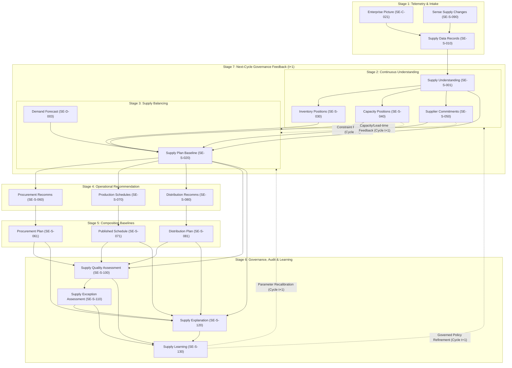
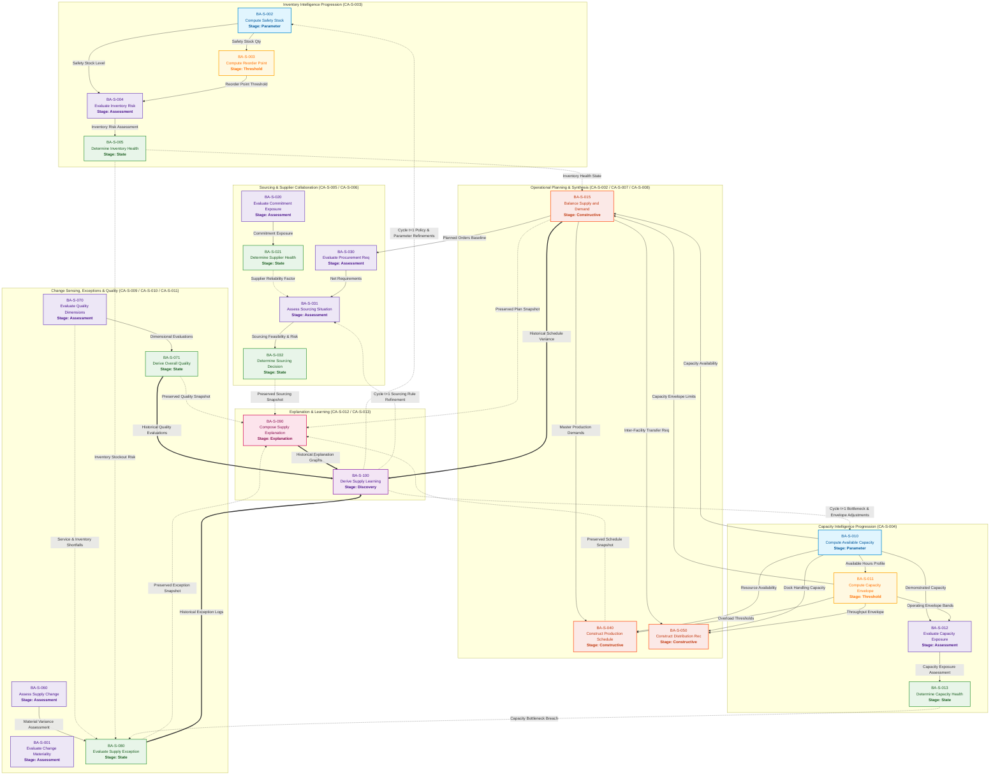

# Supply Intelligence Specification

**Status:** Draft v1.0
**Domain Code:** S
**Governed By:** Specification Meta-Model & Platform Governance (ARS)
**Traceability:** CN-001

# Chapter 1 — Purpose & Scope

## 1.1 Business Purpose

Supply Intelligence is the authoritative enterprise domain responsible for developing trusted understanding of supply capabilities, constraints, and plans. Every inventory policy, capacity decision, procurement recommendation, production schedule, distribution allocation, and supplier collaboration activity originates from and is governed by this specification.

Supply Intelligence consumes trusted demand understanding from Demand Intelligence and transforms it into feasible, optimized, sustainable, and margin-aware supply plans that balance service, cost, risk, and environmental impact. It provides the supply-side foundation upon which order promising, scenario analysis, multi-echelon network optimization, and enterprise learning depend.

## 1.2 Scope

**Included:** Supply picture management, supply planning across horizons, inventory policy and health, capacity modelling and planning, procurement planning, production scheduling, distribution planning, supplier collaboration, supply change sensing, supply quality evaluation, supply exception detection, supply decision explainability, and continuous supply intelligence learning.

**Included (Strategic Additions):** Multi-echelon inventory optimization (MEIO) and decoupling point strategy, supply sustainability and ESG impact assessment, unallocated supply availability projection (ATP/CTP baseline) for order promising, and governed autonomous supply constraint resolution (self-healing).

**Excluded:** Demand forecasting, customer order promising (consumes Supply availability but owns the promise), transportation execution, strategic network design (physical footprint), warehouse execution, and manufacturing execution.

## 1.3 Enterprise Questions

The Supply Intelligence domain answers the following canonical enterprise questions:
1. What supply does the enterprise truly have, and what does the current supply situation mean for planning? *(Understand Supply)*
2. What is the feasible, balanced, and sustainable plan to satisfy demand across the supply network? *(Plan Supply)*
3. What is the current interpreted understanding of inventory position, governed policy, and health across all active item-locations? *(Manage Inventory)*
4. Where should inventory be held across the multi-echelon network to optimize working capital and service? *(Optimize Network Inventory)*
5. What is the current interpreted understanding of resource capacity, constraints, bottlenecks, risk, and health? *(Manage Capacity)*
6. What are the current supplier commitments, and what is the health of supplier collaboration? *(Collaborate with Suppliers)*
7. What procurement actions should the enterprise take to satisfy supply requirements, and what is the authoritative procurement baseline? *(Procure Materials)*
8. What are the executable, sequenced, time-phased production schedules that realise the supply plan within operational constraints? *(Schedule Production)*
9. What are the distribution movements required to position supply across the network, and what is the authoritative distribution baseline? *(Manage Distribution)*
10. What has changed in the supply ecosystem that the enterprise now understands to be true? *(Sense Supply Changes)*
11. How well is the enterprise supply system performing against its objectives? *(Evaluate Supply Quality)*
12. What situations in the supply ecosystem require enterprise attention because they violate governed policies or create unacceptable risk? *(Detect Supply Exceptions)*
13. What minor supply disruptions can be resolved autonomously within governed financial and operational guardrails? *(Resolve Supply Constraint)*
14. Why did the enterprise reach, or deliberately not reach, this supply conclusion, and what evidence, decisions, and policies support it? *(Explain Supply Decisions)*
15. What improvements should the enterprise adopt based on observed supply outcomes and recurring patterns? *(Learn From Supply)*
16. What is the unallocated, time-phased supply availability (ATP/CTP) available for order promising? *(Project Supply Availability)*
17. What is the carbon footprint and ESG impact of the proposed or executed supply plan? *(Assess Supply Sustainability)*

## 1.4 Architectural Position

```
Constitution (CN‑001)
       ↓
Architecture Reference Standard (ARS)
       ↓
Enterprise Semantic Model (SE‑C‑xxx)
       ↓
Supply Domain Semantic Model (SE‑S‑xxx)
       ↓
Supply Capability Model (CA‑S‑xxx)
       ↓
Supply Decision, Rule, Policy, Functional Specification, and Algorithm Models
       ↓
Implementation & Telemetry
```

## 1.5 Out of Scope & Prohibitions

Per ARS §18.3, this chapter shall not contain semantic definitions, behaviors, rules, policies, or workflows. Those belong exclusively to Chapters 4 through 10.

---

# Chapter 2 — Business Objectives

## 2.1 Purpose

Defines what business outcomes the Supply Intelligence domain is responsible for achieving. It translates constitutional mandates and enterprise goals into measurable supply chain outcomes, establishing the business responsibilities of the domain without prescribing implementation, algorithms, or workflows.

## 2.2 Business Objectives Catalog

| ID | Business Objective | Primary Constitutional Traceability |
|----|--------------------|-------------------------------------|
| **BO-S-001** | Deliver Trusted Supply Understanding | CN-003, CN-004, CN-006 |
| **BO-S-002** | Optimize Inventory Performance | CN-002, CN-012 |
| **BO-S-003** | Maximize Capacity Utilization and Flexibility | CN-002, CN-012 |
| **BO-S-004** | Ensure Supply Continuity and Resilience | CN-002, CN-006, CN-011 |
| **BO-S-005** | Minimize Total Delivered Cost | CN-002, CN-012 |
| **BO-S-006** | Improve Supplier Collaboration and Reliability | CN-006, CN-011 |
| **BO-S-007** | Increase Planning Automation, Stability, and Execution Adherence | CN-002, CN-007 |
| **BO-S-008** | Ensure Explainability and Governance of Supply Decisions | CN-005, CN-006, CN-008, CN-009 |
| **BO-S-009** | Optimize Network Positioning and Distribution | CN-002, CN-003 |
| **BO-S-010** | Continuously Improve Supply Intelligence | CN-002, CN-012 |

## 2.3 Business Objective Specifications

### BO-S-001 — Deliver Trusted Supply Understanding
* **Business Objective:** Establish and maintain a single, governed, and continuously current interpretation of supply health, risk, and constraints across the enterprise.
* **Enterprise Outcomes:** Downstream planning and execution capabilities operate from a unified, authoritative baseline rather than fragmented data. Supply exceptions are sensed and contextualized early.
* **Success Criteria:** Measured by Supply Data Acceptance Rate, Supply Understanding Publication Latency, and Supply Change Detection Accuracy.
* **Business Responsibilities:** Ingest and evaluate heterogeneous supply signals. Maintain the authoritative Supply Understanding. Sense and assess supply changes continuously.
* **Traceability:** CN-003 (Single Source of Truth), CN-004 (Single Semantic Ownership), CN-006 (Architectural Traceability).

### BO-S-002 — Optimize Inventory Performance
* **Business Objective:** Balance inventory investment against service level targets, minimizing excess, obsolete, and stockout exposures while adhering to governed inventory policies.
* **Enterprise Outcomes:** Working capital is optimized. Customer service levels are protected. Inventory health is continuously monitored, and policy deviations are governed.
* **Success Criteria:** Measured by Inventory Turnover (PI-S-002), Days of Supply (PI-S-003), and Excess & Obsolete Inventory (PI-S-013).
* **Business Responsibilities:** Maintain continuous inventory position assessments. Govern inventory policy assignments. Publish periodic inventory health assessments for management oversight.
* **Traceability:** CN-002 (Determinism), CN-012 (Testability & Validation).

### BO-S-003 — Maximize Capacity Utilization and Flexibility
* **Business Objective:** Ensure production resources are utilized efficiently within their governed operating envelopes while maintaining the flexibility to absorb variability and prevent bottlenecks.
* **Enterprise Outcomes:** Capacity constraints are identified proactively. Capital expenditure is optimized. Production schedules are feasible and stable.
* **Success Criteria:** Measured by Capacity Utilization (PI-S-005) and Capacity Health Assessment stability metrics.
* **Business Responsibilities:** Maintain continuous capacity position assessments. Evaluate capacity constraints and flexibility. Publish periodic capacity health assessments.
* **Traceability:** CN-002 (Determinism), CN-012 (Testability & Validation).

### BO-S-004 — Ensure Supply Continuity and Resilience
* **Business Objective:** Protect the enterprise from supply disruptions by proactively identifying risks, managing supplier commitments, and maintaining feasible supply plans.
* **Enterprise Outcomes:** Supply disruptions are mitigated. Customer orders are fulfilled despite upstream volatility. Inbound supply is reliable.
* **Success Criteria:** Measured by Fill Rate (PI-S-004), Stockout Frequency (PI-S-012), and Supplier On-Time Delivery (PI-S-007).
* **Business Responsibilities:** Collaborate with suppliers to secure commitments. Sense supply disruptions. Detect and escalate supply exceptions.
* **Traceability:** CN-002 (Determinism), CN-006 (Architectural Traceability), CN-011 (Human Accountability & Override).

### BO-S-005 — Minimize Total Delivered Cost
* **Business Objective:** Optimize the cost of procurement, production, inventory holding, and distribution while satisfying demand and service levels.
* **Enterprise Outcomes:** Improved gross margins. Efficient use of transportation and production resources. Working capital efficiency.
* **Success Criteria:** Measured by Total Supply Chain Cost (PI-S-008) and Cash-to-Cash Cycle Time (PI-S-015).
* **Business Responsibilities:** Generate cost-aware supply plans. Optimize distribution network positioning. Create governed procurement and distribution recommendations.
* **Traceability:** CN-002 (Determinism), CN-012 (Testability & Validation).

### BO-S-006 — Improve Supplier Collaboration and Reliability
* **Business Objective:** Establish transparent, bidirectional planning relationships with suppliers to improve commitment accuracy, responsiveness, and risk visibility.
* **Enterprise Outcomes:** Reduced supply variability. Higher confidence in inbound supply. Proactive supplier development and risk mitigation.
* **Success Criteria:** Measured by Supplier On-Time Delivery (PI-S-007) and Supplier Collaboration Health Assessment ratings.
* **Business Responsibilities:** Maintain supplier commitments. Assess supplier commitment posture. Publish supplier collaboration health assessments.
* **Traceability:** CN-006 (Architectural Traceability), CN-011 (Human Accountability & Override).

### BO-S-007 — Increase Planning Automation, Stability, and Execution Adherence
* **Business Objective:** Maximize the proportion of supply plans, schedules, and procurement decisions that are system-generated, stable, and adhered to during execution.
* **Enterprise Outcomes:** Reduced planner manual intervention. Predictable execution. Higher trust in system recommendations and automated governance.
* **Success Criteria:** Measured by Schedule Adherence (PI-S-006), Supply Plan Adherence (PI-S-010), and automated publication rates.
* **Business Responsibilities:** Produce feasible supply plans. Sequence production schedules. Evaluate supply quality and plan adherence.
* **Traceability:** CN-002 (Determinism), CN-007 (Governance Before Automation).

### BO-S-008 — Ensure Explainability and Governance of Supply Decisions
* **Business Objective:** Guarantee that every significant supply planning decision, recommendation, and exception is fully traceable, explainable, and governed by enterprise policy.
* **Enterprise Outcomes:** Planners and auditors can confidently defend supply decisions. AI and human oversight are aligned. Opaque business outcomes are eliminated.
* **Success Criteria:** 100% of published plans and recommendations carry preserved decision evidence. Explainability requests fulfilled deterministically.
* **Business Responsibilities:** Record immutable supply explanations. Enforce policy precedence. Maintain decision provenance for all aggregate behaviors and algorithms.
* **Traceability:** CN-005 (Explainability), CN-006 (Architectural Traceability), CN-008 (Decision Provenance), CN-009 (Rule Transparency).

### BO-S-009 — Optimize Network Positioning and Distribution
* **Business Objective:** Determine the most effective movement of goods across the enterprise network to balance inventory, meet demand, and minimize transit constraints.
* **Enterprise Outcomes:** Optimized lane utilization. Reduced network imbalances. Synchronized inbound and outbound flows.
* **Success Criteria:** Measured by Distribution Plan adherence, lane utilization metrics, and network balance scores.
* **Business Responsibilities:** Create distribution recommendations. Publish distribution plans. Assess distribution feasibility and allocation outcomes when supply is constrained.
* **Traceability:** CN-002 (Determinism), CN-003 (Single Source of Truth).

### BO-S-010 — Continuously Improve Supply Intelligence
* **Business Objective:** Systematically discover recurring supply patterns, policy violations, and performance trends to refine future planning governance, parameters, and models.
* **Enterprise Outcomes:** Planning policies evolve based on evidence. Systemic root causes are addressed. The enterprise learns from its own execution history.
* **Success Criteria:** Measured by the adoption rate of accepted Supply Learnings and the reduction in recurring exception types.
* **Business Responsibilities:** Evaluate supply quality. Detect exceptions. Record, govern, and publish supply learnings for subsequent planning cycles.
* **Traceability:** CN-002 (Determinism), CN-012 (Testability & Validation).

---

# Chapter 3 – Enterprise Measurement Model

Every Performance Indicator in this chapter is a governed instance of **SE‑C‑036 – Performance Indicator**. The measured values computed and published by the Owning Capability are **Knowledge Artifacts** (KA‑xxx) following the ARS §3.3 minimum interface. Concrete threshold values do not appear in the PI definitions; they are owned by the referenced policies.

## Measure Taxonomy

| Category | Description | Indicators |
|----------|-------------|------------|
| **Efficiency** | Resource utilisation and productivity | PI‑S‑002, PI‑S‑003, PI‑S‑005, PI‑S‑015 |
| **Service** | Ability to meet demand and commitments | PI‑S‑004, PI‑S‑011, PI‑S‑012 |
| **Adherence** | Plan vs. actual execution | PI‑S‑006, PI‑S‑007, PI‑S‑010 |
| **Financial** | Cost and working capital performance | PI‑S‑008, PI‑S‑013 |

## PI Specification Standard

Each Performance Indicator follows this canonical structure:

1. **Enterprise Measure Definition** – Identifier, Name, Category, Nature, Owning Capability, Governed By, Enterprise Question, Business Objectives Served.
2. **Enterprise Meaning** – What enterprise knowledge this measure represents.
3. **Measurement Model** – Measure type, behaviour, context, scope, validity.
4. **Measurement Inputs** – Semantic Dependencies table mapping every variable to its authoritative source.
5. **Calculation Model** – Formula, assumptions, precision.
6. **Publication Model** – What Knowledge Artifact (KA‑xxx) is produced, its contents, and the publication contract.
7. **Interpretation Governance** – Reference to the policy that defines thresholds; no concrete thresholds appear here.
8. **Consumers** – Decisions, algorithms, assessments, and dashboards that consume the measured values.
9. **Explainability** – How every published measurement is traceable to its inputs.
10. **Traceability** – Owning capability, governing policy, consumed objects, produced artifact, and consumers.

### PI‑S‑002 — Inventory Turnover

#### 1. Enterprise Measure Definition

| Attribute | Value |
|-----------|-------|
| Identifier | PI‑S‑002 |
| Name | Inventory Turnover |
| Measure Category | Enterprise Efficiency Measure |
| Measure Nature | Historical Derived Measure |
| Owning Capability | Manage Inventory (CA‑S‑003) |
| Governed By | PO‑S‑032 – Inventory Health Policy |
| Enterprise Question | How efficiently is enterprise inventory being converted into consumed supply over the evaluation period? |
| Business Objectives Served | BO‑S‑002, BO‑S‑005 |

#### 2. Enterprise Meaning

Inventory Turnover represents the enterprise’s understanding of how effectively inventory investment is being converted into operational consumption. It is not a financial metric; it is enterprise knowledge describing inventory efficiency. The measure does not determine whether performance is good or bad; it publishes the observed knowledge. Different consumers may interpret the same turnover value differently depending on planning strategy, industry, and policy.

#### 3. Measurement Model

| Attribute | Value |
|-----------|-------|
| Measure Type | Historical Derived |
| Measure Behaviour | Periodic |
| Measure Context | Historical |
| Measure Scope | Planning Scope, Planning Horizon, Enterprise, Business Unit, Location, SKU |
| Validity | Valid only for the evaluation period. Once published, it represents the enterprise’s understanding for that period. |

#### 4. Measurement Inputs

| Variable | Enterprise Source | Resolution Status |
|----------|-------------------|-------------------|
| Cost of Goods Sold (COGS) | External – Financial System | Resolved – external source. |
| Average Inventory Value | Inventory (SE‑C‑015) on‑hand quantity × unit cost (external financial data). | Resolved – composite derivation. |

#### 5. Calculation Model

**Formula:**
```
Inventory Turnover = COGS ÷ Average Inventory Value
```

**Calculation Assumptions:**
- COGS and inventory valuations use the same costing method.
- Annualization of short periods assumes relative stability (no extreme seasonality).
- Average Inventory Value is computed as (Beginning + Ending) ÷ 2 or average of monthly values.

**Calculation Precision:** One decimal place.  
**Unit:** Turns per year.

#### 6. Publication Model

| Attribute | Value |
|-----------|-------|
| Produces | Inventory Turnover Measurement (KA‑S‑006) |
| Contents | Measure Identifier, Value, Unit, Calculation Context, Validity Period, Evidence References, Calculation Timestamp, Owning Capability |
| Publication Trigger | Scheduled (monthly, quarterly, annually) |
| Publication Pattern | Periodic |

#### 7. Interpretation Governance

Interpretation of measured values (Excellent, Good, Warning, Critical) is governed by **PO‑S‑032 – Inventory Health Policy**. The policy defines the thresholds applicable per industry, Planning Scope, and segmentation class. The measure definition does not embed thresholds.

#### 8. Consumers

| Consumer | How the Measure Is Used |
|----------|-------------------------|
| Inventory Health Assessment (SE‑S‑032) | Consumed as an efficiency dimension for health classification. |
| Evaluate Supply Quality (CA‑S‑010) | Consumed for supply quality evaluation. |
| Dashboards and Executive Reporting | Displayed for management oversight. |
| Learn From Supply (CA‑S‑013) | Analysed for trend patterns and improvement opportunities. |

#### 9. Explainability

Every published Inventory Turnover Measurement is traceable to:
- The COGS value used (source: financial system).
- The inventory values used (source: SE‑C‑015 and unit cost data).
- The calculation methodology (this definition).
- The publication timestamp and evaluation period.

#### 10. Traceability

| Attribute | Value |
|-----------|-------|
| Owned By | Manage Inventory (CA‑S‑003) |
| Governed By | PO‑S‑032 |
| Consumes | SE‑C‑015, External Financial Facts |
| Produces | KA‑S‑006 – Inventory Turnover Measurement |
| Used By | SE‑S‑032, CA‑S‑010, CA‑S‑013, Dashboards |

---

### PI‑S‑003 — Days of Supply

#### 1. Enterprise Measure Definition

| Attribute | Value |
|-----------|-------|
| Identifier | PI‑S‑003 |
| Name | Days of Supply |
| Measure Category | Enterprise Efficiency Measure |
| Measure Nature | Historical Derived Measure |
| Owning Capability | Manage Inventory (CA‑S‑003) |
| Governed By | PO‑S‑032 – Inventory Health Policy |
| Enterprise Question | How many days will the current inventory last given the average daily demand? |
| Business Objectives Served | BO‑S‑002, BO‑S‑004 |

#### 2. Enterprise Meaning

Days of Supply represents the enterprise’s understanding of inventory coverage expressed in time units. It translates a stock quantity into the language of planning: how long until the stock runs out. It does not assess whether the coverage is adequate; that interpretation is governed by policy.

#### 3. Measurement Model

| Attribute | Value |
|-----------|-------|
| Measure Type | Historical Derived |
| Measure Behaviour | Periodic |
| Measure Context | Current snapshot (with demand averaged over a governed lookback) |
| Measure Scope | Planning Scope, Enterprise, Business Unit, Location, SKU |
| Validity | Valid at the time of calculation. Recalculated upon inventory or demand changes. |

#### 4. Measurement Inputs

| Variable | Enterprise Source | Resolution Status |
|----------|-------------------|-------------------|
| Current On‑Hand Inventory | Inventory (SE‑C‑015) | Resolved – SE‑C‑015. |
| Average Daily Demand | Demand Forecast (Demand Intelligence, via SE‑C‑013) | Resolved – external domain. |

#### 5. Calculation Model

**Formula:**
```
Days of Supply = Current On‑Hand Inventory ÷ Average Daily Demand
```

**Calculation Assumptions:**
- Average Daily Demand is computed over a governed lookback period defined in PO‑S‑032.
- Demand data is representative of the current planning context.

**Calculation Precision:** One decimal place.  
**Unit:** Days.

#### 6. Publication Model

| Attribute | Value |
|-----------|-------|
| Produces | Days of Supply Measurement (KA‑S‑007) |
| Contents | Measure Identifier, Value, Unit, Calculation Context, Validity Period, Evidence References, Calculation Timestamp, Owning Capability |
| Publication Trigger | Periodic (weekly, monthly) or on‑demand |
| Publication Pattern | Periodic |

#### 7. Interpretation Governance

Interpretation is governed by **PO‑S‑032**, which defines the minimum and maximum coverage thresholds per segmentation class.

#### 8. Consumers

| Consumer | How the Measure Is Used |
|----------|-------------------------|
| Inventory Position Assessment (SE‑S‑030) | Consumed for coverage status determination (DE‑S‑021). |
| Evaluate Supply Quality (CA‑S‑010) | Consumed for inventory efficiency evaluation. |
| Dashboards | Displayed for operational monitoring. |

#### 9. Explainability

Every published Days of Supply Measurement is traceable to the specific inventory quantity and demand value used.

#### 10. Traceability

| Attribute | Value |
|-----------|-------|
| Owned By | Manage Inventory (CA‑S‑003) |
| Governed By | PO‑S‑032 |
| Consumes | SE‑C‑015, SE‑C‑013 |
| Produces | KA‑S‑007 – Days of Supply Measurement |
| Used By | SE‑S‑030, CA‑S‑010, Dashboards |

---

### PI‑S‑004 — Fill Rate (Supply)

#### 1. Enterprise Measure Definition

| Attribute | Value |
|-----------|-------|
| Identifier | PI‑S‑004 |
| Name | Fill Rate (Supply) |
| Measure Category | Enterprise Service Measure |
| Measure Nature | Historical Derived Measure |
| Owning Capability | Evaluate Supply Quality (CA‑S‑010) |
| Governed By | PO‑S‑110 – Supply Quality Policy |
| Enterprise Question | What percentage of demand quantity is fulfilled on the requested date from available supply? |
| Business Objectives Served | BO‑S‑001, BO‑S‑002, BO‑S‑004 |

#### 2. Enterprise Meaning

Fill Rate represents the enterprise’s ability to meet demand directly from supply without backorders or delays. It measures the effectiveness of the supply system in satisfying customer needs at the moment they are expressed. It does not differentiate between partial fulfilment and late fulfilment; those are measured separately.

#### 3. Measurement Model

| Attribute | Value |
|-----------|-------|
| Measure Type | Historical Derived |
| Measure Behaviour | Periodic |
| Measure Context | Historical (actuals) |
| Measure Scope | Planning Scope, Enterprise, Business Unit, Customer, Location, SKU |
| Validity | Valid for the evaluation period. |

#### 4. Measurement Inputs

| Variable | Enterprise Source | Resolution Status |
|----------|-------------------|-------------------|
| Quantity Fulfilled on Requested Date | Supply Plan adherence (SE‑S‑020), Order fulfilment (SE‑C‑016, SE‑C‑017) | Resolved – SE‑S‑020, SE‑C‑016, SE‑C‑017. |
| Total Quantity Requested | Demand (SE‑C‑013) | Resolved – SE‑C‑013. |

#### 5. Calculation Model

**Formula:**
```
Fill Rate = (Quantity Fulfilled on Requested Date ÷ Total Quantity Requested) × 100
```

**Calculation Assumptions:** Partial fulfilment is recorded accurately. Demand data is complete.

**Calculation Precision:** One decimal place.  
**Unit:** Percentage.

#### 6. Publication Model

| Attribute | Value |
|-----------|-------|
| Produces | Fill Rate Measurement (KA‑S‑008) |
| Contents | Measure Identifier, Value, Unit, Calculation Context, Validity Period, Evidence References, Calculation Timestamp, Owning Capability |
| Publication Trigger | Scheduled (weekly, monthly, quarterly) |
| Publication Pattern | Periodic |

#### 7. Interpretation Governance

Interpretation is governed by **PO‑S‑110**, which defines service level and fill rate thresholds.

#### 8. Consumers

| Consumer | How the Measure Is Used |
|----------|-------------------------|
| Supply Quality Assessment (SE‑S‑100) | Consumed as the Service dimension. |
| Dashboards | Displayed for operational and management oversight. |
| Learn From Supply (CA‑S‑013) | Analysed for trend patterns. |

#### 9. Explainability

Every published Fill Rate Measurement is traceable to the specific demand and fulfilment records used.

#### 10. Traceability

| Attribute | Value |
|-----------|-------|
| Owned By | Evaluate Supply Quality (CA‑S‑010) |
| Governed By | PO‑S‑110 |
| Consumes | SE‑S‑020, SE‑C‑016, SE‑C‑017, SE‑C‑013 |
| Produces | KA‑S‑008 – Fill Rate Measurement |
| Used By | SE‑S‑100, CA‑S‑013, Dashboards |

---

### PI‑S‑005 — Capacity Utilization

#### 1. Enterprise Measure Definition

| Attribute | Value |
|-----------|-------|
| Identifier | PI‑S‑005 |
| Name | Capacity Utilization |
| Measure Category | Enterprise Efficiency Measure |
| Measure Nature | Historical Derived Measure |
| Owning Capability | Manage Capacity (CA‑S‑004) |
| Governed By | PO‑S‑050 – Capacity Management Policy |
| Enterprise Question | What percentage of available capacity is actually used for production during the evaluation period? |
| Business Objectives Served | BO‑S‑003, BO‑S‑005 |

#### 2. Enterprise Meaning

Capacity Utilization represents the enterprise’s understanding of how effectively it is using its production resources. It compares actual output against the governed available capacity. It does not assess whether the utilization level is healthy; that interpretation is governed by policy.

#### 3. Measurement Model

| Attribute | Value |
|-----------|-------|
| Measure Type | Historical Derived |
| Measure Behaviour | Periodic |
| Measure Context | Historical (actuals vs. available capacity) |
| Measure Scope | Resource, Resource Group, Location, Business Unit |
| Validity | Valid for the evaluation period. |

#### 4. Measurement Inputs

| Variable | Enterprise Source | Resolution Status |
|----------|-------------------|-------------------|
| Actual Output | Production confirmation data (external execution system, or SE‑S‑070 planned output). | Resolved – external execution data. |
| Available Capacity | Capacity Position Assessment (SE‑S‑040), computed by BA‑S‑010. | Resolved – SE‑S‑040. |

#### 5. Calculation Model

**Formula:**
```
Capacity Utilization = (Actual Output ÷ Available Capacity) × 100
```

**Calculation Assumptions:** Available Capacity is correctly computed per BA‑S‑010. Actual output is accurately recorded.

**Calculation Precision:** One decimal place.  
**Unit:** Percentage.

#### 6. Publication Model

| Attribute | Value |
|-----------|-------|
| Produces | Capacity Utilization Measurement (KA‑S‑009) |
| Contents | Measure Identifier, Value, Unit, Calculation Context, Validity Period, Evidence References, Calculation Timestamp, Owning Capability |
| Publication Trigger | Periodic (weekly, monthly) |
| Publication Pattern | Periodic |

#### 7. Interpretation Governance

Interpretation is governed by **PO‑S‑050**, which defines the Target Operating Range and utilization thresholds.

#### 8. Consumers

| Consumer | How the Measure Is Used |
|----------|-------------------------|
| Capacity Position Assessment (SE‑S‑040) | Consumed for utilization status determination (DE‑S‑031). |
| Supply Quality Assessment (SE‑S‑100) | Consumed as the Capacity dimension. |
| Dashboards | Displayed for operational monitoring. |

#### 9. Explainability

Every published Capacity Utilization Measurement is traceable to the actual output and available capacity values used.

#### 10. Traceability

| Attribute | Value |
|-----------|-------|
| Owned By | Manage Capacity (CA‑S‑004) |
| Governed By | PO‑S‑050 |
| Consumes | SE‑S‑040, External Production Data |
| Produces | KA‑S‑009 – Capacity Utilization Measurement |
| Used By | SE‑S‑040, SE‑S‑100, Dashboards |

---

### PI‑S‑006 — Schedule Adherence

#### 1. Enterprise Measure Definition

| Attribute | Value |
|-----------|-------|
| Identifier | PI‑S‑006 |
| Name | Schedule Adherence |
| Measure Category | Enterprise Adherence Measure |
| Measure Nature | Historical Derived Measure |
| Owning Capability | Schedule Production (CA‑S‑007) |
| Governed By | PO‑S‑080 – Scheduling Policy |
| Enterprise Question | How closely does actual production follow the published production schedule? |
| Business Objectives Served | BO‑S‑003, BO‑S‑007 |

#### 2. Enterprise Meaning

Schedule Adherence represents the enterprise’s understanding of execution discipline. It compares what was scheduled against what was executed. High adherence indicates a stable, predictable production environment. Low adherence may indicate planning instability or execution issues.

#### 3. Measurement Model

| Attribute | Value |
|-----------|-------|
| Measure Type | Historical Derived |
| Measure Behaviour | Periodic |
| Measure Context | Historical (actuals vs. baseline schedule) |
| Measure Scope | Resource, Resource Group, Product, Location |
| Validity | Valid for the evaluation period. |

#### 4. Measurement Inputs

| Variable | Enterprise Source | Resolution Status |
|----------|-------------------|-------------------|
| Scheduled Activities | Production Schedule (SE‑S‑070) – the published baseline. | Resolved – SE‑S‑070. |
| Actual Completion Times | Production execution data (external or recorded in SE‑S‑070). | Resolved – external execution data. |

#### 5. Calculation Model

**Formula:**
```
Schedule Adherence = (Number of Activities Completed as Scheduled ÷ Total Number of Scheduled Activities) × 100
```

**Calculation Assumptions:** An activity is considered "as scheduled" if it starts and ends within the tolerance defined by PO‑S‑080.

**Calculation Precision:** One decimal place.  
**Unit:** Percentage.

#### 6. Publication Model

| Attribute | Value |
|-----------|-------|
| Produces | Schedule Adherence Measurement (KA‑S‑010) |
| Contents | Measure Identifier, Value, Unit, Calculation Context, Validity Period, Evidence References, Calculation Timestamp, Owning Capability |
| Publication Trigger | Periodic (daily, weekly, monthly) |
| Publication Pattern | Periodic |

#### 7. Interpretation Governance

Interpretation is governed by **PO‑S‑080**, which defines adherence thresholds and tolerance windows.

#### 8. Consumers

| Consumer | How the Measure Is Used |
|----------|-------------------------|
| Production Schedule (SE‑S‑070) | Consumed for schedule quality assessment. |
| Supply Quality Assessment (SE‑S‑100) | Consumed for scheduling effectiveness evaluation. |
| Dashboards | Displayed for operational monitoring. |

#### 9. Explainability

Every published Schedule Adherence Measurement is traceable to the specific scheduled activities and actual completion times used.

#### 10. Traceability

| Attribute | Value |
|-----------|-------|
| Owned By | Schedule Production (CA‑S‑007) |
| Governed By | PO‑S‑080 |
| Consumes | SE‑S‑070, External Production Execution Data |
| Produces | KA‑S‑010 – Schedule Adherence Measurement |
| Used By | SE‑S‑070, SE‑S‑100, Dashboards |

---

### PI‑S‑007 — Supplier On‑Time Delivery

#### 1. Enterprise Measure Definition

| Attribute | Value |
|-----------|-------|
| Identifier | PI‑S‑007 |
| Name | Supplier On‑Time Delivery |
| Measure Category | Enterprise Adherence Measure |
| Measure Nature | Historical Derived Measure |
| Owning Capability | Evaluate Supply Quality (CA‑S‑010) |
| Governed By | PO‑S‑060 – Supplier Collaboration Policy |
| Enterprise Question | What percentage of supplier deliveries arrive on or before the committed delivery date? |
| Business Objectives Served | BO‑S‑004, BO‑S‑006 |

#### 2. Enterprise Meaning

Supplier On‑Time Delivery represents the enterprise’s understanding of supplier reliability. It compares actual receipt dates against committed delivery dates. High performance indicates trustworthy supplier relationships; low performance signals supply continuity risk.

#### 3. Measurement Model

| Attribute | Value |
|-----------|-------|
| Measure Type | Historical Derived |
| Measure Behaviour | Periodic |
| Measure Context | Historical (actuals vs. commitments) |
| Measure Scope | Supplier, Supplier Category, Item, Location, Business Unit |
| Validity | Valid for the evaluation period. |

#### 4. Measurement Inputs

| Variable | Enterprise Source | Resolution Status |
|----------|-------------------|-------------------|
| Committed Delivery Dates | Supplier Commitments (SE‑S‑050). | Resolved – SE‑S‑050. |
| Actual Receipt Dates | Goods receipt records (external execution data). | Resolved – external data. |

#### 5. Calculation Model

**Formula:**
```
Supplier On‑Time Delivery = (Number of On‑Time Deliveries ÷ Total Number of Deliveries) × 100
```

**Calculation Assumptions:** A delivery is "on‑time" if the actual receipt date is on or before the committed delivery date. Partial shipments are counted as separate deliveries.

**Calculation Precision:** One decimal place.  
**Unit:** Percentage.

#### 6. Publication Model

| Attribute | Value |
|-----------|-------|
| Produces | Supplier On‑Time Delivery Measurement (KA‑S‑011) |
| Contents | Measure Identifier, Value, Unit, Calculation Context, Validity Period, Evidence References, Calculation Timestamp, Owning Capability |
| Publication Trigger | Periodic (monthly, quarterly) |
| Publication Pattern | Periodic |

#### 7. Interpretation Governance

Interpretation is governed by **PO‑S‑060**, which defines supplier performance thresholds.

#### 8. Consumers

| Consumer | How the Measure Is Used |
|----------|-------------------------|
| Supplier Commitment Assessment (SE‑S‑051) | Consumed for reliability evaluation. |
| Supply Quality Assessment (SE‑S‑100) | Consumed as the Supplier Collaboration dimension. |
| Procure Materials (CA‑S‑006) | Consumed for sourcing decisions. |

#### 9. Explainability

Every published Supplier On‑Time Delivery Measurement is traceable to the specific commitments and receipt records used.

#### 10. Traceability

| Attribute | Value |
|-----------|-------|
| Owned By | Evaluate Supply Quality (CA‑S‑010) |
| Governed By | PO‑S‑060 |
| Consumes | SE‑S‑050, External Receipt Data |
| Produces | KA‑S‑011 – Supplier On‑Time Delivery Measurement |
| Used By | SE‑S‑051, SE‑S‑100, CA‑S‑006 |

---

### PI‑S‑008 — Total Supply Chain Cost

#### 1. Enterprise Measure Definition

| Attribute | Value |
|-----------|-------|
| Identifier | PI‑S‑008 |
| Name | Total Supply Chain Cost |
| Measure Category | Enterprise Financial Measure |
| Measure Nature | Historical Derived Measure |
| Owning Capability | Evaluate Supply Quality (CA‑S‑010) |
| Governed By | PO‑S‑110 – Supply Quality Policy |
| Enterprise Question | What is the total cost of supply chain operations over the evaluation period? |
| Business Objectives Served | BO‑S‑005 |

#### 2. Enterprise Meaning

Total Supply Chain Cost represents the enterprise’s understanding of the financial resources consumed by supply chain operations. It aggregates procurement, production, inventory holding, transportation, and handling costs. It does not assess cost efficiency; that interpretation is governed by policy and budget variance analysis.

#### 3. Measurement Model

| Attribute | Value |
|-----------|-------|
| Measure Type | Historical Derived |
| Measure Behaviour | Periodic |
| Measure Context | Historical (actuals vs. budget) |
| Measure Scope | Enterprise, Business Unit, Location |
| Validity | Valid for the financial period. |

#### 4. Measurement Inputs

| Variable | Enterprise Source | Resolution Status |
|----------|-------------------|-------------------|
| Procurement Cost | Procurement Plan (SE‑S‑061) and external financial actuals. | Resolved – SE‑S‑061 (planned) and external. |
| Production Cost | Production Schedule (SE‑S‑070) and external manufacturing cost data. | Resolved – SE‑S‑070 (planned) and external. |
| Inventory Holding Cost | Inventory (SE‑C‑015) × standard holding cost rate (external). | Resolved – SE‑C‑015 and external rate. |
| Transportation Cost | Distribution Plan (SE‑S‑081) and external freight invoices. | Resolved – SE‑S‑081 (planned) and external. |
| Handling Cost | External warehousing and labor cost data. | Resolved – external data. |

#### 5. Calculation Model

**Formula:**
```
Total Supply Chain Cost = Procurement Cost + Production Cost + Inventory Holding Cost + Transportation Cost + Handling Cost
```

**Calculation Assumptions:** Cost allocation methodologies are consistent. Standard cost rates are maintained.

**Calculation Precision:** Two decimal places.  
**Unit:** Currency (e.g., USD).

#### 6. Publication Model

| Attribute | Value |
|-----------|-------|
| Produces | Total Supply Chain Cost Measurement (KA‑S‑012) |
| Contents | Measure Identifier, Value, Unit, Calculation Context, Validity Period, Evidence References, Calculation Timestamp, Owning Capability |
| Publication Trigger | Scheduled (monthly, quarterly, annually) |
| Publication Pattern | Periodic |

#### 7. Interpretation Governance

Interpretation is governed by **PO‑S‑110**, which defines cost variance thresholds.

#### 8. Consumers

| Consumer | How the Measure Is Used |
|----------|-------------------------|
| Supply Quality Assessment (SE‑S‑100) | Consumed for cost effectiveness evaluation. |
| Dashboards and Executive Reporting | Displayed for management oversight. |
| Learn From Supply (CA‑S‑013) | Analysed for cost trend patterns. |

#### 9. Explainability

Every published Total Supply Chain Cost Measurement is traceable to the specific cost components and source data used.

#### 10. Traceability

| Attribute | Value |
|-----------|-------|
| Owned By | Evaluate Supply Quality (CA‑S‑010) |
| Governed By | PO‑S‑110 |
| Consumes | SE‑S‑061, SE‑S‑070, SE‑C‑015, SE‑S‑081, External Financial Data |
| Produces | KA‑S‑012 – Total Supply Chain Cost Measurement |
| Used By | SE‑S‑100, CA‑S‑013, Dashboards |

---

### PI‑S‑010 — Supply Plan Adherence

#### 1. Enterprise Measure Definition

| Attribute | Value |
|-----------|-------|
| Identifier | PI‑S‑010 |
| Name | Supply Plan Adherence |
| Measure Category | Enterprise Adherence Measure |
| Measure Nature | Historical Derived Measure |
| Owning Capability | Evaluate Supply Quality (CA‑S‑010) |
| Governed By | PO‑S‑110 – Supply Quality Policy |
| Enterprise Question | How closely does actual supply execution follow the published Supply Plan? |
| Business Objectives Served | BO‑S‑001, BO‑S‑007 |

#### 2. Enterprise Meaning

Supply Plan Adherence represents the enterprise’s understanding of planning accuracy and execution discipline. It compares actual quantities against planned quantities. High adherence indicates that the supply plan is a reliable baseline; low adherence signals that either the plan is not executable or execution is deviating significantly.

#### 3. Measurement Model

| Attribute | Value |
|-----------|-------|
| Measure Type | Historical Derived |
| Measure Behaviour | Periodic |
| Measure Context | Historical (actuals vs. published plan) |
| Measure Scope | Planning Scope, Product, Location, Business Unit |
| Validity | Valid for the plan period. |

#### 4. Measurement Inputs

| Variable | Enterprise Source | Resolution Status |
|----------|-------------------|-------------------|
| Planned Quantities | Supply Plan (SE‑S‑020). | Resolved – SE‑S‑020. |
| Actual Quantities | Execution data (production output, receipts, shipments). | Resolved – external execution data. |

#### 5. Calculation Model

**Formula:**
```
Supply Plan Adherence = (1 − |Actual Quantity − Planned Quantity| ÷ Planned Quantity) × 100
```
(per item‑location, then aggregated)

**Calculation Assumptions:** Actual execution data is timely and accurate. Planned quantities are authoritative.

**Calculation Precision:** One decimal place.  
**Unit:** Percentage.

#### 6. Publication Model

| Attribute | Value |
|-----------|-------|
| Produces | Supply Plan Adherence Measurement (KA‑S‑013) |
| Contents | Measure Identifier, Value, Unit, Calculation Context, Validity Period, Evidence References, Calculation Timestamp, Owning Capability |
| Publication Trigger | Periodic (weekly, monthly) |
| Publication Pattern | Periodic |

#### 7. Interpretation Governance

Interpretation is governed by **PO‑S‑110**, which defines adherence thresholds.

#### 8. Consumers

| Consumer | How the Measure Is Used |
|----------|-------------------------|
| Supply Quality Assessment (SE‑S‑100) | Consumed as a planning quality dimension. |
| Dashboards | Displayed for operational monitoring. |
| Learn From Supply (CA‑S‑013) | Analysed for planning accuracy trends. |

#### 9. Explainability

Every published Supply Plan Adherence Measurement is traceable to the specific planned and actual quantities used.

#### 10. Traceability

| Attribute | Value |
|-----------|-------|
| Owned By | Evaluate Supply Quality (CA‑S‑010) |
| Governed By | PO‑S‑110 |
| Consumes | SE‑S‑020, External Execution Data |
| Produces | KA‑S‑013 – Supply Plan Adherence Measurement |
| Used By | SE‑S‑100, CA‑S‑013, Dashboards |

---

### PI‑S‑011 — Backorder Rate

#### 1. Enterprise Measure Definition

| Attribute | Value |
|-----------|-------|
| Identifier | PI‑S‑011 |
| Name | Backorder Rate |
| Measure Category | Enterprise Service Measure |
| Measure Nature | Historical Derived Measure |
| Owning Capability | Evaluate Supply Quality (CA‑S‑010) |
| Governed By | PO‑S‑110 – Supply Quality Policy |
| Enterprise Question | What percentage of demand cannot be fulfilled immediately and is placed on backorder? |
| Business Objectives Served | BO‑S‑002, BO‑S‑004 |

#### 2. Enterprise Meaning

Backorder Rate represents the enterprise’s understanding of its ability to satisfy demand from available supply. A high backorder rate indicates that the supply system is not keeping pace with demand. It complements Fill Rate by focusing specifically on the unfulfilled portion.

#### 3. Measurement Model

| Attribute | Value |
|-----------|-------|
| Measure Type | Historical Derived |
| Measure Behaviour | Periodic |
| Measure Context | Historical (actuals) |
| Measure Scope | Product, Customer, Location, Business Unit |
| Validity | Valid for the evaluation period. |

#### 4. Measurement Inputs

| Variable | Enterprise Source | Resolution Status |
|----------|-------------------|-------------------|
| Backorder Lines | Order (SE‑C‑016) or Commitment (SE‑C‑017) with backorder status. | Resolved – SE‑C‑016, SE‑C‑017. |
| Total Demand Lines | Demand (SE‑C‑013). | Resolved – SE‑C‑013. |

#### 5. Calculation Model

**Formula:**
```
Backorder Rate = (Number of Backorder Lines ÷ Total Demand Lines) × 100
```

**Calculation Assumptions:** Backorder status is accurately recorded. Demand data is complete.

**Calculation Precision:** One decimal place.  
**Unit:** Percentage.

#### 6. Publication Model

| Attribute | Value |
|-----------|-------|
| Produces | Backorder Rate Measurement (KA‑S‑014) |
| Contents | Measure Identifier, Value, Unit, Calculation Context, Validity Period, Evidence References, Calculation Timestamp, Owning Capability |
| Publication Trigger | Periodic (daily, weekly, monthly) |
| Publication Pattern | Periodic |

#### 7. Interpretation Governance

Interpretation is governed by **PO‑S‑110**, which defines service level and backorder thresholds.

#### 8. Consumers

| Consumer | How the Measure Is Used |
|----------|-------------------------|
| Supply Quality Assessment (SE‑S‑100) | Consumed as a service dimension. |
| Dashboards | Displayed for operational monitoring. |

#### 9. Explainability

Every published Backorder Rate Measurement is traceable to the specific demand and backorder records used.

#### 10. Traceability

| Attribute | Value |
|-----------|-------|
| Owned By | Evaluate Supply Quality (CA‑S‑010) |
| Governed By | PO‑S‑110 |
| Consumes | SE‑C‑016, SE‑C‑017, SE‑C‑013 |
| Produces | KA‑S‑014 – Backorder Rate Measurement |
| Used By | SE‑S‑100, Dashboards |

---

### PI‑S‑012 — Stockout Frequency

#### 1. Enterprise Measure Definition

| Attribute | Value |
|-----------|-------|
| Identifier | PI‑S‑012 |
| Name | Stockout Frequency |
| Measure Category | Enterprise Service Measure |
| Measure Nature | Historical Derived Measure |
| Owning Capability | Evaluate Supply Quality (CA‑S‑010) |
| Governed By | PO‑S‑110 – Supply Quality Policy |
| Enterprise Question | How often does the enterprise experience a stockout for a demanded item? |
| Business Objectives Served | BO‑S‑002, BO‑S‑004 |

#### 2. Enterprise Meaning

Stockout Frequency represents the enterprise’s understanding of inventory adequacy. Each stockout event is a failure to meet demand. The measure counts occurrences, not duration or impact. It is a leading indicator of service risk.

#### 3. Measurement Model

| Attribute | Value |
|-----------|-------|
| Measure Type | Historical Derived |
| Measure Behaviour | Periodic |
| Measure Context | Historical (actuals) |
| Measure Scope | Product, Location, Business Unit |
| Validity | Valid for the evaluation period. |

#### 4. Measurement Inputs

| Variable | Enterprise Source | Resolution Status |
|----------|-------------------|-------------------|
| Stockout Events | Inventory Position Assessment (SE‑S‑030) – health status "At Risk" or "Stockout". | Resolved – SE‑S‑030. |

#### 5. Calculation Model

**Formula:**
```
Stockout Frequency = Number of Stockout Events ÷ Number of Evaluation Periods
```

**Calculation Assumptions:** A stockout event is defined as on‑hand inventory reaching zero while demand exists. The evaluation period is governed by PO‑S‑110.

**Calculation Precision:** Integer (event count).  
**Unit:** Events per period.

#### 6. Publication Model

| Attribute | Value |
|-----------|-------|
| Produces | Stockout Frequency Measurement (KA‑S‑015) |
| Contents | Measure Identifier, Value, Unit, Calculation Context, Validity Period, Evidence References, Calculation Timestamp, Owning Capability |
| Publication Trigger | Periodic (monthly, quarterly) |
| Publication Pattern | Periodic |

#### 7. Interpretation Governance

Interpretation is governed by **PO‑S‑110**.

#### 8. Consumers

| Consumer | How the Measure Is Used |
|----------|-------------------------|
| Supply Quality Assessment (SE‑S‑100) | Consumed as a service reliability dimension. |
| Inventory Health Assessment (SE‑S‑032) | Consumed for health classification. |

#### 9. Explainability

Every published Stockout Frequency Measurement is traceable to the specific stockout events and evaluation period used.

#### 10. Traceability

| Attribute | Value |
|-----------|-------|
| Owned By | Evaluate Supply Quality (CA‑S‑010) |
| Governed By | PO‑S‑110 |
| Consumes | SE‑S‑030 |
| Produces | KA‑S‑015 – Stockout Frequency Measurement |
| Used By | SE‑S‑100, SE‑S‑032 |

---

### PI‑S‑013 — Excess & Obsolete Inventory

#### 1. Enterprise Measure Definition

| Attribute | Value |
|-----------|-------|
| Identifier | PI‑S‑013 |
| Name | Excess & Obsolete Inventory |
| Measure Category | Enterprise Financial Measure |
| Measure Nature | Historical Derived Measure |
| Owning Capability | Manage Inventory (CA‑S‑003) |
| Governed By | PO‑S‑032 – Inventory Health Policy |
| Enterprise Question | What is the value or quantity of inventory that exceeds healthy levels or is at risk of obsolescence? |
| Business Objectives Served | BO‑S‑002, BO‑S‑005 |

#### 2. Enterprise Meaning

Excess & Obsolete Inventory represents the enterprise’s understanding of inventory that is not contributing to operational objectives. Excess inventory ties up working capital; obsolete inventory represents a potential write‑off. The measure identifies the magnitude of the problem, not its causes.

#### 3. Measurement Model

| Attribute | Value |
|-----------|-------|
| Measure Type | Historical Derived |
| Measure Behaviour | Periodic |
| Measure Context | Snapshot or period‑end |
| Measure Scope | Product, Product Family, Location, Business Unit |
| Validity | Valid at the measurement point. |

#### 4. Measurement Inputs

| Variable | Enterprise Source | Resolution Status |
|----------|-------------------|-------------------|
| Excess Inventory Quantity | Inventory Health Assessment (SE‑S‑032) – health status "Over‑Stocked". | Resolved – SE‑S‑032. |
| Obsolete Inventory Quantity | Inventory Health Assessment (SE‑S‑032) – health status "Obsolete". | Resolved – SE‑S‑032. |
| Unit Cost | External – Financial System. | Resolved – external source. |

#### 5. Calculation Model

**Formula:**
```
Excess & Obsolete Inventory = (Excess Quantity × Unit Cost) + (Obsolete Quantity × Unit Cost)
```

**Calculation Assumptions:** Health classifications are current. Unit costs are accurate.

**Calculation Precision:** Two decimal places.  
**Unit:** Currency.

#### 6. Publication Model

| Attribute | Value |
|-----------|-------|
| Produces | Excess & Obsolete Inventory Measurement (KA‑S‑016) |
| Contents | Measure Identifier, Value, Unit, Calculation Context, Validity Period, Evidence References, Calculation Timestamp, Owning Capability |
| Publication Trigger | Periodic (monthly, quarterly) |
| Publication Pattern | Periodic |

#### 7. Interpretation Governance

Interpretation is governed by **PO‑S‑032**, which defines excess and obsolescence thresholds.

#### 8. Consumers

| Consumer | How the Measure Is Used |
|----------|-------------------------|
| Inventory Health Assessment (SE‑S‑032) | Consumed for financial exposure summary. |
| Supply Quality Assessment (SE‑S‑100) | Consumed for inventory effectiveness evaluation. |

#### 9. Explainability

Every published Excess & Obsolete Inventory Measurement is traceable to the specific health classifications and unit costs used.

#### 10. Traceability

| Attribute | Value |
|-----------|-------|
| Owned By | Manage Inventory (CA‑S‑003) |
| Governed By | PO‑S‑032 |
| Consumes | SE‑S‑032, External Financial Data |
| Produces | KA‑S‑016 – Excess & Obsolete Inventory Measurement |
| Used By | SE‑S‑032, SE‑S‑100 |

---

### PI‑S‑015 — Cash‑to‑Cash Cycle Time

#### 1. Enterprise Measure Definition

| Attribute | Value |
|-----------|-------|
| Identifier | PI‑S‑015 |
| Name | Cash‑to‑Cash Cycle Time |
| Measure Category | Enterprise Efficiency Measure |
| Measure Nature | Historical Derived Measure |
| Owning Capability | Evaluate Supply Quality (CA‑S‑010) |
| Governed By | PO‑S‑110 – Supply Quality Policy |
| Enterprise Question | How many days elapse between the enterprise paying for raw materials and receiving payment for finished goods? |
| Business Objectives Served | BO‑S‑005 |

#### 2. Enterprise Meaning

Cash‑to‑Cash Cycle Time represents the enterprise’s understanding of working capital efficiency across the supply chain. It measures the time cash is tied up in operations. A shorter cycle indicates more efficient capital utilization.

#### 3. Measurement Model

| Attribute | Value |
|-----------|-------|
| Measure Type | Historical Derived |
| Measure Behaviour | Periodic |
| Measure Context | Historical (financial period) |
| Measure Scope | Enterprise, Business Unit |
| Validity | Valid for the financial period. |

#### 4. Measurement Inputs

| Variable | Enterprise Source | Resolution Status |
|----------|-------------------|-------------------|
| Days Inventory Outstanding (DIO) | Derived from PI‑S‑002 and PI‑S‑003. | Resolved – derived from PI‑S‑002, PI‑S‑003. |
| Days Sales Outstanding (DSO) | External – Financial System. | Resolved – external. |
| Days Payable Outstanding (DPO) | External – Financial System. | Resolved – external. |

#### 5. Calculation Model

**Formula:**
```
Cash‑to‑Cash Cycle Time = DIO + DSO − DPO
```

**Calculation Assumptions:** DIO, DSO, and DPO are computed using consistent averaging methods. Financial data is period‑aligned.

**Calculation Precision:** One decimal place.  
**Unit:** Days.

#### 6. Publication Model

| Attribute | Value |
|-----------|-------|
| Produces | Cash‑to‑Cash Cycle Time Measurement (KA‑S‑017) |
| Contents | Measure Identifier, Value, Unit, Calculation Context, Validity Period, Evidence References, Calculation Timestamp, Owning Capability |
| Publication Trigger | Periodic (quarterly, annually) |
| Publication Pattern | Periodic |

#### 7. Interpretation Governance

Interpretation is governed by **PO‑S‑110**, which defines working capital efficiency thresholds.

#### 8. Consumers

| Consumer | How the Measure Is Used |
|----------|-------------------------|
| Supply Quality Assessment (SE‑S‑100) | Consumed for financial efficiency evaluation. |
| Dashboards and Executive Reporting | Displayed for management oversight. |

#### 9. Explainability

Every published Cash‑to‑Cash Cycle Time Measurement is traceable to the DIO, DSO, and DPO values used.

#### 10. Traceability

| Attribute | Value |
|-----------|-------|
| Owned By | Evaluate Supply Quality (CA‑S‑010) |
| Governed By | PO‑S‑110 |
| Consumes | PI‑S‑002, PI‑S‑003, External Financial Data |
| Produces | KA‑S‑017 – Cash‑to‑Cash Cycle Time Measurement |
| Used By | SE‑S‑100, Dashboards |

---

# Chapter 4 – Supply Domain Semantic Model

## 4.1 Supply Domain Semantic Principles

### 4.1.1 Enterprise Temporal Semantics

| Temporal Dimension | Business Meaning |
|--------------------|------------------|
| Business Time | When an event occurred in enterprise reality (e.g., goods receipt timestamp). |
| Observation Time | When the enterprise received or recorded the supply data. |
| Transaction Time | When an aggregate was created or revised within Supply Intelligence. |
| Publication Time | When an aggregate became authoritative and visible to consumers. |
| Effective Time | The planning period for which supply information is valid. |

### 4.1.2 Cross-Cutting Semantic Concepts

| Term | Definition | Governance Reference |
|------|------------|----------------------|
| Material Change | A change to an enterprise understanding that is significant enough to warrant publication of a new version. Materiality is assessed per knowledge category (inventory, commitments, capacity, orders) against thresholds defined in the relevant Publication Policy. | PO-S-011 (Supply), PO-S-033 (Inventory), PO-S-050 (Capacity), PO-S-070 (Procurement), PO-S-090 (Distribution) |
| Significant Change (sensing) | A deviation from an expected baseline that exceeds the detection threshold for a monitored entity and change type. Distinct from Material Change: a change may be Significant (detected) but not Material (not warranting publication). | PO-S-100 (Supply Change Policy) |
| Confidence | A multi-dimensional assessment of the enterprise’s trust in an assertion. Confidence is never a single number. Dimensions include Statistical Confidence, Evidence Strength, Data Completeness, Data Consistency, Source Reliability, and, where applicable, Intervention Confidence. Each capability declares which dimensions apply to its outputs. | PO-S-110 (Supply Quality Policy) and individual capability policies |
| Feasibility | An assessment of whether a plan, schedule, recommendation, or movement can be executed under current constraints. Feasibility is not binary; it admits Conditionally Feasible (documented constraints) and Infeasible (unresolvable constraints). Each constraint type is assessed independently. | PO-S-050 (Capacity), PO-S-070 (Procurement), PO-S-080 (Scheduling), PO-S-090 (Distribution) |
| Risk | A structured assessment of potential adverse outcomes, expressed as a combination of likelihood and business impact. Risk is a first-class dimension of position assessments, not an afterthought. Risk types are specific to each domain (stockout risk, bottleneck risk, commitment risk, etc.). | PO-S-032 (Inventory Health), PO-S-050 (Capacity), PO-S-060 (Supplier Collaboration) |
| Stability | A measure of how much an enterprise understanding has changed relative to a previous version. Stability is assessed as change count, change magnitude, and a stability score. High instability may indicate planning churn or environmental volatility. | PO-S-022 (Supply Plan), PO-S-080 (Scheduling) |
| Carbon Footprint / ESG Impact | The quantified environmental and social governance impact of a supply plan, production schedule, or distribution recommendation. | PO-S-015 (Supply Sustainability Policy - *Deferred to Policy Model*) |
| Margin / Profitability Impact | The financial margin impact of a supply decision, evaluating trade-offs between cost, service, and revenue. | PO-S-110 |

### 4.1.3 Semantic Object Families

| Family | Pattern | Examples |
|--------|---------|----------|
| Published Enterprise Knowledge | Published Knowledge (ARS App. A.3) | Supply Understanding, Supply Plan, Procurement Plan, Production Schedule Baseline, Distribution Plan, Inventory Health Assessment, Capacity Health Assessment, Supply Quality Assessment |
| Continuously Maintained Assessment | Continuous Assessment (ARS App. A.2) | Inventory Position Assessment, Capacity Position Assessment, Supplier Commitment Assessment, Supply Change Assessment |
| Governed Assignment | Governed Assignment | Inventory Policy Assignment |
| Condition / Exception | Centralized Registry (via Core) | Supply Exception Assessment (Evidence published to Core SE-C-019) |
| Record / Explanation | Explanation / Learning | Supply Explanation, Supply Learning, Supplier Collaboration Record |

### 4.1.4 Object Classification

| ARS Classification | Ontology Nature | Ontology Behavior |
|--------------------|-----------------|-------------------|
| Aggregate Root | Record, Scope, State, Projection, Process | Immutable, Versioned, Derived, Authoritative |
| Entity | (inherits from parent Aggregate) | |
| Value Object | — | Immutable |
| Reference Object | — | (owned externally) |

### 4.1.5 Semantic vs. Behavioral Boundary

Supply Aggregate Behaviors strictly adhere to ARS §5, §6, §7, and §14:
1. Modify exactly one Aggregate Root.
2. Publish Enterprise Events (EV-S-xxx) only.
3. **Never** publish Business Notifications (BN-S-xxx). Business Notifications are published exclusively by Business Workflow Notification Nodes.
4. **Never** mutate Semantic Objects owned by another Capability (e.g., Supply cannot mutate Core SE-C-019 Exception or SE-C-021 Enterprise Picture).
5. Enforce declared Business Rules and consume governed Policy configuration.
6. Invoke Decisions and Business Algorithms by identifier.

### 4.1.6 Semantic Meaning vs. Execution Mechanism
Chapter 4 defines *what* enterprise objects are – their identity, structure, lifecycle states, and invariants. It does not define *how* behaviors execute, how events are sequenced, or how concurrency is coordinated. Those belong to Aggregate Behaviors (documented immediately beneath their owning Aggregate Root), Functional Specifications (Chapter 9), and the Blueprint. If a statement in this chapter describes a mechanism rather than a meaning, it is an architectural defect and must be migrated to the appropriate behavioral specification.

### 4.1.7 Reference Consistency
Historical supply assertions reference Reference Objects as they existed at Observation Time. Subsequent changes to master data (e.g., a Supplier transitioning to Retired) do not retroactively alter historical records.

### 4.1.8 Enterprise Information Flow

```
Supply Transactions (ERP, WMS, MES, Supplier Portals)
        │
        ▼
Supply Data Record (SE‑S‑010) — evaluated, accepted
        │
        ▼
Enterprise Picture (SE‑C‑021) — authoritative snapshot of enterprise supply facts
        │
        ▼
Supply Understanding (SE‑S‑001) — interprets the Enterprise Picture and Supply Change Signals (SE‑S‑090) ──→ Supply Understanding (SE‑S‑001)
        │
        ▼
Consumed by: Plan Supply, Manage Inventory, Manage Capacity,
             Procure Materials, Promise Intelligence, Scenario Intelligence
```


## 4.2 Supply Domain Dependency Declaration

Every Enterprise Semantic Object consumed by the Supply domain is listed below, together with the attributes that Supply capabilities require.

| Enterprise Object | Required Attributes |
|-------------------|---------------------|
| SE-C-001 Item | Identifier, Name, Structural Classification, Item Roles, Unit of Measure, Lifecycle State |
| SE-C-002 Location | Identifier, Name, Location Type, Time Zone, Lifecycle State |
| SE-C-003 Customer | Identifier, Name, Customer Class, Lifecycle State |
| SE-C-004 Supplier | Identifier, Name, Lifecycle State |
| SE-C-005 Resource Group | Identifier, Name, Resource Group Type, Calendar, Lifecycle State |
| SE-C-006 Standard Resource | Identifier, Name, Capability Description, Resource Type, Reference Capacity, Calendar, Lifecycle State |
| SE-C-007 Physical Resource | Identifier, Name, Location, Resource Group, Standard Resource, Calendar, Assigned Capacity, Lifecycle State |
| SE-C-008 Transportation Lane | Identifier, Lane Name, From Location, To Location, Lifecycle State |
| SE-C-009 Network | Identifier, Name, Participating Locations, Participating Lanes, Lifecycle State |
| SE-C-010 Planning Scope | Identifier, Scope Name, Boundary Rules, Lifecycle State |
| SE-C-011 Scenario | Identifier, Scenario Name, Scenario Adjustments, Lifecycle State |
| SE-C-012 Plan | Identifier, Plan Name, Planning Scope, Planning Horizon, Scenario, Lifecycle State |
| SE-C-013 Demand | Identifier, Item, Quantity, Location, Need Window, Demand Origin, Customer, Lifecycle State |
| SE-C-014 Supply | Identifier, Item, Quantity, Location, Availability Window, Supply Provenance Classification, Lifecycle State |
| SE-C-015 Inventory | Item, Location, **Batch Identifier**, On-Hand Quantity, Observation Timestamp |
| SE-C-017 Commitment | Identifier, Obligation Direction, Item, Quantity, Location, Requested Date, Committed Date, Customer, Supplier, Lifecycle State |
| SE-C-018 Bill of Materials | Identifier, Parent Item, Version Number, Effective Date, End Date, BOM Lines, Lifecycle State |
| SE-C-019 Exception | Identifier, Constraint Reference, Exception Classification, Affected Scope Type, Affected Scope Identifier, Evidence Reference, Lifecycle State |
| SE-C-020 Risk | Identifier, Risk Type, Risk Subject, Lifecycle State |
| SE-C-021 Enterprise Picture | Planning Scope Identifier, Versions (Demand, Supply, Inventory references), Lifecycle State |
| SE-C-022 Timestamp | (Entire value) |
| SE-C-023 Quantity | (Entire value) |
| SE-C-024 Duration | (Entire value) |
| SE-C-025 Money | (Entire value) |
| SE-C-026 Capacity | (Entire value) |
| SE-C-027 Planning Horizon | (Entire value) |
| SE-C-028 Temporal Window | (Entire value) |
| SE-C-029 Need Window | (Entire value) |
| SE-C-030 Risk Assessment | (Entire value) |
| SE-C-031 Time Zone | (Entire value) |
| SE-C-032 Unit of Measure | (Entire value) |
| SE-C-033 Calendar | Identifier, Calendar Name, Time Zone, Calendar Definition, Version Number, Adoption State |
| SE-C-034 Planning Period | Identifier, Display Name, Adoption State |
| SE-C-035 Performance Indicator Catalog | Identifier, Version Number, Performance Indicator Definitions, Lifecycle State |
| SE-C-036 Performance Indicator | Identifier, Name, Measure Category, Measure Nature, Formula, Semantic Dependencies |
| SE-C-037 Enterprise Governed Vocabulary | Identifier, Version Number, Vocabulary Entries, Lifecycle State |
| SE-C-038 Scope Boundary Rule | Rule Identifier, Target Semantic Type, Inclusion Indicator, Target Instance Identifiers, Target Category Identifiers |
| SE-C-039 Scenario Adjustment | Adjustment Identifier, Target Semantic Type, Adjustment Type, Adjustment Quantity/Text |
| SE-C-040 Item Transition | Transition Identifier, Superseded Item, Superseding Item, Transition Type, Effective Date, End Date, Lifecycle State |
| SE-D-002 Demand Understanding | Planning Scope Identifier, Versions (Continuity, Pattern, Health, Volatility interpretations) |
| SE-D-003 Forecast Publication | Planning Scope Identifier, Forecast Horizon, Versions (Forecast Lines, Confidence Index) |
| SE-D-005 Planning Classification Assignment | Planning Scope Identifier, Item, Location, ABC Classification, XYZ Classification, Lifecycle State |
| SE-D-018 Demand Intervention Impact | Intervention Impact Identifier, Intervention Reference, Item, Location, Assessed Demand Lift, Lift Confidence, Temporal Validity |

**Inventory Identity Rule:**
`SE-C-015 Inventory` is identified by `Item + Location + Batch Identifier`. Supply Intelligence shall never treat Inventory identity as `Item + Location` alone. All inventory position assessments and policy assignments must account for batch-level granularity or explicitly aggregate batch-level Core Inventories into a domain-specific "Item-Location Position" entity without violating Core identity invariants.

**Exception Lifecycle Rule:**
Supply Intelligence does not mutate `SE-C-019 Exception` directly. Supply Intelligence detects supply exception evidence and publishes it to Core Exception Management (`CA-C-020`) via Business Notifications (`BN-S-101 Supply Exception Detection Evidence` and `BN-S-102 Supply Exception Resolution Evidence`). Core owns the `SE-C-019` lifecycle. Domain-internal exception assessment state changes are tracked via `BN-S-100`.

**No semantic object may be used later in this specification unless declared here.**

---

## 4.3 Supply-Owned Semantic Objects

### 4.3.1 Aggregate Roots

#### SE-S-001 – Supply Understanding

##### Business Intent

Provide exactly one authoritative supply interpretation for a Planning Scope at any point in time, enabling downstream planning capabilities to act on a single, governed view of supply health, risk, and confidence — without duplicating enterprise facts.

##### Enterprise Meaning

The Supply Understanding is the aggregate root that maintains the authoritative version series of supply interpretation for a Planning Scope.

Each version interprets the current supply situation — supply continuity risk, capacity adequacy, inventory exposure, supplier commitment posture, and overall supply risk — by examining the latest Published Enterprise Picture and eligible Supply Change evidence.

The Supply Understanding does not duplicate supply facts. It interprets them.

The Enterprise Picture, owned by the Core domain, remains the authoritative point-in-time snapshot of enterprise supply, demand, and inventory facts. The Supply Understanding is the enterprise’s published interpretation of what those facts mean for supply planning.

The Supply Understanding is not a forecast. It is not a supply plan. It is not an operational execution state. It is the governed interpretation of current supply reality that downstream capabilities use as their interpretive baseline.

##### Published Knowledge

In accordance with ARS Appendix A.3. The Supply Understanding is a versioned, periodically published interpretation. Each Published version is immutable. Each new Published version supersedes the previous Published version for the same Planning Scope.

##### Identity

The aggregate identity of the Supply Understanding is:

```text
Planning Scope Identifier (SE-C-010)
```

Exactly one Supply Understanding aggregate exists for each Planning Scope.

Each version within the aggregate receives a monotonically increasing Version Number, scoped to the Planning Scope. Version Numbers are never reset and never reused.

A specific Supply Understanding version is uniquely identified by:

```text
Planning Scope Identifier + Version Number
```

##### Semantic Ownership

| Ownership Dimension | Value |
|---|---|
| Semantic Authority | Supply Intelligence Domain |
| Steward Domain | Supply Intelligence |
| Mutation Authority | Enterprise-Derived Planning Fact |
| Authoritative Representation | The governed, versioned interpretation of current supply health, risk, and confidence for a Planning Scope. |
| Authority Scope | Per Planning Scope. Exactly one Published version per Planning Scope is authoritative at any moment. |
| Primary Consumers | Plan Supply, Manage Inventory, Manage Capacity, Procure Materials, Schedule Production, Manage Distribution, Promise Intelligence, Scenario Intelligence, Evaluate Supply Quality, Detect Supply Exceptions, Explain Supply Decisions, Learn From Supply. |

##### Authority Specification Contract

| Section | Value |
|---|---|
| Business Owner | Understand Supply, CA-S-001 |
| Authoritative Representation | The enterprise’s governed interpretation of current supply continuity, capacity adequacy, inventory exposure, supplier commitment posture, overall supply risk, and interpretation confidence. |
| Business Responsibility | Interpret the latest Published Enterprise Picture and eligible Supply Change evidence into a coherent Supply Understanding. Publish materially changed versions as the single interpretive source for downstream planning. |
| Authority Scope | Per Planning Scope. |
| Intended Consumers | Plan Supply, Manage Inventory, Manage Capacity, Procure Materials, Schedule Production, Manage Distribution, Promise Intelligence, Scenario Intelligence, Evaluate Supply Quality, Detect Supply Exceptions, Explain Supply Decisions, Learn From Supply. |
| Non-Intended Consumers | Operational execution systems shall not consume the Supply Understanding as an execution instruction. |
| Supersedes | The previous Published version within the same Planning Scope. |
| Superseded By | A newer Published version within the same Planning Scope. |

##### Consumer Specification Contract


| Section | Value |
|---|---|
| Business Guarantees | Exactly one Published Supply Understanding exists per Planning Scope at any moment. A Published version is immutable. All interpretation dimensions are traceable to the Enterprise Picture version, Supply Change evidence, and policy versions used. |
| Required Interpretation | Consumers must treat the Published Supply Understanding as the exclusive interpretive baseline for current supply. The Supply Understanding does not contain raw operational supply data. For actual inventory positions, capacity statuses, supplier commitments, or other enterprise facts, consumers must reference the Enterprise Picture or the assessments produced by downstream capabilities. |
| Known Limitations | The Supply Understanding is a point-in-time interpretation. It does not include demand forecasts, supply plans, procurement recommendations, production schedules, distribution recommendations, or operational execution states. It does not guarantee future supply performance. |
| Declared Consumers | Plan Supply, Manage Inventory, Manage Capacity, Procure Materials, Promise Intelligence, Scenario Intelligence. |
| Consumer Responsibility | Each consumer shall reference the Supply Understanding solely by its immutable aggregate identity and version evidence. Each consumer shall not infer enterprise facts that are not published in the Supply Understanding contract. |
| Required Attributes | Planning Scope Identifier, Version Number, Lifecycle State, Supply Continuity Interpretation, Capacity Adequacy Interpretation, Inventory Position Interpretation, Supplier Commitment Posture Interpretation, Overall Supply Risk, Supply Understanding Confidence, Evidence References, Transaction Time, Publication Time. |
| Authoritative Source | `SE-S-001 Supply Understanding`. |
| Version Expectations | Consumers should subscribe to `BN-S-001 Supply Understanding Published` to be notified of new Published versions. Only the Published version is guaranteed to be consistent. Draft versions are internal and may be incomplete. |
| Freshness Expectations | Updated upon material change in the Enterprise Picture or eligible Supply Change evidence, and published in near-real-time where governed. A periodic refresh may also occur under `PO-S-012`. |


##### Lifecycle Specification Contract

**States**

| State | Description |
|---|---|
| Draft | A new version has been composed. Interpretations have been derived from the latest Published Enterprise Picture and eligible Supply Change evidence. The version is not authoritative. |
| Published | The version has been released as authoritative. The previous Published version, if any, is Superseded. |
| Superseded | The version has been replaced by a newer Published version. It is retained permanently for audit, explainability, and historical traceability. |


Permitted Transitions:

```text
Draft → Published
Published → Superseded
```

Terminal State:

```text
Superseded
```

**Entry Criteria**

| State | Entry Criteria |
|---|---|
| Draft | `AB-S-003 Revise Supply Understanding` has composed a new version. The version contains all mandatory interpretation dimensions, although a dimension may carry an Incomplete flag where evidence is unavailable. |
| Published | `DE-S-002 Publish Supply Understanding` has authorized publication. The version satisfies the materiality requirements of `PO-S-011` and the completeness requirements of `PO-S-011`. |
| Superseded | A newer version for the same Planning Scope has been Published. |

**Exit Criteria**

| State | Exit Criteria |
|---|---|
| Draft | The version may exit Draft only by being Published through `AB-S-005 Publish Supply Understanding`. |
| Published | The version may exit Published only by being Superseded by a newer Published version. |
| Superseded | No exit. Superseded is terminal. |

**State Transition Triggers**

| Transition | Trigger | Responsible Behavior |
|---|---|---|
| None → Draft | Revision triggered by Enterprise Picture publication, eligible Supply Change evidence, or governed periodic refresh. | `AB-S-003 Revise Supply Understanding` |
| Draft → Published | Publication authorized by `DE-S-002 Publish Supply Understanding`. | `AB-S-005 Publish Supply Understanding` |
| Published → Superseded | A newer Draft version is Published for the same Planning Scope. | `AB-S-005 Publish Supply Understanding` |

**Terminal States**

`Superseded` is terminal. Superseded versions are retained permanently.

**History Preservation**

All Supply Understanding versions are retained permanently. No version is deleted. Superseded versions remain immutable and available for audit, explanation, learning, and historical traceability.

**Versioning Rules**

Version Numbers are monotonically increasing within the Planning Scope. Version Numbers are never reset, never reused, and never mutated. A Published version is immutable. A Superseded version is immutable.

##### Information Model


| Category | Information | Mandatory | Immutable | Description |
|---|---|---:|---:|---|
| Identity | Planning Scope Identifier | Yes | Yes | Reference to `SE-C-010 Planning Scope`. This is the aggregate identity. |
| Identity | Version Number | Yes | Yes | Monotonically increasing version number within the Planning Scope. |
| Lifecycle | Lifecycle State | Yes | No | Draft, Published, or Superseded. |
| Supply Continuity Interpretation | Continuity Status | Yes | Yes | Governed identifier reference through `SE-C-037 Enterprise Governed Vocabulary`. Examples include Stable, At Risk, and Disrupted. |
| Supply Continuity Interpretation | Short-Term Disruption Risk | Yes | Yes | Governed identifier reference through `SE-C-037`. |
| Supply Continuity Interpretation | Medium-Term Disruption Risk | Yes | Yes | Governed identifier reference through `SE-C-037`. |
| Supply Continuity Interpretation | Critical Supply Gaps | Yes | Yes | Structured interpretation of critical supply gaps derived from Enterprise Picture facts and eligible Supply Change evidence. |
| Capacity Adequacy Interpretation | Overall Capacity Status | Yes | Yes | Governed identifier reference through `SE-C-037`. Examples include Sufficient, Constrained, and Critical. |
| Capacity Adequacy Interpretation | Bottleneck Resources | Yes | Yes | Interpreted identification of resources that constrain supply capability. |
| Capacity Adequacy Interpretation | Capacity Utilisation Trend | Yes | Yes | Governed interpretation of the direction and significance of capacity utilisation change. |
| Inventory Position Interpretation | Inventory Status | Yes | Yes | Governed identifier reference through `SE-C-037`. Examples include Healthy, At Risk, and Critical. |
| Inventory Position Interpretation | Stockout Exposure | Yes | Yes | Interpreted exposure of inventory positions to stockout conditions. |
| Inventory Position Interpretation | Excess Exposure | Yes | Yes | Interpreted exposure of inventory positions to excess conditions. |
| Supplier Commitment Posture Interpretation | Overall Supplier Confidence | Yes | Yes | Governed identifier reference through `SE-C-037`. Examples include High, Medium, and Low. |
| Supplier Commitment Posture Interpretation | Critical Supplier Dependencies | Yes | Yes | Interpreted identification of supplier dependencies that materially affect supply continuity. |
| Supplier Commitment Posture Interpretation | Supplier Risk Concentration | Yes | Yes | Interpreted concentration of supplier risk across the Planning Scope. |
| Overall Supply Risk | Risk Level | Yes | Yes | Governed identifier reference through `SE-C-037`. Examples include Low, Medium, High, and Critical. |
| Overall Supply Risk | Primary Risk Drivers | Yes | Yes | Business-language identification of the principal causes of overall supply risk. |
| Supply Understanding Confidence | Confidence Level | Yes | Yes | Governed identifier reference through `SE-C-037`. Examples include High, Medium, and Low. |
| Supply Understanding Confidence | Influencing Factors | Yes | Yes | The factors influencing confidence, including evidence completeness, evidence consistency, source reliability, and signal currency. |
| Evidence References | Enterprise Picture Version Reference | Yes | Yes | The Published `SE-C-021 Enterprise Picture` version used as the authoritative factual basis. |
| Evidence References | Supply Change Assessment References | Yes | Yes | The `SE-S-090 Supply Change Assessment` identities used, if any. If no Supply Change evidence was used, the structure shall explicitly record that no eligible evidence was consumed. |
| Evidence References | Policy Versions | Yes | Yes | The versions of `PO-S-011` and `PO-S-012` used. |
| Traceability | Transaction Time | Yes | Yes | The time at which this version was created or revised. |
| Traceability | Publication Time | No for Draft; Yes for Published | Yes once Published | The time at which this version became authoritative. |
| Traceability | Superseded Version Identifier | No for first Published version; Yes otherwise | Yes | The version superseded by this Published version. |


##### Relationships

| Relationship | Target Object | Cardinality | Description |
|---|---|---|---|
| interprets supply reality for | `SE-C-010 Planning Scope` | Many-to-One | Each Supply Understanding version interprets supply reality for exactly one Planning Scope. |
| derived from enterprise picture | `SE-C-021 Enterprise Picture` | Many-to-One | Each version is derived from exactly one Published Enterprise Picture version. |
| informed by supply change evidence | `SE-S-090 Supply Change Assessment` | Many-to-Many | Eligible Supply Change Assessments may inform the interpretation. |
| governed by materiality policy | `PO-S-011 Supply Understanding Materiality Policy` | Many-to-One | Materiality and completeness requirements are governed by policy. |
| governed by publication cadence policy | `PO-S-012 Supply Understanding Publication Cadence Policy` | Many-to-One | Periodic refresh and staleness requirements are governed by policy. |
| consumed by planning capabilities | Plan Supply, Manage Inventory, Manage Capacity, Procure Materials, Promise Intelligence, Scenario Intelligence | Many-to-Many | Declared consumers use the Published Supply Understanding as an interpretive baseline. |

##### Dependencies


| Dependency Type | Description |
|---|---|
| Semantic Dependency | `SE-C-010 Planning Scope` must exist and be active. |
| Semantic Dependency | `SE-C-021 Enterprise Picture` must have a Published version for the Planning Scope. |
| Domain Dependency | `SE-S-090 Supply Change Assessment` may provide eligible supply change evidence. |
| Governance Dependency | `PO-S-011 Supply Understanding Materiality Policy` must be current. |
| Governance Dependency | `PO-S-012 Supply Understanding Publication Cadence Policy` must be current. |
| Vocabulary Dependency | All governed interpretation statuses must resolve through `SE-C-037 Enterprise Governed Vocabulary`. |
| Cross-Domain Notification Dependency | `BN-C-001 Enterprise Picture Published` is consumed as the trigger indicating that a new authoritative Enterprise Picture version exists. The authoritative notification contract is owned by the Core capability responsible for Enterprise Picture publication. |


##### Invariants

1. [BR-S-001] Exactly one Supply Understanding aggregate exists for each Planning Scope.

2. [BR-S-002] Exactly one Published Supply Understanding version exists for each Planning Scope at any moment.

3. [BR-S-003] A Published Supply Understanding version is immutable.

4. [BR-S-004] A Superseded Supply Understanding version is immutable.

5. [BR-S-005] Version Numbers are monotonically increasing within the Planning Scope and are never reused.

6. [BR-S-006] Every interpretation dimension must reference the evidence used to derive it.

7. [BR-S-007] The Supply Understanding does not duplicate raw enterprise facts owned by the Enterprise Picture.

8. [BR-S-008] The Supply Understanding does not create, modify, or supersede Enterprise Picture facts.

9. [BR-S-009] A Draft version may exist only as a candidate for publication.

10. [BR-S-010] A Draft version cannot be consumed as an authoritative planning baseline.

11. [BR-S-011] Publication may occur only when `DE-S-002 Publish Supply Understanding` authorizes publication.

12. [BR-S-012] `BN-S-001 Supply Understanding Published` may be published only by a Business Workflow Notification Node after `EV-S-004 Supply Understanding Published` exists.

13. [BR-S-013] All governed interpretation statuses must resolve to active governed identifier entries in `SE-C-037 Enterprise Governed Vocabulary`.

##### Traceability

| Direction | Reference |
|---|---|
| Upward Constitutional Traceability | CN-003 Single Source of Truth, CN-004 Single Semantic Ownership, CN-005 Explainability, CN-006 Architectural Traceability. |
| Upward ARS Traceability | ARS §3 Semantic Model Architecture, ARS §4 Business Intent, ARS §5 Aggregate Behavior Contract, ARS §14 Enterprise Events and Business Notifications, ARS §16 Ownership, ARS §17 Common Specification Contracts, ARS §18 Document Architecture, ARS §22 Well-Formedness Rules. |
| Upward Enterprise Semantic Model Traceability | `SE-C-010 Planning Scope`, `SE-C-021 Enterprise Picture`, `SE-C-037 Enterprise Governed Vocabulary`. |
| Owning Capability | `CA-S-001 Understand Supply`. |
| Producing Aggregate Behaviors | `AB-S-003 Revise Supply Understanding`, `AB-S-005 Publish Supply Understanding`. |
| Publishing Decision | `DE-S-002 Publish Supply Understanding`. |
| Materiality Algorithm | `BA-S-001 Evaluate Supply Understanding Materiality`. |
| Governing Policies | `PO-S-011 Supply Understanding Materiality Policy`, `PO-S-012 Supply Understanding Publication Cadence Policy`. |
| Enterprise Events | `EV-S-003 Supply Understanding Revised`, `EV-S-004 Supply Understanding Published`. |
| Business Notification | `BN-S-001 Supply Understanding Published`, published by the Business Workflow Notification Node of `BW-S-004`. |
| Downstream Consumers | Plan Supply, Manage Inventory, Manage Capacity, Procure Materials, Promise Intelligence, Scenario Intelligence. |


#### AB-S-003 – Revise Supply Understanding

##### Purpose

Create a new Draft version of the Supply Understanding by interpreting the latest Enterprise Picture and any relevant detected supply changes.

##### Business Intent

Keep the enterprise’s supply interpretation current without requiring downstream capabilities to interpret raw Enterprise Picture facts independently.

The behavior ensures that the Supply Understanding remains a governed, traceable, and explainable interpretation of supply reality.

##### Trigger

This behavior is triggered by any of the following governed conditions:

1. `BN-C-001 Enterprise Picture Published` is received for the Planning Scope.
2. Eligible Supply Change evidence becomes available for the Planning Scope.
3. A periodic refresh is required under `PO-S-012 Supply Understanding Publication Cadence Policy`.

##### Preconditions

1. The Planning Scope referenced by the trigger exists and is active.
2. A Published Enterprise Picture version exists for the Planning Scope.
3. `PO-S-011 Supply Understanding Materiality Policy` is current.
4. `PO-S-012 Supply Understanding Publication Cadence Policy` is current.
5. Eligible Supply Change evidence, if referenced, is readable and governed.


##### Semantic Preconditions

1. SE-C-010 Planning Scope identity is valid.
2. SE-C-021 Enterprise Picture has a Published version for the Planning Scope.
3. SE-S-090 Supply Change Assessment evidence, if used, is in an evidence-eligible state as defined by its lifecycle contract.
4. SE-C-037 Enterprise Governed Vocabulary contains active entries for all interpretation statuses required by this version.
5. The previous Published Supply Understanding, if present, is readable.


##### Business Behavior

The behavior performs the following governed business actions:

1. Establish the revision context for the Planning Scope.

2. Identify the latest Published Enterprise Picture version for the Planning Scope.

3. Identify eligible Supply Change Assessments for the Planning Scope.

4. Derive the Supply Continuity Interpretation from Enterprise Picture supply facts and eligible Supply Change evidence.

5. Derive the Capacity Adequacy Interpretation from Enterprise Picture capacity facts and eligible Supply Change evidence.

6. Derive the Inventory Position Interpretation from Enterprise Picture inventory facts and eligible Supply Change evidence.

7. Derive the Supplier Commitment Posture Interpretation from Enterprise Picture commitment facts and eligible Supply Change evidence.

8. Derive the Overall Supply Risk as an enterprise-level synthesis of the preceding interpretation dimensions.

9. Derive the Supply Understanding Confidence based on evidence completeness, evidence consistency, source reliability, and signal currency.

10. Compose a Draft Supply Understanding version containing all mandatory interpretation dimensions and evidence references.

11. Assign the next monotonically increasing Version Number within the Planning Scope.

12. Record the Transaction Time.

13. Preserve the previous Published version unchanged.


##### State Transitions

| From | To | Condition |
|---|---|---|
| No Draft exists | Draft | A new Draft version is composed. |
| Existing Draft exists | Draft | The existing Draft is revised in place where the revision context has changed. |
| Published exists | Published remains Published | The previous Published version remains authoritative until a new version is Published. |


##### Business Transaction

The behavior operates under a Business Transaction that protects the `SE-S-001 Supply Understanding` aggregate.

The transaction guarantees:

- Atomic creation or revision of one Draft version.
- Consistency of version identity.
- Isolation from concurrent revisions for the same Planning Scope.
- Durability of the Draft version once committed.
- No mutation of the previous Published version.


##### Decisions Invoked

None.

This behavior derives a Draft interpretation. Publication authorization is performed separately by `AB-S-005 Publish Supply Understanding` through `DE-S-002 Publish Supply Understanding`.

##### Rules Enforced

| Rule | Description |
|---|---|
| `BR-S-002` | Supply Understanding Aggregate Identity (one aggregate per Planning Scope). |
| `BR-S-102` | Supply Understanding Revision Eligibility (requires Active Planning Scope and Published Enterprise Picture). |
| `BR-S-105` | Published Supply Understanding Immutability. |
| `BR-S-106` | Excluded Supply Data (Quarantined and Rejected records strictly excluded). |
| `BR-S-110` | Supply Understanding Derivation Source (derived exclusively from Published Enterprise Picture and Accepted Supply Data). |


##### Policies Referenced

| Policy | Role |
|---|---|
| `PO-S-011 Supply Understanding Materiality Policy` | Governs interpretation completeness and materiality expectations. |
| `PO-S-012 Supply Understanding Publication Cadence Policy` | Governs periodic refresh and staleness expectations. |

##### Algorithms Invoked

None.

The interpretation composition performed by this behavior is governed by the Supply Understanding contract and the relevant policies. Where the enterprise later ratifies explicit computational algorithms for interpretation derivation, those algorithms shall be declared in Chapter 10 and referenced from this behavior without altering the business contract of the aggregate.

##### Events Published

**EV-S-003 – Supply Understanding Revised**

This event is published by `AB-S-003 Revise Supply Understanding` when a Draft version has been created or revised.

| Field | Type | Required | Description |
|---|---|---:|---|
| Event Identity | Aggregate Identifier, Event Type, Occurrence Number | Yes | Identity of the event in accordance with ARS §14. |
| Planning Scope Identifier | Reference to `SE-C-010` | Yes | The Planning Scope being revised. |
| Draft Version Number | Integer | Yes | The Version Number of the Draft. |
| Transaction Time | Timestamp | Yes | When the Draft was created or revised. |
| Source Enterprise Picture Version | Reference to `SE-C-021 PictureVersion` | Yes | The Enterprise Picture version used. |
| Supply Change Assessments Used | List of references to `SE-S-090` | Yes | The Supply Change evidence used, or an explicit empty set if none was used. |
| Revision Trigger | Governed identifier reference | Yes | The trigger category: Enterprise Picture Published, Supply Change Evidence, or Periodic Refresh. |

##### Notifications Produced

None.

Aggregate Behaviors do not publish Business Notifications.


##### Idempotency Guarantee

Re-execution of `AB-S-003` with the same Enterprise Picture version, the same eligible Supply Change evidence, and the same policy versions produces the same Draft interpretation and does not create duplicate versions.

##### Concurrency Guarantee

Revisions for different Planning Scopes are independent.

Revisions for the same Planning Scope are serialized. Only one revision transaction may commit for a given Planning Scope at a time.


##### Exceptional Conditions

1. If no Published Enterprise Picture exists for the Planning Scope, the behavior does not create a Draft and records a business failure.

2. If the Enterprise Picture version cannot be read, the behavior does not create a Draft and records a retryable operational failure.

3. If an interpretation dimension cannot be fully derived because evidence is missing, the dimension is marked Incomplete with a governed reason code. The Draft may still be created, but publication is governed separately by `DE-S-002` and `PO-S-011`.

4. If a governed interpretation status cannot be resolved through `SE-C-037`, the revision is rejected as a governance failure.

5. If Supply Change evidence is conflicting, the interpretation confidence is reduced and the conflict is recorded in the influencing factors.

##### Postconditions

1. A Draft Supply Understanding version exists for the Planning Scope.

2. The Draft contains all mandatory interpretation dimensions.

3. Every interpretation dimension contains evidence references or an explicit Incomplete flag with a governed reason.

4. The previous Published version, if any, remains authoritative and unchanged.

5. `EV-S-003 Supply Understanding Revised` has been published.

6. `FS-S-004 Publish Supply Understanding` is eligible to be invoked.

##### Traceability

| Attribute | Value |
|---|---|
| Owned By | `SE-S-001 Supply Understanding` |
| Owning Capability | `CA-S-001 Understand Supply` |
| Invoked By | `FS-S-003 Revise Supply Understanding` |
| Modifies | `SE-S-001 Supply Understanding` |
| Publishes | `EV-S-003 Supply Understanding Revised` |
| Governing Policies | `PO-S-011`, `PO-S-012` |
| Constitutional Traceability | CN-003, CN-004, CN-005, CN-006 |
| ARS Traceability | ARS §5, §6, §14, §17, §18 |

---

#### AB-S-005 – Publish Supply Understanding

##### Purpose

Publish the Draft Supply Understanding, making it the authoritative interpretation for downstream consumption.

##### Business Intent

Transfer the latest governed supply interpretation to all consuming capabilities while preserving single-version authority, immutability, traceability, and explainability.

The behavior ensures that only materially changed or periodically refreshed interpretations become authoritative.

##### Trigger

This behavior is triggered when:

1. A material change is detected under `PO-S-011 Supply Understanding Materiality Policy`.
2. A periodic refresh is due under `PO-S-012 Supply Understanding Publication Cadence Policy`.
3. `FS-S-004 Publish Supply Understanding` invokes publication after `EV-S-003 Supply Understanding Revised` exists.

##### Preconditions

1. A Draft Supply Understanding version exists for the Planning Scope.

2. A materiality assessment has been produced by `BA-S-001 Evaluate Supply Understanding Materiality`.

3. Interpretation completeness satisfies the requirements of `PO-S-011`.

4. `PO-S-011` is current.

5. `PO-S-012` is current.

##### Semantic Preconditions

1. The Draft version belongs to the Planning Scope identified by the triggering context.

2. The current Published version, if present, is readable.

3. The Draft version contains all mandatory interpretation dimensions.

4. All governed interpretation statuses resolve through `SE-C-037 Enterprise Governed Vocabulary`.

5. The Enterprise Picture version referenced by the Draft is readable and Published.

##### Business Behavior

The behavior performs the following governed business actions:

1. Identify the latest Draft Supply Understanding version.

2. Evaluate the Materiality Assessment produced by `BA-S-001 Evaluate Supply Understanding Materiality`.

3. Execute `DE-S-002 Publish Supply Understanding`.

4. If the decision outcome is Publish:

   - Transition the Draft version to Published.
   - Record the Publication Time.
   - Supersede the previous Published version, if one exists.
   - Record the Material Change Summary.
   - Record the Periodic Refresh Flag.
   - Publish `EV-S-004 Supply Understanding Published`.

5. If the decision outcome is Do Not Publish:

   - Retain the Draft version.
   - Record the non-publication reason.
   - Do not publish `EV-S-004`.
   - Do not cause `BN-S-001` to be published.

6. The Business Workflow Notification Node of `BW-S-004 Publish Supply Understanding` publishes `BN-S-001 Supply Understanding Published` only after `EV-S-004` exists.

##### State Transitions

| From | To | Condition |
|---|---|---|
| Draft | Published | `DE-S-002` authorizes publication. |
| Published | Superseded | A newer Draft version is Published for the same Planning Scope. |
| Draft | Draft | `DE-S-002` returns Do Not Publish. |

##### Business Transaction

The behavior operates under a Business Transaction that protects the `SE-S-001 Supply Understanding` aggregate.

The transaction guarantees:

- Atomic transition of the Draft version to Published.
- Atomic supersession of the previous Published version, if present.
- Consistency of the single Published version invariant.
- Durability of the Published version.
- No partial publication state.

Notification publication occurs after the Business Transaction has committed and is not part of the aggregate Business Transaction.

##### Decisions Invoked

| Decision | Role |
|---|---|
| `DE-S-002 Publish Supply Understanding` | Determines whether the Draft version should become Published. |

##### Rules Enforced

| Rule | Description |
|---|---|
| `BR-S-002` | Supply Understanding Aggregate Identity (one aggregate per Planning Scope). |
| `BR-S-104` | Single Published Supply Understanding per Planning Scope (atomic supersession). |
| `BR-S-105` | Published Supply Understanding Immutability. |
| `BR-S-108` | Supply Understanding Materiality Governance (materiality governed by PO-S-011). |
| `BR-S-109` | Supply Understanding Publication Authorization (material change or periodic refresh). |
| `BR-S-110` | Supply Understanding Derivation Source. |
| `BR-S-111` | First Publication Materiality (always true for initial version). |

##### Policies Referenced

| Policy | Role |
|---|---|
| `PO-S-011 Supply Understanding Materiality Policy` | Governs materiality and interpretation completeness. |
| `PO-S-012 Supply Understanding Publication Cadence Policy` | Governs periodic refresh and staleness. |


##### Algorithms Invoked

| Algorithm | Role |
|---|---|
| `BA-S-001 Evaluate Supply Understanding Materiality` | Assesses whether the Draft version differs materially from the current Published version. |

##### Events Published

**EV-S-004 – Supply Understanding Published**

This event is published by `AB-S-005 Publish Supply Understanding` when a Draft version becomes Published.

| Field | Type | Required | Description |
|---|---|---:|---|
| Event Identity | Aggregate Identifier, Event Type, Occurrence Number | Yes | Identity of the event in accordance with ARS §14. |
| Planning Scope Identifier | Reference to `SE-C-010` | Yes | The Planning Scope. |
| Published Version Number | Integer | Yes | The Version Number now Published. |
| Superseded Version Number | Integer | No | The previously Published version, if any. Absent for the first publication. |
| Publication Time | Timestamp | Yes | When the version became authoritative. |
| Material Change Summary | Structured interpretation change summary | Yes | The interpretation dimensions that changed materially. |
| Periodic Refresh Flag | Boolean | Yes | True if publication occurred due to cadence rather than material change. |
| Interpretation Completeness Score | Structured completeness assessment | Yes | The completeness assessment used for publication governance. |
| Source Enterprise Picture Version | Reference to `SE-C-021 PictureVersion` | Yes | The Enterprise Picture version used by the Published version. |

##### Notifications Produced

None.

`AB-S-005` does not publish `BN-S-001`.

`BN-S-001 Supply Understanding Published` is published only by the Business Workflow Notification Node of `BW-S-004 Publish Supply Understanding` after `EV-S-004 Supply Understanding Published` exists.

##### Idempotency Guarantee

Re-execution of `AB-S-005` on a Draft version that has already been Published has no effect.

Re-execution with the same Draft, materiality assessment, and policy versions produces the same publication outcome.

##### Concurrency Guarantee

Publication for a given Planning Scope is serialized.

A specific Draft version can be Published exactly once.

Concurrent attempts to publish different Draft versions for the same Planning Scope are resolved by the aggregate transaction boundary.

##### Exceptional Conditions

1. If the materiality assessment indicates No Material Change and no periodic refresh is due, `DE-S-002` returns Do Not Publish.

2. If interpretation completeness is below the governed threshold, publication is deferred and the Supply Data Steward is notified.

3. If this is the first publication for the Planning Scope, the result is always treated as requiring publication, provided completeness requirements are satisfied.

4. If the previous Published version is unavailable and this is not the first publication, the behavior treats the situation as a governance warning and requires publication with an explicit governance exception recorded.

5. If `BN-C-001` or `BN-S-001` delivery infrastructure is unavailable, publication of the aggregate state remains committed. Notification delivery is retried according to the notification delivery guarantee owned by `CA-S-001`.

##### Postconditions

If publication occurs:

1. Exactly one Published Supply Understanding version exists for the Planning Scope.

2. The newly Published version is immutable.

3. The previous Published version, if any, is Superseded and immutable.

4. `EV-S-004 Supply Understanding Published` has been published.

5. The Business Workflow Notification Node is eligible to publish `BN-S-001 Supply Understanding Published`.

If publication does not occur:

1. The Draft version remains retained.

2. The previous Published version remains authoritative.

3. No `EV-S-004` is published.

4. No `BN-S-001` is published.

##### Traceability

| Attribute | Value |
|---|---|
| Owned By | `SE-S-001 Supply Understanding` |
| Owning Capability | `CA-S-001 Understand Supply` |
| Invoked By | `FS-S-004 Publish Supply Understanding` |
| Modifies | `SE-S-001 Supply Understanding` |
| Decision Invoked | `DE-S-002 Publish Supply Understanding` |
| Algorithm Invoked | `BA-S-001 Evaluate Supply Understanding Materiality` |
| Publishes | `EV-S-004 Supply Understanding Published` |
| Workflow Notification | `BN-S-001 Supply Understanding Published`, published by `BW-S-004` Notification Node |
| Governing Policies | `PO-S-011`, `PO-S-012` |
| Constitutional Traceability | CN-003, CN-004, CN-005, CN-006, CN-008 |
| ARS Traceability | ARS §5, §6, §14, §17, §18, §22 |

---


#### SE-S-010 – Supply Data Record

##### Business Intent

Preserve exactly one immutable enterprise record for each received supply transaction, with sufficient provenance, temporal context, and evaluation state to support trustworthy downstream supply understanding without allowing raw records to become planning facts.

##### Enterprise Meaning

The Supply Data Record is the aggregate root that preserves a received supply transaction exactly as it entered the enterprise.

A Supply Data Record may represent an inventory observation, purchase order, production order, transfer, or supplier commitment signal. It is raw supply evidence. It is not yet an interpreted supply position, not a Supply Plan, not a Supply Understanding, and not an authoritative enterprise supply fact.

The Supply Data Record exists to ensure that every supply signal entering the enterprise is traceable to its source, temporally grounded, evaluated exactly once, and governed before it may contribute to enterprise supply knowledge.

Accepted Supply Data Records are eligible for governed enterprise fact derivation, including contribution to enterprise supply facts and Enterprise Picture composition through the responsible governed capabilities.

Quarantined and Rejected Supply Data Records shall not contribute to downstream planning, supply understanding, or enterprise supply facts.

##### Observation

In accordance with ARS Appendix A.4, the Supply Data Record is an Observation aggregate.

It is an immutable record of a supply fact as received. It captures source provenance, Business Time, Observation Time, and governed evaluation state.

The lifecycle is:

```text
Received → Evaluated as Accepted, Quarantined, or Rejected
```

The evaluation outcome states `Accepted`, `Quarantined`, and `Rejected` represent the terminal evaluated states of the Observation lifecycle.

##### Identity

The aggregate identity of the Supply Data Record is:

```text
Supply Data Record Identifier
```

The Supply Data Record Identifier is globally unique within the enterprise and assigned at creation.

The business identity of the received supply transaction is derived from:

```text
Source System Provenance
+ Supply Type
+ Item Identifier
+ Location Identifier
+ Business Time
+ Conditional Transaction Identifiers
```

The derived business identity is used for duplicate detection under `BR-S-013 Duplicate Data Detection`.

The Supply Data Record Identifier remains the immutable aggregate identity.

##### Semantic Ownership

| Ownership Dimension | Value |
|---|---|
| Semantic Authority | Supply Intelligence Domain |
| Steward Domain | Supply Intelligence |
| Mutation Authority | Enterprise-Derived Planning Fact |
| Authoritative Representation | The immutable enterprise record of a received supply transaction, exactly as received, including provenance and governed evaluation state. |
| Authority Scope | Per received supply transaction record. |
| Primary Consumers | `CA-S-001 Understand Supply` for evaluation; authorized data governance and audit consumers. |

##### Authority Specification Contract

| Section | Value |
|---|---|
| Business Owner | Understand Supply, `CA-S-001` |
| Authoritative Representation | The immutable record that the enterprise received a specific supply transaction with specific content, provenance, Business Time, and Observation Time. |
| Business Responsibility | Preserve the received supply transaction exactly as received; evaluate it exactly once under governed acceptance rules; record the evaluation outcome and rationale. |
| Authority Scope | Per Supply Data Record. The record is authoritative for the fact that the enterprise received this supply transaction, not for the operational truth of the transaction itself. |
| Intended Consumers | `CA-S-001 Understand Supply` for evaluation; authorized data governance, audit, and explainability consumers. |
| Non-Intended Consumers | Planning capabilities, operational execution systems, Promise Intelligence, Scenario Intelligence, and downstream supply interpretation capabilities shall not consume raw Supply Data Records as authoritative supply facts. |
| Supersedes | None. |
| Superseded By | None. |

##### Consumer Specification Contract

| Section | Value |
|---|---|
| Business Guarantees | Each Supply Data Record is immutable once received. Evaluation is performed exactly once. The evaluation outcome, decision reference, confidence, rationale, reason codes, and evaluation timestamp are permanently preserved. |
| Required Interpretation | Consumers shall treat a Supply Data Record as received supply evidence, not as an interpreted supply position. Only records in `Accepted` state are eligible for governed enterprise fact derivation. `Received`, `Quarantined`, and `Rejected` records shall not be used as planning inputs. |
| Known Limitations | The record reflects data as received. It may contain source errors, latency, duplicates, or incomplete conditional attributes. Acceptance indicates governed trustworthiness, not absolute operational truth. |
| Declared Consumers | `CA-S-001 Understand Supply`; authorized data governance and audit consumers. No planning capability is a declared consumer of raw Supply Data Records. |
| Consumer Responsibility | Each consumer shall reference the Supply Data Record solely by its immutable identifier. Consumers shall not infer supply positions, inventory positions, commitments, or planning facts that are not published by the responsible downstream semantic objects. |
| Required Attributes | Supply Data Record Identifier, Lifecycle State, Item, Location, Supply Type, Quantity, Unit of Measure, Business Time, Observation Time, Source System Provenance, conditional transaction identifiers, evaluation metadata. |
| Authoritative Source | `SE-S-010 Supply Data Record`. |
| Version Expectations | The Supply Data Record is not versioned. The received payload is immutable. The record changes only through the governed evaluation transition from `Received` to a terminal evaluated state. |
| Freshness Expectations | Records are evaluated promptly upon receipt. Latency, timeliness, and staleness are governed by `PO-S-010 Supply Data Acceptance Policy`. |

##### Lifecycle Specification Contract

**States**

| State | Description |
|---|---|
| Received | The supply transaction has been received and recorded. It has not yet been evaluated. |
| Accepted | The record passed governed acceptance evaluation. It is eligible for governed enterprise fact derivation. |
| Quarantined | The record failed one or more acceptance rules in a manner that requires manual review or governance handling. It shall not contribute to planning or enterprise supply facts. |
| Rejected | The record failed acceptance rules critically and is permanently excluded from governed enterprise fact derivation. |

Permitted Transitions:

```text
Received → Accepted
Received → Quarantined
Received → Rejected
```

Terminal States:

```text
Accepted
Quarantined
Rejected
```

**Entry Criteria**

| State | Entry Criteria |
|---|---|
| Received | `AB-S-001 Receive Supply Data` has created the record with all mandatory identity, supply fact, temporal, and provenance attributes. |
| Accepted | `AB-S-002 Evaluate Supply Data` has invoked `DE-S-001 Accept Supply Data`, and the decision outcome is Accept. All governed acceptance rules are satisfied, or the record is accepted with a recorded non-blocking Data Quality Flag. |
| Quarantined | `AB-S-002 Evaluate Supply Data` has invoked `DE-S-001 Accept Supply Data`, and the decision outcome is Quarantine. One or more marginal failures, unresolved conflicts, or unassessable governance conditions exist. |
| Rejected | `AB-S-002 Evaluate Supply Data` has invoked `DE-S-001 Accept Supply Data`, and the decision outcome is Reject. A critical failure exists, including duplicate detection, invalid quantity, invalid identity, or source reliability failure. |

**Exit Criteria**

| State | Exit Criteria |
|---|---|
| Received | The record may exit `Received` only through `AB-S-002 Evaluate Supply Data`. |
| Accepted | No exit. `Accepted` is terminal. |
| Quarantined | No exit. `Quarantined` is terminal within this aggregate. External governance may initiate separate remediation outside this aggregate, but the original record remains immutable. |
| Rejected | No exit. `Rejected` is terminal. |

**State Transition Triggers**

| Transition | Trigger | Responsible Behavior |
|---|---|---|
| None → Received | A supply transaction is received from a governed source system. | `AB-S-001 Receive Supply Data` |
| Received → Accepted | `DE-S-001 Accept Supply Data` returns Accept. | `AB-S-002 Evaluate Supply Data` |
| Received → Quarantined | `DE-S-001 Accept Supply Data` returns Quarantine. | `AB-S-002 Evaluate Supply Data` |
| Received → Rejected | `DE-S-001 Accept Supply Data` returns Reject. | `AB-S-002 Evaluate Supply Data` |

**Terminal States**

`Accepted`, `Quarantined`, and `Rejected` are terminal.

Terminal records are retained permanently.

**History Preservation**

All Supply Data Records are retained permanently.

The received payload is never mutated.

The evaluation outcome, decision reference, decision confidence, decision rationale, reason codes, Data Quality Flag, and Evaluation Timestamp are preserved as immutable evaluation evidence once recorded.

**Versioning Rules**

The Supply Data Record is not versioned.

The aggregate does not create new versions of the received payload.

Evaluation is a lifecycle transition, not a content revision.

##### Information Model

| Category | Information | Mandatory | Immutable | Description |
|---|---|---:|---:|---|
| Identity | Supply Data Record Identifier | Yes | Yes | Globally unique enterprise identifier assigned at creation. |
| Supply Fact | Item Identifier | Yes | Yes | Reference to `SE-C-001 Item`. |
| Supply Fact | Location Identifier | Yes | Yes | Reference to `SE-C-002 Location`. This is the location to which the supply fact pertains. |
| Supply Fact | Supply Type | Yes | Yes | Governed Supply domain enumeration: `Inventory`, `PurchaseOrder`, `ProductionOrder`, `Transfer`, `SupplierCommitment`. |
| Supply Fact | Quantity | Yes | Yes | Reference to `SE-C-023 Quantity`. |
| Supply Fact | Unit of Measure | Yes | Yes | Reference to `SE-C-032 Unit of Measure`. |
| Supply Fact | Batch Identifier | Conditional | Yes | Mandatory when `Supply Type = Inventory`. Aligns with `SE-C-015 Inventory` identity: Item + Location + Batch Identifier. |
| Supply Fact | Order Identifier | Conditional | Yes | Mandatory when `Supply Type` is `PurchaseOrder`, `ProductionOrder`, or `Transfer`. |
| Supply Fact | Commitment Identifier | Conditional | Yes | Mandatory when `Supply Type = SupplierCommitment`. |
| Supply Fact | Supplier Identifier | Conditional | Yes | Mandatory when `Supply Type` is `SupplierCommitment` or `PurchaseOrder` and a supplier is known. Optional otherwise. Reference to `SE-C-004 Supplier`. |
| Supply Fact | Expected Delivery Date | No | Yes | Expected delivery or arrival date where provided by the source transaction. |
| Temporal | Business Time | Yes | Yes | When the supply event occurred in enterprise reality. Reference to `SE-C-022 Timestamp`. |
| Temporal | Observation Time | Yes | Yes | When the enterprise received the supply data. Reference to `SE-C-022 Timestamp`. |
| Provenance | Source System Provenance | Yes | Yes | Structured provenance containing Source System Identifier, Source Transaction Identifier, and Source Transaction Timestamp. |
| Evaluation | Lifecycle State | Yes | No until terminal | `Received`, `Accepted`, `Quarantined`, or `Rejected`. Immutable once terminal. |
| Evaluation | Decision Reference | Conditional | Yes once recorded | Reference to `DE-S-001 Accept Supply Data` evaluation occurrence. |
| Evaluation | Decision Confidence | Conditional | Yes once recorded | Governed confidence level of the acceptance decision. |
| Evaluation | Decision Rationale | Conditional | Yes once recorded | Business-language rationale for the acceptance decision. |
| Evaluation | Reason Codes | Conditional | Yes once recorded | Governed reason code references through `SE-C-037 Enterprise Governed Vocabulary`. |
| Evaluation | Data Quality Flag | Conditional | Yes once recorded | Non-blocking quality concern recorded on an Accepted record where governed by `PO-S-010`. |
| Evaluation | Evaluation Timestamp | Conditional | Yes once recorded | Time at which the record was evaluated. |

##### Relationships

| Relationship | Target Object | Cardinality | Description |
|---|---|---|---|
| records supply fact for | `SE-C-001 Item` | Many-to-One | Each Supply Data Record pertains to exactly one Item. |
| observed at | `SE-C-002 Location` | Many-to-One | Each Supply Data Record pertains to exactly one Location. |
| may reference supplier | `SE-C-004 Supplier` | Many-to-One | Applicable where the supply transaction involves a supplier. |
| may provide evidence for inventory | `SE-C-015 Inventory` | Many-to-One | Applicable when `Supply Type = Inventory` and the record is Accepted. |
| may provide evidence for supply | `SE-C-014 Supply` | Many-to-One | Applicable when the record is Accepted and the supply transaction contributes to an enterprise supply fact. |
| governed by acceptance policy | `PO-S-010 Supply Data Acceptance Policy` | Many-to-One | Acceptance evaluation is governed by policy. |
| evaluated by decision | `DE-S-001 Accept Supply Data` | Many-to-One | Each evaluated record is evaluated by exactly one acceptance decision occurrence. |

##### Dependencies

| Dependency Type | Description |
|---|---|
| Semantic Dependency | `SE-C-001 Item` must exist and be active. |
| Semantic Dependency | `SE-C-002 Location` must exist and be active. |
| Semantic Dependency | `SE-C-023 Quantity` is used for supply quantity. |
| Semantic Dependency | `SE-C-032 Unit of Measure` is used for quantity units. |
| Semantic Dependency | `SE-C-022 Timestamp` is used for Business Time, Observation Time, and Evaluation Timestamp. |
| Semantic Dependency | `SE-C-004 Supplier` is required where supplier participation is mandatory for the Supply Type. |
| Semantic Dependency | `SE-C-015 Inventory` identity semantics require Batch Identifier for inventory observations. |
| Governance Dependency | `PO-S-010 Supply Data Acceptance Policy` must be current for evaluation. |
| Governance Dependency | `DE-S-001 Accept Supply Data` must be available for evaluation. |
| Governance Dependency | `BR-S-001 Supply Data Record Identity`, `BR-S-003 Supply Data Reception Eligibility`, `BR-S-101 Supply Data Evaluation Eligibility`, `BR-S-103 Single Evaluation of Supply Data`, `BR-S-010 Supply Data Timeliness`, `BR-S-011 Supply Quantity Range Validity`, `BR-S-012 Source Reliability Threshold`, and `BR-S-013 Duplicate Data Detection` govern receipt and evaluation. |
| Vocabulary Dependency | Reason codes, evaluation flags, and governed status values must resolve through `SE-C-037 Enterprise Governed Vocabulary`. |

##### Invariants

1. The Supply Data Record Identifier is globally unique and immutable (`BR-S-001`).

2. The received supply payload is immutable once the record enters `Received`.

3. A Supply Data Record shall be evaluated exactly once from `Received` (`BR-S-103`).

4. `Accepted`, `Quarantined`, and `Rejected` are terminal and immutable states.

5. Only `Accepted` Supply Data Records are eligible for governed enterprise fact derivation.

6. `Received`, `Quarantined`, and `Rejected` Supply Data Records shall not be consumed as planning inputs.

7. No planning capability shall treat a Supply Data Record as an authoritative Supply Understanding, Supply Plan, inventory position, capacity position, or commitment fact.

8. The Supply Data Record shall not mutate `SE-C-014 Supply`, `SE-C-015 Inventory`, `SE-C-017 Commitment`, or `SE-C-021 Enterprise Picture`.

9. When `Supply Type = Inventory`, Batch Identifier is mandatory.

10. When `Supply Type` is `PurchaseOrder`, `ProductionOrder`, or `Transfer`, Order Identifier is mandatory.

11. When `Supply Type = SupplierCommitment`, Commitment Identifier is mandatory.

12. When `Supply Type` is `SupplierCommitment` or `PurchaseOrder`, Supplier Identifier is mandatory where a supplier is known.

13. Business Time shall not be later than Observation Time beyond the governed clock-skew tolerance defined by `PO-S-010`.

14. Source System Provenance is mandatory and immutable.

15. Duplicate supply transactions within the governed duplicate detection window shall be rejected under `BR-S-013`.

16. All evaluation reason codes and governed flags must resolve to active entries in `SE-C-037 Enterprise Governed Vocabulary`.

##### Traceability

| Direction | Reference |
|---|---|
| Upward Constitutional Traceability | CN-003 Single Source of Truth, CN-004 Single Semantic Ownership, CN-005 Explainability, CN-006 Architectural Traceability, CN-008 Decision Provenance, CN-009 Rule Transparency. |
| Upward ARS Traceability | ARS §3 Semantic Model Architecture, ARS §4 Business Intent, ARS §5 Aggregate Behavior Contract, ARS §6 Business Transaction, ARS §14 Enterprise Events and Business Notifications, ARS §16 Ownership, ARS §17 Common Specification Contracts, ARS §18 Document Architecture, ARS §22 Well-Formedness Rules, ARS Appendix A.4 Observation Pattern. |
| Upward Enterprise Semantic Model Traceability | `SE-C-001 Item`, `SE-C-002 Location`, `SE-C-004 Supplier`, `SE-C-015 Inventory`, `SE-C-022 Timestamp`, `SE-C-023 Quantity`, `SE-C-032 Unit of Measure`, `SE-C-037 Enterprise Governed Vocabulary`. |
| Owning Capability | `CA-S-001 Understand Supply`. |
| Producing Aggregate Behaviors | `AB-S-001 Receive Supply Data`, `AB-S-002 Evaluate Supply Data`. |
| Evaluating Decision | `DE-S-001 Accept Supply Data`. |
| Governing Policies | `PO-S-010 Supply Data Acceptance Policy`. |
| Governing Rules | `BR-S-001`, `BR-S-003`, `BR-S-101`, `BR-S-103`, `BR-S-010`, `BR-S-011`, `BR-S-012`, `BR-S-013`. |
| Enterprise Events | `EV-S-001 Supply Data Record Received`, `EV-S-002 Supply Data Record Evaluated`. |
| Business Notifications | `BN-S-005 Supply Data Record Received`, `BN-S-006 Supply Data Record Accepted`, `BN-S-002 Supply Data Record Quarantined`, `BN-S-003 Supply Data Record Rejected`. All Business Notifications are published by Business Workflow Notification Nodes. |
| Downstream Consumers | No planning capability is a declared consumer of raw Supply Data Records. Accepted records are eligible for governed enterprise fact derivation only. |

---

#### AB-S-001 – Receive Supply Data

##### Purpose

Establish an immutable Supply Data Record from a received supply transaction before any trustworthiness evaluation occurs.

##### Business Intent

Ensure that every received supply transaction is preserved exactly once as an enterprise observation with complete provenance, temporal context, and structural validity.

The behavior ensures that the enterprise can later explain, audit, and evaluate what was received, from where, and when.

##### Trigger

This behavior is triggered when a supply transaction is received from a governed source system.

Examples include:

1. Inventory observation received from warehouse or ERP.
2. Purchase order supply signal received from procurement or supplier integration.
3. Production order supply signal received from manufacturing execution or production planning.
4. Transfer supply signal received from logistics or warehouse systems.
5. Supplier commitment signal received from supplier collaboration or procurement systems.

##### Preconditions

1. The source system is known and governed.

2. The received payload contains sufficient information to establish a unique Supply Data Record identity.

3. Item Identifier is present.

4. Location Identifier is present.

5. Supply Type is present and recognized.

6. Quantity and Unit of Measure are present.

7. Business Time is present.

8. Observation Time is present.

9. Source System Provenance is present.

10. Conditional attributes required by the Supply Type are present.

##### Semantic Preconditions

1. `SE-C-001 Item` referenced by the record exists and is active.

2. `SE-C-002 Location` referenced by the record exists and is active.

3. `SE-C-004 Supplier`, if referenced, exists.

4. `SE-C-032 Unit of Measure` referenced by Quantity is valid.

5. `SE-C-037 Enterprise Governed Vocabulary` contains active entries required for Supply Type and reason code governance.

6. `PO-S-010 Supply Data Acceptance Policy` is readable for receipt governance.

##### Business Behavior

The behavior performs the following governed business actions:

1. Establish the receipt context for the incoming supply transaction.

2. Validate the structural presence of all mandatory attributes.

3. Validate Supply Type-specific conditional attributes.

4. Assign a globally unique Supply Data Record Identifier.

5. Record the received supply payload exactly as received.

6. Record Business Time and Observation Time.

7. Record Source System Provenance, including Source System Identifier, Source Transaction Identifier, and Source Transaction Timestamp.

8. Place the record in `Received` state.

9. Publish `EV-S-001 Supply Data Record Received`.

This behavior does not evaluate trustworthiness, timeliness, source reliability, quantity validity, or duplicate status beyond structural identity protection.

Trustworthiness evaluation is performed exclusively by `AB-S-002 Evaluate Supply Data`.

##### State Transitions

| From | To | Condition |
|---|---|---|
| No record exists | Received | A structurally valid supply transaction is received and recorded. |
| Existing record with same Supply Data Record Identifier exists | No state change | The incoming receipt is idempotently recognized as already received. |

##### Business Transaction

The behavior operates under a Business Transaction that protects the `SE-S-010 Supply Data Record` aggregate.

The transaction guarantees:

- Atomic creation of one Supply Data Record.
- Consistency of aggregate identity.
- Isolation from concurrent receipts of the same record identity.
- Durability of the received payload once committed.
- No evaluation state change beyond `Received`.

##### Decisions Invoked

None.

Receipt is a structural recording action. Trustworthiness evaluation requires `DE-S-001 Accept Supply Data`, which is invoked by `AB-S-002`.

##### Rules Enforced

| Rule | Description |
|---|---|
| `BR-S-001 Supply Data Record Identity` | The Supply Data Record Identifier must be globally unique and immutable. |
| `BR-S-003 Supply Data Reception Eligibility` | Requires active Item (`SE-C-001`), active Location (`SE-C-002`), and recognized Source System Provenance. |
| `BR-S-013 Duplicate Data Detection` | Duplicate business transactions within the governed duplicate detection window are prevented from creating additional accepted records. Structural duplicate receipt protection is enforced at identity level. |

##### Policies Referenced

| Policy | Role |
|---|---|
| `PO-S-010 Supply Data Acceptance Policy` | Governs receipt eligibility expectations, clock-skew tolerance, source governance, and downstream evaluation criteria. |

##### Algorithms Invoked

None.

Receipt is a governed observation creation action. No computational algorithm is invoked.

##### Events Published

**EV-S-001 – Supply Data Record Received**

This event is published by `AB-S-001 Receive Supply Data` when a Supply Data Record has entered `Received` state.

| Field | Type | Required | Description |
|---|---|---:|---|
| Event Identity | Aggregate Identifier, Event Type, Occurrence Number | Yes | Identity of the event in accordance with ARS §14. |
| Supply Data Record Identifier | Identifier | Yes | The unique identifier of the received record. |
| Item Identifier | Reference to `SE-C-001` | Yes | The item referenced by the supply transaction. |
| Location Identifier | Reference to `SE-C-002` | Yes | The location referenced by the supply transaction. |
| Supply Type | Governed enumeration | Yes | Inventory, PurchaseOrder, ProductionOrder, Transfer, or SupplierCommitment. |
| Quantity | Reference to `SE-C-023` | Yes | The received quantity. |
| Unit of Measure | Reference to `SE-C-032` | Yes | The unit of measure for the quantity. |
| Business Time | Timestamp | Yes | When the supply event occurred in enterprise reality. |
| Observation Time | Timestamp | Yes | When the enterprise received the supply data. |
| Source System Provenance | Structured provenance | Yes | Source System Identifier, Source Transaction Identifier, Source Transaction Timestamp. |

##### Notifications Produced

None.

Aggregate Behaviors do not publish Business Notifications.

`BN-S-005 Supply Data Record Received` is published only by the Business Workflow Notification Node of `BW-S-001` after `EV-S-001 Supply Data Record Received` exists.

##### Idempotency Guarantee

Re-execution of `AB-S-001` with the same Supply Data Record Identifier produces no duplicate record.

If the same business transaction is received again with different technical envelope data but the same governed business identity, duplicate handling is governed by `BR-S-013` during evaluation.

##### Concurrency Guarantee

Receipts for different Supply Data Record identities are independent.

Receipts for the same Supply Data Record identity are serialized. Only one receipt transaction may commit for a given record identity.

##### Exceptional Conditions

1. If mandatory attributes are missing, no Supply Data Record is created and the receipt is rejected as a structural business failure.

2. If the Supply Type is not recognized, no Supply Data Record is created and the receipt is rejected as a governance failure.

3. If the referenced Item does not exist or is not active, no Supply Data Record is created and the receipt is rejected as a semantic failure.

4. If the referenced Location does not exist or is not active, no Supply Data Record is created and the receipt is rejected as a semantic failure.

5. If the Supply Data Record Identifier already exists, no new record is created and the receipt terminates idempotently.

6. If Source System Provenance is incomplete, no Supply Data Record is created and the receipt is rejected as a provenance failure.

7. If Business Time is later than Observation Time beyond the governed clock-skew tolerance, no Supply Data Record is created and the receipt is rejected as a temporal validity failure.

##### Postconditions

1. A Supply Data Record exists in `Received` state.

2. The received payload is immutable.

3. Source System Provenance is recorded.

4. Business Time and Observation Time are recorded.

5. `EV-S-001 Supply Data Record Received` has been published.

6. `AB-S-002 Evaluate Supply Data` is eligible to be invoked.

##### Traceability

| Attribute | Value |
|---|---|
| Owned By | `SE-S-010 Supply Data Record` |
| Owning Capability | `CA-S-001 Understand Supply` |
| Invoked By | `FS-S-001 Receive Supply Data` |
| Modifies | `SE-S-010 Supply Data Record` |
| Publishes | `EV-S-001 Supply Data Record Received` |
| Business Notification Publication | `BN-S-005 Supply Data Record Received`, published by the Business Workflow Notification Node of `BW-S-001` after `EV-S-001` exists. |
| Governing Policies | `PO-S-010` |
| Governing Rules | `BR-S-001`, `BR-S-013` |
| Constitutional Traceability | CN-003, CN-004, CN-005, CN-006, CN-008 |
| ARS Traceability | ARS §3, §4, §5, §6, §14, §17, §18, Appendix A.4 |

---

#### AB-S-002 – Evaluate Supply Data

##### Purpose

Evaluate a Received Supply Data Record against governed acceptance criteria and transition it to exactly one terminal evaluation state.

##### Business Intent

Ensure that only trustworthy supply evidence contributes to governed enterprise supply knowledge.

The behavior protects downstream supply understanding, enterprise picture composition, and planning capabilities from unreliable, duplicate, late, invalid, or unprovenanced supply data.

##### Trigger

This behavior is triggered when a Supply Data Record is in `Received` state and is eligible for evaluation.

The trigger is typically the successful publication of `EV-S-001 Supply Data Record Received` and the invocation of the evaluation workflow.

##### Preconditions

1. The Supply Data Record exists.

2. The Supply Data Record is in `Received` state.

3. The Supply Data Record has not been previously evaluated.

4. `PO-S-010 Supply Data Acceptance Policy` is current.

5. `DE-S-001 Accept Supply Data` is available.

6. Source reliability history required by `BR-S-012` is readable.

7. Duplicate detection evidence required by `BR-S-013` is readable.

##### Semantic Preconditions

1. The Supply Data Record Identifier is valid.

2. The Item referenced by the record exists.

3. The Location referenced by the record exists.

4. The Supply Type is recognized.

5. The Quantity and Unit of Measure are semantically valid.

6. Business Time and Observation Time are present.

7. Source System Provenance is complete.

8. `SE-C-037 Enterprise Governed Vocabulary` contains active entries for reason codes and evaluation flags.

9. Conditional attributes required by Supply Type are present.

##### Business Behavior

The behavior performs the following governed business actions:

1. Establish the evaluation context for the Supply Data Record.

2. Evaluate supply data timeliness under `BR-S-010 Supply Data Timeliness`.

3. Evaluate quantity range validity under `BR-S-011 Supply Quantity Range Validity`.

4. Evaluate source reliability under `BR-S-012 Source Reliability Threshold`.

5. Evaluate duplicate detection under `BR-S-013 Duplicate Data Detection`.

6. Invoke `DE-S-001 Accept Supply Data`.

7. Determine the terminal evaluation outcome:

   - Accept;
   - Quarantine;
   - Reject.

8. Record the decision reference.

9. Record the decision confidence.

10. Record the decision rationale.

11. Record governed reason codes.

12. Record a Data Quality Flag where the record is accepted with a non-blocking quality concern.

13. Record the Evaluation Timestamp.

14. Transition the Supply Data Record to the terminal state corresponding to the decision outcome.

15. Publish `EV-S-002 Supply Data Record Evaluated`.

This behavior does not modify the received supply payload.

##### State Transitions

| From | To | Condition |
|---|---|---|
| Received | Accepted | `DE-S-001 Accept Supply Data` returns Accept. |
| Received | Quarantined | `DE-S-001 Accept Supply Data` returns Quarantine. |
| Received | Rejected | `DE-S-001 Accept Supply Data` returns Reject. |
| Accepted | No state change | Re-evaluation is idempotently rejected because the record is already evaluated. |
| Quarantined | No state change | Re-evaluation is idempotently rejected because the record is already evaluated. |
| Rejected | No state change | Re-evaluation is idempotently rejected because the record is already evaluated. |

##### Business Transaction

The behavior operates under a Business Transaction that protects the `SE-S-010 Supply Data Record` aggregate.

The transaction guarantees:

- Atomic evaluation of one Supply Data Record.
- Atomic transition to exactly one terminal state.
- Consistency of evaluation metadata.
- Isolation from concurrent evaluations of the same record.
- Durability of the evaluation outcome once committed.
- No mutation of the received supply payload.

##### Decisions Invoked

| Decision | Role |
|---|---|
| `DE-S-001 Accept Supply Data` | Determines whether the Supply Data Record is accepted, quarantined, or rejected under governed acceptance rules. |

##### Rules Enforced

| Rule | Description |
|---|---|
| `BR-S-101 Supply Data Evaluation Eligibility` | Record must be in `Received` state and not previously evaluated. |
| `BR-S-103 Single Evaluation of Supply Data` | A Supply Data Record shall be evaluated exactly once from `Received`. |
| `BR-S-010 Supply Data Timeliness` | The record’s Business Time and Observation Time must satisfy the latency thresholds governed by `PO-S-010`. |
| `BR-S-011 Supply Quantity Range Validity` | The record’s quantity must be within the valid range for the Supply Type and governed business context. |
| `BR-S-012 Source Reliability Threshold` | The source system’s reliability must satisfy the governed minimum threshold. |
| `BR-S-013 Duplicate Data Detection` | The record must not duplicate an existing supply transaction within the governed duplicate detection window. |

##### Policies Referenced

| Policy | Role |
|---|---|
| `PO-S-010 Supply Data Acceptance Policy` | Governs timeliness thresholds, quantity validity, source reliability thresholds, duplicate detection windows, reason codes, Data Quality Flags, and quarantine handling. |

##### Algorithms Invoked

None.

The evaluation is performed through governed rules and `DE-S-001 Accept Supply Data`. Where the enterprise later ratifies computational algorithms for source reliability scoring or duplicate similarity detection, those algorithms shall be declared in Chapter 10 and referenced from this behavior without altering the aggregate contract.

##### Events Published

**EV-S-002 – Supply Data Record Evaluated**

This event is published by `AB-S-002 Evaluate Supply Data` when a Supply Data Record has reached a terminal evaluation state.

| Field | Type | Required | Description |
|---|---|---:|---|
| Event Identity | Aggregate Identifier, Event Type, Occurrence Number | Yes | Identity of the event in accordance with ARS §14. |
| Supply Data Record Identifier | Identifier | Yes | The evaluated record. |
| Evaluation Outcome | Governed enumeration | Yes | `Accepted`, `Quarantined`, or `Rejected`. |
| Decision Reference | Reference to `DE-S-001` | Yes | The acceptance decision occurrence. |
| Decision Confidence | Governed identifier reference | Yes | Confidence level of the acceptance decision. |
| Decision Rationale | Business-language text | Yes | Explanation of the evaluation outcome. |
| Reason Codes | List of governed identifier references | Yes | Reason codes supporting the outcome. An explicit empty set is recorded where no additional reason codes apply. |
| Data Quality Flag | Governed flag | No | Present when an Accepted record carries a non-blocking quality concern. |
| Evaluation Timestamp | Timestamp | Yes | Time at which evaluation occurred. |

##### Notifications Produced

None.

Aggregate Behaviors do not publish Business Notifications.

The following Business Notifications are published only by the Business Workflow Notification Node of `BW-S-002` after `EV-S-002 Supply Data Record Evaluated` exists:

1. `BN-S-006 Supply Data Record Accepted` when the evaluation outcome is `Accepted`.
2. `BN-S-002 Supply Data Record Quarantined` when the evaluation outcome is `Quarantined`.
3. `BN-S-003 Supply Data Record Rejected` when the evaluation outcome is `Rejected`.

##### Idempotency Guarantee

Re-execution of `AB-S-002` on a Supply Data Record that is already in `Accepted`, `Quarantined`, or `Rejected` state terminates without changing the record.

Re-execution with the same Received record, policy version, source reliability evidence, and duplicate detection evidence produces the same evaluation outcome.

##### Concurrency Guarantee

Evaluations for different Supply Data Records are independent.

Evaluation for the same Supply Data Record is serialized. Exactly one evaluation transaction may commit for a given record.

##### Exceptional Conditions

1. If the Supply Data Record is not in `Received` state, evaluation is not performed and the behavior terminates idempotently.

2. If `PO-S-010 Supply Data Acceptance Policy` is missing or not current, evaluation is not performed and the behavior records a retryable governance failure.

3. If source reliability history is unavailable and `PO-S-010` does not permit evaluation without history, the decision outcome is Quarantine with reason code `SourceReliabilityUnassessed`.

4. If duplicate detection evidence is unavailable and `PO-S-010` does not permit evaluation without duplicate evidence, the decision outcome is Quarantine with reason code `DuplicateDetectionUnassessed`.

5. If the quantity is outside the governed valid range, the decision outcome is Reject with reason code `QuantityOutOfRange`.

6. If the record is a duplicate within the governed duplicate detection window, the decision outcome is Reject with reason code `DuplicateRecord`.

7. If latency exceeds the governed threshold and no exception is permitted, the decision outcome is Quarantine or Reject as governed by `PO-S-010`.

8. If multiple rules fail, the most severe governed outcome applies. Reject overrides Quarantine. Quarantine overrides Accept.

9. If the record satisfies all acceptance rules but carries a non-blocking quality concern, the decision outcome is Accept and a Data Quality Flag is recorded.

##### Postconditions

1. The Supply Data Record is in exactly one terminal state: `Accepted`, `Quarantined`, or `Rejected`.

2. The received payload remains immutable.

3. The decision reference, decision confidence, decision rationale, reason codes, and Evaluation Timestamp are recorded.

4. If the outcome is `Accepted`, the record is eligible for governed enterprise fact derivation.

5. If the outcome is `Quarantined` or `Rejected`, the record shall not contribute to planning, supply understanding, or enterprise supply facts.

6. `EV-S-002 Supply Data Record Evaluated` has been published.

7. The appropriate Business Notification is eligible for publication by the Business Workflow Notification Node.

##### Traceability

| Attribute | Value |
|---|---|
| Owned By | `SE-S-010 Supply Data Record` |
| Owning Capability | `CA-S-001 Understand Supply` |
| Invoked By | `FS-S-002 Evaluate Supply Data` |
| Modifies | `SE-S-010 Supply Data Record` |
| Decision Invoked | `DE-S-001 Accept Supply Data` |
| Publishes | `EV-S-002 Supply Data Record Evaluated` |
| Business Notification Publication | `BN-S-006`, `BN-S-002`, or `BN-S-003`, published by the Business Workflow Notification Node of `BW-S-002` after `EV-S-002` exists. |
| Governing Policies | `PO-S-010` |
| Governing Rules | `BR-S-010`, `BR-S-011`, `BR-S-012`, `BR-S-013` |
| Constitutional Traceability | CN-003, CN-004, CN-005, CN-006, CN-008, CN-009 |
| ARS Traceability | ARS §3, §4, §5, §6, §14, §17, §18, §22, Appendix A.4 |


#### SE-S-020 – Supply Plan

##### Business Intent

Provide exactly one authoritative supply planning baseline for a Planning Scope and horizon, so downstream supply capabilities work from the same governed plan of how demand will be satisfied.

##### Enterprise Meaning

The Supply Plan is the aggregate root that maintains the authoritative version series of supply plans for a Planning Scope and horizon. Each version represents the enterprise's current planning baseline for supply execution — specifying planned production, procurement, and transfer quantities, projected inventory positions, projected shortfall, constraint status, and planning assumptions. It is the enterprise's authoritative, feasible, and balanced plan of how it intends to satisfy demand across the supply network, respecting constraints and balancing service, cost, and risk.

The Supply Plan is a domain-specific specialization of the enterprise concept SE-C-012 Plan. It inherits the planning scope, horizon, and scenario references, and adds supply-specific planned quantities, projections, and constraints.

The Supply Plan does not duplicate demand data, supply facts, or inventory positions. It consumes them from the Enterprise Picture, Supply Understanding, and Forecast Publication, and produces planned actions and projections.

##### Applied Semantic Pattern

Published Knowledge, in accordance with ARS Appendix A.3.

Each version is immutable once published. The previous Published version is superseded when a new version is published. All versions are retained permanently for audit, plan-accuracy measurement, and explainability.

##### Identity

The aggregate identity of the Supply Plan is:

```text
Planning Scope Identifier (SE-C-010) + Forecast Horizon (SE-C-027)
```

Exactly one Supply Plan aggregate exists for a given Planning Scope and Forecast Horizon.

Each version within the aggregate receives a globally unique Supply Plan Version Identifier and a monotonically increasing Version Number scoped to the Planning Scope and Forecast Horizon. Version Numbers are never reset and never reused.

A specific Supply Plan version is uniquely identified by:

```text
Supply Plan Version Identifier
```

##### Semantic Ownership

| Ownership Dimension | Value |
|---|---|
| Semantic Authority | Supply Intelligence Domain |
| Steward Domain | Supply Intelligence |
| Mutation Authority | Enterprise-Derived Planning Fact |
| Authoritative Representation | The governed, versioned supply planning baseline for a Planning Scope and horizon. |
| Authority Scope | Per Planning Scope and Forecast Horizon. Exactly one Published version is authoritative at any moment. |
| Primary Consumers | Manage Inventory, Manage Capacity, Procure Materials, Schedule Production, Manage Distribution, Promise Intelligence, Scenario Intelligence, Evaluate Supply Quality, Explain Supply Decisions, Learn From Supply. |

##### Authority Specification Contract

| Section | Value |
|---|---|
| **Business Owner** | Plan Supply (CA-S-002) |
| **Authoritative Representation** | The enterprise's authoritative, feasible, and balanced supply planning baseline for a Planning Scope and horizon. |
| **Business Responsibility** | Produce and publish the enterprise's authoritative supply plan. Ensure all hard constraints are satisfied or documented as approved relaxations. Ensure the plan covers the full planning horizon for all mandatory item-location combinations. |
| **Authority Scope** | Per Planning Scope and Forecast Horizon. Exactly one Published version is authoritative at any moment. |
| **Intended Consumers** | Manage Inventory (projected inventory positions), Manage Capacity (resource utilization), Procure Materials (planned procurement quantities), Schedule Production (planned production quantities), Manage Distribution (planned transfers), Promise Intelligence (ATP/CTP evaluation), Scenario Intelligence (baseline for scenario comparison), Evaluate Supply Quality (plan adherence measurement), Explain Supply Decisions (plan rationale), Learn From Supply (planning pattern analysis). |
| **Non-Intended Consumers** | Operational execution systems shall not consume the Supply Plan directly. Execution systems consume published operational plans (Production Schedule, Distribution Plan, Procurement Plan) produced by downstream capabilities. |
| **Supersedes** | The previous Published version within the same Planning Scope and Forecast Horizon. |
| **Superseded By** | A newer Published version within the same Planning Scope and Forecast Horizon. |

##### Consumer Specification Contract

| Section | Value |
|---|---|
| **Business Guarantees** | Exactly one Published Supply Plan exists for a given Planning Scope and Forecast Horizon at any moment. A Published plan is immutable. All planned quantities, projections, and constraint statuses are traceable to the Supply Understanding version, Forecast Publication version, and Enterprise Picture version used. All hard constraints are satisfied or documented as approved relaxations per PO-S-021. |
| **Required Interpretation** | Consumers must treat the Published Supply Plan as the single authoritative supply planning baseline. Downstream capabilities derive their specific operational plans from it; they do not independently determine supply requirements. The plan is a planning baseline, not an execution guarantee. |
| **Known Limitations** | The plan reflects the assumptions and constraints in effect at generation time. It does not guarantee execution feasibility. Actual supply conditions may diverge from projected positions. The plan does not include real-time execution status. |
| **Version Expectations** | Consumers should subscribe to BN-S-010 Supply Plan Published to be notified of new Published versions. Only the Published version is guaranteed to be consistent. Draft versions are internal and may be incomplete. |
| **Freshness Expectations** | The plan is refreshed on the governed planning cadence per PO-S-023. Out-of-cycle refresh may be triggered by critical demand changes or major supply disruptions. |
| **Declared Consumers** | Manage Inventory (CA-S-003), Manage Capacity (CA-S-004), Procure Materials (CA-S-006), Schedule Production (CA-S-007), Manage Distribution (CA-S-008), Promise Intelligence (CA-P-001), Scenario Intelligence (CA-X-001), Evaluate Supply Quality (CA-S-010), Explain Supply Decisions (CA-S-012), Learn From Supply (CA-S-013). |
| **Consumer Responsibility** | The consumer shall reference the Supply Plan solely by its immutable version identifier and shall not infer semantics not published in this contract. |
| **Required Attributes** | Supply Plan Version Identifier, Planning Scope Identifier, Forecast Horizon, Version Number, Lifecycle State, Planned Production Quantities, Planned Procurement Quantities, Planned Transfer Quantities, Projected Inventory, Projected Shortfall, Constraint Status, Plan Confidence Score. |
| **Authoritative Source** | SE-S-020 Supply Plan. |

##### Lifecycle Specification Contract

The Supply Plan aggregate root does not have an independent lifecycle. The lifecycle is governed by the Supply Plan Version entities within it.

**Version Lifecycle States**

| State | Description |
|---|---|
| Draft | Plan created; all quantities and projections populated. Not authoritative. |
| Published | Plan version released as authoritative. Previous Published version becomes Superseded. BN-S-010 published. |
| Superseded | Version replaced by a newer Published version. Retained permanently for audit and plan-accuracy measurement. |

**Entry Criteria**

| State | Entry Criteria |
|---|---|
| Draft | AB-S-010 has completed supply-demand balancing. All planned quantities, projections, and constraint statuses are populated. |
| Published | DE-S-011 has accepted the plan. DE-S-012 has authorized publication. All hard constraints are satisfied or documented as approved relaxations. |
| Superseded | A newer version has been Published for the same Planning Scope and Forecast Horizon. |

**Exit Criteria**

| State | Exit Criteria |
|---|---|
| Draft | The version may exit Draft only by being Published through AB-S-012. |
| Published | The version may exit Published only by being Superseded by a newer Published version. |
| Superseded | No exit. Superseded is terminal. |

**State Transition Triggers**

| Transition | Trigger | Responsible Behavior |
|---|---|---|
| None → Draft | Supply-demand balancing completes. | AB-S-010 Generate Supply Plan |
| Draft → Published | DE-S-011 accepts the plan. DE-S-012 authorizes publication. | AB-S-012 Publish Supply Plan |
| Published → Superseded | A newer version is Published for the same Planning Scope and Forecast Horizon. | AB-S-012 Publish Supply Plan |

**Terminal States**

Superseded is terminal. Superseded versions are retained permanently.

**History Preservation**

All Supply Plan versions are retained permanently. Superseded versions are immutable and available for audit, plan-accuracy measurement, and explainability.

**Versioning Rules**

Version Numbers are monotonically increasing within the Planning Scope and Forecast Horizon. Version Numbers are never reset and never reused. A Published version is immutable. A Superseded version is immutable.

##### Information Model

| Category | Information | Mandatory | Immutable | Description |
|---|---|---|---|---|
| Identity | Planning Scope Identifier | Yes | Yes | Reference to SE-C-010 Planning Scope. Aggregate identity component. |
| Identity | Forecast Horizon | Yes | Yes | Reference to SE-C-027 Planning Horizon. Aggregate identity component. |
| Identity | Versions | Yes | No | List of Supply Plan Version entities (SE-S-021). At least one version. |

##### Relationships

| Relationship | Target Object | Cardinality | Description |
|---|---|---|---|
| is plan for | Planning Scope (SE-C-010) | Many-to-One | The Planning Scope this plan covers. |
| covers horizon | Planning Horizon (SE-C-027) | Many-to-One | The temporal extent of the plan. |
| specializes | Plan (SE-C-012) | Many-to-One | The Supply Plan is a domain-specific specialization of the enterprise Plan concept. |
| derived from supply understanding | Supply Understanding (SE-S-001) | Many-to-One | The supply interpretation used as planning baseline. |
| derived from forecast publication | Forecast Publication (SE-D-003) | Many-to-One | The demand forecast used as planning input. |
| satisfies demand | Demand (SE-C-013) | Many-to-Many | The demand requirements the plan addresses. |
| plans production on | Physical Resource (SE-C-007) | Many-to-Many | Resources assigned for production. |
| plans procurement from | Supplier (SE-C-004) | Many-to-Many | Suppliers for planned procurement. |
| moves items between | Location (SE-C-002) | Many-to-Many | Source and destination locations for transfers. |

##### Dependencies

| Dependency Type | Description |
|---|---|
| Semantic Dependency | SE-C-010 Planning Scope must exist and be Active. |
| Semantic Dependency | SE-C-027 Planning Horizon must be valid. |
| Semantic Dependency | SE-C-001 Item must exist and be Active. |
| Semantic Dependency | SE-C-002 Location must exist and be Active. |
| Semantic Dependency | SE-C-004 Supplier must exist and be Active. |
| Semantic Dependency | SE-C-007 Physical Resource must exist and be Active. |
| Semantic Dependency | SE-C-013 Demand must be available. |
| Semantic Dependency | SE-C-033 Calendar must be current. |
| Supply Domain Dependency | SE-S-001 Supply Understanding must have a Published version. |
| Supply Domain Dependency | SE-D-003 Forecast Publication must have a Published version. |
| Governance Dependency | PO-S-021 Constraint Relaxation Policy must be current. |
| Governance Dependency | PO-S-022 Supply Plan Acceptance Policy must be current. |
| Governance Dependency | PO-S-023 Supply Plan Publication Cadence Policy must be current. |

##### Invariants

1. Exactly one Published Supply Plan exists for a given Planning Scope and Forecast Horizon at any moment.
2. A Published Supply Plan version is immutable. Any change requires a new plan produced by a new planning run.
3. All hard constraints must be satisfied or documented and approved as constraint relaxations per PO-S-021 before publication.
4. The plan must cover the full planning horizon for all mandatory item-location combinations.
5. Version Numbers are monotonically increasing within the Planning Scope and Forecast Horizon and are never reused.
6. Every planned quantity, projection, and constraint status is traceable to the Supply Understanding version, Forecast Publication version, and Enterprise Picture version used.
7. A Draft version may exist only as a candidate for evaluation and publication.
8. A Draft version cannot be consumed as an authoritative planning baseline.
9. Publication may occur only when DE-S-011 accepts the plan and DE-S-012 authorizes publication.
10. BN-S-010 Supply Plan Published may be published only by a Business Workflow Notification Node after EV-S-012 Supply Plan Published exists.
11. The Supply Plan does not duplicate demand data, supply facts, or inventory positions. It consumes them from authoritative sources.
12. The Supply Plan does not modify the Enterprise Picture, Supply Understanding, or Forecast Publication.

##### Traceability

| Direction | Reference |
|---|---|
| Upward Constitutional Traceability | CN-003 Single Source of Truth, CN-004 Single Semantic Ownership, CN-006 Architectural Traceability. |
| Upward ARS Traceability | ARS §3 Semantic Model Architecture, ARS §4 Business Intent, ARS §16 Ownership, ARS §18 Document Architecture, ARS Appendix A.3 Published Knowledge Pattern. |
| Upward Enterprise Semantic Model Traceability | SE-C-010 Planning Scope, SE-C-027 Planning Horizon, SE-C-012 Plan, SE-C-001 Item, SE-C-002 Location, SE-C-004 Supplier, SE-C-007 Physical Resource, SE-C-013 Demand, SE-C-033 Calendar. |
| Owning Capability | CA-S-002 Plan Supply. |
| Producing Aggregate Behaviors | AB-S-010 Generate Supply Plan, AB-S-011 Evaluate Supply Plan, AB-S-012 Publish Supply Plan. |
| Publishing Decisions | DE-S-011 Accept Supply Plan, DE-S-012 Publish Supply Plan. |
| Balancing Algorithm | BA-S-015 Balance Supply and Demand. |
| Governing Policies | PO-S-021 Constraint Relaxation Policy, PO-S-022 Supply Plan Acceptance Policy, PO-S-023 Supply Plan Publication Cadence Policy. |
| Enterprise Events | EV-S-010 Supply Plan Generated, EV-S-011 Supply Plan Evaluated, EV-S-012 Supply Plan Published. |
| Business Notification | BN-S-010 Supply Plan Published, published by the Business Workflow Notification Node of BW-S-012. |
| Downstream Consumers | Manage Inventory, Manage Capacity, Procure Materials, Schedule Production, Manage Distribution, Promise Intelligence, Scenario Intelligence, Evaluate Supply Quality, Explain Supply Decisions, Learn From Supply. |

---

#### AB-S-010 – Generate Supply Plan

##### Purpose

Execute the supply planning logic to produce a Draft Supply Plan with all planned quantities, projected inventory, constraint status, and supply-demand balance.

##### Business Intent

Produce a feasible draft supply plan that represents the enterprise's best understanding of how demand will be satisfied, respecting all constraints and governed planning parameters.

##### Trigger

Scheduled cadence reached per PO-S-023, or event-driven trigger (critical demand change per BN-D-016, major supply disruption, or authorized planner request).

##### Preconditions

1. A Published Supply Understanding (SE-S-001) exists for the Planning Scope.
2. A Published Forecast Publication (SE-D-003) exists for the Planning Scope and Forecast Horizon.
3. A Published Enterprise Picture (SE-C-021) exists for the Planning Scope.
4. PO-S-021 Constraint Relaxation Policy is current.
5. PO-S-022 Supply Plan Acceptance Policy is current.
6. No active Supply Plan generation context exists for the same Planning Scope and Forecast Horizon.

##### Semantic Preconditions

1. SE-C-010 Planning Scope identity is valid and Active.
2. SE-C-027 Planning Horizon is valid.
3. SE-S-001 Supply Understanding has a Published version with current supply interpretation.
4. SE-D-003 Forecast Publication has a Published version with demand forecast for the horizon.
5. SE-C-021 Enterprise Picture has a Published version with current demand, supply, and inventory facts.
6. SE-C-001 Item, SE-C-002 Location, SE-C-004 Supplier, SE-C-007 Physical Resource are Active.
7. SE-C-033 Calendar is current.

##### Business Behavior

AB-S-010 creates or revises one Draft Supply Plan Version within the SE-S-020 Supply Plan aggregate. The Draft version is identified by a monotonically increasing Version Number and a globally unique Supply Plan Version Identifier. AB-S-010 publishes EV-S-010. AB-S-010 does not publish Business Notifications.

1. Validate the Planning Scope and Planning Horizon.
2. Load the Published Supply Understanding (SE-S-001) for the Planning Scope.
3. Load the Published Forecast Publication (SE-D-003) for the Planning Scope and Planning Horizon.
4. Load the Published Enterprise Picture (SE-C-021) for the Planning Scope.
5. Invoke BA-S-015 Balance Supply and Demand to produce the supply-demand balance.
6. Populate planned production, procurement, and transfer quantities.
7. Compute projected inventory, projected shortfall, and supply-demand balance.
8. Evaluate resource utilization against available capacity and classify constraint status.
9. Document any constraint relaxations per PO-S-021.
10. Compute Plan Confidence Score and Plan Completeness Score.
11. Create a new Draft SE-S-021 Supply Plan Version entity within the SE-S-020 aggregate, assigning the next monotonically increasing Version Number and a globally unique Supply Plan Version Identifier.
12. Record Transaction Time.
13. Publish EV-S-010 Supply Plan Generated.

##### State Transitions

| From | To | Condition |
|---|---|---|
| SE-S-020 with no active Draft SE-S-021 | SE-S-020 containing one Draft SE-S-021 | Supply-demand balancing completes successfully. |

##### Business Transaction

Protects the SE-S-020 Supply Plan aggregate. The transaction guarantees the atomic creation of one Draft SE-S-021 entity with all planned quantities, projections, constraint statuses, and planning assumptions. It ensures isolation from concurrent generation contexts for the same Planning Scope and Planning Horizon.

##### Decisions Invoked

None. Supply-demand balancing is an algorithmic operation governed by BA-S-015. Constraint relaxation is governed by PO-S-021.

##### Rules Enforced

| Rule | Description |
|---|---|
| `BR-S-021 Supply Plan Generation Eligibility` | Generation requires active Planning Scope and valid Plan Horizon. |
| `BR-S-022 Supply Plan Derivation Source` | Plan is derived exclusively from Published Supply Understanding (`SE-S-001`) and Published Demand Forecast (`SE-D-003`). |
| `BR-S-125 Constraint Relaxation Governance` | All hard constraints must be satisfied or documented and approved as constraint relaxations per `PO-S-021`. |

##### Policies Referenced

| Policy | Role |
|---|---|
| PO-S-021 Constraint Relaxation Policy | Governs the approval and documentation of constraint relaxations. |
| PO-S-023 Supply Plan Publication Cadence Policy | Governs the scheduled cadence for plan generation. |

##### Algorithms Invoked

| Algorithm | Role |
|---|---|
| BA-S-015 Balance Supply and Demand | Produces the supply-demand balance, planned quantities, projections, and constraint status. |

##### Events Published

**EV-S-010 – Supply Plan Generated**

This event is published by AB-S-010 when a Draft Supply Plan Version has been created.

| Field | Type | Required | Description |
|---|---|---|---|
| Event Identity | Aggregate Identifier, Event Type, Occurrence Number | Yes | Identity of the event in accordance with ARS §14. |
| Planning Scope Identifier | Reference (SE-C-010) | Yes | The Planning Scope. |
| Forecast Horizon | Reference (SE-C-027) | Yes | The Forecast Horizon. |
| Draft Version Number | Integer | Yes | The Version Number of the Draft. |
| Supply Plan Version Identifier | ID | Yes | The globally unique version identifier. |
| Generation Timestamp | Timestamp (SE-C-022) | Yes | When the generation completed. |
| Item-Location Count | Integer | Yes | Number of item-location combinations covered. |
| Constraint Violations Count | Integer | Yes | Number of hard constraint violations documented. |
| Plan Confidence Score | Decimal (0–100) | Yes | Overall confidence in the generated plan. |
| Source Supply Understanding Version | Reference (SE-S-001) | Yes | The Supply Understanding version used. |
| Source Forecast Publication Version | Reference (SE-D-003) | Yes | The Forecast Publication version used. |
| Source Enterprise Picture Version | Reference (SE-C-021) | Yes | The Enterprise Picture version used. |

##### Notifications Produced

None. Aggregate Behaviors do not publish Business Notifications.

##### Idempotency Guarantee

Re-execution with the same Supply Understanding version, Forecast Publication version, Enterprise Picture version, and planning parameters produces the same Draft plan. No duplicate Draft is created.

##### Concurrency Guarantee

Generation for different Planning Scopes and Forecast Horizons is independent. Generation for the same Planning Scope and Forecast Horizon is serialized. Only one active generation context is permitted per Planning Scope and Forecast Horizon.

##### Exceptional Conditions

1. If no Published Supply Understanding exists, generation is rejected. Reason code: `MissingSupplyUnderstanding`.
2. If no Published Forecast Publication exists, generation is rejected. Reason code: `MissingForecastPublication`.
3. If no Published Enterprise Picture exists, generation is rejected. Reason code: `MissingEnterprisePicture`.
4. If supply-demand balancing cannot be fully resolved due to infeasibility, the Draft plan records the unresolved constraints and projections. The plan is not discarded. Constraint violations are documented.
5. If PO-S-021 is missing or not current, generation is rejected. Reason code: `MissingConstraintRelaxationPolicy`.

##### Postconditions

1. A Draft Supply Plan Version exists with all planned quantities, projections, constraint statuses, and planning assumptions populated.
2. EV-S-010 has been published.
3. AB-S-011 is eligible to be invoked.
4. No Published Supply Plan version is changed by this behavior.

##### Traceability

| Attribute | Value |
|---|---|
| Owned By | SE-S-020 Supply Plan |
| Owning Capability | CA-S-002 Plan Supply |
| Invoked By | FS-S-010 Balance Supply and Demand |
| Modifies | SE-S-020 Supply Plan |
| Publishes | EV-S-010 Supply Plan Generated |
| Algorithm Invoked | BA-S-015 Balance Supply and Demand |
| Governing Policies | PO-S-021, PO-S-023 |
| Constitutional Traceability | CN-003, CN-004, CN-006 |
| ARS Traceability | ARS §3, §4, §5, §6, §14, §16, §18 |

---

#### AB-S-011 – Evaluate Supply Plan

##### Purpose

Assess the Draft Supply Plan against business quality KPIs and stability rules to determine whether it meets the criteria for acceptance.

##### Business Intent

Ensure the draft plan meets enterprise planning objectives for service level, capacity utilization, projected inventory, and total cost before it is accepted for publication.

##### Trigger

Completion of AB-S-010. EV-S-010 Supply Plan Generated has been published.

##### Preconditions

1. A Draft Supply Plan Version exists for the Planning Scope and Forecast Horizon.
2. PO-S-022 Supply Plan Acceptance Policy is current.
3. The Draft has not been previously evaluated.

##### Semantic Preconditions

1. The Draft Supply Plan Version belongs to the Planning Scope and Forecast Horizon identified by EV-S-010.
2. All planned quantities, projections, and constraint statuses are populated.
3. PO-S-022 is readable and current.

##### Business Behavior

1. Load the Draft Supply Plan Version.
2. Evaluate service level: compare Satisfied Demand against total Demand. Determine whether the service level meets the target defined in PO-S-022.
3. Evaluate capacity utilization: compare Resource Utilization against Available Capacity for each resource and time bucket. Determine whether utilization is within the maximum defined in PO-S-022.
4. Evaluate projected inventory: compare Projected Inventory against policy bounds for each item-location. Determine whether projected inventory is within the acceptable range defined in PO-S-022.
5. Evaluate total cost: compare total planned cost against budget variance defined in PO-S-022.
6. Evaluate plan stability: compare the Draft against the previous Published version for the same Planning Scope and Forecast Horizon. Determine whether the plan is within the stability threshold defined in PO-S-022.
7. Invoke DE-S-011 Accept Supply Plan to determine the evaluation outcome.
8. Record the evaluation outcome: Accepted, Accepted With Warnings, or Rejected.
9. Record the Decision Identifier, Service Level Achieved, Capacity Utilization, and Evaluation Timestamp.
10. Publish EV-S-011 Supply Plan Evaluated.

##### State Transitions

| From | To | Condition |
|---|---|---|
| Draft (unevaluated) | Draft (evaluated) | DE-S-011 produces an evaluation outcome. |

##### Business Transaction

Protects the SE-S-020 Supply Plan aggregate. Atomic recording of evaluation outcome and decision traceability.

##### Decisions Invoked

| Decision | Role |
|---|---|
| DE-S-011 Accept Supply Plan | Determines whether the Draft plan meets the acceptance criteria defined in PO-S-022. |

##### Rules Enforced

| Rule | Description |
|---|---|
| `BR-S-121 Supply Plan Evaluation Eligibility` | Evaluation requires a complete Draft Supply Plan Version. |
| `BR-S-127 Supply Plan Quality Thresholds` | Quality thresholds must be met for service level, capacity utilization, projected inventory, and total cost per `PO-S-022`. |
| `BR-S-128 Supply Plan Stability Thresholds` | Plan stability across consecutive planning cycles must be within the governed threshold per `PO-S-022`. |
| `BR-S-131 First Publication Acceptance` | For first publication where no previous baseline exists, stability requirements are waived if quality thresholds are met. |

##### Policies Referenced

| Policy | Role |
|---|---|
| PO-S-022 Supply Plan Acceptance Policy | Governs the quality thresholds, stability criteria, and acceptance rules. |

##### Algorithms Invoked

None. Evaluation is a decision operation governed by DE-S-011.

##### Events Published

**EV-S-011 – Supply Plan Evaluated**

This event is published by AB-S-011 when the Draft Supply Plan has been evaluated.

| Field | Type | Required | Description |
|---|---|---|---|
| Event Identity | Aggregate Identifier, Event Type, Occurrence Number | Yes | Identity of the event in accordance with ARS §14. |
| Supply Plan Version Identifier | ID | Yes | The evaluated version. |
| Planning Scope Identifier | Reference (SE-C-010) | Yes | The Planning Scope. |
| Forecast Horizon | Reference (SE-C-027) | Yes | The Forecast Horizon. |
| Evaluation Outcome | Enum (Accepted, AcceptedWithWarnings, Rejected) | Yes | The result of DE-S-011. |
| Decision Identifier | Reference (DE-S-011) | Yes | The decision that produced the outcome. |
| Service Level Achieved | Decimal (0–100) | Yes | The service level achieved by the plan. |
| Capacity Utilization | Decimal (0–100) | Yes | The maximum capacity utilization across all resources. |
| Evaluation Timestamp | Timestamp (SE-C-022) | Yes | When the evaluation completed. |

##### Notifications Produced

None. Aggregate Behaviors do not publish Business Notifications.

##### Idempotency Guarantee

Re-execution on an already-evaluated Draft terminates immediately. No duplicate evaluation is performed.

##### Concurrency Guarantee

Evaluation for a given Supply Plan Version occurs exactly once. Concurrent evaluation attempts are rejected.

##### Exceptional Conditions

1. If no Draft Supply Plan Version exists, evaluation is rejected. Reason code: `MissingDraftPlan`.
2. If PO-S-022 is missing or not current, evaluation is rejected. Reason code: `MissingAcceptancePolicy`.
3. If the Draft has already been evaluated, evaluation terminates immediately. Reason code: `AlreadyEvaluated`.
4. If any mandatory quality threshold fails, the outcome is Rejected. The plan must be re-generated or escalated per PO-S-021.
5. If quality thresholds are marginally missed but within the warning tolerance defined in PO-S-022, the outcome is Accepted With Warnings.

##### Postconditions

1. The Draft Supply Plan Version has been evaluated.
2. The evaluation outcome is recorded: Accepted, Accepted With Warnings, or Rejected.
3. EV-S-011 has been published.
4. If Accepted or Accepted With Warnings: AB-S-012 is eligible to be invoked.
5. If Rejected: the plan must be re-generated or escalated.

##### Traceability

| Attribute | Value |
|---|---|
| Owned By | SE-S-020 Supply Plan |
| Owning Capability | CA-S-002 Plan Supply |
| Invoked By | FS-S-011 Evaluate Supply Plan |
| Modifies | SE-S-020 Supply Plan |
| Publishes | EV-S-011 Supply Plan Evaluated |
| Decision Invoked | DE-S-011 Accept Supply Plan |
| Governing Policies | PO-S-022 |
| Constitutional Traceability | CN-003, CN-004, CN-006 |
| ARS Traceability | ARS §3, §4, §5, §6, §14, §16, §18 |

---

#### AB-S-012 – Publish Supply Plan

##### Purpose

Publish the accepted Supply Plan, making it the authoritative supply planning baseline for the Planning Scope and Forecast Horizon.

##### Business Intent

Establish the accepted plan as the enterprise's authoritative supply planning baseline for all downstream capabilities. Ensure exactly one Published version exists per Planning Scope and Forecast Horizon.

##### Trigger

Completion of AB-S-011 with evaluation outcome Accepted or Accepted With Warnings. EV-S-011 Supply Plan Evaluated has been published.

##### Preconditions

1. The Draft Supply Plan Version has been evaluated by DE-S-011 with outcome Accepted or Accepted With Warnings.
2. PO-S-023 Supply Plan Publication Cadence Policy is current.
3. The Draft has not been previously published.

##### Semantic Preconditions

1. The Draft Supply Plan Version belongs to the Planning Scope and Forecast Horizon identified by EV-S-011.
2. The evaluation outcome is Accepted or Accepted With Warnings.
3. All hard constraints are satisfied or documented as approved relaxations per PO-S-021.
4. PO-S-023 is readable and current.

##### Business Behavior

1. Load the evaluated Draft Supply Plan Version.
2. Verify the evaluation outcome is Accepted or Accepted With Warnings.
3. Invoke DE-S-012 Publish Supply Plan to authorize publication.
4. If the decision is Publish:

   a. Transition the Draft Supply Plan Version to Published.
   b. Record Publication Time.
   c. Transition the previous Published Supply Plan Version to Superseded.
   d. Record the Superseded Plan Identifier.
   e. Publish EV-S-012 Supply Plan Published.

5. If the decision is Do Not Publish:

   a. Retain the Draft Supply Plan Version.
   b. Publish no event.

6. The Business Workflow Notification Node publishes BN-S-010 Supply Plan Published after EV-S-012 exists.

##### State Transitions

| From | To | Condition |
|---|---|---|
| Draft (evaluated, accepted) | Published | DE-S-012 authorizes publication. |
| Previous Published | Superseded | A newer version is Published for the same Planning Scope and Forecast Horizon. |
| Draft (evaluated, not authorized) | Draft (retained) | DE-S-012 does not authorize publication. |

##### Business Transaction

Protects the SE-S-020 Supply Plan aggregate. Atomic transition of the Draft to Published and the previous Published to Superseded. If publication does not occur, the transaction completes with no state change.

##### Decisions Invoked

| Decision | Role |
|---|---|
| DE-S-012 Publish Supply Plan | Determines whether the evaluated Draft plan is authorized for publication. |

##### Rules Enforced

| Rule | Description |
|---|---|
| `BR-S-122 Supply Plan Publication Eligibility` | The plan version must be accepted by `DE-S-011` before publication authorization. |
| `BR-S-123 Single Published Supply Plan per Scope and Horizon` | Exactly one Published Supply Plan Version shall exist per Planning Scope and Plan Horizon at any moment. |
| `BR-S-124 Published Supply Plan Immutability` | Every published plan receives a unique, monotonically increasing version identifier and is immutable. |
| `BR-S-129 Supply Plan Publication Authorization` | Publication requires explicit authorization by `DE-S-012 Publish Supply Plan`. |

##### Policies Referenced

| Policy | Role |
|---|---|
| PO-S-023 Supply Plan Publication Cadence Policy | Governs the publication cadence and out-of-cycle publication rules. |

##### Algorithms Invoked

None. Publication is a decision operation governed by DE-S-012.

##### Events Published

**EV-S-012 – Supply Plan Published**

This event is published by AB-S-012 when the Draft Supply Plan Version is published.

| Field | Type | Required | Description |
|---|---|---|---|
| Event Identity | Aggregate Identifier, Event Type, Occurrence Number | Yes | Identity of the event in accordance with ARS §14. |
| Supply Plan Version Identifier | ID | Yes | The published version. |
| Planning Scope Identifier | Reference (SE-C-010) | Yes | The Planning Scope. |
| Forecast Horizon | Reference (SE-C-027) | Yes | The Forecast Horizon. |
| Published Version Number | Integer | Yes | The Version Number now Published. |
| Superseded Version Identifier | ID | No | The previously Published version, if any. Absent for first publication. |
| Publication Timestamp | Timestamp (SE-C-022) | Yes | When the plan became authoritative. |
| Plan Confidence Score | Decimal (0–100) | Yes | Overall confidence in the published plan. |
| Constraint Summary | Structured | Yes | Summary of constraint status and any approved relaxations. |
| Source Supply Understanding Version | Reference (SE-S-001) | Yes | The Supply Understanding version used. |
| Source Forecast Publication Version | Reference (SE-D-003) | Yes | The Forecast Publication version used. |
| Source Enterprise Picture Version | Reference (SE-C-021) | Yes | The Enterprise Picture version used. |

##### Notifications Produced

None. Aggregate Behaviors do not publish Business Notifications.

BN-S-010 Supply Plan Published is published only by the Business Workflow Notification Node of BW-S-012 after EV-S-012 exists.

##### Idempotency Guarantee

Re-execution on an already-published Supply Plan Version terminates immediately. No duplicate publication is performed.

##### Concurrency Guarantee

Publication for a given Supply Plan Version occurs exactly once. Concurrent publication attempts are rejected.

##### Exceptional Conditions

1. If the evaluation outcome is Rejected, publication is rejected. Reason code: `PlanRejected`.

2. If PO-S-023 is missing or not current, publication is rejected. Reason code: `MissingPublicationCadencePolicy`.

3. If the Draft has already been published, publication terminates immediately. Reason code: `AlreadyPublished`.

4. If the previous Published version is unavailable and this is not the first publication, the result is Publish with a governance warning. Reason code: `PreviousVersionUnavailable`.

5. If DE-S-012 returns Do Not Publish, the Draft is retained. No event is published.

##### Postconditions

If publication occurs:

1. Exactly one Published Supply Plan Version exists for the Planning Scope and Forecast Horizon.
2. The newly Published version is immutable.
3. The previous Published version is Superseded and immutable.
4. EV-S-012 has been published.
5. BN-S-010 is eligible for publication by the Workflow Notification Node.

If publication does not occur:

1. The Draft Supply Plan Version is retained.
2. No EV-S-012 is published.
3. No BN-S-010 is published.

##### Traceability

| Attribute | Value |
|---|---|
| Owned By | SE-S-020 Supply Plan |
| Owning Capability | CA-S-002 Plan Supply |
| Invoked By | FS-S-012 Publish Supply Plan |
| Modifies | SE-S-020 Supply Plan |
| Publishes | EV-S-012 Supply Plan Published |
| Business Notification | BN-S-010 Supply Plan Published, published by BW-S-012 Notification Node |
| Decision Invoked | DE-S-012 Publish Supply Plan |
| Governing Policies | PO-S-023 |
| Constitutional Traceability | CN-003, CN-004, CN-006 |
| ARS Traceability | ARS §3, §4, §5, §6, §14, §16, §18 |

---

#### SE-S-030 – Inventory Position Assessment

##### Business Intent

Maintain a continuously current enterprise interpretation of what each active item-location inventory position means for service, risk, financial exposure, and policy compliance, preserving an immutable history of how that interpretation evolved.

##### Enterprise Meaning

The Inventory Position Assessment is the aggregate root that maintains the current inventory position interpretation for one active item-location. 

It applies the Continuous Assessment Pattern (ARS Appendix A.2). It interprets current and projected inventory—transforming raw operational data from the Core domain (SE-C-015 Inventory) and planning data from the Supply Understanding (SE-S-001) and Supply Plan (SE-S-020) into interpreted enterprise understanding (coverage, risk, health, financial exposure). 

It preserves an immutable assessment change history to support explainability and enterprise learning. It does not duplicate raw inventory facts; it interprets them against governed inventory policies (SE-S-031).

##### Applied Semantic Pattern

Continuous Assessment, in accordance with ARS Appendix A.2.

The Inventory Position Assessment is continuously maintained. It is not versioned in the traditional sense; rather, its current state is updated as new evidence arrives, and material changes to its interpretation are recorded as immutable `Inventory Assessment Change Event` entities within the aggregate.

##### Identity

The aggregate identity of the Inventory Position Assessment is:

```text
Item Identifier (SE-C-001) + Location Identifier (SE-C-002)
```

Exactly one Inventory Position Assessment aggregate exists for each active item-location combination.

##### Semantic Ownership

| Ownership Dimension | Value |
|---|---|
| Semantic Authority | Supply Intelligence Domain |
| Steward Domain | Supply Intelligence |
| Mutation Authority | Enterprise-Derived Planning Fact |
| Authoritative Representation | The continuously maintained interpretation of inventory position, coverage, risk, and policy compliance for an active item-location. |
| Authority Scope | Per active item-location. |
| Primary Consumers | Procure Materials (CA-S-006), Manage Distribution (CA-S-008), Evaluate Supply Quality (CA-S-010), Detect Supply Exceptions (CA-S-011), Learn From Supply (CA-S-013). |

##### Authority Specification Contract

| Section | Value |
|---|---|
| **Business Owner** | Manage Inventory, `CA-S-003` |
| **Authoritative Representation** | The governed, continuously updated interpretation of current and projected inventory position, coverage, risk, and policy compliance for an active item-location. |
| **Business Responsibility** | Interpret current and projected inventory; assess coverage, risk, financial exposure, and policy compliance; preserve immutable change history. |
| **Authority Scope** | Per active item-location. |
| **Intended Consumers** | Procure Materials, Manage Distribution, Evaluate Supply Quality, Detect Supply Exceptions, Learn From Supply. |
| **Non-Intended Consumers** | Operational execution systems (e.g., WMS, ERP) shall not consume this assessment as an execution instruction. They consume operational inventory facts from SE-C-015. |
| **Supersedes** | The previous assessment state for the same item-location (via Assessment Change Events). |
| **Superseded By** | A newer assessment state for the same item-location. |

##### Consumer Specification Contract

| Section | Value |
|---|---|
| **Business Guarantees** | At any moment, an active item-location has exactly one current Inventory Position Assessment. The assessment is derived from the latest published Supply Understanding (SE-S-001), Supply Plan (SE-S-020), and Core Inventory (SE-C-015). Assessment Change Events are immutable and append-only. |
| **Required Interpretation** | Consumers shall treat the assessment as the authoritative interpretation of current inventory risk, coverage, and policy compliance. It does not prescribe replenishment actions; those are determined by downstream capabilities (e.g., Procure Materials). |
| **Known Limitations** | The assessment is a point-in-time interpretation based on the best available evidence. It does not replace the underlying physical inventory data owned by the Core domain. |
| **Version Expectations** | Continuously maintained; not versioned. Previous assessment values are retained as immutable `Inventory Assessment Change Event` entities. |
| **Freshness Expectations** | Updated upon publication of the Supply Understanding (BN-S-001), Supply Plan (BN-S-010), Inventory Policy Assignment (BN-S-021), or upon receipt of new Core Inventory observations. |
| **Declared Consumers** | Procure Materials, Manage Distribution, Evaluate Supply Quality, Detect Supply Exceptions, Learn From Supply. |
| **Consumer Responsibility** | Each consumer shall reference the Inventory Position Assessment solely by its aggregate identity (Item + Location). |
| **Required Attributes** | Item Identifier, Location Identifier, Lifecycle State, On-Hand Quantity, Allocated Quantity, Projected Inventory, Days of Supply, Coverage Status, Risk Level, Health Status, Policy Compliance Status, Source Evidence References. |
| **Authoritative Source** | `SE-S-030 Inventory Position Assessment`. |

##### Lifecycle Specification Contract

**States**

| State | Description |
|---|---|
| Active | Item-location is actively assessed. Current interpretation and change history are maintained. |
| Archived | Item-location is no longer active for planning (e.g., Item retired or Location closed). Final state retained for audit; no new assessment changes appended. |

**Entry Criteria**

| State | Entry Criteria |
|---|---|
| Active | `AB-S-020 Update Inventory Position Assessment` has created or updated the assessment for an active item-location. |
| Archived | The Item (SE-C-001) or Location (SE-C-002) transitions to a retired/closed lifecycle state, or the item-location is explicitly removed from the Planning Scope. |

**Exit Criteria**

| State | Exit Criteria |
|---|---|
| Active | The item-location becomes inactive. |
| Archived | No exit. Archived is terminal. |

**State Transition Triggers**

| Transition | Trigger | Responsible Behavior |
|---|---|---|
| None → Active | First inventory observation or planning evidence received for a new item-location. | `AB-S-020 Update Inventory Position Assessment` |
| Active → Archived | Master Data Lifecycle Change (Item retired / Location closed). | Governed externally via Core domain lifecycle events. |

**Terminal States**

`Archived` is terminal. Archived assessments are retained permanently for audit and historical traceability.

**History Preservation**

All assessment states and `Inventory Assessment Change Event` entities are retained permanently. No history is deleted.

**Versioning Rules**

The aggregate is not versioned. State mutations are captured as immutable child entities (`Inventory Assessment Change Event`).

##### Information Model

| Category | Information | Mandatory | Immutable | Description |
|---|---|---:|---:|---|
| Identity | Item Identifier | Yes | Yes | Reference to `SE-C-001 Item`. Aggregate identity component. |
| Identity | Location Identifier | Yes | Yes | Reference to `SE-C-002 Location`. Aggregate identity component. |
| Lifecycle | Lifecycle State | Yes | No | Active or Archived. |
| Current Position | On-Hand Quantity | Yes | Yes | Current physical stock. Reference to `SE-C-023 Quantity`. Derived from `SE-C-015 Inventory`. |
| Current Position | Allocated Quantity | Yes | Yes | Stock committed to demand but not yet shipped. Reference to `SE-C-023 Quantity`. |
| Current Position | In-Transit Quantity | Yes | Yes | Stock currently moving between locations. Reference to `SE-C-023 Quantity`. |
| Projected Position | Projected Inventory | Yes | Yes | Future inventory interpretation derived from the latest published Supply Plan (SE-S-020). Structured by time bucket. |
| Projected Position | Projected Stockout Period | No | Yes | The time bucket where projected inventory first falls below zero or safety stock. |
| Interpretation | Days of Supply | Yes | Yes | Numeric. How many days the current and projected inventory will satisfy expected demand. |
| Interpretation | Coverage Status | Yes | Yes | Governed identifier reference (SE-C-037). e.g., Understocked, Optimal, Overstocked. |
| Interpretation | Risk Level | Yes | Yes | Governed identifier reference (SE-C-037). e.g., Low, Medium, High, Critical. |
| Interpretation | Health Status | Yes | Yes | Governed identifier reference (SE-C-037). e.g., Healthy, At Risk, Critical. |
| Interpretation | Financial Exposure | No | Yes | Reference to `SE-C-025 Money`. The financial value of excess or obsolete inventory. |
| Governance | Policy Compliance Status | Yes | Yes | Governed identifier reference (SE-C-037). e.g., Compliant, Violation. |
| Governance | Policy Reference | Yes | Yes | Reference to `SE-S-031 Inventory Policy Assignment`. |
| Traceability | Source Supply Understanding ID | Yes | Yes | Reference to `SE-S-001` version used. |
| Traceability | Source Supply Plan ID | Yes | Yes | Reference to `SE-S-020` version used. |
| Traceability | Assessment Timestamp | Yes | Yes | Reference to `SE-C-022 Timestamp`. When the interpretation was last updated. |

##### Entities (Owned by SE-S-030)

###### Inventory Assessment Change Event

**Business Intent:** Preserve an immutable, auditable record of every material change to the inventory position interpretation.

**Identity:** Monotonically increasing Sequence Number (local to the SE-S-030 Aggregate Root).

**Information Model:**

| Attribute | Type | Mandatory | Immutable | Description |
|---|---|---:|---:|---|
| Sequence Number | Integer | Yes | Yes | Local identity. |
| Change Timestamp | Timestamp (SE-C-022) | Yes | Yes | When the interpretation changed. |
| Previous Health Status | Governed Identifier (SE-C-037) | Yes | Yes | Health status before the change. |
| New Health Status | Governed Identifier (SE-C-037) | Yes | Yes | Health status after the change. |
| Previous Risk Level | Governed Identifier (SE-C-037) | Yes | Yes | Aggregate risk level before the change. |
| New Risk Level | Governed Identifier (SE-C-037) | Yes | Yes | Aggregate risk level after the change. |
| Triggering Evidence | List of References | Yes | Yes | References to the SE-S-001 / SE-S-020 / SE-C-015 versions that caused the change. |
| Reason Code | Governed Identifier (SE-C-037) | Yes | Yes | e.g., `ProjectedStockoutDetected`, `ExcessThresholdBreached`. |

**Invariants:** Immutable once created. Append-only.

##### Relationships

| Relationship | Target Object | Cardinality | Description |
|---|---|---|---|
| assesses stock of | Item (SE-C-001) | Many-to-One | The item being assessed. |
| is held at | Location (SE-C-002) | Many-to-One | The location where the stock is held. |
| derived from core inventory | Inventory (SE-C-015) | Many-to-Many | Consumes batch-level inventory facts from the Core domain. |
| derived from supply understanding | Supply Understanding (SE-S-001) | Many-to-One | Source of current supply context. |
| derived from supply plan | Supply Plan (SE-S-020) | Many-to-One | Source of projected inventory data. |
| governed by policy | Inventory Policy Assignment (SE-S-031) | Many-to-One | Current replenishment policy for this item-location. |
| contains | Inventory Assessment Change Event | One-to-Many | Immutable history of interpretation changes. |

##### Dependencies

| Dependency Type | Description |
|---|---|
| Semantic Dependency | `SE-C-001 Item`, `SE-C-002 Location`, `SE-C-015 Inventory`, `SE-C-022 Timestamp`, `SE-C-023 Quantity`, `SE-C-025 Money`, `SE-C-037 Enterprise Governed Vocabulary`. |
| Supply Domain Dependency | `SE-S-001 Supply Understanding`, `SE-S-020 Supply Plan`, `SE-S-031 Inventory Policy Assignment`. |

##### Invariants

1. Exactly one Inventory Position Assessment aggregate exists for each active item-location.
2. The assessment must be derived exclusively from the latest *Published* Supply Understanding (SE-S-001), Supply Plan (SE-S-020), and Core Inventory (SE-C-015) available at evaluation time. Draft versions of upstream objects shall not be consumed.
3. `Inventory Assessment Change Event` entities are immutable and append-only. They shall never be modified or deleted.
4. The aggregate does not mutate `SE-C-015 Inventory`. It only reads it.
5. All interpretation statuses (Coverage, Risk, Health, Compliance) must resolve to active governed identifier entries in `SE-C-037 Enterprise Governed Vocabulary`.
6. An Archived assessment shall not be updated.

##### Traceability

| Direction | Reference |
|---|---|
| Upward Constitutional Traceability | CN-003 Single Source of Truth, CN-004 Single Semantic Ownership, CN-005 Explainability, CN-006 Architectural Traceability. |
| Upward ARS Traceability | ARS §3, §4, §5, §14, §16, §17, §18, Appendix A.2 (Continuous Assessment Pattern). |
| Upward Enterprise Semantic Model Traceability | SE-C-001, SE-C-002, SE-C-015, SE-C-022, SE-C-023, SE-C-025, SE-C-037. |
| Owning Capability | CA-S-003 Manage Inventory. |
| Producing Aggregate Behaviors | AB-S-020 Update Inventory Position Assessment. |
| Governing Policies | PO-S-032 Inventory Health Policy. |
| Enterprise Events | EV-S-020 Inventory Position Assessment Changed. |
| Business Notification | BN-S-020 Inventory Position Assessment Changed, published by the Business Workflow Notification Node of BW-S-020. |
| Downstream Consumers | Procure Materials, Manage Distribution, Evaluate Supply Quality, Detect Supply Exceptions, Learn From Supply. |

---

#### AB-S-020 – Update Inventory Position Assessment

##### Purpose

Re-evaluate and update the Inventory Position Assessment for an item-location based on the latest Core Inventory facts, Supply Understanding, Supply Plan, and Inventory Policy Assignment, appending an immutable change event if the interpretation materially changes.

##### Business Intent

Maintain a continuously current enterprise interpretation of inventory position by reflecting the latest supply and inventory evidence while preserving strict historical provenance and ensuring downstream capabilities always operate on the most current risk and coverage assessment.

##### Trigger

This behavior is triggered by any of the following governed conditions:

1. `EV-S-004 Supply Understanding Published` is received for the Planning Scope containing the item-location.
2. `EV-S-012 Supply Plan Published` is received for the Planning Scope containing the item-location.
3. `EV-S-021 Inventory Policy Assignment Published` is received for the item-location.
4. A new Core Inventory observation (SE-C-015) is recorded for the item-location.

##### Preconditions

1. The Item (SE-C-001) and Location (SE-C-002) exist and are Active.
2. The Inventory Position Assessment aggregate is in the `Active` lifecycle state (or is being created for the first time).

##### Semantic Preconditions

1. `SE-C-001 Item` identity is valid and Active.
2. `SE-C-002 Location` identity is valid and Active.
3. `SE-C-015 Inventory` facts are readable for the item-location-batch combinations.
4. `SE-S-001 Supply Understanding` has a Published version.
5. `SE-S-020 Supply Plan` has a Published version covering the item-location.
6. `SE-S-031 Inventory Policy Assignment` exists and is Published for the item-location.
7. `SE-C-037 Enterprise Governed Vocabulary` contains active entries for all interpretation statuses.

##### Business Behavior

The behavior performs the following governed business actions:

1. Establish the evaluation context for the item-location.
2. Load the current SE-S-030 aggregate state.
3. Load the latest Core Inventory (SE-C-015) facts for the item-location (aggregating batch-level quantities).
4. Load the latest Published Supply Understanding (SE-S-001) and Supply Plan (SE-S-020) projections for the item-location.
5. Load the current Inventory Policy Assignment (SE-S-031) parameters (e.g., safety stock targets, min/max levels).
6. Invoke `BA-S-005 Calculate Days of Supply` to compute the days of supply based on current stock, projected supply, and expected demand.
7. Invoke `BA-S-004 Evaluate Inventory Risk` to assess coverage, risk, health, and financial exposure against the thresholds governed by `PO-S-032`.
8. Invoke `DE-S-021 Determine Inventory Position Status` to finalize the interpretation statuses.
9. Compare the newly derived interpretation against the current SE-S-030 state.
10. If a material change has occurred (e.g., Health Status transitions, Risk Level changes, or Policy Compliance Status changes):
    - Update the SE-S-030 interpretation attributes.
    - Create a new `Inventory Assessment Change Event` entity with the previous state, new state, triggering evidence IDs, and governed Reason Code.
    - Publish `EV-S-020 Inventory Position Assessment Changed`.
11. If no material change has occurred, terminate without appending a change event or publishing events.

##### State Transitions

| From | To | Condition |
|---|---|---|
| None | Active | First evaluation for a new item-location. |
| Active | Active | Interpretation updated. |
| Active | Archived | Item or Location transitions to retired/closed (handled externally). |

##### Business Transaction

The behavior operates under a Business Transaction that protects the `SE-S-030 Inventory Position Assessment` aggregate.

The transaction guarantees:

- Atomic update of the current interpretation attributes.
- Atomic append of the `Inventory Assessment Change Event` entity, if a material change occurred.
- Isolation from concurrent evaluations for the same item-location.
- Durability of the updated state and history once committed.

##### Decisions Invoked

| Decision | Role |
|---|---|
| `DE-S-021 Determine Inventory Position Status` | Determines the final Coverage Status, Risk Level, Health Status, and Policy Compliance Status based on algorithmic outputs and governed policy thresholds. |

##### Rules Enforced

| Rule | Description |
|---|---|
| `BR-S-043` | Exactly one current Inventory Position Assessment per active item-location. |
| `BR-S-044` | Assessment derived exclusively from latest Published upstream evidence. |
| `BR-S-045` | Inventory Assessment Change Events are immutable and append-only. |

##### Policies Referenced

| Policy | Role |
|---|---|
| `PO-S-032 Inventory Health Policy` | Governs the thresholds for Days of Supply, Risk Levels, Health Status, and Financial Exposure limits. |

##### Algorithms Invoked

| Algorithm | Role |
|---|---|
| `BA-S-004 Evaluate Inventory Risk` | Computes risk and health scores based on inventory position and policy parameters. |
| `BA-S-005 Calculate Days of Supply` | Computes the temporal coverage of current and projected inventory against expected demand. |

##### Events Published

**EV-S-020 – Inventory Position Assessment Changed**

This event is published by `AB-S-020` when a material change to the inventory position interpretation occurs.

| Field | Type | Required | Description |
|---|---|---:|---|
| Event Identity | Aggregate Identifier, Event Type, Occurrence Number | Yes | Identity of the event in accordance with ARS §14. |
| Item Identifier | Reference to `SE-C-001` | Yes | The item assessed. |
| Location Identifier | Reference to `SE-C-002` | Yes | The location assessed. |
| New Health Status | Governed Identifier (SE-C-037) | Yes | The updated health status. |
| New Risk Level | Governed Identifier (SE-C-037) | Yes | The updated risk level. |
| New Coverage Status | Governed Identifier (SE-C-037) | Yes | The updated coverage status. |
| Policy Compliance Status | Governed Identifier (SE-C-037) | Yes | The updated compliance status. |
| Change Event Sequence Number | Integer | Yes | The sequence number of the appended change event. |
| Assessment Timestamp | Timestamp (SE-C-022) | Yes | When the assessment was updated. |

##### Notifications Produced

None.

Aggregate Behaviors do not publish Business Notifications.

`BN-S-020 Inventory Position Assessment Changed` is published only by the Business Workflow Notification Node of `BW-S-020` after `EV-S-020` exists.

##### Idempotency Guarantee

Re-evaluation with the exact same SE-C-015, SE-S-001, SE-S-020, and SE-S-031 versions produces the exact same interpretation and will *not* append a duplicate Change Event.

##### Concurrency Guarantee

Evaluations for different item-locations are independent.

Evaluations for the same item-location are serialized. Only one evaluation transaction may commit for a given item-location at a time.

##### Exceptional Conditions

1. If the Item or Location is not Active, the behavior rejects the evaluation.
2. If the Inventory Policy Assignment (SE-S-031) is missing for the item-location, the assessment is marked as `Unassessed` for Policy Compliance, and the Risk Level is elevated to `High` due to lack of governance.
3. If upstream evidence (SE-S-001 or SE-S-020) is missing, the assessment relies solely on current Core Inventory (SE-C-015) and marks Projected Position attributes as `Incomplete`.
4. If a governed interpretation status cannot be resolved through SE-C-037, the evaluation is rejected as a governance failure.

##### Postconditions

1. The Inventory Position Assessment reflects the latest enterprise understanding of the item-location.
2. If a material change occurred, the history is permanently preserved via the new `Inventory Assessment Change Event` entity.
3. If a material change occurred, `EV-S-020` has been published.
4. Traceability to the exact upstream versions used is recorded in the aggregate state.

##### Traceability

| Attribute | Value |
|---|---|
| Owned By | SE-S-030 Inventory Position Assessment |
| Owning Capability | CA-S-003 Manage Inventory |
| Invoked By | FS-S-020 Update Inventory Position Assessment |
| Modifies | SE-S-030 Inventory Position Assessment |
| Decisions Invoked | DE-S-021 Determine Inventory Position Status |
| Algorithms Invoked | BA-S-004, BA-S-005 |
| Publishes | EV-S-020 Inventory Position Assessment Changed |
| Business Notification Publication | BN-S-020, published by BW-S-020 Notification Node |
| Governing Policies | PO-S-032 |
| Constitutional Traceability | CN-003, CN-004, CN-005, CN-006 |
| ARS Traceability | ARS §3, §4, §5, §6, §14, §17, §18, Appendix A.2 |

#### SE-S-031 – Inventory Policy Assignment

##### Business Intent

Ensure every active item-location has exactly one current, governed inventory policy that downstream replenishment, planning, and assessment capabilities can rely on to make deterministic decisions.

##### Enterprise Meaning

The Inventory Policy Assignment is the aggregate root that maintains the authoritative, governed inventory parameters (e.g., Safety Stock, Reorder Point, Min/Max levels, Target Service Level) for a specific item-location combination.

It applies the Governed Assignment pattern. It translates enterprise inventory strategies, demand variability, lead times, and business rules into concrete, actionable planning parameters. 

It does not execute replenishment, nor does it assess current inventory health. It provides the governed parameters that Procure Materials (CA-S-006), Plan Supply (CA-S-002), and Inventory Position Assessment (SE-S-030) consume to make replenishment decisions, generate supply plans, and evaluate policy compliance.

##### Applied Semantic Pattern

Governed Assignment, in accordance with ARS Appendix A.

The Inventory Policy Assignment is a governed mapping of planning parameters to an item-location. It is updated when upstream evidence (demand variability, lead times) changes materially, or when enterprise strategy dictates a change. 

##### Identity

The aggregate identity of the Inventory Policy Assignment is:

```text
Item Identifier (SE-C-001) + Location Identifier (SE-C-002)
```

Exactly one Inventory Policy Assignment aggregate exists for each active item-location combination that requires inventory planning.

##### Semantic Ownership

| Ownership Dimension | Value |
|---|---|
| Semantic Authority | Supply Intelligence Domain |
| Steward Domain | Supply Intelligence |
| Mutation Authority | Enterprise-Derived Planning Fact |
| Authoritative Representation | The governed inventory policy parameters and replenishment strategy for an active item-location. |
| Authority Scope | Per active item-location. |
| Primary Consumers | Plan Supply (CA-S-002), Manage Inventory (CA-S-003), Procure Materials (CA-S-006), Evaluate Supply Quality (CA-S-010). |

##### Authority Specification Contract

| Section | Value |
|---|---|
| **Business Owner** | Manage Inventory, `CA-S-003` |
| **Authoritative Representation** | The governed inventory policy parameters, replenishment strategy, and target service level for an active item-location. |
| **Business Responsibility** | Compute, govern, and maintain the inventory parameters required by downstream planning and replenishment capabilities. Ensure parameters reflect current demand variability, lead times, and enterprise strategy. |
| **Authority Scope** | Per active item-location. |
| **Intended Consumers** | Plan Supply, Manage Inventory, Procure Materials, Evaluate Supply Quality. |
| **Non-Intended Consumers** | Operational execution systems (e.g., WMS, ERP) shall not consume this assignment directly for execution triggers; they consume the resulting Procurement Recommendations or Production Schedules. |
| **Supersedes** | The previous parameter set for the same item-location (via parameter update). |
| **Superseded By** | A newer parameter set for the same item-location. |

##### Consumer Specification Contract

| Section | Value |
|---|---|
| **Business Guarantees** | At any moment, an active item-location requiring inventory planning has exactly one Active Inventory Policy Assignment. Parameters are mathematically valid and governed by `PO-S-033`. |
| **Required Interpretation** | Consumers shall treat the assignment as the authoritative target for inventory planning. It does not guarantee that current inventory meets these targets; it defines what the targets *are*. |
| **Known Limitations** | Parameters are based on historical and projected demand variability and lead time assumptions. They do not adapt in real-time to transient, unrecorded operational anomalies. |
| **Version Expectations** | Parameters are updated in place. The previous parameter values are not versioned as separate aggregates but are recorded in the `Inventory Policy Change Event` entity for audit. |
| **Freshness Expectations** | Updated upon material changes in Demand Forecast (SE-D-003), Lead Time assumptions (SE-S-090), or governed periodic review cadences. |
| **Declared Consumers** | Plan Supply, Manage Inventory, Procure Materials, Evaluate Supply Quality. |
| **Consumer Responsibility** | Consumers shall reference the assignment solely by its aggregate identity (Item + Location). |
| **Required Attributes** | Item Identifier, Location Identifier, Lifecycle State, Replenishment Strategy, Safety Stock Quantity, Reorder Point Quantity, Minimum Quantity, Maximum Quantity, Target Service Level. |
| **Authoritative Source** | `SE-S-031 Inventory Policy Assignment`. |

##### Lifecycle Specification Contract

**States**

| State | Description |
|---|---|
| Active | Item-location is actively planned. Policy parameters are current and govern downstream decisions. |
| Archived | Item-location is no longer active for planning (e.g., Item retired, Location closed, or planning responsibility transferred). Final parameters retained for audit. |

**Entry Criteria**

| State | Entry Criteria |
|---|---|
| Active | `AB-S-021 Update Inventory Policy Assignment` has computed and governed the initial parameters for an active item-location. |
| Archived | The Item (SE-C-001) or Location (SE-C-002) transitions to a retired/closed lifecycle state, or the item-location is explicitly removed from the Planning Scope. |

**Exit Criteria**

| State | Exit Criteria |
|---|---|
| Active | The item-location becomes inactive. |
| Archived | No exit. Archived is terminal. |

**State Transition Triggers**

| Transition | Trigger | Responsible Behavior |
|---|---|---|
| None → Active | First parameter computation for a new item-location. | `AB-S-021 Update Inventory Policy Assignment` |
| Active → Archived | Master Data Lifecycle Change (Item retired / Location closed). | Governed externally via Core domain lifecycle events. |

**Terminal States**

`Archived` is terminal. Archived assignments are retained permanently.

**History Preservation**

All parameter mutations are recorded as immutable `Inventory Policy Change Event` entities within the aggregate. 

**Versioning Rules**

The aggregate is not versioned. State mutations are captured as immutable child entities.

##### Information Model

| Category | Information | Mandatory | Immutable | Description |
|---|---|---:|---:|---|
| Identity | Item Identifier | Yes | Yes | Reference to `SE-C-001 Item`. Aggregate identity component. |
| Identity | Location Identifier | Yes | Yes | Reference to `SE-C-002 Location`. Aggregate identity component. |
| Lifecycle | Lifecycle State | Yes | No | Active or Archived. |
| Strategy | Replenishment Strategy | Yes | Yes | Governed identifier reference (SE-C-037). e.g., `Min/Max`, `Reorder Point`, `Periodic Review`, `Base Stock`. |
| Parameters | Safety Stock Quantity | Yes | Yes | Reference to `SE-C-023 Quantity`. The buffer inventory to protect against variability. |
| Parameters | Reorder Point Quantity | Conditional | Yes | Reference to `SE-C-023 Quantity`. Mandatory if Strategy is `Reorder Point`. |
| Parameters | Minimum Quantity | Conditional | Yes | Reference to `SE-C-023 Quantity`. Mandatory if Strategy is `Min/Max`. |
| Parameters | Maximum Quantity | Conditional | Yes | Reference to `SE-C-023 Quantity`. Mandatory if Strategy is `Min/Max`. |
| Parameters | Target Service Level | Yes | Yes | Decimal (0.00 to 1.00). The governed probability of avoiding stockout. |
| Parameters | Review Frequency | Conditional | Yes | Reference to `SE-C-024 Duration`. Mandatory if Strategy is `Periodic Review`. |
| Assumptions | Lead Time Assumption | Yes | Yes | Reference to `SE-C-024 Duration`. The expected replenishment or production lead time used in computation. |
| Assumptions | Demand Variability Assumption | Yes | Yes | Decimal. The statistical variance of demand used in computation. |
| Temporal | Effective Date | Yes | Yes | Reference to `SE-C-022 Timestamp`. When these parameters became authoritative. |
| Temporal | Expiration Date | No | Yes | Reference to `SE-C-022 Timestamp`. When these parameters are scheduled for mandatory review. |
| Temporal | Assignment Timestamp | Yes | Yes | Reference to `SE-C-022 Timestamp`. When the aggregate was last updated. |
| Traceability | Source Evidence References | Yes | Yes | References to the `SE-D-003` (Forecast) and `SE-S-090` (Supply Change) versions used to compute the parameters. |

##### Entities (Owned by SE-S-031)

###### Inventory Policy Change Event

**Business Intent:** Preserve an immutable, auditable record of every material change to the inventory policy parameters.

**Identity:** Monotonically increasing Sequence Number (local to the SE-S-031 Aggregate Root).

**Information Model:**

| Attribute | Type | Mandatory | Immutable | Description |
|---|---|---:|---:|---|
| Sequence Number | Integer | Yes | Yes | Local identity. |
| Change Timestamp | Timestamp (SE-C-022) | Yes | Yes | When the parameters changed. |
| Previous Parameters | Structured Record | Yes | Yes | Snapshot of the parameters before the change. |
| New Parameters | Structured Record | Yes | Yes | Snapshot of the parameters after the change. |
| Triggering Evidence | List of References | Yes | Yes | References to the upstream evidence that caused the change. |
| Reason Code | Governed Identifier (SE-C-037) | Yes | Yes | e.g., `DemandVariabilityShift`, `LeadTimeIncrease`, `StrategicOverride`. |

**Invariants:** Immutable once created. Append-only.

##### Relationships

| Relationship | Target Object | Cardinality | Description |
|---|---|---|---|
| assigns policy to | Item (SE-C-001) | Many-to-One | The item being governed. |
| assigns policy at | Location (SE-C-002) | Many-to-One | The location being governed. |
| consumes forecast from | Forecast Publication (SE-D-003) | Many-to-One | Source of demand variability and volume assumptions. |
| consumes lead time from | Supply Change Assessment (SE-S-090) | Many-to-One | Source of lead time variability and adjustments. |
| evaluated by | Inventory Position Assessment (SE-S-030) | One-to-Many | SE-S-030 consumes SE-S-031 to assess compliance. |
| contains | Inventory Policy Change Event | One-to-Many | Immutable history of parameter changes. |

##### Dependencies

| Dependency Type | Description |
|---|---|
| Semantic Dependency | `SE-C-001 Item`, `SE-C-002 Location`, `SE-C-022 Timestamp`, `SE-C-023 Quantity`, `SE-C-024 Duration`, `SE-C-037 Enterprise Governed Vocabulary`. |
| Cross-Domain Dependency | `SE-D-003 Forecast Publication` (Demand Intelligence). |
| Supply Domain Dependency | `SE-S-090 Supply Change Assessment`. |
| Governance Dependency | `PO-S-033 Inventory Policy Governance Policy`. |

##### Invariants

1. Exactly one Active Inventory Policy Assignment exists for each active item-location requiring planning.
2. Replenishment Strategy must resolve to an active entry in `SE-C-037 Enterprise Governed Vocabulary`.
3. If Replenishment Strategy is `Reorder Point`, Reorder Point Quantity must be $\ge$ Safety Stock Quantity.
4. If Replenishment Strategy is `Min/Max`, Maximum Quantity must be $>$ Minimum Quantity.
5. Safety Stock, Reorder Point, Minimum, and Maximum quantities must be $\ge$ 0.
6. Target Service Level must be $\ge$ 0.00 and $\le$ 1.00.
7. `Inventory Policy Change Event` entities are immutable and append-only.
8. An Archived assignment shall not be modified.
9. The aggregate does not mutate `SE-C-001`, `SE-C-002`, or `SE-D-003`.

##### Traceability

| Direction | Reference |
|---|---|
| Upward Constitutional Traceability | CN-003 Single Source of Truth, CN-004 Single Semantic Ownership, CN-007 Governance Before Automation. |
| Upward ARS Traceability | ARS §3, §4, §5, §14, §16, §17, §18, Appendix A (Governed Assignment). |
| Upward Enterprise Semantic Model Traceability | SE-C-001, SE-C-002, SE-C-022, SE-C-023, SE-C-024, SE-C-037. |
| Owning Capability | CA-S-003 Manage Inventory. |
| Producing Aggregate Behaviors | AB-S-021 Update Inventory Policy Assignment. |
| Governing Policies | PO-S-033 Inventory Policy Governance Policy. |
| Enterprise Events | EV-S-021 Inventory Policy Assignment Updated. |
| Business Notification | BN-S-021 Inventory Policy Assignment Updated, published by the Business Workflow Notification Node of BW-S-021. |
| Downstream Consumers | Plan Supply, Manage Inventory, Procure Materials, Evaluate Supply Quality. |

---

#### AB-S-021 – Update Inventory Policy Assignment

##### Purpose

Compute, govern, and update the inventory policy parameters for an item-location based on the latest demand variability, lead time assumptions, and enterprise strategies.

##### Business Intent

Ensure that inventory planning parameters remain mathematically sound and aligned with current enterprise realities, preventing downstream planning and replenishment capabilities from operating on stale or statistically invalid targets.

##### Trigger

This behavior is triggered by any of the following governed conditions:

1. `EV-S-011 Forecast Published` (or equivalent Demand Intelligence event) is received, indicating material changes in demand variability or volume.
2. `EV-S-080 Supply Change Assessment Published` is received, indicating material changes in supplier or transportation lead times.
3. A governed periodic review cadence is reached per `PO-S-033`.
4. An authorized planner requests a manual parameter override.

##### Preconditions

1. The Item (SE-C-001) and Location (SE-C-002) exist and are Active.
2. The Inventory Policy Assignment aggregate is in the `Active` lifecycle state (or is being created for the first time).
3. `PO-S-033 Inventory Policy Governance Policy` is current.

##### Semantic Preconditions

1. `SE-C-001 Item` and `SE-C-002 Location` identities are valid and Active.
2. `SE-D-003 Forecast Publication` has a Published version covering the item-location.
3. `SE-C-037 Enterprise Governed Vocabulary` contains active entries for Replenishment Strategy and Reason Codes.

##### Business Behavior

The behavior performs the following governed business actions:

1. Establish the computation context for the item-location.
2. Load the current SE-S-031 aggregate state (if it exists).
3. Load the latest Published Forecast Publication (SE-D-003) to extract demand volume and variability assumptions.
4. Load the latest Lead Time assumptions from Master Data or Supply Change Assessments (SE-S-090).
5. Determine the governed Replenishment Strategy for the item-location based on `PO-S-033` (e.g., classifying the item via ABC/XYZ analysis).
6. Invoke `BA-S-002 Calculate Safety Stock` as a pure function of demand variability, lead time variability, and Target Service Level.
7. Invoke `BA-S-003 Calculate Replenishment Parameters` to compute Reorder Point, Min/Max, or Review Frequency based on the selected Replenishment Strategy.
8. Invoke `DE-S-022 Approve Inventory Policy Parameters` to validate the computed parameters against governance thresholds (e.g., rejecting or escalating if Safety Stock changes by $>20\%$ without manual override).
9. If the Decision outcome is Approve:
   - Update the SE-S-031 parameters.
   - Record the Effective Date and Assignment Timestamp.
   - Create a new `Inventory Policy Change Event` entity capturing the previous and new parameters, triggering evidence, and Reason Code.
   - Publish `EV-S-021 Inventory Policy Assignment Updated`.
10. If the Decision outcome is Defer or Escalate:
    - Retain the current parameters.
    - Record the deferred state and publish no update event.

##### State Transitions

| From | To | Condition |
|---|---|---|
| None | Active | First parameter computation for a new item-location. |
| Active | Active | Parameters updated and approved. |
| Active | Archived | Item or Location transitions to retired/closed (handled externally). |

##### Business Transaction

The behavior operates under a Business Transaction that protects the `SE-S-031 Inventory Policy Assignment` aggregate.

The transaction guarantees:

- Atomic update of the policy parameters.
- Atomic append of the `Inventory Policy Change Event` entity.
- Isolation from concurrent computations for the same item-location.
- Durability of the updated state and history once committed.

##### Decisions Invoked

| Decision | Role |
|---|---|
| `DE-S-022 Approve Inventory Policy Parameters` | Determines whether the computed parameters are accepted automatically, require manual escalation, or are deferred based on governed volatility thresholds. |

##### Rules Enforced

| Rule | Description |
|---|---|
| `BR-S-046` | Policy Parameter Validity (Reorder Point $\ge$ Safety Stock, Max $>$ Min, Quantities $\ge$ 0). |
| `BR-S-047` | Single Active Policy per Item-Location. |
| `BR-S-048` | Parameter Volatility Threshold (governed by PO-S-033). |

##### Policies Referenced

| Policy | Role |
|---|---|
| `PO-S-033 Inventory Policy Governance Policy` | Governs the selection of Replenishment Strategy, volatility thresholds for escalation, and periodic review cadences. |

##### Algorithms Invoked

| Algorithm | Role |
|---|---|
| `BA-S-002 Calculate Safety Stock` | Computes the statistical buffer required to meet the Target Service Level. |
| `BA-S-003 Calculate Replenishment Parameters` | Computes Reorder Point, Min/Max, or Review Frequency based on the chosen strategy. |

##### Events Published

**EV-S-021 – Inventory Policy Assignment Updated**

This event is published by `AB-S-021` when the inventory policy parameters are materially changed and approved.

| Field | Type | Required | Description |
|---|---|---:|---|
| Event Identity | Aggregate Identifier, Event Type, Occurrence Number | Yes | Identity of the event in accordance with ARS §14. |
| Item Identifier | Reference to `SE-C-001` | Yes | The item governed. |
| Location Identifier | Reference to `SE-C-002` | Yes | The location governed. |
| Replenishment Strategy | Governed Identifier (SE-C-037) | Yes | The strategy applied. |
| New Safety Stock Quantity | Quantity (SE-C-023) | Yes | The updated safety stock. |
| New Reorder Point Quantity | Quantity (SE-C-023) | No | The updated reorder point (if applicable). |
| Change Event Sequence Number | Integer | Yes | The sequence number of the appended change event. |
| Assignment Timestamp | Timestamp (SE-C-022) | Yes | When the parameters were updated. |

##### Notifications Produced

None.

Aggregate Behaviors do not publish Business Notifications.

`BN-S-021 Inventory Policy Assignment Updated` is published only by the Business Workflow Notification Node of `BW-S-021` after `EV-S-021` exists.

##### Idempotency Guarantee

Re-computation with the exact same SE-D-003, SE-S-090, and PO-S-033 versions produces the exact same parameters and will *not* append a duplicate Change Event if the parameters remain unchanged.

##### Concurrency Guarantee

Computations for different item-locations are independent.

Computations for the same item-location are serialized. Only one computation transaction may commit for a given item-location at a time.

##### Exceptional Conditions

1. If the Item or Location is not Active, the behavior rejects the computation.
2. If Demand Forecast (SE-D-003) is missing or lacks variability data, the behavior defaults to a governed static Safety Stock multiplier defined in `PO-S-033` and flags the Reason Code as `DemandDataInsufficient`.
3. If Lead Time data is missing, the behavior defaults to a governed maximum lead time penalty and flags the Reason Code as `LeadTimeDataInsufficient`.
4. If `DE-S-022` returns Escalate, the parameters are not updated, and an Exception Evidence record is published to Core Exception Management (CA-C-020) for human planner review.

##### Postconditions

1. The Inventory Policy Assignment reflects the latest governed parameters.
2. If parameters changed, the history is permanently preserved via the new `Inventory Policy Change Event` entity.
3. If parameters changed, `EV-S-021` has been published.
4. Traceability to the exact upstream evidence used is recorded in the aggregate state.

##### Traceability

| Attribute | Value |
|---|---|
| Owned By | SE-S-031 Inventory Policy Assignment |
| Owning Capability | CA-S-003 Manage Inventory |
| Invoked By | FS-S-021 Update Inventory Policy Assignment |
| Modifies | SE-S-031 Inventory Policy Assignment |
| Decisions Invoked | DE-S-022 Approve Inventory Policy Parameters |
| Algorithms Invoked | BA-S-002, BA-S-003 |
| Publishes | EV-S-021 Inventory Policy Assignment Updated |
| Business Notification Publication | BN-S-021, published by BW-S-021 Notification Node |
| Governing Policies | PO-S-033 |
| Constitutional Traceability | CN-003, CN-004, CN-007 |
| ARS Traceability | ARS §3, §4, §5, §6, §14, §17, §18, Appendix A |

#### SE-S-032 – Inventory Health Assessment

##### Business Intent

Provide a periodic, authoritative management view of inventory health for a defined scope and evaluation period, enabling management oversight, trend analysis, and continuous improvement of inventory management effectiveness.

##### Enterprise Meaning

The Inventory Health Assessment is the aggregate root that maintains the published inventory health assessment version series for an assessment scope and evaluation period. Each version contains health classifications per item-location, aggregated risk summaries, financial summaries, and evidence references to the Inventory Position Assessments and Inventory Policy Assignments used.

It applies the Published Knowledge pattern (ARS App. A.3). It is a periodic assessment produced on a governed cadence. Each Published version is immutable and permanently retained. The previous Published version is superseded when a new version is published.

The Inventory Health Assessment does not define the underlying inventory positions or policies. It evaluates them. It does not prescribe corrective actions. It identifies health status and provides the evidence basis for management decisions.

##### Applied Semantic Pattern

Published Knowledge, in accordance with ARS Appendix A.3.

The Inventory Health Assessment is a versioned, periodically published assessment. Each version is immutable once published. The previous Published version is superseded when a new version is published. The assessment is produced on a governed cadence defined by PO-S-034.

##### Identity

The aggregate identity of the Inventory Health Assessment is:

```text
Assessment Scope (SE-C-010) + Evaluation Period
```

Each version within the aggregate receives a monotonically increasing Version Number, scoped to the Assessment Scope and Evaluation Period. The aggregate identity is the combination of Assessment Scope and Evaluation Period. Each version within that aggregate is identified by its Version Number.

##### Semantic Ownership

| Ownership Dimension | Value |
|---|---|
| Semantic Authority | Supply Intelligence Domain |
| Steward Domain | Supply Intelligence |
| Mutation Authority | Enterprise-Derived Planning Fact |
| Authoritative Representation | The enterprise's authoritative assessment of inventory health for a defined scope and evaluation period. |
| Authority Scope | Per Assessment Scope and Evaluation Period. Exactly one Published version per Assessment Scope and Evaluation Period is authoritative at any moment. |
| Primary Consumers | Evaluate Supply Quality (CA-S-010), Learn From Supply (CA-S-013), Explain Supply Decisions (CA-S-012), Supply Planners and Managers, Dashboards. |

##### Authority Specification Contract

| Section | Value |
|---------|-------|
| **Business Owner** | Manage Inventory, `CA-S-003` |
| **Authoritative Representation** | The enterprise's authoritative assessment of inventory health for a defined scope and evaluation period. |
| **Business Responsibility** | Produce the periodic inventory health assessment by evaluating Inventory Position Assessments and Inventory Policy Assignments against governed criteria. Publish the assessment on the governed cadence. |
| **Authority Scope** | Per Assessment Scope and Evaluation Period. Exactly one Published version per Assessment Scope and Evaluation Period is authoritative at any moment. |
| **Intended Consumers** | Evaluate Supply Quality, Learn From Supply, Supply Planners and Managers, Dashboards. |
| **Non-Intended Consumers** | Operational execution systems. The Inventory Health Assessment is a management view, not an operational control signal. |
| **Supersedes** | The previous Published version for the same Assessment Scope and Evaluation Period. |
| **Superseded By** | A newer Published version for the same Assessment Scope and Evaluation Period. |

##### Consumer Specification Contract

| Section | Value |
|---------|-------|
| **Business Guarantees** | Each Published version is an immutable, complete assessment of inventory health for the Assessment Scope and Evaluation Period. Exactly one Published version exists per Assessment Scope and Evaluation Period at any moment. All health classifications are traceable to the Inventory Position Assessments and Inventory Policy Assignments used. |
| **Required Interpretation** | Consumers shall treat the Published version as the authoritative management view of inventory health for the Assessment Scope and Evaluation Period. It is a periodic assessment, not a real-time operational view. Previous versions are historical records and must not be used for active management decisions. |
| **Known Limitations** | The assessment is a snapshot at the time of publication. Changes to underlying inventory positions or policies after publication are not reflected until a new version is published. The assessment does not prescribe corrective actions. It identifies health status and provides the evidence basis for management decisions. |
| **Declared Consumers** | Evaluate Supply Quality (CA-S-010), Learn From Supply (CA-S-013), Explain Supply Decisions (CA-S-012). |
| **Consumer Responsibility** | The consumer shall reference this object solely by its immutable identifier and shall not infer semantics not published in this contract. |
| **Required Attributes** | Assessment Scope, Evaluation Period, Version Number, Lifecycle State, Item Health Summary List (Item ID, Location ID, Health Classification, Days of Supply, Policy Compliance Status), Total Excess Value, Total Stockout Risk Exposure, Evaluation Timestamp, Publication Timestamp. |
| **Authoritative Source** | SE-S-032 Inventory Health Assessment. |

##### Lifecycle Specification Contract

**States**

| State | Description |
|---|---|
| Draft | Assessment is being prepared. Not authoritative. May be incomplete. |
| Published | Assessment is authoritative. Previous Published version becomes Superseded. |
| Superseded | Assessment has been replaced by a newer Published version. Retained for historical reference. |

**Entry Criteria**

| State | Entry Criteria |
|---|---|
| Draft | AB-S-022 has been invoked and a Draft version is being prepared. |
| Published | DE-S-023 has determined the assessment is complete and ready for publication. All mandatory metrics have been computed. All item-locations in scope have been evaluated. |
| Superseded | A newer Published version has been published for the same Assessment Scope and Evaluation Period. |

**Exit Criteria**

| State | Exit Criteria |
|---|---|
| Draft | The assessment is either Published (if complete and approved) or discarded (if incomplete and not approved). |
| Published | The assessment is Superseded when a newer Published version is published. |
| Superseded | No exit. Superseded is terminal. |

**State Transition Triggers**

| Transition | Trigger | Responsible Behavior |
|---|---|---|
| None → Draft | AB-S-022 invoked. | AB-S-022 Publish Inventory Health Assessment |
| Draft → Published | DE-S-023 determines assessment is complete and ready for publication. | AB-S-022 Publish Inventory Health Assessment |
| Published → Superseded | A newer Published version is published for the same Assessment Scope and Evaluation Period. | AB-S-022 Publish Inventory Health Assessment |

**Terminal States**

Superseded is terminal. Superseded versions are retained permanently for historical reference.

**History Preservation**

All Published versions are retained permanently. Superseded versions are immutable and retained for historical reference.

**Versioning Rules**

Each version within the aggregate receives a monotonically increasing Version Number, scoped to the Assessment Scope and Evaluation Period. Version Numbers are never reset. A new version is published on each governed cadence cycle.

##### Information Model

| Category | Information | Mandatory | Immutable | Description |
|---|---|---:|---:|---|
| Identity | Assessment Scope Identifier | Yes | Yes | Reference to `SE-C-010 Planning Scope`. Aggregate identity component. |
| Identity | Evaluation Period | Yes | Yes | The time period being evaluated. Aggregate identity component. |
| Identity | Version Number | Yes | Yes | Monotonically increasing version number within the Assessment Scope and Evaluation Period. |
| Identity | Inventory Health Assessment Identifier | Yes | Yes | Unique enterprise identity for this version. Immutable. |
| Assessment | Health Classifications | Yes | Yes | List of health classifications per item-location. Each classification is one of: Optimal, Under-Stocked, Over-Stocked, At Risk, Obsolete. |
| Assessment | Risk Summary | Yes | Yes | Aggregated risk summary across all item-locations in scope. Includes stockout risk, excess risk, obsolescence risk. |
| Assessment | Financial Summary | Yes | Yes | Aggregated financial summary. Includes excess inventory value, obsolescence exposure, stockout cost exposure. |
| Assessment | Evidence References | Yes | Yes | References to the Inventory Position Assessments (SE-S-030) and Inventory Policy Assignments (SE-S-031) used for this assessment. |
| Assessment | Assessment Confidence | Yes | Yes | Overall confidence in the assessment. Governed by PO-S-034. |
| Assessment | Assessment Rationale | Yes | Yes | Business-language rationale for the overall health assessment. |
| Lifecycle | Lifecycle State | Yes | No | Current state: Draft, Published, or Superseded. |
| Traceability | Publication Time | Yes (when Published) | Yes (when Published) | When this version was published. Absent for Draft versions. |
| Traceability | Superseded Version Identifier | Yes (when Superseded) | Yes (when Superseded) | Identifier of the previous Published version that this version supersedes. |

##### Relationships

| Relationship | Target Object | Cardinality | Description |
|---|---|---|---|
| assesses health for | Planning Scope (`SE-C-010`) | Many-to-One | The Assessment Scope for which this assessment is produced. |
| evaluates | Inventory Position Assessment (`SE-S-030`) | Many-to-Many | The Inventory Position Assessments used for this assessment. |
| evaluates | Inventory Policy Assignment (`SE-S-031`) | Many-to-Many | The Inventory Policy Assignments used for this assessment. |
| governs publication by | Policy (`PO-S-034`) | Many-to-One | The policy governing the publication cadence and criteria. |

##### Dependencies

| Dependency Type | Description |
|---|---|
| Semantic Dependency | `SE-C-010 Planning Scope` for Assessment Scope identity. |
| Semantic Dependency | `SE-S-030 Inventory Position Assessment` for inventory position data. |
| Semantic Dependency | `SE-S-031 Inventory Policy Assignment` for policy data. |
| Governance Dependency | `PO-S-034 Inventory Health Assessment Policy` for publication cadence and criteria. |
| Conceptual Dependency | None. |

##### Invariants

1. Inventory Health Assessment Identifier is immutable once assigned.
2. Assessment Scope and Evaluation Period are immutable once assigned.
3. Version Number is monotonically increasing within the Assessment Scope and Evaluation Period.
4. Exactly one Published version exists per Assessment Scope and Evaluation Period at any moment.
5. A Published version is immutable.
6. A Superseded version is immutable.
7. All health classifications must be traceable to the Inventory Position Assessments and Inventory Policy Assignments used.
8. The assessment must evaluate all item-locations within the Assessment Scope.
9. The assessment must not prescribe corrective actions.
10. The assessment must not mutate the underlying Inventory Position Assessments or Inventory Policy Assignments.

##### Traceability

| Direction | Reference |
|---|---|
| Upward Constitutional Traceability | CN-003 Single Source of Truth, CN-004 Single Semantic Ownership, CN-005 Explainability, CN-006 Architectural Traceability. |
| Upward ARS Traceability | ARS §3 Semantic Model Architecture, ARS §4 Business Intent, ARS §5 Aggregate Behavior Contract, ARS §14 Enterprise Events and Business Notifications, ARS §16 Ownership, ARS §17 Common Specification Contracts, ARS §18 Document Architecture, ARS §22 Well-Formedness Rules. |
| Upward Enterprise Semantic Model Traceability | `SE-C-010 Planning Scope`, `SE-C-037 Enterprise Governed Vocabulary`. |
| Owning Capability | `CA-S-003 Manage Inventory`. |
| Producing Aggregate Behaviors | `AB-S-022 Publish Inventory Health Assessment`. |
| Governing Policies | `PO-S-034 Inventory Health Assessment Policy`. |
| Governing Rules | `BR-S-032`, `BR-S-033`, `BR-S-034`. |
| Enterprise Events | `EV-S-022 Inventory Health Assessment Published`. |
| Business Notification | `BN-S-022 Inventory Health Assessment Published`, published by the Business Workflow Notification Node of `BW-S-022`. |
| Downstream Consumers | Evaluate Supply Quality (`CA-S-013`), Learn From Supply (`CA-S-014`), Supply Planners and Managers, Dashboards. |

---

#### AB-S-022 – Publish Inventory Health Assessment

##### Purpose

Publish the Inventory Health Assessment for the Assessment Scope and Evaluation Period, making it the authoritative management view of inventory health.

##### Business Intent

Provide the enterprise with the authoritative periodic management view of inventory health for the Assessment Scope and Evaluation Period. Ensure that management has a complete, evidence-based assessment of inventory health on the governed cadence.

##### Trigger

Scheduled per PO-S-034 (Inventory Health Assessment Policy), or on-demand after sufficient actuals are available.

##### Preconditions

1. Inventory Position Assessments (SE-S-030) are available for all item-locations in the Assessment Scope.
2. Inventory Policy Assignments (SE-S-031) are available for all item-locations in the Assessment Scope.
3. PO-S-034 (Inventory Health Assessment Policy) is current.

##### Semantic Preconditions

1. `SE-C-010 Planning Scope` identity is valid and Active.
2. `SE-S-030 Inventory Position Assessment` records are current for all item-locations in the Assessment Scope.
3. `SE-S-031 Inventory Policy Assignment` records are current for all item-locations in the Assessment Scope.
4. `PO-S-034 Inventory Health Assessment Policy` is current and defines the publication criteria.

##### Business Behavior

1. Create a Draft Inventory Health Assessment for the Assessment Scope and Evaluation Period.
2. For each item-location in the Assessment Scope:
   a. Retrieve the current Inventory Position Assessment (SE-S-030).
   b. Retrieve the current Inventory Policy Assignment (SE-S-031).
   c. Compute the health classification for the item-location using BA-S-005.
   d. Record the health classification and evidence references.
3. Aggregate health classifications across all item-locations to produce the Risk Summary and Financial Summary.
4. Compute the Assessment Confidence and Assessment Rationale.
5. Invoke DE-S-023 (Publish Inventory Health Assessment).
6. If Publish: transition Draft to Published, supersede previous Published version for the same Assessment Scope and Evaluation Period.
7. If Do Not Publish: assessment remains Draft; Supply Manager notified.

##### State Transitions

| From | To | Condition |
|---|---|---|
| None | Draft | AB-S-022 invoked. |
| Draft | Published | DE-S-023 determines assessment is complete and ready for publication. |
| Published | Superseded | A newer Published version is published for the same Assessment Scope and Evaluation Period. |

##### Business Transaction

Protects the Inventory Health Assessment aggregate. Atomic publication and previous version superseding.

##### Decisions Invoked

| Decision | Role |
|---|---|
| `DE-S-023 Publish Inventory Health Assessment` | Determines whether the assessment is complete and ready for publication. |

##### Rules Enforced

| Rule | Description |
|---|---|
| `BR-S-049` | Inventory Health Assessment Publication Completeness. All item-locations in the Assessment Scope must be evaluated before publication. |
| `BR-S-050` | Inventory Health Assessment Evaluation Period Minimum. The Evaluation Period must meet the minimum length defined by PO-S-034. |

##### Policies Referenced

| Policy | Role |
|---|---|
| `PO-S-034 Inventory Health Assessment Policy` | Governs the publication cadence, publication criteria, and assessment confidence criteria. |

##### Algorithms Invoked

| Algorithm | Role |
|---|---|
| `BA-S-005 Classify Inventory Health` | Computes the health classification for each item-location based on the Inventory Position Assessment and Inventory Policy Assignment. |

##### Events Published

**EV-S-022 – Inventory Health Assessment Published**

This event is published by `AB-S-022` when the Inventory Health Assessment is published.

| Field | Type | Required | Description |
|---|---|---:|---|
| Event Identity | Aggregate Identifier, Event Type, Occurrence Number | Yes | Identity of the event in accordance with ARS §14. |
| Assessment Scope Identifier | Reference to `SE-C-010` | Yes | The Assessment Scope for which the assessment is published. |
| Evaluation Period | Structured | Yes | The Evaluation Period for which the assessment is published. |
| Version Number | Integer | Yes | The Version Number of the published assessment. |
| Inventory Health Assessment Identifier | ID | Yes | The unique enterprise identity of the published assessment. |
| Publication Time | Timestamp (SE-C-022) | Yes | When the assessment was published. |
| Superseded Version Identifier | ID | No | The identifier of the previous Published version that this version supersedes. Absent if this is the first publication. |

##### Notifications Produced

None.

Aggregate Behaviors do not publish Business Notifications.

`BN-S-022 Inventory Health Assessment Published` is published only by the Business Workflow Notification Node of `BW-S-022` after `EV-S-022` exists.

##### Idempotency Guarantee

Re-execution with the same Assessment Scope, Evaluation Period, and input data produces the same assessment and does not create a duplicate Published version.

##### Concurrency Guarantee

Publication for a given Assessment Scope and Evaluation Period is serialized. Only one publication transaction may commit for a given Assessment Scope and Evaluation Period at a time.

##### Exceptional Conditions

1. If Inventory Position Assessments are missing for any item-location in the Assessment Scope, the assessment is not published and the Supply Manager is notified.
2. If Inventory Policy Assignments are missing for any item-location in the Assessment Scope, the assessment is not published and the Supply Manager is notified.
3. If PO-S-034 is not current, the assessment is not published and the Supply Manager is notified.
4. If the assessment is incomplete (not all item-locations evaluated), the assessment remains Draft and the Supply Manager is notified.

##### Postconditions

1. If published: Exactly one Published version exists for the Assessment Scope and Evaluation Period. The previous Published version is Superseded. `EV-S-022` has been published. `BN-S-022` is published by the Business Workflow Notification Node.
2. If not published: The assessment remains Draft. The Supply Manager is notified. No event is published.

##### Traceability

| Attribute | Value |
|---|---|
| Owned By | SE-S-032 Inventory Health Assessment |
| Owning Capability | CA-S-003 Manage Inventory |
| Invoked By | FS-S-022 Publish Inventory Health Assessment |
| Modifies | SE-S-032 Inventory Health Assessment |
| Decisions Invoked | DE-S-023 Publish Inventory Health Assessment |
| Algorithms Invoked | BA-S-005 Classify Inventory Health |
| Publishes | EV-S-022 Inventory Health Assessment Published |
| Business Notification Publication | BN-S-022, published by BW-S-022 Notification Node |
| Governing Policies | PO-S-034 Inventory Health Assessment Policy |
| Constitutional Traceability | CN-003, CN-004 |
| ARS Traceability | ARS §3, §4, §5, §6, §14, §17, §18, Appendix A.3 |

#### SE-S-040 – Capacity Position Assessment

##### Business Intent

Maintain a continuously current enterprise interpretation of what each active physical resource's capacity position means for production feasibility, bottleneck risk, flexibility, and constraint exposure, preserving an immutable history of how that interpretation evolved.

##### Enterprise Meaning

The Capacity Position Assessment is the aggregate root that maintains the current capacity position interpretation for one active Physical Resource. 

It applies the Continuous Assessment Pattern (ARS Appendix A.2). It interprets current and projected capacity—transforming raw master data from the Core domain (SE-C-007 Physical Resource, SE-C-033 Calendar) and planning data from the Supply Understanding (SE-S-001) and Supply Plan (SE-S-020) into interpreted enterprise understanding (utilization, constraint status, bottleneck risk, flexibility). 

It preserves an immutable assessment change history to support explainability and enterprise learning. It does not duplicate raw capacity facts or calendar definitions; it interprets them against governed capacity policies (PO-S-050).

##### Applied Semantic Pattern

Continuous Assessment, in accordance with ARS Appendix A.2.

The Capacity Position Assessment is continuously maintained. It is not versioned in the traditional sense; rather, its current state is updated as new evidence arrives, and material changes to its interpretation are recorded as immutable `Capacity Assessment Change Event` entities within the aggregate.

##### Identity

The aggregate identity of the Capacity Position Assessment is:

```text
Physical Resource Identifier (SE-C-007)
```

Exactly one Capacity Position Assessment aggregate exists for each active Physical Resource.

##### Semantic Ownership

| Ownership Dimension | Value |
|---|---|
| Semantic Authority | Supply Intelligence Domain |
| Steward Domain | Supply Intelligence |
| Mutation Authority | Enterprise-Derived Planning Fact |
| Authoritative Representation | The continuously maintained interpretation of capacity position, utilization, constraint status, and bottleneck risk for an active Physical Resource. |
| Authority Scope | Per active Physical Resource. |
| Primary Consumers | Plan Supply (CA-S-002), Schedule Production (CA-S-007), Evaluate Supply Quality (CA-S-010), Detect Supply Exceptions (CA-S-011), Learn From Supply (CA-S-013). |

##### Authority Specification Contract

| Section | Value |
|---|---|
| **Business Owner** | Manage Capacity, `CA-S-004` |
| **Authoritative Representation** | The governed, continuously updated interpretation of current and projected capacity position, utilization, constraint status, and flexibility for an active Physical Resource. |
| **Business Responsibility** | Interpret current and projected capacity; assess utilization, bottleneck risk, and constraint exposure; preserve immutable change history. |
| **Authority Scope** | Per active Physical Resource. |
| **Intended Consumers** | Plan Supply, Schedule Production, Evaluate Supply Quality, Detect Supply Exceptions, Learn From Supply. |
| **Non-Intended Consumers** | Operational execution systems (e.g., MES, SCADA) shall not consume this assessment as an execution instruction. They consume operational capacity facts from SE-C-007 and SE-C-033. |
| **Supersedes** | The previous assessment state for the same Physical Resource (via Assessment Change Events). |
| **Superseded By** | A newer assessment state for the same Physical Resource. |

##### Consumer Specification Contract

| Section | Value |
|---|---|
| **Business Guarantees** | At any moment, an active Physical Resource has exactly one current Capacity Position Assessment. The assessment is derived from the latest published Supply Understanding (SE-S-001), Supply Plan (SE-S-020), and Core Master Data (SE-C-007, SE-C-033). Assessment Change Events are immutable and append-only. |
| **Required Interpretation** | Consumers shall treat the assessment as the authoritative interpretation of current capacity risk, utilization, and constraint status. It does not prescribe scheduling sequences; those are determined by downstream capabilities (e.g., Schedule Production). |
| **Known Limitations** | The assessment is a point-in-time interpretation based on the best available evidence. It does not replace the underlying physical resource master data or calendar definitions owned by the Core domain. |
| **Version Expectations** | Continuously maintained; not versioned. Previous assessment values are retained as immutable `Capacity Assessment Change Event` entities. |
| **Freshness Expectations** | Updated upon publication of the Supply Understanding (BN-S-001), Supply Plan (BN-S-010), or upon receipt of material master data changes (e.g., Calendar updates, Resource downtime). |
| **Declared Consumers** | Plan Supply, Schedule Production, Evaluate Supply Quality, Detect Supply Exceptions, Learn From Supply. |
| **Consumer Responsibility** | Each consumer shall reference the Capacity Position Assessment solely by its aggregate identity (Physical Resource Identifier). |
| **Required Attributes** | Physical Resource Identifier, Lifecycle State, Available Capacity, Current Utilization, Projected Load, Utilization Status, Constraint Status, Bottleneck Assessment, Source Evidence References. |
| **Authoritative Source** | `SE-S-040 Capacity Position Assessment`. |

##### Lifecycle Specification Contract

**States**

| State | Description |
|---|---|
| Active | Physical Resource is actively assessed. Current interpretation and change history are maintained. |
| Archived | Physical Resource is no longer active for planning (e.g., Resource retired, decommissioned, or transferred out of the Planning Scope). Final state retained for audit; no new assessment changes appended. |

**Entry Criteria**

| State | Entry Criteria |
|---|---|
| Active | `AB-S-030 Update Capacity Position Assessment` has created or updated the assessment for an active Physical Resource. |
| Archived | The Physical Resource (SE-C-007) transitions to a retired/decommissioned lifecycle state, or is explicitly removed from the Planning Scope. |

**Exit Criteria**

| State | Exit Criteria |
|---|---|
| Active | The Physical Resource becomes inactive. |
| Archived | No exit. Archived is terminal. |

**State Transition Triggers**

| Transition | Trigger | Responsible Behavior |
|---|---|---|
| None → Active | First capacity observation or planning evidence received for a new Physical Resource. | `AB-S-030 Update Capacity Position Assessment` |
| Active → Archived | Master Data Lifecycle Change (Resource retired / decommissioned). | Governed externally via Core domain lifecycle events. |

**Terminal States**

`Archived` is terminal. Archived assessments are retained permanently for audit and historical traceability.

**History Preservation**

All assessment states and `Capacity Assessment Change Event` entities are retained permanently. No history is deleted.

**Versioning Rules**

The aggregate is not versioned. State mutations are captured as immutable child entities (`Capacity Assessment Change Event`).

##### Information Model

| Category | Information | Mandatory | Immutable | Description |
|---|---|---:|---:|---|
| Identity | Physical Resource Identifier | Yes | Yes | Reference to `SE-C-007 Physical Resource`. Aggregate identity. |
| Lifecycle | Lifecycle State | Yes | No | Active or Archived. |
| Current Position | Available Capacity | Yes | Yes | Reference to `SE-C-026 Capacity`. The usable capacity per time bucket, derived from SE-C-007 and SE-C-033. |
| Current Position | Current Utilization | Yes | Yes | Reference to `SE-C-026 Capacity`. The capacity currently consumed by active orders. |
| Current Position | Current Load | Yes | Yes | Reference to `SE-C-026 Capacity`. The total load currently assigned to the resource. |
| Projected Position | Projected Load | Yes | Yes | Structured. Future load derived from the latest published Supply Plan (SE-S-020), time-phased across planning buckets. |
| Projected Position | Projected Utilization | Yes | Yes | Structured. Projected utilization percentage per time bucket. |
| Projected Position | Projected Overload/Underload Periods | No | Yes | Structured. Time buckets where projected utilization exceeds or falls significantly below the governed operating envelope. |
| Projected Position | Constraint Horizon | No | Yes | Reference to `SE-C-022 Timestamp`. The furthest point in time where a capacity constraint is projected. |
| Load Composition | Production Orders | No | Yes | Structured. Active production orders consuming capacity. |
| Load Composition | Planned Production | No | Yes | Structured. Planned production from SE-S-020 consuming capacity. |
| Load Composition | Maintenance | No | Yes | Structured. Scheduled maintenance windows consuming capacity. |
| Load Composition | Reserved Capacity | No | Yes | Structured. Capacity reserved for strategic or unplanned events. |
| Interpretation | Utilization Status | Yes | Yes | Governed identifier reference (SE-C-037). e.g., Underutilized, Optimal, Near Capacity, Overloaded. |
| Interpretation | Constraint Status | Yes | Yes | Governed identifier reference (SE-C-037). e.g., Non-Constraint, Near Constraint, Active Constraint. |
| Interpretation | Bottleneck Assessment | Yes | Yes | Governed identifier reference (SE-C-037). e.g., Not a Bottleneck, Potential Bottleneck, Current Bottleneck. |
| Flexibility | Alternate Resources | No | Yes | List of References to `SE-C-007`. Alternative resources that can absorb overflow. |
| Flexibility | Overtime Feasibility | Yes | Yes | Boolean or Governed Identifier. Whether overtime is permitted and available. |
| Flexibility | Subcontracting Feasibility | Yes | Yes | Boolean or Governed Identifier. Whether subcontracting is a viable flexibility lever. |
| Risk | Overload Risk | Yes | Yes | Governed identifier reference (SE-C-037). e.g., Low, Medium, High, Critical. |
| Risk | Underload Risk | Yes | Yes | Governed identifier reference (SE-C-037). e.g., Low, Medium, High. |
| Risk | Single Point of Failure Risk | Yes | Yes | Boolean. True if this resource has no alternates and is a constraint. |
| Confidence | Assessment Confidence | Yes | Yes | Governed identifier reference (SE-C-037). e.g., High, Medium, Low. Influenced by missing calendars, estimated routing times, or uncertain labor. |
| Traceability | Source Supply Understanding ID | Yes | Yes | Reference to `SE-S-001` version used. |
| Traceability | Source Supply Plan ID | Yes | Yes | Reference to `SE-S-020` version used. |
| Traceability | Assessment Timestamp | Yes | Yes | Reference to `SE-C-022 Timestamp`. When the interpretation was last updated. |

##### Entities (Owned by SE-S-040)

###### Capacity Assessment Change Event

**Business Intent:** Preserve an immutable, auditable record of every material change to the capacity position interpretation.

**Identity:** Monotonically increasing Sequence Number (local to the SE-S-040 Aggregate Root).

**Information Model:**

| Attribute | Type | Mandatory | Immutable | Description |
|---|---|---:|---:|---|
| Sequence Number | Integer | Yes | Yes | Local identity. |
| Change Timestamp | Timestamp (SE-C-022) | Yes | Yes | When the interpretation changed. |
| Previous Utilization Status | Governed Identifier (SE-C-037) | Yes | Yes | Utilization status before the change. |
| New Utilization Status | Governed Identifier (SE-C-037) | Yes | Yes | Utilization status after the change. |
| Previous Constraint Status | Governed Identifier (SE-C-037) | Yes | Yes | Constraint status before the change. |
| New Constraint Status | Governed Identifier (SE-C-037) | Yes | Yes | Constraint status after the change. |
| Triggering Evidence | List of References | Yes | Yes | References to the SE-S-001 / SE-S-020 / SE-C-007 versions that caused the change. |
| Reason Code | Governed Identifier (SE-C-037) | Yes | Yes | e.g., `ProjectedOverloadDetected`, `CalendarChange`, `NewBottleneckIdentified`. |

**Invariants:** Immutable once created. Append-only.

##### Relationships

| Relationship | Target Object | Cardinality | Description |
|---|---|---|---|
| assesses capacity of | Physical Resource (SE-C-007) | Many-to-One | The resource being assessed. |
| governed by calendar | Calendar (SE-C-033) | Many-to-One | The calendar defining the resource's available time. |
| derived from supply understanding | Supply Understanding (SE-S-001) | Many-to-One | Source of current supply context and risk signals. |
| derived from supply plan | Supply Plan (SE-S-020) | Many-to-One | Source of projected load and planned production. |
| evaluated by | Capacity Health Assessment (SE-S-041) | One-to-Many | SE-S-041 consumes SE-S-040 to assess periodic health. |
| contains | Capacity Assessment Change Event | One-to-Many | Immutable history of interpretation changes. |

##### Dependencies

| Dependency Type | Description |
|---|---|
| Semantic Dependency | `SE-C-007 Physical Resource`, `SE-C-026 Capacity`, `SE-C-033 Calendar`, `SE-C-022 Timestamp`, `SE-C-037 Enterprise Governed Vocabulary`. |
| Supply Domain Dependency | `SE-S-001 Supply Understanding`, `SE-S-020 Supply Plan`. |
| Governance Dependency | `PO-S-050 Capacity Management Policy`. |

##### Invariants

1. Exactly one Capacity Position Assessment aggregate exists for each active Physical Resource.
2. Available Capacity must be $\ge$ 0.
3. Current Utilization must be $\ge$ 0 and $\le$ Available Capacity (excluding governed overtime allowances).
4. Projected Utilization must be $\ge$ 0.
5. The assessment must be derived exclusively from the latest *Published* Supply Understanding (SE-S-001), Supply Plan (SE-S-020), and active Master Data (SE-C-007, SE-C-033) available at evaluation time.
6. `Capacity Assessment Change Event` entities are immutable and append-only. They shall never be modified or deleted.
7. The aggregate does not mutate `SE-C-007 Physical Resource` or `SE-C-033 Calendar`. It only reads them.
8. All interpretation statuses (Utilization, Constraint, Bottleneck, Risk, Confidence) must resolve to active governed identifier entries in `SE-C-037 Enterprise Governed Vocabulary`.
9. An Archived assessment shall not be updated.

##### Traceability

| Direction | Reference |
|---|---|
| Upward Constitutional Traceability | CN-003 Single Source of Truth, CN-004 Single Semantic Ownership, CN-005 Explainability, CN-006 Architectural Traceability. |
| Upward ARS Traceability | ARS §3, §4, §5, §14, §16, §17, §18, Appendix A.2 (Continuous Assessment Pattern). |
| Upward Enterprise Semantic Model Traceability | SE-C-007, SE-C-026, SE-C-033, SE-C-022, SE-C-037. |
| Owning Capability | CA-S-004 Manage Capacity. |
| Producing Aggregate Behaviors | AB-S-030 Update Capacity Position Assessment. |
| Governing Policies | PO-S-050 Capacity Management Policy. |
| Enterprise Events | EV-S-030 Capacity Position Assessment Changed. |
| Business Notification | BN-S-030 Capacity Position Assessment Changed, published by the Business Workflow Notification Node of BW-S-030. |
| Downstream Consumers | Plan Supply, Schedule Production, Evaluate Supply Quality, Detect Supply Exceptions, Learn From Supply. |

---

#### AB-S-030 – Update Capacity Position Assessment

##### Purpose

Re-evaluate and update the Capacity Position Assessment for a Physical Resource based on the latest Core Master Data, Supply Understanding, and Supply Plan, appending an immutable change event if the interpretation materially changes.

##### Business Intent

Maintain a continuously current enterprise interpretation of capacity position by reflecting the latest supply and master data evidence while preserving strict historical provenance and ensuring downstream scheduling and planning capabilities always operate on the most current constraint and utilization assessment.

##### Trigger

This behavior is triggered by any of the following governed conditions:

1. `EV-S-004 Supply Understanding Published` is received for the Planning Scope containing the Physical Resource.
2. `EV-S-012 Supply Plan Published` is received for the Planning Scope containing the Physical Resource.
3. A material change to the Physical Resource (SE-C-007) or its governing Calendar (SE-C-033) is recorded in the Core domain.
4. A governed periodic re-evaluation cadence is reached per `PO-S-050`.

##### Preconditions

1. The Physical Resource (SE-C-007) exists and is Active.
2. The Capacity Position Assessment aggregate is in the `Active` lifecycle state (or is being created for the first time).

##### Semantic Preconditions

1. `SE-C-007 Physical Resource` identity is valid and Active.
2. `SE-C-033 Calendar` referenced by the Physical Resource is valid and Active.
3. `SE-S-001 Supply Understanding` has a Published version.
4. `SE-S-020 Supply Plan` has a Published version covering the Planning Scope of the resource.
5. `SE-C-037 Enterprise Governed Vocabulary` contains active entries for all interpretation statuses.

##### Business Behavior

The behavior performs the following governed business actions:

1. Establish the evaluation context for the Physical Resource.
2. Load the current SE-S-040 aggregate state.
3. Load the latest Physical Resource (SE-C-007) master data and governing Calendar (SE-C-033).
4. Invoke `BA-S-010 Compute Available Capacity` to calculate the time-phased available capacity based on the calendar and resource attributes.
5. Load the latest Published Supply Understanding (SE-S-001) and Supply Plan (SE-S-020) projections for the resource.
6. Invoke `BA-S-011 Compute Capacity Operating Envelope` to determine the governed utilization thresholds (e.g., target utilization, maximum overload tolerance).
7. Invoke `BA-S-012 Evaluate Capacity Exposure` to assess projected load against the available capacity and operating envelope, identifying overload/underload periods and constraint horizons.
8. Invoke `DE-S-031 Determine Capacity Position Status` to finalize the interpretation statuses (Utilization, Constraint, Bottleneck, Risk, Flexibility).
9. Compare the newly derived interpretation against the current SE-S-040 state.
10. If a material change has occurred (e.g., Utilization Status transitions, Constraint Status changes, or a new Bottleneck is identified):
    - Update the SE-S-040 interpretation attributes.
    - Create a new `Capacity Assessment Change Event` entity with the previous state, new state, triggering evidence IDs, and governed Reason Code.
    - Publish `EV-S-030 Capacity Position Assessment Changed`.
11. If no material change has occurred, terminate without appending a change event or publishing events.

##### State Transitions

| From | To | Condition |
|---|---|---|
| None | Active | First evaluation for a new Physical Resource. |
| Active | Active | Interpretation updated. |
| Active | Archived | Physical Resource transitions to retired/decommissioned (handled externally). |

##### Business Transaction

The behavior operates under a Business Transaction that protects the `SE-S-040 Capacity Position Assessment` aggregate.

The transaction guarantees:

- Atomic update of the current interpretation attributes.
- Atomic append of the `Capacity Assessment Change Event` entity, if a material change occurred.
- Isolation from concurrent evaluations for the same Physical Resource.
- Durability of the updated state and history once committed.

##### Decisions Invoked

| Decision | Role |
|---|---|
| `DE-S-031 Determine Capacity Position Status` | Determines the final Utilization Status, Constraint Status, Bottleneck Assessment, and Risk Levels based on algorithmic outputs and governed policy thresholds. |

##### Rules Enforced

| Rule | Description |
|---|---|
| `BR-S-060` | Exactly one current Capacity Position Assessment per active Physical Resource. |
| `BR-S-061` | Assessment derived exclusively from latest Published upstream evidence and active Master Data. |
| `BR-S-062` | Capacity Assessment Change Events are immutable and append-only. |
| `BR-S-063` | Capacity values must be non-negative. |

##### Policies Referenced

| Policy | Role |
|---|---|
| `PO-S-050 Capacity Management Policy` | Governs the operating envelopes, utilization thresholds, bottleneck classification rules, and flexibility levers. |

##### Algorithms Invoked

| Algorithm | Role |
|---|---|
| `BA-S-010 Compute Available Capacity` | Computes the time-phased available capacity from master data and calendars. |
| `BA-S-011 Compute Capacity Operating Envelope` | Derives the governed utilization limits and thresholds. |
| `BA-S-012 Evaluate Capacity Exposure` | Computes projected load, utilization percentages, and identifies constraint horizons. |

##### Events Published

**EV-S-030 – Capacity Position Assessment Changed**

This event is published by `AB-S-030` when a material change to the capacity position interpretation occurs.

| Field | Type | Required | Description |
|---|---|---:|---|
| Event Identity | Aggregate Identifier, Event Type, Occurrence Number | Yes | Identity of the event in accordance with ARS §14. |
| Physical Resource Identifier | Reference to `SE-C-007` | Yes | The resource assessed. |
| New Utilization Status | Governed Identifier (SE-C-037) | Yes | The updated utilization status. |
| New Constraint Status | Governed Identifier (SE-C-037) | Yes | The updated constraint status. |
| New Bottleneck Assessment | Governed Identifier (SE-C-037) | Yes | The updated bottleneck assessment. |
| Change Event Sequence Number | Integer | Yes | The sequence number of the appended change event. |
| Assessment Timestamp | Timestamp (SE-C-022) | Yes | When the assessment was updated. |

##### Notifications Produced

None.

Aggregate Behaviors do not publish Business Notifications.

`BN-S-030 Capacity Position Assessment Changed` is published only by the Business Workflow Notification Node of `BW-S-030` after `EV-S-030` exists.

##### Idempotency Guarantee

Re-evaluation with the exact same SE-C-007, SE-C-033, SE-S-001, and SE-S-020 versions produces the exact same interpretation and will *not* append a duplicate Change Event.

##### Concurrency Guarantee

Evaluations for different Physical Resources are independent.

Evaluations for the same Physical Resource are serialized. Only one evaluation transaction may commit for a given Physical Resource at a time.

##### Exceptional Conditions

1. If the Physical Resource is not Active, the behavior rejects the evaluation.
2. If the governing Calendar (SE-C-033) is missing or inactive, the assessment is marked as `Unassessed` for Available Capacity, and the Overload Risk is elevated to `Critical` due to lack of governance. Reason Code: `CalendarMissing`.
3. If upstream planning evidence (SE-S-020) is missing, the assessment relies solely on current active orders and marks Projected Position attributes as `Incomplete`. Reason Code: `PlanMissing`.
4. If a governed interpretation status cannot be resolved through SE-C-037, the evaluation is rejected as a governance failure.

##### Postconditions

1. The Capacity Position Assessment reflects the latest enterprise understanding of the Physical Resource.
2. If a material change occurred, the history is permanently preserved via the new `Capacity Assessment Change Event` entity.
3. If a material change occurred, `EV-S-030` has been published.
4. Traceability to the exact upstream versions used is recorded in the aggregate state.

##### Traceability

| Attribute | Value |
|---|---|
| Owned By | SE-S-040 Capacity Position Assessment |
| Owning Capability | CA-S-004 Manage Capacity |
| Invoked By | FS-S-030 Update Capacity Position Assessment |
| Modifies | SE-S-040 Capacity Position Assessment |
| Decisions Invoked | DE-S-031 Determine Capacity Position Status |
| Algorithms Invoked | BA-S-010, BA-S-011, BA-S-012 |
| Publishes | EV-S-030 Capacity Position Assessment Changed |
| Business Notification Publication | BN-S-030, published by BW-S-030 Notification Node |
| Governing Policies | PO-S-050 |
| Constitutional Traceability | CN-003, CN-004, CN-005, CN-006 |
| ARS Traceability | ARS §3, §4, §5, §6, §14, §17, §18, Appendix A.2 |

---

#### SE-S-041 – Capacity Health Assessment

##### Business Intent

Provide a periodic, authoritative management view of capacity health, stability, volatility, constraint pressure, bottleneck impact, risk exposure, and improvement signals for a defined Assessment Scope and Evaluation Period.

##### Enterprise Meaning

The Capacity Health Assessment is the aggregate root that maintains the published capacity health assessment version series for an Assessment Scope and Evaluation Period.

Each version represents the enterprise’s periodic management-level interpretation of capacity health across the resources within the Assessment Scope. It summarizes utilization behavior, stability, volatility, binding constraints, bottleneck impact, risk exposure, and candidate improvement signals.

The Capacity Health Assessment is not an operational capacity position. It does not replace `SE-S-040 Capacity Position Assessment`. It does not contain raw capacity facts, resource calendars, or real-time load details. It interprets capacity health from the current Capacity Position Assessments and publishes a governed management view.

The Capacity Health Assessment is also not an execution instruction. It does not directly trigger production, procurement, distribution, or capacity expansion. It provides governed management insight that may inform planning, learning, exception handling, scenario evaluation, and governance decisions.

##### Applied Semantic Pattern

Published Knowledge, in accordance with ARS Appendix A.3.

The Capacity Health Assessment is a versioned, periodically published assessment. Each Published version is immutable. Each new Published version supersedes the previous Published version for the same Assessment Scope and Evaluation Period.

##### Identity

The aggregate identity of the Capacity Health Assessment is:

```text
Assessment Scope Identifier + Evaluation Period
```

The Assessment Scope Identifier is the Planning Scope Identifier (`SE-C-010`) for which capacity health is assessed.

The Evaluation Period is a governed temporal interval represented by `SE-C-028 Temporal Window`.

Each assessment version receives:

```text
Assessment Version Identifier
```

and a monotonically increasing Version Number within the aggregate.

Exactly one Published Capacity Health Assessment exists for a given Assessment Scope and Evaluation Period at any moment.

##### Semantic Ownership

| Ownership Dimension | Value |
|---|---|
| Semantic Authority | Supply Intelligence Domain |
| Steward Domain | Supply Intelligence |
| Mutation Authority | Enterprise-Derived Planning Fact |
| Authoritative Representation | The periodic, versioned management assessment of capacity health for an Assessment Scope and Evaluation Period. |
| Authority Scope | Per Assessment Scope and Evaluation Period. |
| Primary Consumers | Evaluate Supply Quality, Learn From Supply, Plan Supply, Scenario Intelligence, Supply Governance and Management. |

##### Authority Specification Contract

| Section | Value |
|---|---|
| **Business Owner** | Manage Capacity, `CA-S-004` |
| **Authoritative Representation** | The enterprise’s periodic, versioned assessment of capacity health, stability, volatility, constraint pressure, bottleneck impact, risk exposure, and improvement signals. |
| **Business Responsibility** | Compose and publish capacity health assessments from Capacity Position Assessments. Preserve assessment evidence, classification rationale, and version history. |
| **Authority Scope** | Per Assessment Scope and Evaluation Period. |
| **Intended Consumers** | Evaluate Supply Quality, Learn From Supply, Plan Supply, Scenario Intelligence, Supply Governance and Management. |
| **Non-Intended Consumers** | Operational execution systems. Real-time capacity monitoring consumers must not consume this periodic assessment as a real-time capacity position. |
| **Supersedes** | The previous Published Capacity Health Assessment for the same Assessment Scope and Evaluation Period. |
| **Superseded By** | A newer Published Capacity Health Assessment for the same Assessment Scope and Evaluation Period. |

##### Consumer Specification Contract

| Section | Value |
|---|---|
| **Business Guarantees** | Exactly one Published Capacity Health Assessment exists for a given Assessment Scope and Evaluation Period. A Published version is immutable. The assessment is traceable to the Capacity Position Assessments, policy version, and evaluation evidence used. |
| **Required Interpretation** | Consumers must treat the Published Capacity Health Assessment as a periodic management view of capacity health. It is not a real-time capacity position and must not be used as an operational execution instruction. |
| **Known Limitations** | The assessment is a point-in-time periodic interpretation. It does not contain raw capacity facts, resource calendars, real-time load details, or execution status. It does not guarantee future capacity performance. Improvement signals are governed candidate signals, not direct execution commands. |
| **Version Expectations** | Published on the governed cadence defined by `PO-S-050 Capacity Management Policy`. Each Published version supersedes the previous Published version for the same Assessment Scope and Evaluation Period. Superseded versions are retained permanently. |
| **Freshness Expectations** | Freshness is governed by `PO-S-050`. Staleness is evaluated against the governed publication cadence. |
| **Declared Consumers** | Evaluate Supply Quality, Learn From Supply, Plan Supply, Scenario Intelligence, Supply Governance and Management. |
| **Consumer Responsibility** | Consumers shall reference the Capacity Health Assessment by its immutable Assessment Version Identifier and shall not infer raw capacity facts, real-time capacity state, or execution instructions from it. |
| **Required Attributes** | Assessment Scope Identifier, Evaluation Period, Assessment Version Identifier, Version Number, Lifecycle State, Overall Capacity Health State, Utilization Summary, Stability and Volatility, Constraint Analysis, Risk Summary, Investment and Improvement Signals, Assessment Confidence, Evidence References, Transaction Time, Publication Time. |
| **Authoritative Source** | `SE-S-041 Capacity Health Assessment`. |

##### Lifecycle Specification Contract

**States**

| State | Description |
|---|---|
| Draft | The assessment is being composed. It is not authoritative and must not be consumed as a published management assessment. |
| Published | The assessment is authoritative for the Assessment Scope and Evaluation Period. The previous Published version is Superseded. |
| Superseded | The assessment has been replaced by a newer Published version. It is retained permanently for audit, trend analysis, explainability, and learning. |

**Entry Criteria**

| State | Entry Criteria |
|---|---|
| Draft | `AB-S-031 Publish Capacity Health Assessment` has composed a candidate assessment from the relevant Capacity Position Assessments. |
| Published | Publication has been authorized by `DE-S-032 Publish Capacity Health Assessment`. The assessment satisfies the completeness, classification, evidence, and policy requirements governed by `PO-S-050`. |
| Superseded | A newer Published Capacity Health Assessment has been published for the same Assessment Scope and Evaluation Period. |

**Exit Criteria**

| State | Exit Criteria |
|---|---|
| Draft | The Draft may exit only by becoming Published through `AB-S-031`. |
| Published | The Published version may exit only by becoming Superseded when a newer Published version is published. |
| Superseded | No exit. Superseded is terminal. |

**State Transition Triggers**

| Transition | Trigger | Responsible Behavior |
|---|---|---|
| None → Draft | Composition of a candidate capacity health assessment. | `AB-S-031 Publish Capacity Health Assessment` |
| Draft → Published | Publication authorized by `DE-S-032 Publish Capacity Health Assessment`. | `AB-S-031 Publish Capacity Health Assessment` |
| Published → Superseded | A newer Published version is published for the same Assessment Scope and Evaluation Period. | `AB-S-031 Publish Capacity Health Assessment` |

**Terminal States**

`Superseded` is terminal. Superseded versions are retained permanently.

**History Preservation**

All Capacity Health Assessment versions are retained permanently. Superseded versions are immutable and available for audit, trend analysis, explainability, and learning.

**Versioning Rules**

Version Numbers are monotonically increasing within the Assessment Scope and Evaluation Period. Version Numbers are never reset and never reused. A Published version is immutable. A Superseded version is immutable.

##### Information Model

| Category | Information | Mandatory | Immutable | Description |
|---|---|---:|---:|---|
| Identity | Assessment Scope Identifier | Yes | Yes | Planning Scope Identifier (`SE-C-010`) for which capacity health is assessed. |
| Identity | Evaluation Period | Yes | Yes | Temporal Window (`SE-C-028`) evaluated by this assessment. |
| Identity | Assessment Version Identifier | Yes | Yes | Globally unique identifier for this assessment version. |
| Identity | Version Number | Yes | Yes | Monotonically increasing version number within the Assessment Scope and Evaluation Period. |
| Lifecycle | Lifecycle State | Yes | No | Draft, Published, or Superseded. |
| Health Classification | Overall Capacity Health State | Yes | Yes | Governed identifier reference through `SE-C-037 Enterprise Governed Vocabulary`. The state is governed by `PO-S-050`. |
| Health Classification | Classification Rationale | Yes | Yes | Business-language explanation of why the overall capacity health state was assigned. |
| Assessment Confidence | Assessment Confidence | Yes | Yes | Governed identifier reference through `SE-C-037`. Derived from evidence completeness, source reliability, and assessment consistency. |
| Utilization Summary | Average Utilization | Yes | Yes | Aggregate utilization across the assessed resources for the Evaluation Period. |
| Utilization Summary | Peak Utilization | Yes | Yes | Highest observed or projected utilization within the Evaluation Period. |
| Utilization Summary | Underutilized Resource Count | Yes | Yes | Count of resources assessed as underutilized under `PO-S-050`. |
| Utilization Summary | Overloaded Resource Count | Yes | Yes | Count of resources assessed as overloaded under `PO-S-050`. |
| Stability and Volatility | Capacity Stability | Yes | Yes | Frequency and significance of capacity state changes during the Evaluation Period. |
| Stability and Volatility | Capacity Volatility | Yes | Yes | Amplitude of utilization variation during the Evaluation Period. |
| Constraint Analysis | Binding Constraints | Yes | Yes | Constraints that limited capacity or throughput during the Evaluation Period. May be empty if none existed. |
| Constraint Analysis | Bottleneck Resources | Yes | Yes | Resources identified as bottlenecks during the Evaluation Period. May be empty if none existed. |
| Constraint Analysis | Throughput Impact | Yes | Yes | Business-language and structured description of the impact of binding constraints and bottlenecks on throughput. |
| Risk Summary | Overload Risk Exposure | Yes | Yes | Aggregated exposure to capacity overload during the Evaluation Period. |
| Risk Summary | Underload Cost Exposure | Yes | Yes | Aggregated exposure to inefficient underutilization during the Evaluation Period. |
| Risk Summary | Bottleneck Impact | Yes | Yes | Aggregated impact of bottleneck behavior on supply continuity and throughput. |
| Investment and Improvement Signals | Chronic Overload Resources | Yes | Yes | Resources exhibiting chronic overload patterns. May be empty. |
| Investment and Improvement Signals | Chronic Underutilized Resources | Yes | Yes | Resources exhibiting chronic underutilization. May be empty. |
| Investment and Improvement Signals | Recurring Bottlenecks | Yes | Yes | Bottlenecks recurring across the Evaluation Period or prior periods. May be empty. |
| Investment and Improvement Signals | Unstable Utilization Patterns | Yes | Yes | Resources or resource groups exhibiting unstable utilization behavior. May be empty. |
| Investment and Improvement Signals | Load Balancing Opportunities | Yes | Yes | Candidate load-balancing signals. May be empty. These are governed candidate signals, not execution commands. |
| Investment and Improvement Signals | Routing Optimization Opportunities | Yes | Yes | Candidate routing or flow improvement signals. May be empty. These are governed candidate signals, not execution commands. |
| Investment and Improvement Signals | Flexibility Improvement Opportunities | Yes | Yes | Candidate flexibility improvement signals. May be empty. These are governed candidate signals, not execution commands. |
| Investment and Improvement Signals | Expansion or Contraction Candidates | Yes | Yes | Candidate capacity expansion or contraction signals. May be empty. These are governed candidate signals, not execution commands. |
| Evidence References | Source Capacity Position Assessment Identifiers | Yes | Yes | Identifiers of the `SE-S-040 Capacity Position Assessment` objects used as evidence. |
| Evidence References | Source Capacity Position Assessment Timestamps | Yes | Yes | Timestamps identifying the evidence state used. |
| Evidence References | Policy Version | Yes | Yes | The version of `PO-S-050 Capacity Management Policy` used. |
| Traceability | Transaction Time | Yes | Yes | When this assessment version was created. |
| Traceability | Publication Time | No for Draft; Yes for Published | Yes once Published | When this assessment version became authoritative. |
| Traceability | Superseded Assessment Identifier | No for first Published version; Yes otherwise | Yes | The identifier of the previous Published version superseded by this version. |

##### Relationships

| Relationship | Target Object | Cardinality | Description |
|---|---|---|---|
| assesses capacity for | Planning Scope (`SE-C-010`) | Many-to-One | Each Capacity Health Assessment assesses capacity health for one Planning Scope. |
| evaluated over | Temporal Window (`SE-C-028`) | Many-to-One | Each assessment evaluates one Evaluation Period. |
| references capacity position evidence | Capacity Position Assessment (`SE-S-040`) | One-to-Many | The assessment is derived from Capacity Position Assessments. |
| governed by capacity policy | `PO-S-050 Capacity Management Policy` | Many-to-One | Classification, stability, volatility, risk, and signal criteria are governed by policy. |

##### Dependencies

| Dependency Type | Description |
|---|---|
| Semantic Dependency | `SE-C-010 Planning Scope`. |
| Semantic Dependency | `SE-C-028 Temporal Window`. |
| Semantic Dependency | `SE-C-022 Timestamp`. |
| Semantic Dependency | `SE-C-037 Enterprise Governed Vocabulary`. |
| Supply Domain Dependency | `SE-S-040 Capacity Position Assessment`. |
| Governance Dependency | `PO-S-050 Capacity Management Policy`. |

##### Invariants

1. Exactly one Published Capacity Health Assessment exists for a given Assessment Scope and Evaluation Period at any moment.

2. A Published Capacity Health Assessment is immutable.

3. A Superseded Capacity Health Assessment is immutable.

4. Version Numbers are monotonically increasing within the Assessment Scope and Evaluation Period and are never reused.

5. The Assessment Scope Identifier and Evaluation Period are immutable.

6. The Assessment Version Identifier is immutable.

7. Every Published assessment must reference the Capacity Position Assessments used as evidence.

8. The Capacity Health Assessment does not duplicate raw capacity facts owned by `SE-S-040 Capacity Position Assessment`.

9. The Capacity Health Assessment does not mutate `SE-S-040 Capacity Position Assessment`.

10. The Capacity Health Assessment does not mutate the Enterprise Picture, Capacity Position Assessments, or any Core domain object.

11. The Overall Capacity Health State must resolve to an active governed identifier in `SE-C-037 Enterprise Governed Vocabulary`.

12. Investment and Improvement Signals are governed candidate signals. They are not execution commands, procurement recommendations, production schedules, or distribution instructions.

13. A Draft Capacity Health Assessment must not be consumed as an authoritative management assessment.

14. A Published Capacity Health Assessment must be traceable to the policy version and evidence used.

##### Traceability

| Direction | Reference |
|---|---|
| Upward Constitutional Traceability | CN-003 Single Source of Truth, CN-004 Single Semantic Ownership, CN-005 Explainability, CN-006 Architectural Traceability. |
| Upward ARS Traceability | ARS §3 Semantic Model Architecture, ARS §4 Business Intent, ARS §5 Aggregate Behavior Contract, ARS §14 Enterprise Events and Business Notifications, ARS §16 Ownership, ARS §17 Common Specification Contracts, ARS §18 Document Architecture, ARS Appendix A.3 Published Knowledge Pattern. |
| Upward Enterprise Semantic Model Traceability | `SE-C-010 Planning Scope`, `SE-C-028 Temporal Window`, `SE-C-022 Timestamp`, `SE-C-037 Enterprise Governed Vocabulary`. |
| Owning Capability | `CA-S-004 Manage Capacity`. |
| Producing Aggregate Behavior | `AB-S-031 Publish Capacity Health Assessment`. |
| Governing Policies | `PO-S-050 Capacity Management Policy`. |
| Governing Rules | `BR-S-066 Health Classification Thresholds`, `BR-S-067 Stability and Volatility Thresholds`, `BR-S-068 Investment and Improvement Signal Criteria`. |
| Enterprise Events | `EV-S-031 Capacity Health Assessment Published`. |
| Business Notification | `BN-S-031 Capacity Health Assessment Published`, published by the Business Workflow Notification Node of `BW-S-031`. |
| Downstream Consumers | Evaluate Supply Quality, Learn From Supply, Plan Supply, Scenario Intelligence, Supply Governance and Management. |

---

#### AB-S-031 – Publish Capacity Health Assessment

##### Purpose

Compose and publish the periodic Capacity Health Assessment for an Assessment Scope and Evaluation Period.

##### Business Intent

Provide the enterprise with an authoritative periodic management view of capacity health, stability, volatility, constraint pressure, bottleneck impact, risk exposure, and improvement signals.

##### Owned Aggregate

`SE-S-041 Capacity Health Assessment`.

##### Trigger

This behavior is triggered by any of the following governed conditions:

1. The scheduled capacity health assessment cadence defined by `PO-S-050 Capacity Management Policy` is reached.
2. An authorized on-demand management assessment is requested.
3. A governed re-evaluation is required due to material capacity health instability.

##### Preconditions

1. The Assessment Scope is active.
2. The Evaluation Period is valid.
3. Capacity Position Assessments are available for the resources within the Assessment Scope.
4. `PO-S-050 Capacity Management Policy` is current.
5. The governed classification vocabulary required by the assessment is active in `SE-C-037 Enterprise Governed Vocabulary`.

##### Semantic Preconditions

1. `SE-C-010 Planning Scope` identity is valid.
2. `SE-C-028 Temporal Window` for the Evaluation Period is valid.
3. `SE-S-040 Capacity Position Assessment` objects for the assessed resources are readable.
4. `PO-S-050 Capacity Management Policy` is readable and current.
5. `SE-C-037 Enterprise Governed Vocabulary` contains active entries for the required capacity health states and signal categories.

##### Business Behavior

The behavior performs the following governed business actions:

1. Establish the assessment context for the Assessment Scope and Evaluation Period.

2. Identify the resources within the Assessment Scope.

3. Collect the relevant Capacity Position Assessments for those resources.

4. Compute the Utilization Summary, including average utilization, peak utilization, underutilized resource count, and overloaded resource count.

5. Compute Capacity Stability and Capacity Volatility for the Evaluation Period under the criteria governed by `PO-S-050`.

6. Identify binding constraints, bottleneck resources, and throughput impact.

7. Compute the Risk Summary, including overload risk exposure, underload cost exposure, and bottleneck impact.

8. Derive Investment and Improvement Signals under the criteria governed by `PO-S-050`.

9. Determine the Overall Capacity Health State using the classification thresholds governed by `PO-S-050`.

10. Compose the Classification Rationale.

11. Compute Assessment Confidence from evidence completeness, source reliability, and assessment consistency.

12. Compose a Draft Capacity Health Assessment containing all mandatory categories and evidence references.

13. Invoke `DE-S-032 Publish Capacity Health Assessment`.

14. If the decision outcome is Publish:

   - transition the Draft Capacity Health Assessment to Published;
   - supersede the previous Published version for the same Assessment Scope and Evaluation Period;
   - record Publication Time;
   - record the Superseded Assessment Identifier where applicable;
   - publish `EV-S-031 Capacity Health Assessment Published`.

15. If the decision outcome is Do Not Publish:

   - retain the Draft Capacity Health Assessment;
   - record the non-publication reason;
   - publish no event.

##### State Transitions

| From | To | Condition |
|---|---|---|
| None | Draft | A candidate Capacity Health Assessment is composed. |
| Draft | Published | Publication is authorized by `DE-S-032 Publish Capacity Health Assessment`. |
| Published | Superseded | A newer Published version is published for the same Assessment Scope and Evaluation Period. |

##### Business Transaction

The behavior operates under a Business Transaction that protects the `SE-S-041 Capacity Health Assessment` aggregate.

The transaction guarantees:

- Atomic composition of the Draft assessment.
- Atomic transition from Draft to Published.
- Atomic supersession of the previous Published version.
- Isolation from concurrent publication attempts for the same Assessment Scope and Evaluation Period.
- Durability of the Published assessment once committed.
- No mutation of a Published or Superseded assessment.

##### Decisions Invoked

| Decision | Role |
|---|---|
| `DE-S-032 Publish Capacity Health Assessment` | Determines whether the composed Capacity Health Assessment satisfies publication requirements and may become authoritative. |

##### Rules Enforced

| Rule | Description |
|---|---|
| `BR-S-066 Health Classification Thresholds` | Governs the classification of Overall Capacity Health State. |
| `BR-S-067 Stability and Volatility Thresholds` | Governs stability and volatility evaluation. |
| `BR-S-068 Investment and Improvement Signal Criteria` | Governs derivation of investment and improvement signals. |
| `BR-S-069 Single Published Capacity Health Assessment` | Enforces exactly one Published version per Assessment Scope and Evaluation Period. |
| `BR-S-070 Published Assessment Immutability` | Prevents mutation of Published and Superseded assessments. |

##### Policies Referenced

| Policy | Role |
|---|---|
| `PO-S-050 Capacity Management Policy` | Governs classification thresholds, stability criteria, volatility criteria, risk evaluation, improvement signal criteria, publication cadence, and completeness requirements. |

##### Algorithms Invoked

| Algorithm | Role |
|---|---|
| `BA-S-013 Determine Capacity Health` | Determines the Overall Capacity Health State from Capacity Position Assessments and governed policy criteria. |

##### Events Published

**EV-S-031 – Capacity Health Assessment Published**

This event is published by `AB-S-031 Publish Capacity Health Assessment` when a Capacity Health Assessment becomes Published.

| Field | Type | Required | Description |
|---|---|---:|---|
| Event Identity | Aggregate Identifier, Event Type, Occurrence Number | Yes | Identity of the event in accordance with ARS §14. |
| Assessment Scope Identifier | Reference to `SE-C-010` | Yes | The Planning Scope assessed. |
| Evaluation Period | Temporal Window, `SE-C-028` | Yes | The Evaluation Period assessed. |
| Assessment Version Identifier | Identifier | Yes | The globally unique identifier of the Published assessment version. |
| Published Version Number | Integer | Yes | The Version Number now Published. |
| Superseded Assessment Identifier | Identifier | No | The previous Published version, if any. Absent for first publication. |
| Overall Capacity Health State | Governed identifier reference, `SE-C-037` | Yes | The published capacity health state. |
| Assessment Confidence | Governed identifier reference, `SE-C-037` | Yes | Confidence in the published assessment. |
| Publication Time | Timestamp, `SE-C-022` | Yes | When the assessment became authoritative. |
| Publication Reason | Governed identifier reference, `SE-C-037` | Yes | Scheduled, Material Change, or On-Demand. |

##### Notifications Produced

None.

Aggregate Behaviors do not publish Business Notifications.

`BN-S-031 Capacity Health Assessment Published` is published only by the Business Workflow Notification Node of `BW-S-031 Publish Capacity Health Assessment` after `EV-S-031 Capacity Health Assessment Published` exists.

##### Idempotency Guarantee

Re-execution of `AB-S-031` for an already Published Capacity Health Assessment version has no effect.

Re-composition with the same Capacity Position Assessments, Evaluation Period, Assessment Scope, and policy version produces the same assessment content.

##### Concurrency Guarantee

Publication attempts for different Assessment Scopes or Evaluation Periods are independent.

Publication attempts for the same Assessment Scope and Evaluation Period are serialized. Only one publication transaction may commit for a given Assessment Scope and Evaluation Period at a time.

##### Exceptional Conditions

1. If Capacity Position Assessments are missing for resources within the Assessment Scope, the assessment is marked with reduced confidence and the missing evidence is recorded.

2. If mandatory evidence is insufficient to produce a complete assessment, the assessment is not published and the non-publication reason is recorded.

3. If `PO-S-050 Capacity Management Policy` is missing or not current, the behavior rejects publication.

4. If the governed classification vocabulary is unavailable, the behavior rejects publication.

5. If the previous Published version cannot be read and this is not the first publication, the behavior rejects publication and records a governance failure.

##### Postconditions

If publication occurs:

1. Exactly one Published Capacity Health Assessment exists for the Assessment Scope and Evaluation Period.

2. The newly Published version is immutable.

3. The previous Published version, if any, is Superseded and immutable.

4. `EV-S-031 Capacity Health Assessment Published` has been published.

5. The Business Workflow Notification Node is eligible to publish `BN-S-031 Capacity Health Assessment Published`.

If publication does not occur:

1. The Draft Capacity Health Assessment is retained.

2. The previous Published version remains authoritative.

3. No `EV-S-031` is published.

4. No `BN-S-031` is published.

##### Traceability

| Attribute | Value |
|---|---|
| Owned By | `SE-S-041 Capacity Health Assessment` |
| Owning Capability | `CA-S-004 Manage Capacity` |
| Invoked By | `FS-S-031 Publish Capacity Health Assessment` |
| Modifies | `SE-S-041 Capacity Health Assessment` |
| Decisions Invoked | `DE-S-032 Publish Capacity Health Assessment` |
| Algorithms Invoked | `BA-S-013 Determine Capacity Health` |
| Publishes | `EV-S-031 Capacity Health Assessment Published` |
| Business Notification Publication | `BN-S-031 Capacity Health Assessment Published`, published by `BW-S-031` Notification Node |
| Governing Policies | `PO-S-050 Capacity Management Policy` |
| Governing Rules | `BR-S-066`, `BR-S-067`, `BR-S-068`, `BR-S-069`, `BR-S-070` |
| Constitutional Traceability | CN-003, CN-004, CN-005, CN-006 |
| ARS Traceability | ARS §3, §4, §5, §6, §14, §16, §17, §18, Appendix A.3 |

---


#### SE-S-050 – Supplier Commitment

##### Business Intent

Maintain the authoritative enterprise record of a planning collaboration agreement between the enterprise and a specific supplier for a specific supply requirement — capturing both the enterprise's request and the supplier's response, together with any alternative proposals, assumptions, and confidence.

##### Enterprise Meaning

The Supplier Commitment is the aggregate root that maintains the complete bidirectional collaboration record for one supply requirement. It tracks the enterprise's request, the supplier's response (including commitment state, committed quantities/dates, and alternatives), the confidence the enterprise places in that commitment, any supplier-declared assumptions, and the immutable collaboration history showing the full conversation.

The Supplier Commitment is a collaboration record, not the binding obligation itself. The binding obligation is represented by SE-C-017 Commitment in the Core domain. The Supplier Commitment tracks the *process* of reaching that commitment — the negotiation, the back-and-forth, the alternatives considered, and the final confirmation.

The Supplier Commitment does not execute procurement, does not create purchase orders, and does not modify the Enterprise Picture. It provides the collaboration context that Procure Materials (CA-S-006) and Plan Supply (CA-S-002) consume to make sourcing and planning decisions.

##### Applied Semantic Pattern

Continuous Assessment & Governed Record, in accordance with ARS Appendix A.2.

The Supplier Commitment is a continuously maintained, aggregate-level collaboration record. Each interaction in the collaboration is appended as an immutable child `Collaboration Event` entity within the aggregate. The current commitment state is determined by the latest supplier response. The record is permanently retained for audit, explainability, and organizational learning.

##### Identity

The aggregate identity of the Supplier Commitment is:

```text
Supplier Identifier (SE-C-004) + Item Identifier (SE-C-001) + Required Date
```

Exactly one Supplier Commitment aggregate exists for a given supplier, item, and required date combination.

##### Semantic Ownership

| Ownership Dimension | Value |
|---|---|
| Semantic Authority | Supply Intelligence Domain |
| Steward Domain | Supply Intelligence |
| Mutation Authority | Enterprise-Governed Transactional State |
| Authoritative Representation | The authoritative enterprise record of the planning collaboration between the enterprise and a supplier for a specific supply requirement. |
| Authority Scope | Per supplier, item, and required date. |
| Primary Consumers | Plan Supply (CA-S-002), Procure Materials (CA-S-006), Supplier Commitment Assessment (SE-S-051), Supplier Collaboration Health Assessment (SE-S-052), Sense Demand (CA-D-003). |

##### Authority Specification Contract

| Section | Value |
|---|---|
| **Business Owner** | Collaborate with Suppliers (CA-S-005) |
| **Authoritative Representation** | The authoritative enterprise record of the planning collaboration between the enterprise and a supplier for a specific supply requirement. |
| **Business Responsibility** | Record the enterprise's request, capture the supplier's response, track the collaboration lifecycle, and maintain the immutable collaboration history. |
| **Authority Scope** | Per supplier, item, and required date. |
| **Intended Consumers** | Plan Supply (CA-S-002), Procure Materials (CA-S-006), Supplier Commitment Assessment (SE-S-051), Supplier Collaboration Health Assessment (SE-S-052), Sense Demand (CA-D-003). |
| **Non-Intended Consumers** | Operational execution systems shall not consume Supplier Commitments directly for execution. Procure Materials consumes confirmed commitments to generate purchase orders. |
| **Supersedes** | None. |
| **Superseded By** | None. |

##### Consumer Specification Contract

| Section | Value |
|---|---|
| **Business Guarantees** | Every Supplier Commitment has a unique, immutable identity. The collaboration history is immutable and complete. The current commitment state is determined by the latest supplier response. Only Confirmed commitments are authoritative for planning. |
| **Required Interpretation** | Consumers shall treat the Supplier Commitment as the authoritative collaboration record. Only Confirmed commitments shall be used for planning. Proposed, Acknowledged, Partially Committed, and Alternative Proposed states indicate that the commitment is not yet firm. |
| **Known Limitations** | The Supplier Commitment does not define the binding obligation (that is SE-C-017 Commitment in the Core domain). It does not execute procurement or create purchase orders. It does not modify the Enterprise Picture. |
| **Declared Consumers** | Plan Supply (CA-S-002), Procure Materials (CA-S-006), Supplier Commitment Assessment (SE-S-051), Supplier Collaboration Health Assessment (SE-S-052), Sense Demand (CA-D-003). |
| **Consumer Responsibility** | The consumer shall reference this object solely by its immutable identifier and shall not infer semantics not published in this contract. |
| **Required Attributes** | Supplier Commitment Identifier, Supplier Identifier, Item Identifier, Required Date, Requested Quantity, Committed Quantity, Committed Delivery Date, Lifecycle State, Reliability Score. |
| **Authoritative Source** | SE-S-050 Supplier Commitment. |

##### Lifecycle Specification Contract

**States**

| State | Description |
|---|---|
| Proposed | Enterprise has communicated the requirement to the supplier; no response yet. |
| Acknowledged | Supplier has received the requirement; no commitment yet. |
| Committed | Supplier confirms full quantity by requested date. |
| Partially Committed | Supplier commits partial quantity or alternate date. |
| Rejected | Supplier cannot fulfil this requirement. |
| Alternative Proposed | Supplier proposes a different quantity, date, product, or other alternative. |
| Confirmed | Enterprise accepts the supplier's commitment or alternative; commitment is now firm for planning. |

**Entry Criteria**

| State | Entry Criteria |
|---|---|
| Proposed | AB-S-040 has recorded the enterprise's request. |
| Acknowledged | Supplier has acknowledged receipt of the requirement. |
| Committed | Supplier confirms full quantity by requested date. |
| Partially Committed | Supplier commits partial quantity or alternate date. |
| Rejected | Supplier cannot fulfil this requirement. |
| Alternative Proposed | Supplier proposes a different quantity, date, product, or other alternative. |
| Confirmed | Enterprise accepts the supplier's commitment or alternative. |

**Exit Criteria**

| State | Exit Criteria |
|---|---|
| Proposed | Supplier acknowledges receipt. |
| Acknowledged | Supplier responds with a commitment, rejection, or alternative. |
| Committed | Enterprise confirms the commitment. |
| Partially Committed | Enterprise accepts the partial commitment. |
| Rejected | No exit. Rejected is terminal. |
| Alternative Proposed | Enterprise accepts or rejects the alternative. |
| Confirmed | No exit. Confirmed is terminal. |

**State Transition Triggers**

| Transition | Trigger | Responsible Behavior |
|---|---|---|
| None → Proposed | Enterprise communicates requirement to supplier. | AB-S-040 Record Supplier Commitment |
| Proposed → Acknowledged | Supplier acknowledges receipt. | AB-S-040 Record Supplier Commitment |
| Acknowledged → Committed | Supplier confirms full quantity by requested date. | AB-S-040 Record Supplier Commitment |
| Acknowledged → Partially Committed | Supplier commits partial quantity or alternate date. | AB-S-040 Record Supplier Commitment |
| Acknowledged → Rejected | Supplier cannot fulfil this requirement. | AB-S-040 Record Supplier Commitment |
| Acknowledged → Alternative Proposed | Supplier proposes a different quantity, date, product, or other alternative. | AB-S-040 Record Supplier Commitment |
| Alternative Proposed → Confirmed | Enterprise accepts the alternative. | AB-S-040 Record Supplier Commitment |
| Partially Committed → Confirmed | Enterprise accepts the partial commitment. | AB-S-040 Record Supplier Commitment |
| Committed → Confirmed | Enterprise confirms the full commitment. | AB-S-040 Record Supplier Commitment |

**Terminal States**

Confirmed and Rejected are terminal. Confirmed and Rejected commitments are retained permanently.

**History Preservation**

All Collaboration Events are retained permanently. No Collaboration Event is deleted. The collaboration history is immutable.

**Versioning Rules**

The Supplier Commitment is not versioned. The collaboration history is appended as immutable Collaboration Events. The current commitment state is determined by the latest supplier response.

##### Information Model

| Category | Information | Mandatory | Immutable | Description |
|---|---|---:|---:|---|
| Identity | Supplier Identifier (SE-C-004) | Yes | Yes | The supplier involved in the collaboration. |
| Identity | Item Identifier (SE-C-001) | Yes | Yes | The item being committed. |
| Identity | Required Date | Yes | Yes | The date by which the enterprise needs the item. |
| Enterprise Request | Requested Quantity | Yes | Yes | The quantity requested by the enterprise. |
| Enterprise Request | Requested Date | Yes | Yes | The date by which the enterprise needs the item. |
| Enterprise Request | Request Timestamp | Yes | Yes | When the enterprise communicated the requirement. |
| Supplier Response | Commitment State | No (until response) | Yes (once received) | The current commitment state: Proposed, Acknowledged, Committed, Partially Committed, Rejected, Alternative Proposed, Confirmed. |
| Supplier Response | Committed Quantity | No (until response) | Yes (once received) | The quantity the supplier commits to deliver. |
| Supplier Response | Committed Date | No (until response) | Yes (once received) | The date the supplier commits to deliver. |
| Supplier Response | Response Timestamp | No (until response) | Yes (once received) | When the supplier responded. |
| Commitment Confidence | Confidence Level | No | Yes | Enterprise's confidence in the commitment: High, Medium, Low. |
| Commitment Confidence | Confidence Basis | No | Yes | The basis for the confidence assessment. |
| Alternative Proposal | Alternative Description | No | Yes | Description of the alternative proposed by the supplier. |
| Alternative Proposal | Alternative Quantity | No | Yes | The quantity proposed in the alternative. |
| Alternative Proposal | Alternative Date | No | Yes | The date proposed in the alternative. |
| Supplier-Declared Assumptions | Assumptions | No | Yes | Assumptions declared by the supplier. |
| Collaboration History | Collection of Collaboration Events | Yes | No | Immutable audit log of all collaboration interactions. |

##### Entities (Owned by SE-S-050)

###### Collaboration Event

**Business Intent:** Preserve one immutable record of a single interaction in the collaboration between the enterprise and the supplier.

**Identity:** Event Sequence Number uniquely identifies the Collaboration Event within its owning Supplier Commitment aggregate.

**Owning Aggregate Root:** SE-S-050 Supplier Commitment

**Information Model**

| Attribute | Type | Mandatory | Immutable | Description |
|---|---|---:|---:|---|
| Event Sequence Number | Integer | Yes | Yes | Monotonically increasing within the Supplier Commitment. |
| Event Type | Enum (Enterprise Request, Supplier Acknowledgement, Supplier Commitment, Supplier Rejection, Supplier Alternative, Enterprise Confirmation) | Yes | Yes | The type of interaction. |
| Event Timestamp | Timestamp (SE-C-022) | Yes | Yes | When the interaction occurred. |
| Event Details | Structured | Yes | Yes | The details of the interaction (quantity, date, alternative, etc.). |
| Actor | Enum (Enterprise, Supplier) | Yes | Yes | Who initiated the interaction. |

**Invariants**

- Event Sequence Number is monotonically increasing within the owning Supplier Commitment.
- A Collaboration Event is immutable once created.
- A Collaboration Event cannot exist outside its owning Supplier Commitment.

**Lifecycle Specification Contract**

Collaboration Event has no independent lifecycle. Its existence and immutability are governed by the lifecycle of its owning Supplier Commitment.

**Traceability**

| Direction | Reference |
|---|---|
| Upward | Constitution CN-003, CN-004; ARS §3, §4, §16; Enterprise Semantic Model Chapter 4. |
| Owner | SE-S-050 Supplier Commitment |
| Downward | Plan Supply, Procure Materials, Supplier Commitment Assessment, Supplier Collaboration Health Assessment. |

##### Relationships

| Relationship | Target Object | Cardinality | Description |
|---|---|---|---|
| involves item | Item (SE-C-001) | Many-to-One | The item being committed. |
| involves supplier | Supplier (SE-C-004) | Many-to-One | The supplier involved in the collaboration. |
| references supply plan | Supply Plan (SE-S-020) | Many-to-One | The supply plan that generated the requirement. |
| contains | Collaboration Event | One-to-Many | Immutable collaboration events owned by this Supplier Commitment. |

##### Dependencies

| Dependency Type | Description |
|---|---|
| Semantic Dependency | SE-C-001 Item, SE-C-004 Supplier, SE-C-022 Timestamp, SE-C-023 Quantity. |
| Supply Domain Dependency | SE-S-020 Supply Plan. |
| Conceptual Dependency | None. |

##### Invariants

1. Supplier Identifier + Item Identifier + Required Date is the unique aggregate identity.
2. The Supplier Commitment identity is immutable once created.
3. A Supplier Commitment cannot exist without a valid Supplier and Item reference.
4. The Collaboration History is immutable and append-only.
5. Only the latest supplier response determines the current commitment state.
6. A Confirmed Supplier Commitment is immutable.
7. A Rejected Supplier Commitment is immutable.
8. A Supplier Commitment cannot transition from Confirmed or Rejected to any other state.

##### Traceability

| Direction | Reference |
|---|---|
| Upward Constitutional Traceability | CN-003 Single Source of Truth, CN-004 Single Semantic Ownership, CN-005 Explainability, CN-006 Architectural Traceability. |
| Upward ARS Traceability | ARS §3 Semantic Model Architecture, ARS §4 Business Intent, ARS §5 Aggregate Behavior Contract, ARS §14 Enterprise Events and Business Notifications, ARS §16 Ownership, ARS §17 Common Specification Contracts, ARS §18 Document Architecture, ARS §22 Well-Formedness Rules. |
| Upward Enterprise Semantic Model Traceability | `SE-C-005 Vendor`, `SE-C-001 Item`, `SE-C-002 Location`, `SE-C-010 Planning Scope`, `SE-C-037 Enterprise Governed Vocabulary`. |
| Owning Capability | `CA-S-005 Collaborate with Suppliers`. |
| Producing Aggregate Behaviors | `AB-S-040 Record Supplier Commitment`. |
| Governing Policies | `PO-S-040 Supplier Collaboration Policy`. |
| Governing Rules | `BR-S-040`, `BR-S-041`, `BR-S-042`, `BR-S-043`, `BR-S-044`, `BR-S-045`, `BR-S-046`, `BR-S-047`. |
| Enterprise Events | `EV-S-040 Supplier Commitment Recorded`. |
| Business Notification | `BN-S-040 Supplier Commitment Recorded`, published by the Business Workflow Notification Node of `BW-S-040`. |
| Downstream Consumers | Plan Supply (`CA-S-002`), Procure Materials (`CA-S-006`), Supplier Commitment Assessment (`SE-S-051`), Supplier Collaboration Health Assessment (`SE-S-052`), Sense Demand (`CA-D-003`). |

---

#### AB-S-040 – Record Supplier Commitment

##### Purpose

Record a supplier's response to an enterprise request, updating the Supplier Commitment's current state and appending an immutable Collaboration Event.

##### Business Intent

Ensure that every interaction in the collaboration between the enterprise and a supplier is recorded as an immutable Collaboration Event, and that the Supplier Commitment's current state accurately reflects the latest supplier response.

##### Trigger

This behavior is triggered by any of the following governed conditions:

1. Enterprise communicates a requirement to a supplier (creates Proposed state).
2. Supplier acknowledges receipt of a requirement (transitions to Acknowledged).
3. Supplier responds with a commitment, rejection, or alternative (transitions to Committed, Partially Committed, Rejected, or Alternative Proposed).
4. Enterprise confirms a commitment or alternative (transitions to Confirmed).

##### Preconditions

1. The Supplier (SE-C-004) exists and is Active.
2. The Item (SE-C-001) exists and is Active.
3. The Required Date is a valid future date.
4. The Supply Plan (SE-S-020) that generated the requirement exists and is Published.

##### Semantic Preconditions

1. SE-C-004 Supplier identity is valid and Active.
2. SE-C-001 Item identity is valid and Active.
3. SE-S-020 Supply Plan is Published.
4. SE-C-037 Enterprise Governed Vocabulary contains active entries for commitment states.

##### Business Behavior

1. Validate the supplier, item, and required date.
2. Determine the interaction type (Enterprise Request, Supplier Acknowledgement, Supplier Commitment, Supplier Rejection, Supplier Alternative, Enterprise Confirmation).
3. Create a new Collaboration Event with the interaction details.
4. Append the Collaboration Event to the Collaboration History.
5. Determine the new commitment state based on the interaction type.
6. Update the Supplier Commitment's current state.
7. If the interaction is a supplier response, update the Committed Quantity, Committed Date, and Response Timestamp.
8. If the interaction is an alternative proposal, update the Alternative Proposal fields.
9. Publish EV-S-040 Supplier Commitment Changed.

##### State Transitions

| From | To | Condition |
|---|---|---|
| None | Proposed | Enterprise communicates requirement to supplier. |
| Proposed | Acknowledged | Supplier acknowledges receipt. |
| Acknowledged | Committed | Supplier confirms full quantity by requested date. |
| Acknowledged | Partially Committed | Supplier commits partial quantity or alternate date. |
| Acknowledged | Rejected | Supplier cannot fulfil this requirement. |
| Acknowledged | Alternative Proposed | Supplier proposes a different quantity, date, product, or other alternative. |
| Alternative Proposed | Confirmed | Enterprise accepts the alternative. |
| Partially Committed | Confirmed | Enterprise accepts the partial commitment. |
| Committed | Confirmed | Enterprise confirms the full commitment. |

##### Business Transaction

The behavior operates under a Business Transaction that protects the SE-S-050 Supplier Commitment aggregate.

The transaction guarantees:

- Atomic creation or update of the Supplier Commitment.
- Atomic append of the Collaboration Event.
- Isolation from concurrent interactions for the same supplier, item, and required date.
- Durability of the updated state and collaboration history once committed.

##### Decisions Invoked

| Decision | Role |
|---|---|
| DE-S-041 Accept Supplier Response | Determines whether the supplier's response is acceptable and what the new commitment state should be. |

##### Rules Enforced

| Rule | Description |
|---|---|
| BR-S-080 | Supplier Commitment identity is Supplier + Item + Required Date. |
| BR-S-081 | Only the latest supplier response determines the current commitment state. |
| BR-S-082 | Collaboration Events are immutable and append-only. |
| BR-S-083 | A Confirmed or Rejected Supplier Commitment is immutable. |

##### Policies Referenced

| Policy | Role |
|---|---|
| PO-S-060 Supplier Collaboration Policy | Governs the collaboration lifecycle, commitment states, and confidence assessment. |

##### Algorithms Invoked

| Algorithm | Role |
|---|---|
| BA-S-020 Evaluate Commitment Confidence | Assesses the enterprise's confidence in the supplier's commitment. |

##### Events Published

**EV-S-040 – Supplier Commitment Changed**

This event is published by AB-S-040 when the Supplier Commitment's current state changes.

| Field | Type | Required | Description |
|---|---|---:|---|
| Event Identity | Aggregate Identifier, Event Type, Occurrence Number | Yes | Identity of the event in accordance with ARS §14. |
| Supplier Identifier | Reference to SE-C-004 | Yes | The supplier involved in the collaboration. |
| Item Identifier | Reference to SE-C-001 | Yes | The item being committed. |
| Required Date | Timestamp | Yes | The date by which the enterprise needs the item. |
| Previous Commitment State | Enum | Yes | The commitment state before the interaction. |
| New Commitment State | Enum | Yes | The commitment state after the interaction. |
| Committed Quantity | Quantity (SE-C-023) | No | The quantity the supplier commits to deliver (if applicable). |
| Committed Date | Timestamp | No | The date the supplier commits to deliver (if applicable). |
| Event Timestamp | Timestamp (SE-C-022) | Yes | When the interaction occurred. |

##### Notifications Produced

None.

Aggregate Behaviors do not publish Business Notifications.

BN-S-040 Supplier Commitment Changed is published only by the Business Workflow Notification Node of BW-S-050 after EV-S-040 exists.

##### Idempotency Guarantee

Re-execution of AB-S-040 with the same interaction details produces the same Collaboration Event and does not create duplicate events.

##### Concurrency Guarantee

Interactions for different supplier, item, and required date combinations are processed independently.

Interactions for the same supplier, item, and required date are serialized. Only one interaction transaction may commit for a given supplier, item, and required date at a time.

##### Exceptional Conditions

1. If the Supplier does not exist or is not Active, the interaction is rejected.
2. If the Item does not exist or is not Active, the interaction is rejected.
3. If the Required Date is in the past, the interaction is rejected.
4. If the Supply Plan that generated the requirement does not exist or is not Published, the interaction is rejected.
5. If the interaction type is not recognized, the interaction is rejected.

##### Postconditions

1. A new Collaboration Event has been appended to the Collaboration History.
2. The Supplier Commitment's current state has been updated.
3. EV-S-040 Supplier Commitment Changed has been published.
4. If the interaction is a supplier response, the Committed Quantity, Committed Date, and Response Timestamp have been updated.
5. If the interaction is an alternative proposal, the Alternative Proposal fields have been updated.

##### Traceability

| Attribute | Value |
|---|---|
| Owned By | SE-S-050 Supplier Commitment |
| Owning Capability | CA-S-005 Collaborate with Suppliers |
| Invoked By | FS-S-050 Record Supplier Commitment |
| Modifies | SE-S-050 Supplier Commitment |
| Decisions Invoked | DE-S-041 Accept Supplier Response |
| Algorithms Invoked | BA-S-020 Evaluate Commitment Confidence |
| Publishes | EV-S-040 Supplier Commitment Changed |
| Business Notification Publication | BN-S-040, published by BW-S-050 Notification Node |
| Governing Policies | PO-S-060 |
| Constitutional Traceability | CN-003, CN-004 |
| ARS Traceability | ARS §3, §4, §5, §6, §14, §17, §18 |

---

#### SE-S-051 – Supplier Commitment Assessment

##### Business Intent

Continuously maintain the enterprise’s authoritative assessment of a supplier’s commitment posture, reliability, responsiveness, risk exposure, and confidence, so that downstream planning capabilities can reason about supplier trustworthiness without directly interpreting raw commitment records.

##### Enterprise Meaning

The Supplier Commitment Assessment is the aggregate root that maintains the continuously current assessment of a supplier’s commitment posture.

It interprets the supplier’s commitments, commitment changes, delivery performance evidence, responsiveness behavior, and risk signals into an enterprise-level assessment of how trustworthy, reliable, responsive, and risky the supplier currently is.

The Supplier Commitment Assessment does not create supplier commitments. It does not modify supplier master data. It does not select suppliers for sourcing. It does not publish procurement recommendations.

It provides the assessed supplier posture that Procure Materials, Plan Supply, Detect Supply Exceptions, Learn From Supply, and Explain Supply Decisions consume when reasoning about supply reliability and risk.

##### Applied Semantic Pattern

Continuous Assessment, in accordance with ARS Appendix A.2.

The Supplier Commitment Assessment is continuously maintained as new supplier commitment evidence, delivery performance evidence, collaboration evidence, and risk signals become available. Its current state is updated through governed assessment behavior. Historical assessment changes are preserved as immutable assessment change events.

##### Identity

The aggregate identity of the Supplier Commitment Assessment is:

```text
Supplier Identifier (SE-C-004)
```

Exactly one Supplier Commitment Assessment aggregate exists for each active Supplier.

The assessment is not versioned as a published knowledge object. Its current state is continuously maintained, and historical changes are preserved as immutable assessment change events.

##### Semantic Ownership

| Ownership Dimension | Value |
|---|---|
| Semantic Authority | Supply Intelligence Domain |
| Steward Domain | Supply Intelligence |
| Mutation Authority | Enterprise-Derived Planning Fact |
| Authoritative Representation | The enterprise’s continuously current assessment of a supplier’s commitment posture, reliability, responsiveness, risk exposure, and assessment confidence. |
| Authority Scope | Per active Supplier. |
| Primary Consumers | Procure Materials, Plan Supply, Detect Supply Exceptions, Learn From Supply, Explain Supply Decisions. |

##### Authority Specification Contract

| Section | Value |
|---|---|
| Business Owner | Collaborate with Suppliers, `CA-S-005` |
| Authoritative Representation | The enterprise’s authoritative assessment of the supplier’s current commitment posture, reliability, responsiveness, risk exposure, and assessment confidence. |
| Business Responsibility | Continuously assess the supplier’s commitment posture based on governed commitment evidence, delivery performance evidence, responsiveness evidence, and risk signals. Preserve the assessment history. Publish material assessment changes. |
| Authority Scope | Per Supplier. |
| Intended Consumers | Procure Materials, Plan Supply, Detect Supply Exceptions, Learn From Supply, Explain Supply Decisions. |
| Non-Intended Consumers | Operational execution systems shall not consume the assessment as an execution instruction. Supplier portals shall not consume it as a supplier performance notice unless separately governed. |
| Supersedes | None. State changes are preserved as assessment change events. |
| Superseded By | None. State changes are preserved as assessment change events. |

##### Consumer Specification Contract

| Section | Value |
|---|---|
| Business Guarantees | Exactly one active Supplier Commitment Assessment exists for each active Supplier. The assessment is derived from governed supplier commitment evidence, delivery performance evidence, responsiveness evidence, and risk signals. Assessment change events are immutable. |
| Required Interpretation | Consumers shall treat the Supplier Commitment Assessment as the enterprise’s assessed view of supplier commitment posture. It is not a supplier master data record. It is not a supplier commitment. It is not a sourcing decision. |
| Known Limitations | The assessment is a point-in-time enterprise interpretation. It does not guarantee future supplier performance. It does not replace contractual supplier performance measurement. It does not authorize procurement actions. |
| Version Expectations | The assessment is continuously maintained. Historical assessment changes are preserved as immutable assessment change events. |
| Freshness Expectations | Updated upon material changes to supplier commitments, delivery performance evidence, responsiveness evidence, risk signals, or governed periodic refresh. |
| Declared Consumers | Procure Materials, Plan Supply, Detect Supply Exceptions, Learn From Supply, Explain Supply Decisions. |
| Consumer Responsibility | Consumers shall reference the assessment solely by Supplier Identifier and shall not infer supplier master data, contractual obligations, or sourcing decisions from it. |
| Required Attributes | Supplier Identifier, Lifecycle State, Commitment Reliability, Responsiveness, Risk Signals, Assessment Confidence, Source Evidence References, Assessment Timestamp. |
| Authoritative Source | `SE-S-051 Supplier Commitment Assessment`. |

##### Lifecycle Specification Contract

**States**

| State | Description |
|---|---|
| Active | The supplier is active, and the enterprise maintains a continuously current assessment of the supplier’s commitment posture. |
| Archived | The supplier is no longer active, or the enterprise has ceased maintaining the assessment. The final assessment state is retained for audit and historical analysis. |

**Entry Criteria**

| State | Entry Criteria |
|---|---|
| Active | The Supplier is active, and sufficient commitment or delivery evidence exists to create an assessment. |
| Archived | The Supplier is retired, inactive, or no longer monitored under governed supplier collaboration governance. |

**Exit Criteria**

| State | Exit Criteria |
|---|---|
| Active | The Supplier is retired, inactive, or no longer monitored under governed supplier collaboration governance. |
| Archived | No exit. Archived is terminal. |

**State Transition Triggers**

| Transition | Trigger | Responsible Behavior |
|---|---|---|
| None → Active | First supplier commitment evidence, delivery performance evidence, or governed monitoring initiation for an active Supplier. | `AB-S-041 Update Supplier Commitment Assessment` |
| Active → Active | New commitment evidence, delivery performance evidence, responsiveness evidence, risk signal, or periodic refresh materially changes the assessment. | `AB-S-041 Update Supplier Commitment Assessment` |
| Active → Archived | Supplier lifecycle transitions to Inactive or Retired, or governed monitoring cessation occurs. | `AB-S-041 Update Supplier Commitment Assessment` |

**Terminal States**

`Archived` is terminal. Archived assessments are retained permanently for audit, explainability, and historical analysis.

**History Preservation**

All assessment changes are preserved as immutable Supplier Commitment Assessment Change Events. No assessment history is deleted.

**Versioning Rules**

The Supplier Commitment Assessment is continuously maintained and is not versioned as a published knowledge object. Historical assessment changes are preserved as immutable assessment change events.

##### Information Model

| Category | Information | Mandatory | Immutable | Description |
|---|---|---:|---:|---|
| Identity | Supplier Identifier | Yes | Yes | Reference to `SE-C-004 Supplier`. Aggregate identity. |
| Lifecycle | Lifecycle State | Yes | No | Active or Archived. |
| Commitment Reliability | On-Time Delivery Rate | Yes | Yes | Assessed rate at which supplier commitments have been fulfilled on time. |
| Commitment Reliability | Quantity Fulfillment Rate | Yes | Yes | Assessed rate at which committed quantities have been fulfilled. |
| Commitment Reliability | Commitment Accuracy | Yes | Yes | Assessed alignment between committed dates, quantities, and actual fulfillment evidence. |
| Commitment Reliability | Reliability Trend | Yes | Yes | Governed identifier reference through `SE-C-037 Enterprise Governed Vocabulary`. Examples include Improving, Stable, Deteriorating, Insufficient Evidence. |
| Responsiveness | Average Acknowledgement Duration | Yes | Yes | Assessed duration between enterprise request and supplier acknowledgement. |
| Responsiveness | Average Commitment Duration | Yes | Yes | Assessed duration between enterprise request and supplier commitment. |
| Responsiveness | Responsiveness Trend | Yes | Yes | Governed identifier reference through `SE-C-037`. Examples include Improving, Stable, Deteriorating, Insufficient Evidence. |
| Risk Signals | Risk Signal Collection | Yes | Yes | Collection of governed risk signals. May be empty. |
| Risk Signals | Risk Signal Category | Yes | Yes | Governed identifier reference through `SE-C-037`. Examples include Delivery Risk, Capacity Risk, Commitment Volatility Risk, Geographic Risk, Sustainability Risk. |
| Risk Signals | Risk Likelihood | Yes | Yes | Governed identifier reference through `SE-C-037`. |
| Risk Signals | Risk Impact | Yes | Yes | Governed identifier reference through `SE-C-037`. |
| Risk Signals | Risk Evidence Reference | Yes | Yes | Reference to the evidence supporting the risk signal. |
| Risk Signals | Risk Detected Timestamp | Yes | Yes | Timestamp when the risk signal was detected. |
| Assessment Confidence | Confidence Level | Yes | Yes | Governed identifier reference through `SE-C-037`. Examples include High, Medium, Low. |
| Assessment Confidence | Evidence Completeness | Yes | Yes | Assessment of the completeness of the evidence used. |
| Assessment Confidence | Evidence Consistency | Yes | Yes | Assessment of the consistency of the evidence used. |
| Assessment Confidence | Source Reliability | Yes | Yes | Assessment of the reliability of the evidence sources. |
| Evidence References | Supplier Commitment References | Yes | Yes | References to `SE-S-050 Supplier Commitment` records used in the assessment. |
| Evidence References | Delivery Evidence References | Yes | Yes | Typed external delivery evidence references used in the assessment. May be empty. |
| Evidence References | Policy Version References | Yes | Yes | Versions of the governing policies used in the assessment. |
| History | Assessment Change Events | Yes | Yes | Immutable collection of assessment change events. |
| Traceability | Assessment Timestamp | Yes | Yes | Timestamp of the current assessment state. |

##### Relationships

| Relationship | Target Object | Cardinality | Description |
|---|---|---|---|
| assesses commitment posture of | Supplier, `SE-C-004` | Many-to-One | The supplier whose commitment posture is assessed. |
| derived from supplier commitments | Supplier Commitment, `SE-S-050` | One-to-Many | Supplier commitments used as evidence. |
| informed by delivery evidence | External Delivery Evidence | One-to-Many | Typed external delivery evidence used in reliability assessment. |
| informed by collaboration evidence | Supplier Collaboration Health Assessment, `SE-S-052` | Many-to-One | Collaboration health context may inform risk interpretation. |
| governed by supplier collaboration policy | `PO-S-060 Supplier Collaboration Policy` | Many-to-One | Governs assessment thresholds, confidence rules, and risk signal interpretation. |

##### Dependencies

| Dependency Type | Description |
|---|---|
| Semantic Dependency | `SE-C-004 Supplier` must exist and be active for an active assessment. |
| Semantic Dependency | `SE-C-037 Enterprise Governed Vocabulary` must provide governed risk, trend, confidence, and status identifiers. |
| Semantic Dependency | `SE-C-022 Timestamp` is required for assessment timestamps. |
| Semantic Dependency | `SE-C-024 Duration` is required for responsiveness duration assessment. |
| Supply Domain Dependency | `SE-S-050 Supplier Commitment` provides supplier commitment evidence. |
| Supply Domain Dependency | `SE-S-052 Supplier Collaboration Health Assessment` may provide collaboration health context. |
| External Dependency | External delivery evidence may provide actual delivery performance evidence. |
| Governance Dependency | `PO-S-060 Supplier Collaboration Policy` must be current. |

##### Invariants

1. Exactly one active Supplier Commitment Assessment exists for each active Supplier.

2. The Supplier Commitment Assessment is derived only from governed supplier commitment evidence, delivery performance evidence, collaboration evidence, and risk signals.

3. The Supplier Commitment Assessment does not modify `SE-C-004 Supplier`.

4. The Supplier Commitment Assessment does not modify `SE-S-050 Supplier Commitment`.

5. The Supplier Commitment Assessment does not create supplier commitments.

6. The Supplier Commitment Assessment does not select suppliers for sourcing.

7. Assessment change events are immutable and append-only.

8. An Archived Supplier Commitment Assessment shall not be updated.

9. All risk signal categories, trend identifiers, confidence levels, and status values must resolve to active governed identifier entries in `SE-C-037 Enterprise Governed Vocabulary`.

10. Assessment confidence must include evidence completeness, evidence consistency, and source reliability.

11. The current assessment state must reference the evidence used to produce it.

12. A material assessment change must append an immutable assessment change event.

##### Traceability

| Direction | Reference |
|---|---|
| Upward Constitutional Traceability | CN-003 Single Source of Truth, CN-004 Single Semantic Ownership, CN-005 Explainability, CN-006 Architectural Traceability. |
| Upward ARS Traceability | ARS §3 Semantic Model Architecture, ARS §4 Business Intent, ARS §5 Aggregate Behavior Contract, ARS §14 Enterprise Events and Business Notifications, ARS §16 Ownership, ARS §17 Common Specification Contracts, ARS §18 Document Architecture, ARS Appendix A.2 Continuous Assessment Pattern. |
| Upward Enterprise Semantic Model Traceability | `SE-C-004 Supplier`, `SE-C-022 Timestamp`, `SE-C-024 Duration`, `SE-C-037 Enterprise Governed Vocabulary`. |
| Owning Capability | `CA-S-005 Collaborate with Suppliers`. |
| Producing Aggregate Behavior | `AB-S-041 Update Supplier Commitment Assessment`. |
| Governing Policies | `PO-S-060 Supplier Collaboration Policy`. |
| Enterprise Events | `EV-S-041 Supplier Commitment Assessment Changed`. |
| Business Notification | `BN-S-041 Supplier Commitment Assessment Changed`, published by the Business Workflow Notification Node of `BW-S-050`. |
| Downstream Consumers | Procure Materials, Plan Supply, Detect Supply Exceptions, Learn From Supply, Explain Supply Decisions. |

---

#### AB-S-041 – Update Supplier Commitment Assessment

##### Purpose

Maintain the continuously current Supplier Commitment Assessment by evaluating supplier commitment evidence, delivery performance evidence, responsiveness evidence, and risk signals.

##### Business Intent

Ensure that the enterprise maintains a trusted, explainable, and continuously current assessment of each supplier’s commitment posture, so downstream capabilities can reason about supplier reliability and risk without directly interpreting raw evidence.

##### Trigger

This behavior is triggered by any of the following governed conditions:

1. A Supplier Commitment is created, changed, confirmed, rejected, or superseded.
2. Delivery performance evidence becomes available or materially changes.
3. Responsiveness evidence becomes available or materially changes.
4. A supplier risk signal is detected or materially changes.
5. A governed periodic refresh is required under `PO-S-060 Supplier Collaboration Policy`.
6. The Supplier lifecycle transitions to Inactive or Retired.

##### Preconditions

1. The Supplier exists.
2. The Supplier Commitment Assessment is active, or the Supplier is active and sufficient evidence exists to create the assessment.
3. `PO-S-060 Supplier Collaboration Policy` is current.
4. Supplier commitment evidence, delivery performance evidence, responsiveness evidence, or risk signal evidence is available.

##### Semantic Preconditions

1. `SE-C-004 Supplier` identity is valid.
2. `SE-S-050 Supplier Commitment` evidence is readable where used.
3. `SE-C-037 Enterprise Governed Vocabulary` contains active entries for confidence levels, trend identifiers, risk categories, likelihood levels, and impact levels.
4. External delivery evidence references, where used, are structurally valid.
5. `PO-S-060 Supplier Collaboration Policy` is readable.

##### Business Behavior

The behavior performs the following governed business actions:

1. Establish the assessment context for the Supplier.

2. Collect supplier commitment evidence from `SE-S-050 Supplier Commitment`.

3. Collect delivery performance evidence from governed external delivery evidence.

4. Collect responsiveness evidence from supplier acknowledgement and commitment response evidence.

5. Collect supplier risk signals from governed risk evidence.

6. Assess commitment reliability using commitment fulfillment evidence, quantity fulfillment evidence, commitment accuracy evidence, and reliability trend evidence.

7. Assess responsiveness using acknowledgement duration evidence, commitment duration evidence, and responsiveness trend evidence.

8. Assess supplier risk exposure using governed risk categories, likelihood levels, impact levels, and evidence references.

9. Assess assessment confidence using evidence completeness, evidence consistency, and source reliability.

10. Compare the newly assessed posture with the current Supplier Commitment Assessment.

11. If the Supplier lifecycle is Inactive or Retired, transition the Supplier Commitment Assessment to Archived.

12. If the assessment has materially changed, update the current Supplier Commitment Assessment and append an immutable Supplier Commitment Assessment Change Event.

13. Publish `EV-S-041 Supplier Commitment Assessment Changed` when a material change occurs or when the assessment is archived.

14. If no material change occurs, retain the current assessment state without appending a change event.

##### State Transitions

| From | To | Condition |
|---|---|---|
| None | Active | First assessment is created for an active Supplier. |
| Active | Active | New evidence materially changes the assessed supplier commitment posture. |
| Active | Archived | Supplier lifecycle transitions to Inactive or Retired, or governed monitoring cessation occurs. |

##### Business Transaction

The behavior operates under a Business Transaction that protects the `SE-S-051 Supplier Commitment Assessment` aggregate.

The transaction guarantees:

- Atomic update of the current assessment state.
- Atomic append of an assessment change event when a material change occurs.
- Isolation from concurrent assessments for the same Supplier.
- Durability of the assessment state and assessment history once committed.
- No mutation of supplier commitment records.
- No mutation of supplier master data.

##### Decisions Invoked

| Decision | Role |
|---|---|
| `DE-S-041 Determine Supplier Commitment Assessment State` | Determines the assessed supplier commitment posture and whether the assessment state materially changes. |

##### Rules Enforced

| Rule | Description |
|---|---|
| `BR-S-086 Single Active Supplier Commitment Assessment per Supplier` | Exactly one active assessment exists for each active Supplier. |
| `BR-S-087 Supplier Commitment Assessment Derivation Source` | The assessment is derived only from governed supplier commitment evidence, delivery performance evidence, responsiveness evidence, and risk signals. |
| `BR-S-088 Supplier Commitment Assessment Change Event Immutability` | Assessment change events are immutable and append-only. |
| `BR-S-089 Supplier Commitment Assessment Evidence Reference` | Every material assessment change must reference the evidence used to produce it. |

##### Policies Referenced

| Policy | Role |
|---|---|
| `PO-S-060 Supplier Collaboration Policy` | Governs reliability assessment thresholds, responsiveness thresholds, risk signal interpretation, confidence assessment, materiality, and periodic refresh. |

##### Algorithms Invoked

| Algorithm | Role |
|---|---|
| `BA-S-020 Assess Supplier Commitment Reliability` | Assesses commitment reliability, quantity fulfillment, commitment accuracy, and reliability trend. |
| `BA-S-021 Assess Supplier Commitment Risk` | Assesses supplier commitment risk exposure using governed risk categories and evidence. |

##### Events Published

**EV-S-041 – Supplier Commitment Assessment Changed**

This event is published by `AB-S-041 Update Supplier Commitment Assessment` when the Supplier Commitment Assessment materially changes or is archived.

| Field | Type | Required | Description |
|---|---|---:|---|
| Event Identity | Aggregate Identifier, Event Type, Occurrence Number | Yes | Identity of the event in accordance with ARS §14. |
| Supplier Identifier | Reference to `SE-C-004` | Yes | The supplier whose assessment changed. |
| Assessment State | Enum | Yes | Active or Archived. |
| Commitment Reliability | Structured assessment | Yes | Updated commitment reliability assessment. |
| Responsiveness | Structured assessment | Yes | Updated responsiveness assessment. |
| Risk Signals | Structured collection | Yes | Updated risk signal collection. May be empty. |
| Assessment Confidence | Structured confidence assessment | Yes | Updated assessment confidence. |
| Material Change Indicator | Boolean | Yes | Indicates whether the assessment materially changed. |
| Assessment Timestamp | Timestamp | Yes | Timestamp of the assessment state. |
| Assessment Change Event Sequence Number | Integer | No | Sequence number of the appended assessment change event. Required when a material change occurred. |

##### Notifications Produced

None.

Aggregate Behaviors do not publish Business Notifications.

`BN-S-041 Supplier Commitment Assessment Changed` is published only by the Business Workflow Notification Node of `BW-S-050 Collaborate with Suppliers` after `EV-S-041 Supplier Commitment Assessment Changed` exists.

##### Idempotency Guarantee

Re-execution with the same supplier commitment evidence, delivery performance evidence, responsiveness evidence, risk signals, and policy versions produces the same assessment state and does not append duplicate assessment change events.

##### Concurrency Guarantee

Assessments for different Suppliers are independent.

Assessments for the same Supplier are serialized. Only one assessment transaction may commit for a given Supplier at a time.

##### Exceptional Conditions

1. If the Supplier does not exist, the behavior rejects the assessment.

2. If the Supplier is Retired, the assessment is archived.

3. If supplier commitment evidence is missing, the assessment confidence is reduced and the affected assessment dimensions are marked with governed insufficient-evidence identifiers.

4. If delivery performance evidence is missing, reliability assessment is based on available evidence and the confidence is reduced.

5. If risk signal evidence is conflicting, risk exposure is assessed conservatively and the conflict is recorded in the assessment confidence.

6. If a governed risk category, trend identifier, confidence level, likelihood level, or impact level cannot be resolved through `SE-C-037 Enterprise Governed Vocabulary`, the assessment is rejected as a governance failure.

7. If `PO-S-060 Supplier Collaboration Policy` is missing or not current, the assessment is rejected as a governance failure.

##### Postconditions

If a material assessment change occurs:

1. The Supplier Commitment Assessment reflects the current assessed supplier commitment posture.
2. An immutable Supplier Commitment Assessment Change Event has been appended.
3. `EV-S-041 Supplier Commitment Assessment Changed` has been published.
4. The Business Workflow Notification Node is eligible to publish `BN-S-041 Supplier Commitment Assessment Changed`.

If no material assessment change occurs:

1. The current Supplier Commitment Assessment remains unchanged.
2. No assessment change event is appended.
3. No Enterprise Event is published.
4. No Business Notification is published.

If the assessment is archived:

1. The Supplier Commitment Assessment is Archived.
2. The final assessment state is retained permanently.
3. `EV-S-041 Supplier Commitment Assessment Changed` has been published.
4. The Business Workflow Notification Node is eligible to publish `BN-S-041 Supplier Commitment Assessment Changed`.

##### Traceability

| Attribute | Value |
|---|---|
| Owned By | `SE-S-051 Supplier Commitment Assessment` |
| Owning Capability | `CA-S-005 Collaborate with Suppliers` |
| Invoked By | `FS-S-050 Collaborate with Suppliers` |
| Modifies | `SE-S-051 Supplier Commitment Assessment` |
| Decisions Invoked | `DE-S-041 Determine Supplier Commitment Assessment State` |
| Algorithms Invoked | `BA-S-020 Assess Supplier Commitment Reliability`, `BA-S-021 Assess Supplier Commitment Risk` |
| Publishes | `EV-S-041 Supplier Commitment Assessment Changed` |
| Business Notification Publication | `BN-S-041 Supplier Commitment Assessment Changed`, published by `BW-S-050` Notification Node |
| Governing Policies | `PO-S-060 Supplier Collaboration Policy` |
| Constitutional Traceability | CN-003, CN-004, CN-005, CN-006 |
| ARS Traceability | ARS §3, §4, §5, §6, §14, §17, §18, Appendix A.2 |

---

#### SE-S-052 – Supplier Collaboration Health Assessment

##### Business Intent

Provide a periodic, authoritative management view of supplier collaboration health for a defined Assessment Scope and Evaluation Period, enabling the enterprise to understand supplier responsiveness, commitment accuracy, collaboration risk, and improvement signals.

##### Enterprise Meaning

The Supplier Collaboration Health Assessment is the aggregate root that maintains the published supplier collaboration health assessment version series for an Assessment Scope and Evaluation Period.

Each version represents the enterprise’s periodic evaluation of how effectively suppliers are collaborating with the enterprise. It assesses supplier responsiveness, commitment accuracy, commitment reliability, collaboration risk, and recommendation signals derived from the current Supplier Commitment Assessments.

The Supplier Collaboration Health Assessment is a management assessment. It does not create supplier commitments. It does not modify supplier master data. It does not execute procurement actions. It does not own exception lifecycle. It provides governed evidence that may inform Detect Supply Exceptions, Learn From Supply, Evaluate Supply Quality, and supply planning governance.

##### Applied Semantic Pattern

Published Knowledge, in accordance with ARS Appendix A.3.

The Supplier Collaboration Health Assessment is versioned, periodically published, and immutable once published. Each Published version supersedes the previous Published version for the same Assessment Scope and Evaluation Period.

##### Identity

The aggregate identity of the Supplier Collaboration Health Assessment is:

```text
Assessment Scope Identifier (SE-C-010 Planning Scope)
+ Evaluation Period (SE-C-028 Temporal Window)
```

Exactly one Supplier Collaboration Health Assessment aggregate exists for each Assessment Scope and Evaluation Period.

Each assessment version receives:

```text
Assessment Version Identifier
```

and a monotonically increasing Version Number within the aggregate.

The Assessment Scope Identifier is a governed Planning Scope reference. Where supplier collaboration health is assessed enterprise-wide, the enterprise Planning Scope is used.

##### Semantic Ownership

| Ownership Dimension | Value |
|---|---|
| Semantic Authority | Supply Intelligence Domain |
| Steward Domain | Supply Intelligence |
| Mutation Authority | Enterprise-Derived Planning Fact |
| Authoritative Representation | The enterprise’s periodic assessment of supplier collaboration health for an Assessment Scope and Evaluation Period. |
| Authority Scope | Per Assessment Scope and Evaluation Period. |
| Primary Consumers | Evaluate Supply Quality, Learn From Supply, Detect Supply Exceptions, Supply Planning Governance, Supplier Collaboration Management. |

##### Authority Specification Contract

| Section | Value |
|---|---|
| Business Owner | Collaborate with Suppliers, `CA-S-005` |
| Authoritative Representation | The enterprise’s periodic assessment of supplier collaboration health, including responsiveness, commitment accuracy, collaboration risk, and recommendation signals. |
| Business Responsibility | Compose and publish supplier collaboration health assessments from Supplier Commitment Assessments. Preserve assessment evidence, classification rationale, and version history. |
| Authority Scope | Per Assessment Scope and Evaluation Period. |
| Intended Consumers | Evaluate Supply Quality, Learn From Supply, Detect Supply Exceptions, Supply Planning Governance, Supplier Collaboration Management. |
| Non-Intended Consumers | Operational execution systems shall not consume this assessment as an execution instruction. Supplier portals shall not consume this assessment unless governed supplier collaboration communication is separately authorized. |
| Supersedes | The previous Published Supplier Collaboration Health Assessment for the same Assessment Scope and Evaluation Period. |
| Superseded By | A newer Published Supplier Collaboration Health Assessment for the same Assessment Scope and Evaluation Period. |

##### Consumer Specification Contract

| Section | Value |
|---|---|
| Business Guarantees | Exactly one Published Supplier Collaboration Health Assessment exists for each Assessment Scope and Evaluation Period. A Published version is immutable. Each supplier classification is traceable to the Supplier Commitment Assessments used as evidence. |
| Required Interpretation | Consumers shall treat the Published Supplier Collaboration Health Assessment as the authoritative periodic management view of supplier collaboration health. It is not a real-time supplier performance record. It is not a supplier commitment. It is not an exception. |
| Known Limitations | The assessment is periodic. It reflects the evidence available at the time of composition. It does not prescribe supplier actions, procurement actions, or contractual remedies. Recommendation signals are governed signals, not execution commands. |
| Version Expectations | Each Published version supersedes the previous Published version for the same Assessment Scope and Evaluation Period. Superseded versions are retained permanently. |
| Freshness Expectations | Published on the cadence governed by `PO-S-060 Supplier Collaboration Policy`. |
| Declared Consumers | Evaluate Supply Quality, Learn From Supply, Detect Supply Exceptions, Supply Planning Governance, Supplier Collaboration Management. |
| Consumer Responsibility | Consumers shall reference the assessment by its immutable Assessment Version Identifier and shall not infer supplier master data, contractual obligations, or execution instructions from it. |
| Required Attributes | Assessment Scope Identifier, Evaluation Period, Assessment Version Identifier, Version Number, Lifecycle State, Overall Collaboration Health State, Supplier Collaboration Health Classification Set, Assessment Completeness, Assessment Confidence, Evidence References, Transaction Time, Publication Time. |
| Authoritative Source | `SE-S-052 Supplier Collaboration Health Assessment`. |

##### Lifecycle Specification Contract

**States**

| State | Description |
|---|---|
| Draft | The assessment is being composed. It is not authoritative. |
| Published | The assessment is authoritative for the Assessment Scope and Evaluation Period. The previous Published version becomes Superseded. |
| Superseded | The assessment has been replaced by a newer Published version. It is retained permanently for audit, explainability, trend analysis, and learning. |

Permitted Transitions:

```text
Draft → Published
Published → Superseded
```

Terminal State:

```text
Superseded
```

**Entry Criteria**

| State | Entry Criteria |
|---|---|
| Draft | `AB-S-042 Publish Supplier Collaboration Health Assessment` has composed a candidate assessment from current Supplier Commitment Assessments. |
| Published | `DE-S-042 Classify Collaboration Health` has determined that the assessment is complete and publishable. The assessment satisfies the classification, evidence, and completeness requirements governed by `PO-S-060`. |
| Superseded | A newer Supplier Collaboration Health Assessment version has been Published for the same Assessment Scope and Evaluation Period. |

**Exit Criteria**

| State | Exit Criteria |
|---|---|
| Draft | The Draft may exit only by becoming Published through `AB-S-042 Publish Supplier Collaboration Health Assessment`. |
| Published | The Published version may exit only by becoming Superseded when a newer Published version is published. |
| Superseded | No exit. Superseded is terminal. |

**State Transition Triggers**

| Transition | Trigger | Responsible Behavior |
|---|---|---|
| None → Draft | Scheduled composition cadence governed by `PO-S-060`, or authorized on-demand assessment request. | `AB-S-042 Publish Supplier Collaboration Health Assessment` |
| Draft → Published | Publication authorized by `DE-S-042 Classify Collaboration Health`. | `AB-S-042 Publish Supplier Collaboration Health Assessment` |
| Published → Superseded | A newer Supplier Collaboration Health Assessment version is Published for the same Assessment Scope and Evaluation Period. | `AB-S-042 Publish Supplier Collaboration Health Assessment` |

**History Preservation**

All Supplier Collaboration Health Assessment versions are retained permanently. Superseded versions are immutable and available for audit, trend analysis, explainability, and learning.

**Versioning Rules**

Version Numbers are monotonically increasing within the Assessment Scope and Evaluation Period.

Version Numbers are never reset and never reused.

A Published version is immutable.

A Superseded version is immutable.

##### Information Model

| Category | Information | Mandatory | Immutable | Description |
|---|---|---:|---:|---|
| Identity | Assessment Scope Identifier | Yes | Yes | Governed Planning Scope reference, `SE-C-010`. |
| Identity | Evaluation Period | Yes | Yes | Temporal Window, `SE-C-028`. The period evaluated by this assessment. |
| Identity | Assessment Version Identifier | Yes | Yes | Globally unique identifier for this assessment version. |
| Identity | Version Number | Yes | Yes | Monotonically increasing version number within the Assessment Scope and Evaluation Period. |
| Lifecycle | Lifecycle State | Yes | No | Draft, Published, or Superseded. |
| Overall Summary | Overall Collaboration Health State | Yes | Yes | Governed identifier reference through `SE-C-037 Enterprise Governed Vocabulary`. Derived according to `PO-S-060`. |
| Overall Summary | Supplier Count by State | Yes | Yes | Structured count of suppliers per Collaboration Health State. |
| Overall Summary | Critical Supplier Count | Yes | Yes | Count of suppliers classified in a critical or high-risk collaboration health state, as governed by `PO-S-060`. |
| Overall Summary | Key Risk Suppliers | Yes | Yes | Structured list of suppliers requiring management attention. May be empty. |
| Supplier Classification Set | Supplier Identifier | Yes | Yes | Reference to `SE-C-004 Supplier`. Each supplier appears at most once per assessment version. |
| Supplier Classification Set | Collaboration Health State | Yes | Yes | Governed identifier reference through `SE-C-037`. Examples include Excellent, Good, Needs Improvement, At Risk. |
| Supplier Classification Set | Responsiveness Trend | Yes | Yes | Governed identifier reference through `SE-C-037`. Examples include Improving, Stable, Deteriorating, Insufficient Evidence. |
| Supplier Classification Set | Commitment Accuracy Trend | Yes | Yes | Governed identifier reference through `SE-C-037`. Examples include Improving, Stable, Deteriorating, Insufficient Evidence. |
| Supplier Classification Set | Recommendation Signals | Yes | Yes | Governed signal set. May be empty. Signals are not execution commands. Examples include Consider Buffer Increase, Escalate For Review, Collaboration Improving, Seek Alternate Supplier. |
| Supplier Classification Set | Supplier Assessment Confidence | Yes | Yes | Governed identifier reference through `SE-C-037`. Confidence in the supplier-level classification. |
| Supplier Classification Set | Evidence References | Yes | Yes | References to the `SE-S-051 Supplier Commitment Assessment` records used for the supplier classification. |
| Assessment Quality | Assessment Completeness | Yes | Yes | Decimal from 0 to 100. The proportion of suppliers in the Assessment Scope for which sufficient evidence was available. |
| Assessment Quality | Assessment Confidence | Yes | Yes | Governed identifier reference through `SE-C-037`. Overall confidence in the assessment. |
| Evidence | Supplier Commitment Assessment References | Yes | Yes | The `SE-S-051 Supplier Commitment Assessment` records used in the assessment. |
| Evidence | Policy Version References | Yes | Yes | The versions of `PO-S-060 Supplier Collaboration Policy` used. |
| Traceability | Transaction Time | Yes | Yes | When this assessment version was created. |
| Traceability | Publication Time | No for Draft; Yes for Published | Yes once Published | When this assessment version became authoritative. |
| Traceability | Superseded Assessment Identifier | No for first Published version; Yes otherwise | Yes | The identifier of the previous Published version superseded by this version. |

##### Relationships

| Relationship | Target Object | Cardinality | Description |
|---|---|---|---|
| assesses collaboration for | Planning Scope, `SE-C-010` | Many-to-One | The Assessment Scope for which supplier collaboration health is assessed. |
| evaluates | Supplier Commitment Assessment, `SE-S-051` | One-to-Many | The supplier commitment assessments used as evidence. |
| governed by | Supplier Collaboration Policy, `PO-S-060` | Many-to-One | The policy governing classification thresholds, evidence sufficiency, recommendation signals, and publication criteria. |
| references supplier | Supplier, `SE-C-004` | Many-to-Many | Suppliers classified within the assessment version. |

##### Dependencies

| Dependency Type | Description |
|---|---|
| Semantic Dependency | `SE-C-010 Planning Scope` for Assessment Scope identity. |
| Semantic Dependency | `SE-C-028 Temporal Window` for Evaluation Period. |
| Semantic Dependency | `SE-C-004 Supplier` for supplier identity. |
| Semantic Dependency | `SE-C-037 Enterprise Governed Vocabulary` for governed classification states, trend states, recommendation signals, and confidence states. |
| Supply Domain Dependency | `SE-S-051 Supplier Commitment Assessment` for supplier commitment posture evidence. |
| Governance Dependency | `PO-S-060 Supplier Collaboration Policy` must be current. |

##### Invariants

1. Exactly one Published Supplier Collaboration Health Assessment exists for each Assessment Scope and Evaluation Period at any moment.

2. A Published Supplier Collaboration Health Assessment is immutable.

3. A Superseded Supplier Collaboration Health Assessment is immutable.

4. Version Numbers are monotonically increasing within the Assessment Scope and Evaluation Period and are never reused.

5. Each supplier appears at most once within a given Supplier Collaboration Health Assessment version.

6. Every supplier classification must reference at least one `SE-S-051 Supplier Commitment Assessment` as evidence.

7. The Overall Collaboration Health State must be derived according to the composition rules governed by `PO-S-060`.

8. Recommendation signals are governed signals. They are not execution commands, procurement recommendations, supplier sanctions, or contractual actions.

9. The Supplier Collaboration Health Assessment does not mutate `SE-S-051 Supplier Commitment Assessment`.

10. The Supplier Collaboration Health Assessment does not mutate `SE-C-004 Supplier`.

11. The Supplier Collaboration Health Assessment does not mutate supplier commitments.

12. The Supplier Collaboration Health Assessment does not create or resolve exceptions. Exception lifecycle remains owned by Core Exception Management.

13. All governed classification states, trend states, recommendation signals, and confidence states must resolve to active governed identifier entries in `SE-C-037 Enterprise Governed Vocabulary`.

14. A Draft Supplier Collaboration Health Assessment is not authoritative and must not be consumed as a management baseline.

15. Assessment Completeness and Assessment Confidence must be recorded for every assessment version.

##### Traceability

| Direction | Reference |
|---|---|
| Upward Constitutional Traceability | CN-003 Single Source of Truth, CN-004 Single Semantic Ownership, CN-005 Explainability, CN-006 Architectural Traceability. |
| Upward ARS Traceability | ARS §3 Semantic Model Architecture, ARS §4 Business Intent, ARS §5 Aggregate Behavior Contract, ARS §14 Enterprise Events and Business Notifications, ARS §16 Ownership, ARS §17 Common Specification Contracts, ARS §18 Document Architecture, ARS Appendix A.3 Published Knowledge Pattern. |
| Upward Enterprise Semantic Model Traceability | `SE-C-010 Planning Scope`, `SE-C-028 Temporal Window`, `SE-C-004 Supplier`, `SE-C-037 Enterprise Governed Vocabulary`. |
| Owning Capability | `CA-S-005 Collaborate with Suppliers`. |
| Producing Aggregate Behavior | `AB-S-042 Publish Supplier Collaboration Health Assessment`. |
| Publishing Decision | `DE-S-042 Classify Collaboration Health`. |
| Business Algorithm | `BA-S-021 Determine Supplier Collaboration Health`. |
| Governing Policies | `PO-S-060 Supplier Collaboration Policy`. |
| Enterprise Events | `EV-S-042 Supplier Collaboration Health Assessment Published`. |
| Business Notification | `BN-S-042 Supplier Collaboration Health Assessment Published`, published by the Business Workflow Notification Node of `BW-S-051`. |
| Downstream Consumers | Evaluate Supply Quality, Learn From Supply, Detect Supply Exceptions, Supply Planning Governance, Supplier Collaboration Management. |

---

#### AB-S-042 – Publish Supplier Collaboration Health Assessment

##### Purpose

Compose and publish the Supplier Collaboration Health Assessment for an Assessment Scope and Evaluation Period.

##### Business Intent

Provide the enterprise with an authoritative periodic management view of supplier collaboration health, enabling governance, exception awareness, learning, and supplier relationship improvement.

##### Trigger

This behavior is triggered by any of the following governed conditions:

1. The scheduled supplier collaboration health assessment cadence governed by `PO-S-060 Supplier Collaboration Policy` is reached.
2. An authorized on-demand supplier collaboration health assessment is requested.
3. A governance review requires a refreshed supplier collaboration health assessment.

##### Preconditions

1. The Assessment Scope is valid.
2. The Evaluation Period is valid.
3. `PO-S-060 Supplier Collaboration Policy` is current.
4. Supplier Commitment Assessments are available for suppliers within the Assessment Scope.
5. The governed vocabulary required for classification states, trend states, recommendation signals, and confidence states is active.

##### Semantic Preconditions

1. `SE-C-010 Planning Scope` identity is valid.
2. `SE-C-028 Temporal Window` for the Evaluation Period is valid.
3. `SE-S-051 Supplier Commitment Assessment` records are available for suppliers within the Assessment Scope.
4. `SE-C-004 Supplier` identities referenced by the assessment are valid.
5. `SE-C-037 Enterprise Governed Vocabulary` contains active entries for collaboration health states, trend states, recommendation signals, and confidence states.
6. `PO-S-060 Supplier Collaboration Policy` is readable and current.

##### Business Behavior

The behavior performs the following governed business actions:

1. Establish the assessment context for the Assessment Scope and Evaluation Period.

2. Identify the suppliers within the Assessment Scope.

3. Consume the current `SE-S-051 Supplier Commitment Assessment` records for those suppliers.

4. For each supplier, assess collaboration health using responsiveness, commitment accuracy, commitment reliability, and collaboration risk evidence.

5. Classify each supplier according to the collaboration health taxonomy governed by `PO-S-060`.

6. Determine responsiveness trend and commitment accuracy trend for each supplier.

7. Generate recommendation signals where governed criteria are satisfied.

8. Derive the Overall Collaboration Health State according to the composition rules governed by `PO-S-060`.

9. Compute Supplier Count by State, Critical Supplier Count, and Key Risk Suppliers.

10. Compute Assessment Completeness and Assessment Confidence.

11. Compose a Draft Supplier Collaboration Health Assessment containing all mandatory classifications, summaries, evidence references, and policy version references.

12. Invoke `DE-S-042 Classify Collaboration Health` to determine whether the assessment is complete and publishable.

13. If the decision outcome is Publish:

   - transition the Draft Supplier Collaboration Health Assessment to Published;
   - supersede the previous Published version for the same Assessment Scope and Evaluation Period;
   - record Publication Time;
   - record the Superseded Assessment Identifier where applicable;
   - publish `EV-S-042 Supplier Collaboration Health Assessment Published`.

14. If the decision outcome is Do Not Publish:

   - retain the Draft Supplier Collaboration Health Assessment;
   - record the non-publication reason;
   - publish no event.

The Business Workflow Notification Node of `BW-S-051 Assess Supplier Collaboration Health` publishes `BN-S-042 Supplier Collaboration Health Assessment Published` only after `EV-S-042 Supplier Collaboration Health Assessment Published` exists.

##### State Transitions

| From | To | Condition |
|---|---|---|
| None | Draft | A candidate Supplier Collaboration Health Assessment is composed. |
| Draft | Published | Publication is authorized by `DE-S-042 Classify Collaboration Health`. |
| Published | Superseded | A newer Supplier Collaboration Health Assessment version is Published for the same Assessment Scope and Evaluation Period. |

##### Business Transaction

The behavior operates under a Business Transaction that protects the `SE-S-052 Supplier Collaboration Health Assessment` aggregate.

The transaction guarantees:

- Atomic composition of the Draft assessment.
- Atomic transition from Draft to Published.
- Atomic supersession of the previous Published version.
- Isolation from concurrent assessments for the same Assessment Scope and Evaluation Period.
- Durability of the Published assessment once committed.
- No mutation of `SE-S-051 Supplier Commitment Assessment`.
- No mutation of `SE-C-004 Supplier`.
- No mutation of supplier commitments.

##### Decisions Invoked

| Decision | Role |
|---|---|
| `DE-S-042 Classify Collaboration Health` | Determines supplier collaboration health classifications and whether the assessment is complete and publishable. |

##### Rules Enforced

| Rule | Description |
|---|---|
| `BR-S-090 Supplier Collaboration Health Classification Thresholds` | Governs the classification of supplier collaboration health states, trend states, and recommendation signals. |
| `BR-S-091 Single Published Supplier Collaboration Health Assessment` | Exactly one Published Supplier Collaboration Health Assessment exists per Assessment Scope and Evaluation Period. |
| `BR-S-092 Published Supplier Collaboration Health Assessment Immutability` | A Published Supplier Collaboration Health Assessment is immutable. |

##### Policies Referenced

| Policy | Role |
|---|---|
| `PO-S-060 Supplier Collaboration Policy` | Governs classification thresholds, evidence sufficiency, recommendation signal criteria, assessment completeness, assessment confidence, and publication criteria. |

##### Algorithms Invoked

| Algorithm | Role |
|---|---|
| `BA-S-021 Determine Supplier Collaboration Health` | Determines supplier collaboration health classifications from Supplier Commitment Assessments and governed policy criteria. |

##### Events Published

**EV-S-042 – Supplier Collaboration Health Assessment Published**

This event is published by `AB-S-042 Publish Supplier Collaboration Health Assessment` when a Supplier Collaboration Health Assessment becomes Published.

| Field | Type | Required | Description |
|---|---|---:|---|
| Event Identity | Aggregate Identifier, Event Type, Occurrence Number | Yes | Identity of the event in accordance with ARS §14. |
| Assessment Scope Identifier | Reference to `SE-C-010` | Yes | The Assessment Scope assessed. |
| Evaluation Period | Temporal Window, `SE-C-028` | Yes | The Evaluation Period assessed. |
| Assessment Version Identifier | Identifier | Yes | The globally unique identifier of the Published assessment version. |
| Published Version Number | Integer | Yes | The Version Number now Published. |
| Superseded Assessment Identifier | Identifier | No | The previous Published version, if any. Absent for first publication. |
| Overall Collaboration Health State | Governed identifier reference, `SE-C-037` | Yes | The overall supplier collaboration health state. |
| Supplier Count by State | Structured counts | Yes | Counts of suppliers per collaboration health state. |
| Critical Supplier Count | Integer | Yes | Count of suppliers in critical or high-risk collaboration health states. |
| Assessment Completeness | Decimal | Yes | Proportion of suppliers with sufficient evidence. |
| Assessment Confidence | Governed identifier reference, `SE-C-037` | Yes | Overall confidence in the assessment. |
| Publication Time | Timestamp, `SE-C-022` | Yes | When the assessment became authoritative. |

##### Notifications Produced

None.

Aggregate Behaviors do not publish Business Notifications.

`BN-S-042 Supplier Collaboration Health Assessment Published` is published only by the Business Workflow Notification Node of `BW-S-051 Assess Supplier Collaboration Health` after `EV-S-042 Supplier Collaboration Health Assessment Published` exists.

##### Idempotency Guarantee

Re-execution of `AB-S-042` for the same Assessment Scope and Evaluation Period with the same Supplier Commitment Assessments and policy versions produces the same assessment and does not create a duplicate Published version.

If the assessment version is already Published, re-execution has no effect.

##### Concurrency Guarantee

Assessments for different Assessment Scopes or Evaluation Periods are independent.

Assessments for the same Assessment Scope and Evaluation Period are serialized. Only one assessment transaction may commit for a given Assessment Scope and Evaluation Period at a time.

##### Exceptional Conditions

1. If no Supplier Commitment Assessments are available for any supplier in the Assessment Scope, the assessment is not published and the non-publication reason is recorded.

2. If Supplier Commitment Assessments are missing for some suppliers, those suppliers are marked as unassessed within the assessment, Assessment Completeness is reduced, and Assessment Confidence is reduced.

3. If critical suppliers are unassessed and `PO-S-060` does not permit publication with critical unassessed suppliers, the assessment is not published.

4. If `PO-S-060 Supplier Collaboration Policy` is missing or not current, the assessment is rejected.

5. If the governed vocabulary required for classification states, trend states, recommendation signals, or confidence states is unavailable, the assessment is rejected.

6. If the Evaluation Period is invalid, the assessment is rejected.

7. If supplier identity references are invalid, the affected supplier classifications are excluded and the exclusion is recorded.

##### Postconditions

If publication occurs:

1. Exactly one Published Supplier Collaboration Health Assessment exists for the Assessment Scope and Evaluation Period.

2. The newly Published version is immutable.

3. The previous Published version, if any, is Superseded and immutable.

4. `EV-S-042 Supplier Collaboration Health Assessment Published` has been published.

5. The Business Workflow Notification Node is eligible to publish `BN-S-042 Supplier Collaboration Health Assessment Published`.

If publication does not occur:

1. The Draft Supplier Collaboration Health Assessment is retained.

2. The previous Published version remains authoritative.

3. No `EV-S-042` is published.

4. No `BN-S-042` is published.

##### Traceability

| Attribute | Value |
|---|---|
| Owned By | `SE-S-052 Supplier Collaboration Health Assessment` |
| Owning Capability | `CA-S-005 Collaborate with Suppliers` |
| Invoked By | `FS-S-051 Assess Supplier Collaboration Health` |
| Business Workflow | `BW-S-051 Assess Supplier Collaboration Health` |
| Modifies | `SE-S-052 Supplier Collaboration Health Assessment` |
| Decisions Invoked | `DE-S-042 Classify Collaboration Health` |
| Algorithms Invoked | `BA-S-021 Determine Supplier Collaboration Health` |
| Publishes | `EV-S-042 Supplier Collaboration Health Assessment Published` |
| Business Notification Publication | `BN-S-042 Supplier Collaboration Health Assessment Published`, published by `BW-S-051` Notification Node |
| Governing Policies | `PO-S-060 Supplier Collaboration Policy` |
| Constitutional Traceability | CN-003, CN-004, CN-005, CN-006 |
| ARS Traceability | ARS §3, §4, §5, §6, §14, §17, §18, Appendix A.3 |

---


#### SE-S-060 – Procurement Recommendation

##### Business Intent

Maintain the enterprise's continuously current sourcing decision for each procurement requirement—recording which suppliers to use, in what quantities, at what times, with what confidence, and under what rationale, assumptions, and decision evidence.

##### Enterprise Meaning

The Procurement Recommendation is the aggregate root that maintains the current procurement recommendation for one procurement requirement. It captures the requirement itself, the sourcing decision (supplier allocation, quantities, order timing), procurement feasibility, the decision rationale and evidence, confidence factors, and planning assumptions. Multiple sourcing strategies are natively supported.

The Procurement Recommendation is not a purchase order. It is not a commitment to a supplier. It is the enterprise's governed sourcing decision—the enterprise's determination of how a procurement requirement should be satisfied, given the available suppliers, their capabilities, commitments, and constraints.

The Procurement Recommendation is the bridge between the Supply Plan's procurement requirements and the Procurement Plan's execution baseline. The Supply Plan identifies what needs to be procured. The Procurement Recommendation determines how to procure it. The Procurement Plan aggregates the recommendations into an execution baseline.

##### Applied Semantic Pattern

Continuous Assessment, in accordance with ARS Appendix A.2.

The Procurement Recommendation is a continuously maintained recommendation. Only one version is Active at a time. When the recommendation changes, the old version is Superseded and a new version is created. The recommendation is maintained as long as the procurement requirement is active.

##### Identity

The aggregate identity of the Procurement Recommendation is:

```text
Supply Plan Procurement Requirement Reference
```

Each version within the aggregate receives a monotonically increasing Version Number, scoped to the procurement requirement. Version Numbers are never reset and never reused.

A specific Procurement Recommendation version is uniquely identified by:

```text
Supply Plan Procurement Requirement Reference + Version Number
```

##### Semantic Ownership

| Ownership Dimension | Value |
|---|---|
| Semantic Authority | Supply Intelligence Domain |
| Steward Domain | Supply Intelligence |
| Mutation Authority | Enterprise-Derived Planning Fact |
| Authoritative Representation | The enterprise's governed sourcing decision for a procurement requirement. |
| Authority Scope | Per procurement requirement. Only one Active version per requirement. |
| Primary Consumers | Procure Materials (CA-S-006), Procurement Plan (SE-S-061), Explain Supply Decisions (CA-S-012), Evaluate Supply Quality (CA-S-010), Learn From Supply (CA-S-013). |

##### Authority Specification Contract

| Section | Value |
|---|---|
| **Business Owner** | Procure Materials, `CA-S-006` |
| **Authoritative Representation** | The enterprise's governed sourcing decision for a procurement requirement, including supplier allocation, quantities, timing, feasibility, rationale, evidence, and confidence. |
| **Business Responsibility** | Evaluate eligible suppliers, constraints, commitments, and risks to produce a sourcing decision with full rationale, evidence, and confidence. Maintain the recommendation as long as the procurement requirement is active. |
| **Authority Scope** | Per procurement requirement. Only one Active version per requirement. |
| **Intended Consumers** | Procure Materials (CA-S-006), Procurement Plan (SE-S-061), Explain Supply Decisions (CA-S-012), Evaluate Supply Quality (CA-S-010), Learn From Supply (CA-S-013). |
| **Non-Intended Consumers** | Operational execution systems shall not consume the Procurement Recommendation directly. Purchase orders are created by the Procurement Plan execution process. |
| **Supersedes** | The previous Active version for the same procurement requirement. |
| **Superseded By** | A newer Active version for the same procurement requirement. |

##### Consumer Specification Contract

| Section | Value |
|---|---|
| **Business Guarantees** | Every Active Procurement Recommendation contains a complete sourcing decision with supplier allocation, quantities, timing, feasibility, rationale, evidence, and confidence. The recommendation is traceable to the Supply Plan requirement that generated it. |
| **Required Interpretation** | Consumers shall treat the Active Procurement Recommendation as the enterprise's governed sourcing decision for the procurement requirement. The recommendation is not a purchase order and does not create supplier obligations. |
| **Known Limitations** | The recommendation is a planning decision, not an execution commitment. Supplier capabilities and commitments may change after the recommendation is made. The recommendation does not account for real-time supplier availability or capacity. |
| **Declared Consumers** | Procure Materials (CA-S-006), Procurement Plan (SE-S-061), Explain Supply Decisions (CA-S-012), Evaluate Supply Quality (CA-S-010), Learn From Supply (CA-S-013). |
| **Consumer Responsibility** | The consumer shall reference the Procurement Recommendation solely by its immutable identifier and shall not infer semantics not published in this contract. |
| **Required Attributes** | Supply Plan Procurement Requirement Reference, Version Number, Lifecycle State, Requirement (Item, Location, Required Date, Required Quantity), Sourcing Decision (Supplier Allocations, Sourcing Strategy), Procurement Feasibility, Decision Rationale, Decision Evidence, Confidence, Assumptions. |
| **Authoritative Source** | `SE-S-060 Procurement Recommendation`. |

##### Lifecycle Specification Contract

**States**

| State | Description |
|---|---|
| Active | The current recommendation for the procurement requirement. Only one Active version per requirement. |
| Superseded | Replaced by a newer Active version. Retained for historical traceability. |
| Archived | The procurement requirement is no longer active. The recommendation is retained for historical traceability. |

**Entry Criteria**

| State | Entry Criteria |
|---|---|
| Active | `AB-S-050 Create Procurement Recommendation` has produced a complete sourcing decision with rationale, evidence, and confidence. |
| Superseded | A newer Active version has been created for the same procurement requirement. |
| Archived | The procurement requirement is no longer active. |

**Exit Criteria**

| State | Exit Criteria |
|---|---|
| Active | The recommendation is superseded by a newer version, or the procurement requirement is no longer active. |
| Superseded | No exit. Superseded is terminal. |
| Archived | No exit. Archived is terminal. |

**State Transition Triggers**

| Transition | Trigger | Responsible Behavior |
|---|---|---|
| None → Active | A complete sourcing decision is produced for the procurement requirement. | `AB-S-050 Create Procurement Recommendation` |
| Active → Superseded | A newer Active version is created for the same procurement requirement. | `AB-S-050 Create Procurement Recommendation` |
| Active → Archived | The procurement requirement is no longer active. | `AB-S-050 Create Procurement Recommendation` |

**Terminal States**

Superseded and Archived are terminal. Both are retained permanently for historical traceability.

**History Preservation**

All recommendation versions are retained permanently. Superseded and Archived versions are immutable.

**Versioning Rules**

Version Numbers are monotonically increasing within the procurement requirement. Version Numbers are never reset and never reused. A Superseded or Archived version is immutable.

##### Information Model

| Category | Information | Mandatory | Immutable | Description |
|---|---|---:|---:|---|
| Identity | Supply Plan Procurement Requirement Reference | Yes | Yes | Reference to the procurement requirement in the Supply Plan (SE-S-020). |
| Identity | Version Number | Yes | Yes | Monotonically increasing version number within the procurement requirement. |
| Lifecycle | Lifecycle State | Yes | No | Active, Superseded, or Archived. |
| Requirement | Item | Yes | Yes | Reference to `SE-C-001 Item`. The item to be procured. |
| Requirement | Location | Yes | Yes | Reference to `SE-C-002 Location`. The location where the item is needed. |
| Requirement | Required Date | Yes | Yes | Reference to `SE-C-022 Timestamp`. The date by which the item is needed. |
| Requirement | Required Quantity | Yes | Yes | Reference to `SE-C-023 Quantity`. The quantity to be procured. |
| Procurement Feasibility | Feasibility Status | Yes | Yes | Feasible, Conditionally Feasible, or Infeasible. |
| Procurement Feasibility | Feasibility Constraints | No | Yes | The constraints that affect feasibility, if any. |
| Sourcing Decision | Supplier Allocations | Yes | Yes | List of supplier allocations: supplier, quantity, order release date, expected delivery date. |
| Sourcing Decision | Sourcing Strategy | Yes | Yes | The sourcing strategy applied: Single Source, Dual Source, Competitive, Strategic Partnership, or other governed strategy. |
| Decision Rationale | Rationale | Yes | Yes | Business-language explanation of why this supplier, why this split, why this timing. |
| Decision Evidence | Evidence References | Yes | Yes | References to Supplier Commitments, Inventory Position Assessment, Capacity Position Assessment, and Policy versions used. |
| Confidence | Overall Recommendation Confidence | Yes | Yes | Overall confidence in the recommendation. |
| Confidence | Supplier Confidence | Yes | Yes | Confidence in the selected suppliers' ability to deliver. |
| Confidence | Demand Confidence | Yes | Yes | Confidence in the demand forecast that generated the requirement. |
| Confidence | Capacity Confidence | Yes | Yes | Confidence in the suppliers' capacity to deliver. |
| Confidence | Inventory Risk Factor | Yes | Yes | Risk factor related to inventory availability. |
| Confidence | Sourcing Complexity Factor | Yes | Yes | Complexity factor related to the sourcing decision. |
| Assumptions | Supplier Lead Time Accuracy | No | Yes | Assumption about supplier lead time accuracy. |
| Assumptions | Demand Forecast Stability | No | Yes | Assumption about demand forecast stability. |
| Assumptions | Capacity Availability | No | Yes | Assumption about supplier capacity availability. |
| Assumptions | Transit Time Assumptions | No | Yes | Assumptions about transit times. |
| Alternative Recommendations | Alternative Recommendations | No | Yes | Alternative recommendations with ranking, rationale, and confidence. |
| Traceability | Source Supply Plan ID | Yes | Yes | Reference to the Supply Plan that generated the requirement. |
| Traceability | Last Updated Timestamp | Yes | Yes | When the recommendation was last updated. |

##### Relationships

| Relationship | Target Object | Cardinality | Description |
|---|---|---|---|
| satisfies requirement from | Supply Plan (SE-S-020) | Many-to-One | The Supply Plan that generated the procurement requirement. |
| recommends supplier | Supplier (SE-C-004) | Many-to-Many | The suppliers recommended for the procurement requirement. |
| references item | Item (SE-C-001) | Many-to-One | The item to be procured. |
| references location | Location (SE-C-002) | Many-to-One | The location where the item is needed. |
| references supplier commitments | Supplier Commitment (SE-S-050) | Many-to-Many | The supplier commitments used as evidence. |
| references inventory position | Inventory Position Assessment (SE-S-030) | Many-to-One | The inventory position used as evidence. |
| references capacity position | Capacity Position Assessment (SE-S-040) | Many-to-One | The capacity position used as evidence. |

##### Dependencies

| Dependency Type | Description |
|---|---|
| Semantic Dependency | `SE-C-001 Item`, `SE-C-002 Location`, `SE-C-004 Supplier`, `SE-C-022 Timestamp`, `SE-C-023 Quantity`. |
| Supply Domain Dependency | `SE-S-020 Supply Plan` (procurement requirement), `SE-S-050 Supplier Commitment`, `SE-S-030 Inventory Position Assessment`, `SE-S-040 Capacity Position Assessment`. |
| Governance Dependency | `PO-S-070 Procurement Policy`. |

##### Invariants

1. Only one Active Procurement Recommendation exists per procurement requirement at any moment.

2. An Active Procurement Recommendation is immutable.

3. A Superseded or Archived Procurement Recommendation is immutable.

4. Version Numbers are monotonically increasing within the procurement requirement and are never reused.

5. Every Active Procurement Recommendation contains a complete sourcing decision with supplier allocation, quantities, timing, feasibility, rationale, evidence, and confidence.

6. The Procurement Recommendation does not create supplier obligations.

7. The Procurement Recommendation does not create purchase orders.

8. Every Active Procurement Recommendation is traceable to the Supply Plan requirement that generated it.

##### Traceability

| Direction | Reference |
|---|---|
| Upward Constitutional Traceability | CN-003 Single Source of Truth, CN-004 Single Semantic Ownership, CN-005 Explainability, CN-006 Architectural Traceability. |
| Upward ARS Traceability | ARS §3 Semantic Model Architecture, ARS §4 Business Intent, ARS §5 Aggregate Behavior Contract, ARS §14 Enterprise Events and Business Notifications, ARS §16 Ownership, ARS §17 Common Specification Contracts, ARS §18 Document Architecture, ARS Appendix A.2 Continuous Assessment Pattern. |
| Upward Enterprise Semantic Model Traceability | `SE-C-001 Item`, `SE-C-002 Location`, `SE-C-004 Supplier`, `SE-C-022 Timestamp`, `SE-C-023 Quantity`. |
| Owning Capability | `CA-S-006 Procure Materials`. |
| Producing Aggregate Behavior | `AB-S-050 Create Procurement Recommendation`. |
| Governing Policies | `PO-S-070 Procurement Policy`. |
| Enterprise Events | `EV-S-050 Procurement Recommendation Created`. |
| Business Notification | `BN-S-050 Procurement Recommendation Created`, published by the Business Workflow Notification Node of `BW-S-060`. |
| Downstream Consumers | Procure Materials (CA-S-006), Procurement Plan (SE-S-061), Explain Supply Decisions (CA-S-012), Evaluate Supply Quality (CA-S-010), Learn From Supply (CA-S-013). |

---

#### AB-S-050 – Create Procurement Recommendation

##### Purpose

For a given procurement requirement, evaluate eligible suppliers, constraints, commitments, and risks to produce a sourcing decision with full rationale, evidence, and confidence.

##### Business Intent

Produce the enterprise's governed sourcing decision for a procurement requirement, ensuring that the decision is traceable, explainable, and based on the best available evidence.

##### Trigger

This behavior is triggered by any of the following governed conditions:

1. Supply Plan published (BN-S-010) with new or changed procurement requirements.
2. Supplier Commitment changed (BN-S-040) affecting the procurement requirement.
3. Scheduled re-evaluation per PO-S-070 Procurement Policy.

##### Preconditions

1. The procurement requirement exists in the Supply Plan (SE-S-020).
2. The procurement requirement is active.
3. Eligible suppliers exist for the item and location.
4. PO-S-070 Procurement Policy is current.

##### Semantic Preconditions

1. The Supply Plan (SE-S-020) is Published and contains the procurement requirement.
2. Supplier Commitments (SE-S-050) are available for the eligible suppliers.
3. Inventory Position Assessment (SE-S-030) is available for the item and location.
4. Capacity Position Assessment (SE-S-040) is available for the eligible suppliers.
5. PO-S-070 Procurement Policy is current.

##### Business Behavior

1. Load the procurement requirement from the Supply Plan (SE-S-020).

2. Identify eligible suppliers for the item and location based on the Procurement Policy (PO-S-070).

3. Load Supplier Commitments (SE-S-050) for the eligible suppliers.

4. Load Inventory Position Assessment (SE-S-030) for the item and location.

5. Load Capacity Position Assessment (SE-S-040) for the eligible suppliers.

6. Invoke `BA-S-030 Evaluate Procurement Requirement` to evaluate the procurement requirement against the available evidence.

7. Invoke `BA-S-031 Assess Sourcing Situation` to assess the sourcing situation, including supplier capabilities, commitments, and constraints.

8. Invoke `BA-S-032 Determine Enterprise Sourcing Determination` to determine the enterprise sourcing determination, including supplier allocation, quantities, timing, and sourcing strategy.

9. Invoke `DE-S-051 Determine Sourcing Decision` to approve or reject the sourcing determination.

10. If the sourcing determination is approved:
    - Create a new Active Procurement Recommendation with the sourcing decision, rationale, evidence, and confidence.
    - Supersede the previous Active version, if any.
    - Publish `EV-S-050 Procurement Recommendation Created`.

11. If the sourcing determination is rejected:
    - Record the rejection reason.
    - Do not create a new recommendation.

##### State Transitions

| From | To | Condition |
|---|---|---|
| None → Active | A complete sourcing decision is produced for the procurement requirement. |
| Active → Superseded | A newer Active version is created for the same procurement requirement. |
| Active → Archived | The procurement requirement is no longer active. |

##### Business Transaction

The behavior operates under a Business Transaction that protects the `SE-S-060 Procurement Recommendation` aggregate.

The transaction guarantees:

- Atomic creation of the new Active Procurement Recommendation.
- Atomic supersession of the previous Active version, if any.
- Isolation from concurrent recommendations for the same procurement requirement.
- Durability of the recommendation once committed.

##### Decisions Invoked

| Decision | Role |
|---|---|
| `DE-S-051 Determine Sourcing Decision` | Approves or rejects the sourcing determination based on the available evidence and the Procurement Policy. |

##### Rules Enforced

| Rule | Description |
|---|---|
| `BR-S-100 Supplier Eligibility` | Only eligible suppliers may be recommended. |
| `BR-S-101 Supplier Allocation Constraints` | Supplier allocations must respect capacity, commitment, and lead time constraints. |
| `BR-S-102 Sourcing Strategy Constraints` | The sourcing strategy must be consistent with the Procurement Policy. |
| `BR-S-103 Feasibility Constraints` | The recommendation must be feasible or conditionally feasible. |
| `BR-S-104 Confidence Thresholds` | The recommendation confidence must meet the thresholds defined in the Procurement Policy. |
| `BR-S-105 Rationale Completeness` | The recommendation must contain a complete rationale. |
| `BR-S-106 Evidence Completeness` | The recommendation must contain complete evidence references. |
| `BR-S-107 Assumption Completeness` | The recommendation must contain all relevant assumptions. |
| `BR-S-108 Alternative Recommendation Completeness` | Alternative recommendations must contain ranking, rationale, and confidence. |
| `BR-S-109 Recommendation Immutability` | An Active recommendation is immutable. |
| `BR-S-110 Recommendation Traceability` | The recommendation must be traceable to the Supply Plan requirement that generated it. |

##### Policies Referenced

| Policy | Role |
|---|---|
| `PO-S-070 Procurement Policy` | Governs supplier eligibility, sourcing strategy, feasibility constraints, confidence thresholds, and recommendation completeness. |

##### Algorithms Invoked

| Algorithm | Role |
|---|---|
| `BA-S-030 Evaluate Procurement Requirement` | Evaluates the procurement requirement against the available evidence. |
| `BA-S-031 Assess Sourcing Situation` | Assesses the sourcing situation, including supplier capabilities, commitments, and constraints. |
| `BA-S-032 Determine Enterprise Sourcing Determination` | Determines the enterprise sourcing determination, including supplier allocation, quantities, timing, and sourcing strategy. |

##### Events Published

**EV-S-050 – Procurement Recommendation Created**

This event is published by `AB-S-050 Create Procurement Recommendation` when a new Active Procurement Recommendation is created.

| Field | Type | Required | Description |
|---|---|---:|---|
| Event Identity | Aggregate Identifier, Event Type, Occurrence Number | Yes | Identity of the event in accordance with ARS §14. |
| Supply Plan Procurement Requirement Reference | Reference to SE-S-020 | Yes | The procurement requirement. |
| Version Number | Integer | Yes | The version number of the new recommendation. |
| Sourcing Strategy | Governed Identifier Reference (SE-C-037) | Yes | The sourcing strategy applied. |
| Supplier Allocations | List of supplier allocations | Yes | The supplier allocations in the recommendation. |
| Procurement Feasibility | Enum (Feasible, Conditionally Feasible, Infeasible) | Yes | The feasibility status. |
| Overall Recommendation Confidence | Decimal | Yes | The overall confidence in the recommendation. |
| Source Supply Plan ID | Reference to SE-S-020 | Yes | The Supply Plan that generated the requirement. |
| Last Updated Timestamp | Timestamp (SE-C-022) | Yes | When the recommendation was created. |

##### Notifications Produced

None.

Aggregate Behaviors do not publish Business Notifications.

`BN-S-050 Procurement Recommendation Created` is published only by the Business Workflow Notification Node of `BW-S-060` after `EV-S-050` exists.

##### Idempotency Guarantee

Re-execution of `AB-S-050` with the same procurement requirement, supplier capabilities, commitments, and constraints produces the same recommendation and does not create duplicate recommendations.

##### Concurrency Guarantee

Recommendations for different procurement requirements are independent.

Recommendations for the same procurement requirement are serialized. Only one recommendation transaction may commit for a given procurement requirement at a time.

##### Exceptional Conditions

1. If no eligible suppliers exist for the item and location, the recommendation is not created and the procurement requirement is flagged for manual review.

2. If the sourcing determination is infeasible, the recommendation is not created and the procurement requirement is flagged for manual review.

3. If the recommendation confidence is below the threshold defined in the Procurement Policy, the recommendation is not created and the procurement requirement is flagged for manual review.

4. If the Procurement Policy is missing or not current, the recommendation is not created and the procurement requirement is flagged for manual review.

##### Postconditions

1. If the sourcing determination is approved, a new Active Procurement Recommendation exists for the procurement requirement.

2. The previous Active version, if any, is Superseded.

3. `EV-S-050 Procurement Recommendation Created` has been published.

4. The Business Workflow Notification Node is eligible to publish `BN-S-050 Procurement Recommendation Created`.

5. If the sourcing determination is rejected, no new recommendation is created and the procurement requirement is flagged for manual review.

##### Traceability

| Attribute | Value |
|---|---|
| Owned By | `SE-S-060 Procurement Recommendation` |
| Owning Capability | `CA-S-006 Procure Materials` |
| Invoked By | `FS-S-060 Create Procurement Recommendation` |
| Modifies | `SE-S-060 Procurement Recommendation` |
| Decisions Invoked | `DE-S-051 Determine Sourcing Decision` |
| Algorithms Invoked | `BA-S-030 Evaluate Procurement Requirement`, `BA-S-031 Assess Sourcing Situation`, `BA-S-032 Determine Enterprise Sourcing Determination` |
| Publishes | `EV-S-050 Procurement Recommendation Created` |
| Business Notification Publication | `BN-S-050 Procurement Recommendation Created`, published by `BW-S-060` Notification Node |
| Governing Policies | `PO-S-070 Procurement Policy` |
| Constitutional Traceability | CN-003, CN-004, CN-005, CN-006 |
| ARS Traceability | ARS §3, §4, §5, §6, §14, §17, §18, Appendix A.2 |

---


#### SE-S-061 – Procurement Plan

##### Business Intent

Publish the authoritative, versioned procurement baseline for a planning cycle—composed of the current Active Procurement Recommendations, not re-calculated from scratch.

##### Enterprise Meaning

The Procurement Plan is the aggregate root that maintains the published procurement plan version series for a Planning Scope and Planning Cycle. Each version is a snapshot of the current Active Procurement Recommendations at publication time.

The Procurement Plan does not re-calculate procurement recommendations. It composes them. The recommendations are owned by the Procure Materials capability (CA-S-006) and are maintained continuously by AB-S-050. The Procurement Plan captures the authoritative state of those recommendations at the moment of publication.

The Procurement Plan is the single authoritative procurement baseline for the planning cycle. Downstream capabilities—procurement execution, supply quality evaluation, scenario intelligence—consume the Procurement Plan as the single source of truth for what the enterprise intends to procure.

The Procurement Plan does not define procurement execution. It does not create purchase orders. It does not define supplier contracts. It is the planning baseline from which execution derives its instructions.

##### Applied Semantic Pattern

Published Knowledge, in accordance with ARS Appendix A.3.

The Procurement Plan is a versioned, periodically published composition for management oversight. Each version is immutable. Each new Published version supersedes the previous Published version for the same Planning Scope and Planning Cycle.

##### Identity

The aggregate identity of the Procurement Plan is:

```text
Planning Scope Identifier (SE-C-010) + Planning Cycle (SE-C-034)
```

Exactly one Procurement Plan aggregate exists for each Planning Scope and Planning Cycle.

Each version within the aggregate receives a monotonically increasing Version Number, scoped to the Planning Scope and Planning Cycle. Version Numbers are never reset and never reused.

A specific Procurement Plan version is uniquely identified by:

```text
Planning Scope Identifier + Planning Cycle + Version Number
```

##### Semantic Ownership

| Ownership Dimension | Value |
|---|---|
| Semantic Authority | Supply Intelligence Domain |
| Steward Domain | Supply Intelligence |
| Mutation Authority | Enterprise-Derived Planning Fact |
| Authoritative Representation | The authoritative, versioned procurement baseline for a Planning Scope and Planning Cycle. |
| Authority Scope | Per Planning Scope and Planning Cycle. Exactly one Published version per Planning Scope and Planning Cycle is authoritative at any moment. |
| Primary Consumers | Procurement Execution, Supply Quality Evaluation, Scenario Intelligence, Explain Supply Decisions, Learn From Supply. |

##### Authority Specification Contract

| Section | Value |
|---|---|
| Business Owner | Procure Materials (CA-S-006) |
| Authoritative Representation | The authoritative, versioned procurement baseline for a Planning Scope and Planning Cycle. |
| Business Responsibility | Compose the current Active Procurement Recommendations into a versioned, authoritative procurement baseline. Publish the baseline on the governed cadence. |
| Authority Scope | Per Planning Scope and Planning Cycle. |
| Intended Consumers | Procurement Execution, Supply Quality Evaluation, Scenario Intelligence, Explain Supply Decisions, Learn From Supply. |
| Non-Intended Consumers | Operational execution systems shall not consume the Procurement Plan as a purchase order. Purchase orders are created by procurement execution systems from the Procurement Plan. |
| Supersedes | The previous Published version within the same Planning Scope and Planning Cycle. |
| Superseded By | A newer Published version within the same Planning Scope and Planning Cycle. |

##### Consumer Specification Contract

| Section | Value |
|---|---|
| Business Guarantees | Exactly one Published Procurement Plan exists for each Planning Scope and Planning Cycle at any moment. Each Published version is immutable. The plan is a composition of the Active Procurement Recommendations at publication time. |
| Required Interpretation | Consumers shall treat the Published Procurement Plan as the single authoritative procurement baseline for the planning cycle. The plan is a composition of recommendations, not a re-calculation. Consumers shall not re-derive procurement recommendations from the plan. |
| Known Limitations | The plan is a snapshot at publication time. Recommendations may change after publication. The plan does not define purchase orders, supplier contracts, or execution instructions. |
| Declared Consumers | Procurement Execution (external integration), Evaluate Supply Quality (CA-S-010), Scenario Intelligence (CA-X-001), Explain Supply Decisions (CA-S-012), Learn From Supply (CA-S-013). |
| Consumer Responsibility | The consumer shall reference the Procurement Plan solely by its immutable identifier and shall not infer procurement recommendations not published in the plan. |
| Required Attributes | Procurement Plan Version Identifier, Planning Scope Identifier, Planning Cycle Identifier, Version Number, Lifecycle State, Line Items (Item ID, Location ID, Supplier ID, Delivery Date, Order Quantity, Estimated Cost), Total Spend, Publication Timestamp. |
| Authoritative Source | SE-S-061 Procurement Plan. |

##### Lifecycle Specification Contract

**States**

| State | Description |
|---|---|
| Draft | The plan is being composed. Active recommendations are being snapshotted. The plan is not authoritative. |
| Published | The plan is authoritative. The previous Published version becomes Superseded. |
| Superseded | The plan has been replaced by a newer Published version. It is retained permanently for audit and plan-accuracy measurement. |

Permitted Transitions:

```text
Draft → Published
Published → Superseded
```

Terminal State: Superseded.

**Entry Criteria**

| State | Entry Criteria |
|---|---|
| Draft | AB-S-051 has begun composing the plan. Active Procurement Recommendations are being snapshotted. |
| Published | AB-S-051 has completed composition. DE-S-052 has authorized publication. The plan is immutable. |
| Superseded | A newer Published version has been published for the same Planning Scope and Planning Cycle. |

**Exit Criteria**

| State | Exit Criteria |
|---|---|
| Draft | The plan may exit Draft only by being Published through AB-S-051. |
| Published | The plan may exit Published only by being Superseded by a newer Published version. |
| Superseded | No exit. Superseded is terminal. |

**State Transition Triggers**

| Transition | Trigger | Responsible Behavior |
|---|---|---|
| None → Draft | AB-S-051 begins composing the plan. | AB-S-051 Publish Procurement Plan |
| Draft → Published | DE-S-052 authorizes publication. | AB-S-051 Publish Procurement Plan |
| Published → Superseded | A newer Published version is published. | AB-S-051 Publish Procurement Plan |

**Terminal States**

Superseded is terminal. Superseded versions are retained permanently.

**History Preservation**

All Procurement Plan versions are retained permanently. Superseded versions are immutable and available for audit, plan-accuracy measurement, and historical traceability.

**Versioning Rules**

Version Numbers are monotonically increasing within the Planning Scope and Planning Cycle. Version Numbers are never reset and never reused. A Published version is immutable. A Superseded version is immutable.

##### Information Model

| Category | Information | Mandatory | Immutable | Description |
|---|---|---:|---:|---|
| Identity | Planning Scope Identifier | Yes | Yes | Reference to SE-C-010 Planning Scope. Aggregate identity component. |
| Identity | Planning Cycle | Yes | Yes | Reference to SE-C-034 Planning Period. Aggregate identity component. |
| Identity | Version Number | Yes | Yes | Monotonically increasing version number within the Planning Scope and Planning Cycle. |
| Procurement Recommendations Snapshot | Active Procurement Recommendation References | Yes | Yes | List of references to Active SE-S-060 Procurement Recommendations at publication time. Each reference includes Item, Location, Supplier, Quantity, Order Release Date, Expected Delivery Date, and Confidence. |
| Aggregate Metrics | Total Spend | Yes | Yes | Reference to SE-C-025 Money. Total planned procurement spend across all recommendations. |
| Aggregate Metrics | Supplier Allocation Percentages | Yes | Yes | Structured. Percentage of total spend allocated to each supplier. |
| Aggregate Metrics | Confidence Distribution | Yes | Yes | Structured. Distribution of recommendation confidence levels across all recommendations. |
| Aggregate Metrics | Feasibility Summary | Yes | Yes | Structured. Summary of feasibility status across all recommendations (Feasible, Conditionally Feasible, Infeasible). |
| Risk Signals | Supplier Concentration | Yes | Yes | Structured. Concentration of spend across suppliers. Identifies suppliers receiving disproportionate allocation. |
| Risk Signals | Single-Source Exposure | Yes | Yes | Structured. Items procured from a single supplier without alternative sources. |
| Risk Signals | Geographic Concentration | Yes | Yes | Structured. Concentration of procurement across geographic regions. |
| Risk Signals | Procurement Confidence Distribution | Yes | Yes | Structured. Distribution of confidence levels across all recommendations. |
| Recommendation Signals | Items Requiring Planner Review | Yes | Yes | Structured. Items where recommendations require manual planner review before execution. |
| Recommendation Signals | Supplier Consolidation Opportunities | Yes | Yes | Structured. Opportunities to consolidate procurement across suppliers to reduce cost or improve terms. |
| Recommendation Signals | Risk Concentration Alerts | Yes | Yes | Structured. Alerts where risk concentration exceeds governed thresholds. |
| Recommendation Signals | Unresolved Feasibility Issues | Yes | Yes | Structured. Recommendations with unresolved feasibility issues requiring planner attention. |
| Publication Metadata | Publication Time | Yes | Yes | Reference to SE-C-022 Timestamp. When the plan was published. |
| Publication Metadata | Publication Authority | Yes | Yes | Governed Identifier Reference (SE-C-037). The authority that authorized publication. |

##### Relationships

| Relationship | Target Object | Cardinality | Description |
|---|---|---|---|
| is plan for | Planning Scope (SE-C-010) | Many-to-One | The Planning Scope the plan covers. |
| is plan for | Planning Period (SE-C-034) | Many-to-One | The Planning Cycle the plan covers. |
| composes | Procurement Recommendation (SE-S-060) | One-to-Many | The plan is a composition of Active Procurement Recommendations at publication time. |
| derived from | Supply Plan (SE-S-020) | Many-to-One | The Supply Plan from which procurement requirements are derived. |
| referenced by | Procurement Execution | One-to-Many | Procurement execution systems consume the plan as the authoritative baseline. |
| referenced by | Supply Quality Evaluation | One-to-Many | Supply quality evaluation consumes the plan for plan-accuracy measurement. |
| referenced by | Scenario Intelligence | One-to-Many | Scenario Intelligence consumes the plan for scenario evaluation. |

##### Dependencies

| Dependency Type | Description |
|---|---|
| Semantic Dependency | SE-C-010 Planning Scope. |
| Semantic Dependency | SE-C-034 Planning Period. |
| Semantic Dependency | SE-C-025 Money. |
| Semantic Dependency | SE-C-022 Timestamp. |
| Semantic Dependency | SE-C-037 Enterprise Governed Vocabulary. |
| Supply Domain Dependency | SE-S-060 Procurement Recommendation. |
| Supply Domain Dependency | SE-S-020 Supply Plan. |
| Governance Dependency | PO-S-070 Procurement Policy. |

##### Invariants

1. Exactly one Published Procurement Plan exists for each Planning Scope and Planning Cycle at any moment.

2. A Published Procurement Plan is immutable.

3. A Superseded Procurement Plan is immutable.

4. Version Numbers are monotonically increasing within the Planning Scope and Planning Cycle and are never reused.

5. The Procurement Plan is a composition of Active Procurement Recommendations at publication time. It does not re-calculate recommendations.

6. The Procurement Plan does not define purchase orders, supplier contracts, or execution instructions.

7. All recommendations in the plan must reference Active SE-S-060 Procurement Recommendations at publication time.

8. All risk signals and recommendation signals must be derived from the recommendations in the plan.

9. The plan must not reference recommendations that are not Active at publication time.

10. The plan must not reference recommendations from a different Planning Scope or Planning Cycle.

##### Traceability

| Direction | Reference |
|---|---|
| Upward Constitutional Traceability | CN-003 Single Source of Truth, CN-004 Single Semantic Ownership, CN-005 Explainability, CN-006 Architectural Traceability. |
| Upward ARS Traceability | ARS §3 Semantic Model Architecture, ARS §4 Business Intent, ARS §16 Ownership, ARS Appendix A.3 Published Knowledge Pattern. |
| Upward Enterprise Semantic Model Traceability | SE-C-010 Planning Scope, SE-C-034 Planning Period, SE-C-025 Money, SE-C-022 Timestamp, SE-C-037 Enterprise Governed Vocabulary. |
| Owning Capability | CA-S-006 Procure Materials. |
| Producing Aggregate Behavior | AB-S-051 Publish Procurement Plan. |
| Publishing Decision | DE-S-052 Publish Procurement Plan. |
| Governing Policies | PO-S-070 Procurement Policy. |
| Enterprise Events | EV-S-051 Procurement Plan Published. |
| Business Notification | BN-S-051 Procurement Plan Published, published by the Business Workflow Notification Node of BW-S-061. |
| Downstream Consumers | Procurement Execution, Supply Quality Evaluation, Scenario Intelligence, Explain Supply Decisions, Learn From Supply. |

---

#### AB-S-051 – Publish Procurement Plan

##### Purpose

Compose the current Active Procurement Recommendations into a versioned, authoritative procurement baseline for the planning cycle.

##### Business Intent

Establish the authoritative procurement baseline for the planning cycle, enabling downstream capabilities to work from a single, governed procurement plan.

##### Trigger

This behavior is triggered by any of the following governed conditions:

1. Scheduled publication cadence per PO-S-070 Procurement Policy.
2. On-demand publication request after sufficient procurement recommendations are available.
3. Material change in the active recommendation set requiring re-publication.

##### Preconditions

1. Active Procurement Recommendations exist for the Planning Scope and Planning Cycle.
2. PO-S-070 Procurement Policy is current.
3. The Planning Scope and Planning Cycle are valid.

##### Semantic Preconditions

1. SE-C-010 Planning Scope identity is valid.
2. SE-C-034 Planning Period identity is valid.
3. SE-S-060 Procurement Recommendations are Active for the Planning Scope and Planning Cycle.
4. SE-C-037 Enterprise Governed Vocabulary contains active entries for publication authority.
5. PO-S-070 Procurement Policy is current.

##### Business Behavior

1. Identify the Planning Scope and Planning Cycle for the publication.

2. Snapshot the current Active Procurement Recommendations for the Planning Scope and Planning Cycle.

3. Compute aggregate metrics: Total Spend, Supplier Allocation Percentages, Confidence Distribution, Feasibility Summary.

4. Compute risk signals: Supplier Concentration, Single-Source Exposure, Geographic Concentration, Procurement Confidence Distribution.

5. Compute recommendation signals: Items Requiring Planner Review, Supplier Consolidation Opportunities, Risk Concentration Alerts, Unresolved Feasibility Issues.

6. Compose a Draft Procurement Plan with the snapshot, aggregate metrics, risk signals, and recommendation signals.

7. Invoke DE-S-052 Publish Procurement Plan to authorize publication.

8. If publication is authorized:
   - Transition the Draft to Published.
   - Supersede the previous Published version.
   - Record Publication Time and Publication Authority.
   - Publish EV-S-051 Procurement Plan Published.

9. If publication is not authorized:
   - Retain the Draft.
   - Record the non-publication reason.

##### State Transitions

| From | To | Condition |
|---|---|---|
| None | Draft | AB-S-051 begins composing the plan. |
| Draft | Published | DE-S-052 authorizes publication. |
| Published | Superseded | A newer Published version is published. |

##### Business Transaction

The behavior operates under a Business Transaction that protects the SE-S-061 Procurement Plan aggregate.

The transaction guarantees:

- Atomic composition of the Draft plan.
- Atomic transition of Draft to Published.
- Atomic supersession of the previous Published version.
- Isolation from concurrent publications for the same Planning Scope and Planning Cycle.
- Durability of the Published plan once committed.

##### Decisions Invoked

| Decision | Role |
|---|---|
| DE-S-052 Publish Procurement Plan | Authorizes publication of the Procurement Plan. Determines whether the plan meets publication criteria. |

##### Rules Enforced

| Rule | Description |
|---|---|
| BR-S-111 | The Procurement Plan must be a composition of Active Procurement Recommendations at publication time. |
| BR-S-012 | The plan must not reference recommendations that are not Active at publication time. |
| BR-S-013 | The plan must not reference recommendations from a different Planning Scope or Planning Cycle. |

##### Policies Referenced

| Policy | Role |
|---|---|
| PO-S-070 Procurement Policy | Governs publication cadence, publication criteria, and publication authority. |

##### Algorithms Invoked

None. Composition is a deterministic function of the active recommendation set at publication time.

##### Events Published

**EV-S-051 – Procurement Plan Published**

This event is published by AB-S-051 when a Procurement Plan is published.

| Field | Type | Required | Description |
|---|---|---:|---|
| Event Identity | Aggregate Identifier, Event Type, Occurrence Number | Yes | Identity of the event in accordance with ARS §14. |
| Planning Scope Identifier | Reference to SE-C-010 | Yes | The Planning Scope the plan covers. |
| Planning Cycle | Reference to SE-C-034 | Yes | The Planning Cycle the plan covers. |
| Published Version Number | Integer | Yes | The version number of the published plan. |
| Superseded Version Number | Integer | No | The version number of the superseded plan, if any. |
| Publication Time | Reference to SE-C-022 | Yes | When the plan was published. |
| Publication Authority | Governed Identifier Reference (SE-C-037) | Yes | The authority that authorized publication. |
| Total Spend | Reference to SE-C-025 | Yes | Total planned procurement spend. |
| Feasibility Summary | Structured | Yes | Summary of feasibility status across all recommendations. |
| Risk Signals | Structured | Yes | Risk signals computed from the recommendations. |
| Recommendation Signals | Structured | Yes | Recommendation signals computed from the recommendations. |

##### Notifications Produced

None.

Aggregate Behaviors do not publish Business Notifications.

BN-S-051 Procurement Plan Published is published only by the Business Workflow Notification Node of BW-S-061 after EV-S-051 exists.

##### Idempotency Guarantee

Re-execution with the same active recommendation set produces the same plan. Re-execution on an already-published version has no effect.

##### Concurrency Guarantee

Publication for a given Planning Scope and Planning Cycle is serialized. Only one publication transaction may commit for a given Planning Scope and Planning Cycle at a time.

##### Exceptional Conditions

1. If no Active Procurement Recommendations exist for the Planning Scope and Planning Cycle, publication is deferred. The Draft is retained.

2. If recommendations are incomplete or missing, publication is deferred with a warning. The Draft is retained.

3. If PO-S-070 is missing or not current, publication is deferred. The Draft is retained.

4. If the recommendation set changes during composition, the composition is restarted with the updated recommendation set.

5. If the previous Published version cannot be found, the plan is published as the first version for the Planning Scope and Planning Cycle.

##### Postconditions

1. Exactly one Published Procurement Plan exists for the Planning Scope and Planning Cycle.

2. The Published plan is immutable.

3. The previous Published version, if any, is Superseded and immutable.

4. EV-S-051 Procurement Plan Published has been published.

5. BN-S-051 Procurement Plan Published is eligible for publication by the Business Workflow Notification Node.

##### Traceability

| Attribute | Value |
|---|---|
| Owned By | SE-S-061 Procurement Plan |
| Owning Capability | CA-S-006 Procure Materials |
| Invoked By | FS-S-061 Publish Procurement Plan |
| Modifies | SE-S-061 Procurement Plan |
| Decisions Invoked | DE-S-052 Publish Procurement Plan |
| Publishes | EV-S-051 Procurement Plan Published |
| Business Notification Publication | BN-S-051 Procurement Plan Published, published by BW-S-061 Notification Node |
| Governing Policies | PO-S-070 Procurement Policy |
| Constitutional Traceability | CN-003, CN-004, CN-005, CN-006 |
| ARS Traceability | ARS §3, §4, §5, §6, §14, §17, §18, Appendix A.3 |

---


#### SE-S-070 – Production Schedule

##### Business Intent

Maintain the enterprise’s authoritative, executable, resource-specific production sequence for a planning period, ensuring that production intent is sequenced, timed, and constrained in accordance with the Supply Plan and governed scheduling policy.

##### Enterprise Meaning

The Production Schedule is the aggregate root that maintains the current production schedule for one Physical Resource over one Planning Period and Schedule Type.

It represents the enterprise’s executable production intent for a constrained resource. It sequences production activities, assigns timing, records changeover requirements, evaluates feasibility against material, capacity, calendar, maintenance, tool, and labor constraints, and preserves the evidence and rationale for sequencing decisions.

The Production Schedule realizes the Supply Plan at the resource level. It does not define demand. It does not create supply. It does not dispatch production orders. It does not record actual execution. It is the governed production sequencing artifact from which the published production baseline is derived.

##### Applied Semantic Pattern

Operational Planning Artifact with governed versioned lifecycle.

The Production Schedule is a constructive planning artifact. It is created by governed scheduling behavior, assessed for feasibility, activated when executable, superseded when revised, and archived when the planning period is no longer active.

##### Identity

The aggregate identity of the Production Schedule is:

```text
Physical Resource Identifier (SE-C-007)
+ Planning Period Identifier (SE-C-034)
+ Schedule Type
```

Schedule Type is a governed classification with the following values:

```text
Primary
Recovery
Frozen
Scenario
```

Exactly one Active Production Schedule exists for each Physical Resource, Planning Period, and Schedule Type.

Each schedule version receives a monotonically increasing Schedule Version Number within the aggregate identity.

A specific Production Schedule version is uniquely identified by:

```text
Physical Resource Identifier
+ Planning Period Identifier
+ Schedule Type
+ Schedule Version Number
```

##### Semantic Ownership

| Ownership Dimension | Value |
|---|---|
| Semantic Authority | Supply Intelligence Domain |
| Steward Domain | Supply Intelligence |
| Mutation Authority | Enterprise-Derived Planning Fact |
| Authoritative Representation | The authoritative, executable production sequence for a Physical Resource, Planning Period, and Schedule Type. |
| Authority Scope | Per Physical Resource, Planning Period, and Schedule Type. |
| Primary Consumers | Schedule Production, Publish Production Schedule, Evaluate Supply Quality, Explain Supply Decisions, Detect Supply Exceptions. |

##### Authority Specification Contract

| Section | Value |
|---|---|
| **Business Owner** | Schedule Production, `CA-S-007` |
| **Authoritative Representation** | The authoritative production sequence, timing, changeover structure, feasibility assessment, confidence, stability, and scheduling rationale for a Physical Resource, Planning Period, and Schedule Type. |
| **Business Responsibility** | Sequence production activities, assess feasibility, preserve scheduling rationale and evidence, maintain schedule stability, and ensure that only executable or conditionally executable schedules become Active. |
| **Authority Scope** | Per Physical Resource, Planning Period, and Schedule Type. |
| **Intended Consumers** | Schedule Production, Publish Production Schedule, Evaluate Supply Quality, Explain Supply Decisions, Detect Supply Exceptions. |
| **Non-Intended Consumers** | Operational execution systems shall not consume `SE-S-070` as the execution baseline. Operational execution shall consume `SE-S-071 Published Production Schedule`. |
| **Supersedes** | The previous Active Production Schedule for the same Physical Resource, Planning Period, and Schedule Type. |
| **Superseded By** | A newer Active Production Schedule for the same Physical Resource, Planning Period, and Schedule Type. |

##### Consumer Specification Contract

| Section | Value |
|---|---|
| **Business Guarantees** | Exactly one Active Production Schedule exists per Physical Resource, Planning Period, and Schedule Type. An Active schedule is immutable. An Active schedule is feasible or conditionally feasible. Every Active schedule is traceable to the Supply Plan version, capacity evidence, material evidence, scheduling policy version, and sequencing rationale. |
| **Required Interpretation** | Consumers shall treat the Active Production Schedule as the current resource-level production sequencing artifact. It is not an execution dispatch. It is not a customer promise. It is not a material order. It is not a record of actual production. |
| **Known Limitations** | The schedule does not guarantee execution. It does not contain actual production confirmations. It does not own resource master data, calendar master data, or material master data. It does not resolve exceptions by itself. |
| **Version Expectations** | A new version supersedes the previous Active version. Superseded versions are retained permanently. Draft schedules are not authoritative. |
| **Freshness Expectations** | Updated when the Supply Plan changes, capacity availability changes, material availability changes, supplier commitment evidence changes, or a governed scheduling revision is required. |
| **Declared Consumers** | Schedule Production, Publish Production Schedule, Evaluate Supply Quality, Explain Supply Decisions, Detect Supply Exceptions. |
| **Consumer Responsibility** | Consumers shall reference the Production Schedule by its immutable version identity and shall not infer execution status, material orders, or dispatch instructions from it. |
| **Required Attributes** | Physical Resource Identifier, Planning Period Identifier, Schedule Type, Schedule Version Number, Lifecycle State, Production Activity Sequence, Overall Feasibility, Schedule Confidence, Stability Score, Source Supply Plan Version, Scheduling Policy Version, Decision Rationale. |
| **Authoritative Source** | `SE-S-070 Production Schedule`. |

##### Lifecycle Specification Contract

**States**

| State | Description |
|---|---|
| Draft | The schedule has been constructed but is not authoritative. It may be incomplete, infeasible, or awaiting feasibility assessment. |
| Active | The schedule is current, authoritative, feasible or conditionally feasible, and governs resource-level scheduling for the resource-period-type. |
| Superseded | The schedule has been replaced by a newer Active schedule for the same resource-period-type. |
| Archived | The planning period has passed or the schedule has been formally retired. The schedule is retained for audit and historical analysis. |

Permitted Transitions:

```text
Draft → Active
Active → Superseded
Active → Archived
Superseded → Archived
```

Terminal State:

```text
Archived
```

**Entry Criteria**

| State | Entry Criteria |
|---|---|
| Draft | `AB-S-060 Create Production Schedule` has constructed a candidate schedule. |
| Active | `DE-S-062 Assess Schedule Feasibility` has determined that the schedule is Feasible or Conditionally Feasible, and the schedule has been activated by `AB-S-060`. |
| Superseded | A newer schedule version has become Active for the same Physical Resource, Planning Period, and Schedule Type. |
| Archived | The Planning Period has passed, or the schedule has been formally retired under governed scheduling governance. |

**Exit Criteria**

| State | Exit Criteria |
|---|---|
| Draft | The Draft may exit only by becoming Active or by being Archived when the planning period is no longer valid. |
| Active | The Active schedule may exit only by being Superseded or Archived. |
| Superseded | The Superseded schedule may exit only by being Archived. |
| Archived | No exit. Archived is terminal. |

**State Transition Triggers**

| Transition | Trigger | Responsible Behavior |
|---|---|---|
| None → Draft | A candidate production schedule is constructed. | `AB-S-060 Create Production Schedule` |
| Draft → Active | Feasibility assessment determines Feasible or Conditionally Feasible and activation is authorized. | `AB-S-060 Create Production Schedule` |
| Active → Superseded | A newer schedule version becomes Active for the same resource-period-type. | `AB-S-060 Create Production Schedule` |
| Active → Archived | Planning period has passed or governed retirement occurs. | Governed archival behavior |
| Superseded → Archived | Planning period has passed or governed retirement occurs. | Governed archival behavior |

**History Preservation**

All Production Schedule versions are retained permanently. Superseded and Archived versions are immutable and available for audit, schedule adherence measurement, explainability, and learning.

**Versioning Rules**

Schedule Version Numbers are monotonically increasing within the Physical Resource, Planning Period, and Schedule Type.

Schedule Version Numbers are never reset and never reused.

An Active schedule is immutable. Revisions create a new version and supersede the previous Active version.

##### Information Model

| Category | Information | Mandatory | Immutable | Description |
|---|---|---:|---:|---|
| Identity | Physical Resource Identifier | Yes | Yes | Reference to `SE-C-007 Physical Resource`. Aggregate identity component. |
| Identity | Planning Period Identifier | Yes | Yes | Reference to `SE-C-034 Planning Period`. Aggregate identity component. |
| Identity | Schedule Type | Yes | Yes | Governed classification: `Primary`, `Recovery`, `Frozen`, or `Scenario`. |
| Identity | Schedule Version Number | Yes | Yes | Monotonically increasing version number within the aggregate identity. |
| Lifecycle | Lifecycle State | Yes | No until terminal | Draft, Active, Superseded, or Archived. |
| Production Sequence | Production Activity Sequence | Yes for Active | Yes once Active | Ordered list of production activities scheduled on the resource. |
| Production Sequence | Campaign Grouping | No | Yes once Active | Optional grouping of consecutive activities sharing common setup, product family, process, or campaign rules. |
| Production Sequence | Changeover Details | Conditional | Yes once Active | Required where consecutive activities require changeover. Includes changeover type, setup time, cleaning time, and tooling change time. |
| Resource Assignment | Assigned Resource | Yes | Yes | The Physical Resource scheduled. This is the aggregate resource. |
| Resource Assignment | Alternate Resources Considered | No | Yes once Active | Evidence of alternate resources evaluated during scheduling. |
| Resource Assignment | Overtime Applied | Yes | Yes once Active | Boolean indicating whether overtime is used in the schedule. |
| Synchronization | Cross-Resource Dependencies | No | Yes once Active | Dependencies between this schedule and other resource schedules. |
| Synchronization | Material Synchronization Points | No | Yes once Active | Points where material availability must align with scheduled activities. |
| Feasibility | Overall Feasibility | Yes | Yes once Active | Feasible, Conditionally Feasible, or Infeasible. |
| Feasibility | Material Availability Feasibility | Yes | Yes once Active | Assessment of material availability for scheduled activities. |
| Feasibility | Capacity Availability Feasibility | Yes | Yes once Active | Assessment of finite capacity feasibility. |
| Feasibility | Tool Availability Feasibility | Conditional | Yes once Active | Required where tool constraints are governed. |
| Feasibility | Labor Availability Feasibility | Conditional | Yes once Active | Required where labor constraints are governed. |
| Feasibility | Maintenance and Calendar Conflict Feasibility | Yes | Yes once Active | Assessment of maintenance windows and calendar closures. |
| Feasibility | Frozen Horizon Compliance | Yes | Yes once Active | Compliance with frozen-horizon rules governed by `PO-S-080`. |
| Confidence | Overall Schedule Confidence | Yes | Yes once Active | Composite confidence in schedule executability. |
| Confidence | Material Certainty | Yes | Yes once Active | Confidence in material availability evidence. |
| Confidence | Resource Reliability | Yes | Yes once Active | Confidence in resource availability and reliability. |
| Confidence | Changeover Accuracy | Yes | Yes once Active | Confidence in changeover duration and sequence assumptions. |
| Confidence | Demand Stability | Yes | Yes once Active | Confidence in the stability of the demand driving the Supply Plan. |
| Criticality | Activity Criticality Classification | No | Yes once Active | Classification of activities as Critical Path, Bottleneck-Constrained, or Flexible. |
| Decision Evidence | Source Supply Plan Version | Yes | Yes | Reference to the `SE-S-020 Supply Plan` version used. |
| Decision Evidence | Capacity Position Assessment Reference | Yes | Yes | Reference to `SE-S-040 Capacity Position Assessment` used. |
| Decision Evidence | Inventory Position Assessment Reference | Yes | Yes | Reference to `SE-S-030 Inventory Position Assessment` used for material feasibility. |
| Decision Evidence | Supplier Commitment References | No | Yes once Active | Supplier commitments used where inbound material affects material feasibility. |
| Decision Evidence | Scheduling Policy Version | Yes | Yes | Version of `PO-S-080 Scheduling Policy` used. |
| Rationale | Decision Rationale | Yes for Active | Yes once Active | Business-language explanation of sequencing decisions, changeover choices, overtime usage, and constraint handling. |
| Stability | Stability Score | Yes for Active | Yes once Active | Stability relative to the previous Active schedule. |
| Stability | Change Count | Yes for Active | Yes once Active | Number of material changes relative to the previous Active schedule. |
| Stability | Change Magnitude | Yes for Active | Yes once Active | Magnitude of material changes relative to the previous Active schedule. |
| Traceability | Created Timestamp | Yes | Yes | When the schedule version was created. |
| Traceability | Activated Timestamp | Conditional | Yes once Active | Required when the schedule is Active. |
| Traceability | Superseded Timestamp | Conditional | Yes once Superseded | Required when the schedule is Superseded. |
| Traceability | Superseded By Version Number | Conditional | Yes once Superseded | Version number that superseded this version. |

##### Entities Owned by SE-S-070

###### Production Activity

**Business Intent:** Represent one scheduled production activity within a Production Schedule.

**Identity:** Activity Identifier is the immutable identity of the Production Activity within its owning Production Schedule.

**Information Model**

| Attribute | Type | Mandatory | Immutable | Description |
|---|---|---:|---:|---|
| Activity Identifier | ID | Yes | Yes | Immutable activity identity within the schedule. |
| Sequence Number | Integer | Yes | Yes once Active | Unique ordering of the activity within the schedule. |
| Item | Reference to `SE-C-001 Item` | Yes | Yes once Active | The item to be produced. |
| Quantity | Quantity, `SE-C-023` | Yes | Yes once Active | Quantity to produce. Must be positive. |
| Start Time | Timestamp, `SE-C-022` | Yes | Yes once Active | Scheduled start time. |
| End Time | Timestamp, `SE-C-022` | Yes | Yes once Active | Scheduled end time. |
| Duration | Duration, `SE-C-024` | Yes | Yes once Active | Scheduled duration. |
| Preceding Activity Identifier | ID | No | Yes once Active | Immediate predecessor activity, if any. |
| Succeeding Activity Identifier | ID | No | Yes once Active | Immediate successor activity, if any. |
| Campaign Identifier | ID | No | Yes once Active | Campaign grouping, if applicable. |
| Criticality Classification | Governed classification | No | Yes once Active | Critical Path, Bottleneck-Constrained, or Flexible. |

**Invariants**

1. Activity Identifier is immutable within the owning Production Schedule.
2. Sequence Number is unique within the schedule.
3. Production activity sequence is acyclic.
4. Start Time is earlier than End Time.
5. Quantity is positive.
6. Start Time and End Time fall within the Planning Period unless governed exception is approved.
7. Production Activity entities cannot exist outside their owning Production Schedule.

###### Changeover Detail

**Business Intent:** Represent the changeover requirement between two consecutive production activities.

**Identity:** Changeover Identifier is the immutable identity of the Changeover Detail within its owning Production Schedule.

**Information Model**

| Attribute | Type | Mandatory | Immutable | Description |
|---|---|---:|---:|---|
| Changeover Identifier | ID | Yes | Yes | Immutable changeover identity. |
| From Activity Identifier | ID | Yes | Yes once Active | Activity before the changeover. |
| To Activity Identifier | ID | Yes | Yes once Active | Activity after the changeover. |
| Changeover Type | Governed classification | Yes | Yes once Active | Governed changeover classification. |
| Setup Time | Duration, `SE-C-024` | Yes | Yes once Active | Setup duration. |
| Cleaning Time | Duration, `SE-C-024` | No | Yes once Active | Cleaning duration where applicable. |
| Tooling Change Time | Duration, `SE-C-024` | No | Yes once Active | Tooling change duration where applicable. |

**Invariants**

1. Changeover Identifier is immutable.
2. From Activity and To Activity must belong to the same Production Schedule.
3. From Activity must precede To Activity in the schedule sequence.
4. Setup Time is non-negative.
5. Cleaning Time and Tooling Change Time are non-negative when present.

##### Relationships

| Relationship | Target Object | Cardinality | Description |
|---|---|---|---|
| schedules work on | Physical Resource, `SE-C-007` | Many-to-One | The resource scheduled by this schedule. |
| realizes planned production from | Supply Plan, `SE-S-020` | Many-to-One | The Supply Plan whose planned production quantities are realized. |
| uses capacity evidence from | Capacity Position Assessment, `SE-S-040` | Many-to-One | Capacity feasibility evidence. |
| uses material evidence from | Inventory Position Assessment, `SE-S-030` | Many-to-One | Material availability evidence. |
| uses inbound evidence from | Supplier Commitment, `SE-S-050` | Many-to-Many | Supplier commitment evidence where inbound material affects feasibility. |
| governed by | Scheduling Policy, `PO-S-080` | Many-to-One | Governs sequencing, changeovers, feasibility, frozen horizon, and stability rules. |
| uses calendar | Calendar, `SE-C-033` | Many-to-One | Calendar governing resource availability. |

##### Dependencies

| Dependency Type | Description |
|---|---|
| Semantic Dependency | `SE-C-007 Physical Resource` must exist and be Active. |
| Semantic Dependency | `SE-C-034 Planning Period` must be valid. |
| Semantic Dependency | `SE-C-001 Item` must exist for each production activity. |
| Semantic Dependency | `SE-C-022 Timestamp` is required for schedule times. |
| Semantic Dependency | `SE-C-023 Quantity` is required for production quantities. |
| Semantic Dependency | `SE-C-024 Duration` is required for durations and changeovers. |
| Semantic Dependency | `SE-C-033 Calendar` must be current for the scheduled resource. |
| Supply Domain Dependency | `SE-S-020 Supply Plan` provides planned production quantities. |
| Supply Domain Dependency | `SE-S-030 Inventory Position Assessment` provides material availability evidence. |
| Supply Domain Dependency | `SE-S-040 Capacity Position Assessment` provides capacity availability evidence. |
| Supply Domain Dependency | `SE-S-050 Supplier Commitment` may provide inbound material evidence. |
| Governance Dependency | `PO-S-080 Scheduling Policy` must be current. |

##### Invariants

1. Exactly one Active Production Schedule exists for each Physical Resource, Planning Period, and Schedule Type.

2. An Active Production Schedule is immutable.

3. A Superseded Production Schedule is immutable.

4. An Archived Production Schedule is immutable.

5. Schedule Version Numbers are monotonically increasing within the Physical Resource, Planning Period, and Schedule Type.

6. Schedule Version Numbers are never reused.

7. An Active Production Schedule must have Overall Feasibility of Feasible or Conditionally Feasible.

8. An Infeasible schedule cannot become Active.

9. Production activity sequences must be acyclic.

10. Production activity Sequence Numbers must be unique within the schedule.

11. Changeover details must reference valid predecessor and successor activities within the same schedule.

12. The schedule must respect finite capacity, material prerequisites, maintenance windows, and calendar closures.

13. Frozen-horizon violations cannot be activated unless a governed exception is approved under `PO-S-080`.

14. The schedule must reference the Supply Plan version, Scheduling Policy version, capacity evidence, and material evidence used.

15. The Production Schedule does not mutate the Supply Plan, Capacity Position Assessment, Inventory Position Assessment, Supplier Commitment, or master data.

16. Operational execution shall consume `SE-S-071 Published Production Schedule`, not `SE-S-070`.

##### Traceability

| Direction | Reference |
|---|---|
| Upward Constitutional Traceability | CN-003 Single Source of Truth, CN-004 Single Semantic Ownership, CN-005 Explainability, CN-006 Architectural Traceability. |
| Upward ARS Traceability | ARS §3, §4, §5, §6, §14, §16, §17, §18. |
| Upward Enterprise Semantic Model Traceability | `SE-C-001 Item`, `SE-C-007 Physical Resource`, `SE-C-022 Timestamp`, `SE-C-023 Quantity`, `SE-C-024 Duration`, `SE-C-033 Calendar`, `SE-C-034 Planning Period`. |
| Owning Capability | `CA-S-007 Schedule Production`. |
| Producing Aggregate Behavior | `AB-S-060 Create Production Schedule`. |
| Publishing Baseline Aggregate | `SE-S-071 Published Production Schedule`. |
| Governing Policies | `PO-S-080 Scheduling Policy`. |
| Enterprise Events | `EV-S-060 Production Schedule Activated`. |
| Business Notification | `BN-S-060 Production Schedule Activated`, published by the Business Workflow Notification Node of `BW-S-070`. |
| Downstream Consumers | Schedule Production, Publish Production Schedule, Evaluate Supply Quality, Explain Supply Decisions, Detect Supply Exceptions. |

---

#### AB-S-060 – Create Production Schedule

##### Purpose

Construct, assess, and activate a Production Schedule for a Physical Resource, Planning Period, and Schedule Type.

##### Business Intent

Transform planned production quantities from the Supply Plan into an executable, resource-specific production sequence that respects finite capacity, changeovers, material availability, maintenance, calendar constraints, and governed scheduling policy.

##### Trigger

This behavior is triggered by any of the following governed conditions:

1. `BN-S-010 Supply Plan Published` is received.
2. `BN-S-030 Capacity Position Assessment Changed` is received for the scheduled resource.
3. `BN-S-020 Inventory Position Assessment Changed` is received for material relevant to the scheduled resource.
4. `BN-S-040 Supplier Commitment Changed` is received where inbound material affects material feasibility.
5. A governed scheduling revision is requested by an authorized scheduler.
6. A scheduled re-evaluation is required under `PO-S-080 Scheduling Policy`.

##### Preconditions

1. The Physical Resource exists and is Active.
2. The Planning Period is valid.
3. The Schedule Type is recognized.
4. A Published Supply Plan exists for the relevant Planning Scope.
5. A current Capacity Position Assessment exists for the Physical Resource.
6. Current Inventory Position Assessments exist for material relevant to the schedule.
7. Supplier Commitments are available where inbound material affects material feasibility.
8. `PO-S-080 Scheduling Policy` is current.
9. The resource calendar is current.

##### Semantic Preconditions

1. `SE-C-007 Physical Resource` identity is valid and Active.
2. `SE-C-034 Planning Period` identity is valid.
3. `SE-S-020 Supply Plan` has a Published version containing planned production quantities for the resource.
4. `SE-S-030 Inventory Position Assessment` is current for relevant material.
5. `SE-S-040 Capacity Position Assessment` is current for the Physical Resource.
6. `SE-C-033 Calendar` is current for the Physical Resource.
7. `PO-S-080 Scheduling Policy` is readable and current.
8. Governed Schedule Type classifications are active.

##### Business Behavior

The behavior performs the following governed business actions:

1. Establish the scheduling context for the Physical Resource, Planning Period, and Schedule Type.

2. Load planned production quantities from the Published Supply Plan.

3. Load resource availability from the Capacity Position Assessment and resource calendar.

4. Load material availability from Inventory Position Assessments and relevant Supplier Commitments.

5. Invoke `DE-S-061 Determine Production Sequence` to determine the governed sequencing strategy and resolve sequencing preferences.

6. Invoke `BA-S-040 Construct Production Schedule` to construct a candidate production sequence respecting finite capacity, changeovers, material availability, maintenance windows, calendar closures, synchronization dependencies, and frozen-horizon rules.

7. Assess material availability feasibility for each scheduled activity.

8. Assess capacity availability feasibility for each scheduled activity.

9. Assess tool availability feasibility where tool constraints are governed.

10. Assess labor availability feasibility where labor constraints are governed.

11. Assess maintenance and calendar conflict feasibility.

12. Assess frozen-horizon compliance under `PO-S-080`.

13. Invoke `DE-S-062 Assess Schedule Feasibility` to determine Overall Feasibility.

14. If Overall Feasibility is Feasible or Conditionally Feasible:

   - create a new schedule version;
   - activate the schedule;
   - supersede the previous Active schedule for the same Physical Resource, Planning Period, and Schedule Type;
   - record schedule confidence, stability, rationale, and evidence;
   - publish `EV-S-060 Production Schedule Activated`.

15. If Overall Feasibility is Infeasible:

   - retain the candidate schedule as Draft;
   - record the infeasibility evidence;
   - make no Active schedule change;
   - publish no activation event.

##### State Transitions

| From | To | Condition |
|---|---|---|
| None | Draft | A candidate Production Schedule is constructed. |
| Draft | Active | Overall Feasibility is Feasible or Conditionally Feasible and activation is authorized. |
| Active | Superseded | A newer schedule version becomes Active for the same resource-period-type. |
| Active | Archived | The Planning Period has passed or governed retirement occurs. |
| Superseded | Archived | The Planning Period has passed or governed retirement occurs. |

##### Business Transaction

The behavior operates under a Business Transaction that protects the `SE-S-070 Production Schedule` aggregate.

The transaction guarantees:

- Atomic creation of a new schedule version.
- Atomic activation of the new schedule version.
- Atomic supersession of the previous Active schedule version.
- Isolation from concurrent scheduling revisions for the same Physical Resource, Planning Period, and Schedule Type.
- Durability of the activated schedule once committed.
- No mutation of Supply Plan, Capacity Position Assessment, Inventory Position Assessment, Supplier Commitment, or master data.

##### Decisions Invoked

| Decision | Role |
|---|---|
| `DE-S-061 Determine Production Sequence` | Determines the governed sequencing strategy and resolves sequencing preferences. |
| `DE-S-062 Assess Schedule Feasibility` | Determines whether the constructed schedule is Feasible, Conditionally Feasible, or Infeasible. |

##### Rules Enforced

| Rule | Description |
|---|---|
| `BR-S-120` | Sequencing shall use the strategy defined by the Scheduling Policy. |
| `BR-S-121` | Changeover times between consecutive activities shall be respected as hard constraints. |
| `BR-S-122` | Due date adherence shall be prioritized according to governed scheduling rules. |
| `BR-S-123` | Priority-based sequencing shall respect governed demand and production priorities. |
| `BR-S-124` | Material availability shall be confirmed for each production activity before the schedule is activated. |
| `BR-S-125` | Capacity availability shall be verified against the finite capacity of the scheduled resource. |
| `BR-S-126` | Tool availability shall be confirmed where tool constraints are governed. |
| `BR-S-127` | Labor availability shall be confirmed where labor constraints are governed. |
| `BR-S-128` | Maintenance windows and calendar closures shall be respected as hard constraints. |
| `BR-S-246` | Production Schedule Derivation Source |

##### Policies Referenced

| Policy | Role |
|---|---|
| `PO-S-080 Scheduling Policy` | Governs sequencing strategy, changeover matrices, overtime limits, feasibility criteria, stability thresholds, confidence thresholds, frozen-horizon rules, and schedule revision rules. |

##### Algorithms Invoked

| Algorithm | Role |
|---|---|
| `BA-S-040 Construct Production Schedule` | Constructs the candidate production sequence from planned production quantities, resource availability, material availability, changeover rules, and scheduling constraints. |

##### Events Published

**EV-S-060 – Production Schedule Activated**

This event is published by `AB-S-060` when a new Production Schedule version becomes Active.

| Field | Type | Required | Description |
|---|---|---:|---|
| Event Identity | Aggregate Identifier, Event Type, Occurrence Number | Yes | Identity of the event in accordance with ARS §14. |
| Physical Resource Identifier | Reference to `SE-C-007` | Yes | The scheduled resource. |
| Planning Period Identifier | Reference to `SE-C-034` | Yes | The planning period scheduled. |
| Schedule Type | Governed classification | Yes | Primary, Recovery, Frozen, or Scenario. |
| Schedule Version Number | Integer | Yes | The activated schedule version. |
| Superseded Schedule Version Number | Integer | No | The previous Active version, if any. |
| Overall Feasibility | Governed classification | Yes | Feasible or Conditionally Feasible. |
| Overall Schedule Confidence | Decimal | Yes | Confidence in schedule executability. |
| Stability Score | Decimal | Yes | Stability relative to the previous Active schedule. |
| Source Supply Plan Version | Reference to `SE-S-020` | Yes | The Supply Plan version used. |
| Scheduling Policy Version | Reference to `PO-S-080` | Yes | The policy version used. |
| Activated Timestamp | Timestamp, `SE-C-022` | Yes | When the schedule became Active. |

##### Notifications Produced

None.

Aggregate Behaviors do not publish Business Notifications.

`BN-S-060 Production Schedule Activated` is published only by the Business Workflow Notification Node of `BW-S-070` after `EV-S-060 Production Schedule Activated` exists.

##### Idempotency Guarantee

Re-execution with the same Supply Plan version, capacity evidence, material evidence, supplier commitment evidence, calendar, and scheduling policy produces the same candidate schedule.

If the generated schedule is materially identical to the current Active schedule, no new schedule version is created.

##### Concurrency Guarantee

Schedule creation for different Physical Resource, Planning Period, and Schedule Type combinations is independent.

Schedule creation for the same Physical Resource, Planning Period, and Schedule Type is serialized. Only one scheduling transaction may commit for the same aggregate identity at a time.

##### Exceptional Conditions

1. If the Physical Resource is not Active, no schedule is created.

2. If the resource calendar is missing or not current, no schedule is activated.

3. If the Supply Plan contains no planned production quantities for the resource and planning period, no new schedule is created.

4. If material availability evidence is missing, material feasibility is marked Unassessed and the schedule cannot become Active unless governed by `PO-S-080`.

5. If tool or labor availability evidence is missing where governed, the schedule is marked Conditionally Feasible with the missing evidence recorded.

6. If a frozen-horizon violation exists and no governed exception is approved, the schedule cannot become Active.

7. If no feasible sequence can be constructed, the candidate schedule remains Draft and the infeasibility evidence is recorded.

8. If the schedule is Infeasible, no Active schedule is created and no activation event is published.

##### Postconditions

If activation occurs:

1. Exactly one Active Production Schedule exists for the Physical Resource, Planning Period, and Schedule Type.

2. The newly Active schedule is immutable.

3. The previous Active schedule is Superseded and immutable.

4. `EV-S-060 Production Schedule Activated` has been published.

5. The Business Workflow Notification Node is eligible to publish `BN-S-060 Production Schedule Activated`.

If activation does not occur:

1. The candidate schedule remains Draft.

2. The previous Active schedule remains Active.

3. No activation event is published.

4. No Business Notification is published.

##### Traceability

| Attribute | Value |
|---|---|
| Owned By | `SE-S-070 Production Schedule` |
| Owning Capability | `CA-S-007 Schedule Production` |
| Invoked By | `FS-S-070 Create Production Schedule` |
| Modifies | `SE-S-070 Production Schedule` |
| Decisions Invoked | `DE-S-061 Determine Production Sequence`, `DE-S-062 Assess Schedule Feasibility` |
| Algorithm Invoked | `BA-S-040 Construct Production Schedule` |
| Publishes | `EV-S-060 Production Schedule Activated` |
| Business Notification Publication | `BN-S-060 Production Schedule Activated`, published by `BW-S-070` Notification Node |
| Governing Policies | `PO-S-080 Scheduling Policy` |
| Constitutional Traceability | CN-003, CN-004, CN-005, CN-006 |
| ARS Traceability | ARS §3, §4, §5, §6, §14, §16, §17, §18 |

---


#### SE-S-071 – Published Production Schedule

##### Business Intent

Publish the authoritative, versioned production scheduling baseline for a Planning Scope and Planning Period—composed of the current Active Production Schedules, not re-calculated from scratch.

##### Enterprise Meaning

The Published Production Schedule is the aggregate root that maintains the published production schedule version series for a Planning Scope and Planning Period. Each version is a snapshot of the current Active Production Schedules at publication time.

The Published Production Schedule is not a live view of production schedules. It is a governed, immutable baseline that captures the scheduling intent at the moment of publication. Changes to Production Schedules after publication are not reflected until a new version is published.

The Published Production Schedule is the authoritative scheduling baseline for downstream execution and evaluation. Production Execution consumes it to dispatch work. Evaluate Supply Quality consumes it to measure schedule adherence. Explain Supply Decisions consumes it to explain scheduling decisions. Learn From Supply consumes it to identify scheduling improvement opportunities.

##### Applied Semantic Pattern

Published Knowledge, in accordance with ARS Appendix A.3.

The Published Production Schedule is a versioned, periodically published baseline of production schedules. Each Published version is immutable. Each new Published version supersedes the previous Published version for the same Planning Scope and Planning Period.

##### Identity

The aggregate identity of the Published Production Schedule is:

```text
Planning Scope Identifier (SE-C-010) + Planning Period Identifier (SE-C-034)
```

Exactly one Published Production Schedule aggregate exists for each Planning Scope and Planning Period.

Each version within the aggregate receives a monotonically increasing Version Number, scoped to the Planning Scope and Planning Period. Version Numbers are never reset and never reused.

A specific Published Production Schedule version is uniquely identified by:

```text
Planning Scope Identifier + Planning Period Identifier + Version Number
```

##### Semantic Ownership

| Ownership Dimension | Value |
|---|---|
| Semantic Authority | Supply Intelligence Domain |
| Steward Domain | Supply Intelligence |
| Mutation Authority | Enterprise-Derived Planning Fact |
| Authoritative Representation | The authoritative, versioned production scheduling baseline for a Planning Scope and Planning Period. |
| Authority Scope | Per Planning Scope and Planning Period. |
| Primary Consumers | Production Execution (external), Evaluate Supply Quality (CA-S-010), Explain Supply Decisions (CA-S-012), Learn From Supply (CA-S-013). |

##### Authority Specification Contract

| Section | Value |
|---|---|
| **Business Owner** | Schedule Production (CA-S-007) |
| **Authoritative Representation** | The authoritative, versioned production scheduling baseline for a Planning Scope and Planning Period. |
| **Business Responsibility** | Compose the current Active Production Schedules into a versioned, authoritative scheduling baseline. Ensure the baseline is complete, feasible, and stable before publication. |
| **Authority Scope** | Per Planning Scope and Planning Period. |
| **Intended Consumers** | Production Execution (external), Evaluate Supply Quality, Explain Supply Decisions, Learn From Supply. |
| **Non-Intended Consumers** | None. |
| **Supersedes** | The previous Published version for the same Planning Scope and Planning Period. |
| **Superseded By** | A newer Published version for the same Planning Scope and Planning Period. |

##### Consumer Specification Contract

| Section | Value |
|---|---|
| **Business Guarantees** | Exactly one Published Published Production Schedule exists for a given Planning Scope and Planning Period. A Published baseline is immutable. All schedule references are traceable to the source Production Schedules. |
| **Required Interpretation** | Consumers shall treat the Published baseline as the authoritative scheduling baseline for the Planning Period. It is a snapshot of Active Production Schedules at publication time, not a live view. |
| **Known Limitations** | The baseline is a snapshot, not a live view. Changes to Production Schedules after publication are not reflected until a new version is published. The baseline does not define execution actions; it defines the scheduling intent. |
| **Version Expectations** | Published on the scheduling cadence defined by PO-S-080. Previous versions are superseded and retained permanently. |
| **Freshness Expectations** | Published on the scheduling cadence. Staleness is governed by PO-S-080. |
| **Declared Consumers** | Production Execution (external), Evaluate Supply Quality, Explain Supply Decisions, Learn From Supply. |
| **Consumer Responsibility** | Consumers shall reference the baseline solely by its aggregate identity (Planning Scope + Planning Period + Version). |
| **Required Attributes** | Planning Scope Identifier, Planning Period Identifier, Version Number, Lifecycle State, Schedule References, Aggregate Metrics, Feasibility Summary, Stability Summary, Risk Signals, Recovery Opportunities. |
| **Authoritative Source** | `SE-S-071 Published Production Schedule`. |

##### Lifecycle Specification Contract

**States**

| State | Description |
|---|---|
| Draft | Baseline being composed. Not authoritative. |
| Published | Baseline released as authoritative. Previous Published version becomes Superseded. |
| Superseded | Baseline replaced by a newer Published version. Retained permanently for audit and schedule adherence measurement. |

**Entry Criteria**

| State | Entry Criteria |
|---|---|
| Draft | AB-S-061 has initiated baseline composition. Active Production Schedules exist for the Planning Scope and Planning Period. |
| Published | DE-S-063 has authorized publication. Feasibility, stability, and completeness thresholds are met. |
| Superseded | A newer Published version has been published for the same Planning Scope and Planning Period. |

**Exit Criteria**

| State | Exit Criteria |
|---|---|
| Draft | The Draft may exit only by being Published through AB-S-061. |
| Published | The Published version may exit only by being Superseded by a newer Published version. |
| Superseded | No exit. Superseded is terminal. |

**State Transition Triggers**

| Transition | Trigger | Responsible Behavior |
|---|---|---|
| None → Draft | Baseline composition initiated. | AB-S-061 Publish Production Schedule |
| Draft → Published | DE-S-063 authorizes publication. | AB-S-061 Publish Production Schedule |
| Published → Superseded | A newer Published version is published. | AB-S-061 Publish Production Schedule |

**Terminal States**

Superseded is terminal. Superseded baselines are retained permanently for audit and schedule adherence measurement.

**History Preservation**

All Published Production Schedule versions are retained permanently. Superseded versions are immutable and available for audit, schedule adherence measurement, and explainability.

**Versioning Rules**

Version Numbers are monotonically increasing within the Planning Scope and Planning Period. Version Numbers are never reset and never reused. A Published version is immutable. A Superseded version is immutable.

##### Information Model

| Category | Information | Mandatory | Immutable | Description |
|---|---|---:|---:|---|
| Identity | Planning Scope Identifier | Yes | Yes | Reference to SE-C-010 Planning Scope. Aggregate identity component. |
| Identity | Planning Period Identifier | Yes | Yes | Reference to SE-C-034 Planning Period. Aggregate identity component. |
| Identity | Version Number | Yes | Yes | Monotonically increasing version number within the Planning Scope and Planning Period. |
| Identity | Lifecycle State | Yes | No | Draft, Published, or Superseded. |
| Schedule References | Active Production Schedule References | Yes | Yes | Set of references to all Active Production Schedules (SE-S-070) at publication time. |
| Aggregate Metrics | Total Changeover Time | Yes | Yes | Total changeover time across all scheduled resources. |
| Aggregate Metrics | Resource Utilization | Yes | Yes | Aggregate resource utilization across all scheduled resources. |
| Aggregate Metrics | Overtime Required | Yes | Yes | Total overtime required across all scheduled resources. |
| Aggregate Metrics | Schedule Adherence Projection | Yes | Yes | Projected schedule adherence based on current schedule. |
| Feasibility Summary | Feasible Resource Count | Yes | Yes | Number of resources with Feasible schedules. |
| Feasibility Summary | Conditionally Feasible Count | Yes | Yes | Number of resources with Conditionally Feasible schedules. |
| Feasibility Summary | Infeasible Count | Yes | Yes | Number of resources with Infeasible schedules. |
| Feasibility Summary | Top Constraints | Yes | Yes | Top constraints affecting schedule feasibility. |
| Stability Summary | Average Stability Score | Yes | Yes | Average stability score across all scheduled resources. |
| Stability Summary | Resources with High Schedule Volatility | Yes | Yes | Resources with high schedule volatility. |
| Risk Signals | Resources at Risk of Delay | Yes | Yes | Resources at risk of schedule delay. |
| Risk Signals | Materials at Risk of Unavailability | Yes | Yes | Materials at risk of unavailability. |
| Risk Signals | Bottleneck Resources | Yes | Yes | Resources identified as bottlenecks. |
| Risk Signals | Overtime-Dependent Schedules | Yes | Yes | Schedules that depend on overtime. |
| Recovery Opportunities | Resources where Schedule Recovery is Possible | Yes | Yes | Resources where schedule recovery is possible. |
| Recovery Opportunities | Estimated Recoverable Time | Yes | Yes | Estimated time for schedule recovery. |
| Recovery Opportunities | Recovery Strategy | Yes | Yes | Strategy for schedule recovery. |
| Evidence | Source Production Schedule IDs | Yes | Yes | References to the source Production Schedules (SE-S-070). |
| Evidence | Publication Timestamp | No | Yes once Published | When the baseline was published. Absent for Draft versions. |
| Traceability | Superseded Version Identifier | No | Yes once Published | The version superseded by this Published version. Absent for first publication. |

##### Relationships

| Relationship | Target Object | Cardinality | Description |
|---|---|---|---|
| is baseline for | Planning Scope (SE-C-010) | Many-to-One | The Planning Scope this baseline covers. |
| covers period | Planning Period (SE-C-034) | Many-to-One | The Planning Period this baseline covers. |
| composed from | Production Schedule (SE-S-070) | One-to-Many | The Active Production Schedules composed into this baseline. |

##### Dependencies

| Dependency Type | Description |
|---|---|
| Semantic Dependency | SE-C-010 Planning Scope, SE-C-034 Planning Period. |
| Supply Domain Dependency | SE-S-070 Production Schedule. |
| Governance Dependency | PO-S-080 Scheduling Policy. |

##### Invariants

1. Exactly one Published Published Production Schedule exists for a given Planning Scope and Planning Period.

2. A Published baseline is immutable.

3. A Superseded baseline is immutable.

4. Version Numbers are monotonically increasing within the Planning Scope and Planning Period.

5. All schedule references must reference Active Production Schedules at publication time.

6. The baseline is a snapshot of Active Production Schedules at publication time, not a live view.

7. A Draft baseline cannot be consumed as an authoritative scheduling baseline.

8. Publication may occur only when DE-S-063 authorizes publication.

9. BN-S-061 may be published only by the Business Workflow Notification Node of BW-S-071 after EV-S-061 exists.

##### Traceability

| Direction | Reference |
|---|---|
| Upward Constitutional Traceability | CN-003 Single Source of Truth, CN-004 Single Semantic Ownership, CN-005 Explainability, CN-006 Architectural Traceability. |
| Upward ARS Traceability | ARS §3, §4, §5, §14, §16, §17, §18, Appendix A.3. |
| Upward Enterprise Semantic Model Traceability | SE-C-010 Planning Scope, SE-C-034 Planning Period. |
| Owning Capability | CA-S-007 Schedule Production. |
| Producing Aggregate Behavior | AB-S-061 Publish Production Schedule. |
| Publishing Decision | DE-S-063 Publish Production Schedule. |
| Governing Policies | PO-S-080 Scheduling Policy. |
| Enterprise Events | EV-S-061 Production Schedule Published. |
| Business Notification | BN-S-061 Production Schedule Published, published by the Business Workflow Notification Node of BW-S-071. |
| Downstream Consumers | Production Execution (external), Evaluate Supply Quality, Explain Supply Decisions, Learn From Supply. |

---

#### AB-S-061 – Publish Production Schedule

##### Purpose

Compose the current Active Production Schedules into a versioned, authoritative scheduling baseline for the planning period.

##### Business Intent

Establish the authoritative scheduling baseline for downstream execution and evaluation.

##### Trigger

Scheduled per Scheduling Policy (PO-S-080).

##### Preconditions

1. Active Production Schedules exist for the Planning Scope and Planning Period.
2. PO-S-080 Scheduling Policy is current.

##### Semantic Preconditions

1. SE-C-010 Planning Scope is valid.
2. SE-C-034 Planning Period is valid.
3. SE-S-070 Production Schedules are current and approved.
4. PO-S-080 Scheduling Policy is current.

##### Business Behavior

1. Load all Active Production Schedules for the Planning Scope and Planning Period.

2. Compose the schedules into the baseline snapshot.

3. Compute aggregate metrics: Total Changeover Time, Resource Utilization, Overtime Required, Schedule Adherence Projection.

4. Compute feasibility summary: Feasible resource count, Conditionally Feasible count, Infeasible count, Top constraints.

5. Compute stability summary: Average Stability Score, Resources with high schedule volatility.

6. Compute risk signals: Resources at Risk of Delay, Materials at Risk of Unavailability, Bottleneck Resources, Overtime-Dependent Schedules.

7. Compute recovery opportunities: Resources where schedule recovery is possible, estimated recoverable time, recovery strategy.

8. Invoke DE-S-063 to determine publication authorization.

9. If authorized, transition Draft to Published, supersede previous Published version, publish EV-S-061.

10. If not authorized, retain Draft.

##### State Transitions

| From | To | Condition |
|---|---|---|
| None | Draft | Baseline composition initiated. |
| Draft | Published | DE-S-063 authorizes publication. |
| Published | Superseded | A newer Published version is published. |

##### Business Transaction

Protects SE-S-071 aggregate. Atomic publication and previous version superseding.

##### Decisions Invoked

| Decision | Role |
|---|---|
| DE-S-063 Publish Production Schedule | Determines whether the baseline is authorized for publication. |

##### Rules Enforced

| Rule | Description |
|---|---|
| BR-S-133 | Feasibility threshold must be met for publication. |
| BR-S-134 | Stability threshold must be met for publication. |
| BR-S-035 | Completeness must be met for publication. |

##### Policies Referenced

| Policy | Role |
|---|---|
| PO-S-080 Scheduling Policy | Governs publication criteria, feasibility thresholds, stability thresholds, and completeness requirements. |

##### Algorithms Invoked

None. Composition is deterministic.

##### Events Published

**EV-S-061 – Production Schedule Published**

| Field | Type | Required | Description |
|---|---|---:|---|
| Event Identity | Aggregate Identifier, Event Type, Occurrence Number | Yes | Identity of the event in accordance with ARS §14. |
| Planning Scope Identifier | Reference to SE-C-010 | Yes | The Planning Scope. |
| Planning Period Identifier | Reference to SE-C-034 | Yes | The Planning Period. |
| Published Version Number | Integer | Yes | The version now Published. |
| Superseded Version Identifier | Integer | No | The previous Published version, if any. Absent for first publication. |
| Publication Timestamp | Timestamp (SE-C-022) | Yes | When the baseline was published. |
| Feasibility Summary | Structured | Yes | Summary of schedule feasibility. |
| Stability Summary | Structured | Yes | Summary of schedule stability. |
| Risk Signals | Structured | Yes | Summary of schedule risk signals. |

##### Notifications Produced

None.

Aggregate Behaviors do not publish Business Notifications.

BN-S-061 Production Schedule Published is published only by the Business Workflow Notification Node of BW-S-071 after EV-S-061 exists.

##### Idempotency Guarantee

Re-publication with same schedules produces same baseline.

##### Concurrency Guarantee

Publication per planning period occurs once.

##### Exceptional Conditions

1. If no Active Production Schedules exist, publication is not authorized.

2. If feasibility threshold is not met, publication may be Held or published with flags.

3. If stability threshold is not met, publication may be Held or published with flags.

4. If completeness is not met, publication is not authorized.

##### Postconditions

1. If published, exactly one Published Published Production Schedule exists for the Planning Scope and Planning Period.

2. The Published baseline is immutable.

3. The previous Published version is Superseded and immutable.

4. EV-S-061 has been published.

5. BN-S-061 is eligible for publication by the Business Workflow Notification Node.

##### Traceability

| Attribute | Value |
|---|---|
| Owned By | SE-S-071 Published Production Schedule |
| Owning Capability | CA-S-007 Schedule Production |
| Invoked By | FS-S-071 Publish Production Schedule |
| Modifies | SE-S-071 Published Production Schedule |
| Decisions Invoked | DE-S-063 Publish Production Schedule |
| Publishes | EV-S-061 Production Schedule Published |
| Business Notification Publication | BN-S-061 Production Schedule Published, published by BW-S-071 Notification Node |
| Governing Policies | PO-S-080 Scheduling Policy |
| Constitutional Traceability | CN-003, CN-004, CN-005, CN-006 |
| ARS Traceability | ARS §3, §4, §5, §14, §16, §17, §18, Appendix A.3 |

---


#### SE-S-080 – Distribution Recommendation

##### Business Intent

Maintain the enterprise's continuously current network positioning decision for each distribution requirement—recording where supply should be sourced, which lanes used, when movement should occur, why, with what confidence, and under what allocation strategy when supply is constrained.

##### Enterprise Meaning

The Distribution Recommendation is the aggregate root that maintains the current distribution recommendation for one distribution requirement. It records the enterprise's governed decision about how to move goods from source to destination: which source location(s) to draw from, which transportation lane(s) to use, when the movement should depart, and why this particular movement was chosen over alternatives.

The Distribution Recommendation is not a shipment. It is not a transfer order. It is not an execution instruction. It is the enterprise's governed network positioning decision—the enterprise's answer to the question "how should this requirement be fulfilled through the network?" The actual execution of the movement is the responsibility of Distribution Execution, which consumes the Distribution Plan (SE-S-081), not the recommendation directly.

The Distribution Recommendation is distinct from the Distribution Plan (SE-S-081). The recommendation is the continuously maintained decision for a single requirement. The Distribution Plan is the periodically published baseline that composes all active recommendations for a planning cycle. The recommendation feeds the plan; the plan feeds execution.

When supply is constrained and cannot satisfy all distribution requirements, the Distribution Recommendation records the allocation strategy applied and the allocation outcome—which requirements received full allocation, which received partial allocation, and which were deferred. This allocation record is enterprise knowledge that governs downstream execution and exception detection.

##### Applied Semantic Pattern

Continuous Assessment, in accordance with ARS Appendix A.2.

The Distribution Recommendation is a continuously maintained recommendation. It is revised whenever the underlying supply picture, inventory positions, lane capacity, or distribution requirements change materially. Each revision produces a new version. The current version is the authoritative recommendation for the requirement.

##### Identity

The aggregate identity of the Distribution Recommendation is:

```text
Distribution Requirement Reference + Version
```

The Distribution Requirement Reference is the immutable reference to the distribution requirement in the Supply Plan (SE-S-020) that this recommendation fulfils. The Version is a monotonically increasing integer scoped to the requirement reference.

A specific Distribution Recommendation version is uniquely identified by:

```text
Distribution Requirement Reference + Version
```

##### Semantic Ownership

| Ownership Dimension | Value |
|---|---|
| Semantic Authority | Supply Intelligence Domain |
| Steward Domain | Supply Intelligence |
| Mutation Authority | Enterprise-Derived Planning Fact |
| Authoritative Representation | The enterprise's governed network positioning decision for a distribution requirement. |
| Authority Scope | Per distribution requirement. Exactly one current recommendation per requirement. |
| Primary Consumers | Distribution Plan (SE-S-081), Distribution Execution (external), Explain Supply Decisions (CA-S-012), Evaluate Supply Quality (CA-S-010), Learn From Supply (CA-S-013). |

##### Authority Specification Contract

| Section | Value |
|---|---|
| **Business Owner** | Manage Distribution (CA-S-008) |
| **Authoritative Representation** | The enterprise's governed network positioning decision for a distribution requirement, including source selection, lane selection, timing, allocation strategy, and rationale. |
| **Business Responsibility** | Determine the optimal movement plan for each distribution requirement. Record the decision rationale, evidence, confidence, and allocation outcome. Revise the recommendation when underlying conditions change materially. |
| **Authority Scope** | Per distribution requirement. |
| **Intended Consumers** | Distribution Plan (SE-S-081), Distribution Execution (external), Explain Supply Decisions, Evaluate Supply Quality, Learn From Supply. |
| **Non-Intended Consumers** | Operational execution systems shall not consume the Distribution Recommendation directly. Execution systems consume the Distribution Plan (SE-S-081), which composes recommendations into an execution baseline. |
| **Supersedes** | The previous version for the same distribution requirement. |
| **Superseded By** | A newer version for the same distribution requirement. |

##### Consumer Specification Contract

| Section | Value |
|---|---|
| **Business Guarantees** | Every distribution requirement has exactly one current Distribution Recommendation. The recommendation records the complete movement decision: source, lane, timing, rationale, confidence, and allocation outcome. The recommendation is revised whenever underlying conditions change materially. |
| **Required Interpretation** | Consumers shall interpret the Distribution Recommendation as the enterprise's governed network positioning decision. It is not a shipment instruction. It is not a transfer order. It is the enterprise's answer to "how should this requirement be fulfilled through the network?" |
| **Known Limitations** | The recommendation is a planning decision, not an execution instruction. It does not create shipments or transfer orders. It does not guarantee that the movement will occur. Lane capacity and source inventory may change after the recommendation is made. The recommendation does not define carrier assignment, transport mode selection, or cost optimization. |
| **Version Expectations** | The recommendation is continuously maintained. Each revision produces a new version. The current version is authoritative. Previous versions are retained for audit and explainability. |
| **Freshness Expectations** | Revised whenever the Supply Plan, Inventory Position Assessment, or lane capacity changes materially. The freshness is governed by PO-S-090. |
| **Declared Consumers** | Distribution Plan (SE-S-081), Explain Supply Decisions (CA-S-012), Evaluate Supply Quality (CA-S-010), Learn From Supply (CA-S-013). |
| **Consumer Responsibility** | The consumer shall reference the Distribution Recommendation solely by its immutable identifier and shall not infer semantics not published in this contract. |
| **Required Attributes** | Distribution Requirement Reference, Version, Item, Required Quantity, Source Location(s), Lane(s), Departure Timing, Distribution Feasibility, Confidence, Allocation Strategy, Allocation Outcome, Decision Rationale, Decision Evidence. |
| **Authoritative Source** | SE-S-080 Distribution Recommendation. |

##### Lifecycle Specification Contract

**States**

| State | Description |
|---|---|
| Active | The recommendation is current and authoritative for the distribution requirement. |
| Superseded | The recommendation has been replaced by a newer version. Retained for audit and explainability. |
| Withdrawn | The distribution requirement has been cancelled or is no longer active. The recommendation is retained for historical reference. |

**Entry Criteria**

| State | Entry Criteria |
|---|---|
| Active | AB-S-070 has produced a recommendation for the distribution requirement. The recommendation is complete and governed. |
| Superseded | A newer version has been produced for the same distribution requirement. |
| Withdrawn | The distribution requirement has been cancelled or is no longer active. |

**Exit Criteria**

| State | Exit Criteria |
|---|---|
| Active | The recommendation may exit Active only by being Superseded or Withdrawn. |
| Superseded | No exit. Superseded is terminal. |
| Withdrawn | No exit. Withdrawn is terminal. |

**State Transition Triggers**

| Transition | Trigger | Responsible Behavior |
|---|---|---|
| None → Active | AB-S-070 produces a recommendation for the distribution requirement. | AB-S-070 Create Distribution Recommendation |
| Active → Superseded | A newer version is produced for the same distribution requirement. | AB-S-070 Create Distribution Recommendation |
| Active → Withdrawn | The distribution requirement is cancelled or no longer active. | AB-S-070 Create Distribution Recommendation |

**Terminal States**

Superseded and Withdrawn are terminal. Both are retained permanently for audit and explainability.

**History Preservation**

All versions are retained permanently. Superseded and Withdrawn versions are immutable.

**Versioning Rules**

Version Numbers are monotonically increasing within the distribution requirement reference. Version Numbers are never reset and never reused. An Active version is the current authoritative recommendation. Superseded and Withdrawn versions are immutable.

##### Information Model

| Category | Information | Mandatory | Immutable | Description |
|---|---|---:|---:|---|
| Identity | Distribution Requirement Reference | Yes | Yes | Immutable reference to the distribution requirement in the Supply Plan (SE-S-020). |
| Identity | Version | Yes | Yes | Monotonically increasing version number scoped to the requirement reference. |
| Requirement | Item | Yes | Yes | Reference to SE-C-001 Item. The item to be moved. |
| Requirement | Required Quantity | Yes | Yes | Reference to SE-C-023 Quantity. The quantity to be moved. |
| Requirement | Source | Yes | Yes | Reference to SE-C-002 Location. The location from which the item is to be sourced. |
| Requirement | Destination | Yes | Yes | Reference to SE-C-002 Location. The location to which the item is to be delivered. |
| Requirement | Required Date | Yes | Yes | Reference to SE-C-022 Timestamp. The date by which the item must arrive at the destination. |
| Movement Decision | Source Location(s) | Yes | Yes | List of source locations from which the item will be drawn. Each entry includes the source location and the quantity to be drawn from that source. |
| Movement Decision | Lane(s) | Yes | Yes | List of transportation lanes to be used. Each entry includes the lane reference and the transit time. |
| Movement Decision | Departure Timing | Yes | Yes | The planned departure time for the movement. |
| Movement Decision | Destination Receiving Window | Yes | Yes | The time window during which the destination can receive the shipment. |
| Distribution Strategy | Preferred Distribution Strategy | Yes | Yes | The primary distribution strategy: source location, lane, and timing. |
| Distribution Strategy | Alternative Distribution Strategy | No | Yes | An alternative distribution strategy: alternate source, alternate lane, or alternate timing. |
| Allocation Strategy | Allocation Policy Used | Conditional | Yes | The allocation policy applied when supply is constrained. Governed by PO-S-090. |
| Allocation Strategy | Allocation Outcome | Conditional | Yes | The outcome of the allocation: which requirements received full allocation, which received partial allocation, and which were deferred. |
| Deployment Priority | Deployment Priority | No | Yes | The business purpose driving the deployment: Service Protection, Promotion Support, New Product Launch, Seasonal Positioning, or Inventory Balancing. |
| Distribution Feasibility | Source Inventory Availability | Yes | Yes | Assessment of whether the source location has sufficient inventory to fulfil the requirement. |
| Distribution Feasibility | Lane Capacity Availability | Yes | Yes | Assessment of whether the lane has sufficient capacity for the movement. |
| Distribution Feasibility | Transit Time Feasibility | Yes | Yes | Assessment of whether the transit time allows the shipment to arrive within the required date. |
| Distribution Feasibility | Destination Receiving Capacity | Yes | Yes | Assessment of whether the destination has sufficient receiving capacity. |
| Distribution Feasibility | Time Window Achievability | Yes | Yes | Assessment of whether the movement can be completed within the destination receiving window. |
| Confidence | Inventory Certainty | Yes | Yes | Confidence in the source inventory availability. |
| Confidence | Lane Reliability | Yes | Yes | Confidence in the lane's reliability. |
| Confidence | Transit Time Accuracy | Yes | Yes | Confidence in the transit time estimate. |
| Confidence | Receiving Capacity Confidence | Yes | Yes | Confidence in the destination receiving capacity. |
| Confidence | Demand Volatility | Yes | Yes | Confidence in the stability of the demand driving the requirement. |
| Confidence | Disruption Exposure | Yes | Yes | Confidence in the absence of disruptions affecting the movement. |
| Decision Rationale | Decision Rationale | Yes | Yes | Business-language explanation of why this movement was chosen over alternatives. |
| Decision Evidence | Decision Evidence | Yes | Yes | References to the Supply Plan, Inventory Position Assessments, lane capacity data, and policy versions used. |
| Stability | Change Count | Yes | Yes | Number of changes since the previous version. |
| Stability | Change Magnitude | Yes | Yes | Magnitude of changes since the previous version. |
| Traceability | Created Timestamp | Yes | Yes | When this version was created. |
| Traceability | Superseded Version Identifier | Conditional | Yes | The version superseded by this version. Absent for the first version. |

##### Relationships

| Relationship | Target Object | Cardinality | Description |
|---|---|---|---|
| fulfils requirement from | Supply Plan (SE-S-020) | Many-to-One | The Supply Plan that generated the distribution requirement. |
| moves item | Item (SE-C-001) | Many-to-One | The item to be moved. |
| sources from | Location (SE-C-002) | Many-to-Many | Source locations from which the item is drawn. |
| delivers to | Location (SE-C-002) | Many-to-One | The destination location. |
| uses lane | Transportation Lane (SE-C-008) | Many-to-Many | The transportation lanes used for the movement. |
| references inventory | Inventory Position Assessment (SE-S-030) | Many-to-Many | Inventory positions at source locations. |
| governed by | Distribution Policy (PO-S-090) | Many-to-One | The policy governing distribution decisions. |
| composes into | Distribution Plan (SE-S-081) | Many-to-One | The Distribution Plan that composes this recommendation. |

##### Dependencies

| Dependency Type | Description |
|---|---|
| Semantic Dependency | SE-C-001 Item, SE-C-002 Location, SE-C-008 Transportation Lane, SE-C-022 Timestamp, SE-C-023 Quantity. |
| Supply Domain Dependency | SE-S-020 Supply Plan, SE-S-030 Inventory Position Assessment, SE-S-061 Procurement Plan, SE-S-071 Published Production Schedule, SE-S-050 Supplier Commitment. |
| Governance Dependency | PO-S-090 Distribution Policy. |

##### Invariants

1. Exactly one Active Distribution Recommendation exists per distribution requirement at any moment.

2. The Distribution Requirement Reference is immutable.

3. Version Numbers are monotonically increasing within the distribution requirement reference and are never reused.

4. An Active version is the current authoritative recommendation.

5. Superseded and Withdrawn versions are immutable.

6. The recommendation must record the complete movement decision: source, lane, timing, rationale, confidence, and allocation outcome.

7. When supply is constrained, the allocation strategy and allocation outcome must be recorded.

8. The recommendation must not create shipments or transfer orders.

9. The recommendation must not define carrier assignment, transport mode selection, or cost optimization.

10. The recommendation must be revised whenever the Supply Plan, Inventory Position Assessment, or lane capacity changes materially.

11. The recommendation must reference the Supply Plan, Inventory Position Assessments, lane capacity data, and policy versions used.

12. The recommendation must not be consumed directly by operational execution systems.

##### Traceability

| Direction | Reference |
|---|---|
| Upward Constitutional Traceability | CN-003 Single Source of Truth, CN-004 Single Semantic Ownership, CN-005 Explainability, CN-006 Architectural Traceability. |
| Upward ARS Traceability | ARS §3 Semantic Model Architecture, ARS §4 Business Intent, ARS §5 Aggregate Behavior Contract, ARS §14 Enterprise Events and Business Notifications, ARS §16 Ownership, ARS §17 Common Specification Contracts, ARS §18 Document Architecture, ARS Appendix A.2 Continuous Assessment Pattern. |
| Upward Enterprise Semantic Model Traceability | SE-C-001 Item, SE-C-002 Location, SE-C-008 Transportation Lane, SE-C-022 Timestamp, SE-C-023 Quantity. |
| Owning Capability | CA-S-008 Manage Distribution. |
| Producing Aggregate Behavior | AB-S-070 Create Distribution Recommendation. |
| Publishing Decision | DE-S-071 Determine Distribution Sourcing. |
| Constructive Algorithm | BA-S-050 Construct Distribution Recommendation. |
| Governing Policies | PO-S-090 Distribution Policy. |
| Enterprise Events | EV-S-070 Distribution Recommendation Created. |
| Business Notification | BN-S-070 Distribution Recommendation Created, published by the Business Workflow Notification Node of BW-S-080. |
| Downstream Consumers | Distribution Plan (SE-S-081), Distribution Execution (external), Explain Supply Decisions, Evaluate Supply Quality, Learn From Supply. |

---

#### AB-S-070 – Create Distribution Recommendation

##### Purpose

For a given distribution requirement, evaluate source locations, lanes, constraints, and costs to produce a movement decision with full rationale, evidence, confidence, strategy, and allocation outcome.

##### Business Intent

Provide the authoritative, governed network positioning decision for each distribution requirement. The recommendation answers the enterprise question: "How should this requirement be fulfilled through the network?"

##### Trigger

This behavior is triggered by any of the following governed conditions:

1. Supply Plan published (BN-S-010) with new or changed distribution requirements.
2. Inventory Position Assessment changed (BN-S-020) for source locations.
3. Lane capacity changed.
4. Scheduled re-evaluation per PO-S-090.

##### Preconditions

1. The distribution requirement exists in the Supply Plan (SE-S-020).
2. The distribution requirement is active.
3. PO-S-090 Distribution Policy is current.
4. Source location inventory positions are available.
5. Lane capacity data is available.

##### Semantic Preconditions

1. SE-S-020 Supply Plan is Published and contains the distribution requirement.
2. SE-S-030 Inventory Position Assessment is available for source locations.
3. SE-C-008 Transportation Lane is available for the source-destination pair.
4. PO-S-090 Distribution Policy is current.
5. SE-C-001 Item and SE-C-002 Location are valid.

##### Business Behavior

1. Load the distribution requirement from the Supply Plan (SE-S-020).

2. Load the Inventory Position Assessments (SE-S-030) for all candidate source locations.

3. Load the lane capacity data for all candidate lanes between source and destination.

4. Invoke BA-S-050 Construct Distribution Recommendation to construct the movement decision.

5. Evaluate distribution feasibility across five dimensions:
   - Source Inventory Availability
   - Lane Capacity Availability
   - Transit Time Feasibility
   - Destination Receiving Capacity
   - Time Window Achievability

6. Determine the preferred distribution strategy: source location, lane, and timing.

7. Determine the alternative distribution strategy, if applicable.

8. If supply is constrained, apply the allocation strategy governed by PO-S-090 and record the allocation outcome.

9. Assess confidence across six dimensions:
   - Inventory Certainty
   - Lane Reliability
   - Transit Time Accuracy
   - Receiving Capacity Confidence
   - Demand Volatility
   - Disruption Exposure

10. Record the decision rationale and decision evidence.

11. Invoke DE-S-071 Determine Distribution Sourcing to finalise the sourcing decision.

12. Create a new Active Distribution Recommendation version.

13. Supersede the previous Active version, if one exists.

14. Publish EV-S-070 Distribution Recommendation Created.

##### State Transitions

| From | To | Condition |
|---|---|---|
| None → Active | AB-S-070 produces a recommendation for the distribution requirement. |
| Active → Superseded | A newer version is produced for the same distribution requirement. |
| Active → Withdrawn | The distribution requirement is cancelled or no longer active. |

##### Business Transaction

The behavior operates under a Business Transaction that protects the SE-S-080 Distribution Recommendation aggregate.

The transaction guarantees:

- Atomic creation of a new Active Distribution Recommendation version.
- Atomic supersession of the previous Active version, if one exists.
- Isolation from concurrent revisions for the same distribution requirement.
- Durability of the recommendation once committed.

##### Decisions Invoked

| Decision | Role |
|---|---|
| DE-S-071 Determine Distribution Sourcing | Determines the sourcing decision: which source location(s) to draw from, which lane(s) to use, and when the movement should depart. |

##### Rules Enforced

| Rule | Description |
|---|---|
| BR-S-140 | Source inventory availability must be confirmed before a movement is recommended. |
| BR-S-141 | Lane capacity must be confirmed before a movement is recommended. |
| BR-S-142 | Transit time must allow the shipment to arrive within the required date. |
| BR-S-143 | Destination receiving capacity must be confirmed before a movement is recommended. |
| BR-S-144 | When supply is constrained, the allocation strategy governed by PO-S-090 must be applied. |
| BR-S-145 | The allocation outcome must be recorded when supply is constrained. |

##### Policies Referenced

| Policy | Role |
|---|---|
| PO-S-090 Distribution Policy | Governs distribution decisions, allocation strategies, feasibility thresholds, and confidence thresholds. |

##### Algorithms Invoked

| Algorithm | Role |
|---|---|
| BA-S-050 Construct Distribution Recommendation | Constructs the movement decision: source selection, lane selection, timing, and allocation outcome. |

##### Events Published

**EV-S-070 – Distribution Recommendation Created**

This event is published by AB-S-070 when a new Active Distribution Recommendation version is created.

| Field | Type | Required | Description |
|---|---|---:|---|
| Event Identity | Aggregate Identifier, Event Type, Occurrence Number | Yes | Identity of the event in accordance with ARS §14. |
| Distribution Requirement Reference | Reference to SE-S-020 | Yes | The distribution requirement fulfilled by this recommendation. |
| Version | Integer | Yes | The version number of the new recommendation. |
| Item | Reference to SE-C-001 | Yes | The item to be moved. |
| Required Quantity | Reference to SE-C-023 | Yes | The quantity to be moved. |
| Source Location(s) | List of references to SE-C-002 | Yes | The source locations from which the item is drawn. |
| Lane(s) | List of references to SE-C-008 | Yes | The transportation lanes used. |
| Departure Timing | Reference to SE-C-022 | Yes | The planned departure time. |
| Distribution Feasibility | Structured assessment | Yes | Feasibility across five dimensions. |
| Confidence | Structured assessment | Yes | Confidence across six dimensions. |
| Allocation Strategy | Governed identifier reference | Conditional | The allocation policy applied when supply is constrained. |
| Allocation Outcome | Structured outcome | Conditional | The outcome of the allocation. |
| Superseded Version Identifier | Integer | Conditional | The version superseded by this version. Absent for the first version. |

##### Notifications Produced

None.

Aggregate Behaviors do not publish Business Notifications.

BN-S-070 Distribution Recommendation Created is published only by the Business Workflow Notification Node of BW-S-080 after EV-S-070 exists.

##### Idempotency Guarantee

Re-execution with the same distribution requirement, source inventory, lane capacity, and policy produces the same recommendation. No duplicate versions are created.

##### Concurrency Guarantee

Revisions for different distribution requirements are independent. Revisions for the same distribution requirement are serialized. Only one revision transaction may commit for a given distribution requirement at a time.

##### Exceptional Conditions

1. If the distribution requirement is not found in the Supply Plan, the recommendation is not created.

2. If the distribution requirement is not active, the recommendation is not created.

3. If source inventory is insufficient, the recommendation records the infeasibility and the allocation outcome.

4. If lane capacity is insufficient, the recommendation records the infeasibility and the allocation outcome.

5. If transit time does not allow the shipment to arrive within the required date, the recommendation records the infeasibility.

6. If destination receiving capacity is insufficient, the recommendation records the infeasibility.

7. If the distribution requirement is cancelled, the recommendation is withdrawn.

##### Postconditions

1. Exactly one Active Distribution Recommendation exists for the distribution requirement.

2. The previous Active version, if one existed, is Superseded.

3. The recommendation records the complete movement decision: source, lane, timing, rationale, confidence, and allocation outcome.

4. EV-S-070 Distribution Recommendation Created has been published.

5. BN-S-070 Distribution Recommendation Created is eligible for publication by the Workflow Notification Node.

##### Traceability

| Attribute | Value |
|---|---|
| Owned By | SE-S-080 Distribution Recommendation |
| Owning Capability | CA-S-008 Manage Distribution |
| Invoked By | FS-S-080 Create Distribution Recommendation |
| Modifies | SE-S-080 Distribution Recommendation |
| Decisions Invoked | DE-S-071 Determine Distribution Sourcing |
| Algorithms Invoked | BA-S-050 Construct Distribution Recommendation |
| Publishes | EV-S-070 Distribution Recommendation Created |
| Business Notification Publication | BN-S-070 Distribution Recommendation Created, published by BW-S-080 Notification Node |
| Governing Policies | PO-S-090 Distribution Policy |
| Constitutional Traceability | CN-003, CN-004, CN-005, CN-006 |
| ARS Traceability | ARS §3, §4, §5, §6, §14, §16, §17, §18, Appendix A.2 |

---


#### SE-S-081 – Distribution Plan

##### Business Intent

Provide the authoritative, published distribution plan for a Planning Scope and Planning Cycle, representing the enterprise's committed plan for moving goods across the network.

##### Enterprise Meaning

The Distribution Plan is the aggregate root that represents the enterprise's committed plan for moving goods across the network for a specific Planning Scope and Planning Cycle. It aggregates Distribution Recommendations (SE-S-080) that have been reviewed, approved, and published as the authoritative distribution plan.

##### Applied Semantic Pattern

Published Knowledge, in accordance with ARS Appendix A.3.

The Distribution Plan is a versioned, periodically published baseline. Each Published version is immutable. Each new Published version supersedes the previous Published version for the same Planning Scope and Planning Cycle.

##### Identity

The aggregate identity of the Distribution Plan is:

```text
Planning Scope Identifier (SE-C-010) + Planning Cycle (SE-C-034)
```

Exactly one Distribution Plan aggregate exists for each Planning Scope and Planning Cycle combination.

Each version within the aggregate receives a monotonically increasing Version Number, scoped to the Planning Scope and Planning Cycle. Version Numbers are never reset and never reused.

A specific Distribution Plan version is uniquely identified by:

```text
Planning Scope Identifier + Planning Cycle + Version Number
```

##### Semantic Ownership

| Ownership Dimension | Value |
|---------------------|-------|
| Semantic Authority | Supply Intelligence Domain |
| Steward Domain | Supply Intelligence |
| Mutation Authority | Enterprise-Derived Planning Fact |
| Primary Consumers | Distribution Execution, Supply Execution, Scenario Intelligence, Supply Quality |

##### Authority Specification Contract

| Section | Value |
|---------|-------|
| Business Owner | CA-S-008 Manage Distribution |
| Authoritative Representation | The authoritative, published distribution plan for a Planning Scope and Planning Cycle |
| Business Responsibility | Aggregate and publish Distribution Recommendations as the authoritative distribution plan |
| Authority Scope | Per Planning Scope and Planning Cycle |
| Intended Consumers | Distribution Execution, Supply Execution, Scenario Intelligence, Supply Quality |
| Non-Intended Consumers | None |
| Supersedes | Previous Distribution Plan for the same Planning Scope and Planning Cycle |
| Superseded By | Newer Distribution Plan for the same Planning Scope and Planning Cycle |

##### Consumer Specification Contract

| Section | Value |
|---------|-------|
| Business Guarantees | The Distribution Plan is the authoritative source for distribution execution. It represents the enterprise's committed plan for moving goods across the network. |
| Required Interpretation | The Distribution Plan represents the enterprise's committed plan for moving goods. It is not a recommendation; it is a committed plan. |
| Known Limitations | The Distribution Plan does not include real-time execution status. It represents the planned state, not the actual state. |
| Declared Consumers | Distribution Execution, Supply Execution, Scenario Intelligence, Supply Quality |
| Consumer Responsibility | Consumers must reference the Distribution Plan as the authoritative source for distribution execution. |
| Required Attributes | Planning Scope Identifier, Planning Cycle, Version, Distribution Plan Lines, Total Planned Quantity, Total Planned Cost |
| Authoritative Source | SE-S-081 Distribution Plan |

##### Lifecycle Specification Contract

**States**

| State | Description | Transition Trigger |
|-------|-------------|-------------------|
| Draft | Distribution Plan is being prepared. Distribution Recommendations are being aggregated. | AB-S-071 initiates aggregation |
| Published | Distribution Plan is published as the authoritative distribution plan. | AB-S-071 publishes the plan |
| Superseded | Distribution Plan has been superseded by a newer version. | Newer Distribution Plan is published |

**Entry Criteria**

| State | Entry Criteria |
|-------|---------------|
| Draft | Distribution Recommendations (SE-S-080) are available for aggregation. |
| Published | Distribution Plan has been reviewed and approved. |
| Superseded | A newer Distribution Plan has been published for the same Planning Scope and Planning Cycle. |

**Exit Criteria**

| State | Exit Criteria |
|-------|---------------|
| Draft | Distribution Plan is ready for publication. |
| Published | Distribution Plan is superseded by a newer version. |
| Superseded | Terminal state. No further transitions. |

**State Transition Triggers**

| Transition | Trigger | Responsible Behavior |
|------------|---------|---------------------|
| None → Draft | Distribution Recommendations are available for aggregation. | AB-S-071 |
| Draft → Published | Distribution Plan is reviewed and approved. | AB-S-071 |
| Published → Superseded | A newer Distribution Plan is published. | AB-S-071 |

**Terminal States**

Superseded is the terminal state. Superseded Distribution Plans are retained for historical reference.

**History Preservation**

All Distribution Plan versions are retained permanently. Superseded versions are retained for historical reference and audit.

**Versioning Rules**

Version Numbers are monotonically increasing within the Planning Scope and Planning Cycle. Version Numbers are never reset and never reused.

##### Information Model

| Category | Information | Mandatory | Immutable | Description |
|----------|-------------|-----------|-----------|-------------|
| Identity | Planning Scope Identifier | Yes | Yes | Reference to SE-C-010 Planning Scope. |
| Identity | Planning Cycle | Yes | Yes | The planning cycle for which the plan is published. |
| Identity | Version | Yes | Yes | Monotonically increasing version number. |
| Identity | Lifecycle State | Yes | No | Draft, Published, or Superseded. |
| Distribution Plan Lines | Distribution Plan Line | Yes | Yes | The individual distribution plan lines. |
| Aggregated Metrics | Total Planned Quantity | Yes | Yes | The total quantity planned for distribution. |
| Aggregated Metrics | Total Planned Cost | Yes | Yes | The total cost planned for distribution. |
| Publication Metadata | Publication Timestamp | No | Yes | The timestamp when the plan was published. |
| Publication Metadata | Superseded Version Identifier | No | Yes | The version identifier of the superseded plan. |

##### Relationships

| Relationship | Target Object | Cardinality | Description |
|--------------|---------------|-------------|-------------|
| aggregates | SE-S-080 Distribution Recommendation | One-to-Many | The Distribution Plan aggregates Distribution Recommendations. |
| references | SE-C-008 Transportation Lane | Many-to-Many | The Transportation Lanes used in the plan. |
| references | SE-C-009 Network | Many-to-One | The Network for which the plan is published. |
| references | SE-C-002 Location | Many-to-Many | The Locations involved in the plan. |
| references | SE-C-001 Item | Many-to-Many | The Items being distributed. |

##### Dependencies

| Dependency Type | Description |
|---|---|
| Semantic Dependency | `SE-C-010 Planning Scope` for planning boundary. |
| Semantic Dependency | `SE-C-034 Planning Period` for planning cycle definition. |
| Semantic Dependency | `SE-C-008 Transportation Lane` for lane references. |
| Semantic Dependency | `SE-C-009 Network` for network topology. |
| Semantic Dependency | `SE-C-002 Location` and `SE-C-001 Item` for physical movement entities. |
| Semantic Dependency | `SE-C-022 Timestamp` for publication time. |
| Semantic Dependency | `SE-C-025 Money` for planned distribution cost. |
| Semantic Dependency | `SE-C-023 Quantity` for planned movement quantities. |
| Supply Domain Dependency | `SE-S-080 Distribution Recommendation` for approved movement recommendations. |
| Governance Dependency | `PO-S-090 Distribution Policy` must be current. |

##### Invariants

1. Exactly one Published Distribution Plan exists for each Planning Scope and Planning Cycle at any moment.
2. The Distribution Plan aggregates Active Distribution Recommendations (SE-S-080) that have been reviewed and approved.
3. A Published Distribution Plan is immutable.
4. A Superseded Distribution Plan is immutable.
5. Version Numbers are monotonically increasing within the Planning Scope and Planning Cycle and are never reused.
6. The Distribution Plan does not calculate new distribution recommendations; it composes approved active recommendations.
7. Publication requires authorization by `DE-S-072 Approve Distribution Plan Publication`.
8. Superseded Distribution Plans are retained permanently for historical reference and audit.

##### Traceability

| Direction | Reference |
|---|---|
| Upward Constitutional Traceability | CN-003 Single Source of Truth, CN-004 Single Semantic Ownership, CN-006 Architectural Traceability. |
| Upward ARS Traceability | ARS §2, §3, §16, §17, §22, Appendix A.3 Published Knowledge Pattern. |
| Upward Enterprise Semantic Model Traceability | SE-C-001 Item, SE-C-002 Location, SE-C-008 Transportation Lane, SE-C-009 Network, SE-C-010 Planning Scope, SE-C-034 Planning Period. |
| Owning Capability | CA-S-008 Manage Distribution. |
| Producing Aggregate Behavior | AB-S-071 Publish Distribution Plan. |
| Publishing Decision | DE-S-072 Approve Distribution Plan Publication. |
| Governing Policies | PO-S-090 Distribution Policy. |
| Enterprise Events | EV-S-071 Distribution Plan Published. |
| Business Notification | BN-S-071 Distribution Plan Published, published by BW-S-081 Notification Node. |
| Downstream Consumers | Distribution Execution, Supply Execution, Scenario Intelligence, Evaluate Supply Quality. |

#### AB-S-071 – Publish Distribution Plan

##### Purpose

Aggregate Distribution Recommendations (SE-S-080) and publish them as the authoritative Distribution Plan for a Planning Scope and Planning Cycle.

##### Business Intent

The enterprise needs a committed, authoritative distribution plan that represents the enterprise's plan for moving goods across the network. AB-S-071 aggregates Distribution Recommendations and publishes them as the authoritative Distribution Plan.

##### Trigger

AB-S-071 is triggered when:
- Distribution Recommendations (SE-S-080) are available for aggregation.
- A planner initiates publication of the Distribution Plan.
- A scheduled publication cycle is reached.

##### Preconditions

1. Distribution Recommendations (SE-S-080) are available for aggregation.
2. The Planning Scope and Planning Cycle are valid.
3. The Distribution Plan is in Draft state.

##### Semantic Preconditions

1. SE-C-010 Planning Scope is valid.
2. SE-C-009 Network is valid.
3. SE-S-080 Distribution Recommendations are available.

##### Business Behavior

1. Aggregate Distribution Recommendations (SE-S-080) for the Planning Scope and Planning Cycle.
2. Calculate aggregated metrics (Total Planned Quantity, Total Planned Cost).
3. Invoke `DE-S-072 Approve Distribution Plan Publication` to determine publication authorization.
4. If authorized, publish the Distribution Plan as the authoritative distribution plan.
5. Supersede the previous Distribution Plan for the same Planning Scope and Planning Cycle.
6. If not authorized, retain the Draft Distribution Plan and record the non-publication reason.

##### State Transitions

| From | To | Condition |
|------|----|-----------|
| None | Draft | Distribution Recommendations are available for aggregation. |
| Draft | Published | DE-S-072 authorizes publication. |
| Published | Superseded | A newer Distribution Plan is published. |

##### Business Transaction

AB-S-071 operates within a Business Transaction that ensures:
- Atomicity: The Distribution Plan is published atomically.
- Consistency: The Distribution Plan is consistent with the aggregated Distribution Recommendations.
- Isolation: Concurrent publication attempts are serialized.
- Durability: The published Distribution Plan is durable.

##### Decisions Invoked

| Decision | Role |
|---|---|
| `DE-S-072 Approve Distribution Plan Publication` | Authorizes publication of the aggregated Distribution Plan. Determines whether all movement feasibility and network balance criteria are satisfied. |

##### Rules Enforced

| Rule | Description |
|------|-------------|
| BR-S-160 | Distribution Plan must aggregate all approved Distribution Recommendations. |
| BR-S-161 | Distribution Plan must be immutable once published. |
| BR-S-162 | Version Numbers must be monotonically increasing. |

##### Policies Referenced

| Policy | Description |
|--------|-------------|
| PO-S-090 | Distribution Planning Policy |

##### Algorithms Invoked

| Algorithm | Description |
|-----------|-------------|
| BA-S-051 | Aggregate Distribution Recommendations |

##### Events Published

| Event | Description |
|-------|-------------|
| EV-S-071 | Distribution Plan Published |

##### Notifications Produced

None. Aggregate Behaviors do not publish Business Notifications.

`BN-S-071 Distribution Plan Published` is published only by the Business Workflow Notification Node of `BW-S-081` after `EV-S-071 Distribution Plan Published` exists.

##### Idempotency Guarantee

AB-S-071 is idempotent. Repeated invocation with the same inputs produces the same result.

##### Concurrency Guarantee

Concurrent publication attempts are serialized. Only one publication can occur at a time for a given Planning Scope and Planning Cycle.

##### Exceptional Conditions

1. If Distribution Recommendations are not available, AB-S-071 raises an exception.
2. If the Planning Scope or Planning Cycle is invalid, AB-S-071 raises an exception.
3. If the Distribution Plan is not in Draft state, AB-S-071 raises an exception.

##### Postconditions

1. The Distribution Plan is published as the authoritative distribution plan.
2. The previous Distribution Plan for the same Planning Scope and Planning Cycle is superseded.
3. EV-S-071 is published.
4. BN-S-071 is eligible for publication by the Business Workflow Notification Node of BW-S-081.

##### Traceability

| Attribute | Value |
|---|---|
| Owned By | SE-S-081 Distribution Plan |
| Owning Capability | CA-S-008 Manage Distribution |
| Invoked By | FS-S-081 Publish Distribution Plan |
| Modifies | SE-S-081 Distribution Plan |
| Decisions Invoked | DE-S-072 Approve Distribution Plan Publication |
| Algorithms Invoked | BA-S-051 Aggregate Distribution Recommendations |
| Publishes | EV-S-071 Distribution Plan Published |
| Business Notification Publication | BN-S-071, published by BW-S-081 Notification Node |
| Governing Policies | PO-S-090 Distribution Policy |
| Rules Enforced | BR-S-160, BR-S-161, BR-S-162 |
| Constitutional Traceability | CN-003, CN-004, CN-006 |
| ARS Traceability | ARS §2, §3, §5, §6, §14, §16, §17, §18, §22, Appendix A.3 |

---


#### SE-S-090 – Supply Change Assessment

##### Business Intent
Provide a continuously current, authoritative enterprise awareness of what has changed in the supply ecosystem—capturing the current change state, evidence, confidence, materiality, and the historical evolution of changes over time, enabling downstream capabilities to detect exceptions and adapt plans based on governed supply signals.

##### Enterprise Meaning
The Supply Change Assessment is the aggregate root that maintains the current interpretation of a specific change type for one monitored supply entity. It captures what changed (current change state), why the enterprise believes it changed (evidence and confidence), whether the change is material to planning (materiality), and its temporal context. It preserves the immutable history of how the change evolved from initial observation through corroboration, confirmation, and resolution. Multiple concurrent changes on the same entity are supported through distinct change types. It is a continuously maintained assessment, not a transient event or an exception record.

##### Applied Semantic Pattern

Continuous Assessment & Governed Record, in accordance with ARS Appendix A.2.

The Supply Change Assessment is a continuously maintained, aggregate-level assessment of a specific change type for one monitored supply entity. It tracks an active change signal across its epistemic lifecycle (`Observed → Corroborated → Confirmed → Resolved`). Each change state mutation appends an immutable Assessment Change Event to the history.

##### Identity

**Business Identity:** Monitored Entity Semantic Type + Monitored Entity Identifier + Change Type (SE-C-037). Exactly one Active assessment exists per business identity.
**System Identity:** Supply Change Assessment Identifier (globally unique, immutable, assigned at creation).

##### Semantic Ownership

| Ownership Dimension | Value |
|---|---|
| Semantic Authority | Supply Intelligence Domain |
| Steward Domain | Supply Intelligence |
| Mutation Authority | Enterprise-Derived Planning Fact |
| Authoritative Representation | The continuously maintained, governed awareness of a specific supply change for a monitored entity and change type. |
| Authority Scope | Per monitored supply entity and governed change type. |
| Primary Consumers | Detect Supply Exceptions (CA-S-011), Plan Supply (CA-S-002), Evaluate Supply Quality (CA-S-010), Learn From Supply (CA-S-013), Explain Supply Decisions (CA-S-012). |

##### Authority Specification Contract

| Section | Value |
|---------|-------|
| **Business Owner** | Sense Supply Changes (CA-S-009) |
| **Authoritative Representation** | The continuously maintained, governed awareness of a specific supply change for a monitored entity and change type. |
| **Business Responsibility** | Detect, corroborate, and confirm supply changes; assess materiality and confidence; maintain the canonical change history. |
| **Authority Scope** | Per monitored supply entity and governed change type. |
| **Intended Consumers** | Detect Supply Exceptions, Plan Supply, Evaluate Supply Quality, Learn From Supply, Explain Supply Decisions. |
| **Non-Intended Consumers** | None. |
| **Supersedes** | The previous assessment state for the same business identity (via Assessment Change Events). |
| **Superseded By** | A newer assessment state for the same business identity. |

##### Consumer Specification Contract

| Section | Value |
|---------|-------|
| **Business Guarantees** | At any moment, exactly one current assessment exists per monitored entity and change type. The current change state reflects the latest understanding based on all available signals. Assessment Change Events are immutable and permanently retained. |
| **Required Interpretation** | Consumers shall treat the assessment as the authoritative record of what has changed and the enterprise's confidence in that change. It does not determine whether the change constitutes an exception (that is the responsibility of Detect Supply Exceptions). |
| **Known Limitations** | The assessment is a point-in-time interpretation. Confidence may be low initially (`Observed`) and increase with corroboration. It does not prescribe recovery actions. |
| **Version Expectations** | Continuously maintained; not versioned. Previous assessment states are retained as immutable Assessment Change Events. |
| **Freshness Expectations** | Updated upon signal receipt or scheduled re-evaluation per PO-S-100. |
| **Declared Consumers** | Detect Supply Exceptions (CA-S-011), Plan Supply (CA-S-002), Evaluate Supply Quality (CA-S-010), Learn From Supply (CA-S-013), Explain Supply Decisions (CA-S-012). |
| **Consumer Responsibility** | The consumer shall reference this object to understand supply volatility and signal materiality, and shall not infer exception status or operational responses directly from this object. |
| **Required Attributes** | Monitored Entity Reference, Change Type, Change Epistemic State, Materiality, Temporal Context, Assessment Confidence. |
| **Authoritative Source** | SE-S-090 Supply Change Assessment. |

##### Lifecycle Specification Contract

| State | Description | Entry Criteria | Exit Criteria | State Transition Trigger | Responsible Behavior |
|-------|-------------|----------------|---------------|--------------------------|----------------------|
| **Active** | The entity and change type are actively monitored. Current interpretation and change history are maintained. | A monitored entity is registered for change detection per PO-S-100, and an initial signal is received. | The entity is retired, or the change type is no longer monitored by the enterprise. | Signal received, corroboration evaluated, or resolution detected. | AB-S-080 (Manage Supply Change) |
| **Archived** | The entity or change type is no longer active for planning. Final state retained for audit; no new assessment changes appended. | The monitored entity is retired (e.g., SE-C-004 transitions to Retired) or the change type is deprecated. | None (Terminal). | Archive operation triggered by entity lifecycle change. | AB-S-080 (Manage Supply Change) |

- **Terminal States:** Archived.
- **History Preservation:** All assessment states and Assessment Change Events are retained permanently.
- **Versioning Rules:** Not versioned. State mutations are recorded as immutable Assessment Change Events.

##### Information Model

| Category | Information | Type | Description |
|----------|-------------|------|-------------|
| **Identity** | Supply Change Assessment Identifier | Mandatory | Globally unique, immutable system identity. |
| **Identity** | Monitored Entity Semantic Type | Mandatory | The enterprise concept being monitored (e.g., Supplier, Physical Resource, Transportation Lane). Governed by SE-C-037. |
| **Identity** | Monitored Entity Identifier | Mandatory | The unique identifier of the specific entity instance (e.g., SE-C-004 ID). |
| **Identity** | Change Type | Mandatory | The governed category of change (e.g., QuantityReduction, DeliveryDelay). Governed by SE-C-037. |
| **Current State** | Change Epistemic State | Derived | The lifecycle stage of the change detection: `No Change`, `Observed`, `Corroborated`, `Confirmed`, `Resolved`. |
| **Current State** | Change Classification | Derived | `Planned` or `Unplanned`. |
| **Current State** | Change Description | Derived | Human-readable summary of what changed, including magnitude and direction. |
| **Materiality** | Planning Materiality | Derived | `Material to Planning`, `Non-Material`, or `Unassessed`. Scoped to planning relevance per PO-S-100. |
| **Temporal** | Occurrence Time | Mandatory | When the change occurred in enterprise reality (Business Time). |
| **Temporal** | Detection Time | Mandatory | When the enterprise received the signal (Observation Time). |
| **Temporal** | Expected Duration | Optional | How long the change condition is expected to persist. |
| **Evidence** | Signal Summary | Mandatory | Structured summary of the source and corroborating signals. |
| **Evidence** | Assessment Confidence | Derived | `Confirmed`, `High`, `Medium`, `Low`, `Unconfirmed`. Governed by PO-S-100. |
| **Correlation** | Correlated Change IDs | Optional | References to other SE-S-090 assessments representing related changes. |
| **History** | Assessment Change Events | Derived | Immutable chronological record of state transitions, evidence updates, and rationale. |

##### Relationships

| Relationship | Target Object | Cardinality | Description |
|--------------|---------------|-------------|-------------|
| monitors change for | Supplier (SE-C-004) | Many-to-One | Applicable when Monitored Entity Type = Supplier. |
| monitors change for | Physical Resource (SE-C-007) | Many-to-One | Applicable when Monitored Entity Type = Physical Resource. |
| monitors change for | Transportation Lane (SE-C-008) | Many-to-One | Applicable when Monitored Entity Type = Transportation Lane. |
| classified by | Enterprise Governed Vocabulary (SE-C-037) | Many-to-Many | References the governed Change Type and Entity Semantic Type. |
| correlated with | Supply Change Assessment (SE-S-090) | Many-to-Many | Links related supply changes (e.g., a lane disruption correlated with a supplier delay). |

##### Dependencies

| Dependency Type | Description |
|-----------------|-------------|
| **Semantic Dependency** | SE-C-004 (Supplier), SE-C-007 (Physical Resource), SE-C-008 (Transportation Lane), SE-C-022 (Timestamp), SE-C-037 (Enterprise Governed Vocabulary). |
| **Supply Domain Dependency** | None. (This object is a foundational sensing primitive; it consumes external signals and master data, not downstream planning outputs). |

##### Invariants

- **WF-023 Compliance:** Every Monitored Entity Identifier must resolve to a valid, active Enterprise Semantic Object (SE-C-004, SE-C-007, SE-C-008, etc.).
- **Single Current Assessment:** At any moment, exactly one Active assessment exists per unique combination of (Monitored Entity Semantic Type + Monitored Entity Identifier + Change Type).
- **Immutability of History:** Assessment Change Events are strictly immutable once appended.
- **Epistemic Progression:** The Change Epistemic State may only transition forward (e.g., `Observed` → `Corroborated` → `Confirmed`), or to `Resolved`. It cannot regress to a lower confidence state without a new Assessment Change Event documenting the retraction.
- **Materiality Scope:** Materiality assessment is strictly scoped to planning relevance, not financial or operational execution impact.

##### Traceability

| Direction | Reference |
|---|---|
| Upward Constitutional Traceability | CN-001 Supremacy, CN-003 Single Source of Truth, CN-004 Single Semantic Ownership, CN-005 Explainability, CN-006 Architectural Traceability. |
| Upward ARS Traceability | ARS §3 Semantic Model Architecture, ARS §4 Business Intent, ARS §5 Aggregate Behavior Contract, ARS §14 Enterprise Events and Business Notifications, ARS §16 Ownership, ARS §17 Common Specification Contracts, ARS §18 Document Architecture, ARS §22 Well-Formedness Rules, Appendix A.2 Continuous Assessment Pattern. |
| Upward Enterprise Semantic Model Traceability | `SE-C-010 Planning Scope`, `SE-C-037 Enterprise Governed Vocabulary`. |
| Owning Capability | `CA-S-009 Sense Supply Changes`. |
| Producing Aggregate Behaviors | `AB-S-080 Manage Supply Change`. |
| Governing Policies | `PO-S-100 Supply Change Policy`. |
| Governing Rules | `BR-S-170`, `BR-S-171`, `BR-S-172`, `BR-S-173`, `BR-S-174`, `BR-S-175`, `BR-S-176`, `BR-S-177`, `BR-S-178`. |
| Enterprise Events | `EV-S-080 Supply Change Assessed`. |
| Business Notification | `BN-S-080 Supply Change Assessed`, published by the Business Workflow Notification Node of `BW-S-080`. |
| Downstream Consumers | Detect Supply Exceptions (`CA-S-011`), Plan Supply (`CA-S-002`), Understand Supply (`CA-S-001`). |

---

#### AB-S-080 – Manage Supply Change

##### Purpose

Normalize incoming supply signals, identify or create the relevant Supply Change Assessment, invoke BA-S-060 to assess whether a meaningful change has occurred, and determine the appropriate lifecycle state for the assessment.

##### Business Intent

Ensure that every meaningful change in the supply ecosystem is captured as a governed enterprise awareness, enabling downstream capabilities to detect exceptions and adapt plans based on governed supply signals.

##### Trigger

One or more incoming signals relevant to a monitored supply entity and change type.

##### Preconditions

- At least one incoming signal has been received.
- The monitored entity and change type are recognized.
- PO-S-100 is current.

##### Semantic Preconditions

- The Monitored Entity Semantic Type is recognized in SE-C-037.
- The Monitored Entity Identifier resolves to a valid, active Enterprise Semantic Object.
- The Change Type is recognized in SE-C-037.
- PO-S-100 is current and defines materiality thresholds, confidence assessment rules, and lifecycle criteria.

##### Business Behavior

1. Normalize the incoming signal into the canonical change representation.

2. Identify whether an existing SE-S-090 assessment exists for the business identity (Monitored Entity Semantic Type + Monitored Entity Identifier + Change Type).

3. If no existing assessment exists, create a new SE-S-090 in Active state with Change Epistemic State set to `Observed`.

4. If an existing assessment exists, load it.

5. Invoke BA-S-060 (Assess Supply Change) to assess whether a meaningful change has occurred.

6. BA-S-060 produces a Supply Change Assessment containing:
   - Change Description
   - Materiality (Material to Planning, Non-Material, or Unassessed)
   - Assessment Confidence (Confirmed, High, Medium, Low, or Unconfirmed)
   - Supporting Evidence
   - Reason Codes
   - Assessment Timestamp

7. Determine the appropriate lifecycle state transition based on the BA-S-060 output and PO-S-100 criteria:
   - If the assessment is new: set Change Epistemic State to `Observed`.
   - If corroboration is received: transition to `Corroborated`.
   - If confirmation is received: transition to `Confirmed`.
   - If resolution is detected: transition to `Resolved`.
   - If the entity is retired or the change type is deprecated: transition to `Archived`.

8. If the lifecycle state transitions, append an Assessment Change Event with:
   - Previous Change Epistemic State
   - New Change Epistemic State
   - Triggering Evidence
   - Reason Code
   - Change Timestamp

9. Publish EV-S-080 (Supply Change Assessment Updated).

10. If the assessment is material and Active, publish BN-S-080 (Supply Change Assessment Updated) via the Business Workflow Notification Node.

##### State Transitions

| From | To | Condition |
|------|----|-----------|
| None (new assessment) | Active | A new SE-S-090 is created with Change Epistemic State set to `Observed`. |
| Active (`Observed`) | Active (`Corroborated`) | Corroboration is received from an independent source. |
| Active (`Corroborated`) | Active (`Confirmed`) | Confirmation is received. |
| Active (`Confirmed`) | Active (`Resolved`) | Resolution is detected. |
| Active (any state) | Archived | The monitored entity is retired or the change type is deprecated. |

##### Business Transaction

Protects SE-S-090. Atomic creation or update of the assessment and appending of the Assessment Change Event.

The transaction guarantees:
- Atomic creation of a new SE-S-090 assessment.
- Atomic update of an existing SE-S-090 assessment.
- Atomic appending of the Assessment Change Event.
- Isolation from concurrent assessments for the same business identity.
- Durability of the assessment and Assessment Change Event once committed.

##### Decisions Invoked

None. Lifecycle state determination is governed by BA-S-060 output and PO-S-100 criteria.

##### Rules Enforced

| Rule | Description |
|------|-------------|
| BR-S-170 | Signal normalization is deterministic. |
| BR-S-171 | Corroboration requires at least one independent source. |
| BR-S-172 | Confirmation requires corroboration. |
| BR-S-173 | Resolution requires confirmation. |
| BR-S-174 | Materiality assessment is scoped to planning relevance. |
| BR-S-175 | Assessment Change Events are immutable once appended. |
| BR-S-176 | The Change Epistemic State may only transition forward or to `Resolved`. |
| BR-S-177 | A new assessment is created only when no existing assessment exists for the business identity. |
| BR-S-178 | An assessment transitions to `Archived` only when the monitored entity is retired or the change type is deprecated. |

##### Policies Referenced

| Policy | Description |
|--------|-------------|
| PO-S-100 | Supply Change Policy. Defines materiality thresholds, confidence assessment rules, corroboration requirements, and lifecycle criteria. |

##### Algorithms Invoked

| Algorithm | Description |
|-----------|-------------|
| BA-S-060 | Assess Supply Change. Consumes normalized signals and produces a Supply Change Assessment containing change description, materiality, confidence, evidence, and reason codes. |

##### Events Published

| Event | Description |
|-------|-------------|
| EV-S-080 | Supply Change Assessment Updated. Published when an assessment is created, updated, or transitions to Archived. |

##### Notifications Produced

None.

Aggregate Behaviors do not publish Business Notifications.

BN-S-080 (Supply Change Assessment Updated) is published by the Business Workflow Notification Node when the assessment is material and Active.

##### Idempotency Guarantee

Re-processing the same signal with the same context produces the same assessment and does not create duplicate Assessment Change Events.

##### Concurrency Guarantee

Assessments for different business identities are independent. Assessments for the same business identity are serialized.

##### Exceptional Conditions

1. If the Monitored Entity Semantic Type is unrecognized in `SE-C-037`, signal processing is rejected. Reason code: `UnrecognizedEntityType`.
2. If the Change Type is unrecognized in `SE-C-037`, signal processing is rejected. Reason code: `UnrecognizedChangeType`.
3. If the Monitored Entity Identifier is unresolvable to an active Enterprise Semantic Object, signal processing is rejected. Reason code: `UnresolvableEntityIdentifier`.
4. If `PO-S-100` is missing or not current, signal processing is rejected. Reason code: `MissingSupplyChangePolicy`.
5. If signal normalization fails due to invalid structure or unparseable payload, signal processing is rejected. Reason code: `SignalNormalizationFailure`.

##### Postconditions

If a new assessment is created:
- A new Active SE-S-090 exists with Change Epistemic State set to `Observed`.
- EV-S-080 is published.
- If the assessment is material and Active, BN-S-080 is published.

If an existing assessment is updated:
- The assessment state is updated.
- An Assessment Change Event is appended.
- EV-S-080 is published.
- If the assessment transitions to material Active, BN-S-080 is published.

If the entity is retired or the change type is deprecated:
- The assessment transitions to `Archived`.
- EV-S-080 is published.

##### Traceability

| Attribute | Value |
|-----------|-------|
| Owned By | SE-S-090 Supply Change Assessment |
| Owning Capability | CA-S-009 Sense Supply Changes |
| Invoked By | FS-S-085 Assess Supply Changes |
| Modifies | SE-S-090 Supply Change Assessment |
| Publishes | EV-S-080 Supply Change Assessment Updated |
| Business Notification Publication | BN-S-080 Supply Change Assessment Updated, published by the Business Workflow Notification Node |
| Governing Policies | PO-S-100 Supply Change Policy |
| Rules Enforced | BR-S-170 through BR-S-178 |
| Algorithms Invoked | BA-S-060 Assess Supply Change |
| Constitutional Traceability | CN-001, CN-003, CN-004, CN-006 |
| ARS Traceability | ARS §3, §4, §5, §6, §14, §16, §17, Appendix A.2 |

---

#### SE-S-100 – Supply Quality Assessment

##### Business Intent

Provide a periodic, authoritative management view of overall supply quality, performance, and effectiveness for a defined Assessment Scope and Evaluation Period, enabling enterprise governance, continuous improvement, and strategic supply chain optimization.

##### Enterprise Meaning

The Supply Quality Assessment is the aggregate root that maintains the published supply quality assessment version series for an Assessment Scope and Evaluation Period. 

Each version represents the enterprise’s comprehensive evaluation of supply performance across multiple governed dimensions (e.g., plan adherence, schedule adherence, supplier reliability, inventory health, capacity utilization, distribution efficiency). It synthesizes these dimensions into an overall quality state, identifies primary performance drivers, highlights effectiveness/efficiency trade-offs, and provides historical and cross-scope comparators.

It applies the Published Knowledge Pattern (ARS Appendix A.3). It is a periodic assessment produced on a governed cadence. It does not duplicate the underlying operational assessments (SE-S-030, SE-S-040, etc.); it evaluates and synthesizes them. It does not prescribe corrective actions; it provides the governed evidence base for management decisions, learning, and exception handling.

##### Applied Semantic Pattern

Published Knowledge, in accordance with ARS Appendix A.3.

The Supply Quality Assessment is a versioned, periodically published assessment. Each Published version is immutable. Each new Published version supersedes the previous Published version for the same Assessment Scope and Evaluation Period.

##### Identity

The aggregate identity of the Supply Quality Assessment is:

```text
Assessment Scope Identifier (SE-C-010) + Evaluation Period (SE-C-028)
```

Exactly one Supply Quality Assessment aggregate exists for each Assessment Scope and Evaluation Period.

Each version within the aggregate receives a monotonically increasing Version Number, scoped to the Assessment Scope and Evaluation Period. Version Numbers are never reset and never reused.

A specific Supply Quality Assessment version is uniquely identified by:

```text
Assessment Scope Identifier + Evaluation Period + Version Number
```

##### Semantic Ownership

| Ownership Dimension | Value |
|---|---|
| Semantic Authority | Supply Intelligence Domain |
| Steward Domain | Supply Intelligence |
| Mutation Authority | Enterprise-Derived Planning Fact |
| Authoritative Representation | The periodic, authoritative evaluation of overall supply quality and performance for an Assessment Scope and Evaluation Period. |
| Authority Scope | Per Assessment Scope and Evaluation Period. |
| Primary Consumers | Evaluate Supply Quality (CA-S-010), Learn From Supply (CA-S-013), Explain Supply Decisions (CA-S-012), Supply Governance and Management. |

##### Authority Specification Contract

| Section | Value |
|---|---|
| **Business Owner** | Evaluate Supply Quality, `CA-S-010` |
| **Authoritative Representation** | The enterprise’s authoritative evaluation of supply performance across governed dimensions, overall quality state, trends, trade-offs, and comparators. |
| **Business Responsibility** | Evaluate supply performance against governed objectives. Synthesize multi-dimensional assessments into an overall quality state. Preserve assessment evidence, rationale, and version history. |
| **Authority Scope** | Per Assessment Scope and Evaluation Period. |
| **Intended Consumers** | Learn From Supply, Explain Supply Decisions, Supply Governance and Management, Scenario Intelligence. |
| **Non-Intended Consumers** | Operational execution systems. The Supply Quality Assessment is a strategic management view, not an operational control signal. |
| **Supersedes** | The previous Published version for the same Assessment Scope and Evaluation Period. |
| **Superseded By** | A newer Published version for the same Assessment Scope and Evaluation Period. |

##### Consumer Specification Contract

| Section | Value |
|---|---|
| **Business Guarantees** | Exactly one Published Supply Quality Assessment exists for a given Assessment Scope and Evaluation Period. A Published version is immutable. Every dimension evaluation and the overall quality state are traceable to the underlying domain assessments and policy versions used. |
| **Required Interpretation** | Consumers shall treat the Published version as the authoritative management view of supply quality for the period. It is a synthesized evaluation, not a raw operational metric. |
| **Known Limitations** | The assessment is periodic. It reflects the evidence available at the time of composition. It does not prescribe corrective actions, policy changes, or strategic investments. |
| **Version Expectations** | Published on the cadence governed by `PO-S-110 Supply Quality Policy`. Each Published version supersedes the previous one. Superseded versions are retained permanently. |
| **Freshness Expectations** | Governed by `PO-S-110`. |
| **Declared Consumers** | Learn From Supply, Explain Supply Decisions, Supply Governance and Management, Scenario Intelligence. |
| **Consumer Responsibility** | Consumers shall reference the assessment by its immutable version identifier and shall not infer raw operational facts or execution instructions from it. |
| **Required Attributes** | Assessment Scope Identifier, Evaluation Period, Version Number, Lifecycle State, Performance Dimensions, Overall Quality State, Trend Analysis, Context and Comparators, Evidence References. |
| **Authoritative Source** | `SE-S-100 Supply Quality Assessment`. |

##### Lifecycle Specification Contract

**States**

| State | Description |
|---|---|
| Draft | The assessment is being composed. Dimension evaluations are in progress. Not authoritative. |
| Published | The assessment is authoritative. The previous Published version becomes Superseded. |
| Superseded | The assessment has been replaced by a newer Published version. Retained permanently for audit and trend analysis. |

**Entry Criteria**

| State | Entry Criteria |
|---|---|
| Draft | `AB-S-090 Publish Supply Quality Assessment` has initiated composition. |
| Published | `DE-S-092 Publish Supply Quality Assessment` has authorized publication. All mandatory dimensions have been evaluated. |
| Superseded | A newer version has been Published for the same Assessment Scope and Evaluation Period. |

**Exit Criteria**

| State | Exit Criteria |
|---|---|
| Draft | The Draft may exit only by becoming Published through `AB-S-090`. |
| Published | The Published version may exit only by becoming Superseded. |
| Superseded | No exit. Superseded is terminal. |

**State Transition Triggers**

| Transition | Trigger | Responsible Behavior |
|---|---|---|
| None → Draft | Scheduled composition cadence or on-demand request. | `AB-S-090 Publish Supply Quality Assessment` |
| Draft → Published | Publication authorized by `DE-S-092`. | `AB-S-090 Publish Supply Quality Assessment` |
| Published → Superseded | A newer version is Published. | `AB-S-090 Publish Supply Quality Assessment` |

**Terminal States**

`Superseded` is terminal. Superseded versions are retained permanently.

**History Preservation**

All Supply Quality Assessment versions are retained permanently. Superseded versions are immutable.

**Versioning Rules**

Version Numbers are monotonically increasing within the Assessment Scope and Evaluation Period. Never reset. Never reused.

##### Information Model

| Category | Information | Mandatory | Immutable | Description |
|---|---|---:|---:|---|
| Identity | Assessment Scope Identifier | Yes | Yes | Reference to `SE-C-010 Planning Scope`. |
| Identity | Evaluation Period | Yes | Yes | Reference to `SE-C-028 Temporal Window`. |
| Identity | Version Number | Yes | Yes | Monotonically increasing within the scope and period. |
| Identity | Supply Quality Assessment Identifier | Yes | Yes | Globally unique identifier for this version. |
| Lifecycle | Lifecycle State | Yes | No | Draft, Published, or Superseded. |
| Performance Dimensions | Plan Adherence Evaluation | Yes | Yes | Structured evaluation of Supply Plan adherence (Score, Trend, Judgment, Rationale). |
| Performance Dimensions | Schedule Adherence Evaluation | Yes | Yes | Structured evaluation of Production Schedule adherence. |
| Performance Dimensions | Supplier Reliability Evaluation | Yes | Yes | Structured evaluation of supplier commitment and delivery reliability. |
| Performance Dimensions | Inventory Health Evaluation | Yes | Yes | Structured evaluation of inventory policy compliance and health. |
| Performance Dimensions | Capacity Utilization Evaluation | Yes | Yes | Structured evaluation of capacity efficiency and bottleneck management. |
| Performance Dimensions | Distribution Efficiency Evaluation | Yes | Yes | Structured evaluation of network positioning and lane utilization. |
| Performance Dimensions | Procurement Efficiency Evaluation | Yes | Yes | Structured evaluation of procurement cycle times and cost efficiency. |
| Overall Quality | Overall Quality State | Yes | Yes | Governed identifier reference (SE-C-037). e.g., Excellent, Good, Marginal, Poor, Critical. |
| Overall Quality | Overall Quality Score | Yes | Yes | Decimal (0-100). Composite score derived from dimension evaluations. |
| Overall Quality | Primary Performance Drivers | Yes | Yes | Structured list of the dimensions most heavily influencing the overall state. |
| Overall Quality | Effectiveness/Efficiency Trade-offs | No | Yes | Business-language explanation of conflicts between service levels (effectiveness) and cost/utilization (efficiency). |
| Trend Analysis | Quality Trend | Yes | Yes | Governed identifier reference (SE-C-037). e.g., Improving, Stable, Deteriorating. |
| Trend Analysis | Volatility Index | Yes | Yes | Decimal. Measure of performance stability across the Evaluation Period. |
| Context & Comparators | Historical Comparator | Yes | Yes | Comparison against the previous Evaluation Period for the same scope. |
| Context & Comparators | Cross-Scope Comparator | No | Yes | Comparison against peer Planning Scopes (if governed). |
| Context & Comparators | Target Variance | Yes | Yes | Variance against the strategic targets defined in `PO-S-110`. |
| Evidence | Source Assessment References | Yes | Yes | References to SE-S-020, SE-S-030, SE-S-040, SE-S-051, SE-S-070, SE-S-080, SE-S-090 versions used. |
| Evidence | Policy Version Reference | Yes | Yes | Version of `PO-S-110` used. |
| Traceability | Transaction Time | Yes | Yes | When this version was created. |
| Traceability | Publication Time | No | Yes once Published | When this version became authoritative. |
| Traceability | Superseded Version Identifier | No | Yes once Published | The identifier of the previous Published version. |

##### Relationships

| Relationship | Target Object | Cardinality | Description |
|---|---|---|---|
| assesses quality for | Planning Scope (SE-C-010) | Many-to-One | The scope being evaluated. |
| evaluates | Supply Plan (SE-S-020) | Many-to-Many | Evidence for plan adherence. |
| evaluates | Inventory Position Assessment (SE-S-030) | Many-to-Many | Evidence for inventory health. |
| evaluates | Capacity Position Assessment (SE-S-040) | Many-to-Many | Evidence for capacity utilization. |
| evaluates | Supplier Commitment Assessment (SE-S-051) | Many-to-Many | Evidence for supplier reliability. |
| evaluates | Production Schedule (SE-S-070) | Many-to-Many | Evidence for schedule adherence. |
| evaluates | Distribution Recommendation (SE-S-080) | Many-to-Many | Evidence for distribution efficiency. |
| evaluates | Supply Change Assessment (SE-S-090) | Many-to-Many | Evidence for supply volatility and disruption impact. |
| governed by | Supply Quality Policy (PO-S-110) | Many-to-One | Governs dimension weights, targets, and publication criteria. |

##### Dependencies

| Dependency Type | Description |
|---|---|
| Semantic Dependency | `SE-C-010 Planning Scope`, `SE-C-028 Temporal Window`, `SE-C-022 Timestamp`, `SE-C-037 Enterprise Governed Vocabulary`. |
| Supply Domain Dependency | `SE-S-020`, `SE-S-030`, `SE-S-040`, `SE-S-051`, `SE-S-070`, `SE-S-080`, `SE-S-090`. |
| Governance Dependency | `PO-S-110 Supply Quality Policy`. |

##### Invariants

1. Exactly one Published Supply Quality Assessment exists per Assessment Scope and Evaluation Period.
2. A Published version is immutable.
3. A Superseded version is immutable.
4. Version Numbers are monotonically increasing and never reused.
5. Every Performance Dimension evaluation must reference the specific upstream assessments used as evidence.
6. The Overall Quality State must be deterministically derived from the Performance Dimensions according to `PO-S-110`.
7. The assessment must not mutate any upstream domain assessments.
8. All governed states and trends must resolve to active entries in `SE-C-037`.

##### Traceability

| Direction | Reference |
|---|---|
| Upward Constitutional Traceability | CN-003, CN-004, CN-005, CN-006. |
| Upward ARS Traceability | ARS §3, §4, §5, §14, §16, §17, §18, Appendix A.3. |
| Upward Enterprise Semantic Model Traceability | SE-C-010, SE-C-028, SE-C-022, SE-C-037. |
| Owning Capability | CA-S-010 Evaluate Supply Quality. |
| Producing Aggregate Behaviors | AB-S-090 Publish Supply Quality Assessment. |
| Governing Policies | PO-S-110 Supply Quality Policy. |
| Enterprise Events | EV-S-090 Supply Quality Assessment Published. |
| Business Notification | BN-S-090 Supply Quality Assessment Published, published by BW-S-090 Notification Node. |
| Downstream Consumers | Learn From Supply, Explain Supply Decisions, Supply Governance. |

---

#### AB-S-090 – Publish Supply Quality Assessment

##### Purpose

Compose, evaluate, and publish the periodic Supply Quality Assessment for an Assessment Scope and Evaluation Period.

##### Business Intent

Provide the enterprise with an authoritative, multi-dimensional evaluation of supply performance, enabling management to understand trade-offs, identify systemic issues, and drive continuous improvement.

##### Trigger

1. Scheduled publication cadence per `PO-S-110 Supply Quality Policy`.
2. On-demand request from authorized supply governance.

##### Preconditions

1. The Assessment Scope and Evaluation Period are valid.
2. Upstream domain assessments (SE-S-020, SE-S-030, SE-S-040, SE-S-051, SE-S-070, SE-S-080, SE-S-090) are available for the Evaluation Period.
3. `PO-S-110 Supply Quality Policy` is current.

##### Semantic Preconditions

1. `SE-C-010 Planning Scope` and `SE-C-028 Temporal Window` are valid.
2. `SE-C-037 Enterprise Governed Vocabulary` contains active entries for quality states and trends.
3. All referenced upstream assessments are in a readable state (Active or Published).

##### Business Behavior

1. Establish the evaluation context for the Assessment Scope and Evaluation Period.
2. Load the relevant upstream domain assessments.
3. For each governed Performance Dimension, invoke `BA-S-070 Evaluate Supply Quality Dimensions` to compute the dimension score, trend, and judgment.
4. Invoke `DE-S-091 Evaluate Supply Performance` to finalize the dimension evaluations based on policy thresholds.
5. Invoke `BA-S-071 Derive Overall Supply Quality Assessment` to synthesize the dimension evaluations into the Overall Quality State, Overall Quality Score, Primary Drivers, and Trade-offs.
6. Compute Context and Comparators (Historical, Cross-Scope, Target Variance).
7. Compose a Draft Supply Quality Assessment containing all mandatory dimensions, overall quality, and evidence references.
8. Invoke `DE-S-092 Publish Supply Quality Assessment` to authorize publication.
9. If authorized:
   - Transition Draft to Published.
   - Supersede the previous Published version.
   - Record Publication Time.
   - Publish `EV-S-090 Supply Quality Assessment Published`.
10. If not authorized:
    - Retain the Draft.
    - Record the non-publication reason.

##### State Transitions

| From | To | Condition |
|---|---|---|
| None | Draft | Composition initiated. |
| Draft | Published | DE-S-092 authorizes publication. |
| Published | Superseded | A newer version is Published. |

##### Business Transaction

Protects the `SE-S-100 Supply Quality Assessment` aggregate. Atomic composition, publication, and supersession.

##### Decisions Invoked

| Decision | Role |
|---|---|
| `DE-S-091 Evaluate Supply Performance` | Finalizes dimension evaluations against governed thresholds. |
| `DE-S-092 Publish Supply Quality Assessment` | Authorizes the transition of the Draft to Published. |

##### Rules Enforced

| Rule | Description |
|---|---|
| `BR-S-260 Supply Quality Assessment Aggregate Identity` | Assessment identity is composite key of Scope and Period. |
| `BR-S-261 Supply Quality Assessment Publication Eligibility` | Publication requires complete Draft evaluation meeting publication criteria. |
| `BR-S-262 Published Supply Quality Assessment Immutability` | A Published assessment cannot be modified. |
| `BR-S-263 Permanent Retention of Supply Quality Assessments` | All versions are retained permanently for audit and continuous learning. |
| `BR-S-264 Supply Quality Assessment Version Monotonicity` | Version numbers are monotonically increasing and never reused. |
| `BR-S-266 Quality Dimension Evaluation Completeness` | All mandatory dimensions defined in `PO-S-110` must be evaluated. |
| `BR-S-267 Overall Quality Derivation Source` | Overall quality state must be deterministically synthesized from dimension evaluations. |
| `BR-S-268 Confidence Assessment Derivation` | Confidence level is derived from evidence completeness, source reliability, and consistency. |

##### Policies Referenced

| Policy | Role |
|---|---|
| `PO-S-110 Supply Quality Policy` | Governs dimension definitions, weights, targets, and publication criteria. |

##### Algorithms Invoked

| Algorithm | Role |
|---|---|
| `BA-S-070 Evaluate Supply Quality Dimensions` | Computes scores and trends for individual dimensions. |
| `BA-S-071 Derive Overall Supply Quality Assessment` | Synthesizes dimensions into the overall quality state. |

##### Events Published

**EV-S-090 – Supply Quality Assessment Published**

| Field | Type | Required | Description |
|---|---|---:|---|
| Event Identity | Aggregate Identifier, Event Type, Occurrence Number | Yes | ARS §14 identity. |
| Assessment Scope Identifier | Reference to SE-C-010 | Yes | The scope evaluated. |
| Evaluation Period | Reference to SE-C-028 | Yes | The period evaluated. |
| Version Number | Integer | Yes | The published version. |
| Overall Quality State | Governed Identifier (SE-C-037) | Yes | The synthesized quality state. |
| Overall Quality Score | Decimal | Yes | The composite score. |
| Publication Time | Timestamp (SE-C-022) | Yes | When published. |

##### Notifications Produced

None.

Aggregate Behaviors do not publish Business Notifications.

`BN-S-090 Supply Quality Assessment Published` is published only by the Business Workflow Notification Node of `BW-S-090` after `EV-S-090` exists.

##### Idempotency Guarantee

Re-execution with the same upstream assessments and policy versions produces the same Draft. Re-publishing an already Published version is a no-op.

##### Concurrency Guarantee

Evaluations for different Scopes/Periods are independent. Evaluations for the same Scope/Period are serialized.

##### Exceptional Conditions

1. If mandatory upstream assessments are missing, the affected dimensions are marked `Unassessed`, and Overall Quality State defaults to `Unassessed`.
2. If `PO-S-110` is missing, publication is rejected.
3. If `DE-S-092` returns Do Not Publish, the Draft is retained.

##### Postconditions

1. If published: Exactly one Published version exists. Previous is Superseded. EV-S-090 published.
2. If not published: Draft retained. No event published.

##### Traceability

| Attribute | Value |
|---|---|
| Owned By | SE-S-100 Supply Quality Assessment |
| Owning Capability | CA-S-010 Evaluate Supply Quality |
| Invoked By | FS-S-090 Publish Supply Quality Assessment |
| Modifies | SE-S-100 Supply Quality Assessment |
| Decisions Invoked | DE-S-091, DE-S-092 |
| Algorithms Invoked | BA-S-070, BA-S-071 |
| Publishes | EV-S-090 Supply Quality Assessment Published |
| Business Notification Publication | BN-S-090, published by BW-S-090 Notification Node |
| Governing Policies | PO-S-110 Supply Quality Policy |
| Rules Enforced | BR-S-260 through BR-S-268 |
| Constitutional Traceability | CN-003, CN-004, CN-005, CN-006 |
| ARS Traceability | ARS §3, §4, §5, §6, §14, §17, §18, Appendix A.3 |

---

#### SE-S-110 – Supply Exception Assessment

##### Business Intent

Provide a continuously current, authoritative enterprise record of governed policy violations, unacceptable operational risk thresholds, and supply disruptions across the supply ecosystem, capturing the exception identity, violated policy and rule, multi-dimensional severity, operational horizon, correlated exception network, and the comprehensive evidence trail, enabling enterprise escalation, supervisory oversight, explainability, and systematic organizational learning.

##### Enterprise Meaning

The Supply Exception Assessment is the aggregate root that maintains the authoritative enterprise record of a governed policy violation in the supply ecosystem. 

It captures what violated policy (the specific exception type and governed policy reference), the affected enterprise scope (Item, Location, Supplier, Resource, Planning Scope), the multi-dimensional severity assessment (business impact, urgency, scope, current impact, potential impact), the operational time horizon, and the evidentiary basis. 

It applies the Condition/Exception Registry Pattern in accordance with ARS Appendix A.2. It does not directly mutate Core Exception instances (`SE-C-019`); rather, it encapsulates domain-specific exception evidence and lifecycle within the Supply Intelligence domain and publishes notifications to Core Exception Management (`CA-C-020`) for enterprise-wide escalation. `SE-S-110` and `SE-C-019` are distinct artifacts with distinct ownership: `SE-S-110` is owned by `CA-S-011` within the Supply domain; `SE-C-019` is owned by `CA-C-020` within the Core domain.

##### Applied Semantic Pattern

Condition / Exception Registry, in accordance with ARS Appendix A.2.

The Supply Exception Assessment is a continuously maintained, aggregate-level registry. It tracks an active policy breach across its lifecycle (`Detected → Confirmed → Resolved`). Each state change appends an immutable State Change Event to the assessment history. Resolved exceptions are retained permanently.

##### Identity

**Business Identity:**
```text
Governed Policy Reference (PO-xxx) + Exception Scope (Entity Type + Entity ID) + Exception Type (SE-C-037)
```

At any moment, at most one active Supply Exception Assessment exists per unique business identity (`BR-S-270`, `BR-S-272`).

**System Identity:**
Supply Exception Identifier (globally unique, immutable UUID assigned upon detection).

##### Semantic Ownership

| Ownership Dimension | Value |
|---|---|
| Semantic Authority | Supply Intelligence Domain |
| Steward Domain | Supply Intelligence |
| Mutation Authority | Enterprise-Derived Planning Fact |
| Authoritative Representation | The authoritative enterprise record of a governed policy violation in the supply ecosystem. |
| Authority Scope | Per detected supply policy violation or unacceptable risk state. |
| Primary Consumers | Detect Supply Exceptions (`CA-S-011`), Explain Supply Decisions (`CA-S-012`), Learn From Supply (`CA-S-013`), Core Exception Management (`CA-C-020`), Supply Governance. |

##### Authority Specification Contract

| Section | Value |
|---|---|
| **Business Owner** | Detect Supply Exceptions, `CA-S-011` |
| **Authoritative Representation** | The enterprise's authoritative record of supply ecosystem policy violations, severity, evidence, and resolution status. |
| **Business Responsibility** | Continuously evaluate supply evidence against governed policies; maintain active exception records; track severity trajectories; corroborate resolution evidence; publish exception notifications. |
| **Authority Scope** | Per governed policy violation. |
| **Intended Consumers** | Explain Supply Decisions, Learn From Supply, Core Exception Management, Planners, AI Supervisors. |
| **Non-Intended Consumers** | Operational execution systems. Exceptions provide situational governance, not direct machine-dispatch instructions. |
| **Supersedes** | The previous assessment state for the same business identity (via State Change Events). |
| **Superseded By** | None (state evolves through immutable append-only history). |

##### Consumer Specification Contract

| Section | Value |
|---|---|
| **Business Guarantees** | Every exception is traceable to a specific governed policy and rule (`BR-S-270`). At most one active exception exists per business identity (`BR-S-272`). State Change Events are immutable once appended (`BR-S-273`). All exceptions are permanently retained (`BR-S-274`). Evidence sufficiency is enforced before confirmation (`BR-S-276`). |
| **Required Interpretation** | Consumers shall treat the assessment as the authoritative record of supply-specific policy violations. It represents a verified domain condition. It does not replace `SE-C-019 Exception` owned by Core; Core owns cross-domain exceptions. |
| **Known Limitations** | The assessment reflects domain evidence available at evaluation time. It does not prescribe recovery actions (recovery planning is external or handled by planning capabilities). |
| **Version Expectations** | Continuously maintained; not versioned. Previous assessment states are retained as immutable State Change Events. |
| **Freshness Expectations** | Evaluated on schedule, upon upstream assessment update, or on-demand per `PO-S-120`. |
| **Declared Consumers** | Detect Supply Exceptions, Explain Supply Decisions, Learn From Supply, Core Exception Management. |
| **Consumer Responsibility** | Consumers shall reference the exception by its immutable identifier and shall not attempt to mutate the exception state directly. |
| **Required Attributes** | Supply Exception Identifier, Governed Policy Reference, Violated Rule ID, Exception Type, Exception Scope, Current Lifecycle State, Severity Assessment, Exception Horizon, Evidence References, Correlated Exceptions, State Change History. |
| **Authoritative Source** | `SE-S-110 Supply Exception Assessment`. |

##### Lifecycle Specification Contract

| State | Description | Entry Criteria | Exit Criteria | State Transition Trigger | Responsible Behavior |
|---|---|---|---|---|---|
| **Detected** | An anomaly or policy breach has been identified based on initial evidence. Corroboration is pending. | `BA-S-080` determines exception criteria are met and confidence is established. | Evidence corroboration criteria met, or condition resolves. | Initial evaluation by `BA-S-080`. | `AB-S-100` (Evaluate Supply Exception) |
| **Confirmed** | The policy breach is corroborated by independent evidence sources and represents an active enterprise exception. | Corroboration criteria met per `PO-S-120` (≥2 independent sources, or 1 source with reliability ≥95%). | Underlying conditions return to governed acceptable thresholds. | Corroboration verified by `BA-S-080`. | `AB-S-100` (Evaluate Supply Exception) |
| **Resolved** | The underlying condition has returned to compliance. Exception is closed. | `BA-S-080` confirms underlying metrics returned to governed acceptable thresholds. | Archive trigger per data lifecycle policy. | Resolution verified by `BA-S-080`. | `AB-S-100` (Evaluate Supply Exception) |
| **Archived** | The exception record is permanently stored for audit, historical explanation, and organizational learning. | Monitored scope retired or enterprise retention schedule met. | None (Terminal). | Archival operation. | `AB-S-100` (Evaluate Supply Exception) |

- **Terminal States:** `Archived`.
- **History Preservation:** All state transitions and State Change Events are retained permanently (`BR-S-274`).
- **Versioning Rules:** Not versioned. State mutations are recorded as immutable State Change Events (`BR-S-273`).

##### Information Model

| Category | Information | Mandatory | Immutable | Description |
|---|---|---:|---:|---|
| **Identity** | Supply Exception Identifier | Yes | Yes | Globally unique, immutable UUID system identity. |
| **Identity** | Governed Policy Reference | Yes | Yes | Reference to the violated governed policy (`PO-S-xxx`). |
| **Identity** | Violated Rule ID | Yes | Yes | Reference to the specific rule violated (`BR-S-xxx`). |
| **Identity** | Exception Type | Yes | Yes | Governed category from `SE-C-037` (e.g., `SupplyDisruption`, `InventoryStockoutRisk`, `CapacityOverload`, `CommitmentBreach`). |
| **Identity** | Exception Scope | Yes | Yes | Composite scope identifying affected entities (Item, Location, Supplier, Resource, Planning Scope). |
| **Current State** | Lifecycle State | Yes | No | `Detected`, `Confirmed`, `Resolved`, `Archived`. |
| **Current State** | Current Severity | Yes | No | Multi-dimensional severity: Business Impact, Urgency, Affected Scope, Current vs Potential Impact. |
| **Current State** | Exception Horizon | Yes | No | Governed horizon: `Immediate`, `Near-Term`, `Medium-Term`, `Long-Term`. |
| **Temporal** | Detection Timestamp | Yes | Yes | When the exception was initially detected (`SE-C-022`). |
| **Temporal** | Resolution Timestamp | No | Yes once set | When the exception transitioned to `Resolved`. |
| **Evidence** | Evidence References | Yes | No | References to upstream assessments providing risk signals (`SE-S-030`, `SE-S-040`, `SE-S-051`, `SE-S-060`, `SE-S-070`, `SE-S-080`, `SE-S-090`, `SE-S-100`). |
| **Evidence** | Evaluation Confidence | Yes | No | `High`, `Medium`, `Low` per `PO-S-120`. |
| **Evidence** | Reason Codes | Yes | No | Active vocabulary entries from `SE-C-037` describing root causes. |
| **Correlation** | Correlated Exception IDs | No | No | References to related `SE-S-110` assessments. |
| **History** | State Change Events | Yes | Yes | Immutable chronological log of all lifecycle transitions, evidence updates, and rationale. |

##### Relationships

| Relationship | Target Object | Cardinality | Description |
|---|---|---|---|
| violates policy | Governed Policy (`PO-S-xxx`) | Many-to-One | References the violated policy. |
| scoped to item | Item (`SE-C-001`) | Many-to-One | Optional; populated when exception scope includes an Item. |
| scoped to location | Location (`SE-C-002`) | Many-to-One | Optional; populated when exception scope includes a Location. |
| scoped to supplier | Supplier (`SE-C-004`) | Many-to-One | Optional; populated when exception scope includes a Supplier. |
| scoped to resource | Physical Resource (`SE-C-007`) | Many-to-One | Optional; populated when exception scope includes a Resource. |
| scoped to planning scope | Planning Scope (`SE-C-010`) | Many-to-One | Mandatory; every exception belongs to a governed Planning Scope. |
| supported by evidence | Domain Assessments (`SE-S-xxx`) | Many-to-Many | References the upstream assessments that provided evidence for the exception. |
| correlated with | Supply Exception Assessment (`SE-S-110`) | Many-to-Many | Links related exceptions across the supply network. |

##### Dependencies

| Dependency Type | Description |
|---|---|
| **Semantic Dependency** | `SE-C-001 Item`, `SE-C-002 Location`, `SE-C-004 Supplier`, `SE-C-007 Physical Resource`, `SE-C-010 Planning Scope`, `SE-C-022 Timestamp`, `SE-C-037 Enterprise Governed Vocabulary`. |
| **Supply Domain Dependency** | Consumes evaluated facts from `SE-S-030`, `SE-S-040`, `SE-S-051`, `SE-S-060`, `SE-S-070`, `SE-S-080`, `SE-S-090`, `SE-S-100`. |
| **Governance Dependency** | `PO-S-120 Exception Detection Policy` must be current. |

##### Invariants

1. **Policy-Traceable Exceptions (`BR-S-270`):** Every exception is traceable to a specific governed policy and rule that was violated. The Governed Policy Reference and violated rule ID are recorded at creation and immutable.
2. **Business Identity Uniqueness (`BR-S-272`):** At any moment, at most one active Supply Exception Assessment exists per business identity (`Governed Policy Reference + Exception Scope + Exception Type`).
3. **State Change Immutability (`BR-S-273`):** State Change Events within the Supply Exception Assessment history are strictly immutable once appended.
4. **Permanent Retention (`BR-S-274`):** All Supply Exception Assessments and State Change Events are permanently retained. No deletion operation is permitted.
5. **Deterministic Lifecycle (`BR-S-275`):** Lifecycle transitions are deterministic per `PO-S-120`. No Decision artifact is invoked.
6. **Evidence Sufficiency (`BR-S-276`):** An exception transitions from `Detected` to `Confirmed` only when evidence meets the threshold defined in `PO-S-120`.
7. **Resolution Corroboration (`BR-S-277`):** An exception transitions to `Resolved` only when corroborated evidence demonstrates that underlying data has returned to within governed thresholds.
8. **No Direct Mutation (`BR-S-278`):** Supply Intelligence never directly mutates `SE-C-019 Exception` instances owned by Core Exception Management.

##### Traceability

| Direction | Reference |
|---|---|
| Upward Constitutional Traceability | CN-003 Single Source of Truth, CN-004 Single Semantic Ownership, CN-005 Explainability, CN-006 Architectural Traceability, CN-008 Decision Provenance, CN-009 Rule Transparency. |
| Upward ARS Traceability | ARS §3 Semantic Model Architecture, ARS §4 Business Intent, ARS §5 Aggregate Behavior Contract, ARS §6 Business Transaction, ARS §14 Enterprise Events and Business Notifications, ARS §16 Ownership, ARS §17 Common Specification Contracts, ARS §18 Document Architecture, ARS Appendix A.2 Centralized Condition/Exception Registry Pattern. |
| Upward Enterprise Semantic Model Traceability | `SE-C-001 Item`, `SE-C-002 Location`, `SE-C-004 Supplier`, `SE-C-007 Physical Resource`, `SE-C-010 Planning Scope`, `SE-C-022 Timestamp`, `SE-C-037 Enterprise Governed Vocabulary`. |
| Owning Capability | `CA-S-011 Detect Supply Exceptions`. |
| Producing Aggregate Behavior | `AB-S-100 Evaluate Supply Exception`. |
| Governing Policies | `PO-S-120 Exception Detection Policy`. |
| Governing Rules | `BR-S-270`, `BR-S-272`, `BR-S-273`, `BR-S-274`, `BR-S-275`, `BR-S-276`, `BR-S-277`, `BR-S-278`. |
| Enterprise Events | `EV-S-100 Supply Exception Assessment Updated`. |
| Business Notifications | `BN-S-100 Supply Exception Assessment Updated`, `BN-S-101 Supply Exception Detection Evidence`, `BN-S-102 Supply Exception Resolution Evidence` (published by `BW-S-100` Notification Node). |
| Downstream Consumers | `CA-S-012 Explain Supply Decisions`, `CA-S-013 Learn From Supply`, Core Exception Management (`CA-C-020`). |

---

#### AB-S-100 – Evaluate Supply Exception

##### Purpose

Evaluate evidence from upstream supply assessments against governed policies, determine whether an exception condition exists, create or update the relevant `SE-S-110 Supply Exception Assessment`, manage deterministic lifecycle transitions, and record state changes.

##### Business Intent

Ensure that every supply ecosystem policy violation and unacceptable risk condition is systematically recognized, assessed, and recorded as a governed enterprise exception, providing the foundation for escalation, explanation, and learning.

##### Trigger

Upstream assessment updated (`EV-S-080`, `EV-S-090`, etc.), scheduled evaluation per `PO-S-120`, or on-demand exception scan.

##### Preconditions

- At least one upstream supply assessment is available (`SE-S-030`, `SE-S-040`, `SE-S-051`, `SE-S-060`, `SE-S-070`, `SE-S-080`, `SE-S-090`, `SE-S-100`).
- `PO-S-120 Exception Detection Policy` is current.
- The evaluation scope is recognized and active.

##### Semantic Preconditions

- All referenced entity identifiers resolve to active Enterprise Semantic Objects.
- `PO-S-120` defines active exception types, detection thresholds, severity formulas, and corroboration criteria.
- Reason codes resolve to active entries in `SE-C-037 Enterprise Governed Vocabulary`.

##### Business Behavior

1. Retrieve relevant upstream assessment facts for the evaluated scope.
2. Invoke `BA-S-080 Evaluate Supply Exception Evidence` with scope facts and `PO-S-120` governance parameters.
3. `BA-S-080` outputs Exception Determination, Exception Type, Violated Policy Reference, Severity, Exception Horizon, Assessment Evidence, Confidence, and Reason Codes.
4. Lookup active `SE-S-110` aggregate matching business identity (`Governed Policy Reference + Exception Scope + Exception Type`).
5. If no active exception exists and `BA-S-080` determines an exception exists:
   - Create a new `SE-S-110` aggregate in `Detected` state.
   - Set initial severity, horizon, confidence, and evidence references.
   - Append initial State Change Event to exception history.
   - Publish `EV-S-100 Supply Exception Assessment Updated`.
   - Dispatch `BN-S-100` via Business Workflow Notification Node.
6. If an active exception exists:
   - If `BA-S-080` corroborates sufficient independent evidence: transition state from `Detected` to `Confirmed`.
   - If the exception is `Confirmed` and satisfies enterprise escalation criteria per `BR-S-279c` (Severity $\ge$ Major or multi-facility impact): publish `EV-S-101 Supply Exception Detection Evidence Produced` to enable dispatch of `BN-S-101 Supply Exception Detection Evidence` to Core Exception Management (`CA-C-020`).
   - If `BA-S-080` determines conditions have returned to governed acceptable thresholds: transition state from `Confirmed` (or `Detected`) to `Resolved`.
   - If the resolved exception was previously escalated to Core (`CA-C-020`): publish `EV-S-102 Supply Exception Resolution Evidence Produced` to enable dispatch of `BN-S-102 Supply Exception Resolution Evidence` to Core Exception Management (`CA-C-020`).
   - Update severity, horizon, confidence, and evidence references.
   - Append State Change Event to exception history.
   - Publish `EV-S-100 Supply Exception Assessment Updated`.
   - Dispatch `BN-S-100` via Business Workflow Notification Node.

##### State Transitions

| From | To | Condition |
|---|---|---|
| None (new exception) | Detected | `BA-S-080` determines exception criteria are met and creates new aggregate. |
| Detected | Confirmed | Corroboration criteria met per `PO-S-120` (≥2 independent sources or reliability ≥95%). |
| Confirmed | Resolved | `BA-S-080` determines underlying metrics returned to governed acceptable thresholds. |
| Detected | Resolved | Initial detection cleared by corroboration failure or rapid metric normalization. |
| Resolved | Archived | Archival operation triggered by entity lifecycle change or data retention policy. |

##### Business Transaction

Protects `SE-S-110 Supply Exception Assessment`. Atomic creation or state transition of the exception aggregate and appending of the State Change Event.

The transaction guarantees:
- Atomic creation of a new `SE-S-110` aggregate.
- Atomic state update of an existing `SE-S-110` aggregate.
- Atomic appending of the State Change Event.
- Isolation from concurrent updates for the same business identity.
- Durability of the exception and event trail once committed.

##### Decisions Invoked

None. Lifecycle transitions are fully deterministic per `PO-S-120` rules (`BR-S-275`).

##### Rules Enforced

| Rule | Description |
|---|---|
| `BR-S-270` | Supply Exception Assessment Identity (Policy + Scope + Type). |
| `BR-S-272` | Single Current Exception Assessment per Entity-Type. |
| `BR-S-273` | Exception Assessment State Change Immutability. |
| `BR-S-274` | Exception Assessment History Immutability and permanent retention. |
| `BR-S-275` | Deterministic Lifecycle Transitions per PO-S-120. |
| `BR-S-276` | Exception Evidence Publication Requirement (BN-S-101 published to Core on confirmed escalation). |
| `BR-S-277` | Exception Resolution Evidence Requirement (BN-S-102 published to Core on resolution). |
| `BR-S-278` | No Direct Exception Mutation of SE-C-019. |
| `BR-S-279c` | Enterprise Exception Escalation Criteria. |

##### Policies Referenced

| Policy | Role |
|---|---|
| `PO-S-120 Exception Detection Policy` | Governs exception types, detection thresholds, severity calculations, corroboration rules, and lifecycle criteria. |

##### Algorithms Invoked

| Algorithm | Role |
|---|---|
| `BA-S-080 Evaluate Supply Exception Evidence` | Evaluates multi-source evidence against governed policy thresholds, calculates severity, determines exception state, and outputs structured findings. |

##### Events Published

| Event | Description |
|---|---|
| `EV-S-100` | Supply Exception Assessment Updated. Published when an exception is created, updated, or transitions lifecycle state. |
| `EV-S-101` | Supply Exception Detection Evidence Produced. Published when a confirmed exception satisfies enterprise escalation criteria per `BR-S-279c`. |
| `EV-S-102` | Supply Exception Resolution Evidence Produced. Published when an enterprise-escalated exception transitions to Resolved. |

##### Notifications Produced

None. Aggregate Behaviors do not publish Business Notifications.

1. `BN-S-100 Supply Exception Assessment Updated` is published by the Business Workflow Notification Node of `BW-S-100` after `EV-S-100` exists (internal to Supply domain).
2. `BN-S-101 Supply Exception Detection Evidence Published` is published by the Business Workflow Notification Node of `BW-S-100` after `EV-S-101` exists (directed to Core Exception Management `CA-C-020`).
3. `BN-S-102 Supply Exception Resolution Evidence Published` is published by the Business Workflow Notification Node of `BW-S-100` after `EV-S-102` exists (directed to Core Exception Management `CA-C-020`).

##### Idempotency Guarantee

Re-evaluating the same upstream evidence under the same policy parameters produces the exact same exception state and appends no redundant State Change Events.

##### Concurrency Guarantee

Exceptions for different business identities are evaluated independently. Updates to the same business identity are serialized.

##### Exceptional Conditions

| Condition | Handling |
|---|---|
| Unresolvable Scope Identifier | Terminate evaluation with reason code `UnresolvableScopeIdentifier`. |
| Missing or Expired `PO-S-120` | Terminate evaluation with reason code `MissingExceptionPolicy`. |
| Upstream Evidence Corrupted | Mark affected evidence dimension as `Unassessed` and record Data Quality Flag. |
| Publication Failure | Record operational failure; retry publication via workflow engine without state corruption. |

##### Postconditions

1. If new exception detected: Exactly one new `SE-S-110` aggregate in `Detected` state; `EV-S-100` published.
2. If exception corroborated: `SE-S-110` transitions to `Confirmed`; State Change Event appended; `EV-S-100` published.
3. If exception cleared: `SE-S-110` transitions to `Resolved`; State Change Event appended; `EV-S-100` published.

##### Traceability

| Attribute | Value |
|---|---|
| Owned By | `SE-S-110 Supply Exception Assessment` |
| Owning Capability | `CA-S-011 Detect Supply Exceptions` |
| Invoked By | `FS-S-100 Evaluate Supply Exceptions` |
| Modifies | `SE-S-110 Supply Exception Assessment` |
| Decisions Invoked | None (Deterministic lifecycle per `PO-S-120`) |
| Algorithms Invoked | `BA-S-080 Evaluate Supply Exception Evidence` |
| Publishes | `EV-S-100 Supply Exception Assessment Updated` |
| Business Notification Publication | `BN-S-100`, `BN-S-101`, `BN-S-102`, published by `BW-S-100` Notification Node |
| Governing Policies | `PO-S-120 Exception Detection Policy` |
| Rules Enforced | `BR-S-270`, `BR-S-272`, `BR-S-273`, `BR-S-274`, `BR-S-275`, `BR-S-276`, `BR-S-277`, `BR-S-278` |
| Constitutional Traceability | `CN-003`, `CN-004`, `CN-005`, `CN-006`, `CN-008` |
| ARS Traceability | ARS §3, §4, §5, §6, §14, §16, §17, §18, Appendix A.2 |

---

#### SE-S-120 – Supply Explanation

##### Business Intent

Provide exactly one authoritative, immutable, evidence-based explanation for each significant supply artifact, decision, plan, schedule, recommendation, or exception outcome, ensuring that every significant supply outcome can be understood, audited, challenged, and reproduced at the business-meaning level.

##### Enterprise Meaning

The Supply Explanation is the aggregate root that maintains the composed, canonical explanation for a specific explained supply artifact or outcome.

It records what was explained, why the outcome occurred, which material inputs influenced the outcome, which decisions were evaluated, which rules were applied, which policies governed the outcome, which capabilities and aggregate behaviors produced the outcome, and which semantic objects were involved.

The Supply Explanation does not generate new planning reasoning. It does not create recommendations. It does not modify the explained artifact. It does not participate in the active planning reasoning chain. It is a governed explanatory record composed from preserved evidence that existed at the time the explained outcome was produced.

The Supply Explanation is the Supply Intelligence realization of Constitutional Article CN-005 Explainability and Constitutional Article CN-008 Decision Provenance.

##### Applied Semantic Pattern

Published Knowledge, in accordance with ARS Appendix A.3.

Each Supply Explanation version is published as an immutable explanatory record. When a new explanation version is composed for the same explained artifact, the previous Published version becomes Superseded.

##### Identity

The aggregate identity of the Supply Explanation is:

```text
Explained Artifact Semantic Type
+ Explained Artifact Identifier
```

The `Explained Artifact Identifier` must identify the exact authoritative artifact version, occurrence, or state being explained.

Each explanation version within the aggregate receives a monotonically increasing `Explanation Version`.

A specific Supply Explanation version is uniquely identified by:

```text
Explained Artifact Semantic Type
+ Explained Artifact Identifier
+ Explanation Version
```

Each Supply Explanation version also carries a globally unique, immutable:

```text
Supply Explanation Identifier
```

##### Semantic Ownership

| Ownership Dimension | Value |
|---|---|
| Semantic Authority | Supply Intelligence Domain |
| Steward Domain | Supply Intelligence |
| Mutation Authority | Enterprise-Derived Planning Fact |
| Authoritative Representation | The authoritative, immutable explanation of a significant supply outcome. |
| Authority Scope | Per explained supply artifact or outcome. |
| Primary Consumers | Explain Supply Decisions, Supply Governance, Human Planners, AI Supervisors, Auditors, Scenario Intelligence. |

##### Authority Specification Contract

| Section | Value |
|---|---|
| **Business Owner** | Explain Supply Decisions, `CA-S-012` |
| **Authoritative Representation** | The canonical, evidence-based explanation of why a specific supply outcome was produced. |
| **Business Responsibility** | Compose and publish explanations from preserved decision provenance, applied rules, governing policies, material inputs, capability lineage, and semantic references. |
| **Authority Scope** | Per explained supply artifact or outcome. |
| **Intended Consumers** | Explain Supply Decisions, Supply Governance, Human Planners, AI Supervisors, Auditors, Scenario Intelligence. |
| **Non-Intended Consumers** | Operational execution systems. Supply Explanations are explanatory records, not execution triggers. |
| **Supersedes** | The previous Published Supply Explanation version for the same explained artifact. |
| **Superseded By** | A newer Published Supply Explanation version for the same explained artifact. |

##### Consumer Specification Contract

| Section | Value |
|---|---|
| **Business Guarantees** | Every Published Supply Explanation is immutable and contains the governed explanation of the outcome, the material inputs, the applied rules, the governing policies, the evaluated decisions, and the producing capability lineage. |
| **Required Interpretation** | Consumers shall interpret the Supply Explanation as the authoritative historical explanation of the explained outcome. It explains what happened and why. It does not change the explained artifact. |
| **Known Limitations** | The explanation reflects the evidence, rules, policies, and decisions that were in effect when the explained outcome was produced. It does not incorporate post-hoc rationalizations. It does not guarantee that the explained outcome remains current if the underlying artifact has since changed. |
| **Version Expectations** | Each Published explanation version is immutable. A new explanation version supersedes the previous Published version for the same explained artifact. |
| **Freshness Expectations** | The explanation is composed when an authorized explanation request is received or when a governed explanation trigger occurs. Once Published, the explanation does not change. |
| **Declared Consumers** | Learn From Supply (CA-S-013), Planners, Enterprise Audit, AI Supervisors, Explainability Dashboards. |
| **Consumer Responsibility** | The consumer shall reference the Supply Explanation by its immutable identifier and shall not infer planning instructions, execution commands, or revised outcomes from it. |
| **Required Attributes** | Supply Explanation Identifier, Explained Artifact Semantic Type, Explained Artifact Identifier, Explanation Version, Lifecycle State, Decision Traceability Chain, Applied Rule References, Applied Policy References, Material Input References, Rationale Blocks, Explanation Timestamp. |
| **Authoritative Source** | `SE-S-120 Supply Explanation`. |

##### Lifecycle Specification Contract

**States**

| State | Description |
|---|---|
| Draft | The explanation is being composed from preserved evidence. It is not authoritative. |
| Published | The explanation is authoritative and immutable. |
| Superseded | The explanation has been replaced by a newer Published explanation version. It is retained permanently for audit and historical traceability. |

**Entry Criteria**

| State | Entry Criteria |
|---|---|
| Draft | `AB-S-110 Compose Supply Explanation` has initiated explanation composition for a valid explained artifact. |
| Published | Explanation composition is complete, all mandatory provenance elements are resolved, and the explanation has been published by `AB-S-110`. |
| Superseded | A newer Published explanation version has been published for the same explained artifact. |

**Exit Criteria**

| State | Exit Criteria |
|---|---|
| Draft | The Draft may exit only by becoming Published through `AB-S-110`. |
| Published | The Published version may exit only by becoming Superseded. |
| Superseded | No exit. Superseded is terminal. |

**State Transition Triggers**

| Transition | Trigger | Responsible Behavior |
|---|---|---|
| None → Draft | Authorized explanation request or governed explanation trigger. | `AB-S-110 Compose Supply Explanation` |
| Draft → Published | Explanation composition is complete and all mandatory provenance elements are resolved. | `AB-S-110 Compose Supply Explanation` |
| Published → Superseded | A newer explanation version is published for the same explained artifact. | `AB-S-110 Compose Supply Explanation` |

**Terminal States**

`Superseded` is terminal. Superseded explanations are retained permanently.

**History Preservation**

All Supply Explanation versions are retained permanently. Published and Superseded versions are immutable.

**Versioning Rules**

Explanation Versions are monotonically increasing per explained artifact. Explanation Versions are never reset and never reused.

##### Information Model

| Category | Information | Mandatory | Immutable | Description |
|---|---|---:|---:|---|
| Identity | Supply Explanation Identifier | Yes | Yes | Globally unique identifier for this explanation version. |
| Identity | Explained Artifact Semantic Type | Yes | Yes | Governed identifier reference through `SE-C-037`. Identifies the semantic type of the artifact or outcome being explained. |
| Identity | Explained Artifact Identifier | Yes | Yes | Identifier of the exact artifact version, occurrence, or state being explained. |
| Identity | Explanation Version | Yes | Yes | Monotonically increasing version number within the explained artifact aggregate. |
| Lifecycle | Lifecycle State | Yes | No until terminal | Draft, Published, or Superseded. |
| Provenance | Decision Traceability Chain | Yes | Yes once Published | Structured list of all decisions evaluated in producing the explained outcome, including decision identifiers, outcomes, and evaluation timestamps. |
| Provenance | Applied Rule References | Yes | Yes once Published | Structured list of all Business Rules applied or enforced in producing the explained outcome. |
| Provenance | Applied Policy References | Yes | Yes once Published | Structured list of all Policies that governed the explained outcome. |
| Provenance | Material Input References | Yes | Yes once Published | Structured list of Semantic Objects, Knowledge Artifacts, or governed evidence artifacts that materially influenced the explained outcome. |
| Provenance | Capability Lineage | Yes | Yes once Published | The capabilities and aggregate behaviors that produced the explained outcome. |
| Provenance | Algorithm Lineage | No | Yes once Published | Business Algorithms invoked in producing the explained outcome, where applicable. |
| Rationale | Rationale Blocks | Yes | Yes once Published | Governed, structured explanation blocks mapping outcomes to causal rules, material inputs, and governed narratives. |
| Opaque Model Provenance | Opaque Model Used | Yes | Yes once Published | Boolean indicating whether an opaque model contributed to the explained outcome. |
| Opaque Model Provenance | Opaque Model Identifier | Conditional | Yes once Published | Required if Opaque Model Used is true. |
| Opaque Model Provenance | Model Version | Conditional | Yes once Published | Required if Opaque Model Used is true. |
| Opaque Model Provenance | Model Confidence | Conditional | Yes once Published | Required if Opaque Model Used is true. |
| Opaque Model Provenance | Guardrail Rule References | Conditional | Yes once Published | Required if Opaque Model Used is true. Identifies the transparent rules constraining the opaque model output. |
| Opaque Model Provenance | Known Limitations | Conditional | Yes once Published | Required if Opaque Model Used is true. |
| Traceability | Explanation Timestamp | Yes | Yes | When the explanation version was composed. |
| Traceability | Explained Artifact Publication Time | No | Yes once Published | The business time of the explained artifact or outcome, where available. |
| Traceability | Superseded Explanation Identifier | Conditional | Yes once Published | Required when this version supersedes a previous Published explanation version. |

##### Rationale Block Structure

Each Rationale Block is a governed structured explanation element. Free-text rationalization is prohibited.

| Attribute | Type | Mandatory | Immutable | Description |
|---|---|---:|---:|---|
| Rationale Block Identifier | ID | Yes | Yes | Local identity of the rationale block within the explanation version. |
| Outcome Dimension | Governed Identifier Reference, `SE-C-037` | Yes | Yes | The specific outcome dimension being explained. |
| Causal Rule Reference | `BR-xxx` | Yes | Yes | The Business Rule that governed or caused the outcome dimension. |
| Input Evidence Reference | `SE-xxx`, `KA-xxx`, or governed evidence identifier | Yes | Yes | The material evidence that triggered or influenced the rule application. |
| Governed Narrative | Governed template string | Yes | Yes | Human-readable explanation produced from governed templates. It shall not contain unstructured free-text reasoning. |

##### Relationships

| Relationship | Target Object | Cardinality | Description |
|---|---|---|---|
| explains | Explained Artifact identified by Explained Artifact Semantic Type and Explained Artifact Identifier | Many-to-One | Each explanation version explains one exact artifact version, occurrence, or outcome. |
| classified by | Enterprise Governed Vocabulary, `SE-C-037` | Many-to-Many | Governs explained artifact types, outcome dimensions, and rationale classifications. |
| governed by | Supply Explanation Policy, `PO-S-130` | Many-to-One | Governs explanation depth, mandatory provenance, rationale templates, and publication criteria. |
| composed by | Aggregate Behavior, `AB-S-110` | Many-to-One | The behavior responsible for composing and publishing the explanation. |

##### Dependencies

| Dependency Type | Description |
|---|---|
| Semantic Dependency | `SE-C-037 Enterprise Governed Vocabulary`. |
| Semantic Dependency | `SE-C-022 Timestamp`. |
| Explained Artifact Dependency | The Enterprise or Domain Semantic Object identified by `Explained Artifact Semantic Type` must be authoritative, readable, and resolvable. |
| Governance Dependency | `PO-S-130 Supply Explanation Policy`. |
| Algorithm Dependency | `BA-S-090 Compose Supply Explanation`, classified as `Stage: Explanation` under ARS §15.7.3. |
| Provenance Dependency | Preserved decision provenance, rule provenance, policy provenance, and material input evidence for the explained artifact. |

##### Invariants

1. Exactly one Published Supply Explanation exists per explained artifact version or occurrence at any moment.

2. A Published Supply Explanation is immutable.

3. A Superseded Supply Explanation is immutable.

4. Explanation Versions are monotonically increasing per explained artifact and are never reused.

5. A Supply Explanation cannot exist without a valid, resolvable Explained Artifact Identifier.

6. The Supply Explanation shall never mutate the explained artifact.

7. The Supply Explanation shall never generate new planning reasoning, recommendations, or execution instructions.

8. All rationale must be represented through governed Rationale Blocks.

9. Free-text rationalization is prohibited.

10. If an opaque model contributed to the explained outcome, opaque-model provenance, model version, confidence, guardrail rules, and known limitations must be recorded.

11. The explanation must reference the rules, policies, decisions, and material inputs that were in effect when the explained outcome was produced.

12. All governed classifications must resolve to active entries in `SE-C-037 Enterprise Governed Vocabulary`.

##### Traceability

| Direction | Reference |
|---|---|
| Upward Constitutional Traceability | CN-005 Explainability, CN-006 Architectural Traceability, CN-008 Decision Provenance, CN-009 Rule Transparency, CN-012 Testability & Validation. |
| Upward ARS Traceability | ARS §3, §4, §5, §14, §15.7.3, §16, §17, §18, Appendix A.3. |
| Upward Enterprise Semantic Model Traceability | `SE-C-037 Enterprise Governed Vocabulary`, `SE-C-022 Timestamp`. |
| Owning Capability | `CA-S-012 Explain Supply Decisions`. |
| Producing Aggregate Behavior | `AB-S-110 Compose Supply Explanation`. |
| Invoking Functional Specification | `FS-S-110 Compose Supply Explanation`. |
| Business Workflow | `BW-S-110 Compose Supply Explanation`. |
| Governing Policy | `PO-S-130 Supply Explanation Policy`. |
| Invoked Algorithm | `BA-S-090 Compose Supply Explanation`. |
| Enterprise Event | `EV-S-110 Supply Explanation Published`. |
| Business Notification | `BN-S-110 Supply Explanation Published`, published by the Business Workflow Notification Node of `BW-S-110`. |
| Downstream Consumers | Explain Supply Decisions, Supply Governance, Human Planners, AI Supervisors, Auditors, Scenario Intelligence. |

---

#### AB-S-110 – Compose Supply Explanation

##### Purpose

Compose and publish the authoritative Supply Explanation for a specific explained supply artifact or outcome by assembling preserved decision provenance, applied rules, governing policies, material inputs, and governed rationale blocks.

##### Business Intent

Ensure that every significant supply outcome can be explained in a manner that is understandable, auditable, traceable, and constitutionally compliant, without relying on opaque reasoning or post-hoc rationalization.

##### Trigger

This behavior is triggered by any of the following governed conditions:

1. An authorized explanation request is received for a specific supply artifact, decision, plan, schedule, recommendation, or exception.
2. A governed explanation trigger occurs following publication of a significant supply artifact.
3. A governance or audit function requests an explanation for a retained supply outcome.

##### Preconditions

1. The explained artifact exists.
2. The explained artifact is in a readable state.
3. The explained artifact identifier resolves to a specific artifact version, occurrence, or state.
4. Preserved provenance evidence is available for the explained outcome.
5. `PO-S-130 Supply Explanation Policy` is current.

##### Semantic Preconditions

1. `Explained Artifact Semantic Type` is an active governed entry in `SE-C-037 Enterprise Governed Vocabulary`.
2. `Explained Artifact Identifier` resolves to an authoritative artifact.
3. `SE-C-037 Enterprise Governed Vocabulary` contains active entries for outcome dimensions and rationale classifications.
4. Decision, rule, policy, and material input references are structurally valid.
5. `BA-S-090 Compose Supply Explanation` is available.

##### Business Behavior

1. Establish the explanation context for the explained artifact.

2. Identify the exact explained artifact version, occurrence, or state.

3. Identify the business time or publication time of the explained artifact.

4. Identify all decisions evaluated in producing the explained outcome.

5. Identify all rules applied or enforced in producing the explained outcome.

6. Identify all policies that governed the explained outcome.

7. Identify all material inputs that materially influenced the explained outcome.

8. Identify the capabilities and aggregate behaviors that produced the explained outcome.

9. Identify any opaque model contribution, including model identifier, model version, confidence, guardrail rules, and known limitations.

10. Invoke `BA-S-090 Compose Supply Explanation`.

11. Compose governed Rationale Blocks mapping each material outcome dimension to causal rules, input evidence, and governed narrative templates.

12. Create a Draft Supply Explanation version.

13. Validate that all mandatory provenance elements are resolved.

14. Transition the Draft Supply Explanation to Published.

15. Supersede the previous Published Supply Explanation version for the same explained artifact, if one exists.

16. Publish `EV-S-110 Supply Explanation Published`.

##### State Transitions

| From | To | Condition |
|---|---|---|
| None | Draft | Explanation composition is initiated. |
| Draft | Published | All mandatory provenance elements are resolved and explanation composition is complete. |
| Published | Superseded | A newer explanation version is published for the same explained artifact. |

##### Business Transaction

The behavior operates under a Business Transaction that protects the `SE-S-120 Supply Explanation` aggregate.

The transaction guarantees:

- Atomic creation of a new Supply Explanation version.
- Atomic publication of the Supply Explanation version.
- Atomic supersession of the previous Published explanation version, where applicable.
- Isolation from concurrent explanation compositions for the same explained artifact.
- Durability of the Published explanation once committed.
- No mutation of the explained artifact.

##### Decisions Invoked

None.

The Supply Explanation is composed deterministically from preserved evidence. It does not make new business decisions.

##### Rules Enforced

| Rule | Description |
|---|---|
| `BR-S-230 Supply Explanation Identity` | The explained artifact semantic type, explained artifact identifier, and explanation version uniquely identify an explanation version. |
| `BR-S-231 Explained Artifact Validity` | The explained artifact must exist and resolve to an authoritative artifact version, occurrence, or state. |
| `BR-S-232 Provenance Completeness` | A Supply Explanation cannot be published unless all mandatory provenance elements are resolved. |
| `BR-S-233 Governed Rationale Blocks` | All rationale must be composed through governed Rationale Blocks. Free-text rationalization is prohibited. |
| `BR-S-234 Opaque Model Disclosure` | If an opaque model contributed to the explained outcome, its provenance and guardrail rules must be recorded. |
| `BR-S-235 Historical Fidelity` | The explanation must reference the rules, policies, decisions, and material inputs that were in effect when the explained outcome was produced. |
| `BR-S-236 Published Explanation Immutability` | A Published Supply Explanation is immutable. |

##### Policies Referenced

| Policy | Role |
|---|---|
| `PO-S-130 Supply Explanation Policy` | Governs explanation depth, mandatory provenance elements, rationale templates, opaque-model disclosure requirements, and publication criteria. |

##### Algorithms Invoked

| Algorithm | Role |
|---|---|
| `BA-S-090 Compose Supply Explanation` | Explanation-stage algorithm that composes the deterministic, evidence-based explanation from preserved governed knowledge. |

##### Events Published

**EV-S-110 – Supply Explanation Published**

| Field | Type | Required | Description |
|---|---|---:|---|
| Event Identity | Aggregate Identifier, Event Type, Occurrence Number | Yes | Identity of the event in accordance with ARS §14. |
| Supply Explanation Identifier | ID | Yes | Globally unique identifier of the published explanation version. |
| Explained Artifact Semantic Type | Governed Identifier Reference, `SE-C-037` | Yes | Semantic type of the explained artifact. |
| Explained Artifact Identifier | ID | Yes | Identifier of the exact explained artifact version, occurrence, or state. |
| Explanation Version | Integer | Yes | Monotonically increasing explanation version. |
| Explanation Timestamp | Timestamp, `SE-C-022` | Yes | When the explanation was composed. |
| Opaque Model Used | Boolean | Yes | Indicates whether an opaque model contributed to the explained outcome. |
| Superseded Explanation Identifier | ID | No | Identifier of the previous Published explanation version, if superseded. |
| Publication Reason | Governed Identifier Reference, `SE-C-037` | Yes | The trigger category for explanation composition. |

##### Notifications Produced

None.

Aggregate Behaviors do not publish Business Notifications.

`BN-S-110 Supply Explanation Published` is published only by the Business Workflow Notification Node of `BW-S-110 Compose Supply Explanation` after `EV-S-110 Supply Explanation Published` exists.

##### Idempotency Guarantee

Re-execution of `AB-S-110` with the same explained artifact, the same preserved provenance evidence, and the same `PO-S-130` policy version produces the same explanation and does not create duplicate explanation versions.

##### Concurrency Guarantee

Explanation compositions for different explained artifacts are independent.

Explanation compositions for the same explained artifact are serialized. Only one explanation transaction may commit for the same explained artifact at a time.

##### Exceptional Conditions

1. If the explained artifact cannot be resolved, composition is rejected with reason code `ExplainedArtifactNotFound`.

2. If preserved provenance evidence is missing mandatory elements, composition is rejected with reason code `BrokenProvenanceChain`.

3. If `PO-S-130 Supply Explanation Policy` is missing or not current, composition is rejected with reason code `ExplanationPolicyMissing`.

4. If an opaque model contributed to the explained outcome but its provenance or guardrail rules are missing, composition is rejected with reason code `OpaqueModelProvenanceMissing`.

5. If a governed rationale template cannot be resolved, composition is rejected with reason code `RationaleTemplateMissing`.

6. If the explained artifact semantic type is not recognized in `SE-C-037`, composition is rejected with reason code `UnrecognizedExplainedArtifactType`.

##### Postconditions

If explanation publication occurs:

1. Exactly one Published Supply Explanation exists for the explained artifact version or occurrence.

2. The Published Supply Explanation is immutable.

3. The previous Published explanation version, if any, is Superseded and immutable.

4. `EV-S-110 Supply Explanation Published` has been published.

5. The Business Workflow Notification Node is eligible to publish `BN-S-110 Supply Explanation Published`.

If explanation publication does not occur:

1. No Published Supply Explanation is created.

2. The explained artifact remains unchanged.

3. No `EV-S-110` is published.

4. No `BN-S-110` is published.

##### Traceability

| Attribute | Value |
|---|---|
| Owned By | `SE-S-120 Supply Explanation` |
| Owning Capability | `CA-S-012 Explain Supply Decisions` |
| Invoked By | `FS-S-110 Compose Supply Explanation` |
| Business Workflow | `BW-S-110 Compose Supply Explanation` |
| Modifies | `SE-S-120 Supply Explanation` |
| Decisions Invoked | None |
| Algorithms Invoked | `BA-S-090 Compose Supply Explanation` |
| Publishes | `EV-S-110 Supply Explanation Published` |
| Business Notification Publication | `BN-S-110 Supply Explanation Published`, published by `BW-S-110` Notification Node |
| Governing Policies | `PO-S-130 Supply Explanation Policy` |
| Rules Enforced | `BR-S-230`, `BR-S-231`, `BR-S-232`, `BR-S-233`, `BR-S-234`, `BR-S-235`, `BR-S-236` |
| Constitutional Traceability | CN-005, CN-006, CN-008, CN-009, CN-012 |
| ARS Traceability | ARS §3, §4, §5, §6, §14, §15.7.3, §16, §17, §18, Appendix A.3 |

---

#### SE-S-130 – Supply Learning

##### Business Intent

Provide an authoritative, immutable enterprise record of what the enterprise has concluded about a recurring supply phenomenon—what it means, whether it warrants change, and with what confidence—based on systematic analysis of historical outcomes, patterns, and evidence.

##### Enterprise Meaning

The Supply Learning is the aggregate root that maintains the governed learning record for one recurring supply phenomenon. 

Each learning captures the observed pattern, the enterprise's conclusion about what it means (the Learning Statement), the evidence supporting that conclusion, one or more Improvement Opportunities that derive from it, and the enterprise's governance decision outcome (Accepted, Rejected, or Deferred). 

The pattern is supporting evidence; the Learning Statement is the core identity of the knowledge. If the enterprise's understanding of the phenomenon itself evolves materially, a new Supply Learning is created, and the previous one may be superseded.

The Supply Learning is the Supply Intelligence realization of the Discovery algorithm pattern defined in ARS §15.7.2. It does not determine whether the learning is adopted; adoption is a governance decision executed externally and recorded by AB-S-121. It does not mutate upstream assessments, plans, or policies.

##### Applied Semantic Pattern

Published Knowledge (Discovery Output), in accordance with ARS Appendix A.3 and ARS §15.7.2.

Each Supply Learning is published as a candidate for governance review. The learning record is immutable except for the single governed mutation permitted to record the enterprise's governance decision (Learning Outcome). Once the outcome is recorded, the learning is fully immutable.

##### Identity

The aggregate identity of the Supply Learning is:

```text
Learning Subject Semantic Type (SE-C-037)
+ Learning Subject Identifier
+ Learning Type (SE-C-037)
+ Learning Version
```

Exactly one Supply Learning aggregate exists for a given learning subject and learning type. Each version within the aggregate receives a monotonically increasing `Learning Version`.

A specific Supply Learning version is uniquely identified by its globally unique, immutable:

```text
Enterprise Learning Identifier
```

##### Semantic Ownership

| Ownership Dimension | Value |
|---|---|
| Semantic Authority | Supply Intelligence Domain |
| Steward Domain | Supply Intelligence |
| Mutation Authority | Enterprise-Derived Planning Fact |
| Authoritative Representation | The authoritative, evidence-based learning derived from historical supply outcomes. |
| Authority Scope | Per learning subject and learning type. |
| Primary Consumers | Supply Governance, Learn From Supply, Scenario Intelligence, Explain Supply Decisions, Plan Supply, Manage Inventory, Manage Capacity. |

##### Authority Specification Contract

| Section | Value |
|---|---|
| **Business Owner** | Learn From Supply, `CA-S-013` |
| **Authoritative Representation** | The authoritative, evidence-based learning derived from historical supply outcomes, including pattern confidence, intervention confidence, and governance outcome. |
| **Business Responsibility** | Discover, compose, and publish governed learnings from historical supply evidence. Preserve learning evidence, confidence, and governance outcome. |
| **Authority Scope** | Per learning subject and learning type. |
| **Intended Consumers** | Supply Governance, Learn From Supply, Scenario Intelligence, Explain Supply Decisions, Plan Supply, Manage Inventory, Manage Capacity, Procure Materials, Schedule Production, Manage Distribution. |
| **Non-Intended Consumers** | Operational execution systems. Supply Learnings are governance knowledge, not execution triggers. |
| **Supersedes** | The previous Published Supply Learning for the same learning subject and type, if the enterprise's understanding evolves materially. |
| **Superseded By** | A newer Published Supply Learning for the same learning subject and type. |

##### Consumer Specification Contract

| Section | Value |
|---|---|
| **Business Guarantees** | Every Published Supply Learning is supported by evidence of recurrence. Pattern Confidence and Intervention Confidence are distinct and independently assessed. Rejected learnings are permanently preserved. Learnings are evaluated from an enterprise-system perspective. |
| **Required Interpretation** | Consumers shall treat the learning as the enterprise's conclusion. Improvement Opportunities are derived suggestions, not mandates. The Learning Outcome dictates whether the enterprise has accepted, rejected, or deferred the learning for governance action. |
| **Known Limitations** | The learning is based on historical evidence; future conditions may differ. The learning does not automatically alter upstream planning parameters or policies. |
| **Version Expectations** | Created as immutable except for the Learning Outcome. Once the outcome is recorded, the version is fully immutable. Materially new understanding creates a new learning version. |
| **Freshness Expectations** | Created when sufficient evidence accumulates per `PO-S-140`. |
| **Declared Consumers** | Enterprise Governance, Policy Owners, Supply Planners, Optimization Engineers, Machine Learning Model Governance. |
| **Consumer Responsibility** | The consumer shall reference the Supply Learning by its immutable identifier and shall not infer adoption status or policy changes from the learning itself without checking the Learning Outcome. |
| **Required Attributes** | Enterprise Learning Identifier, Learning Subject, Learning Type, Learning Statement, Pattern Confidence, Intervention Confidence, Learning Outcome, Evidence Summary. |
| **Authoritative Source** | `SE-S-130 Supply Learning`. |

##### Lifecycle Specification Contract

**States**

| State | Description |
|---|---|
| Pending Outcome | The learning has been recorded by AB-S-120. All attributes are immutable except the Learning Outcome, which is set to `Pending`. |
| Outcome Recorded | The Learning Outcome has been set to `Accepted`, `Rejected`, or `Deferred` by AB-S-121. The learning is now fully immutable. |
| Superseded | The learning has been replaced by a newer version due to a material evolution in the enterprise's understanding of the phenomenon. Retained permanently. |

**Entry Criteria**

| State | Entry Criteria |
|---|---|
| Pending Outcome | `AB-S-120 Record Supply Learning` has composed the learning from Discovery algorithm output. |
| Outcome Recorded | `AB-S-121 Record Learning Outcome` has recorded the authorized governance decision. |
| Superseded | A materially new understanding has been recorded by `AB-S-120` for the same learning subject and type. |

**Exit Criteria**

| State | Exit Criteria |
|---|---|
| Pending Outcome | The governance decision is authorized and recorded by `AB-S-121`. |
| Outcome Recorded | A newer learning version supersedes this one. |
| Superseded | No exit. Superseded is terminal. |

**State Transition Triggers**

| Transition | Trigger | Responsible Behavior |
|---|---|---|
| None → Pending Outcome | Discovery algorithm produces candidate learning meeting evidence thresholds. | `AB-S-120 Record Supply Learning` |
| Pending Outcome → Outcome Recorded | Governance decision is authorized and recorded. | `AB-S-121 Record Learning Outcome` |
| Outcome Recorded → Superseded | Materially new understanding recorded for same subject and type. | `AB-S-120 Record Supply Learning` |

**Terminal States**

`Superseded` is terminal. `Outcome Recorded` is terminal unless superseded. All states are retained permanently.

**History Preservation**

All Supply Learning versions and outcomes are retained permanently. Rejected learnings are permanently preserved for audit and explainability.

**Versioning Rules**

Learning Versions are monotonically increasing per learning subject and type. Never reset. Never reused.

##### Information Model

| Category | Information | Mandatory | Immutable | Description |
|---|---|---:|---:|---|
| Identity | Enterprise Learning Identifier | Yes | Yes | Globally unique, immutable identifier. |
| Identity | Learning Subject Semantic Type | Yes | Yes | Governed Identifier Reference (SE-C-037). The type of enterprise entity the learning is about. |
| Identity | Learning Subject Identifier | Yes | Yes | The unique identifier of the specific entity the learning is about. |
| Identity | Learning Type | Yes | Yes | Governed Identifier Reference (SE-C-037). The category of learning. |
| Identity | Learning Version | Yes | Yes | Monotonically increasing version number per learning subject and type. |
| Lifecycle | Lifecycle State | Yes | No until terminal | Pending Outcome, Outcome Recorded, or Superseded. |
| Observed Pattern | Pattern Description | Yes | Yes once Created | Structured description of the recurring phenomenon. |
| Observed Pattern | Recurrence Evidence | Yes | Yes once Created | Statistical or structural evidence of recurrence. |
| Observed Pattern | Pattern Scope | Yes | Yes once Created | The scope of observation (e.g., Enterprise, Business Unit, Supplier Network). |
| Observed Pattern | Time Horizon | Yes | Yes once Created | Temporal Window (SE-C-028) over which the pattern was observed. |
| Enterprise Learning | Learning Statement | Yes | Yes once Created | The enterprise's conclusion about what the pattern means. |
| Enterprise Learning | Pattern Confidence | Yes | Yes once Created | Confidence that the pattern genuinely exists based on recurrence and evidence. |
| Enterprise Learning | Improvement Opportunities | Yes | Yes once Created | One or more proposed improvements derived from the learning. |
| Enterprise Learning | Intervention Confidence | Yes | Yes once Created | Confidence that acting on the improvement opportunity will produce benefit. Distinct from Pattern Confidence. |
| Governance | Learning Outcome | Yes | No until set by AB-S-121, then Yes | `Pending`, `Accepted`, `Rejected`, or `Deferred`. Set to `Pending` at creation. Updated by AB-S-121. |
| Governance | Outcome Timestamp | No | Yes once set | When the governance decision was recorded. Set by AB-S-121. |
| Governance | Outcome Authority | No | Yes once set | The governance authority that made the decision. Set by AB-S-121. |
| Governance | Outcome Rationale | No | Yes once set | The rationale for the governance decision. Set by AB-S-121. |
| Evidence | Evidence Summary | Yes | Yes once Created | References to historical records across multiple periods. |
| Evidence | Source Evidence Version Set | Yes | Yes once Created | The exact versions of upstream assessments and plans used as evidence. |
| Evidence | Learning Policy Version | Yes | Yes once Created | The version of PO-S-140 used during discovery. |
| Traceability | Generation Timestamp | Yes | Yes | When this learning version was composed. |

##### Relationships

| Relationship | Target Object | Cardinality | Description |
|---|---|---|---|
| discovers learning about | Learning Subject (typed by Learning Subject Semantic Type) | Many-to-One | The entity the learning is about. |
| classified by | Enterprise Governed Vocabulary (SE-C-037) | Many-to-Many | Governs Learning Subject Semantic Type and Learning Type. |
| governed by | Supply Learning Policy (PO-S-140) | Many-to-One | Governs learning discovery, confidence thresholds, and outcome criteria. |
| discovered by | Discovery Algorithm (BA-S-100) | Many-to-One | The Discovery algorithm that produced the learning. |
| consumes evidence from | Supply Intelligence Assessments and Plans | Many-to-Many | Historical evidence (SE-S-030, SE-S-040, SE-S-051, SE-S-090, SE-S-100, SE-S-110, SE-S-120). |

##### Dependencies

| Dependency Type | Description |
|---|---|
| Semantic Dependency | SE-C-037 Enterprise Governed Vocabulary, SE-C-028 Temporal Window, SE-C-022 Timestamp. |
| Governance Dependency | PO-S-140 Supply Learning Policy. |
| Algorithm Dependency | BA-S-100 Derive Supply Learning (Stage: Discovery, Output Type: Learning). |
| Evidence Dependency | Historical Supply Intelligence assessments, plans, recommendations, schedules, and explanations. |

##### Invariants

1. Enterprise Learning Identifier is immutable.
2. Learning Subject Semantic Type and Learning Type must be recognized in SE-C-037.
3. A Supply Learning in `Pending Outcome` state is immutable except for the Learning Outcome, Outcome Timestamp, Outcome Authority, and Outcome Rationale attributes.
4. A Supply Learning in `Outcome Recorded` or `Superseded` state is fully immutable.
5. Learning must be supported by evidence of recurrence spanning multiple periods.
6. Pattern Confidence and Intervention Confidence are distinct and independently assessed.
7. Rejected learnings are permanently preserved.
8. The Learning Outcome is the only attribute permitted to mutate after creation, and only via AB-S-121.
9. Exactly one Active (Pending Outcome or Outcome Recorded) Supply Learning exists per learning subject and type at any moment, unless superseded.

##### Traceability

| Direction | Reference |
|---|---|
| Upward Constitutional Traceability | CN-003, CN-004, CN-005, CN-008, CN-012. |
| Upward ARS Traceability | ARS §3, §4, §5, §14, §15.7.2, §16, §17, §18, Appendix A.3. |
| Upward Enterprise Semantic Model Traceability | SE-C-037, SE-C-028, SE-C-022. |
| Owning Capability | CA-S-013 Learn From Supply. |
| Producing Aggregate Behaviors | AB-S-120 Record Supply Learning, AB-S-121 Record Learning Outcome. |
| Governing Policy | PO-S-140 Supply Learning Policy. |
| Invoked Algorithm | BA-S-100 Derive Supply Learning. |
| Enterprise Events | EV-S-120 Supply Learning Recorded, EV-S-121 Supply Learning Outcome Recorded. |
| Business Notifications | BN-S-120, BN-S-121 (published by BW-S-120 and BW-S-121 Notification Nodes). |

---

#### AB-S-120 – Record Supply Learning

##### Purpose

Analyze historical supply outcomes, patterns, and evidence across the domain according to the Learning Policy, and record a Supply Learning in the `Pending Outcome` state when the evidence supports a conclusion about a recurring phenomenon.

##### Business Intent

Derive and record enterprise learning from historical evidence, establishing the factual and statistical basis for governance review without preempting the governance decision itself.

##### Trigger

1. Scheduled discovery cadence governed by PO-S-140.
2. Sufficient new evidence accumulates to warrant re-evaluation of a learning subject.

##### Preconditions

1. Historical evidence is available across the domain spanning the minimum periods defined by PO-S-140.
2. PO-S-140 Supply Learning Policy is current.
3. BA-S-100 Derive Supply Learning is available.

##### Semantic Preconditions

1. Historical evidence from across the Supply Intelligence domain is available, readable, and immutable.
2. Learning Subject Semantic Type and Learning Type are active entries in SE-C-037.
3. SE-C-028 Temporal Window for the Time Horizon is valid.

##### Business Behavior

1. Establish the discovery context for the learning subject, learning type, and time horizon.
2. Invoke BA-S-100 (Derive Supply Learning) to analyze evidence and produce candidate learnings.
3. For each candidate meeting recurrence and evidence thresholds governed by PO-S-140:
   - Compose the Learning Statement, Pattern Confidence, Intervention Confidence, and Improvement Opportunities.
   - Create a new SE-S-130 Supply Learning in the `Pending Outcome` state.
   - Set the Learning Outcome to `Pending`.
   - If a previous `Outcome Recorded` learning exists for the same subject and type, transition it to `Superseded`.
   - Publish EV-S-120 (Supply Learning Recorded).
4. If no candidates meet the thresholds, record no learning and publish no event.

##### State Transitions

| From | To | Condition |
|---|---|---|
| None | Pending Outcome | Candidate learning meets evidence and recurrence thresholds. |
| Outcome Recorded | Superseded | A materially new understanding is recorded for the same subject and type. |

##### Business Transaction

Protects the SE-S-130 Supply Learning aggregate. Atomic creation of the new learning and atomic supersession of the previous learning, if applicable.

##### Decisions Invoked

None. (Discovery is algorithmic; governance decisions are external).

##### Rules Enforced

| Rule | Description |
|---|---|
| BR-S-250 | Learning must be supported by evidence of recurrence spanning multiple periods. |
| BR-S-251 | Pattern Confidence and Intervention Confidence must be independently assessed. |
| BR-S-252 | Learning Outcome must be initialized to `Pending` at creation. |
| BR-S-253 | A new learning supersedes the previous active learning for the same subject and type. |

##### Policies Referenced

| Policy | Role |
|---|---|
| PO-S-140 Supply Learning Policy | Governs discovery cadence, evidence thresholds, recurrence criteria, and confidence assessment. |

##### Algorithms Invoked

| Algorithm | Role |
|---|---|
| BA-S-100 Derive Supply Learning | Stage: Discovery. Analyzes historical evidence to identify recurring patterns and propose improvement opportunities. |

##### Events Published

**EV-S-120 – Supply Learning Recorded**

| Field | Type | Required | Description |
|---|---|---:|---|
| Event Identity | Aggregate Identifier, Event Type, Occurrence Number | Yes | ARS §14 identity. |
| Enterprise Learning Identifier | ID | Yes | The recorded learning. |
| Learning Subject Semantic Type | Governed Identifier (SE-C-037) | Yes | The subject type. |
| Learning Subject Identifier | External ID | Yes | The specific subject. |
| Learning Type | Governed Identifier (SE-C-037) | Yes | The learning category. |
| Learning Version | Integer | Yes | The version number. |
| Pattern Confidence | Structured | Yes | Confidence in the pattern's existence. |
| Superseded Learning Identifier | ID | No | The previous learning, if superseded. |

##### Notifications Produced

None. Aggregate Behaviors do not publish Business Notifications. BN-S-120 is published by the BW-S-120 Notification Node.

##### Idempotency Guarantee

Re-analysis with the same evidence and policy version produces the same learning and does not create duplicate records.

##### Concurrency Guarantee

Analyses for different learning subjects and types are independent. Analyses for the same subject and type are serialized.

##### Exceptional Conditions

1. If historical evidence is insufficient, no learning is created.
2. If PO-S-140 is missing, discovery is rejected with reason code `LearningPolicyMissing`.
3. If BA-S-100 fails, discovery is rejected with reason code `DiscoveryAlgorithmFailure`.

##### Postconditions

1. A new SE-S-130 Supply Learning exists in the `Pending Outcome` state.
2. The previous learning for the same subject and type is `Superseded`, if applicable.
3. EV-S-120 has been published.

##### Traceability

| Attribute | Value |
|---|---|
| Owned By | SE-S-130 Supply Learning |
| Owning Capability | CA-S-013 Learn From Supply |
| Invoked By | FS-S-120 Record Supply Learning |
| Modifies | SE-S-130 Supply Learning |
| Algorithms Invoked | BA-S-100 |
| Publishes | EV-S-120 Supply Learning Recorded |
| Governing Policies | PO-S-140 |

---

#### AB-S-121 – Record Learning Outcome

##### Purpose

Record the enterprise’s governance decision on a Supply Learning, transitioning it from `Pending Outcome` to `Outcome Recorded`.

##### Business Intent

Ensure that every discovered Supply Learning receives a governed enterprise decision (Accepted, Rejected, or Deferred), and that the decision is recorded with full provenance, authority, and rationale, preserving the immutable learning record while appending the single governed outcome.

##### Trigger

An authorized governance decision is made on a candidate Supply Learning per PO-S-140.

##### Preconditions

1. A Supply Learning (SE-S-130) exists.
2. The Supply Learning is in the `Pending Outcome` state.
3. The governance authority is authorized per PO-S-140.
4. PO-S-140 is current.

##### Semantic Preconditions

1. The Enterprise Learning Identifier resolves to an existing SE-S-130 instance in the `Pending Outcome` state.
2. The governance decision (`Accepted`, `Rejected`, or `Deferred`) is a recognized value governed by PO-S-140.

##### Business Behavior

1. Identify the Supply Learning by its Enterprise Learning Identifier.
2. Validate that the Lifecycle State is `Pending Outcome`.
3. Validate that the governance authority is authorized per PO-S-140.
4. Set the Learning Outcome to the authorized value (`Accepted`, `Rejected`, or `Deferred`).
5. Record the Outcome Timestamp.
6. Record the Outcome Authority.
7. Record the Outcome Rationale.
8. Transition the Lifecycle State to `Outcome Recorded`.
9. Publish EV-S-121 (Supply Learning Outcome Recorded).

##### State Transitions

| From | To | Condition |
|---|---|---|
| Pending Outcome | Outcome Recorded | Governance decision is authorized and recorded. |

##### Business Transaction

Protects the SE-S-130 Supply Learning aggregate. Atomic update of the Learning Outcome, Outcome Timestamp, Outcome Authority, Outcome Rationale, and Lifecycle State. All other attributes remain immutable.

##### Decisions Invoked

None. The governance decision is made externally by Supply Governance. AB-S-121 records the decision; it does not make it.

##### Rules Enforced

| Rule | Description |
|---|---|
| BR-S-256 | Rejected learnings are permanently preserved. |
| BR-S-258 | The learning record is immutable except for the Learning Outcome attributes. The Learning Outcome is the only allowed post-creation update. |

##### Policies Referenced

| Policy | Role |
|---|---|
| PO-S-140 Supply Learning Policy | Governs the governance decision process, authorized outcomes, and authority requirements. |

##### Algorithms Invoked

None.

##### Events Published

**EV-S-121 – Supply Learning Outcome Recorded**

| Field | Type | Required | Description |
|---|---|---:|---|
| Event Identity | Aggregate Identifier, Event Type, Occurrence Number | Yes | ARS §14 identity. |
| Enterprise Learning Identifier | ID | Yes | The learning that received the outcome. |
| Learning Outcome | Enum (Accepted, Rejected, Deferred) | Yes | The governance decision. |
| Outcome Timestamp | Timestamp (SE-C-022) | Yes | When the decision was recorded. |
| Outcome Authority | External Identifier | Yes | The governance authority that made the decision. |
| Outcome Rationale | String | No | The rationale for the decision. |

##### Notifications Produced

None. Aggregate Behaviors do not publish Business Notifications. BN-S-121 is published by the BW-S-121 Notification Node.

##### Idempotency Guarantee

Recording the same outcome for the same learning twice has no additional effect. If the Lifecycle State is already `Outcome Recorded`, the operation is rejected.

##### Concurrency Guarantee

Outcome recording for different learnings is independent. Outcome recording for the same learning is serialized.

##### Exceptional Conditions

1. If the Supply Learning does not exist, the operation is rejected with reason code `LearningNotFound`.
2. If the Lifecycle State is already `Outcome Recorded` or `Superseded`, the operation is rejected with reason code `OutcomeAlreadyRecorded`.
3. If the governance authority is not authorized per PO-S-140, the operation is rejected with reason code `UnauthorizedGovernanceAuthority`.
4. If PO-S-140 is missing or not current, the operation is rejected with reason code `LearningPolicyMissing`.
5. If the governance decision value is not recognized, the operation is rejected with reason code `UnrecognizedLearningOutcome`.

##### Postconditions

1. The Learning Outcome is recorded as `Accepted`, `Rejected`, or `Deferred`.
2. The Outcome Timestamp, Outcome Authority, and Outcome Rationale are recorded.
3. The Lifecycle State is `Outcome Recorded`.
4. All other attributes of the learning remain immutable.
5. EV-S-121 has been published.

##### Traceability

| Attribute | Value |
|---|---|
| Owned By | SE-S-130 Supply Learning |
| Owning Capability | CA-S-013 Learn From Supply |
| Invoked By | FS-S-121 Record Learning Outcome |
| Modifies | SE-S-130 Supply Learning (Governance attributes only) |
| Publishes | EV-S-121 Supply Learning Outcome Recorded |
| Governing Policies | PO-S-140 |
| Rules Enforced | BR-S-256, BR-S-258 |
| Constitutional Traceability | CN-003, CN-004, CN-008, CN-011 |
| ARS Traceability | ARS §3, §4, §5, §6, §14, §15.7.2, §17, §18 |

---

### 4.3.2 Entities


#### SE-S-021 – Supply Plan Version

##### Business Intent

Preserve one immutable version of the enterprise Supply Plan for a Planning Scope and Planning Horizon, including planned supply actions, projected supply positions, constraint status, planning assumptions, confidence, evaluation outcome, and publication provenance.

##### Enterprise Meaning

A Supply Plan Version is a governed, versioned record of the enterprise’s intended future supply operating state for a specific Planning Scope and Planning Horizon.

It represents what the enterprise intends to produce, procure, transfer, and project as supply outcomes in order to satisfy the demand requirements consumed by the Supply Planning capability.

A Supply Plan Version is not a forecast. It is not an execution commitment. It is not an operational transaction. It is the authoritative planning baseline version produced by the Supply Planning capability.

Only Published Supply Plan Versions are authoritative for downstream consumption. Draft versions are internal working versions. Superseded versions are retained permanently for audit, explanation, plan adherence measurement, and learning.

##### Owning Aggregate Root

```text
SE-S-020 Supply Plan
```

SE-S-021 exists only within SE-S-020. It cannot exist independently. Its lifecycle is owned by SE-S-020.

##### Semantic Classification

| Classification Attribute | Value |
|---|---|
| ARS Classification | Entity |
| Lifecycle Owner | SE-S-020 Supply Plan |
| Owning Capability | CA-S-002 Plan Supply |
| Aggregate Behaviors Allowed | None |
| Enterprise Event Publication | Not allowed |
| Business Notification Publication | Not allowed |

##### Identity

The local business identity of the Supply Plan Version within its owning Supply Plan aggregate is:

```text
Version Number
```

The full enterprise reference is:

```text
Planning Scope Identifier
+ Planning Horizon Identifier
+ Version Number
```

A globally unique technical identifier may also be assigned for cross-referencing:

```text
Supply Plan Version Identifier
```

The Supply Plan Version Identifier does not replace the business identity. It is used for stable traceability, event payloads, explanations, and audit references.

##### Semantic Ownership

| Ownership Dimension | Value |
|---|---|
| Semantic Authority | Supply Intelligence Domain |
| Steward Domain | Supply Intelligence |
| Mutation Authority | Enterprise-Derived Planning Fact |
| Operational Capability | CA-S-002 Plan Supply |
| Primary Consumers | Manage Inventory, Manage Capacity, Procure Materials, Schedule Production, Manage Distribution, Promise Intelligence, Scenario Intelligence, Evaluate Supply Quality, Explain Supply Decisions, Learn From Supply |

##### Authority Specification Contract

| Section | Value |
|---|---|
| Business Owner | CA-S-002 Plan Supply |
| Authoritative Representation | One version of the governed supply planning baseline for a Planning Scope and Planning Horizon. |
| Business Responsibility | Preserve the planned supply quantities, projections, constraints, assumptions, confidence, evaluation outcome, and publication provenance for one Supply Plan version. |
| Authority Scope | Per Planning Scope and Planning Horizon. |
| Intended Consumers | Downstream Supply Intelligence capabilities, Promise Intelligence, Scenario Intelligence, Evaluate Supply Quality, Explain Supply Decisions, Learn From Supply. |
| Non-Intended Consumers | Operational execution systems shall not consume Draft versions. Operational execution shall consume published operational plans derived from the Published Supply Plan Version. |
| Supersedes | The previous Published Supply Plan Version for the same Planning Scope and Planning Horizon. |
| Superseded By | A newer Published Supply Plan Version for the same Planning Scope and Planning Horizon. |

##### Consumer Specification Contract

| Section | Value |
|---|---|
| Business Guarantees | A Published Supply Plan Version is immutable. Exactly one Published version exists per Supply Plan aggregate at any moment. All planned quantities and projections are traceable to source evidence. |
| Required Interpretation | Consumers shall treat only Published Supply Plan Versions as authoritative. Draft versions are not consumable planning baselines. Superseded versions are historical records. |
| Known Limitations | A Supply Plan Version is a planning baseline, not an execution guarantee. It does not contain operational execution status. It does not define purchase orders, production orders, or shipment executions. |
| Declared Consumers | Manage Inventory (CA-S-003), Manage Capacity (CA-S-004), Procure Materials (CA-S-006), Schedule Production (CA-S-007), Manage Distribution (CA-S-008), Promise Intelligence (CA-P-001), Scenario Intelligence (CA-X-001), Evaluate Supply Quality (CA-S-010), Explain Supply Decisions (CA-S-012), Learn From Supply (CA-S-013). |
| Consumer Responsibility | Consumers shall reference the Supply Plan Version through the owning SE-S-020 aggregate and shall not infer semantics not published in this contract. |
| Required Attributes | Version Number, Supply Plan Version Identifier, Lifecycle State, Planning Scope Identifier, Planning Horizon Identifier, planned supply line sets, projected inventory, projected shortfall, supply-demand balance, constraint status, plan confidence score, source references. |
| Authoritative Source | SE-S-021 Supply Plan Version, owned by SE-S-020 Supply Plan. |

##### Information Model

| Category | Information | Mandatory | Immutable | Description |
|---|---:|---:|---:|---|
| Identity | Version Number | Yes | Yes | Monotonically increasing local identity within the owning SE-S-020 aggregate. Never reset and never reused. |
| Identity | Supply Plan Version Identifier | Yes | Yes | Globally unique technical identifier for traceability, events, explanations, and audit. |
| Identity | Lifecycle State | Yes | No until terminal | Draft, Published, or Superseded. |
| Planning Context | Planning Scope Identifier | Yes | Yes | Reference to SE-C-010 Planning Scope. Inherited from the owning SE-S-020 aggregate and recorded for traceability. |
| Planning Context | Planning Horizon Identifier | Yes | Yes | Reference to SE-C-027 Planning Horizon. Defines the temporal extent of the plan version. |
| Planning Context | Time Bucket Configuration | Yes | Yes | The planning bucket structure used by the version. References SE-C-034 Planning Period. |
| Generation Provenance | Generation Context Identifier | Yes | Yes | Identifier of the supply plan generation cycle that produced this version. |
| Generation Provenance | Cycle Initiation Timestamp | Yes | Yes | Timestamp recording when the generation cycle was initiated. |
| Generation Provenance | Cycle Initiation Reason | Yes | Yes | Governed reason: Scheduled, Critical Supply Change, or Planner Request. |
| Source Evidence | Source Demand Reference | Yes | Yes | Version-specific reference to the authoritative demand projection consumed from Demand Intelligence. The ratified Demand-side object is SE-D-003 Forecast Publication. |
| Source Evidence | Source Supply Understanding Reference | Yes | Yes | Version-specific reference to SE-S-001 Supply Understanding consumed as the supply interpretation baseline. |
| Source Evidence | Source Enterprise Picture Reference | No | Yes | Reference to SE-C-021 Enterprise Picture version where used as supporting evidence. |
| Planned Supply | Planned Production Quantities | Yes | Yes once Published | Structured set of planned production actions. Each entry identifies Item, Physical Resource, Location, Time Bucket, and Quantity. May be empty only when the version contains no planned production actions. |
| Planned Supply | Planned Procurement Quantities | Yes | Yes once Published | Structured set of planned procurement actions. Each entry identifies Item, Supplier, Receiving Location, Time Bucket, and Quantity. May be empty only when the version contains no planned procurement actions. |
| Planned Supply | Planned Transfer Quantities | Yes | Yes once Published | Structured set of planned transfer actions. Each entry identifies Item, Source Location, Destination Location, Time Bucket, and Quantity. May be empty only when the version contains no planned transfer actions. |
| Projected State | Projected Inventory | Yes | Yes once Published | Structured set of projected inventory positions by Item, Location, and Time Bucket. |
| Projected State | Projected Shortfall | Yes | Yes once Published | Structured set of projected unmet demand positions by Item, Location, and Time Bucket. May be empty when no shortfall is projected. |
| Supply-Demand Balance | Satisfied Demand | Yes | Yes once Published | Demand quantities satisfied by the plan. |
| Supply-Demand Balance | Delayed Demand | Yes | Yes once Published | Demand quantities that cannot be satisfied at the requested time but can be satisfied later within the horizon. May be empty. |
| Supply-Demand Balance | Unmet Demand | Yes | Yes once Published | Demand quantities that cannot be satisfied within the planning horizon. May be empty. |
| Supply-Demand Balance | Excess Supply | Yes | Yes once Published | Supply quantities that remain unused after demand satisfaction. May be empty. |
| Constraint Governance | Resource Utilization versus Capacity | Yes | Yes once Published | Structured set by Physical Resource and Time Bucket comparing planned load against available capacity. |
| Constraint Governance | Constraint Status | Yes | Yes once Published | Classification per resource and time bucket: Feasible, Near Capacity, or Overloaded. |
| Constraint Governance | Documented Constraint Relaxations | Conditional | Yes once Published | Required when any hard constraint is not satisfied and relaxation is approved under PO-S-021. Must include relaxation identifier, scope, justification, approving authority, and policy reference. |
| Planning Assumptions | Planning Assumption Set | No | Yes once Published | Structured assumptions used during plan generation, including supplier lead-time assumptions, capacity availability assumptions, sourcing assumptions, inventory assumptions, and demand assumptions. |
| Quality and Confidence | Plan Confidence Score | Yes | Yes once Published | Numeric score from 0 to 100 representing confidence in the generated plan. Derived from data quality, constraint satisfaction, source reliability, and planning assumptions. |
| Quality and Confidence | Plan Completeness Score | Yes | Yes once Published | Numeric score from 0 to 100 representing the completeness of the plan version against the required coverage for the Planning Scope. |
| Evaluation and Publication | Evaluation Outcome | Yes | No until final Draft evaluation | Pending, Accepted, Accepted With Warnings, or Rejected. Recorded by AB-S-011 through DE-S-011. |
| Evaluation and Publication | Evaluation Timestamp | No | Yes once recorded | Timestamp when evaluation was completed. |
| Evaluation and Publication | Publication Time | No | Yes once Published | Timestamp when the version became authoritative. Absent for Draft versions. |
| Evaluation and Publication | Supersedes Supply Plan Version Identifier | No | Yes once Published | Identifier of the previous Published version superseded by this version. Absent for the first Published version. |
| Traceability | Transaction Time | Yes | Yes | Timestamp when this version was created. |
| Traceability | Balancing Algorithm Reference | Yes | Yes | Reference to BA-S-015 Balance Supply and Demand as the constructive planning algorithm used. |

##### Relationships

| Relationship | Target Object | Cardinality | Description |
|---|---|---:|---|
| belongs to | SE-S-020 Supply Plan | Many-to-One | The version exists only within its owning Supply Plan aggregate. |
| references planning scope | SE-C-010 Planning Scope | Many-to-One | The business boundary of the plan version. |
| references planning horizon | SE-C-027 Planning Horizon | Many-to-One | The temporal extent of the plan version. |
| references time bucket structure | SE-C-034 Planning Period | Many-to-One | The planning bucket configuration used by the version. |
| references demand projection | SE-D-003 Forecast Publication | Many-to-One | The external Demand Intelligence publication used as the demand input. |
| references supply understanding | SE-S-001 Supply Understanding | Many-to-One | The Supply Intelligence interpretation used as the supply baseline. |
| references enterprise picture | SE-C-021 Enterprise Picture | Many-to-One | Optional supporting evidence where used. |
| governed by constraint relaxation policy | PO-S-021 Constraint Relaxation Policy | Many-to-One | Governs documented relaxations of hard constraints. |
| governed by acceptance policy | PO-S-022 Supply Plan Acceptance Policy | Many-to-One | Governs evaluation and acceptance. |
| governed by publication policy | PO-S-023 Supply Plan Publication Cadence Policy | Many-to-One | Governs publication cadence and publication eligibility. |

##### Dependencies

| Dependency Type | Dependency |
|---|---|
| Owning Aggregate Dependency | SE-S-020 Supply Plan must exist for the same Planning Scope and Planning Horizon. |
| Semantic Dependency | SE-C-010 Planning Scope. |
| Semantic Dependency | SE-C-027 Planning Horizon. |
| Semantic Dependency | SE-C-022 Timestamp. |
| Semantic Dependency | SE-C-023 Quantity. |
| Semantic Dependency | SE-C-032 Unit of Measure. |
| Semantic Dependency | SE-C-034 Planning Period. |
| Semantic Dependency | SE-C-037 Enterprise Governed Vocabulary. |
| Supply Domain Dependency | SE-S-001 Supply Understanding. |
| Cross-Domain Dependency | SE-D-003 Forecast Publication. |
| Core Dependency | SE-C-021 Enterprise Picture where used as evidence. |
| Algorithm Dependency | BA-S-015 Balance Supply and Demand. |
| Decision Dependency | DE-S-011 Accept Supply Plan. |
| Decision Dependency | DE-S-012 Publish Supply Plan. |
| Policy Dependency | PO-S-021 Constraint Relaxation Policy. |
| Policy Dependency | PO-S-022 Supply Plan Acceptance Policy. |
| Policy Dependency | PO-S-023 Supply Plan Publication Cadence Policy. |

##### Lifecycle Specification Contract

###### States

| State | Description |
|---|---|
| Draft | The version has been generated and may be evaluated. It is not authoritative. |
| Published | The version has been released as the authoritative Supply Plan baseline for the Planning Scope and Planning Horizon. |
| Superseded | The version has been replaced by a newer Published version. It is retained permanently for audit and historical traceability. |

###### Entry Criteria

| State | Entry Criteria |
|---|---|
| Draft | AB-S-010 has created the version within SE-S-020. Version Number has been assigned. Mandatory plan content has been populated. Source Demand Reference and Source Supply Understanding Reference are recorded. |
| Published | AB-S-012 has published the version. DE-S-012 has authorized publication. DE-S-011 has produced an evaluation outcome of Accepted or Accepted With Warnings. Plan completeness and confidence satisfy PO-S-022 and PO-S-023. All hard constraints are satisfied or documented as approved constraint relaxations under PO-S-021. |
| Superseded | A newer Supply Plan Version has been Published for the same Planning Scope and Planning Horizon. |

###### Exit Criteria

| State | Exit Criteria |
|---|---|
| Draft | The version may exit Draft only by being Published through AB-S-012. |
| Published | The version may exit Published only by being Superseded by a newer Published version. |
| Superseded | No exit. Superseded is terminal. |

###### State Transition Triggers

| Transition | Trigger | Responsible Behavior |
|---|---|---|
| None → Draft | Supply plan generation cycle creates a new Draft version. | AB-S-010 Generate Supply Plan |
| Draft → Draft | Draft is revised during generation or evaluation preparation. | AB-S-010 Generate Supply Plan |
| Draft → Draft with Evaluation Outcome | Draft is evaluated. State remains Draft while evaluation metadata is recorded. | AB-S-011 Evaluate Supply Plan |
| Draft → Published | Publication is authorized. | AB-S-012 Publish Supply Plan |
| Published → Superseded | A newer Draft version is Published for the same Planning Scope and Planning Horizon. | AB-S-012 Publish Supply Plan |

###### Terminal States

```text
Superseded
```

Superseded versions are retained permanently. They are immutable. They shall not be deleted.

###### History Preservation

All Supply Plan Versions are retained permanently. Draft, Published, and Superseded versions form the complete version history of the owning SE-S-020 Supply Plan aggregate.

###### Versioning Rules

Version Numbers are monotonically increasing within the owning Supply Plan aggregate.

Version Numbers are never reset.

Version Numbers are never reused.

A rejected Draft version remains retained in Draft state with Evaluation Outcome Rejected. It cannot be published unless it is revised and re-evaluated to Accepted or Accepted With Warnings.

A Published version cannot be modified. Any change requires a new Draft version and a new publication cycle.

##### Invariants

1. SE-S-021 exists only within SE-S-020.

2. SE-S-021 has no Aggregate Behaviors.

3. SE-S-021 publishes no Enterprise Events.

4. SE-S-021 publishes no Business Notifications.

5. Version Number is unique within the owning SE-S-020 aggregate.

6. Version Number is monotonically increasing and never reused.

7. Supply Plan Version Identifier is globally unique and immutable.

8. At most one Draft version exists per SE-S-020 aggregate at any moment.

9. At most one Published version exists per SE-S-020 aggregate at any moment.

10. A Published Supply Plan Version is immutable.

11. A Superseded Supply Plan Version is immutable.

12. A Draft version may be modified only by Aggregate Behaviors owned by SE-S-020.

13. A Draft version cannot be consumed as an authoritative planning baseline.

14. A Published version becomes authoritative only after AB-S-012 publishes it.

15. A Published version supersedes exactly one previous Published version, except the first Published version.

16. All planned quantity values are non-negative.

17. All quantity values are expressed using SE-C-023 Quantity and SE-C-032 Unit of Measure.

18. All time buckets are aligned with the Planning Horizon and the Time Bucket Configuration.

19. Source Demand Reference must identify a specific published demand projection version.

20. Source Supply Understanding Reference must identify a specific published SE-S-001 version.

21. A version cannot be Published if Source Demand Reference is missing.

22. A version cannot be Published if Source Supply Understanding Reference is missing.

23. A version cannot be Published if Evaluation Outcome is Pending or Rejected.

24. A version cannot be Published if any hard constraint is unsatisfied and no approved constraint relaxation exists under PO-S-021.

25. Documented Constraint Relaxations are mandatory whenever constraint status indicates an approved relaxation.

26. Plan Confidence Score and Plan Completeness Score are values between 0 and 100.

27. Publication Time is absent for Draft versions and mandatory for Published versions.

28. Supersedes Supply Plan Version Identifier is absent for the first Published version and mandatory for subsequent Published versions.

29. A Superseded version shall not be deleted.

30. A Superseded version shall not be modified.

##### Traceability

| Direction | Reference |
|---|---|
| Upward Constitutional Traceability | CN-003 Single Source of Truth, CN-004 Single Semantic Ownership, CN-005 Explainability, CN-006 Architectural Traceability. |
| Upward ARS Traceability | ARS §3.1 Object Classification, ARS §4 Business Intent, ARS §5 Aggregate Behavior Contract, ARS §14 Enterprise Events and Business Notifications, ARS §16 Ownership, ARS §17 Common Specification Contracts, ARS §18 Document Architecture, ARS §22 Well-Formedness Rules. |
| Upward Enterprise Semantic Model Traceability | SE-C-010 Planning Scope, SE-C-012 Plan, SE-C-022 Timestamp, SE-C-023 Quantity, SE-C-027 Planning Horizon, SE-C-032 Unit of Measure, SE-C-034 Planning Period, SE-C-037 Enterprise Governed Vocabulary. |
| Owning Aggregate Root | SE-S-020 Supply Plan. |
| Owning Capability | CA-S-002 Plan Supply. |
| Generating Behavior | AB-S-010 Generate Supply Plan. |
| Evaluating Behavior | AB-S-011 Evaluate Supply Plan. |
| Publishing Behavior | AB-S-012 Publish Supply Plan. |
| Publication Decision | DE-S-012 Publish Supply Plan. |
| Evaluation Decision | DE-S-011 Accept Supply Plan. |
| Constructive Algorithm | BA-S-015 Balance Supply and Demand. |
| Governing Policies | PO-S-021, PO-S-022, PO-S-023. |
| External Source Reference | SE-D-003 Forecast Publication. |
| Downstream Consumers | Manage Inventory, Manage Capacity, Procure Materials, Schedule Production, Manage Distribution, Promise Intelligence, Scenario Intelligence, Evaluate Supply Quality, Explain Supply Decisions, Learn From Supply. |


---

### 4.3.3 Value Objects

| Object | Attributes | Business Meaning |
|---|---|---|
| Quantity | Numeric value, unit of measure (`SE-C-032`) | A measured amount of supply. |
| Planning Period | Start date, end date, time bucket type | A defined interval for planning aggregation. |
| Commitment Reliability | Confidence level, assessment basis | How reliable a supplier commitment is. |
| Confidence Score | Statistical confidence, evidence strength, data completeness, source reliability | Multi-dimensional structured assessment of enterprise trust in a supply assertion, calculation, or recommendation. |
| Material Change Summary | Entity ID, change type, materiality classification, delta magnitude, threshold reference | Summary of detected delta across supply entities exceeding governed publication thresholds. |
| Risk Signal | Risk category, likelihood, operational impact, affected horizons, severity score | Structured assessment of potential adverse outcome or disruption across the supply network. |
| Rationale Block | Explanatory statement, contributing factors, evidence references, governed policy basis | Structured natural language justification for an automated or human-supervised supply decision or recommendation. |
| Days of Supply | Projected inventory, average daily consumption rate, resulting coverage duration | Operational runway expressing inventory position as temporal coverage against forecast demand. |
| Feasibility Summary | Material feasibility status, capacity feasibility status, constraint violation count, relaxation reference | Multi-dimensional operational feasibility evaluation for a supply plan, schedule, or movement recommendation. |
| Stability Summary | Change count, volume churn magnitude, stability score, previous version reference | Quantitative assessment evaluating planning churn and schedule oscillation relative to previous planning cycles. |
| Planning Assumption | Category, assumption text, source provenance, validity window, sensitivity rating | Governed operational, behavioral, or financial premise underlying supply plan generation and optimization. |
| Time Bucket Configuration | Bucket granularity (Day, Week, Month), start timestamp, end timestamp, working calendar reference | Governed temporal discretization definition for planning aggregation and scheduling buckets. |
| Capacity Load | Required capacity hours, available capacity hours, utilization percentage, bottleneck classification | Workload projection relative to rated and demonstrated resource capacity across time buckets. |
| Supply Sourcing Allocation | Sourcing split percentage, priority rank, effective period, quota volume | Governed allocation of procurement or production volume across alternate supply sources and vendors. |
| Movement Instruction | Source location, destination location, carrier/mode, dispatch window, transit duration | Structured specification of inter-facility inventory transfer requirements realizing distribution plans. |

---

### 4.3.4 Reference Objects

| ID | Object | Owning Domain | Consistency Expectation |
|----|--------|---------------|--------------------------|
| SE-C-004 | Supplier | Core Reference Data | Historical records reference Supplier as at Observation Time. |
| SE-C-001 | Item | Core Reference Data | Historical records reference Item as at Observation Time. |
| SE-C-002 | Location | Core Reference Data | Historical records reference Location as at Observation Time. |
| SE-D-003 | Forecast Publication | Demand Intelligence | Authoritative demand forecast baseline consumed for supply-demand balancing and adequacy evaluation. |
| SE-D-005 | Planning Classification Assignment | Demand Intelligence | Authoritative demand segmentation (ABC/XYZ classification) consumed by Manage Inventory for inventory policy determination and buffer sizing. |

---

### 4.3.5 Knowledge Artifacts


Knowledge Artifacts are governed by ARS v2 §3.3 and must declare the minimum interface: Identifier, Owning Capability, Version, Confidence (structured), Evidence Reference, and Expiry Timestamp.

#### KA-S-001 — Plan Confidence Score

| Field | Value |
|-------|-------|
| Identifier | KA-S-001 |
| Owning Capability | Plan Supply (CA-S-002) |
| Version | As generated with each Supply Plan version |
| Confidence | Numeric value 0–1 representing overall plan feasibility and risk |
| Evidence Reference | Trace to the Supply Plan version (SE-S-020) and its input data snapshot |
| Expiry Timestamp | End of the plan horizon or next planning cycle, whichever is later |

**Purpose:** Quantitative measure of the reliability of a published Supply Plan, consumed by downstream capabilities for risk-aware decision making.

#### KA-S-002 — Inventory Health Classification

| Field | Value |
|-------|-------|
| Identifier | KA-S-002 |
| Owning Capability | Manage Inventory (CA-S-003) |
| Version | As generated with each Inventory Health Assessment |
| Confidence | Classification confidence based on data completeness and policy thresholds |
| Evidence Reference | Trace to the Inventory Health Assessment (SE-S-032) and its source Inventory Position Assessments |
| Expiry Timestamp | Next scheduled health assessment, or when underlying inventory data materially changes |

**Purpose:** Authoritative health classification (Optimal, Under-Stocked, etc.) for a product-location, used for management oversight and trend analysis.

#### KA-S-003 — Supply Quality Overall Assessment

| Field | Value |
|-------|-------|
| Identifier | KA-S-003 |
| Owning Capability | Evaluate Supply Quality (CA-S-010) |
| Version | As generated with each Supply Quality Assessment |
| Confidence | Assessment confidence derived from data completeness, consistency, and source reliability |
| Evidence Reference | Trace to the Supply Quality Assessment (SE-S-100) and its governed performance dimensions |
| Expiry Timestamp | Next scheduled quality assessment |

**Purpose:** The governed, composite enterprise judgment of supply system performance for a given scope and period.

#### KA-S-004 — Capacity Health Classification

| Field | Value |
|-------|-------|
| Identifier | KA-S-004 |
| Owning Capability | Manage Capacity (CA-S-004) |
| Version | As generated with each Capacity Health Assessment |
| Confidence | Classification confidence based on data completeness and policy thresholds |
| Evidence Reference | Trace to the Capacity Health Assessment (SE-S-041) and its source Capacity Position Assessments |
| Expiry Timestamp | Next scheduled health assessment, or when underlying capacity data materially changes |

**Purpose:** Authoritative health classification (Healthy, Constrained, etc.) for a resource or group, used for investment and improvement decisions.

#### KA-S-005 — Supplier Collaboration Health Classification

| Field | Value |
|-------|-------|
| Identifier | KA-S-005 |
| Owning Capability | Collaborate with Suppliers (CA-S-005) |
| Version | As generated with each Supplier Collaboration Health Assessment |
| Confidence | Classification confidence based on responsiveness and accuracy data |
| Evidence Reference | Trace to the Supplier Collaboration Health Assessment (SE-S-052) and its source Supplier Commitment Assessments |
| Expiry Timestamp | Next scheduled health assessment |

**Purpose:** Authoritative classification (Excellent, Good, etc.) of supplier collaboration quality, consumed by procurement and planning governance.


### 4.3.6 Supply Enumerations

The following governed enumerations are used across Supply capabilities.

| Enumeration | Allowed Values | Definition |
|-------------|----------------|------------|
| SupplyType | Inventory, PurchaseOrder, ProductionOrder, Transfer, SupplierCommitment | The category of a Supply Data Record. |
| RecordType | Absolute, Delta | Whether a supply record replaces or adjusts the current value (applies to Inventory and Capacity records). |
| CommitmentState (Supplier) | Proposed, Acknowledged, Committed, PartiallyCommitted, Rejected, AlternativeProposed, Confirmed | The current state of a supplier commitment. |
| ObligationDirection | Inbound, Outbound | Whether a commitment is to receive (Inbound) or deliver (Outbound) items. |
| DemandOrigin | CustomerOrder, Forecast, ProductionRequirement, Transfer, Other | The enterprise context from which a Demand originates. |
| OrderType | CustomerOrder, PurchaseOrder, TransferOrder | The classification of an Order. |
| SupplyProvenanceClassification | OnHand, ScheduledReceipt, PlannedProduction, AnticipatedDelivery, Other | The category of how a Supply came into existence. |
| AssessmentScope | Enterprise, BusinessUnit, ProductFamily, SupplierNetwork, DistributionNetwork (extensible per PO-S-110) | The governed boundary for a Supply Quality Assessment. |
| ExceptionScope | SingleItem, ProductFamily, Supplier, Resource, Location, BusinessUnit, Enterprise (extensible per PO-S-120) | The scope of impact for a supply exception. |
| SupplyEntityType | Supplier, PhysicalResource, TransportationLane, Location, Item (extensible per PO‑S‑100) | The type of enterprise entity being monitored for supply changes. |
| ChangeType | QuantityReduction, QuantityIncrease, DeliveryDelay, DeliveryExpedite, CapacityReduction, CapacityIncrease, Disruption, QualityIssue, PriceChange, RegulatoryChange (extensible per PO‑S‑100) | The type of supply change detected. |

Additional enumerations specific to individual capabilities are defined in their respective Policy configurations.

### 4.3.7 Supply Domain Relationships

The following relationships are owned by the Supply domain and involve both Supply-owned and Enterprise Semantic Objects.

| Source Object | Relationship | Target Object | Cardinality |
|---------------|--------------|---------------|-------------|
| SE-S-010 Supply Data Record | records facts for | SE-C-001 Item | Many-to-One |
| SE-S-010 Supply Data Record | records facts for | SE-C-002 Location | Many-to-One |
| SE-S-001 Supply Understanding | snapshots supply reality for | SE-C-010 Planning Scope | Many-to-One |
| SE-S-001 Supply Understanding (each version) | references demand | SE-C-013 Demand | Many-to-Many |
| SE-S-001 Supply Understanding (each version) | references supply | SE-C-014 Supply | Many-to-Many |
| SE-S-001 Supply Understanding (each version) | references inventory | SE-C-015 Inventory | Many-to-Many |
| SE-S-020 Supply Plan | is plan for | SE-C-010 Planning Scope | Many-to-One |
| SE-S-020 Supply Plan | satisfies demand | SE-C-013 Demand | One-to-Many |
| SE-S-030 Inventory Position Assessment | assesses stock of | SE-C-001 Item | Many-to-One |
| SE-S-030 Inventory Position Assessment | is held at | SE-C-002 Location | Many-to-One |
| SE-S-040 Capacity Position Assessment | evaluates | SE-C-007 Physical Resource | Many-to-One |
| SE-S-050 Supplier Commitment | involves item | SE-C-001 Item | Many-to-One |
| SE-S-050 Supplier Commitment | involves supplier | SE-C-004 Supplier | Many-to-One |
| SE-S-060 Procurement Recommendation | recommends sourcing for | SE-C-001 Item | Many-to-One |
| SE-S-060 Procurement Recommendation | recommends supplier | SE-C-004 Supplier | Many-to-One |
| SE-S-070 Production Schedule | schedules work on | SE-C-007 Physical Resource | Many-to-One |
| SE-S-080 Distribution Recommendation | moves item | SE-C-001 Item | Many-to-One |
| SE-S-080 Distribution Recommendation | from source location | SE-C-002 Location | Many-to-One |
| SE-S-080 Distribution Recommendation | to destination location | SE-C-002 Location | Many-to-One |
| SE-S-080 Distribution Recommendation | uses lane | SE-C-008 Transportation Lane | Many-to-One |

*All Supply-to-Supply relationships (e.g., Supply Plan consuming Supply Understanding) are documented in the Integration Matrix (Appendix A) and the individual capability definitions (Chapter 5).*

---

# Chapter 5 — Capability Model

## Domain Capability Principles
The Supply Intelligence Capability Model defines the business responsibilities of the domain. It translates the semantic foundations (Chapter 4) into actionable enterprise outcomes without prescribing implementation, algorithms, or rules. 

1. **Single Semantic Ownership:** Every Capability is the sole operational owner of the Semantic Objects it produces. It governs the lifecycle transitions and publishes Enterprise Events and Business Notifications to downstream consumers.
2. **Temporal Acyclicity & Feedback Boundaries:** Capabilities operate within strict temporal boundaries. *Intelligence* and *Planning* capabilities operate within the **Current Planning Cycle**. *Feedback* capabilities (Evaluate Supply Quality, Learn From Supply) evaluate outcomes and produce learnings that are consumed by upstream capabilities exclusively in the **Next Planning Cycle**. This prevents infinite reasoning loops and ensures planning stability.
3. **Separation of Knowledge and Execution:** Capabilities produce *enterprise knowledge* (assessments, plans, recommendations, explanations). They do not execute physical operations (e.g., moving inventory, running machines, issuing purchase orders). Execution is performed by external operational systems consuming the published baselines.
4. **Guarantee Verifiability:** Every Business Guarantee declared in this chapter is expressed as a verifiable condition over Semantic Object states or Enterprise Events, ensuring architectural compliance can be audited at runtime.

## Declared Consumer Matrix
This matrix fulfills the Consumer Specification Contracts declared in Chapter 4. It defines the authoritative knowledge handoffs between capabilities.

| Producer Capability | Produced Artifact | Consumer Capability | Consumption Purpose | Temporal Boundary |
| :--- | :--- | :--- | :--- | :--- |
| **Understand Supply** | `SE-S-001` (Supply Understanding) | Plan Supply, Manage Inventory, Manage Capacity, Procure Materials, Schedule Production, Manage Distribution, Promise/Scenario Intelligence | Interpretive baseline for current supply reality. | Current Cycle |
| **Understand Supply** | `SE-S-010` (Supply Data Record) | Core Domain (Enterprise Picture) | Authoritative supply transaction observation for enterprise fact derivation. | Current Cycle |
| **Plan Supply** | `SE-S-020` (Supply Plan) | Manage Inventory, Manage Capacity, Procure Materials, Schedule Production, Manage Distribution, Promise Intelligence | Authoritative supply-demand balance and planned actions. | Current Cycle |
| **Manage Inventory** | `SE-S-030` (Inventory Position Assessment) | Procure Materials, Plan Supply, Schedule Production, Manage Distribution, Evaluate Supply Quality | Current/projected inventory risk, coverage duration, and stockout exposure. | Current Cycle |
| **Manage Inventory** | `SE-S-031` (Inventory Policy Assignment) | Procure Materials, Plan Supply | Governed replenishment parameters and buffer configurations. | Current Cycle |
| **Manage Inventory** | `SE-S-032` (Inventory Health Assessment) | Evaluate Supply Quality, Learn From Supply, Planning Governance, Dashboards | Authoritative periodic management view of inventory health, excess, and working capital risk. | Next Cycle (Feedback) |
| **Manage Capacity** | `SE-S-040` (Capacity Position Assessment) | Schedule Production, Plan Supply, Procure Materials, Detect Supply Exceptions, Evaluate Supply Quality | Resource utilization, operational envelopes, constraints, and bottleneck risk. | Current Cycle |
| **Manage Capacity** | `SE-S-041` (Capacity Health Assessment) | Evaluate Supply Quality, Learn From Supply, Capacity Governance, Capital Planning | Authoritative periodic management view of resource health, stability, and bottleneck impact. | Next Cycle (Feedback) |
| **Collaborate with Suppliers** | `SE-S-050` (Supplier Commitment) | Procure Materials, Plan Supply, Schedule Production, Manage Distribution, Sense Supply Changes | Bidirectional collaboration record and firm commitments. | Current Cycle |
| **Collaborate with Suppliers** | `SE-S-051` (Supplier Commitment Assessment) | Procure Materials, Plan Supply, Evaluate Supply Quality, Detect Supply Exceptions | Supplier reliability, responsiveness, and commitment posture. | Current Cycle |
| **Collaborate with Suppliers** | `SE-S-052` (Supplier Collab Health Assessment) | Evaluate Supply Quality, Learn From Supply, Procurement Governance | Periodic management evaluation of supplier collaboration effectiveness and risk. | Next Cycle (Feedback) |
| **Procure Materials** | `SE-S-060` (Procurement Recommendation) | Procurement Execution (External), Explain Supply Decisions, Evaluate Supply Quality | Governed sourcing decision, supplier allocation, and decision rationale. | Current Cycle |
| **Procure Materials** | `SE-S-061` (Procurement Plan) | Procurement Execution (External), Manage Distribution, Evaluate Supply Quality | Authoritative procurement baseline for purchase order release. | Current Cycle |
| **Schedule Production** | `SE-S-070` (Production Schedule) | Production Execution (External), Explain Supply Decisions, Evaluate Supply Quality | Resource-specific sequenced production intent. | Current Cycle |
| **Schedule Production** | `SE-S-071` (Published Production Schedule) | Production Execution (External), Manage Distribution, Evaluate Supply Quality | Authoritative production scheduling baseline for dispatch. | Current Cycle |
| **Manage Distribution** | `SE-S-080` (Distribution Recommendation) | Distribution Execution (External), Explain Supply Decisions, Evaluate Supply Quality | Network positioning and inter-facility movement rationale. | Current Cycle |
| **Manage Distribution** | `SE-S-081` (Distribution Plan) | Distribution Execution (External), Evaluate Supply Quality, Learn From Supply | Authoritative distribution baseline for transportation dispatch. | Current Cycle |
| **Sense Supply Changes** | `SE-S-090` (Supply Change Assessment) | Detect Supply Exceptions, Plan Supply, Understand Supply, Explain Supply Decisions | Corroborated awareness of supply ecosystem volatility and events. | Current Cycle |
| **Evaluate Supply Quality** | `SE-S-100` (Supply Quality Assessment) | Learn From Supply, Detect Supply Exceptions, Plan Supply, Governance | Retrospective multi-dimensional performance judgment across 6 dimensions. | Next Cycle (Feedback) |
| **Detect Supply Exceptions** | `SE-S-110` (Supply Exception Assessment) | Core Exception Management (`CA-C-020`), Explain Supply Decisions, Learn From Supply, Governance | Formal recognition of policy violations, unacceptable risks, and severity. | Current / Next Cycle |
| **Explain Supply Decisions** | `SE-S-120` (Supply Explanation) | Learn From Supply, Auditors, AI Copilot, Governance | Deterministic, auditable reasoning trace for supply decisions. | Current / Next Cycle |
| **Learn From Supply** | `SE-S-130` (Supply Learning) | Planning Governance, All Supply Capabilities (`CA-S-001` to `CA-S-012`) | Authoritative recurring patterns and candidate policy/parameter refinements. | Next Cycle (Feedback) |

---

## CA-S-001 — Understand Supply

### Business Intent
Interpret the latest Enterprise Picture (SE-C-021) and detected supply change signals (SE-S-090) into the enterprise's authoritative supply interpretation—the Supply Understanding (SE-S-001)—so that downstream planning capabilities act on a single, governed view of supply health, risk, and confidence.

The enterprise verifies this intent by confirming three conditions: first, that for any Planning Scope, exactly one Supply Understanding exists in Published state at any moment; second, that every interpretation dimension within that Understanding is traceable to the specific Enterprise Picture version and Supply Change Assessments that produced it; and third, that only published evidence contributes to the Understanding.

### Enterprise Question
What supply does the enterprise truly have, and what does the current supply situation mean for planning?

### Owned Semantic Objects
- **SE-S-001 - Supply Understanding** - The authoritative interpretation of current supply health, risk, and confidence for a Planning Scope. This follows the Published Knowledge pattern (ARS Appendix A.3), meaning each Published version is immutable and each new Published version supersedes the previous Published version for the same Planning Scope. In business terms, this means that once a Supply Understanding is published, it cannot be changed; any new interpretation creates a new version that replaces the old one.
- **SE-S-010 - Supply Data Record** - The immutable enterprise record of a received supply transaction. This follows the Observation pattern (ARS Appendix A.4), meaning the record captures the supply transaction exactly as it was received and cannot be altered after receipt. The Supply Data Record is received and evaluated, but the Supply Understanding itself does not consume raw data; the Enterprise Picture does.

**Relationship between SE-S-010 and SE-S-001:**
- SE-S-010 (Supply Data Record) captures raw supply transactions as they are received from source systems such as ERP, WMS, MES, and supplier portals.
- SE-S-010 records are evaluated for trustworthiness. Each record is classified as Accepted, Quarantined, or Rejected based on governed acceptance criteria.
- Only Accepted SE-S-010 records contribute to the Enterprise Picture (SE-C-021). Quarantined and Rejected records do not contribute.
- The Enterprise Picture (SE-C-021) is then interpreted by this capability to produce the Supply Understanding (SE-S-001).
- SE-S-010 does NOT directly feed SE-S-001. The Enterprise Picture (SE-C-021) is the intermediary. This separation ensures that the Supply Understanding is based on verified, consolidated enterprise facts rather than raw, unverified data.

### Position in Enterprise Reasoning

#### Consumes
| Dependency | Role in Understand Supply |
|------------|---------------------------|
| SE-C-021 (Enterprise Picture) | Provides the authoritative point-in-time snapshot of enterprise supply, demand, and inventory facts. This capability interprets the Enterprise Picture to produce the Supply Understanding. The Enterprise Picture is the sole source of raw supply facts for this capability. In business terms, this means the Supply Understanding is always based on the enterprise's consolidated, verified view of supply reality, not on raw or unverified data. |
| SE-S-090 (Supply Change Assessment) | Provides eligible, corroborated supply change signals that inform the interpretation. Supply Change Assessments are consumed when they are in the Corroborated or Confirmed state. In business terms, this means the Supply Understanding incorporates verified signals about supply disruptions, delays, or other changes that affect supply planning. |
| PO-S-011 (Supply Understanding Materiality Policy) | Governs when a new Supply Understanding version must be published. Defines materiality thresholds per interpretation dimension. In business terms, this policy determines when a change in the supply interpretation is significant enough to warrant publishing a new version, preventing excessive versioning from trivial changes. |
| PO-S-012 (Publication Cadence Policy) | Governs the maximum allowed staleness interval for the Supply Understanding. Defines when a periodic refresh must occur. In business terms, this policy ensures that the Supply Understanding is refreshed at regular intervals even if no material change has occurred, preventing the interpretation from becoming stale. |

#### Produces
| Artifact | Description |
|----------|-------------|
| SE-S-001 (Supply Understanding) | The authoritative interpretation of current supply health, risk, and confidence for a Planning Scope. Published as a versioned, immutable object. Each Published version supersedes the previous Published version. In business terms, this is the single, authoritative view of supply health that all downstream planning capabilities rely upon. |
| SE-S-010 (Supply Data Record) | The immutable enterprise record of a received supply transaction. Produced during the Receive Supply Data responsibility (CR-S-001). In business terms, this is the enterprise's permanent record of every supply transaction received, ensuring full auditability. |

#### Feeds
| Consumer Capability | Consumption Purpose | Temporal Boundary |
|---------------------|---------------------|-------------------|
| CA-S-002 (Plan Supply) | Consumes the Supply Understanding as the interpretive baseline for supply-demand balancing. The Understanding provides the current supply context against which demand is balanced. In business terms, the supply plan is built upon the Supply Understanding's interpretation of supply health and risk. | Current cycle |
| CA-S-003 (Manage Inventory) | Consumes the Supply Understanding for inventory position interpretation. The Understanding provides the current inventory context for position assessment. In business terms, inventory assessments are informed by the Supply Understanding's interpretation of inventory exposure and risk. | Current cycle |
| CA-S-004 (Manage Capacity) | Consumes the Supply Understanding for capacity position interpretation. The Understanding provides the current capacity context for position assessment. In business terms, capacity assessments are informed by the Supply Understanding's interpretation of capacity adequacy. | Current cycle |
| CA-S-006 (Procure Materials) | Consumes the Supply Understanding for procurement context. The Understanding provides the current supply context for sourcing decisions. In business terms, procurement decisions are informed by the Supply Understanding's interpretation of supply risk and continuity. | Current cycle |
| CA-R-002 (Promise Intelligence) | Consumes the Supply Understanding for order promising context. The Understanding provides the current supply context for ATP/CTP calculations. In business terms, order promises are informed by the Supply Understanding's interpretation of supply availability and risk. | Current cycle |
| CA-N-001 (Scenario Intelligence) | Consumes the Supply Understanding as the baseline for scenario analysis. The Understanding provides the current supply context against which scenarios are evaluated. In business terms, what-if scenarios are evaluated against the Supply Understanding's interpretation of current supply reality. | Current cycle |

#### Dependencies

##### Enterprise Governance
| Dependency | Role |
|------------|------|
| PO-S-010 (Supply Data Acceptance Policy) | Governs the criteria for accepting, quarantining, or rejecting incoming supply data records. Defines the evaluation criteria for SE-S-010 records. In business terms, this policy determines whether incoming supply data is trustworthy enough to contribute to the enterprise's supply understanding. |
| PO-S-011 (Supply Understanding Materiality Policy) | Governs when a new Supply Understanding version must be published. Defines materiality thresholds per interpretation dimension. In business terms, this policy determines when a change in the supply interpretation is significant enough to warrant publishing a new version. |
| PO-S-012 (Publication Cadence Policy) | Governs the maximum allowed staleness interval for the Supply Understanding. Defines when a periodic refresh must occur. In business terms, this policy ensures the Supply Understanding is refreshed at regular intervals even if no material change has occurred. |

##### Cross-Domain Dependencies
| Dependency | Role | Verification Status |
|------------|------|---------------------|
| SE-C-021 (Enterprise Picture) - Core Domain | Provides the authoritative point-in-time snapshot of enterprise supply, demand, and inventory facts. This is the sole source of raw supply facts for this capability. In business terms, the Supply Understanding is always based on the enterprise's consolidated, verified view of supply reality. | Verified |
| SE-C-010 (Planning Scope) - Core Domain | Defines the Planning Scope for which the Supply Understanding is produced. Each Supply Understanding is scoped to exactly one Planning Scope. In business terms, each Supply Understanding is specific to a defined planning scope and cannot be applied outside that scope. | Verified |
| SE-C-001 (Item) - Core Domain | Provides the item reference for supply data records. In business terms, every supply transaction is associated with a specific item. | Verified |
| SE-C-002 (Location) - Core Domain | Provides the location reference for supply data records. In business terms, every supply transaction is associated with a specific location. | Verified |
| SE-C-022 (Timestamp) - Core Domain | Provides the timestamp type for Business Time, Observation Time, and Transaction Time. In business terms, every supply transaction and interpretation is timestamped to ensure temporal traceability. | Verified |
| SE-C-032 (Unit of Measure) - Core Domain | Provides the unit of measure for supply quantities. In business terms, every supply quantity is expressed in a standard unit of measure. | Verified |
| BN-C-001 (Enterprise Picture Published) - Core Domain | Authoritative event notification from Core indicating a new consolidated point-in-time snapshot of enterprise facts has been published. Triggers revision/refresh of Supply Understanding via `BW-S-003`. | Verified (ratified in Core Domain Specification) |
| BN-D-001 (Demand Understanding Published) / BN-D-011 (Forecast Published) - Demand Intelligence | Provides authoritative demand context for supply adequacy evaluation and supply planning. In business terms, the Supply Understanding incorporates demand context to assess whether supply is adequate to meet demand. | Verified (ratified in Demand Intelligence Specification) |

---

### Business Guarantees
1. **Single Published Understanding:** The enterprise guarantees that for any given Planning Scope, exactly one Supply Understanding exists in Published state at any moment. When a new version is published, the previous version is automatically superseded. This ensures that every downstream capability always has exactly one authoritative supply interpretation to rely upon, eliminating the risk of conflicting or ambiguous supply interpretations. In business terms, this means that at any point in time, every planner, every planning capability, and every downstream system sees the same, single, authoritative view of supply health and risk.

2. **Traceable Evidence:** Every interpretation dimension within the Supply Understanding carries a traceable reference to the specific Enterprise Picture version and Supply Change Assessments that produced it. This means that any stakeholder—whether a planner, auditor, or governance reviewer—can trace any interpretation back to the exact evidence that produced it, ensuring full transparency and auditability. In business terms, if a planner questions why the Supply Understanding shows a particular risk level, they can trace it back to the specific Enterprise Picture version and Supply Change Assessments that produced that interpretation.

3. **Published Evidence Only:** Only evidence that has reached Published state contributes to the Supply Understanding. Draft, unpublished, or superseded evidence does not influence the interpretation. This ensures that the Supply Understanding is always based on verified, authoritative information, and that no unverified data can influence planning decisions. In business terms, this means that the Supply Understanding is never influenced by draft or unverified data, ensuring that planning decisions are always based on verified information.

4. **Materiality Thresholds:** Materiality thresholds prevent excessive versioning while ensuring that significant interpretation changes are always published. A new version is published only when the interpretation changes materially (as defined by the Supply Understanding Materiality Policy), or when a periodic refresh is required by the Publication Cadence Policy. This prevents noise from trivial changes while ensuring that important changes are never missed. In business terms, this means that the Supply Understanding is not republished for every minor change, but significant changes are always published promptly, ensuring that downstream capabilities are always aware of important changes in supply health and risk.

### Capability Boundaries
This capability does NOT:
- Create supply plans. Supply planning is the responsibility of CA-S-002 (Plan Supply). In business terms, this capability interprets supply reality; it does not decide what to do about it.
- Manage inventory positions. Inventory management is the responsibility of CA-S-003 (Manage Inventory). In business terms, this capability interprets inventory exposure; it does not manage inventory levels.
- Manage capacity positions. Capacity management is the responsibility of CA-S-004 (Manage Capacity). In business terms, this capability interprets capacity adequacy; it does not manage capacity levels.
- Manage supplier commitments. Supplier collaboration is the responsibility of CA-S-005 (Collaborate with Suppliers). In business terms, this capability interprets supplier commitment posture; it does not manage supplier relationships.
- Create procurement recommendations. Procurement is the responsibility of CA-S-006 (Procure Materials). In business terms, this capability interprets supply risk; it does not decide what to procure.
- Create production schedules. Production scheduling is the responsibility of CA-S-007 (Schedule Production). In business terms, this capability interprets capacity adequacy; it does not schedule production.
- Create distribution recommendations. Distribution is the responsibility of CA-S-008 (Manage Distribution). In business terms, this capability interprets supply risk; it does not decide what to distribute.
- Detect supply exceptions. Exception detection is the responsibility of CA-S-011 (Detect Supply Exceptions). In business terms, this capability interprets supply health; it does not detect exceptions.
- Evaluate supply quality. Quality evaluation is the responsibility of CA-S-010 (Evaluate Supply Quality). In business terms, this capability interprets supply health; it does not evaluate quality.
- Explain supply decisions. Decision explanation is the responsibility of CA-S-012 (Explain Supply Decisions). In business terms, this capability interprets supply health; it does not explain decisions.
- Derive supply learnings. Learning is the responsibility of CA-S-013 (Learn From Supply). In business terms, this capability interprets supply health; it does not derive learnings.

**Handoff Points:**
- This capability hands off the Supply Understanding (SE-S-001) to all downstream planning capabilities. In business terms, the Supply Understanding is the single, authoritative view of supply health that all downstream planning capabilities rely upon.
- This capability does NOT hand off raw supply data. Raw supply data is captured in SE-S-010 and evaluated, but only Accepted records contribute to the Enterprise Picture. In business terms, raw supply data is verified and consolidated before it influences the Supply Understanding.

### Capability Responsibilities

| ID | Responsibility | Business Workflow (BW) | Functional Specification (FS) |
|----|----------------|------------------------|-------------------------------|
| CR-S-001 | Receive Supply Data | BW-S-001 | FS-S-001 |
| CR-S-002 | Evaluate Supply Data | BW-S-002 | FS-S-002 |
| CR-S-003 | Revise Supply Understanding | BW-S-003 | FS-S-003 |
| CR-S-004 | Publish Supply Understanding | BW-S-004 | FS-S-004 |

### Enterprise Events Published

| ID | Business Fact | Published By |
|----|---------------|--------------|
| EV-S-001 | Supply Data Record Received | AB-S-001 |
| EV-S-002 | Supply Data Record Evaluated | AB-S-002 |
| EV-S-003 | Supply Understanding Revised | AB-S-003 |
| EV-S-004 | Supply Understanding Published | AB-S-005 |

**Note:** AB-S-004 is intentionally unused and reserved for future capability expansion.

#### EV-S-001 - Supply Data Record Received

This event is published when a new supply data record is received from a source system. It captures the complete supply transaction as received, including the item, location, quantity, and provenance. In business terms, this event announces that a new supply transaction has been received and recorded.

| Field | Type | Business Meaning | Required |
|-------|------|------------------|----------|
| Event Identity | (Aggregate ID, Event Type, Occurrence Number) | Supply Data Record Identifier, "SupplyDataRecordReceived", 1. In business terms, this uniquely identifies this specific event occurrence. | Yes |
| Supply Data Record Identifier | SE-S-010 ID | The unique enterprise identity of the record. In business terms, this is the unique identifier assigned to this supply transaction. | Yes |
| Product | Reference (SE-C-001) | The product the supply data relates to. In business terms, this identifies the specific item involved in the supply transaction. | Yes |
| Location | Reference (SE-C-002) | The location the supply data relates to. In business terms, this identifies the specific location involved in the supply transaction. | Yes |
| Supply Type | Enum (Inventory, PurchaseOrder, ProductionOrder, Transfer, SupplierCommitment) | The category of supply. In business terms, this identifies the type of supply transaction: inventory on hand, purchase order, production order, transfer, or supplier commitment. | Yes |
| Quantity | Decimal, Unit of Measure | The received quantity. In business terms, this is the quantity of the item involved in the supply transaction, expressed in a standard unit of measure. | Yes |
| Business Time | Timestamp | When the event occurred in enterprise reality. In business terms, this is the actual time when the supply transaction occurred in the real world. | Yes |
| Observation Time | Timestamp | When the enterprise received the data. In business terms, this is the time when the enterprise received and recorded the supply transaction. | Yes |
| Source System Provenance | String | Originating system. In business terms, this identifies the source system that sent the supply transaction, ensuring full provenance traceability. | Yes |
| Expected Delivery Date | Timestamp (optional) | The expected delivery date if applicable. In business terms, this is the expected delivery date for the supply transaction, if known. | No |

#### EV-S-002 - Supply Data Record Evaluated

This event is published when a supply data record has been evaluated for trustworthiness. It captures the evaluation outcome (Accepted, Quarantined, or Rejected), the decision that produced the outcome, and the rationale. In business terms, this event announces the result of the trustworthiness evaluation for a supply data record.

| Field | Type | Business Meaning | Required |
|-------|------|------------------|----------|
| Event Identity | (Aggregate ID, Event Type, Occurrence Number) | Supply Data Record Identifier, "SupplyDataRecordEvaluated", 1. In business terms, this uniquely identifies this specific event occurrence. | Yes |
| Supply Data Record Identifier | SE-S-010 ID | The evaluated record. In business terms, this identifies the specific supply data record that was evaluated. | Yes |
| Evaluation Outcome | Enum (Accepted, Quarantined, Rejected) | The final lifecycle state. In business terms, this is the result of the trustworthiness evaluation: Accepted means the record is trustworthy and will contribute to the Enterprise Picture; Quarantined means the record requires manual review; Rejected means the record is permanently excluded. | Yes |
| Decision Identifier | DE-S-001 ID | Reference to the decision that produced the outcome. In business terms, this identifies the specific decision that determined the evaluation outcome. | Yes |
| Decision Confidence | Enum (High, Medium, Low) | Confidence in the evaluation. In business terms, this indicates how confident the enterprise is in the evaluation outcome. | Yes |
| Decision Rationale | String | Structured rationale per the decision template. In business terms, this is the business-language explanation of why the evaluation outcome was reached. | Yes |
| Quarantine/Reject Reason Code | Code (optional) | Reason code if not Accepted. In business terms, this identifies the specific reason why the record was quarantined or rejected. | No |

#### EV-S-003 - Supply Understanding Revised

This event is published when a new Draft version of the Supply Understanding has been created or revised. It captures the new Draft version, the Enterprise Picture version that was interpreted, and the Supply Change Assessments that informed the interpretation. In business terms, this event announces that a new draft interpretation of supply health has been created.

| Field | Type | Business Meaning | Required |
|-------|------|------------------|----------|
| Event Identity | (Aggregate ID, Event Type, Occurrence Number) | Planning Scope, "SupplyUnderstandingRevised", VersionNumber-scoped occurrence. In business terms, this uniquely identifies this specific event occurrence. | Yes |
| Planning Scope | Reference (SE-C-010) | The Planning Scope. In business terms, this identifies the specific planning scope for which the Supply Understanding was revised. | Yes |
| Draft Version Number | Integer | The new Draft version number. In business terms, this is the version number of the new draft interpretation. | Yes |
| Transaction Time | Timestamp | When the revision occurred. In business terms, this is the time when the new draft interpretation was created. | Yes |
| Source Enterprise Picture Version | SE-C-021 version reference | The Enterprise Picture version that was interpreted. In business terms, this identifies the specific Enterprise Picture version that was used as the basis for the interpretation. | Yes |
| Supply Change Assessments Used | List of SE-S-090 IDs | Change signals that informed the interpretation. In business terms, these are the specific supply change signals that informed the interpretation. | Yes |

#### EV-S-004 - Supply Understanding Published

This event is published when a new Published version of the Supply Understanding has been published. It captures the new Published version, the superseded version, the publication time, and the material change summary. In business terms, this event announces that a new authoritative interpretation of supply health has been published.

| Field | Type | Business Meaning | Required |
|-------|------|------------------|----------|
| Event Identity | (Aggregate ID, Event Type, Occurrence Number) | Planning Scope, "SupplyUnderstandingPublished", VersionNumber-scoped occurrence. In business terms, this uniquely identifies this specific event occurrence. | Yes |
| Planning Scope | Reference (SE-C-010) | The Planning Scope. In business terms, this identifies the specific planning scope for which the Supply Understanding was published. | Yes |
| Published Version Number | Integer | The version now Published. In business terms, this is the version number of the new authoritative interpretation. | Yes |
| Superseded Version Number | Integer (optional) | The previous Published version, if any. In business terms, this identifies the previous authoritative interpretation that was superseded. | No |
| Publication Time | Timestamp | When the Understanding became authoritative. In business terms, this is the time when the new interpretation became the authoritative supply interpretation. | Yes |
| Material Change Summary | Structured (per interpretation dimension: boolean, details) | Which interpretation dimensions changed materially. In business terms, this identifies which aspects of the supply interpretation changed significantly enough to warrant publication. | Yes |
| Periodic Refresh Flag | Boolean | True if published due to cadence rather than material change. In business terms, this indicates whether the publication was triggered by a periodic refresh rather than a material change. | Yes |
| Interpretation Completeness Score | Percentage | Completeness of the interpretation at time of publication. In business terms, this indicates how complete the interpretation is at the time of publication. | Yes |

### Business Notifications Published

| ID | References EV | Business Information | Delivery | Ordering | Timeliness |
|----|---------------|----------------------|----------|----------|------------|
| BN-S-001 | EV-S-004 | Supply Understanding Published: Planning Scope, Version, Publication Time, Superseded Version, Material Change Summary | At-least-once | Per Planning Scope | Near-real-time |
| BN-S-002 | EV-S-002 | Supply Data Quarantined: Record Identifier, Reason, Reviewer | At-least-once | Per record | Near-real-time |
| BN-S-003 | EV-S-002 | Supply Data Rejected: Record Identifier, Reason | At-least-once | Per record | Near-real-time |

**Delivery Guarantee Note:** "At-least-once" means the notification will be delivered at least once, but may be delivered more than once. "Per Planning Scope" means notifications are ordered within each Planning Scope. "Near-real-time" means the notification is delivered within a short, bounded time after the event occurs. In business terms, this means downstream capabilities will receive the notification promptly and in order, but may receive duplicate notifications that they must handle idempotently.

#### BN-S-001 - Supply Understanding Published

This notification is published when a new Published version of the Supply Understanding is available. It informs downstream planning capabilities that a new authoritative supply interpretation is available. In business terms, this notification tells downstream capabilities that they should update their planning context to reflect the new supply interpretation.

| Field | Type | Business Meaning | Required |
|-------|------|------------------|----------|
| Planning Scope | Reference (SE-C-010) | The Planning Scope. In business terms, this identifies the specific planning scope for which the new Supply Understanding is available. | Yes |
| Published Version Number | Integer | The new authoritative version. In business terms, this is the version number of the new authoritative interpretation. | Yes |
| Superseded Version Number | Integer (optional) | The version replaced. In business terms, this identifies the previous authoritative interpretation that was superseded. | No |
| Publication Time | Timestamp | When published. In business terms, this is the time when the new interpretation became authoritative. | Yes |
| Material Change Summary | Structured (per interpretation dimension: boolean, details) | Which interpretation dimensions triggered publication. In business terms, this identifies which aspects of the supply interpretation changed significantly. | Yes |
| Periodic Refresh Flag | Boolean | True if cadence-driven. In business terms, this indicates whether the publication was triggered by a periodic refresh rather than a material change. | Yes |
| Summary of Key Interpretation Changes | String (free-text, business language) | Human-readable description of what changed materially in the interpretation. In business terms, this is a plain-language summary of what changed in the supply interpretation, written for business stakeholders. | Yes |
| Delivery Guarantee | At-least-once, ordering per Planning Scope, near-real-time | As defined. In business terms, this notification will be delivered at least once, in order within each Planning Scope, within a short bounded time. | — |

#### BN-S-002 - Supply Data Quarantined

This notification is published when a supply data record has been quarantined. It informs the Supply Data Steward that a supply data record requires manual review. In business terms, this notification alerts the Supply Data Steward that a supply data record has been set aside for manual review because it did not fully meet the acceptance criteria.

| Field | Type | Business Meaning | Required |
|-------|------|------------------|----------|
| Supply Data Record Identifier | SE-S-010 ID | The quarantined record. In business terms, this identifies the specific supply data record that was quarantined. | Yes |
| Quarantine Reason Code | Code | The reason (e.g., DataLatencyExceeded). In business terms, this identifies the specific reason why the record was quarantined. | Yes |
| Quarantine Reason Description | String | Human-readable explanation. In business terms, this is a plain-language explanation of why the record was quarantined. | Yes |
| Assigned Reviewer | String (role or person) | Who should review. In business terms, this identifies the person or role responsible for reviewing the quarantined record. | Yes |
| Delivery Guarantee | At-least-once, per record, near-real-time | As defined. In business terms, this notification will be delivered at least once, in order per record, within a short bounded time. | — |

#### BN-S-003 - Supply Data Rejected

This notification is published when a supply data record has been rejected. It informs governance that a supply data record has been permanently excluded. In business terms, this notification alerts governance that a supply data record has been permanently excluded because it failed the acceptance criteria.

| Field | Type | Business Meaning | Required |
|-------|------|------------------|----------|
| Supply Data Record Identifier | SE-S-010 ID | The rejected record. In business terms, this identifies the specific supply data record that was rejected. | Yes |
| Rejection Reason Code | Code | The reason (e.g., DuplicateRecord). In business terms, this identifies the specific reason why the record was rejected. | Yes |
| Rejection Reason Description | String | Human-readable explanation. In business terms, this is a plain-language explanation of why the record was rejected. | Yes |
| Delivery Guarantee | At-least-once, per record, near-real-time | As defined. In business terms, this notification will be delivered at least once, in order per record, within a short bounded time. | — |

### Business Notifications Consumed

| Source Notification | Publisher | Business Behaviour | Invokes |
|---------------------|-----------|--------------------|---------|
| BN-C-001 Enterprise Picture Published | Core Domain (CA-C-021) | Ingest authoritative point-in-time consolidated enterprise supply facts to revise/refresh the draft Supply Understanding. | BW-S-003 (FS-S-003) |
| BN-D-001 Demand Understanding Published | Demand Intelligence | Provide demand context for supply adequacy evaluation. In business terms, when a new demand understanding is published, this capability refreshes its supply adequacy evaluation to incorporate the new demand context. | Context refresh |

*Architectural Interface Note: Governed cross-domain contracts with Core Domain (BN-C-001) and Demand Intelligence domain (BN-D-001).*

### Capability Artifact Index

| Artifact Type | ID | Location | Status |
|---------------|----|----------|--------|
| Owned Semantic Objects | SE-S-001 - Supply Understanding | §4.3.1 | Frozen |
| Owned Semantic Objects | SE-S-010 - Supply Data Record | §4.3.1 | Frozen |
| Aggregate Behaviors | AB-S-001 - Receive Supply Data | §4.3.1 | Frozen |
| Aggregate Behaviors | AB-S-002 - Evaluate Supply Data | §4.3.1 | Frozen |
| Aggregate Behaviors | AB-S-003 - Revise Supply Understanding | §4.3.1 | Frozen |
| Aggregate Behaviors | AB-S-005 - Publish Supply Understanding | §4.3.1 | Frozen |
| Decisions | DE-S-001 - Accept Supply Data | §6 | Aligned |
| Decisions | DE-S-002 - Publish Supply Understanding | §6 | Aligned |
| Rules | BR-S-001 - Supply Data Record Identity | §7 | Aligned |
| Rules | BR-S-002 - Supply Understanding Aggregate Identity | §7 | Aligned |
| Rules | BR-S-003 - Supply Data Reception Eligibility | §7 | Aligned |
| Rules | BR-S-101 - Supply Data Evaluation Eligibility | §7 | Aligned |
| Rules | BR-S-102 - Supply Understanding Revision Eligibility | §7 | Aligned |
| Rules | BR-S-103 - Single Evaluation of Supply Data | §7 | Aligned |
| Rules | BR-S-104 - Single Published Supply Understanding per Planning Scope | §7 | Aligned |
| Rules | BR-S-105 - Published Supply Understanding Immutability | §7 | Aligned |
| Rules | BR-S-106 - Excluded Supply Data | §7 | Aligned |
| Rules | BR-S-107 - Supply Data Acceptance Governance | §7 | Aligned |
| Rules | BR-S-108 - Supply Understanding Materiality Governance | §7 | Aligned |
| Rules | BR-S-109 - Supply Understanding Publication Authorization | §7 | Aligned |
| Rules | BR-S-110 - Supply Understanding Derivation Source | §7 | Aligned |
| Rules | BR-S-111 - First Publication Materiality | §7 | Aligned |
| Policies | PO-S-010 - Supply Data Acceptance Policy | §8 | Frozen |
| Policies | PO-S-011 - Enterprise Supply Materiality Policy | §8 | Frozen |
| Policies | PO-S-012 - Publication Cadence Policy | §8 | Frozen |
| Functional Specifications | FS-S-001 - Receive Supply Data | §9 | Frozen |
| Functional Specifications | FS-S-002 - Evaluate Supply Data | §9 | Frozen |
| Functional Specifications | FS-S-003 - Revise Supply Understanding | §9 | Frozen |
| Functional Specifications | FS-S-004 - Publish Supply Understanding | §9 | Frozen |
| Business Algorithms | BA-S-001 - Evaluate Picture Change Materiality | §10 | Frozen |
| Consumed Enterprise Objects | SE-C-001, SE-C-002, SE-C-010, SE-C-022, SE-C-032 | §4.2 | Frozen |
| Consumed Domain Objects | SE-S-090 - Supply Change Assessment | §4.3 | Aligned |
| Enterprise Events | EV-S-001 - Supply Data Record Received | §5.1 | Aligned |
| Enterprise Events | EV-S-002 - Supply Data Record Evaluated | §5.1 | Aligned |
| Enterprise Events | EV-S-003 - Supply Understanding Revised | §5.1 | Aligned |
| Enterprise Events | EV-S-004 - Supply Understanding Published | §5.1 | Aligned |
| Business Notifications | BN-S-001 - Supply Understanding Published | §5.1 | Aligned |
| Business Notifications | BN-S-002 - Supply Data Quarantined | §5.1 | Aligned |
| Business Notifications | BN-S-003 - Supply Data Rejected | §5.1 | Aligned |
| Business Notifications Consumed | BN-D-001 - Demand Understanding Published | §5.1 | Declared |

**Note:** AB-S-004 is intentionally unused and reserved for future capability expansion.

### Traceability

| Direction | Reference |
|-----------|-----------|
| Upward: Constitution | CN-003 (Single Source of Truth), CN-004 (Single Semantic Ownership), CN-005 (Explainability), CN-006 (Architectural Traceability) |
| Upward: ARS | ARS §3 (Semantic Model Architecture), ARS §4 (Business Intent), ARS §5 (Aggregate Behavior Contract), ARS §8 (Capability and Capability Responsibility), ARS §14 (Enterprise Events and Business Notifications), ARS §16 (Ownership), ARS §18 (Document Architecture) |
| Upward: Enterprise Semantic Model | SE-C-001 (Item), SE-C-002 (Location), SE-C-010 (Planning Scope), SE-C-021 (Enterprise Picture), SE-C-022 (Timestamp), SE-C-032 (Unit of Measure) |
| Realises Business Objectives | BO-S-001 (Deliver Trusted Supply Understanding) |
| Downward: All artifacts | See Capability Artifact Index above |

---

## CA-S-002 — Plan Supply

### Business Intent
Produce the enterprise's authoritative, feasible, and balanced supply planning baseline for a Planning Scope and Forecast Horizon, so that downstream supply capabilities work from the same governed plan of how demand will be satisfied. The Supply Plan is the enterprise's committed intent: what to produce, procure, transfer, and project as supply outcomes, respecting all hard constraints and governed planning parameters.

### Enterprise Question
What is the feasible, balanced plan to satisfy demand across the supply network?

### Owned Semantic Objects
- **SE-S-020 – Supply Plan** – The authoritative, versioned supply planning baseline for a Planning Scope and Forecast Horizon. Specializes the enterprise concept SE-C-012 (Plan). Contains planned production, procurement, and transfer quantities, projected inventory positions, projected shortfall, constraint status, and planning assumptions.
- **SE-S-021 – Supply Plan Version** (Entity within SE-S-020) – A single version of the Supply Plan. Lifecycle: Draft → Published → Superseded. Each Published version is immutable. Each new Published version supersedes the previous Published version for the same Planning Scope and Forecast Horizon.

### Position in Enterprise Reasoning

#### Consumes
| Dependency | Role in Plan Supply |
|------------|---------------------|
| SE-S-001 (Supply Understanding) – CA-S-001 | Provides the authoritative current supply interpretation: supply continuity, capacity adequacy, inventory exposure, supplier commitment posture, and overall supply risk. Plan Supply uses this as the interpretive baseline for all planning decisions. |
| SE-D-003 (Forecast Publication) – Demand Intelligence | Provides the authoritative demand forecast for the Planning Scope and Forecast Horizon. Plan Supply balances this demand against available and planned supply. |
| SE-C-021 (Enterprise Picture) – Core Domain | Provides the authoritative point-in-time snapshot of enterprise supply, demand, and inventory facts. Used for netting and baseline calculations. |
| SE-C-013 (Demand) – Core Domain | Provides the demand requirements that the plan must satisfy. |
| SE-C-018 (Bill of Materials) – Core Domain | Provides the component structures required to translate finished-item demand into component requirements. |
| SE-C-007 (Physical Resource) – Core Domain | Provides the available capacity per resource per time bucket. |
| SE-C-033 (Calendar) – Core Domain | Provides the working calendar for resource availability calculations. |
| Planning Parameters – Planning Governance | Provides the horizon configuration, bucket definitions, frozen periods, sourcing priorities, lot-sizing behaviour, and planning frequencies. |
| PO-S-021 (Constraint Relaxation Policy) | Governs the approval and documentation of constraint relaxations when a feasible plan cannot be produced within the original constraints. |
| PO-S-022 (Supply Plan Acceptance Policy) | Governs the quality thresholds and stability criteria for plan acceptance. |
| PO-S-023 (Supply Plan Publication Cadence Policy) | Governs the publication cadence and out-of-cycle publication rules. |

#### Produces
| Artifact | Description |
|----------|-------------|
| SE-S-020 (Supply Plan) | The authoritative, versioned supply planning baseline. Contains planned production quantities, planned procurement quantities, planned transfer quantities, projected inventory positions, projected shortfall, constraint status, planning assumptions, and plan confidence score. |

#### Feeds
| Consumer Capability | Consumption Purpose | Temporal Boundary |
|---------------------|---------------------|-------------------|
| CA-S-003 (Manage Inventory) | Uses projected inventory positions to evaluate future inventory health, assess replenishment adequacy, and identify potential stockout or excess situations. | Current cycle |
| CA-S-004 (Manage Capacity) | Uses planned production quantities to evaluate future resource loading against available capacity, identify capacity risks (overloads and underloads), and establish enterprise understanding of production capability sufficiency. | Current cycle |
| CA-S-006 (Procure Materials) | Uses planned procurement quantities to develop procurement recommendations, determine order timing, and establish enterprise understanding of future purchasing requirements. | Current cycle |
| CA-S-007 (Schedule Production) | Uses planned production quantities and capacity constraints to develop executable, sequenced production schedules at the resource level. | Current cycle |
| CA-S-008 (Manage Distribution) | Uses planned transfer quantities to develop distribution and replenishment plans, balancing inventory across the network. | Current cycle |
| CA-R-002 (Promise Intelligence) | Uses the authoritative Supply Plan to evaluate Available-to-Promise and Capable-to-Promise commitments, determining whether customer orders can be fulfilled. | Current cycle |
| CA-N-001 (Scenario Intelligence) | Uses the Supply Plan as the enterprise baseline for scenario comparison and impact analysis, evaluating how changes in assumptions or constraints would alter the supply understanding. | Current cycle |

#### Dependencies

##### Enterprise Governance
| Dependency | Role |
|------------|------|
| PO-S-021 (Constraint Relaxation Policy) | Governs the process by which hard planning constraints may be relaxed when a feasible supply plan cannot be produced within the original constraints. All constraint relaxations must be approved by the Supply Planning Manager before the plan can be accepted. |
| PO-S-022 (Supply Plan Acceptance Policy) | Governs the automatic acceptance and escalation criteria for draft supply plans based on quality thresholds (service level, capacity utilization, projected inventory, total cost) and plan stability. |
| PO-S-023 (Supply Plan Publication Cadence Policy) | Governs the publication cadence for the supply plan across operational and tactical horizons. Defines the publication cadence and out-of-cycle publication rules. |

##### Cross-Domain Dependencies
| Dependency | Role | Verification Status |
|------------|------|---------------------|
| SE-S-001 (Supply Understanding) – CA-S-001 | Provides the authoritative current supply interpretation. Plan Supply cannot produce a plan without a current Supply Understanding. | Verified |
| SE-D-003 (Forecast Publication) – Demand Intelligence | Provides the authoritative demand forecast. Plan Supply cannot produce a plan without a current demand forecast. | Verified |
| SE-C-021 (Enterprise Picture) – Core Domain | Provides the authoritative point-in-time snapshot of enterprise supply, demand, and inventory facts. | Verified |
| SE-C-013 (Demand) – Core Domain | Provides the demand requirements that the plan must satisfy. | Verified |
| SE-C-018 (Bill of Materials) – Core Domain | Provides the component structures required to translate finished-item demand into component requirements. | Verified |
| SE-C-007 (Physical Resource) – Core Domain | Provides the available capacity per resource per time bucket. | Verified |
| SE-C-033 (Calendar) – Core Domain | Provides the working calendar for resource availability calculations. | Verified |
| Planning Parameters – Planning Governance | Provides the horizon configuration, bucket definitions, frozen periods, sourcing priorities, lot-sizing behaviour, and planning frequencies. | Verified |

### Business Guarantees
1. **Single Published Plan:** Exactly one Published Supply Plan exists for a given Planning Scope and Forecast Horizon at any moment. When a new version is published, the previous Published version is atomically transitioned to Superseded within the same business transaction. This ensures that downstream capabilities always work from a single, authoritative planning baseline.
2. **Constraint Satisfaction:** All hard constraints in a Published Supply Plan are either satisfied or documented as approved constraint relaxations per PO-S-021. No plan is published with unapproved constraint violations. This ensures that the plan is always feasible within the enterprise's governed constraints.
3. **Planning Horizon Coverage:** The plan covers the full planning horizon for all mandatory item-location combinations. No mandatory item-location combination is omitted from the plan. This ensures that the plan is complete and covers all required planning scope.
4. **Plan Immutability:** A Published Supply Plan version is immutable. Any change requires a new plan produced by a new planning run. This ensures that the plan is always a consistent, authoritative baseline.
5. **Plan Acceptance:** A plan is published only after it has been accepted by DE-S-011 (Accept Supply Plan) or approved by manual override. No plan is published without acceptance. This ensures that the plan meets the enterprise's quality thresholds before it becomes authoritative.

### Capability Boundaries
- **Does NOT** interpret supply facts. Supply interpretation is the responsibility of CA-S-001 (Understand Supply). CA-S-002 consumes the Supply Understanding; it does not produce it.
- **Does NOT** forecast demand. Demand forecasting is the responsibility of Demand Intelligence. CA-S-002 consumes the Forecast Publication; it does not produce it.
- **Does NOT** schedule production activities. Production scheduling is the responsibility of CA-S-007 (Schedule Production). CA-S-002 produces planned production quantities; it does not sequence them.
- **Does NOT** select suppliers. Supplier selection is the responsibility of CA-S-006 (Procure Materials). CA-S-002 produces planned procurement quantities; it does not select suppliers.
- **Does NOT** manage inventory policies. Inventory policy management is the responsibility of CA-S-003 (Manage Inventory). CA-S-002 produces projected inventory positions; it does not manage inventory policies.
- **Does NOT** manage capacity. Capacity management is the responsibility of CA-S-004 (Manage Capacity). CA-S-002 produces planned production quantities; it does not manage capacity.
- **Does NOT** execute procurement, production, or distribution. Execution is the responsibility of external execution systems. CA-S-002 produces plans; it does not execute them.
- **Does NOT** evaluate supply quality. Supply quality evaluation is the responsibility of CA-S-010 (Evaluate Supply Quality). CA-S-002 produces plans; it does not evaluate their quality.

### Capability Responsibilities

| ID | Responsibility | Business Workflow (BW) | Functional Specification (FS) |
|----|----------------|------------------------|-------------------------------|
| CR-S-005 | Balance Supply and Demand | BW-S-010 | FS-S-010 |
| CR-S-006 | Evaluate Supply Plan | BW-S-011 | FS-S-011 |
| CR-S-007 | Publish Supply Plan | BW-S-012 | FS-S-012 |

### Enterprise Events Published

| ID | Business Fact | Published By |
|----|---------------|--------------|
| EV-S-010 | Supply Plan Generated | AB-S-010 |
| EV-S-011 | Supply Plan Evaluated | AB-S-011 |
| EV-S-012 | Supply Plan Published | AB-S-012 |

#### EV-S-010 – Supply Plan Generated

This event is published by AB-S-010 (Generate Supply Plan) when a Draft Supply Plan Version has been created.

| Field | Type | Business Meaning | Required |
|-------|------|------------------|----------|
| Event Identity | (Aggregate ID, Event Type, Occurrence Number) | Planning Scope Identifier + Forecast Horizon, "SupplyPlanGenerated", occurrence number. | Yes |
| Planning Scope Identifier | Reference (SE-C-010) | The Planning Scope for which the plan was generated. | Yes |
| Forecast Horizon | Reference (SE-C-027) | The Forecast Horizon for which the plan was generated. | Yes |
| Draft Version Number | Integer | The Version Number of the Draft Supply Plan Version. | Yes |
| Supply Plan Version Identifier | ID | The globally unique identifier of the Draft Supply Plan Version. | Yes |
| Generation Timestamp | Timestamp (SE-C-022) | When the plan generation completed. | Yes |
| Item-Location Count | Integer | The number of item-location combinations covered by the plan. | Yes |
| Constraint Violations Count | Integer | The number of hard constraint violations documented in the plan. | Yes |
| Plan Confidence Score | Decimal (0–100) | The overall confidence in the generated plan, derived from data quality, supplier reliability, capacity certainty, and constraint satisfaction. | Yes |
| Source Supply Understanding Version | Reference (SE-S-001) | The Supply Understanding version used as the interpretive baseline. | Yes |
| Source Forecast Publication Version | Reference (SE-D-003) | The Forecast Publication version used as the demand input. | Yes |
| Source Enterprise Picture Version | Reference (SE-C-021) | The Enterprise Picture version used for netting and baseline calculations. | Yes |

#### EV-S-011 – Supply Plan Evaluated

This event is published by AB-S-011 (Evaluate Supply Plan) when a Draft Supply Plan has been evaluated.

| Field | Type | Business Meaning | Required |
|-------|------|------------------|----------|
| Event Identity | (Aggregate ID, Event Type, Occurrence Number) | Supply Plan Version Identifier, "SupplyPlanEvaluated", occurrence number. | Yes |
| Supply Plan Version Identifier | ID | The evaluated Supply Plan Version. | Yes |
| Planning Scope Identifier | Reference (SE-C-010) | The Planning Scope for which the plan was evaluated. | Yes |
| Forecast Horizon | Reference (SE-C-027) | The Forecast Horizon for which the plan was evaluated. | Yes |
| Evaluation Outcome | Enum (Accepted, AcceptedWithWarnings, Rejected) | The result of DE-S-011 (Accept Supply Plan). Accepted means all quality thresholds are met. AcceptedWithWarnings means mandatory thresholds are met but non-mandatory targets are slightly missed. Rejected means one or more mandatory thresholds failed. | Yes |
| Decision Identifier | Reference (DE-S-011) | The decision that produced the evaluation outcome. | Yes |
| Service Level Achieved | Decimal (0–100) | The service level achieved by the plan, as a percentage of demand satisfied. | Yes |
| Capacity Utilization | Decimal (0–100) | The maximum capacity utilization across all resources, as a percentage. | Yes |
| Evaluation Timestamp | Timestamp (SE-C-022) | When the evaluation completed. | Yes |

#### EV-S-012 – Supply Plan Published

This event is published by AB-S-012 (Publish Supply Plan) when a Draft Supply Plan Version is published.

| Field | Type | Business Meaning | Required |
|-------|------|------------------|----------|
| Event Identity | (Aggregate ID, Event Type, Occurrence Number) | Supply Plan Version Identifier, "SupplyPlanPublished", occurrence number. | Yes |
| Supply Plan Version Identifier | ID | The published Supply Plan Version. | Yes |
| Planning Scope Identifier | Reference (SE-C-010) | The Planning Scope for which the plan was published. | Yes |
| Forecast Horizon | Reference (SE-C-027) | The Forecast Horizon for which the plan was published. | Yes |
| Published Version Number | Integer | The Version Number now Published. | Yes |
| Superseded Version Identifier | ID | The previously Published version, if any. Absent for the first publication. | No |
| Publication Timestamp | Timestamp (SE-C-022) | When the plan became authoritative. | Yes |
| Plan Confidence Score | Decimal (0–100) | The overall confidence in the published plan. | Yes |
| Constraint Summary | Structured | Summary of constraint status and any approved constraint relaxations. | Yes |
| Source Supply Understanding Version | Reference (SE-S-001) | The Supply Understanding version used. | Yes |
| Source Forecast Publication Version | Reference (SE-D-003) | The Forecast Publication version used. | Yes |
| Source Enterprise Picture Version | Reference (SE-C-021) | The Enterprise Picture version used. | Yes |

### Business Notifications Published

| ID | References EV | Business Information | Delivery | Ordering | Timeliness |
|----|---------------|----------------------|----------|----------|------------|
| BN-S-010 | EV-S-012 | Supply Plan Published: Planning Scope, Forecast Horizon, Version, Publication Timestamp, Plan Confidence Score, Constraint Summary, Planning Assumptions Summary, Material Planning Changes | At-least-once | Per Planning Scope + Forecast Horizon | Near-real-time |

#### BN-S-010 – Supply Plan Published

This notification is published by the Business Workflow Notification Node of BW-S-012 after EV-S-012 (Supply Plan Published) exists. It notifies downstream capabilities that a new authoritative Supply Plan is available.

| Field | Type | Business Meaning | Required |
|-------|------|------------------|----------|
| Planning Scope Identifier | Reference (SE-C-010) | The Planning Scope for which the plan was published. | Yes |
| Forecast Horizon | Reference (SE-C-027) | The Forecast Horizon for which the plan was published. | Yes |
| Published Version Number | Integer | The Version Number now Published. | Yes |
| Superseded Version Identifier | ID | The previously Published version, if any. Absent for the first publication. | No |
| Publication Timestamp | Timestamp (SE-C-022) | When the plan became authoritative. | Yes |
| Plan Confidence Score | Decimal (0–100) | The overall confidence in the published plan. | Yes |
| Constraint Summary | Structured | Summary of constraint status and any approved constraint relaxations. | Yes |
| Planning Assumptions Summary | Structured | Key assumptions underpinning the plan, including supplier lead time assumptions, capacity availability assumptions, sourcing assumptions, inventory assumptions, and demand assumptions. | Yes |
| Material Planning Changes | Structured | Key changes relative to the previous plan, including changes in planned production quantities, planned procurement quantities, planned transfer quantities, projected inventory positions, and projected shortfall. | Yes |
| Delivery Guarantee | At-least-once, ordering per Planning Scope + Forecast Horizon, near-real-time | As defined in the capability model. | — |

### Business Notifications Consumed

| Source Notification | Publisher | Business Behaviour | Invokes |
|---------------------|-----------|--------------------|---------|
| BN-S-001 (Supply Understanding Published) | CA-S-001 (Understand Supply) | Provides the authoritative current supply interpretation. When a new Supply Understanding is published, Plan Supply re-evaluates the plan to incorporate the updated supply interpretation. | FS-S-010 (Balance Supply and Demand) |
| BN-D-011 (Forecast Published) | Demand Intelligence | Provides the authoritative consensus demand forecast. When a new Forecast Publication is published, Plan Supply re-evaluates the plan to incorporate the updated demand forecast. | FS-S-010 (Balance Supply and Demand) |
| BN-D-016 (Critical Demand Behavior Requires Action) | Demand Intelligence | Ingest critical demand shift signals to trigger event-driven out-of-cycle supply plan re-evaluation. | FS-S-010 (Balance Supply and Demand) |
| BN-D-026 (Demand Intervention Impact Published) | Demand Intelligence | Ingest quantified commercial campaign/promotion demand lift to pre-build or pre-buffer supply requirements across the planning horizon. | FS-S-010 (Balance Supply and Demand) |
| BN-C-002 (Enterprise Exception Active) | Core Domain (CA-C-020) | Ingest enterprise-level disruption constraints and policy exceptions to restrict planning optimization bounds and avoid infeasible allocations. | FS-S-010 (Balance Supply and Demand) |
| BN-C-003 (Enterprise Exception Resolved) | Core Domain (CA-C-020) | Ingest resolution of enterprise exceptions to restore normal planning envelopes and release constrained resources. | FS-S-010 (Balance Supply and Demand) |
| BN-C-004 (Item Transition Activated) | Core Domain (CA-C-021) | Ingest item transition parameters to execute phase-in of superseding items and phase-out/run-down of superseded items in supply balancing. | FS-S-010 (Balance Supply and Demand) |

### Capability Artifact Index

| Artifact Type | ID | Location | Status |
|---------------|----|----------|--------|
| Owned Semantic Objects | SE-S-020 – Supply Plan | §4.3.1 | Frozen |
| Entities | SE-S-021 – Supply Plan Version | §4.3.1 | Frozen |
| Aggregate Behaviors | AB-S-010 – Generate Supply Plan | §4.3.1 | Frozen |
| Aggregate Behaviors | AB-S-011 – Evaluate Supply Plan | §4.3.1 | Frozen |
| Aggregate Behaviors | AB-S-012 – Publish Supply Plan | §4.3.1 | Frozen |
| Decisions | DE-S-011 – Accept Supply Plan | §6 | Aligned |
| Decisions | DE-S-012 – Publish Supply Plan | §6 | Aligned |
| Rules | BR-S-020 – Supply Plan Aggregate Identity | §7 | Aligned |
| Rules | BR-S-021 – Supply Plan Generation Eligibility | §7 | Aligned |
| Rules | BR-S-121 – Supply Plan Evaluation Eligibility | §7 | Aligned |
| Rules | BR-S-122 – Supply Plan Publication Eligibility | §7 | Aligned |
| Rules | BR-S-123 – Single Published Supply Plan per Scope and Horizon | §7 | Aligned |
| Rules | BR-S-124 – Published Supply Plan Immutability | §7 | Aligned |
| Rules | BR-S-125 – Constraint Relaxation Governance | §7 | Aligned |
| Rules | BR-S-126 – Draft Version Immutability | §7 | Aligned |
| Rules | BR-S-127 – Supply Plan Quality Thresholds | §7 | Aligned |
| Rules | BR-S-128 – Supply Plan Stability Thresholds | §7 | Aligned |
| Rules | BR-S-129 – Supply Plan Publication Authorization | §7 | Aligned |
| Rules | BR-S-022 – Supply Plan Derivation Source | §7 | Aligned |
| Rules | BR-S-131 – First Publication Acceptance | §7 | Aligned |
| Policies | PO-S-021 – Constraint Relaxation Policy | §8 | Aligned |
| Policies | PO-S-022 – Supply Plan Acceptance Policy | §8 | Aligned |
| Policies | PO-S-023 – Supply Plan Publication Cadence Policy | §8 | Aligned |
| Functional Specifications | FS-S-010 – Balance Supply and Demand | §9 | Aligned |
| Functional Specifications | FS-S-011 – Evaluate Supply Plan | §9 | Aligned |
| Functional Specifications | FS-S-012 – Publish Supply Plan | §9 | Aligned |
| Business Algorithms | BA-S-015 – Balance Supply and Demand | §10 | Aligned |
| Consumed Enterprise Objects | SE-C-001, SE-C-002, SE-C-004, SE-C-007, SE-C-010, SE-C-013, SE-C-018, SE-C-021, SE-C-022, SE-C-023, SE-C-026, SE-C-027, SE-C-033 | §4.2 | Frozen |
| Consumed Domain Objects | SE-S-001 – Supply Understanding | §4.3.1 | Aligned |
| Consumed Domain Objects | SE-D-003 – Forecast Publication | §4.3.1 | Aligned |
| Enterprise Events | EV-S-010 – Supply Plan Generated | §5.2 | Aligned |
| Enterprise Events | EV-S-011 – Supply Plan Evaluated | §5.2 | Aligned |
| Enterprise Events | EV-S-012 – Supply Plan Published | §5.2 | Aligned |
| Business Notifications | BN-S-010 – Supply Plan Published | §5.2 | Aligned |
| Business Notifications Consumed | BN-S-001 – Supply Understanding Published | §5.1 | Aligned |
| Business Notifications Consumed | BN-D-011 – Forecast Published | §5.1 | Aligned |

### Traceability

| Direction | Reference |
|-----------|-----------|
| Upward: Constitution | CN-002 (Determinism), CN-003 (Single Source of Truth), CN-004 (Single Semantic Ownership), CN-006 (Architectural Traceability), CN-011 (Human Accountability & Override) |
| Upward: ARS | ARS §3 (Semantic Model Architecture), ARS §4 (Business Intent), ARS §5 (Aggregate Behavior Contract), ARS §8 (Capability and Capability Responsibility), ARS §14 (Enterprise Events and Business Notifications), ARS §16 (Ownership), ARS §17 (Common Specification Contracts), ARS §18 (Document Architecture), ARS Appendix A.3 (Published Knowledge Pattern) |
| Upward: Enterprise Semantic Model | SE-C-001 (Item), SE-C-002 (Location), SE-C-004 (Supplier), SE-C-007 (Physical Resource), SE-C-010 (Planning Scope), SE-C-012 (Plan), SE-C-013 (Demand), SE-C-018 (Bill of Materials), SE-C-021 (Enterprise Picture), SE-C-022 (Timestamp), SE-C-023 (Quantity), SE-C-026 (Capacity), SE-C-027 (Planning Horizon), SE-C-033 (Calendar) |
| Realises Business Objectives | BO-S-002 (Optimize Inventory Performance), BO-S-003 (Maximize Capacity Utilization and Flexibility), BO-S-004 (Ensure Supply Continuity and Resilience), BO-S-005 (Minimize Total Delivered Cost), BO-S-009 (Optimize Network Positioning and Distribution) |
| Downward: All artifacts | See Capability Artifact Index above |

---

## CA-S-003 — Manage Inventory

### Business Intent
Develop and maintain the enterprise's authoritative understanding of inventory — continuously interpreting current inventory positions against governed policy parameters, maintaining those policy parameters as demand and supply conditions evolve, and periodically assessing inventory health for management oversight. This capability ensures that every active item-location has a current, governed interpretation of its inventory position, and that inventory policy parameters remain aligned with current demand and supply conditions.

### Enterprise Question
What is the current interpreted understanding of inventory position, governed policy, and health across all active item-locations?

### Owned Semantic Objects
- **SE-S-030 – Inventory Position Assessment** (Continuous Assessment pattern, ARS Appendix A.2)
- **SE-S-031 – Inventory Policy Assignment** (Governed Assignment pattern)
- **SE-S-032 – Inventory Health Assessment** (Published Knowledge pattern, ARS Appendix A.3)

### Position in Enterprise Reasoning

#### Consumes
| Dependency | Role in Manage Inventory |
|------------|---------------------------|
| SE-S-001 Supply Understanding (CA-S-001) | Provides the authoritative current supply interpretation — supply continuity, capacity adequacy, inventory exposure, and overall supply risk. Manage Inventory uses this to contextualize inventory position assessments within the broader supply picture. |
| SE-S-020 Supply Plan (CA-S-002) | Provides projected inventory positions derived from the supply plan. Manage Inventory uses these projections to assess future inventory coverage and identify potential stockout or excess situations. |
| SE-C-015 Inventory (Core Domain) | Provides raw on-hand inventory facts. Manage Inventory interprets these facts against governed policy parameters — it does not duplicate or mutate them. |
| SE-C-013 Demand (Core Domain) | Provides demand data used to compute Days of Supply and assess inventory coverage. |
| SE-C-001 Item (Core Domain) | Provides item identity and classification for item-location identification. |
| SE-C-002 Location (Core Domain) | Provides location identity for item-location identification. |
| SE-C-022 Timestamp (Core Domain) | Provides temporal context for assessment timestamps. |
| SE-C-023 Quantity (Core Domain) | Provides quantity values for inventory quantities. |
| SE-C-032 Unit of Measure (Core Domain) | Provides unit of measure for inventory quantities. |
| BN-S-001 Supply Understanding Published (CA-S-001) | Triggers re-evaluation of inventory position assessments when the supply interpretation changes materially. |
| BN-S-010 Supply Plan Published (CA-S-002) | Triggers re-evaluation of inventory policies and position assessments when the supply plan changes. |

#### Produces
| Artifact | Description |
|----------|-------------|
| SE-S-030 Inventory Position Assessment | The continuously maintained interpretation of inventory position, coverage, risk, and policy compliance for each active item-location. |
| SE-S-031 Inventory Policy Assignment | The governed inventory policy parameters (safety stock, reorder point, lot size, target service level) for each active item-location. |
| SE-S-032 Inventory Health Assessment | The periodically published assessment of inventory health, risk, and financial exposure for management oversight. |
| KA-S-002 Inventory Health Classification | The authoritative health classification (Optimal, Under-Stocked, Over-Stocked, Excess, Obsolete) derived per item-location for management oversight and working capital governance. |

#### Feeds
| Consumer Capability | Consumption Purpose | Temporal Boundary |
|---------------------|---------------------|-------------------|
| CA-S-006 Procure Materials | Uses Inventory Position Assessments (risk signals, coverage gaps) to prioritize replenishment actions. Uses Inventory Policy Assignments (reorder point, lot size) to generate replenishment recommendations. | Current cycle |
| CA-S-008 Manage Distribution | Uses Inventory Position Assessments to identify excess inventory available for network rebalancing transfers. | Current cycle |
| CA-S-010 Evaluate Supply Quality | Uses Inventory Health Assessments and policy change history to measure inventory management effectiveness. | Next cycle |
| CA-S-013 Learn From Supply | Uses health trends, risk patterns, and policy changes to identify improvement opportunities. | Next cycle |
| Supply Planners and Managers | Uses Inventory Position Assessments and Inventory Health Assessments for operational monitoring and management oversight. | Current cycle |

#### Dependencies

##### Enterprise Governance
| Dependency | Role |
|------------|------|
| PO-S-032 Inventory Health Policy | Governs coverage thresholds, risk assessment criteria, obsolescence criteria, and health classification thresholds for inventory position assessments. |
| PO-S-033 Inventory Policy Governance | Governs the calculation methodology, service level targets, cost parameters, and policy type selection rules for inventory policy assignments. |
| PO-S-034 Inventory Health Assessment Policy | Governs the health classification thresholds, assessment frequency, and publication criteria for inventory health assessments. |

##### Cross-Domain Dependencies
| Dependency | Role | Verification Status |
|------------|------|---------------------|
| SE-C-015 Inventory (Core Domain) | Provides raw on-hand inventory facts. Manage Inventory interprets these facts against governed policy parameters — it does not duplicate or mutate them. | Verified |
| SE-C-013 Demand (Core Domain) | Provides demand data used to compute Days of Supply and assess inventory coverage. | Verified |
| SE-C-001 Item (Core Domain) | Provides item identity and classification for item-location identification. | Verified |
| SE-C-002 Location (Core Domain) | Provides location identity for item-location identification. | Verified |
| SE-C-022 Timestamp (Core Domain) | Provides temporal context for assessment timestamps. | Verified |
| SE-C-023 Quantity (Core Domain) | Provides quantity values for inventory quantities. | Verified |
| SE-C-032 Unit of Measure (Core Domain) | Provides unit of measure for inventory quantities. | Verified |
| SE-S-001 Supply Understanding (CA-S-001) | Provides the authoritative current supply interpretation. | Verified |
| SE-S-020 Supply Plan (CA-S-002) | Provides projected inventory positions derived from the supply plan. | Verified |

### Business Guarantees
- **Single Position Assessment per Item-Location:** Exactly one current Inventory Position Assessment (SE-S-030) exists for each active item-location at any moment. This is expressible as: for each active item-location, COUNT(SE-S-030 WHERE Lifecycle State = 'Active' AND Item = X AND Location = Y) = 1.
- **Single Policy Assignment per Item-Location:** Exactly one current Inventory Policy Assignment (SE-S-031) exists for each active item-location at any moment. This is expressible as: for each active item-location, COUNT(SE-S-031 WHERE Lifecycle State = 'Active' AND Item = X AND Location = Y) = 1.
- **Single Published Health Assessment per Scope and Period:** Exactly one Published Inventory Health Assessment (SE-S-032) exists for each Assessment Scope and Evaluation Period at any moment. This is expressible as: for each Assessment Scope and Evaluation Period, COUNT(SE-S-032 WHERE Lifecycle State = 'Published' AND Assessment Scope = X AND Evaluation Period = Y) = 1.
- **Published Health Assessment Immutability:** A Published Inventory Health Assessment is immutable. Any attempt to modify a Published SE-S-032 is rejected. This is expressible as: for each SE-S-032 WHERE Lifecycle State = 'Published', no modification operation is permitted.
- **Assessment Change Events Immutability:** Assessment Change Events within SE-S-030 are immutable and append-only. Once appended, no modification is permitted. This is expressible as: for each Assessment Change Event within SE-S-030, no modification operation is permitted.
- **Assessment Derivation Source:** Every Inventory Position Assessment is derived exclusively from the latest Published Supply Understanding (SE-S-001), Supply Plan (SE-S-020), and Core Inventory (SE-C-015). Draft versions of upstream objects are not consumed. This is expressible as: for each SE-S-030, all source references point to Published versions of upstream objects.
- **Policy Calculation Governance:** Inventory policy parameters are calculated using the methodology governed by PO-S-033. This is expressible as: for each SE-S-031, the calculation methodology reference points to PO-S-033.
- **Data Sufficiency:** If demand history or lead time data is insufficient for statistical calculation, the item-location retains its current policy and is flagged for manual review. This is expressible as: for each SE-S-031 WHERE data sufficiency flag = 'Insufficient', the current policy is retained and a manual review flag is set.

### Capability Boundaries
- **Does NOT** create supply plans. Supply planning is the responsibility of CA-S-002 (Plan Supply). Manage Inventory consumes projected inventory positions from the Supply Plan — it does not create them.
- **Does NOT** create procurement recommendations. Procurement is the responsibility of CA-S-006 (Procure Materials). Manage Inventory provides inventory position assessments and policy parameters — it does not generate procurement recommendations.
- **Does NOT** create production schedules. Production scheduling is the responsibility of CA-S-007 (Schedule Production). Manage Inventory provides inventory position assessments — it does not schedule production.
- **Does NOT** create distribution recommendations. Distribution is the responsibility of CA-S-008 (Manage Distribution). Manage Inventory provides inventory position assessments — it does not generate distribution recommendations.
- **Does NOT** duplicate or mutate raw inventory facts (SE-C-015). Manage Inventory interprets raw inventory facts against governed policy parameters — it does not duplicate or mutate them.
- **Does NOT** detect supply exceptions. Exception detection is the responsibility of CA-S-011 (Detect Supply Exceptions). Manage Inventory provides inventory position assessments — it does not detect exceptions.
- **Does NOT** evaluate supply quality. Quality evaluation is the responsibility of CA-S-010 (Evaluate Supply Quality). Manage Inventory provides Inventory Health Assessments — it does not evaluate overall supply quality.
- **Does NOT** derive supply learnings. Learning is the responsibility of CA-S-013 (Learn From Supply). Manage Inventory provides Inventory Health Assessments — it does not derive learnings.
- **Does NOT** determine inventory policy parameters autonomously. Inventory policy parameters are calculated using the methodology governed by PO-S-033 — the algorithm computes, the policy governs.

### Capability Responsibilities

| ID | Responsibility | Business Workflow (BW) | Functional Specification (FS) |
|----|----------------|------------------------|-------------------------------|
| CR-S-008 | Maintain Inventory Position Understanding | BW-S-020 | FS-S-020 |
| CR-S-009 | Maintain Inventory Policies | BW-S-021 | FS-S-021 |
| CR-S-010 | Assess Inventory Health | BW-S-022 | FS-S-022 |

### Enterprise Events Published

| ID | Business Fact | Published By |
|----|---------------|--------------|
| EV-S-020 | Inventory Position Assessment Changed | AB-S-020 |
| EV-S-021 | Inventory Policy Assignment Updated | AB-S-021 |
| EV-S-022 | Inventory Health Assessment Published | AB-S-022 |

### Business Notifications Published

| ID | References EV | Business Information | Delivery | Ordering | Timeliness |
|----|---------------|----------------------|----------|----------|------------|
| BN-S-020 | EV-S-020 | Inventory Position Assessment Changed: Item, Location, Health Status Change, Risk Level Change | At-least-once | Per item-location | Near-real-time |
| BN-S-021 | EV-S-021 | Inventory Policy Assignment Updated: Item, Location, New Policy Parameters | At-least-once | Per item-location | Near-real-time |
| BN-S-022 | EV-S-022 | Inventory Health Assessment Published: Assessment ID, Scope, Period, Health Summary, Risk Summary, Financial Summary | At-least-once | Per assessment | Batch |

### Business Notifications Consumed

| Source Notification | Publisher | Business Behaviour | Invokes |
|---------------------|-----------|--------------------|---------|
| BN-S-001 Supply Understanding Published | CA-S-001 Understand Supply | Triggers re-evaluation of inventory position assessments when the supply interpretation changes materially. | FS-S-020 |
| BN-S-010 Supply Plan Published | CA-S-002 Plan Supply | Triggers re-evaluation of inventory policies and position assessments when the supply plan changes. | FS-S-020, FS-S-021 |
| BN-D-011 Forecast Published | Demand Intelligence | Provides updated consensus forecast demand volume and variability to recalculate dynamic safety stock buffers and reorder points. | FS-S-021 (BA-S-002, BA-S-003) |
| BN-D-017 Planning Classification Changed | Demand Intelligence | Ingest ABC/XYZ shifts to trigger reassessment of inventory stocking policies, target cycle service levels, and replenishment frequencies. | FS-S-021 |
| BN-D-019 Demand Behavior Classification Changed | Demand Intelligence | Ingest shifts in demand variability and arrival patterns (Smooth, Intermittent, Erratic, Lumpy) to select the appropriate mathematical safety stock algorithm in BA-S-002. | FS-S-021 (BA-S-002) |
| BN-C-004 Item Transition Activated | Core Domain (CA-C-021) | Initialize inventory policy assignment for superseding items and establish target run-down curve for superseded items. | FS-S-021 |
| BN-C-005 Item Transition Retired | Core Domain (CA-C-021) | Lock replenishment policies and archive inventory policy assignment for retired item-locations. | FS-S-021 |

### Capability Artifact Index

| Artifact Type | ID | Location | Status |
|---------------|----|----------|--------|
| Owned Semantic Objects | SE-S-030 – Inventory Position Assessment | §4.3.1 | Frozen |
| Owned Semantic Objects | SE-S-031 – Inventory Policy Assignment | §4.3.1 | Frozen |
| Owned Semantic Objects | SE-S-032 – Inventory Health Assessment | §4.3.1 | Frozen |
| Aggregate Behaviors | AB-S-020 – Update Inventory Position Assessment | §4.3.1 | Frozen |
| Aggregate Behaviors | AB-S-021 – Update Inventory Policy | §4.3.1 | Frozen |
| Aggregate Behaviors | AB-S-022 – Publish Inventory Health Assessment | §4.3.1 | Frozen |
| Decisions | DE-S-021 – Determine Inventory Position Status | §6 | Aligned |
| Decisions | DE-S-022 – Determine Inventory Policy | §6 | Aligned |
| Decisions | DE-S-023 – Classify Inventory Health | §6 | Aligned |
| Rules | BR-S-030 – Inventory Position Assessment Identity | §7 | Aligned |
| Rules | BR-S-031 – Inventory Policy Assignment Identity | §7 | Aligned |
| Rules | BR-S-032 – Inventory Health Assessment Identity | §7 | Aligned |
| Rules | BR-S-140 – Inventory Position Update Eligibility | §7 | Aligned |
| Rules | BR-S-141 – Inventory Policy Update Eligibility | §7 | Aligned |
| Rules | BR-S-142 – Inventory Health Assessment Eligibility | §7 | Aligned |
| Rules | BR-S-143 – Single Current Inventory Position Assessment | §7 | Aligned |
| Rules | BR-S-144 – Inventory Position Assessment State Change Immutability | §7 | Aligned |
| Rules | BR-S-145 – Single Current Inventory Policy Assignment | §7 | Aligned |
| Rules | BR-S-146 – Single Published Inventory Health Assessment | §7 | Aligned |
| Rules | BR-S-147 – Published Inventory Health Assessment Immutability | §7 | Aligned |
| Rules | BR-S-148 – Permanent Retention of Health Assessments | §7 | Aligned |
| Rules | BR-S-149 – Inventory Position Status Classification | §7 | Aligned |
| Rules | BR-S-150 – Inventory Policy Determination | §7 | Aligned |
| Rules | BR-S-151 – Inventory Health Classification | §7 | Aligned |
| Rules | BR-S-152 – Safety Stock Derivation | §7 | Aligned |
| Rules | BR-S-153 – Reorder Point Derivation | §7 | Aligned |
| Rules | BR-S-154 – Inventory Risk Assessment Derivation | §7 | Aligned |
| Rules | BR-S-155 – Inventory Health State Derivation | §7 | Aligned |
| Policies | PO-S-032 – Inventory Health Policy | §8 | Aligned |
| Policies | PO-S-033 – Inventory Policy Governance | §8 | Aligned |
| Policies | PO-S-034 – Inventory Health Assessment Policy | §8 | Aligned |
| Functional Specifications | FS-S-020 – Maintain Inventory Position Understanding | §9 | Aligned |
| Functional Specifications | FS-S-021 – Maintain Inventory Policies | §9 | Aligned |
| Functional Specifications | FS-S-022 – Assess Inventory Health | §9 | Aligned |
| Business Algorithms | BA-S-002 – Compute Safety Stock | §10 | Aligned |
| Business Algorithms | BA-S-003 – Compute Reorder Point | §10 | Aligned |
| Business Algorithms | BA-S-004 – Evaluate Inventory Risk | §10 | Aligned |
| Business Algorithms | BA-S-005 – Determine Inventory Health | §10 | Aligned |
| Consumed Enterprise Objects | SE-C-001 Item | §4.2 | Frozen |
| Consumed Enterprise Objects | SE-C-002 Location | §4.2 | Frozen |
| Consumed Enterprise Objects | SE-C-013 Demand | §4.2 | Frozen |
| Consumed Enterprise Objects | SE-C-015 Inventory | §4.2 | Frozen |
| Consumed Enterprise Objects | SE-C-022 Timestamp | §4.2 | Frozen |
| Consumed Enterprise Objects | SE-C-023 Quantity | §4.2 | Frozen |
| Consumed Enterprise Objects | SE-C-032 Unit of Measure | §4.2 | Frozen |
| Consumed Domain Objects | SE-S-001 Supply Understanding | §4.3 | Aligned |
| Consumed Domain Objects | SE-S-020 Supply Plan | §4.3 | Aligned |
| Enterprise Events | EV-S-020 – Inventory Position Assessment Changed | §5.3 | Aligned |
| Enterprise Events | EV-S-021 – Inventory Policy Assignment Updated | §5.3 | Aligned |
| Enterprise Events | EV-S-022 – Inventory Health Assessment Published | §5.3 | Aligned |
| Business Notifications | BN-S-020 – Inventory Position Assessment Changed | §5.3 | Aligned |
| Business Notifications | BN-S-021 – Inventory Policy Assignment Updated | §5.3 | Aligned |
| Business Notifications | BN-S-022 – Inventory Health Assessment Published | §5.3 | Aligned |
| Knowledge Artifacts | KA-S-002 – Inventory Health Classification | §4.3.5 | Aligned |

### Traceability

| Direction | Reference |
|-----------|-----------|
| Upward: Constitution | CN-003 (Single Source of Truth), CN-004 (Single Semantic Ownership), CN-006 (Architectural Traceability), CN-012 (Testability & Validation) |
| Upward: ARS | ARS §3 (Semantic Model Architecture), ARS §4 (Business Intent), ARS §5 (Aggregate Behavior Contract), ARS §8 (Capability and Capability Responsibility), ARS §14 (Enterprise Events and Business Notifications), ARS §16 (Ownership), ARS §18 (Document Architecture), ARS Appendix A.2 (Continuous Assessment Pattern), ARS Appendix A.3 (Published Knowledge Pattern) |
| Upward: Enterprise Semantic Model | SE-C-001 (Item), SE-C-002 (Location), SE-C-013 (Demand), SE-C-015 (Inventory), SE-C-022 (Timestamp), SE-C-023 (Quantity), SE-C-032 (Unit of Measure) |
| Realises Business Objectives | BO-S-002 (Optimize Inventory Performance), BO-S-004 (Ensure Supply Continuity and Resilience), BO-S-005 (Minimize Total Delivered Cost) |
| Downward: All artifacts | See Capability Artifact Index above |

---

## CA-S-004 — Manage Capacity

### Business Intent
Maintain a continuously current enterprise interpretation of what each active physical resource's capacity position means for production feasibility, bottleneck risk, flexibility, and constraint exposure, and periodically publish an authoritative capacity health assessment for management oversight, investment planning, and operational improvement. The capability ensures that every planning and scheduling decision in the enterprise operates from a single, governed understanding of what each resource can actually deliver, rather than from raw calendar data or nameplate capacity figures.

### Enterprise Question
What is the current interpreted understanding of resource capacity, constraints, bottlenecks, risk, and health?

### Owned Semantic Objects
- **SE-S-040 – Capacity Position Assessment** – The continuously maintained interpretation of capacity position, utilization, constraint status, bottleneck risk, flexibility, and policy conformance for one active Physical Resource. Follows the Continuous Assessment pattern (ARS Appendix A.2). Contains a Capacity Operating Envelope derived from BA-S-011, an Available Capacity figure derived from BA-S-010, and an Exposure Assessment derived from BA-S-012. Contains immutable Capacity Assessment Change Events as child entities. The Position Assessment does not duplicate raw calendar data or resource master data; it interprets them against governed capacity policies.
- **SE-S-041 – Capacity Health Assessment** – The periodically published management assessment of capacity health, stability, volatility, constraint pressure, bottleneck impact, risk exposure, and investment/improvement signals for a defined Assessment Scope and Evaluation Period. Follows the Published Knowledge pattern (ARS Appendix A.3). Each Published version is immutable. Each new Published version supersedes the previous Published version for the same Assessment Scope and Evaluation Period. The Health Assessment does not duplicate the Position Assessment; it synthesises Position Assessments into a periodic management view.

**Relationship between SE-S-040 and SE-S-041:**
- SE-S-040 (Capacity Position Assessment) is the continuously maintained, per-resource interpretation of capacity position. It is updated whenever the Supply Understanding, Supply Plan, resource calendar, or resource master data changes.
- SE-S-041 (Capacity Health Assessment) is the periodically published, scope-level synthesis of all Position Assessments within the Assessment Scope. It classifies overall capacity health, computes stability and volatility metrics, identifies binding constraints and bottlenecks, and generates investment and improvement signals.
- SE-S-041 consumes SE-S-040 assessments. SE-S-040 does not consume SE-S-041. The relationship is one-directional.
- The Position Assessment answers: "What is the current capacity situation for this specific resource?" The Health Assessment answers: "How healthy is our overall capacity posture across this scope, and what should management do about it?"

### Position in Enterprise Reasoning

#### Consumes
| Dependency | Role in Manage Capacity |
|------------|---------------------------|
| SE-S-001 Supply Understanding (CA-S-001) | Provides the interpreted supply context, including capacity adequacy interpretation and supply risk signals. Manage Capacity uses this to contextualise resource-level assessments within the broader supply picture. |
| SE-S-020 Supply Plan (CA-S-002) | Provides planned production quantities per resource per time bucket. This is the planned load that Manage Capacity evaluates against Available Capacity to determine utilisation, constraints, and bottlenecks. |
| SE-C-007 Physical Resource (Core) | Provides the resource master data: resource identity, resource group, standard resource, assigned capacity, and lifecycle state. Manage Capacity reads this data; it does not mutate it. |
| SE-C-033 Calendar (Core) | Provides the working calendar, shift patterns, maintenance windows, and holiday schedules that define when a resource is nominally available. Manage Capacity reads this data; it does not mutate it. |
| SE-C-026 Capacity (Core Value Object) | Provides the capacity value structure (quantity per time unit) used in all capacity computations. |
| SE-C-022 Timestamp (Core Value Object) | Provides the temporal reference structure for assessment timestamps, change event timestamps, and publication timestamps. |

#### Produces
| Artifact | Description |
|----------|-------------|
| SE-S-040 Capacity Position Assessment | The continuously maintained, per-resource interpretation of capacity position, including Available Capacity, Capacity Operating Envelope, Planned Load, Utilisation Status, Constraint Status, Bottleneck Assessment, Flexibility Assessment, Single Point of Failure Assessment, and Policy Conformance. Updated whenever upstream evidence changes. |
| SE-S-041 Capacity Health Assessment | The periodically published, scope-level synthesis of all Position Assessments, including Overall Capacity Health State, Utilisation Summary, Stability and Volatility metrics, Constraint Analysis, Risk Summary, and Investment and Improvement Signals. |

#### Feeds
| Consumer Capability | Consumption Purpose | Temporal Boundary |
|---------------------|---------------------|-------------------|
| CA-S-007 Schedule Production | Uses resource availability, constraint status, bottleneck assessment, and flexibility assessment to construct feasible production schedules. The Position Assessment provides the finite capacity constraints that scheduling must respect. | Current cycle |
| CA-S-002 Plan Supply | Uses constraint feedback and bottleneck information to constrain and refine the next supply plan. If a resource is identified as a bottleneck or overloaded, Plan Supply adjusts planned production quantities accordingly. | Next cycle |
| CA-S-010 Evaluate Supply Quality | Uses Capacity Health Assessments (utilisation trends, stability, volatility, constraint analysis) to measure capacity planning effectiveness as part of the overall supply quality evaluation. | Next cycle |
| CA-S-011 Detect Supply Exceptions | Uses constraint status, overload risk, and bottleneck signals as evidence for exception detection. If a resource exceeds its Operating Envelope, Detect Supply Exceptions evaluates whether this constitutes a policy violation. | Current cycle |
| CA-S-013 Learn From Supply | Uses constraint patterns, utilisation trends, recurring bottleneck signals, and investment signals to identify systemic capacity improvement opportunities. | Next cycle |

#### Dependencies

##### Enterprise Governance
| Dependency | Role |
|------------|------|
| PO-S-050 Capacity Management Policy | Governs utilisation targets, overtime rules, subcontracting rules, flexibility constraints, risk assessment criteria, stability/volatility thresholds, investment and improvement signal criteria, health classification taxonomy, and assessment frequency. This is the single comprehensive governance dependency for all capacity management decisions. |

##### Cross-Domain Dependencies
| Dependency | Role | Verification Status |
|------------|------|---------------------|
| SE-C-007 Physical Resource (Core) | Provides resource identity, resource group, standard resource, assigned capacity, and lifecycle state. Manage Capacity reads this data to compute Available Capacity and assess resource-level capacity. | Verified |
| SE-C-033 Calendar (Core) | Provides working calendars, shift patterns, maintenance windows, and holiday schedules. Manage Capacity reads this data to compute Scheduled Operating Time and Available Capacity. | Verified |
| SE-C-026 Capacity (Core Value Object) | Provides the capacity value structure used in all capacity computations. | Verified |
| SE-C-022 Timestamp (Core Value Object) | Provides the temporal reference structure for all assessment timestamps. | Verified |
| SE-S-001 Supply Understanding (CA-S-001) | Provides interpreted supply context and risk signals. | Verified |
| SE-S-020 Supply Plan (CA-S-002) | Provides planned production quantities per resource per time bucket. | Verified |

### Business Guarantees
- **Single Position Assessment per Resource:** Exactly one Active Capacity Position Assessment exists for each active Physical Resource at any moment. This is expressible as: for each active Physical Resource, COUNT(SE-S-040 WHERE Lifecycle State = 'Active' AND Physical Resource = X) = 1.
- **Derivation Source Integrity:** Every Capacity Position Assessment is derived exclusively from the latest Published Supply Understanding (SE-S-001), the latest Published Supply Plan (SE-S-020), the current resource calendar (SE-C-033), and the current resource master data (SE-C-007). Draft versions of upstream objects are never consumed. This is the Derivation Invariant (BR-S-066).
- **Immutable Change Events:** Every Capacity Assessment Change Event appended to a Capacity Position Assessment is immutable and append-only. No change event is ever modified or deleted. This is expressible as: for each Capacity Assessment Change Event, no modification operation is permitted after creation.
- **Single Published Health Assessment per Scope and Period:** Exactly one Published Capacity Health Assessment exists for each Assessment Scope and Evaluation Period at any moment. This is expressible as: for each Assessment Scope and Evaluation Period, COUNT(SE-S-041 WHERE Lifecycle State = 'Published' AND Assessment Scope = X AND Evaluation Period = Y) = 1.
- **Published Health Assessment Immutability:** A Published Capacity Health Assessment is immutable. Any operation attempting to modify a Published version is rejected. This is expressible as: for each SE-S-041 WHERE Lifecycle State = 'Published', no modification operation is permitted.
- **Health Classification Governance:** The Overall Capacity Health State is determined exclusively by applying the classification taxonomy and precedence rules defined in PO-S-050 to the Capacity Exposure Assessments produced by BA-S-012. The algorithm does not embed enterprise priorities; it executes them as governed by policy.
- **Available Capacity Non-Negativity:** Available Capacity is always non-negative. If deductions exceed nominal capacity, Available Capacity is set to zero and the excess is flagged as an over-deduction.

### Capability Boundaries
This capability does NOT:
- **Create or modify resource master data.** Resource identity, resource group, standard resource, and assigned capacity are governed by the Core Domain. Manage Capacity reads SE-C-007; it does not mutate it.
- **Create or modify calendars.** Working calendars, shift patterns, maintenance windows, and holiday schedules are governed by the Core Domain. Manage Capacity reads SE-C-033; it does not mutate it.
- **Schedule production activities.** Production scheduling is the responsibility of CA-S-007 (Schedule Production). Manage Capacity provides the capacity constraints and availability data that scheduling must respect; it does not sequence activities.
- **Create or modify supply plans.** Supply planning is the responsibility of CA-S-002 (Plan Supply). Manage Capacity provides constraint feedback to Plan Supply; it does not determine planned production quantities.
- **Authorise capital expenditure or physical capacity changes.** Investment decisions are governance decisions. Manage Capacity generates investment and improvement signals; it does not authorise capital expenditure.
- **Detect or resolve exceptions.** Exception detection is the responsibility of CA-S-011 (Detect Supply Exceptions). Manage Capacity provides capacity evidence; it does not determine whether a capacity situation constitutes a policy violation.
- **Evaluate overall supply quality.** Quality evaluation is the responsibility of CA-S-010 (Evaluate Supply Quality). Manage Capacity provides capacity health assessments as evidence; it does not produce the overall quality judgment.
- **Derive learnings.** Learning is the responsibility of CA-S-013 (Learn From Supply). Manage Capacity provides capacity patterns and trends as evidence; it does not derive learnings.

### Capability Responsibilities

| ID | Responsibility | Business Workflow (BW) | Functional Specification (FS) |
|----|----------------|------------------------|-------------------------------|
| CR-S-011 | Maintain Capacity Position Understanding | BW-S-030 | FS-S-030 |
| CR-S-012 | Assess Capacity Health | BW-S-031 | FS-S-031 |

### Enterprise Events Published

| ID | Business Fact | Published By |
|----|---------------|--------------|
| EV-S-030 | Capacity Position Assessment Changed | AB-S-030 |
| EV-S-031 | Capacity Health Assessment Published | AB-S-031 |

#### EV-S-030 – Capacity Position Assessment Changed

This event is published by AB-S-030 (Update Capacity Position Assessment) when a material change to the capacity position interpretation occurs for a Physical Resource. A material change is any change to Utilisation Status, Constraint Status, Bottleneck Assessment, Flexibility Assessment, or Policy Conformance that crosses a governed threshold defined in PO-S-050.

| Field | Type | Business Meaning | Required |
|-------|------|------------------|----------|
| Event Identity | (Aggregate ID, Event Type, Occurrence Number) | Physical Resource Identifier, "CapacityPositionAssessmentChanged", occurrence number. | Yes |
| Physical Resource Identifier | Reference (SE-C-007) | The Physical Resource whose capacity position interpretation has changed. | Yes |
| New Utilisation Status | Governed Identifier Reference (SE-C-037) | The updated utilisation status. Examples: Underutilized, Optimal, Near Capacity, Overloaded. Governed by PO-S-050. | Yes |
| New Constraint Status | Governed Identifier Reference (SE-C-037) | The updated constraint status. Examples: Non-Constraint, Near Constraint, Active Constraint. Governed by PO-S-050. | Yes |
| New Bottleneck Assessment | Governed Identifier Reference (SE-C-037) | The updated bottleneck assessment. Examples: Not a Bottleneck, Potential Bottleneck, Current Bottleneck. Governed by PO-S-050. | Yes |
| Change Event Sequence Number | Integer | The sequence number of the Capacity Assessment Change Event appended to the Position Assessment. Monotonically increasing within the Position Assessment. | Yes |
| Assessment Timestamp | Timestamp (SE-C-022) | When the capacity position interpretation was updated. | Yes |

#### EV-S-031 – Capacity Health Assessment Published

This event is published by AB-S-031 (Publish Capacity Health Assessment) when a Capacity Health Assessment is published for an Assessment Scope and Evaluation Period.

| Field | Type | Business Meaning | Required |
|-------|------|------------------|----------|
| Event Identity | (Aggregate ID, Event Type, Occurrence Number) | Assessment Scope Identifier + Evaluation Period, "CapacityHealthAssessmentPublished", occurrence number. | Yes |
| Assessment Scope Identifier | Reference (SE-C-010) | The Assessment Scope for which the health assessment is published. | Yes |
| Evaluation Period | Temporal Window (SE-C-028) | The evaluation period covered by this assessment. | Yes |
| Version Number | Integer | The Version Number of the published assessment. Monotonically increasing within the Assessment Scope and Evaluation Period. | Yes |
| Capacity Health Assessment Identifier | ID | The globally unique identifier of this specific assessment version. | Yes |
| Publication Time | Timestamp (SE-C-022) | When the assessment became authoritative. | Yes |
| Superseded Version Identifier | ID | The identifier of the previous Published version, if any. Absent for the first publication. | No |
| Overall Capacity Health State | Governed Identifier Reference (SE-C-037) | The overall capacity health state determined by applying the PO-S-050 classification taxonomy. Examples: Healthy, Constrained, Critically Constrained, Underutilized, Unstable. | Yes |
| Assessment Confidence | Governed Identifier Reference (SE-C-037) | Confidence in the assessment. Examples: High, Medium, Low. Derived from evidence completeness, source reliability, and assessment consistency. | Yes |

### Business Notifications Published

| ID | References EV | Business Information | Delivery | Ordering | Timeliness |
|----|---------------|----------------------|----------|----------|------------|
| BN-S-030 | EV-S-030 | Capacity Position Assessment Changed: Resource, Utilisation Status Change, Constraint Status Change, Bottleneck Assessment Change, Change Summary | At-least-once | Per Physical Resource | Near-real-time |
| BN-S-031 | EV-S-031 | Capacity Health Assessment Published: Assessment Scope, Evaluation Period, Version, Overall Capacity Health State, Stability Summary, Volatility Summary, Constraint Analysis Summary, Risk Summary, Investment and Improvement Signals Summary | At-least-once | Per Assessment Scope | Batch |

#### BN-S-030 – Capacity Position Assessment Changed

This notification is published by the Business Workflow Notification Node of BW-S-030 after EV-S-030 exists. It notifies downstream capabilities that a material change to a resource's capacity position interpretation has occurred.

| Field | Type | Business Meaning | Required |
|-------|------|------------------|----------|
| Physical Resource Identifier | Reference (SE-C-007) | The Physical Resource whose capacity position interpretation has changed. | Yes |
| New Utilisation Status | Governed Identifier Reference (SE-C-037) | The updated utilisation status. | Yes |
| New Constraint Status | Governed Identifier Reference (SE-C-037) | The updated constraint status. | Yes |
| New Bottleneck Assessment | Governed Identifier Reference (SE-C-037) | The updated bottleneck assessment. | Yes |
| Change Summary | String (free-text, business language) | Human-readable description of what changed materially in the capacity position interpretation. | Yes |
| Delivery Guarantee | At-least-once, ordering per Physical Resource, near-real-time | As defined. | — |

#### BN-S-031 – Capacity Health Assessment Published

This notification is published by the Business Workflow Notification Node of BW-S-031 after EV-S-031 exists. It notifies downstream capabilities and management that a new Capacity Health Assessment has been published.

| Field | Type | Business Meaning | Required |
|-------|------|------------------|----------|
| Assessment Scope Identifier | Reference (SE-C-010) | The Assessment Scope for which the health assessment is published. | Yes |
| Evaluation Period | Temporal Window (SE-C-028) | The evaluation period covered by this assessment. | Yes |
| Version Number | Integer | The Version Number of the published assessment. | Yes |
| Overall Capacity Health State | Governed Identifier Reference (SE-C-037) | The overall capacity health state. | Yes |
| Stability Summary | Structured | Summary of capacity stability across the Assessment Scope: frequency and significance of capacity state changes during the Evaluation Period. | Yes |
| Volatility Summary | Structured | Summary of capacity volatility across the Assessment Scope: amplitude of utilisation variation during the Evaluation Period. | Yes |
| Constraint Analysis Summary | Structured | Summary of binding constraints and bottleneck resources identified during the Evaluation Period. | Yes |
| Risk Summary | Structured | Summary of capacity risk exposure: overload risk, underload cost exposure, bottleneck impact. | Yes |
| Investment and Improvement Signals Summary | Structured | Summary of investment and improvement signals: chronic overload resources, chronic underutilised resources, recurring bottlenecks, unstable utilisation patterns, load balancing opportunities, flexibility improvement opportunities. | Yes |
| Delivery Guarantee | At-least-once, ordering per Assessment Scope, batch | As defined. | — |

### Business Notifications Consumed

| Source Notification | Publisher | Business Behaviour | Invokes |
|---------------------|-----------|--------------------|---------|
| BN-S-001 Supply Understanding Published | CA-S-001 Understand Supply | Triggers re-evaluation of capacity position assessments for all active Physical Resources within the affected Planning Scope. The Supply Understanding provides updated supply context and risk signals that may affect capacity adequacy interpretation. | FS-S-030 |
| BN-S-010 Supply Plan Published | CA-S-002 Plan Supply | Triggers re-evaluation of capacity position assessments based on updated planned production quantities. The Supply Plan provides the planned load that Manage Capacity evaluates against Available Capacity. | FS-S-030 |

### Capability Artifact Index

| Artifact Type | ID | Location | Status |
|---------------|----|----------|--------|
| Owned Semantic Objects | SE-S-040 – Capacity Position Assessment | §4.3.1 | Frozen |
| Owned Semantic Objects | SE-S-041 – Capacity Health Assessment | §4.3.1 | Frozen |
| Aggregate Behaviours | AB-S-030 – Update Capacity Position Assessment | §4.3.1 | Frozen |
| Aggregate Behaviours | AB-S-031 – Publish Capacity Health Assessment | §4.3.1 | Frozen |
| Decisions | DE-S-031 – Determine Capacity Position Status | §6 | Aligned |
| Decisions | DE-S-032 – Classify Capacity Health | §6 | Aligned |
| Rules | BR-S-040 – Capacity Position Assessment Identity | §7 | Aligned |
| Rules | BR-S-041 – Capacity Health Assessment Identity | §7 | Aligned |
| Rules | BR-S-160 – Capacity Position Update Eligibility | §7 | Aligned |
| Rules | BR-S-161 – Capacity Health Assessment Eligibility | §7 | Aligned |
| Rules | BR-S-162 – Single Current Capacity Position Assessment | §7 | Aligned |
| Rules | BR-S-163 – Capacity Position Assessment State Change Immutability | §7 | Aligned |
| Rules | BR-S-164 – Single Published Capacity Health Assessment | §7 | Aligned |
| Rules | BR-S-165 – Published Capacity Health Assessment Immutability | §7 | Aligned |
| Rules | BR-S-166 – Permanent Retention of Capacity Health Assessments | §7 | Aligned |
| Rules | BR-S-167 – Capacity Position Assessment History Immutability | §7 | Aligned |
| Rules | BR-S-168 – Capacity Position Status Classification | §7 | Aligned |
| Rules | BR-S-169 – Capacity Health Classification | §7 | Aligned |
| Rules | BR-S-170 – Capacity Health State Classification | §7 | Aligned |
| Rules | BR-S-171 – Capacity Operating Envelope Derivation | §7 | Aligned |
| Rules | BR-S-172 – Capacity Utilization Derivation | §7 | Aligned |
| Rules | BR-S-173 – Capacity Bottleneck and Health State Derivation | §7 | Aligned |
| Rules | BR-S-174 – Capacity Position Assessment Derivation Source | §7 | Aligned |
| Rules | BR-S-175 – Capacity Health Assessment Derivation Source | §7 | Aligned |
| Policies | PO-S-050 – Capacity Management Policy | §8 | Aligned |
| Functional Specifications | FS-S-030 – Maintain Capacity Position Understanding | §9 | Aligned |
| Functional Specifications | FS-S-031 – Assess Capacity Health | §9 | Aligned |
| Business Algorithms | BA-S-010 – Compute Available Capacity | §10 | Aligned |
| Business Algorithms | BA-S-011 – Compute Capacity Operating Envelope | §10 | Aligned |
| Business Algorithms | BA-S-012 – Evaluate Capacity Exposure | §10 | Aligned |
| Business Algorithms | BA-S-013 – Determine Capacity Health | §10 | Aligned |
| Consumed Enterprise Objects | SE-C-007 Physical Resource | §4.2 | Frozen |
| Consumed Enterprise Objects | SE-C-033 Calendar | §4.2 | Frozen |
| Consumed Enterprise Objects | SE-C-026 Capacity | §4.2 | Frozen |
| Consumed Enterprise Objects | SE-C-022 Timestamp | §4.2 | Frozen |
| Consumed Domain Objects | SE-S-001 Supply Understanding | §4.3.1 | Aligned |
| Consumed Domain Objects | SE-S-020 Supply Plan | §4.3.1 | Aligned |
| Enterprise Events | EV-S-030 – Capacity Position Assessment Changed | §5.4 | Aligned |
| Enterprise Events | EV-S-031 – Capacity Health Assessment Published | §5.4 | Aligned |
| Business Notifications | BN-S-030 – Capacity Position Assessment Changed | §5.4 | Aligned |
| Business Notifications | BN-S-031 – Capacity Health Assessment Published | §5.4 | Aligned |

### Traceability

| Direction | Reference |
|-----------|-----------|
| Upward: Constitution | CN-003 Single Source of Truth, CN-004 Single Semantic Ownership, CN-005 Explainability, CN-006 Architectural Traceability |
| Upward: ARS | ARS §3 Semantic Model Architecture, ARS §4 Business Intent, ARS §5 Aggregate Behavior Contract, ARS §8 Capability and Capability Responsibility, ARS §14 Enterprise Events and Business Notifications, ARS §16 Ownership, ARS §17 Common Specification Contracts, ARS §18 Document Architecture, ARS Appendix A.2 Continuous Assessment Pattern, ARS Appendix A.3 Published Knowledge Pattern |
| Upward: Enterprise Semantic Model | SE-C-007 Physical Resource, SE-C-033 Calendar, SE-C-026 Capacity, SE-C-022 Timestamp |
| Realises Business Objectives | BO-S-003 Maximise Capacity Utilisation and Flexibility, BO-S-005 Minimise Total Delivered Cost |
| Downward: All artifacts | See Capability Artifact Index above |

---

## CA-S-005 — Collaborate with Suppliers

### Business Intent
Maintain the authoritative enterprise record of planning collaboration agreements between the enterprise and its suppliers, capturing both the enterprise's supply requirements and the supplier's responses, together with commitment confidence, supplier reliability assessments, and periodic collaboration health evaluations. This capability ensures that every supply requirement communicated to a supplier is tracked, every supplier response is recorded, and every commitment is assessed for reliability and risk before downstream planning and procurement rely upon it.

### Enterprise Question
What are the current supplier commitments, and what is the health of supplier collaboration?

### Owned Semantic Objects
- **SE-S-050 – Supplier Commitment** – The authoritative enterprise record of a planning collaboration agreement between the enterprise and a specific supplier for a specific supply requirement. Captures the enterprise's request, the supplier's response (including commitment state, committed quantities and dates, and alternatives), commitment confidence, supplier-declared assumptions, and the immutable collaboration history. Follows a multi-state collaboration lifecycle: Proposed → Acknowledged → Committed / Partially Committed / Rejected / Alternative Proposed → Confirmed. Only Confirmed commitments are authoritative for downstream planning and procurement.
- **SE-S-051 – Supplier Commitment Assessment** – The continuously maintained assessment of a supplier's commitment posture, reliability, responsiveness, risk exposure, and confidence. Follows the Continuous Assessment pattern (ARS Appendix A.2). Consumed by BA-S-020 (Evaluate Commitment Exposure) and downstream procurement and planning capabilities.
- **SE-S-052 – Supplier Collaboration Health Assessment** – The periodically published management assessment of supplier collaboration health for an Assessment Scope and Evaluation Period. Follows the Published Knowledge pattern (ARS Appendix A.3). Each Published version is immutable and supersedes the previous Published version for the same Assessment Scope and Evaluation Period.

**Relationship between SE-S-050, SE-S-051, and SE-S-052:**
- SE-S-050 captures the raw collaboration record: what the enterprise asked, what the supplier responded, and the current commitment state.
- SE-S-051 interprets the commitment portfolio: it assesses the supplier's overall reliability, responsiveness, and risk based on the current commitment portfolio and observed fulfilment history.
- SE-S-052 evaluates collaboration health periodically: it synthesises commitment assessments into a management-level health assessment for governance and improvement.
- SE-S-050 is the source. SE-S-051 interprets SE-S-050. SE-S-052 evaluates SE-S-051. The data flows one direction: SE-S-050 → SE-S-051 → SE-S-052.

### Position in Enterprise Reasoning

#### Consumes
| Dependency | Role in Collaborate with Suppliers |
|------------|-------------------------------------|
| SE-S-020 (Supply Plan) | Provides the planned procurement requirements that must be communicated to suppliers. The Supply Plan identifies what must be procured, from which suppliers, in what quantities, and by when. |
| SE-S-030 (Inventory Position Assessment) | Provides inventory position context for identifying where shortages or at-risk positions require supplier action. |
| SE-S-040 (Capacity Position Assessment) | Provides capacity position context for identifying where supplier capacity may be insufficient. |
| SE-S-001 (Supply Understanding) | Provides the authoritative current supply interpretation, including supply continuity risk and supplier commitment posture interpretation. |
| PO-S-060 (Supplier Collaboration Policy) | Governs commitment state transitions, confidence thresholds, responsiveness thresholds, reliability criteria, risk signal definitions, health classification thresholds, and assessment frequency. |

#### Produces
| Artifact | Description |
|----------|-------------|
| SE-S-050 (Supplier Commitment) | The authoritative enterprise record of a planning collaboration agreement between the enterprise and a supplier, capturing the enterprise's request, the supplier's response, commitment confidence, and the immutable collaboration history. |
| SE-S-051 (Supplier Commitment Assessment) | The continuously maintained assessment of a supplier's commitment posture, reliability, responsiveness, risk exposure, and confidence. |
| SE-S-052 (Supplier Collaboration Health Assessment) | The periodically published management assessment of supplier collaboration health for an Assessment Scope and Evaluation Period. |

#### Feeds
| Consumer Capability | Consumption Purpose | Temporal Boundary |
|---------------------|---------------------|-------------------|
| CA-S-002 (Plan Supply) | Uses firm Supplier Commitments and commitment confidence to constrain the next supply plan. | Next cycle |
| CA-S-006 (Procure Materials) | Uses Confirmed Supplier Commitments to generate purchase orders and determine order timing. | Current cycle |
| CA-S-010 (Evaluate Supply Quality) | Uses Supplier Collaboration Health Assessments and commitment accuracy trends to measure planning collaboration effectiveness. | Next cycle |
| CA-S-013 (Learn From Supply) | Uses collaboration patterns, reliability trends, and recommendation signals to identify improvement opportunities. | Next cycle |

#### Dependencies

##### Enterprise Governance
| Dependency | Role |
|------------|------|
| PO-S-060 (Supplier Collaboration Policy) | Governs commitment state transitions, confidence thresholds, responsiveness thresholds, reliability criteria, risk signal definitions, health classification thresholds, recommendation signal criteria, and assessment frequency. |

##### Cross-Domain Dependencies
| Dependency | Role | Verification Status |
|------------|------|---------------------|
| SE-C-004 (Supplier) – Core Domain | Provides supplier master data: supplier identity, name, lifecycle state. | Verified |
| SE-C-001 (Item) – Core Domain | Provides item identity for the items being committed. | Verified |
| SE-C-010 (Planning Scope) – Core Domain | Provides the Assessment Scope for Supplier Collaboration Health Assessments. | Verified |
| SE-C-028 (Temporal Window) – Core Domain | Provides the Evaluation Period for Supplier Collaboration Health Assessments. | Verified |
| SE-C-022 (Timestamp) – Core Domain | Provides timestamps for commitment events and assessment timestamps. | Verified |
| SE-C-023 (Quantity) – Core Domain | Provides quantities for committed quantities. | Verified |

### Business Guarantees
- **Single Commitment per Collaboration Instance:** Exactly one Supplier Commitment exists per unique combination of Supplier Identifier, Item Identifier, and Required Date. No duplicate commitments exist for the same collaboration instance.
- **Latest Response Determines State:** Only the latest supplier response determines the current commitment state. Previous responses are retained in the Collaboration Event history but do not affect the current state.
- **Collaboration Events Immutable:** All Collaboration Events within a Supplier Commitment are immutable once appended. No Collaboration Event is ever modified or deleted.
- **Only Confirmed Commitments Authoritative:** Only Confirmed commitments are authoritative for downstream planning and procurement. Proposed, Acknowledged, Partially Committed, Rejected, and Alternative Proposed commitments are not authoritative.
- **Single Assessment per Supplier:** Exactly one active Supplier Commitment Assessment exists per active Supplier at any moment.
- **Single Published Health Assessment per Scope and Period:** Exactly one Published Supplier Collaboration Health Assessment exists per Assessment Scope and Evaluation Period at any moment.
- **Published Health Assessment Immutable:** A Published Supplier Collaboration Health Assessment is immutable. A new version supersedes the previous Published version.

### Capability Boundaries
- **Does NOT** create purchase orders or execute procurement. Procurement execution is the responsibility of CA-S-006 (Procure Materials). CA-S-005 records commitments; it does not execute them.
- **Does NOT** create supply plans. Supply planning is the responsibility of CA-S-002 (Plan Supply). CA-S-005 consumes the Supply Plan to identify what must be procured.
- **Does NOT** manage supplier master data. Supplier master data is the responsibility of the Core Domain (SE-C-004). CA-S-005 consumes supplier master data; it does not modify it.
- **Does NOT** evaluate supply quality. Supply quality evaluation is the responsibility of CA-S-010 (Evaluate Supply Quality). CA-S-005 provides collaboration health assessments as evidence.
- **Does NOT** derive learnings. Learning is the responsibility of CA-S-013 (Learn From Supply). CA-S-005 provides collaboration patterns as evidence.
- **Does NOT** negotiate commercial terms or pricing. Commercial negotiation is outside the scope of this capability.

### Capability Responsibilities

| ID | Responsibility | Business Workflow (BW) | Functional Specification (FS) |
|----|----------------|------------------------|-------------------------------|
| CR-S-013 | Maintain Supplier Commitments | BW-S-050 | FS-S-050 |
| CR-S-014 | Assess Supplier Collaboration Health | BW-S-051 | FS-S-051 |

### Enterprise Events Published

| ID | Business Fact | Published By |
|----|---------------|--------------|
| EV-S-040 | Supplier Commitment Changed | AB-S-040 |
| EV-S-041 | Supplier Commitment Assessment Changed | AB-S-041 |
| EV-S-042 | Supplier Collaboration Health Assessment Published | AB-S-042 |

#### EV-S-040 – Supplier Commitment Changed

This event is published by AB-S-040 (Record Supplier Commitment) when a Supplier Commitment's state changes. This occurs when the enterprise communicates a requirement to a supplier, when the supplier responds, or when the enterprise confirms or rejects a commitment.

| Field | Type | Business Meaning | Required |
|-------|------|------------------|----------|
| Event Identity | (Aggregate ID, Event Type, Occurrence Number) | Supplier Commitment identity (Supplier Identifier + Item Identifier + Required Date), "SupplierCommitmentChanged", occurrence number. | Yes |
| Supplier Identifier | Reference (SE-C-004) | The supplier involved in the collaboration. | Yes |
| Item Identifier | Reference (SE-C-001) | The item being committed. | Yes |
| Required Date | Reference (SE-C-022) | The date by which the enterprise requires the item. | Yes |
| Previous Commitment State | Enum (Proposed, Acknowledged, Committed, Partially Committed, Rejected, Alternative Proposed, Confirmed) | The commitment state before the change. | Yes |
| New Commitment State | Enum (Proposed, Acknowledged, Committed, Partially Committed, Rejected, Alternative Proposed, Confirmed) | The commitment state after the change. | Yes |
| Committed Quantity | Quantity (SE-C-023) | The quantity the supplier commits to deliver, if applicable. Absent if the commitment is Proposed or Acknowledged. | No |
| Committed Date | Reference (SE-C-022) | The date the supplier commits to deliver, if applicable. Absent if the commitment is Proposed or Acknowledged. | No |
| Commitment Confidence | Enum (Firm, Conditional, Tentative, Estimated) | The enterprise's confidence in the commitment. Governed by PO-S-060. | Yes |
| Collaboration Event Sequence Number | Integer | The sequence number of the Collaboration Event appended to the collaboration history. Monotonically increasing within the Supplier Commitment. | Yes |
| Change Timestamp | Reference (SE-C-022) | When the commitment state changed. | Yes |

#### EV-S-041 – Supplier Commitment Assessment Changed

This event is published by AB-S-041 (Update Supplier Commitment Assessment) when the Supplier Commitment Assessment is updated. This occurs when the supplier's commitment portfolio, reliability, responsiveness, or risk exposure changes materially.

| Field | Type | Business Meaning | Required |
|-------|------|------------------|----------|
| Event Identity | (Aggregate ID, Event Type, Occurrence Number) | Supplier Identifier, "SupplierCommitmentAssessmentChanged", occurrence number. | Yes |
| Supplier Identifier | Reference (SE-C-004) | The supplier whose assessment changed. | Yes |
| Commitment Summary | Structured | Updated summary of open commitments: total open commitments, committed quantities, commitment state distribution. | Yes |
| Responsiveness Summary | Structured | Updated responsiveness metrics: average acknowledgement duration, average commitment duration, responsiveness trend. | Yes |
| Reliability Summary | Structured | Updated reliability metrics: on-time-in-full rate, quality acceptance rate, reliability trend. | Yes |
| Risk Signals | Structured | Updated risk signals: supply continuity risk, commitment risk, dependency risk. May be empty if no risk signals are active. | Yes |
| Assessment Confidence | Enum (High, Medium, Low) | The enterprise's confidence in the assessment. Governed by PO-S-060. | Yes |
| Assessment Timestamp | Reference (SE-C-022) | When the assessment was updated. | Yes |

#### EV-S-042 – Supplier Collaboration Health Assessment Published

This event is published by AB-S-042 (Publish Supplier Collaboration Health Assessment) when a Supplier Collaboration Health Assessment is published. This occurs on the governed assessment cadence defined by PO-S-060.

| Field | Type | Business Meaning | Required |
|-------|------|------------------|----------|
| Event Identity | (Aggregate ID, Event Type, Occurrence Number) | Assessment Scope Identifier + Evaluation Period, "SupplierCollaborationHealthAssessmentPublished", occurrence number. | Yes |
| Assessment Scope Identifier | Reference (SE-C-010) | The Assessment Scope for which the health assessment is published. | Yes |
| Evaluation Period | Reference (SE-C-028) | The evaluation period for which the health assessment is published. | Yes |
| Version Number | Integer | The version number of the published assessment. Monotonically increasing within the Assessment Scope and Evaluation Period. | Yes |
| Assessment Version Identifier | ID | The globally unique identifier of the published assessment version. | Yes |
| Publication Timestamp | Reference (SE-C-022) | When the assessment was published. | Yes |
| Superseded Version Identifier | ID | The identifier of the previous Published version, if any. Absent for the first publication. | No |
| Health Classification Summary | Structured | Per-supplier health classification: count of suppliers classified as Excellent, Good, Needs Improvement, At Risk. Governed by PO-S-060. | Yes |
| Responsiveness Trends | Structured | Responsiveness trends across all suppliers in the Assessment Scope. | Yes |
| Commitment Accuracy Trends | Structured | Commitment accuracy trends across all suppliers in the Assessment Scope. | Yes |
| Recommendation Signals | Structured | Recommendation signals for governance and improvement. May be empty if no recommendation signals are generated. | Yes |

### Business Notifications Published

| ID | References EV | Business Information | Delivery | Ordering | Timeliness |
|----|---------------|----------------------|----------|----------|------------|
| BN-S-040 | EV-S-040 | Supplier Commitment Changed: Supplier Identifier, Item Identifier, Required Date, Previous State, New State, Committed Quantity, Committed Date, Commitment Confidence | At-least-once | Per commitment | Near-real-time |
| BN-S-041 | EV-S-041 | Supplier Commitment Assessment Changed: Supplier Identifier, Item Identifier, Evaluation Period, Commitment Reliability Score, Commitment Risk Score, Assessment State | At-least-once | Per commitment assessment | Near-real-time |
| BN-S-042 | EV-S-042 | Supplier Collaboration Health Assessment Published: Assessment Scope, Evaluation Period, Version, Health Classification Summary, Responsiveness Trends, Commitment Accuracy Trends, Recommendation Signals | At-least-once | Per assessment | Batch |

#### BN-S-040 – Supplier Commitment Changed

This notification is published by the Business Workflow Notification Node of BW-S-050 after EV-S-040 exists. It notifies downstream capabilities that a Supplier Commitment's state has changed.

| Field | Type | Business Meaning | Required |
|-------|------|------------------|----------|
| Supplier Identifier | Reference (SE-C-004) | The supplier involved in the collaboration. | Yes |
| Item Identifier | Reference (SE-C-001) | The item being committed. | Yes |
| Required Date | Reference (SE-C-022) | The date by which the enterprise requires the item. | Yes |
| Previous Commitment State | Enum | The commitment state before the change. | Yes |
| New Commitment State | Enum | The commitment state after the change. | Yes |
| Committed Quantity | Quantity (SE-C-023) | The quantity the supplier commits to deliver, if applicable. | No |
| Committed Date | Reference (SE-C-022) | The date the supplier commits to deliver, if applicable. | No |
| Commitment Confidence | Enum (Firm, Conditional, Tentative, Estimated) | The enterprise's confidence in the commitment. | Yes |
| Collaboration Event Sequence Number | Integer | The sequence number of the Collaboration Event appended to the collaboration history. | Yes |
| Delivery Guarantee | At-least-once, per commitment, near-real-time | As defined. | — |

#### BN-S-041 – Supplier Commitment Assessment Changed

This notification is published by the Business Workflow Notification Node of BW-S-050 after EV-S-041 exists. It notifies downstream capabilities that a Supplier Commitment Assessment has been updated.

| Field | Type | Business Meaning | Required |
|-------|------|------------------|----------|
| Supplier Identifier | Reference (SE-C-004) | The supplier whose commitment performance is assessed. | Yes |
| Item Identifier | Reference (SE-C-001) | The item for which commitment performance is assessed. | Yes |
| Evaluation Period | Reference (SE-C-028) | The evaluation period covered by the assessment. | Yes |
| Commitment Reliability Score | Score (0.0 to 1.0) | The supplier's demonstrated reliability for this item. | Yes |
| Commitment Risk Score | Score (0.0 to 1.0) | The supplier's risk score for this item. | Yes |
| Assessment State | Enum (Current, Stale, Under Review) | The state of the assessment. | Yes |
| Delivery Guarantee | At-least-once, per commitment assessment, near-real-time | As defined. | — |

#### BN-S-042 – Supplier Collaboration Health Assessment Published

This notification is published by the Business Workflow Notification Node of BW-S-051 after EV-S-042 exists. It notifies downstream capabilities that a Supplier Collaboration Health Assessment has been published.

| Field | Type | Business Meaning | Required |
|-------|------|------------------|----------|
| Assessment Scope Identifier | Reference (SE-C-010) | The Assessment Scope for which the health assessment is published. | Yes |
| Evaluation Period | Reference (SE-C-028) | The evaluation period for which the health assessment is published. | Yes |
| Version Number | Integer | The version number of the published assessment. | Yes |
| Assessment Version Identifier | ID | The globally unique identifier of the published assessment version. | Yes |
| Publication Timestamp | Reference (SE-C-022) | When the assessment was published. | Yes |
| Health Classification Summary | Structured | Per-supplier health classification. Governed by PO-S-060. | Yes |
| Responsiveness Trends | Structured | Responsiveness trends across all suppliers in the Assessment Scope. | Yes |
| Commitment Accuracy Trends | Structured | Commitment accuracy trends across all suppliers in the Assessment Scope. | Yes |
| Recommendation Signals | Structured | Recommendation signals for governance and improvement. May be empty. | Yes |
| Delivery Guarantee | At-least-once, per assessment, batch | As defined. | — |

### Business Notifications Consumed

| Source Notification | Publisher | Business Behaviour | Invokes |
|---------------------|-----------|--------------------|---------|
| BN-S-010 (Supply Plan Published) | Plan Supply (CA-S-002) | Identifies new or changed supply requirements and proposes commitments to suppliers. When the Supply Plan is published, Collaborate with Suppliers identifies the procurement requirements that must be communicated to suppliers and proposes Supplier Commitments. | FS-S-050 |
| BN-S-020 (Inventory Position Assessment Changed) | Manage Inventory (CA-S-003) | Identifies where shortages or at-risk positions require supplier action. When an Inventory Position Assessment changes, Collaborate with Suppliers identifies whether supplier action is required and proposes or expedites Supplier Commitments. | FS-S-050 |
| BN-D-020 (Planning Priority Changed) | Demand Intelligence | Prioritize supplier purchase order commitments, order expediting, and allocation of constrained raw materials according to customer/demand segment priority tiers. | FS-S-050 |
| BN-C-004 (Item Transition Activated) | Core Domain (CA-C-021) | Initiate procurement cutovers and supplier commitments for superseding items while dampening or canceling future commitment horizons for superseded items. | FS-S-050 |
| BN-C-005 (Item Transition Retired) | Core Domain (CA-C-021) | Cease all procurement commitments and requisitioning for retired items. | FS-S-050 |

### Capability Artifact Index

| Artifact Type | ID | Location | Status |
|---------------|----|----------|--------|
| Owned Semantic Objects | SE-S-050 – Supplier Commitment | §4.3.1 | Frozen |
| Owned Semantic Objects | SE-S-051 – Supplier Commitment Assessment | §4.3.1 | Frozen |
| Owned Semantic Objects | SE-S-052 – Supplier Collaboration Health Assessment | §4.3.1 | Frozen |
| Entities | Collaboration Event (within SE-S-050) | §4.3.1 | Frozen |
| Aggregate Behaviours | AB-S-040 – Record Supplier Commitment | §4.3.1 | Frozen |
| Aggregate Behaviours | AB-S-041 – Update Supplier Commitment Assessment | §4.3.1 | Frozen |
| Aggregate Behaviours | AB-S-042 – Publish Supplier Collaboration Health Assessment | §4.3.1 | Frozen |
| Decisions | DE-S-041 – Accept Supplier Response | §6 | Aligned |
| Decisions | DE-S-042 – Classify Collaboration Health | §6 | Aligned |
| Rules | BR-S-050 — Supplier Commitment Assessment Identity | §7 | Aligned |
| Rules | BR-S-180 — Supplier Commitment Update Eligibility | §7 | Aligned |
| Rules | BR-S-181 — Supplier Collaboration Health Assessment Eligibility | §7 | Aligned |
| Rules | BR-S-182 — Single Current Supplier Commitment Assessment | §7 | Aligned |
| Rules | BR-S-183 — Supplier Commitment Assessment State Change Immutability | §7 | Aligned |
| Rules | BR-S-184 — Single Published Supplier Collaboration Health Assessment | §7 | Aligned |
| Rules | BR-S-185 — Published Supplier Collaboration Health Assessment Immutability | §7 | Aligned |
| Rules | BR-S-186 — Permanent Retention of Supplier Collaboration Health Assessments | §7 | Aligned |
| Rules | BR-S-187 — Supplier Commitment History Immutability | §7 | Aligned |
| Rules | BR-S-188 — Supplier Commitment Acceptance | §7 | Aligned |
| Rules | BR-S-189 — Supplier Collaboration Health Classification | §7 | Aligned |
| Rules | BR-S-190 — Supplier Commitment Exposure Classification | §7 | Aligned |
| Rules | BR-S-191 — Supplier Commitment Exposure Derivation | §7 | Aligned |
| Rules | BR-S-192 — Supplier Collaboration Health Derivation | §7 | Aligned |
| Rules | BR-S-193 — Supplier Commitment Derivation Source | §7 | Aligned |
| Rules | BR-S-194 — Supplier Collaboration Health Derivation Source | §7 | Aligned |
| Policies | PO-S-060 – Supplier Collaboration Policy | §8 | Aligned |
| Functional Specifications | FS-S-050 – Maintain Supplier Commitments | §9 | Aligned |
| Functional Specifications | FS-S-051 – Assess Supplier Collaboration Health | §9 | Aligned |
| Business Algorithms | BA-S-020 – Evaluate Commitment Exposure | §10 | Aligned |
| Business Algorithms | BA-S-021 – Determine Supplier Collaboration Health | §10 | Aligned |
| Consumed Enterprise Objects | SE-C-001 (Item) | §4.2 | Frozen |
| Consumed Enterprise Objects | SE-C-004 (Supplier) | §4.2 | Frozen |
| Consumed Enterprise Objects | SE-C-010 (Planning Scope) | §4.2 | Frozen |
| Consumed Enterprise Objects | SE-C-022 (Timestamp) | §4.2 | Frozen |
| Consumed Enterprise Objects | SE-C-023 (Quantity) | §4.2 | Frozen |
| Consumed Enterprise Objects | SE-C-028 (Temporal Window) | §4.2 | Frozen |
| Consumed Domain Objects | SE-S-020 (Supply Plan) | §4.3.1 | Aligned |
| Consumed Domain Objects | SE-S-030 (Inventory Position Assessment) | §4.3.1 | Aligned |
| Consumed Domain Objects | SE-S-040 (Capacity Position Assessment) | §4.3.1 | Aligned |
| Consumed Domain Objects | SE-S-001 (Supply Understanding) | §4.3.1 | Aligned |
| Enterprise Events | EV-S-040 – Supplier Commitment Changed | §5.5 | Aligned |
| Enterprise Events | EV-S-041 – Supplier Commitment Assessment Changed | §5.5 | Aligned |
| Enterprise Events | EV-S-042 – Supplier Collaboration Health Assessment Published | §5.5 | Aligned |
| Business Notifications | BN-S-040 – Supplier Commitment Changed | §5.5 | Aligned |
| Business Notifications | BN-S-041 – Supplier Commitment Assessment Changed | §5.5 | Aligned |
| Business Notifications | BN-S-042 – Supplier Collaboration Health Assessment Published | §5.5 | Aligned |

### Traceability

| Direction | Reference |
|-----------|-----------|
| Upward: Constitution | CN-003 (Single Source of Truth), CN-004 (Single Semantic Ownership), CN-006 (Architectural Traceability), CN-011 (Human Accountability & Override) |
| Upward: ARS | ARS §3 (Semantic Model Architecture), ARS §4 (Business Intent), ARS §5 (Aggregate Behavior Contract), ARS §14 (Enterprise Events and Business Notifications), ARS §16 (Ownership), ARS §17 (Common Specification Contracts), ARS §18 (Document Architecture) |
| Upward: Enterprise Semantic Model | SE-C-001 (Item), SE-C-004 (Supplier), SE-C-010 (Planning Scope), SE-C-022 (Timestamp), SE-C-023 (Quantity), SE-C-028 (Temporal Window) |
| Realises Business Objectives | BO-S-004 (Ensure Supply Continuity and Resilience), BO-S-006 (Improve Supplier Collaboration and Reliability) |
| Downward: All artifacts | See Capability Artifact Index above |

---

## CA-S-006 — Procure Materials

### Business Intent
Convert the Supply Plan's procurement requirements into specific, governed, and traceable sourcing decisions — determining what to buy, from whom, when, in what quantities, and with what confidence — and publish the authoritative procurement baseline for each planning cycle. The capability ensures that every procurement requirement has a governed sourcing decision, and that the procurement baseline is published on the governed cadence for downstream execution.

### Enterprise Question
What procurement actions should the enterprise take to satisfy supply requirements, and what is the authoritative procurement baseline?

### Owned Semantic Objects
- **SE-S-060 – Procurement Recommendation** – A continuously maintained, versioned sourcing decision for a procurement requirement. Follows the Continuous Assessment pattern (ARS Appendix A.2). Each Active version is authoritative; previous versions are Superseded. The recommendation contains the sourcing decision, rationale, evidence, confidence, and feasibility assessment.
- **SE-S-061 – Procurement Plan** – A periodically published, immutable composition baseline composed from Active SE-S-060 instances. Follows the Composition Baseline pattern (ARS Appendix F). Each Published version is immutable; previous versions are Superseded. The plan contains aggregate metrics, risk signals, and recommendation signals.

### Position in Enterprise Reasoning

#### Consumes
| Dependency | Role in Procure Materials |
|------------|---------------------------|
| SE-S-020 (Supply Plan) | Provides the procurement requirements — what must be bought, in what quantities, by when, and for which locations. |
| SE-S-030 (Inventory Position Assessment) | Provides current and projected inventory levels, enabling the capability to determine whether external procurement is needed or whether existing inventory is sufficient. |
| SE-S-040 (Capacity Position Assessment) | Provides available capacity and constraints for make-or-buy evaluation. |
| SE-S-050 (Supplier Commitment) | Provides current supplier commitments, enabling the capability to determine whether existing commitments satisfy the requirement. |
| SE-S-051 (Supplier Commitment Assessment) | Provides supplier reliability, responsiveness, and risk signals for sourcing decisions. |
| SE-S-052 (Supplier Collaboration Health Assessment) | Provides supplier collaboration health for long-term sourcing strategy. |
| SE-S-001 (Supply Understanding) | Provides current supply context and risk signals. |
| PO-S-070 (Procurement Policy) | Governs sourcing rules, supplier allocation preferences, confidence thresholds, feasibility criteria, publication cadence, and review requirements. |
| Strategic Sourcing Policy | Defines strategic objectives and optimisation profiles. |
| Delegation of Authority Policy | Defines authority thresholds for sourcing decisions. |

#### Produces
| Artifact | Description |
|----------|-------------|
| SE-S-060 (Procurement Recommendation) | A continuously maintained, versioned sourcing decision for a procurement requirement. Contains the sourcing decision, rationale, evidence, confidence, and feasibility assessment. |
| SE-S-061 (Procurement Plan) | A periodically published, immutable composition baseline composed from Active SE-S-060 instances. Contains aggregate metrics, risk signals, and recommendation signals. |

#### Feeds
| Consumer Capability | Consumption Purpose | Temporal Boundary |
|---------------------|---------------------|-------------------|
| Procurement Execution (external) | Uses the published Procurement Plan to generate purchase orders and transmit them to suppliers. | Current cycle |
| CA-S-010 (Evaluate Supply Quality) | Uses the procurement baseline to measure plan adherence and supplier allocation accuracy. | Next cycle |
| CA-S-013 (Learn From Supply) | Uses procurement patterns to identify sourcing improvement opportunities. | Next cycle |
| CA-S-012 (Explain Supply Decisions) | Uses sourcing rationale and evidence for explanations. | Current cycle |

#### Dependencies

##### Enterprise Governance
| Dependency | Role |
|------------|------|
| PO-S-070 (Procurement Policy) | Governs sourcing rules, supplier allocation preferences, confidence thresholds, feasibility criteria, publication cadence, and review requirements. |
| Strategic Sourcing Policy | Defines strategic objectives and optimisation profiles. |
| Delegation of Authority Policy | Defines authority thresholds for sourcing decisions. |

##### Cross-Domain Dependencies
| Dependency | Role | Verification Status |
|------------|------|---------------------|
| SE-S-020 (Supply Plan) | Provides procurement requirements. | Verified |
| SE-S-030 (Inventory Position Assessment) | Provides inventory levels for make-or-buy evaluation. | Verified |
| SE-S-040 (Capacity Position Assessment) | Provides capacity constraints. | Verified |
| SE-S-050 (Supplier Commitment) | Provides current supplier commitments. | Verified |
| SE-S-051 (Supplier Commitment Assessment) | Provides supplier reliability signals. | Verified |
| SE-S-052 (Supplier Collaboration Health Assessment) | Provides supplier collaboration health. | Verified |
| SE-S-001 (Supply Understanding) | Provides current supply context. | Verified |
| Procurement Execution (external) | Consumes the published Procurement Plan. | Verified |

### Business Guarantees
- **Single Active Recommendation per Requirement:** Exactly one Active Procurement Recommendation exists per procurement requirement at any moment. Previous versions are Superseded.
- **SE-S-061 Immutability:** A Published Procurement Plan is immutable. Previous versions are Superseded.
- **Composition Integrity:** SE-S-061 is composed from Active SE-S-060 instances at publication time. No inactive or superseded recommendations are included.
- **Governance Enforcement:** All sourcing determinations are governed by PO-S-070. Governance status is determined by BA-S-032 and approved by DE-S-051.
- **Publication Governance:** Publication is governed by PO-S-070 and DE-S-052. Publication occurs on the governed cadence.

### Capability Boundaries
- **Does NOT** execute procurement. Procurement execution is external. CA-S-006 produces the planning baseline; execution is external.
- **Does NOT** create supply plans. Supply planning is the responsibility of CA-S-002 (Plan Supply). CA-S-006 consumes the Supply Plan's procurement requirements.
- **Does NOT** manage inventory. Inventory management is the responsibility of CA-S-003 (Manage Inventory). CA-S-006 consumes inventory levels for make-or-buy evaluation.
- **Does NOT** manage capacity. Capacity management is the responsibility of CA-S-004 (Manage Capacity). CA-S-006 consumes capacity constraints.
- **Does NOT** manage supplier commitments. Supplier collaboration is the responsibility of CA-S-005 (Collaborate with Suppliers). CA-S-006 consumes supplier commitments and assessments.
- **Does NOT** manage supply understanding. Supply understanding is the responsibility of CA-S-001 (Understand Supply). CA-S-006 consumes supply context.
- **Does NOT** negotiate commercial terms. Commercial negotiation is external. CA-S-006 produces sourcing decisions; commercial negotiation is external.

### Capability Responsibilities

| ID | Responsibility | Business Workflow (BW) | Functional Specification (FS) |
|----|----------------|------------------------|-------------------------------|
| CR-S-015 | Create Procurement Recommendations | BW-S-060 | FS-S-060 |
| CR-S-016 | Publish Procurement Plan | BW-S-061 | FS-S-061 |

### Enterprise Events Published

| ID | Business Fact | Published By |
|----|---------------|--------------|
| EV-S-050 | Procurement Recommendation Created | AB-S-050 |
| EV-S-051 | Procurement Plan Published | AB-S-051 |

#### EV-S-050 – Procurement Recommendation Created
This event is published when a new Active Procurement Recommendation is created or when a previous Active version is superseded.

| Field | Type | Business Meaning | Required |
|-------|------|------------------|----------|
| Event Identity | (Aggregate ID, Event Type, Occurrence Number) | Aggregate ID, Event Type, Occurrence Number | Yes |
| Procurement Recommendation Identifier | ID | The unique identifier of the Procurement Recommendation. | Yes |
| Requirement Reference | ID | The procurement requirement reference. | Yes |
| Version | Integer | The version number. | Yes |
| Sourcing Decision | Structured | The sourcing decision (supplier, quantity, timing). | Yes |
| Feasibility Assessment | Structured | The feasibility assessment (Feasible, Conditionally Feasible, Infeasible). | Yes |
| Confidence | Enum (High, Medium, Low) | The confidence in the sourcing decision. | Yes |
| Rationale | Structured | The rationale for the sourcing decision. | Yes |
| Evidence | Structured | The evidence supporting the sourcing decision. | Yes |
| Governance Status | Enum (Authorized, Escalated, Deferred) | The governance status. | Yes |
| Creation Timestamp | Timestamp | When the recommendation was created. | Yes |

#### EV-S-051 – Procurement Plan Published
This event is published when a new Procurement Plan is published.

| Field | Type | Business Meaning | Required |
|-------|------|------------------|----------|
| Event Identity | (Aggregate ID, Event Type, Occurrence Number) | Aggregate ID, Event Type, Occurrence Number | Yes |
| Procurement Plan Identifier | ID | The unique identifier of the Procurement Plan. | Yes |
| Planning Scope Identifier | ID | The Planning Scope. | Yes |
| Planning Cycle | ID | The Planning Cycle. | Yes |
| Version | Integer | The version number. | Yes |
| Aggregate Metrics | Structured | Aggregate metrics (total spend, supplier count, etc.). | Yes |
| Risk Signals | Structured | Risk signals identified. | Yes |
| Recommendation Signals | Structured | Recommendation signals identified. | Yes |
| Publication Timestamp | Timestamp | When the plan was published. | Yes |

### Business Notifications Published

| ID | References EV | Business Information | Delivery | Ordering | Timeliness |
|----|---------------|----------------------|----------|----------|------------|
| BN-S-050 | EV-S-050 | Procurement Recommendation Created | At-least-once | Per requirement | Near-real-time |
| BN-S-051 | EV-S-051 | Procurement Plan Published | At-least-once | Per plan | Near-real-time |

#### BN-S-050 – Procurement Recommendation Created
This notification is published when a new Active Procurement Recommendation is created or when a previous Active version is superseded.

| Field | Type | Business Meaning | Required |
|-------|------|------------------|----------|
| Procurement Recommendation Identifier | ID | The unique identifier of the Procurement Recommendation. | Yes |
| Requirement Reference | ID | The procurement requirement reference. | Yes |
| Version | Integer | The version number. | Yes |
| Sourcing Decision | Structured | The sourcing decision. | Yes |
| Feasibility Assessment | Structured | The feasibility assessment. | Yes |
| Confidence | Enum (High, Medium, Low) | The confidence in the sourcing decision. | Yes |
| Governance Status | Enum (Authorized, Escalated, Deferred) | The governance status. | Yes |
| Delivery Guarantee | At-least-once, per requirement, near-real-time | As defined. | — |

#### BN-S-051 – Procurement Plan Published
This notification is published when a new Procurement Plan is published.

| Field | Type | Business Meaning | Required |
|-------|------|------------------|----------|
| Procurement Plan Identifier | ID | The unique identifier of the Procurement Plan. | Yes |
| Planning Scope Identifier | ID | The Planning Scope. | Yes |
| Planning Cycle | ID | The Planning Cycle. | Yes |
| Version | Integer | The version number. | Yes |
| Aggregate Metrics | Structured | Aggregate metrics. | Yes |
| Risk Signals | Structured | Risk signals identified. | Yes |
| Recommendation Signals | Structured | Recommendation signals identified. | Yes |
| Delivery Guarantee | At-least-once, per plan, near-real-time | As defined. | — |

### Business Notifications Consumed

| Source Notification | Publisher | Business Behaviour | Invokes |
|---------------------|-----------|--------------------|---------|
| BN-S-010 (Supply Plan Published) | CA-S-002 (Plan Supply) | Triggers creation of procurement recommendations for new or changed procurement requirements. | FS-S-060 |
| BN-S-040 (Supplier Commitment Changed) | CA-S-005 (Collaborate with Suppliers) | Triggers re-evaluation of sourcing decisions when supplier commitments change. | FS-S-060 |
| BN-S-042 (Supplier Collaboration Health Assessment Published) | CA-S-005 (Collaborate with Suppliers) | Triggers re-evaluation of sourcing decisions when supplier collaboration health changes. | FS-S-060 |
| BN-S-020 (Inventory Position Assessment Changed) | CA-S-003 (Manage Inventory) | Triggers re-evaluation of make-or-buy decisions when inventory levels change. | FS-S-060 |
| BN-S-030 (Capacity Position Assessment Changed) | CA-S-004 (Manage Capacity) | Triggers re-evaluation of make-or-buy decisions when capacity constraints change. | FS-S-060 |
| BN-D-020 (Planning Priority Changed) | Demand Intelligence | Prioritize procurement recommendation processing, order placement, and supplier allocation according to demand segment priority tiers. | FS-S-060 |
| BN-C-004 (Item Transition Activated) | Core Domain (CA-C-021) | Shift procurement recommendations to superseding items and establish phase-out purchase order schedules for superseded items. | FS-S-060 |
| BN-C-005 (Item Transition Retired) | Core Domain (CA-C-021) | Suppress and prohibit creation of procurement recommendations for retired items. | FS-S-060 |

### Capability Artifact Index

| Artifact Type | ID | Location | Status |
|---------------|----|----------|--------|
| Owned Semantic Objects | SE-S-060 – Procurement Recommendation | §4.3.1 | Frozen |
| Owned Semantic Objects | SE-S-061 – Procurement Plan | §4.3.1 | Frozen |
| Aggregate Behaviours | AB-S-050 – Create Procurement Recommendation | §4.3.1 | Frozen |
| Aggregate Behaviours | AB-S-051 – Publish Procurement Plan | §4.3.1 | Frozen |
| Decisions | DE-S-051 – Determine Enterprise Sourcing Determination | §6 | Aligned |
| Decisions | DE-S-052 – Publish Procurement Plan | §6 | Aligned |
| Rules | BR-S-060 — Procurement Recommendation Identity | §7 | Aligned |
| Rules | BR-S-061 — Procurement Plan Aggregate Identity | §7 | Aligned |
| Rules | BR-S-200 — Procurement Recommendation Creation Eligibility | §7 | Aligned |
| Rules | BR-S-201 — Procurement Plan Publication Eligibility | §7 | Aligned |
| Rules | BR-S-202 — Single Active Recommendation per Requirement | §7 | Aligned |
| Rules | BR-S-203 — Procurement Recommendation State Change Immutability | §7 | Aligned |
| Rules | BR-S-204 — Single Published Procurement Plan | §7 | Aligned |
| Rules | BR-S-205 — Published Procurement Plan Immutability | §7 | Aligned |
| Rules | BR-S-206 — Permanent Retention of Procurement Plans | §7 | Aligned |
| Rules | BR-S-207 — Procurement Recommendation History Immutability | §7 | Aligned |
| Rules | BR-S-208 — Sourcing Determination Governance | §7 | Aligned |
| Rules | BR-S-209 — Procurement Plan Publication Authorization | §7 | Aligned |
| Rules | BR-S-210 — Supplier Allocation Strategy Governance | §7 | Aligned |
| Rules | BR-S-211 — Procurement Requirement Derivation | §7 | Aligned |
| Rules | BR-S-212 — Sourcing Situation Derivation | §7 | Aligned |
| Rules | BR-S-213 — Sourcing Determination Derivation | §7 | Aligned |
| Policies | PO-S-070 – Procurement Policy | §8 | Aligned |
| Policies | Strategic Sourcing Policy | §8 | Aligned |
| Policies | Delegation of Authority Policy | §8 | Aligned |
| Functional Specifications | FS-S-060 – Create Procurement Recommendations | §9 | Aligned |
| Functional Specifications | FS-S-061 – Publish Procurement Plan | §9 | Aligned |
| Business Algorithms | BA-S-030 – Evaluate Procurement Requirement | §10 | Aligned |
| Business Algorithms | BA-S-031 – Assess Sourcing Situation | §10 | Aligned |
| Business Algorithms | BA-S-032 – Determine Enterprise Sourcing Determination | §10 | Aligned |
| Consumed Domain Objects | SE-S-001, SE-S-020, SE-S-030, SE-S-040, SE-S-050, SE-S-051, SE-S-052 | §4.3 | Aligned |
| Enterprise Events | EV-S-050 – Procurement Recommendation Created | §5.6 | Aligned |
| Enterprise Events | EV-S-051 – Procurement Plan Published | §5.6 | Aligned |
| Business Notifications | BN-S-050 – Procurement Recommendation Created | §5.6 | Aligned |
| Business Notifications | BN-S-051 – Procurement Plan Published | §5.6 | Aligned |

### Traceability

| Direction | Reference |
|-----------|-----------|
| Upward: Constitution | CN-002, CN-003, CN-004, CN-006, CN-007, CN-011, CN-012 |
| Upward: ARS | ARS §3, §4, §5, §8, §14, §16, §17, §18, Appendix A.2, Appendix F |
| Upward: Enterprise Semantic Model | SE-S-001, SE-S-020, SE-S-030, SE-S-040, SE-S-050, SE-S-051, SE-S-052 |
| Realises Business Objectives | BO-S-004, BO-S-005, BO-S-006 |
| Downward: All artifacts | See Capability Artifact Index above |

---


## CA-S-007 — Schedule Production

### Business Intent

Transform the Supply Plan's planned production quantities into executable, sequenced, time-phased production schedules for every constrained resource—respecting finite capacity, changeovers, material availability, and operational constraints—and publish the authoritative scheduling baseline for each planning period.

The enterprise verifies this intent by confirming three conditions: first, that for every constrained resource and planning period, exactly one Active Production Schedule (SE-S-070) exists with full sequencing, timing, changeover, feasibility, confidence, stability, and rationale; second, that a periodic Published Production Schedule (SE-S-071) is released as the authoritative scheduling baseline composed from all Active schedules; and third, that all schedules and baselines are permanently retained with decision evidence and are traceable to the Supply Plan version, Scheduling Policy version, and resource evidence that produced them.

Before Schedule Production, the enterprise knows *what* to produce and roughly *when* (from the Supply Plan), but not in what *sequence*, on which *specific resource*, or at what *precise time*. After Schedule Production, the enterprise has a continuously maintained Production Schedule per resource per period with full sequencing, timing, changeover, feasibility, confidence, stability, and rationale—and a periodic published baseline that production execution systems consume.

This capability is production scheduling, not production execution. It does not dispatch jobs, record production output, control machines, or manage shop-floor execution.

### Enterprise Question

What are the executable, sequenced, time-phased production schedules that realise the supply plan within operational constraints?

### Owned Semantic Objects

| ID | Name | Pattern | Description |
| --- | --- | --- | --- |
| SE-S-070 | Production Schedule | Operational Planning Artifact (ARS App. A.2 — Continuous Assessment) | The continuously maintained, resource-specific production sequence for a planning period. Contains full sequencing, timing, changeover, feasibility, confidence, stability, and rationale. Only one Active version per resource-period combination. |
| SE-S-071 | Published Production Schedule | Composition Baseline (ARS App. F) | The periodically published, immutable scheduling baseline composed from all Active Production Schedules for a Planning Scope and Planning Period. Each Published version is immutable; previous versions are Superseded. |

### Position in Enterprise Reasoning

| Role | Description |
| --- | --- |
| **Consumes** | Supply Understanding (SE-S-001), Supply Plan (SE-S-020), Inventory Position Assessment (SE-S-030), Capacity Position Assessment (SE-S-040), Supplier Commitment (SE-S-050), Resource Master Data (SE-C-007), Routings and BOMs (Master Data), Scheduling Policy (PO-S-080). |
| **Produces** | Production Schedule (SE-S-070), Published Production Schedule (SE-S-071). |
| **Feeds** | Production Execution (external), Explain Supply Decisions (CA-S-012), Evaluate Supply Quality (CA-S-010). All consumption is within the **current planning cycle**. |
| **Feedback Target** | Schedule adherence and stability metrics feed Evaluate Supply Quality (CA-S-010) in the **next evaluation period**. Scheduling patterns feed Learn From Supply (CA-S-013) in the **next learning cycle**. No feedback loop targets the current scheduling cycle. |

### Enterprise Dependencies

#### Enterprise Understanding (consumed from other capabilities)

| Dependency | Role in Schedule Production |
| --- | --- |
| Supply Understanding (SE-S-001) — CA-S-001 | Provides the authoritative current supply interpretation: supply continuity, capacity adequacy, inventory exposure, and overall supply risk. Schedule Production uses this as the interpretive baseline for all scheduling decisions. |
| Supply Plan (SE-S-020) — CA-S-002 | Provides planned production quantities per product, location, and period—the demand that scheduling must satisfy. This is the primary input. |
| Inventory Position Assessment (SE-S-030) — CA-S-003 | Confirms material availability for production orders at planned start times. Provides coverage status, risk signals, and projected inventory. |
| Capacity Position Assessment (SE-S-040) — CA-S-004 | Provides resource availability, constraint status, bottleneck assessment, flexibility assessment, and risk signals. This is the primary capacity input. |
| Supplier Commitment (SE-S-050) — CA-S-005 | Confirms that inbound materials will arrive in time for scheduled production. Provides commitment state, confidence, and delivery timing. |

#### Enterprise Master Data

| Dependency | Role in Schedule Production |
| --- | --- |
| Physical Resource (SE-C-007) — Core Domain | Defines production resources (lines, machines, cells, labour pools) with capacity, calendars, shifts, and capabilities. |
| Routings and BOMs (SE-C-018) — Core Domain | Define how products flow through resources, operation sequences, and material requirements. |
| Calendar (SE-C-033) — Core Domain | Provides working calendars, shift patterns, maintenance windows, and holiday schedules. |

#### Enterprise Governance

| Dependency | Role in Schedule Production |
| --- | --- |
| Scheduling Policy (PO-S-080) | Governs sequencing rules, changeover matrices, overtime limits, feasibility criteria, stability thresholds, confidence thresholds, frozen horizon definition, campaign scheduling rules, and publication cadence. |

### Business Guarantees

Every Business Guarantee below is expressed as a verifiable condition over Semantic Object states or Enterprise Events, per ARS §10 and WF-013.

1. **Single Active Schedule per Resource-Period:** For every constrained Physical Resource (SE-C-007) and Planning Period, exactly one Production Schedule (SE-S-070) exists in Active state. This is expressible as: for each resource-period combination, COUNT(SE-S-070 WHERE Lifecycle State = 'Active' AND Physical Resource = X AND Planning Period = Y) = 1.

2. **Published Baseline Immutability:** A Published Production Schedule (SE-S-071) is immutable. Any attempt to modify a Published SE-S-071 is rejected. This is expressible as: for each SE-S-071 WHERE Lifecycle State = 'Published', no modification operation is permitted.

3. **Single Published Baseline per Scope-Period:** Exactly one Published Production Schedule exists for each Planning Scope and Planning Period at any moment. This is expressible as: for each Planning Scope and Planning Period, COUNT(SE-S-071 WHERE Lifecycle State = 'Published' AND Planning Scope = X AND Planning Period = Y) = 1.

4. **Hard Constraint Satisfaction:** All Active Production Schedules respect hard constraints (finite capacity, material prerequisites, mandatory maintenance windows, calendar closures) or document approved constraint relaxations per PO-S-080. This is expressible as: for each SE-S-070 WHERE Lifecycle State = 'Active', all hard constraints are satisfied OR documented relaxations exist with approval references.

5. **Complete Scheduling Evidence:** Every Active Production Schedule contains full sequencing, timing, changeover details, feasibility assessment, confidence assessment, stability metrics, and decision rationale. This is expressible as: for each SE-S-070 WHERE Lifecycle State = 'Active', all mandatory Information Model fields are populated.

6. **Traceable Scheduling Decisions:** Every scheduling decision is traceable to the Supply Plan version, Scheduling Policy version, Capacity Position Assessment, and material evidence that produced it. This is expressible as: for each SE-S-070, Source Supply Plan Version, Scheduling Policy Version, and Evidence References are populated.

### Capability Boundaries

This capability does NOT:

- **Create supply plans.** Supply planning is the responsibility of CA-S-002 (Plan Supply). Schedule Production consumes planned production quantities from SE-S-020; it does not determine what to produce.
- **Manage inventory positions.** Inventory management is the responsibility of CA-S-003 (Manage Inventory). Schedule Production consumes material availability from SE-S-030; it does not manage stock levels.
- **Manage capacity.** Capacity management is the responsibility of CA-S-004 (Manage Capacity). Schedule Production consumes resource availability from SE-S-040; it does not manage capacity or resource master data.
- **Manage supplier commitments.** Supplier collaboration is the responsibility of CA-S-005 (Collaborate with Suppliers). Schedule Production consumes inbound material timing from SE-S-050; it does not negotiate or record commitments.
- **Create procurement recommendations.** Procurement is the responsibility of CA-S-006 (Procure Materials). Schedule Production does not determine what to buy.
- **Create distribution recommendations.** Distribution is the responsibility of CA-S-008 (Manage Distribution). Schedule Production does not determine what to ship.
- **Execute production.** Production execution is external. Schedule Production produces the scheduling baseline; execution systems consume it.
- **Detect supply exceptions.** Exception detection is the responsibility of CA-S-011 (Detect Supply Exceptions). Schedule Production provides schedule data as evidence.
- **Evaluate supply quality.** Quality evaluation is the responsibility of CA-S-010 (Evaluate Supply Quality). Schedule Production provides adherence data as evidence.
- **Explain supply decisions.** Decision explanation is the responsibility of CA-S-012 (Explain Supply Decisions). Schedule Production provides rationale and evidence for explanations.
- **Derive supply learnings.** Learning is the responsibility of CA-S-013 (Learn From Supply). Schedule Production provides scheduling patterns as evidence.

**Handoff Points:**
- Schedule Production hands off the Published Production Schedule (SE-S-071) to Production Execution (external) for job dispatch.
- Schedule Production hands off scheduling rationale and feasibility evidence to Explain Supply Decisions (CA-S-012).
- Schedule Production hands off schedule adherence and stability metrics to Evaluate Supply Quality (CA-S-010).
- Schedule Production hands off scheduling patterns to Learn From Supply (CA-S-013).

### Capability Responsibilities

| ID | Responsibility | Business Workflow (BW) | Purpose | Functional Specification (FS) |
| --- | --- | --- | --- | --- |
| CR-S-017 | Create Production Schedules | BW-S-070 | Sequence and time production activities on each constrained resource to satisfy the Supply Plan while respecting all finite constraints. | FS-S-070 |
| CR-S-018 | Publish Production Schedule Baseline | BW-S-071 | Compose the current Active schedules into the authoritative scheduling baseline for the planning period. | FS-S-071 |

### Enterprise Events Published

| ID | Business Fact | Published By |
| --- | --- | --- |
| EV-S-060 | Production Schedule Created | AB-S-060 |
| EV-S-061 | Production Schedule Published | AB-S-061 |

#### EV-S-060 — Production Schedule Created

This event is published by AB-S-060 (Create Production Schedule) when a new Active Production Schedule version is created or when a previous Active version is superseded by a materially revised version.

| Field | Type | Business Meaning | Required | Connection Purpose |
| --- | --- | --- | --- | --- |
| Event Identity | Tuple (Aggregate ID, Event Type, Occurrence Number) | Production Schedule identity (Physical Resource + Planning Period), "ProductionScheduleCreated", occurrence number. | Yes | Uniquely identifies this event occurrence per ARS §14. |
| Physical Resource Identifier | Reference (SE-C-007) | The resource for which the schedule was created. | Yes | Identifies the specific resource being scheduled. |
| Planning Period | Reference (SE-C-034) | The planning period covered by this schedule. | Yes | Identifies the temporal scope of the schedule. |
| Schedule Version Number | Integer | The version number of the new schedule. Monotonically increasing per resource-period. | Yes | Enables version tracking and supersession. |
| Overall Feasibility | Enum (Feasible, Conditionally Feasible, Infeasible) | The compositional feasibility assessment of the schedule. | Yes | Enables downstream capabilities to assess schedule executability. |
| Overall Schedule Confidence | Enum (High, Medium, Low) | The enterprise's confidence in the schedule's executability. | Yes | Enables downstream capabilities to assess schedule reliability. |
| Stability Score | Integer (0–100) | Stability relative to the previous Active schedule. 100 = identical. | Yes | Enables detection of excessive schedule churn. |
| Source Supply Plan Version | Reference (SE-S-020) | The Supply Plan version that drove this schedule. | Yes | Provides traceability to the planning intent. |
| Scheduling Policy Version | Reference (PO-S-080) | The Scheduling Policy version used. | Yes | Provides traceability to the governing policy. |
| Creation Timestamp | Timestamp (SE-C-022) | When the schedule was created. | Yes | Provides temporal context. |

#### EV-S-061 — Production Schedule Published

This event is published by AB-S-061 (Publish Production Schedule) when a Published Production Schedule baseline is released.

| Field | Type | Business Meaning | Required | Connection Purpose |
| --- | --- | --- | --- | --- |
| Event Identity | Tuple (Aggregate ID, Event Type, Occurrence Number) | Published Production Schedule identity (Planning Scope + Planning Period), "ProductionSchedulePublished", occurrence number. | Yes | Uniquely identifies this event occurrence per ARS §14. |
| Planning Scope Identifier | Reference (SE-C-010) | The Planning Scope covered by this baseline. | Yes | Identifies the business boundary of the baseline. |
| Planning Period | Reference (SE-C-034) | The planning period covered by this baseline. | Yes | Identifies the temporal scope of the baseline. |
| Published Version Number | Integer | The version number of the published baseline. | Yes | Enables version tracking. |
| Superseded Version Identifier | ID | The previously Published version, if any. Absent for first publication. | No | Enables version lineage. |
| Feasibility Summary | Structured | Counts of Feasible, Conditionally Feasible, and Infeasible schedules across all resources. | Yes | Enables downstream capabilities to assess overall baseline executability. |
| Stability Summary | Structured | Average Stability Score, count of resources with high schedule volatility. | Yes | Enables detection of planning instability. |
| Risk Signals | Structured | Key risks: bottleneck resources, overtime-dependent schedules, material-at-risk activities. | Yes | Enables proactive risk management. |
| Publication Timestamp | Timestamp (SE-C-022) | When the baseline was published. | Yes | Provides temporal context. |

### Business Notifications Published

| ID | References EV | Business Information | Delivery | Ordering | Timeliness |
| --- | --- | --- | --- | --- | --- |
| BN-S-060 | EV-S-060 | Production Schedule Created: Resource, Planning Period, Version, Feasibility, Confidence, Stability | At-least-once | Per resource-period | Near-real-time |
| BN-S-061 | EV-S-061 | Production Schedule Published: Planning Scope, Planning Period, Version, Feasibility Summary, Stability Summary, Risk Signals | At-least-once | Per scope-period | Batch |

#### BN-S-060 — Production Schedule Created

This notification is published by the Business Workflow Notification Node of BW-S-070 after EV-S-060 exists. It notifies downstream capabilities that a new or revised Production Schedule is available.

| Field | Type | Business Meaning | Required | Connection Purpose |
| --- | --- | --- | --- | --- |
| Physical Resource Identifier | Reference (SE-C-007) | The resource scheduled. | Yes | Identifies the specific resource. |
| Planning Period | Reference (SE-C-034) | The period covered. | Yes | Identifies the temporal scope. |
| Schedule Version Number | Integer | The version. | Yes | Enables version tracking. |
| Overall Feasibility | Enum (Feasible, Conditionally Feasible, Infeasible) | Feasibility assessment. | Yes | Enables downstream assessment. |
| Overall Schedule Confidence | Enum (High, Medium, Low) | Confidence in executability. | Yes | Enables reliability assessment. |
| Stability Score | Integer (0–100) | Stability vs. previous version. | Yes | Enables churn detection. |
| Delivery Guarantee | At-least-once, per resource-period, near-real-time | As defined in capability model. | — | Informs consumers of delivery semantics. |

#### BN-S-061 — Production Schedule Published

This notification is published by the Business Workflow Notification Node of BW-S-071 after EV-S-061 exists. It notifies downstream capabilities and execution systems that a new authoritative scheduling baseline is available.

| Field | Type | Business Meaning | Required | Connection Purpose |
| --- | --- | --- | --- | --- |
| Planning Scope Identifier | Reference (SE-C-010) | The scope. | Yes | Identifies the business boundary. |
| Planning Period | Reference (SE-C-034) | The period. | Yes | Identifies the temporal scope. |
| Published Version Number | Integer | The version. | Yes | Enables version tracking. |
| Feasibility Summary | Structured | Feasible / Conditionally Feasible / Infeasible counts. | Yes | Enables overall executability assessment. |
| Stability Summary | Structured | Average stability, high-volatility resource count. | Yes | Enables instability detection. |
| Risk Signals | Structured | Bottleneck resources, overtime dependencies, material risks. | Yes | Enables proactive risk management. |
| Delivery Guarantee | At-least-once, per scope-period, batch | As defined in capability model. | — | Informs consumers of delivery semantics. |

### Business Notifications Consumed

| Source Notification | Publisher | Business Behaviour | Invokes |
| --- | --- | --- | --- |
| BN-S-010 Supply Plan Published | Plan Supply (CA-S-002) | Triggers creation or revision of production schedules for new or changed planned production quantities. When the Supply Plan is published, Schedule Production re-evaluates all resource schedules. | FS-S-070 (conditional) |
| BN-S-030 Capacity Position Assessment Changed | Manage Capacity (CA-S-004) | Triggers re-evaluation of schedule feasibility where resource availability, constraints, or bottleneck status have changed. | FS-S-070 (conditional) |
| BN-S-020 Inventory Position Assessment Changed | Manage Inventory (CA-S-003) | Triggers re-evaluation of material availability for scheduled activities where inventory coverage or risk signals have changed materially. | FS-S-070 (conditional) |
| BN-D-020 Planning Priority Changed | Demand Intelligence | Prioritize production work order sequencing, dispatch schedules, and bottleneck slot allocation according to customer/demand segment priority tiers. | FS-S-070 (conditional) |
| BN-C-004 Item Transition Activated | Core Domain (CA-C-021) | Enforce BOM cutover milestones on production lines, sequence trial runs, and ramp down production orders for superseded items. | FS-S-070 (conditional) |

### Downstream Consumer Relationships

| Consumer | How Scheduling Output Is Used | Temporal Boundary |
| --- | --- | --- |
| Production Execution (external) | Consumes the Published Production Schedule (SE-S-071) to dispatch jobs to the shop floor. Does not consume Draft or Active schedules directly. | Current cycle |
| Explain Supply Decisions (CA-S-012) | Uses sequencing rationale, feasibility evidence, changeover decisions, and decision rationale to generate scheduling explanations. | Current cycle |
| Evaluate Supply Quality (CA-S-010) | Uses schedule adherence metrics, stability scores, and feasibility trends to measure scheduling effectiveness as part of overall supply quality evaluation. | Next evaluation period |
| Learn From Supply (CA-S-013) | Uses scheduling patterns, recurring feasibility issues, changeover patterns, and stability trends to identify improvement opportunities. | Next learning cycle |

### Traceability

| Direction | Reference |
| --- | --- |
| Upward: Constitution | CN-002 (Determinism), CN-003 (Single Source of Truth), CN-004 (Single Semantic Ownership), CN-005 (Explainability), CN-006 (Architectural Traceability), CN-007 (Governance Before Automation) |
| Upward: ARS | ARS §3 (Semantic Model Architecture), ARS §4 (Business Intent), ARS §5 (Aggregate Behavior Contract), ARS §8 (Capability and Capability Responsibility), ARS §10 (Business Guarantee), ARS §14 (Enterprise Events and Business Notifications), ARS §16 (Ownership), ARS §17 (Common Specification Contracts), ARS §18 (Document Architecture), ARS Appendix A.2 (Continuous Assessment Pattern), ARS Appendix F (Composition Baseline Pattern) |
| Upward: Enterprise Semantic Model | SE-C-007 (Physical Resource), SE-C-018 (Bill of Materials), SE-C-033 (Calendar), SE-C-034 (Planning Period) |
| Realises Business Objectives | BO-S-003 (Maximize Capacity Utilization and Flexibility), BO-S-004 (Ensure Supply Continuity and Resilience), BO-S-007 (Increase Planning Automation, Stability, and Execution Adherence) |
| Downward: All artifacts | See Capability Artifact Index below |

### Knowledge Handoff

```
Supply Plan ──→ Schedule Production ──→ Production Execution (job dispatch)
Capacity         (schedules,               Explain Supply Decisions
Assessment        published baseline)       Evaluate Supply Quality
Inventory                                     Learn From Supply
Assessment
Supplier
Commitments
```

Schedule Production is the final Supply Intelligence planning capability before production execution begins. It transforms planned quantities into sequenced, timed, resource-specific production schedules—the last planning step before the shop floor.

**Feedback Target:** Schedule adherence and stability metrics are consumed by Evaluate Supply Quality (CA-S-010) in the next evaluation period. Scheduling patterns are consumed by Learn From Supply (CA-S-013) in the next learning cycle. No feedback targets the current scheduling cycle. This ensures temporal acyclicity.

### Capability Artifact Index

| Artifact Type | ID | Location | Status |
| --- | --- | --- | --- |
| Owned Semantic Objects | SE-S-070 – Production Schedule | §4.3.1 | Aligned |
| Owned Semantic Objects | SE-S-071 – Published Production Schedule | §4.3.1 | Aligned |
| Aggregate Behaviours | AB-S-060 – Create Production Schedule | §4.3.1 | Aligned |
| Aggregate Behaviours | AB-S-061 – Publish Production Schedule | §4.3.1 | Aligned |
| Decisions | DE-S-061 – Determine Production Sequence | §6 | Aligned |
| Decisions | DE-S-062 – Assess Schedule Feasibility | §6 | Aligned |
| Decisions | DE-S-063 – Publish Production Schedule | §6 | Aligned |
| Rules | BR-S-070 — Production Schedule Identity | §7 | Aligned |
| Rules | BR-S-071 — Published Production Schedule Identity | §7 | Aligned |
| Rules | BR-S-220 — Production Schedule Creation Eligibility | §7 | Aligned |
| Rules | BR-S-221 — Production Schedule Publication Eligibility | §7 | Aligned |
| Rules | BR-S-222 — Single Current Schedule per Resource and Period | §7 | Aligned |
| Rules | BR-S-223 — Schedule Version Monotonicity | §7 | Aligned |
| Rules | BR-S-224 — Single Published Schedule Baseline | §7 | Aligned |
| Rules | BR-S-225 — Published Schedule Baseline Immutability | §7 | Aligned |
| Rules | BR-S-226 — Production Schedule Derivation Source | §7 | Aligned |
| Rules | BR-S-227 — Published Schedule Baseline Derivation Source | §7 | Aligned |
| Rules | BR-S-228 — Production Sequence Determination | §7 | Aligned |
| Rules | BR-S-229 — Production Schedule Feasibility Assessment | §7 | Aligned |
| Rules | BR-S-230 — Production Schedule Publication Authorization | §7 | Aligned |
| Rules | BR-S-231 — Production Schedule Derivation | §7 | Aligned |
| Rules | BR-S-232 — Schedule Feasibility Evaluation Derivation | §7 | Aligned |
| Rules | BR-S-233 — Published Schedule Baseline Derivation | §7 | Aligned |
| Policies | PO-S-080 – Scheduling Policy | §8 | Aligned |
| Functional Specifications | FS-S-070 – Create Production Schedules | §9 | Aligned |
| Functional Specifications | FS-S-071 – Publish Production Schedule Baseline | §9 | Aligned |
| Business Algorithms | BA-S-040 – Construct Production Schedule | §10 | Aligned |
| Consumed Enterprise Objects | SE-C-007 (Physical Resource), SE-C-018 (BOM), SE-C-033 (Calendar), SE-C-034 (Planning Period) | §4.2 | Frozen |
| Consumed Domain Objects | SE-S-001, SE-S-020, SE-S-030, SE-S-040, SE-S-050 | §4.3.1 | Aligned |
| Enterprise Events | EV-S-060 – Production Schedule Created | §5.7 | Aligned |
| Enterprise Events | EV-S-061 – Production Schedule Published | §5.7 | Aligned |
| Business Notifications | BN-S-060 – Production Schedule Created | §5.7 | Aligned |
| Business Notifications | BN-S-061 – Production Schedule Published | §5.7 | Aligned |
| Business Notifications Consumed | BN-S-010 – Supply Plan Published | §5.2 | Aligned |
| Business Notifications Consumed | BN-S-030 – Capacity Position Assessment Changed | §5.4 | Aligned |
| Business Notifications Consumed | BN-S-020 – Inventory Position Assessment Changed | §5.3 | Aligned |
| Enterprise Question | "What are the executable, sequenced, time-phased production schedules that realise the supply plan within operational constraints?" | §5.7 | Aligned |

---

## CA-S-008 — Manage Distribution

### Business Intent
Develop the enterprise's authoritative understanding of how supply should be positioned across the network—determining what to move, from where to where, when, and why—and publish the authoritative distribution baseline for each planning cycle. The capability ensures that every distribution requirement has a governed network positioning decision, and that the distribution baseline is published on the governed cadence for downstream execution.

The enterprise verifies this intent by confirming three conditions: first, that for every distribution requirement, exactly one Active Distribution Recommendation exists with full movement rationale, strategy, evidence, confidence, and allocation outcomes; second, that a periodic Distribution Plan is published as the authoritative baseline composed from all Active recommendations; and third, that all recommendations and plans are permanently retained with decision evidence.

### Enterprise Question
What are the distribution movements required to position supply across the network, and what is the authoritative distribution baseline?

### Owned Semantic Objects
- **SE-S-080 – Distribution Recommendation** – A continuously maintained, versioned network positioning decision for a distribution requirement. Follows the Continuous Assessment pattern (ARS Appendix A.2). Each Active version is authoritative; previous versions are Superseded. The recommendation contains the movement decision, strategy, evidence, confidence, feasibility, and allocation outcomes.
- **SE-S-081 – Distribution Plan** – A periodically published, immutable composition baseline composed from Active SE-S-080 instances. Follows the Composition Baseline pattern (ARS Appendix F). Each Published version is immutable; previous versions are Superseded. The plan contains aggregate metrics, risk signals, recovery opportunities, and stability summary.

### Position in Enterprise Reasoning

#### Consumes
| Dependency | Role in Manage Distribution |
|---|---|
| SE-S-020 (Supply Plan) | Provides planned transfer quantities—the primary input identifying what must be moved, from where, to where, by when. |
| SE-S-030 (Inventory Position Assessment) | Identifies stockout risks (requiring inbound) and excess positions (available for rebalancing) at source and destination locations. |
| SE-S-061 (Procurement Plan) | Provides inbound procurement timing—used to synchronise distribution with incoming supply. |
| SE-S-071 (Published Production Schedule) | Provides production completion timing—used to synchronise distribution with available output. |
| SE-S-050 (Supplier Commitment) | Confirms inbound material availability for cross-docking or direct distribution. |
| SE-S-001 (Supply Understanding) | Provides current supply context and risk signals for distribution decisions. |
| Network/Lane Master Data | Defines permissible movements, capacities, lead times, and costs between network nodes. |
| PO-S-090 (Distribution Policy) | Governs sourcing rules, lane preferences, allocation rules, feasibility criteria, stability thresholds, confidence thresholds, and publication cadence. |

#### Produces
| Artifact | Description |
|---|---|
| SE-S-080 (Distribution Recommendation) | The continuously maintained, governed network positioning decision for each distribution requirement. |
| SE-S-081 (Distribution Plan) | The periodically published, authoritative distribution baseline for the planning cycle. |

#### Feeds
| Consumer Capability | Consumption Purpose | Temporal Boundary |
|---|---|---|
| Distribution Execution (external) | Uses the published Distribution Plan to create shipments and dispatch movements. | Current cycle |
| CA-S-012 (Explain Supply Decisions) | Uses movement rationale, allocation strategy, and decision evidence to generate distribution explanations. | Current cycle |
| CA-S-010 (Evaluate Supply Quality) | Uses plan adherence, lane utilisation, and stability metrics to measure distribution effectiveness. | Next cycle |
| CA-S-013 (Learn From Supply) | Uses movement patterns, allocation outcomes, and risk signals to identify improvement opportunities. | Next cycle |

### Dependencies

#### Enterprise Governance
| Dependency | Role |
|---|---|
| PO-S-090 (Distribution Policy) | Governs sourcing rules, lane preferences, allocation rules, feasibility criteria, stability thresholds, confidence thresholds, and publication cadence. |

#### Cross-Domain Dependencies
| Dependency | Role | Verification Status |
|---|---|---|
| SE-S-020 (Supply Plan) – CA-S-002 | Provides planned transfer quantities. | Verified |
| SE-S-030 (Inventory Position Assessment) – CA-S-003 | Provides inventory positions at source and destination. | Verified |
| SE-S-061 (Procurement Plan) – CA-S-006 | Provides inbound procurement timing. | Verified |
| SE-S-071 (Published Production Schedule) – CA-S-007 | Provides production completion timing. | Verified |
| SE-S-050 (Supplier Commitment) – CA-S-005 | Confirms inbound material availability. | Verified |
| SE-S-001 (Supply Understanding) – CA-S-001 | Provides current supply context. | Verified |
| Network/Lane Master Data – Core Domain | Defines permissible movements, capacities, lead times. | Verified |
| Distribution Execution (external) | Consumes the published Distribution Plan. | Verified |

### Business Guarantees
1. **Single Active Recommendation per Requirement:** Exactly one Active Distribution Recommendation exists for each distribution requirement at any moment. This is expressible as: for each distribution requirement, COUNT(SE-S-080 WHERE Lifecycle State = 'Active' AND Requirement Reference = X) = 1.
2. **SE-S-081 Immutability:** A Published Distribution Plan is immutable. Previous versions are Superseded. Any operation attempting to modify a Published version is rejected.
3. **Composition Integrity:** SE-S-081 is composed from Active SE-S-080 instances at publication time. No inactive or superseded recommendations are included.
4. **Allocation Evidence Recording:** When supply is constrained, both the allocation policy used and the allocation outcome must be recorded. This is expressible as: for each SE-S-080 WHERE supply is constrained, Allocation Policy Reference and Allocation Outcome are both populated.
5. **Decision Evidence References:** Every recommendation must reference the specific artifacts used in the sourcing decision. This is expressible as: for each SE-S-080, Decision Evidence References are populated with specific SE-S-030, Lane capacity data, and policy version identifiers.
6. **Version Immutability:** Versions are immutable once superseded or archived. This is expressible as: for each SE-S-080 WHERE Lifecycle State = 'Superseded' OR 'Archived', no modification operation is permitted.

### Capability Boundaries
This capability does NOT:
- Create supply plans. Supply planning is the responsibility of CA-S-002 (Plan Supply). CA-S-008 consumes the Supply Plan's planned transfer quantities.
- Manage inventory. Inventory management is the responsibility of CA-S-003 (Manage Inventory). CA-S-008 consumes inventory positions for source and destination evaluation.
- Manage capacity. Capacity management is the responsibility of CA-S-004 (Manage Capacity). CA-S-008 does not evaluate resource capacity.
- Manage supplier commitments. Supplier collaboration is the responsibility of CA-S-005 (Collaborate with Suppliers). CA-S-008 consumes supplier commitments for inbound synchronisation.
- Create procurement recommendations. Procurement is the responsibility of CA-S-006 (Procure Materials). CA-S-008 consumes the Procurement Plan for inbound timing.
- Create production schedules. Production scheduling is the responsibility of CA-S-007 (Schedule Production). CA-S-008 consumes the Production Schedule for output timing.
- Execute distribution. Distribution execution is external. CA-S-008 produces the planning baseline; execution is external.
- Evaluate supply quality. Quality evaluation is the responsibility of CA-S-010 (Evaluate Supply Quality). CA-S-008 provides plan adherence data as evidence.
- Derive supply learnings. Learning is the responsibility of CA-S-013 (Learn From Supply). CA-S-008 provides movement patterns as evidence.

### Capability Responsibilities
| ID | Responsibility | Business Workflow (BW) | Functional Specification (FS) |
|---|---|---|---|
| CR-S-019 | Create Distribution Recommendations | BW-S-080 | FS-S-080 |
| CR-S-020 | Publish Distribution Plan | BW-S-081 | FS-S-081 |

### Enterprise Events Published

#### EV-S-070 – Distribution Recommendation Created

**Published By:** AB-S-070 (Create Distribution Recommendation)
**Trigger Condition:** A new Active Distribution Recommendation is created, or a previous Active version is materially revised and superseded.
**Business Purpose:** Announces to downstream capabilities that a new or revised distribution recommendation exists for a specific requirement, enabling them to consume the updated movement decision.

**Complete Data Shape:**

| Field Name | Data Type | Business Meaning | Required | Source Artifact | Connection Purpose |
|---|---|---|---|---|---|
| Event Identity | Tuple (Aggregate ID, Event Type, Occurrence Number) | Unique identity of this event occurrence per ARS §14. Aggregate ID = SE-S-080 identifier. Event Type = "DistributionRecommendationCreated". Occurrence Number = monotonically increasing integer per aggregate. | Yes | AB-S-070 (system-generated) | Enables idempotent consumption and event tracing. |
| Distribution Requirement Reference | String (ID) | The unique identifier of the distribution requirement from the Supply Plan (SE-S-020) that this recommendation fulfils. Connects this event back to the original planning intent. | Yes | SE-S-020 (Supply Plan) | Links the recommendation to the specific planned transfer it realises. |
| Recommendation Version | Integer | The version number of this Distribution Recommendation within the requirement's version history. Monotonically increasing. Enables consumers to determine if this is a new creation or a revision. | Yes | SE-S-080 (Distribution Recommendation) | Allows consumers to detect revisions and compare with previous versions. |
| Source Location(s) | List of Structured Objects | The source location(s) from which the item will be drawn. Each entry contains: Location Identifier (Reference to SE-C-002), Quantity (Reference to SE-C-023), and Departure Timing (Reference to SE-C-022). | Yes | SE-S-080 (Movement Decision) | Tells downstream execution where to pick up the goods and when. |
| Destination Location | Reference (SE-C-002) | The location to which the item is to be delivered. | Yes | SE-S-080 (Movement Decision) | Tells downstream execution where to deliver the goods. |
| Lane(s) Used | List of Structured Objects | The transportation lane(s) used for the movement. Each entry contains: Lane Identifier (Reference to SE-C-008), Transit Time (Reference to SE-C-024), and Lane Capacity Utilisation (Percentage). | Yes | SE-S-080 (Movement Decision) | Enables execution to book lane capacity and plan transit. |
| Departure Timing | Reference (SE-C-022) | The planned departure time for the movement. | Yes | SE-S-080 (Movement Decision) | Enables execution to schedule pickup and transit. |
| Expected Arrival Timing | Reference (SE-C-022) | The expected arrival time at the destination, computed from departure timing plus transit time. | Yes | SE-S-080 (Movement Decision) | Enables destination to prepare receiving capacity. |
| Distribution Strategy | Governed Identifier Reference (SE-C-037) | The governed strategy applied to this movement. Examples: PreferredSource, AlternateSource, CrossDock, Deferral. Defined by PO-S-090. | Yes | SE-S-080 (Distribution Strategy) | Explains WHY this particular movement approach was chosen. |
| Allocation Policy Used | Reference (PO-S-090 clause) | When supply is constrained, the specific allocation policy clause applied. Examples: FairShare, PriorityBased, ServiceLevelPriority. Absent when supply is not constrained. | Conditional | SE-S-080 (Allocation Strategy) | Provides governance traceability for allocation decisions. |
| Allocation Outcome | Structured Object | When supply is constrained, the per-requirement allocation result. Contains: Requirement Reference, Allocated Quantity, Deferred Quantity, and Deferral Reason. Absent when supply is not constrained. | Conditional | SE-S-080 (Allocation Strategy) | Enables downstream to understand who received what and why. |
| Deployment Priority | Governed Identifier Reference (SE-C-037) | The business purpose driving this deployment. Examples: ServiceProtection, PromotionSupport, NewProductLaunch, SeasonalPositioning, InventoryBalancing. | Yes | SE-S-080 (Deployment Priority) | Explains the business driver for this movement. |
| Movement Feasibility | Enum (Feasible, ConditionallyFeasible, Infeasible) | The overall feasibility assessment of this movement. Derived from the compositional assessment of Source Inventory, Lane Capacity, Transit Time, Receiving Capacity, and Network Coherence. | Yes | SE-S-080 (Movement Feasibility) | Enables downstream to understand if this movement can be executed as planned. |
| Feasibility Constraints | List of Structured Objects | When feasibility is ConditionallyFeasible or Infeasible, the specific constraints that affect feasibility. Each entry contains: Constraint Type (Governed Identifier), Constraint Description (String), and Affected Dimension (Source Inventory / Lane Capacity / Transit Time / Receiving Capacity / Network Coherence). | Conditional | SE-S-080 (Movement Feasibility) | Provides detailed evidence for why feasibility is not full. |
| Movement Confidence | Enum (High, Medium, Low) | The enterprise's confidence in this movement decision. Derived from Inventory Certainty, Lane Reliability, Transit Time Accuracy, Receiving Capacity Confidence, and Demand Volatility. | Yes | SE-S-080 (Movement Confidence) | Enables downstream to assess risk in relying on this recommendation. |
| Stability Score | Integer (0-100) | Comparison with the previous Active recommendation for the same requirement. Measures how much this version differs from the previous one. 100 = identical. 0 = completely different. | Yes | SE-S-080 (Movement Stability) | Enables downstream to detect significant changes that may require re-planning. |
| Change Count | Integer | The number of material changes between this version and the previous Active version. | Yes | SE-S-080 (Movement Stability) | Quantifies the magnitude of revision. |
| Change Magnitude | Structured Object | The magnitude of material changes. Contains: Total Quantity Changed (Reference to SE-C-023), Total Timing Shift (Reference to SE-C-024), and Lane Changes (Integer). | Yes | SE-S-080 (Movement Stability) | Provides detail on what specifically changed. |
| Risk Signals | List of Structured Objects | Forward-looking risk indicators for this movement. Each entry contains: Risk Type (Governed Identifier, e.g., LaneDependency, SingleLaneExposure, ConstrainedSupply, ReceivingBottleneck, DeliveryWindowRisk), Risk Severity (Enum: Low/Medium/High), and Risk Description (String). | Yes | SE-S-080 (Risk Signals) | Enables downstream to proactively manage risks. |
| Reason Codes | List of Governed Identifier References (SE-C-037) | Governed codes identifying the primary factors influencing this recommendation. Examples: SourceInventorySufficient, LaneCapacityAvailable, TransitTimeFeasible, AllocationApplied, SingleLaneDependency. Defined by PO-S-090. | Yes | SE-S-080 (Reason Codes) | Provides structured, machine-consumable categorisation for analytics and explanations. |
| Decision Evidence References | List of Structured Objects | References to the specific artifacts used in the sourcing decision. Each entry contains: Artifact Type (SE-S-030 / SE-C-008 / PO-S-090), Artifact Identifier, and Artifact Version. | Yes | SE-S-080 (Decision Evidence) | Enables full traceability of the decision back to its evidence. |
| Superseded Version Identifier | String (ID) | The identifier of the previous Active version that this version supersedes. Absent for the first version. | Conditional | SE-S-080 (Version History) | Enables consumers to trace the version lineage. |
| Creation Timestamp | Reference (SE-C-022) | When this recommendation version was created. | Yes | AB-S-070 (system-generated) | Provides temporal context for the event. |

#### EV-S-071 – Distribution Plan Published

**Published By:** AB-S-071 (Publish Distribution Plan)
**Trigger Condition:** A new Distribution Plan is published for a Planning Scope and Planning Cycle.
**Business Purpose:** Announces to downstream capabilities and execution systems that a new authoritative distribution baseline is available for the planning cycle, enabling them to consume the complete set of distribution movements as a single, governed baseline.

**Complete Data Shape:**

| Field Name | Data Type | Business Meaning | Required | Source Artifact | Connection Purpose |
|---|---|---|---|---|---|
| Event Identity | Tuple (Aggregate ID, Event Type, Occurrence Number) | Unique identity of this event occurrence per ARS §14. Aggregate ID = SE-S-081 identifier. Event Type = "DistributionPlanPublished". Occurrence Number = monotonically increasing integer per aggregate. | Yes | AB-S-071 (system-generated) | Enables idempotent consumption and event tracing. |
| Planning Scope Identifier | Reference (SE-C-010) | The Planning Scope for which this Distribution Plan is published. Connects this event to the specific planning boundary it covers. | Yes | SE-S-081 (Planning Scope) | Enables consumers to filter plans relevant to their scope. |
| Planning Cycle | String (ID) | The Planning Cycle for which this Distribution Plan is published. Connects this event to the specific planning period it covers. | Yes | SE-S-081 (Planning Cycle) | Enables consumers to identify the temporal validity of this plan. |
| Plan Version Number | Integer | The version number of this Distribution Plan within the Planning Scope and Planning Cycle. Monotonically increasing. | Yes | SE-S-081 (Version Number) | Enables consumers to detect new publications and compare with previous versions. |
| Plan Version Identifier | String (ID) | The globally unique identifier of this Distribution Plan version. | Yes | SE-S-081 (Version Identifier) | Provides a stable reference for traceability and cross-referencing. |
| Superseded Version Identifier | String (ID) | The identifier of the previous Published version that this version supersedes. Absent for the first publication. | Conditional | SE-S-081 (Version History) | Enables consumers to trace the version lineage. |
| Publication Timestamp | Reference (SE-C-022) | When this Distribution Plan was published and became authoritative. | Yes | AB-S-071 (system-generated) | Provides temporal context for the publication. |
| Total Movement Count | Integer | The total number of distribution movements included in this plan. | Yes | SE-S-081 (Aggregate Metrics) | Provides a quick summary of plan size. |
| Total Quantity Moved | Reference (SE-C-023) | The total quantity of all items being moved across all movements in this plan. | Yes | SE-S-081 (Aggregate Metrics) | Provides a quick summary of plan volume. |
| Lane Utilisation Summary | List of Structured Objects | Summary of lane utilisation across all movements. Each entry contains: Lane Identifier (Reference to SE-C-008), Total Movements on Lane (Integer), Total Quantity on Lane (Reference to SE-C-023), and Utilisation Percentage (Percentage). | Yes | SE-S-081 (Aggregate Metrics) | Enables downstream to understand lane loading and identify potential bottlenecks. |
| Network Balance Summary | Structured Object | Summary of network balance across all locations. Contains: Total Inbound Quantity (Reference to SE-C-023), Total Outbound Quantity (Reference to SE-C-023), and Net Balance (Reference to SE-C-023). | Yes | SE-S-081 (Aggregate Metrics) | Enables downstream to understand overall network flow balance. |
| Feasibility Summary | Structured Object | Summary of feasibility across all movements. Contains: Feasible Count (Integer), ConditionallyFeasible Count (Integer), Infeasible Count (Integer), and Overall Feasibility Percentage (Percentage). | Yes | SE-S-081 (Feasibility Summary) | Enables downstream to quickly assess plan executability. |
| Stability Summary | Structured Object | Summary of stability across all movements compared to the previous plan. Contains: Average Stability Score (Integer 0-100), Total Change Count (Integer), and High Volatility Movement Count (Integer). | Yes | SE-S-081 (Stability Summary) | Enables downstream to detect significant plan changes. |
| Risk Signals | List of Structured Objects | Forward-looking risk indicators for the overall plan. Each entry contains: Risk Type (Governed Identifier, e.g., LaneDependency, ConstrainedSupply, ReceivingBottleneck, NetworkImbalance), Risk Severity (Enum: Low/Medium/High), Risk Description (String), and Affected Movement Count (Integer). | Yes | SE-S-081 (Risk Signals) | Enables downstream to proactively manage plan-level risks. |
| Recovery Opportunities | List of Structured Objects | Movements that could be rerouted or rescheduled to improve plan quality. Each entry contains: Movement Reference (String ID), Current Lane (Reference to SE-C-008), Alternative Lane (Reference to SE-C-008), Estimated Improvement (String), and Recovery Strategy (Governed Identifier). | Yes | SE-S-081 (Recovery Opportunities) | Enables planners to identify and act on improvement opportunities. |
| Recommendation Signals | List of Structured Objects | Governance-level signals for planning improvement. Each entry contains: Signal Type (Governed Identifier, e.g., LaneConsolidation, NetworkRebalancing, CapacityExpansion), Signal Description (String), and Affected Movement Count (Integer). | Yes | SE-S-081 (Recommendation Signals) | Enables governance to identify strategic improvement opportunities. |
| Confidence Distribution | Structured Object | Distribution of movement confidence levels across the plan. Contains: High Confidence Count (Integer), Medium Confidence Count (Integer), Low Confidence Count (Integer), and Overall Plan Confidence (Enum: High/Medium/Low). | Yes | SE-S-081 (Confidence Distribution) | Enables downstream to assess overall plan reliability. |
| Publication Reason | Governed Identifier Reference (SE-C-037) | The reason for this publication. Examples: ScheduledCadence, MaterialChange, GovernanceOverride, EmergencyReplan. | Yes | AB-S-071 (system-generated) | Explains WHY this plan was published. |
| Source Recommendation Identifiers | List of String (IDs) | The identifiers of all Active Distribution Recommendations (SE-S-080) that were composed into this plan. | Yes | SE-S-081 (Composition References) | Enables full traceability from the plan back to its constituent recommendations. |

### Business Notifications Published

#### BN-S-070 – Distribution Recommendation Created

**Published By:** Business Workflow Notification Node of BW-S-080, after EV-S-070 exists.
**Trigger Condition:** EV-S-070 (Distribution Recommendation Created) has been published.
**Business Purpose:** Notifies downstream capabilities that a new or revised distribution recommendation is available for consumption. This is the directed communication that triggers downstream consumption of the recommendation.
**Delivery Guarantee:** At-least-once
**Ordering Guarantee:** Per distribution requirement
**Timeliness Guarantee:** Near-real-time

**Complete Data Shape:**

| Field Name | Data Type | Business Meaning | Required | Source Artifact | Connection Purpose |
|---|---|---|---|---|---|
| Notification Identity | Tuple (Notification ID, Timestamp) | Unique identity of this notification occurrence. Notification ID = BN-S-070. Timestamp = when the notification was published. | Yes | BW-S-080 Notification Node (system-generated) | Enables idempotent consumption and notification tracing. |
| Referenced Event Identity | Tuple (Aggregate ID, Event Type, Occurrence Number) | The identity of the Enterprise Event (EV-S-070) that this notification references. Per ARS §14, a Business Notification may only be published after the referenced Enterprise Event exists. | Yes | EV-S-070 | Establishes the causal link between the event and the notification. |
| Distribution Requirement Reference | String (ID) | The unique identifier of the distribution requirement from the Supply Plan (SE-S-020) that this recommendation fulfils. | Yes | EV-S-070 | Enables consumers to identify which requirement this notification relates to. |
| Recommendation Version | Integer | The version number of this Distribution Recommendation. | Yes | EV-S-070 | Enables consumers to determine if this is a new creation or a revision. |
| Source Location(s) | List of Structured Objects | The source location(s) from which the item will be drawn. Each entry contains: Location Identifier (Reference to SE-C-002), Quantity (Reference to SE-C-023), and Departure Timing (Reference to SE-C-022). | Yes | EV-S-070 | Tells downstream execution where to pick up the goods and when. |
| Destination Location | Reference (SE-C-002) | The location to which the item is to be delivered. | Yes | EV-S-070 | Tells downstream execution where to deliver the goods. |
| Lane(s) Used | List of Structured Objects | The transportation lane(s) used for the movement. Each entry contains: Lane Identifier (Reference to SE-C-008), Transit Time (Reference to SE-C-024), and Lane Capacity Utilisation (Percentage). | Yes | EV-S-070 | Enables execution to book lane capacity and plan transit. |
| Departure Timing | Reference (SE-C-022) | The planned departure time for the movement. | Yes | EV-S-070 | Enables execution to schedule pickup and transit. |
| Expected Arrival Timing | Reference (SE-C-022) | The expected arrival time at the destination. | Yes | EV-S-070 | Enables destination to prepare receiving capacity. |
| Distribution Strategy | Governed Identifier Reference (SE-C-037) | The governed strategy applied to this movement. | Yes | EV-S-070 | Explains WHY this particular movement approach was chosen. |
| Allocation Policy Used | Reference (PO-S-090 clause) | When supply is constrained, the specific allocation policy clause applied. Absent when supply is not constrained. | Conditional | EV-S-070 | Provides governance traceability for allocation decisions. |
| Allocation Outcome | Structured Object | When supply is constrained, the per-requirement allocation result. Absent when supply is not constrained. | Conditional | EV-S-070 | Enables downstream to understand who received what and why. |
| Deployment Priority | Governed Identifier Reference (SE-C-037) | The business purpose driving this deployment. | Yes | EV-S-070 | Explains the business driver for this movement. |
| Movement Feasibility | Enum (Feasible, ConditionallyFeasible, Infeasible) | The overall feasibility assessment of this movement. | Yes | EV-S-070 | Enables downstream to understand if this movement can be executed as planned. |
| Movement Confidence | Enum (High, Medium, Low) | The enterprise's confidence in this movement decision. | Yes | EV-S-070 | Enables downstream to assess risk in relying on this recommendation. |
| Stability Score | Integer (0-100) | Comparison with the previous Active recommendation for the same requirement. | Yes | EV-S-070 | Enables downstream to detect significant changes. |
| Risk Signals | List of Structured Objects | Forward-looking risk indicators for this movement. | Yes | EV-S-070 | Enables downstream to proactively manage risks. |
| Superseded Version Identifier | String (ID) | The identifier of the previous Active version that this version supersedes. Absent for the first version. | Conditional | EV-S-070 | Enables consumers to trace the version lineage. |
| Delivery Guarantee | Enum (At-least-once) | The delivery guarantee for this notification. | Yes | BW-S-080 Notification Node | Informs consumers of the delivery semantics. |
| Ordering Guarantee | Enum (Per distribution requirement) | The ordering guarantee for this notification. | Yes | BW-S-080 Notification Node | Informs consumers of the ordering semantics. |
| Timeliness Guarantee | Enum (Near-real-time) | The timeliness guarantee for this notification. | Yes | BW-S-080 Notification Node | Informs consumers of the expected delivery latency. |

#### BN-S-071 – Distribution Plan Published

**Published By:** Business Workflow Notification Node of BW-S-081, after EV-S-071 exists.
**Trigger Condition:** EV-S-071 (Distribution Plan Published) has been published.
**Business Purpose:** Notifies downstream capabilities and execution systems that a new authoritative distribution baseline is available for the planning cycle. This is the directed communication that triggers downstream consumption of the complete distribution plan.
**Delivery Guarantee:** At-least-once
**Ordering Guarantee:** Per Planning Scope and Planning Cycle
**Timeliness Guarantee:** Batch

**Complete Data Shape:**

| Field Name | Data Type | Business Meaning | Required | Source Artifact | Connection Purpose |
|---|---|---|---|---|---|
| Notification Identity | Tuple (Notification ID, Timestamp) | Unique identity of this notification occurrence. Notification ID = BN-S-071. Timestamp = when the notification was published. | Yes | BW-S-081 Notification Node (system-generated) | Enables idempotent consumption and notification tracing. |
| Referenced Event Identity | Tuple (Aggregate ID, Event Type, Occurrence Number) | The identity of the Enterprise Event (EV-S-071) that this notification references. Per ARS §14, a Business Notification may only be published after the referenced Enterprise Event exists. | Yes | EV-S-071 | Establishes the causal link between the event and the notification. |
| Planning Scope Identifier | Reference (SE-C-010) | The Planning Scope for which this Distribution Plan is published. | Yes | EV-S-071 | Enables consumers to filter plans relevant to their scope. |
| Planning Cycle | String (ID) | The Planning Cycle for which this Distribution Plan is published. | Yes | EV-S-071 | Enables consumers to identify the temporal validity of this plan. |
| Plan Version Number | Integer | The version number of this Distribution Plan. | Yes | EV-S-071 | Enables consumers to detect new publications. |
| Plan Version Identifier | String (ID) | The globally unique identifier of this Distribution Plan version. | Yes | EV-S-071 | Provides a stable reference for traceability. |
| Superseded Version Identifier | String (ID) | The identifier of the previous Published version that this version supersedes. Absent for the first publication. | Conditional | EV-S-071 | Enables consumers to trace the version lineage. |
| Publication Timestamp | Reference (SE-C-022) | When this Distribution Plan was published and became authoritative. | Yes | EV-S-071 | Provides temporal context for the publication. |
| Total Movement Count | Integer | The total number of distribution movements included in this plan. | Yes | EV-S-071 | Provides a quick summary of plan size. |
| Total Quantity Moved | Reference (SE-C-023) | The total quantity of all items being moved across all movements in this plan. | Yes | EV-S-071 | Provides a quick summary of plan volume. |
| Lane Utilisation Summary | List of Structured Objects | Summary of lane utilisation across all movements. | Yes | EV-S-071 | Enables downstream to understand lane loading. |
| Network Balance Summary | Structured Object | Summary of network balance across all locations. | Yes | EV-S-071 | Enables downstream to understand overall network flow balance. |
| Feasibility Summary | Structured Object | Summary of feasibility across all movements. | Yes | EV-S-071 | Enables downstream to quickly assess plan executability. |
| Stability Summary | Structured Object | Summary of stability across all movements compared to the previous plan. | Yes | EV-S-071 | Enables downstream to detect significant plan changes. |
| Risk Signals | List of Structured Objects | Forward-looking risk indicators for the overall plan. | Yes | EV-S-071 | Enables downstream to proactively manage plan-level risks. |
| Recovery Opportunities | List of Structured Objects | Movements that could be rerouted or rescheduled to improve plan quality. | Yes | EV-S-071 | Enables planners to identify and act on improvement opportunities. |
| Recommendation Signals | List of Structured Objects | Governance-level signals for planning improvement. | Yes | EV-S-071 | Enables governance to identify strategic improvement opportunities. |
| Confidence Distribution | Structured Object | Distribution of movement confidence levels across the plan. | Yes | EV-S-071 | Enables downstream to assess overall plan reliability. |
| Publication Reason | Governed Identifier Reference (SE-C-037) | The reason for this publication. | Yes | EV-S-071 | Explains WHY this plan was published. |
| Source Recommendation Identifiers | List of String (IDs) | The identifiers of all Active Distribution Recommendations (SE-S-080) that were composed into this plan. | Yes | EV-S-071 | Enables full traceability from the plan back to its constituent recommendations. |
| Delivery Guarantee | Enum (At-least-once) | The delivery guarantee for this notification. | Yes | BW-S-081 Notification Node | Informs consumers of the delivery semantics. |
| Ordering Guarantee | Enum (Per Planning Scope and Planning Cycle) | The ordering guarantee for this notification. | Yes | BW-S-081 Notification Node | Informs consumers of the ordering semantics. |
| Timeliness Guarantee | Enum (Batch) | The timeliness guarantee for this notification. | Yes | BW-S-081 Notification Node | Informs consumers of the expected delivery latency. |

### Business Notifications Consumed

| Source Notification | Publisher | Business Behaviour | Invokes |
|---|---|---|---|
| BN-S-010 (Supply Plan Published) | CA-S-002 (Plan Supply) | Triggers creation or revision of distribution recommendations for new or changed transfer requirements. When the Supply Plan is published, Manage Distribution identifies the transfer requirements that must be fulfilled and creates or revises Distribution Recommendations. | FS-S-080 (conditional) |
| BN-S-020 (Inventory Position Assessment Changed) | CA-S-003 (Manage Inventory) | Triggers rebalancing recommendations where shortages or excesses exist. When an Inventory Position Assessment changes, Manage Distribution evaluates whether the change creates a need for inbound or outbound movement. | FS-S-080 (conditional) |
| BN-D-020 (Planning Priority Changed) | Demand Intelligence | Prioritize transfer lane dispatch, inter-facility rebalancing, and vehicle payload allocation according to destination customer/demand segment priority tiers. | FS-S-080 (conditional) |

### Capability Artifact Index

| Artifact Type | ID | Location | Status |
|---|---|---|---|
| Owned Semantic Objects | SE-S-080 – Distribution Recommendation | §4.3.1 | Aligned |
| Owned Semantic Objects | SE-S-081 – Distribution Plan | §4.3.1 | Aligned |
| Aggregate Behaviours | AB-S-070 – Create Distribution Recommendation | §4.3.1 | Aligned |
| Aggregate Behaviours | AB-S-071 – Publish Distribution Plan | §4.3.1 | Aligned |
| Decisions | DE-S-071 – Determine Distribution Sourcing | §6 | Aligned |
| Decisions | DE-S-072 – Publish Distribution Plan | §6 | Aligned |
| Rules | BR-S-080 — Distribution Recommendation Identity | §7 | Aligned |
| Rules | BR-S-081 — Distribution Plan Aggregate Identity | §7 | Aligned |
| Rules | BR-S-240 — Distribution Recommendation Creation Eligibility | §7 | Aligned |
| Rules | BR-S-241 — Distribution Plan Publication Eligibility | §7 | Aligned |
| Rules | BR-S-242 — Single Active Recommendation per Requirement | §7 | Aligned |
| Rules | BR-S-243 — Distribution Recommendation State Change Immutability | §7 | Aligned |
| Rules | BR-S-244 — Single Published Distribution Plan | §7 | Aligned |
| Rules | BR-S-245 — Published Distribution Plan Immutability | §7 | Aligned |
| Rules | BR-S-246 — Permanent Retention of Distribution Plans | §7 | Aligned |
| Rules | BR-S-247 — Distribution Recommendation History Immutability | §7 | Aligned |
| Rules | BR-S-248 — Distribution Sourcing Determination Governance | §7 | Aligned |
| Rules | BR-S-249 — Distribution Plan Publication Authorization | §7 | Aligned |
| Rules | BR-S-250 — Distribution Allocation Strategy Governance | §7 | Aligned |
| Rules | BR-S-251 — Distribution Requirement Derivation | §7 | Aligned |
| Rules | BR-S-252 — Distribution Sourcing Option Derivation | §7 | Aligned |
| Rules | BR-S-253 — Distribution Sourcing Determination Derivation | §7 | Aligned |
| Policies | PO-S-090 – Distribution Policy | §8 | Aligned |
| Functional Specifications | FS-S-080 – Create Distribution Recommendations | §9 | Aligned |
| Functional Specifications | FS-S-081 – Publish Distribution Plan | §9 | Aligned |
| Business Algorithms | BA-S-050 – Construct Distribution Recommendation | §10 | Aligned |
| Consumed Enterprise Objects | SE-C-001, SE-C-002, SE-C-008, SE-C-009, SE-C-010, SE-C-022, SE-C-023, SE-C-024 | §4.2 | Frozen |
| Consumed Domain Objects | SE-S-001, SE-S-020, SE-S-030, SE-S-050, SE-S-061, SE-S-071 | §4.3 | Aligned |
| Enterprise Events | EV-S-070 – Distribution Recommendation Created | §5.8 | Aligned |
| Enterprise Events | EV-S-071 – Distribution Plan Published | §5.8 | Aligned |
| Business Notifications | BN-S-070 – Distribution Recommendation Created | §5.8 | Aligned |
| Business Notifications | BN-S-071 – Distribution Plan Published | §5.8 | Aligned |
| Business Notifications Consumed | BN-S-010 – Supply Plan Published | §5.2 | Aligned |
| Business Notifications Consumed | BN-S-020 – Inventory Position Assessment Changed | §5.3 | Aligned |

### Traceability

| Direction | Reference |
|---|---|
| Upward: Constitution | CN-002 (Determinism), CN-003 (Single Source of Truth), CN-004 (Single Semantic Ownership), CN-005 (Explainability), CN-006 (Architectural Traceability), CN-007 (Governance Before Automation) |
| Upward: ARS | ARS §3 (Semantic Model Architecture), ARS §4 (Business Intent), ARS §5 (Aggregate Behavior Contract), ARS §8 (Capability and Capability Responsibility), ARS §14 (Enterprise Events and Business Notifications), ARS §16 (Ownership), ARS §17 (Common Specification Contracts), ARS §18 (Document Architecture), ARS Appendix A.2 (Continuous Assessment Pattern), ARS Appendix F (Composition Baseline Pattern) |
| Upward: Enterprise Semantic Model | SE-C-001 (Item), SE-C-002 (Location), SE-C-008 (Transportation Lane), SE-C-009 (Network), SE-C-010 (Planning Scope), SE-C-022 (Timestamp), SE-C-023 (Quantity), SE-C-024 (Duration) |
| Realises Business Objectives | BO-S-002 (Optimize Inventory Performance), BO-S-004 (Ensure Supply Continuity and Resilience), BO-S-005 (Minimize Total Delivered Cost), BO-S-009 (Optimize Network Positioning and Distribution) |
| Downward: All artifacts | See Capability Artifact Index above |

### Knowledge Handoff

```
Supply Plan ─────→ Manage Distribution ──────→ Distribution Execution (shipment creation)
Inventory           (recommendations,                Explain Supply Decisions
Assessment          distribution plan)               Evaluate Supply Quality
Procurement Plan
Production Schedule
```

Manage Distribution optimizes network positioning—determining where supply should be deployed to satisfy demand at the right place and time. It is the final planning capability before distribution execution begins.

---

## CA-S-009 — Sense Supply Changes

### Business Intent

Develop and maintain the enterprise's continuous awareness of what has changed in the supply ecosystem—normalising heterogeneous signals into a canonical understanding of supply changes, with evidence, confidence, materiality, temporal context, and change correlation.

Before Sense Supply Changes, the enterprise receives raw signals from multiple sources—supplier commitments, inventory positions, capacity assessments, procurement recommendations, distribution recommendations, and external data—but has no single, governed, canonical understanding of what has actually changed and whether it matters. After Sense Supply Changes, the enterprise has a continuously maintained Supply Change Assessment for every monitored entity and change type, providing a single authoritative awareness of what has changed, why, with what confidence, and whether it matters to planning.

This capability is the bridge from planning to continuous operational awareness. It does not determine whether a change constitutes an exception—that is the responsibility of Detect Supply Exceptions (CA-S-011). It does not prescribe recovery actions. It does not modify planning baselines. It provides the current interpretive baseline against which changes are detected, assessed, and understood.

Sense Supply Changes answers one enterprise question: "What has changed in the supply ecosystem that the enterprise now understands to be true?" It feeds the intelligence loop: Evaluate Supply Quality (CA-S-010), Detect Supply Exceptions (CA-S-011), Explain Supply Decisions (CA-S-012), and Learn From Supply (CA-S-013).

The enterprise verifies this intent by confirming three conditions: first, that for every monitored supply entity and change type, exactly one current Supply Change Assessment exists; second, that every change assessment records evidence, confidence, materiality, temporal context, and correlated changes; and third, that all change history events are immutable and permanently preserved.

### Enterprise Question

What has changed in the supply ecosystem that the enterprise now understands to be true?

### Owned Semantic Objects

| ID | Name | Pattern | Description |
| --- | --- | --- | --- |
| SE-S-090 | Supply Change Assessment | Continuous Assessment (ARS Appendix A.2) | The continuously maintained, governed awareness of a specific supply change for a monitored entity and change type. Captures the current change state, evidence, confidence, materiality, temporal context, and correlated changes. Lifecycle: No Change → Observed → Corroborated → Confirmed → Resolved → Archived. |

### Position in Enterprise Reasoning

#### Consumes

| Dependency | Role in Sense Supply Changes |
| --- | --- |
| SE-S-050 (Supplier Commitment) — CA-S-005 | Provides changes in supplier responses: delays, quantity changes, rejections, new commitments. Monitored for change detection. |
| SE-S-001 (Supply Understanding) — CA-S-001 | Provides changes in inventory positions, capacity status, supply orders. Monitored for change detection. |
| SE-S-040 (Capacity Position Assessment) — CA-S-004 | Provides changes in resource availability, constraints, bottlenecks. Monitored for change detection. |
| SE-S-060 (Procurement Recommendation) — CA-S-006 | Provides changes in sourcing decisions, supplier allocations. Monitored for change detection. |
| SE-S-080 (Distribution Recommendation) — CA-S-008 | Provides changes in network positioning, lane usage, allocation outcomes. Monitored for change detection. |
| External Sources (future) | IoT signals, weather events, port closures, transportation delays, ERP updates. Monitored when integration is established. |
| PO-S-100 (Supply Change Policy) | Governs change detection thresholds, corroboration requirements, materiality criteria, confidence assessment rules, signal normalisation rules, and lifecycle management. |

#### Produces

| Artifact | Description |
| --- | --- |
| SE-S-090 (Supply Change Assessment) | The continuously maintained, governed awareness of a specific supply change. Updated whenever a material change is detected, corroborated, confirmed, or resolved. |

#### Feeds

| Consumer Capability | Consumption Purpose | Temporal Boundary |
| --- | --- | --- |
| CA-S-011 (Detect Supply Exceptions) | Determines whether changes constitute enterprise exceptions requiring action. Consumes change assessments as evidence for exception evaluation. | Current cycle |
| CA-S-002 (Plan Supply) | Consumes awareness of supply constraints and changes for the next planning cycle. May trigger replanning. | Next cycle |
| CA-S-010 (Evaluate Supply Quality) | Uses change frequency and patterns to evaluate planning stability. | Next cycle |
| CA-S-013 (Learn From Supply) | Uses change patterns and correlations to identify systemic supply risks and improvement opportunities. | Next cycle |
| CA-S-012 (Explain Supply Decisions) | Uses change evidence and temporal context to generate explanations for planning decisions. | Current cycle |

#### Feedback Target

Supply Change Assessments inform Plan Supply (CA-S-002) in the **next planning cycle** by providing awareness of emerging constraints. Plan Supply may choose to replan, defer, or monitor based on its own governance. Sense Supply Changes does not directly modify the current planning cycle.

### Enterprise Dependencies

#### Enterprise Understanding (consumed from other capabilities — heterogeneous signals normalised into canonical changes)

| Dependency | What It Provides |
| --- | --- |
| Supplier Commitment (SE-S-050) | Changes in supplier responses: delays, quantity changes, rejections, new commitments. |
| Supply Understanding (SE-S-001) | Changes in inventory positions, capacity status, supply orders. |
| Capacity Position Assessment (SE-S-040) | Changes in resource availability, constraints, bottlenecks. |
| Procurement Recommendation (SE-S-060) | Changes in sourcing decisions, supplier allocations. |
| Distribution Recommendation (SE-S-080) | Changes in network positioning, lane usage, allocation outcomes. |
| External Sources (future) | IoT signals, weather events, port closures, transportation delays, ERP updates. |

#### Enterprise Governance

| Dependency | Role |
| --- | --- |
| Supply Change Policy (PO-S-100) | Governs change detection thresholds, corroboration requirements, materiality criteria, confidence assessment rules, signal normalisation rules, and lifecycle management. |

### Business Guarantees

1. **Single Current Assessment per Entity/Change Type:** At any moment, for each monitored entity and change type, exactly one current Supply Change Assessment exists. This is expressible as: for each monitored entity and change type, COUNT(SE-S-090 WHERE Lifecycle State IN ('No Change', 'Observed', 'Corroborated', 'Confirmed') AND Supply Entity Type = X AND Supply Entity Identifier = Y AND Change Type = Z) = 1.

2. **Current State Derivation:** The current change state reflects the latest understanding based on all available signals. The Current Change State attribute is derived from the most recent Change History Event appended to the assessment. This is expressible as: for each SE-S-090, the Current Change State equals the state recorded in the most recent Change History Event.

3. **Immutable Change History Events:** Change History Events are immutable. Once a Change History Event is appended to the Supply Change Assessment history, its content (state, evidence, timestamp) is never altered. This is expressible as: for each Change History Event within SE-S-090, no modification operation is permitted after creation.

4. **Signal Normalisation:** Heterogeneous signals from multiple sources are normalised into a canonical enterprise change representation before assessment. This is expressible as: every incoming signal is transformed into the standard change record structure (entity type, identifier, change type, magnitude, direction, timestamp) before BA-S-060 is invoked.

5. **Corroboration Requirement:** A change transitions to Corroborated only when at least one independent source confirms it, as governed by PO-S-100. This is expressible as: for each SE-S-090 WHERE Lifecycle State = 'Corroborated', the Change History Events contain at least two independent source references.

6. **Materiality Scoping:** Materiality assessment is scoped to planning relevance—whether the change meaningfully affects planning parameters—not business severity. This is expressible as: for each SE-S-090 WHERE Materiality = 'Material', the change would cause a downstream capability to make a different planning decision.

7. **Permanent Retention:** All Supply Change Assessments and their Change History Events are permanently retained. No assessment or event is deleted. This is expressible as: for each SE-S-090, no deletion operation is permitted.

### Capability Boundaries

This capability does NOT:

- **Determine whether a change constitutes an exception.** Exception detection is the responsibility of CA-S-011 (Detect Supply Exceptions). Sense Supply Changes provides the change assessment; Detect Supply Exceptions evaluates whether it constitutes a policy violation.
- **Prescribe recovery actions.** Recovery planning is external. Sense Supply Changes identifies what changed; it does not determine what to do about it.
- **Modify planning baselines.** Supply Plan, Procurement Plan, Production Schedule, and Distribution Plan are not modified by this capability. Changes are surfaced to Plan Supply for the next cycle.
- **Create or modify supplier commitments.** Supplier collaboration is the responsibility of CA-S-005. Sense Supply Changes monitors commitments; it does not create or modify them.
- **Create or modify capacity assessments.** Capacity management is the responsibility of CA-S-004. Sense Supply Changes monitors capacity; it does not create or modify assessments.
- **Create or modify procurement recommendations.** Procurement is the responsibility of CA-S-006. Sense Supply Changes monitors recommendations; it does not create or modify them.
- **Create or modify distribution recommendations.** Distribution is the responsibility of CA-S-008. Sense Supply Changes monitors recommendations; it does not create or modify them.
- **Evaluate supply quality.** Quality evaluation is the responsibility of CA-S-010. Sense Supply Changes provides change frequency and patterns as evidence.
- **Explain supply decisions.** Decision explanation is the responsibility of CA-S-012. Sense Supply Changes provides change evidence for explanations.
- **Derive supply learnings.** Learning is the responsibility of CA-S-013. Sense Supply Changes provides change patterns as evidence.

#### Handoff Points

- This capability hands off Supply Change Assessments (SE-S-090) to Detect Supply Exceptions (CA-S-011) for exception evaluation.
- This capability hands off change awareness to Plan Supply (CA-S-002) for the next planning cycle.
- This capability hands off change frequency and patterns to Evaluate Supply Quality (CA-S-010) for stability evaluation.
- This capability hands off change patterns and correlations to Learn From Supply (CA-S-013) for systemic risk identification.
- This capability hands off change evidence and temporal context to Explain Supply Decisions (CA-S-012) for explanation generation.

### Capability Responsibilities

| ID | Responsibility | Business Workflow (BW) | Functional Specification (FS) |
| --- | --- | --- | --- |
| CR-S-021 | Assess Supply Changes | BW-S-085 | FS-S-085 |

### Enterprise Events Published

| ID | Business Fact | Published By |
| --- | --- | --- |
| EV-S-080 | Supply Change Assessment Updated | AB-S-080 |

#### EV-S-080 — Supply Change Assessment Updated

This event is published by AB-S-080 (Manage Supply Change) when the Supply Change Assessment lifecycle state transitions or when the assessment is materially updated.

| Field | Type | Business Meaning | Required |
| --- | --- | --- | --- |
| Event Identity | (Aggregate ID, Event Type, Occurrence Number) | Supply Change Assessment identity (Supply Entity Type + Supply Entity Identifier + Change Type), "SupplyChangeAssessmentUpdated", occurrence number. | Yes |
| Supply Entity Type | Enum (Supplier, PhysicalResource, TransportationLane, Location, Item, etc.) | The type of the monitored entity. Governed by PO-S-100. | Yes |
| Supply Entity Identifier | String | The unique enterprise identifier of the monitored entity. | Yes |
| Change Type | Governed Identifier (from PO-S-100 taxonomy) | The category of change detected (e.g., QuantityReduction, DeliveryDelay, CapacityReduction, Disruption). | Yes |
| Previous Lifecycle State | Enum (NoChange, Observed, Corroborated, Confirmed, Resolved) | The lifecycle state before this assessment update. | Yes |
| New Lifecycle State | Enum (NoChange, Observed, Corroborated, Confirmed, Resolved) | The lifecycle state after this assessment update. | Yes |
| Materiality | Enum (Material, Non-Material, Unassessed) | Whether the change meaningfully affects planning parameters. | Yes |
| Confidence | Enum (High, Medium, Low) | Enterprise confidence in the assessment. | Yes |
| Change Description | String | Human-readable summary of what changed, including magnitude and direction. | Yes |
| Change Classification | Enum (Planned, Unplanned) | Whether the change was expected or unexpected. | Yes |
| Correlated Change IDs | List of SE-S-090 identifiers (optional) | Other Supply Change Assessments related to this change. | No |
| Assessment Timestamp | Timestamp (SE-C-022) | When the assessment was updated. | Yes |

### Business Notifications Published

| ID | References EV | Business Information | Delivery | Ordering | Timeliness |
| --- | --- | --- | --- | --- | --- |
| BN-S-080 | EV-S-080 | Supply Change Assessment Updated: Entity, Change Type, Change State, Materiality, Confidence, Change Description | At-least-once | Per assessment | Near-real-time |

#### BN-S-080 — Supply Change Assessment Updated

This notification is published by the Business Workflow Notification Node of BW-S-085 after EV-S-080 exists. It notifies downstream capabilities that a Supply Change Assessment has been updated.

| Field | Type | Business Meaning | Required |
| --- | --- | --- | --- |
| Supply Entity Type | Enum (Supplier, PhysicalResource, TransportationLane, Location, Item, etc.) | The type of the monitored entity. | Yes |
| Supply Entity Identifier | String | The unique enterprise identifier of the entity. | Yes |
| Change Type | Governed Identifier (from PO-S-100 taxonomy) | The category of change detected. | Yes |
| Change State | Enum (NoChange, Observed, Corroborated, Confirmed, Resolved) | The current lifecycle state. | Yes |
| Materiality | Enum (Material, Non-Material, Unassessed) | Whether the change is material to planning. | Yes |
| Confidence | Enum (High, Medium, Low) | Enterprise confidence in the assessment. | Yes |
| Change Description | String | Human-readable summary of the change. | Yes |
| Change Classification | Enum (Planned, Unplanned) | Whether the change was expected or unexpected. | Yes |
| Correlated Change IDs | List of SE-S-090 identifiers (optional) | Other related change assessments. | No |
| Delivery Guarantee | At-least-once, per assessment, near-real-time | As defined in the capability model. | — |

**Note:** Whether state transitions (Observed, Corroborated, Confirmed) each publish BN-S-080, or only certain transitions publish, is governed by the Supply Change Policy (PO-S-100). The default is to publish on every state transition.

### Business Notifications Consumed

| Source Notification | Publisher | Business Behaviour | Invokes |
| --- | --- | --- | --- |
| BN-S-001 (Supply Understanding Published) | CA-S-001 (Understand Supply) | Triggers re-evaluation of supply change assessments when the supply interpretation changes materially. | FS-S-085 (conditional) |
| BN-S-040 (Supplier Commitment Changed) | CA-S-005 (Collaborate with Suppliers) | Triggers re-evaluation of supplier-related change assessments when commitment state or confidence changes. | FS-S-085 (conditional) |
| BN-S-030 (Capacity Position Assessment Changed) | CA-S-004 (Manage Capacity) | Triggers re-evaluation of capacity-related change assessments when resource availability or constraints change. | FS-S-085 (conditional) |

**Note:** Sense Supply Changes also monitors enterprise understanding by reading the current state of upstream aggregates directly, not only through Business Notifications. Incoming signals from external sources (IoT, weather, ERP) are consumed when integration is established.

### Downstream Consumer Relationships

| Consumer | How Supply Change Awareness Is Used |
| --- | --- |
| Detect Supply Exceptions (CA-S-011) | Determines whether changes constitute enterprise exceptions requiring action. Consumes change assessments as evidence for exception evaluation. |
| Plan Supply (CA-S-002) | Consumes awareness of supply constraints and changes for the next planning cycle. May trigger replanning. |
| Evaluate Supply Quality (CA-S-010) | Uses change frequency and patterns to evaluate planning stability. |
| Learn From Supply (CA-S-013) | Uses change patterns and correlations to identify systemic supply risks and improvement opportunities. |
| Explain Supply Decisions (CA-S-012) | Uses change evidence and temporal context to generate explanations for planning decisions. |

### Traceability

| Direction | Reference |
| --- | --- |
| Upward: Constitution | CN-003 (Single Source of Truth), CN-004 (Single Semantic Ownership), CN-005 (Explainability), CN-006 (Architectural Traceability) |
| Upward: ARS | ARS §3 (Semantic Model Architecture), ARS §4 (Business Intent), ARS §5 (Aggregate Behavior Contract), ARS §14 (Enterprise Events and Business Notifications), ARS §16 (Ownership), ARS §17 (Common Specification Contracts), ARS §18 (Document Architecture), ARS Appendix A.2 (Continuous Assessment Pattern) |
| Upward: Enterprise Semantic Model | SE-C-004 (Supplier), SE-C-007 (Physical Resource), SE-C-008 (Transportation Lane), SE-C-002 (Location), SE-C-001 (Item) |
| Realises Business Objectives | BO-S-001 (Deliver Trusted Supply Understanding), BO-S-004 (Ensure Supply Continuity and Resilience) |
| Downward: All artifacts | See Capability Artifact Index below |

### Knowledge Handoff

```
Supplier Commitments ──→ Sense Supply Changes ──→ Detect Supply Exceptions
Supply Understanding    (change awareness)      Evaluate Supply Quality
Capacity Position Assessments                        Learn From Supply
Procurement Recommendations                          Explain Supply Decisions
Distribution Recommendations
External Signals
```

Sense Supply Changes is the bridge from planning to continuous operational awareness. It transforms heterogeneous signals into a single canonical understanding of what has changed, feeding the downstream intelligence capabilities that evaluate, detect, explain, and learn.

### Capability Artifact Index

| Artifact Type | ID | Location | Status |
| --- | --- | --- | --- |
| Owned Semantic Objects | SE-S-090 – Supply Change Assessment | §4.3.1 | Aligned |
| Aggregate Behaviours | AB-S-080 – Manage Supply Change | §4.3.1 | Aligned |
| Decisions | (none – lifecycle transitions are deterministic per PO-S-100) | — | — |
| Rules | BR-S-090 — Supply Change Assessment Identity | §7 | Aligned |
| Rules | BR-S-250 — Supply Change Assessment Update Eligibility | §7 | Aligned |
| Rules | BR-S-251 — Single Current Supply Change Assessment per Entity-Change Type | §7 | Aligned |
| Rules | BR-S-252 — Supply Change Assessment State Change Immutability | §7 | Aligned |
| Rules | BR-S-253 — Supply Change Assessment History Immutability | §7 | Aligned |
| Rules | BR-S-254 — Change Detection Governance | §7 | Aligned |
| Rules | BR-S-255 — Change Materiality Governance | §7 | Aligned |
| Rules | BR-S-256 — Change Lifecycle Determinism | §7 | Aligned |
| Rules | BR-S-257 — Supply Change Assessment Derivation Source | §7 | Aligned |
| Rules | BR-S-258 — Change Signal Normalization | §7 | Aligned |
| Policies | PO-S-100 – Supply Change Policy | §8.x | Aligned |
| Functional Specifications | FS-S-085 – Assess Supply Changes | §9.x | Aligned |
| Business Algorithms | BA-S-060 – Assess Supply Change | §10.x | Aligned (Stage: Assessment, Output Type: Assessment) |
| Enterprise Question | "What has changed in the supply ecosystem that the enterprise now understands to be true?" | §5.9 | Added |
| Enterprise Events | EV-S-080 – Supply Change Assessment Updated | §5.9 | Aligned |
| Business Notifications | BN-S-080 – Supply Change Assessment Updated | §5.9 | Aligned |
| Consumed Enterprise Objects | SE-C-004, SE-C-007, SE-C-008 (via entity references) | §4.2 | Aligned |
| Consumed Domain Objects | SE-S-050, SE-S-001, SE-S-040, SE-S-060, SE-S-080 (via signal sources) | §4.3.1 | Aligned |

---

## CA-S-010 — Evaluate Supply Quality

### Business Intent

Evaluate the current quality of the enterprise's supply intelligence across all governed quality dimensions—completeness, timeliness, accuracy, validity, consistency, and uniqueness—and publish the authoritative quality assessment for each evaluation period.

Before Evaluate Supply Quality, the enterprise produces supply intelligence (understanding, plans, assessments, recommendations, schedules, baselines) but has no governed, quantitative measure of how trustworthy, complete, current, and consistent that intelligence is. After Evaluate Supply Quality, the enterprise has a periodically published Supply Quality Assessment that scores every dimension of supply intelligence quality, identifies specific quality issues, records confidence per dimension, and provides an overall quality score against governed thresholds.

This capability is quality evaluation, not quality remediation. It does not fix data quality issues, correct records, or modify supply intelligence artifacts. It measures and reports quality. Remediation is the responsibility of the owning capabilities or external data governance processes.

Evaluate Supply Quality answers one enterprise question: "What is the current quality of the enterprise's supply intelligence across all dimensions?" It feeds the intelligence loop: Learn From Supply (CA-S-013) consumes quality assessments to identify systemic improvement opportunities; Explain Supply Decisions (CA-S-012) consumes quality context to qualify explanations; Plan Supply (CA-S-002) consumes quality awareness in the next planning cycle to calibrate planning confidence.

The enterprise verifies this intent by confirming three conditions: first, that for each Evaluation Period, exactly one Published Supply Quality Assessment exists containing assessments for all six quality dimensions; second, that every dimension assessment records a score, confidence level, evidence references, and issue counts; and third, that the Overall Quality Score is derived from the six dimension assessments using the governed weighting formula defined in PO-S-110.

### Enterprise Question

What is the current quality of the enterprise's supply intelligence across all dimensions?

### Owned Semantic Objects

| ID | Name | Pattern | Description |
| --- | --- | --- | --- |
| SE-S-100 | Supply Quality Assessment | Periodic Assessment Baseline (ARS Appendix A.2 — Continuous Assessment, periodic publication) | The periodically published, governed evaluation of supply intelligence quality across all six dimensions. Contains dimension scores, confidence levels, evidence references, issue counts, overall quality score, and threshold compliance. Lifecycle: Draft → Published → Superseded → Archived. |

### Position in Enterprise Reasoning

#### Consumes

| Dependency | Role in Evaluate Supply Quality |
| --- | --- |
| SE-S-001 (Supply Understanding) — CA-S-001 | The primary object being evaluated. Quality assessment measures the completeness, timeliness, accuracy, validity, consistency, and uniqueness of the supply understanding. |
| SE-S-010 (Supply Data Record) — CA-S-001 | Provides data quality evidence: record completeness, field population rates, staleness indicators. |
| SE-S-020 (Supply Plan) — CA-S-002 | Provides plan quality evidence: plan completeness, consistency with understanding, version stability. |
| SE-S-030 (Inventory Position Assessment) — CA-S-003 | Provides inventory assessment quality evidence. |
| SE-S-040 (Capacity Position Assessment) — CA-S-004 | Provides capacity assessment quality evidence. |
| SE-S-050 (Supplier Commitment) — CA-S-005 | Provides supplier data quality evidence: commitment completeness, response timeliness, accuracy. |
| SE-S-060 (Procurement Recommendation) — CA-S-006 | Provides procurement quality evidence. |
| SE-S-070 (Production Schedule) — CA-S-007 | Provides scheduling quality evidence: schedule completeness, feasibility accuracy, stability. |
| SE-S-080 (Distribution Recommendation) — CA-S-008 | Provides distribution quality evidence. |
| SE-S-090 (Supply Change Assessment) — CA-S-009 | Provides change detection quality evidence: detection completeness, corroboration rates, false positive rates. |
| PO-S-110 (Supply Quality Policy) | Governs quality dimensions, scoring criteria, confidence assessment rules, weighting formula, thresholds, evaluation cadence, and publication rules. |

#### Produces

| Artifact | Description |
| --- | --- |
| SE-S-100 (Supply Quality Assessment) | The periodically published, authoritative quality assessment for the evaluation period. Contains six dimension assessments, overall quality score, threshold compliance, and issue identification. |

#### Feeds

| Consumer Capability | Consumption Purpose | Temporal Boundary |
| --- | --- | --- |
| CA-S-013 (Learn From Supply) | Consumes quality assessments and issue patterns to identify systemic improvement opportunities. Uses recurring quality issues to derive learning recommendations. | Next learning cycle |
| CA-S-012 (Explain Supply Decisions) | Consumes quality context to qualify explanations. When quality is low, explanations include quality caveats. | Current cycle |
| CA-S-002 (Plan Supply) | Consumes quality awareness to calibrate planning confidence in the next planning cycle. Low quality dimensions reduce planning confidence. | Next planning cycle |
| CA-S-011 (Detect Supply Exceptions) | Consumes quality assessment to distinguish genuine supply exceptions from data quality artifacts. | Current cycle |

#### Feedback Target

Supply Quality Assessments inform Learn From Supply (CA-S-013) in the **next learning cycle** by providing quality patterns and recurring issues. Supply Quality Assessments inform Plan Supply (CA-S-002) in the **next planning cycle** by providing quality-aware confidence calibration. No feedback targets the current evaluation or planning cycle. This ensures temporal acyclicity.

### Enterprise Dependencies

#### Enterprise Understanding (consumed from other capabilities — the objects being evaluated)

| Dependency | What It Provides |
| --- | --- |
| Supply Understanding (SE-S-001) — CA-S-001 | The primary evaluation target. Provides the current supply interpretation to be assessed for quality. |
| Supply Data Record (SE-S-010) — CA-S-001 | Provides data-level quality evidence: field population, record staleness, source completeness. |
| Supply Plan (SE-S-020) — CA-S-002 | Provides plan-level quality evidence: completeness, consistency, version stability. |
| Inventory Position Assessment (SE-S-030) — CA-S-003 | Provides inventory assessment quality evidence. |
| Capacity Position Assessment (SE-S-040) — CA-S-004 | Provides capacity assessment quality evidence. |
| Supplier Commitment (SE-S-050) — CA-S-005 | Provides supplier data quality evidence. |
| Procurement Recommendation (SE-S-060) — CA-S-006 | Provides procurement quality evidence. |
| Production Schedule (SE-S-070) — CA-S-007 | Provides scheduling quality evidence. |
| Distribution Recommendation (SE-S-080) — CA-S-008 | Provides distribution quality evidence. |
| Supply Change Assessment (SE-S-090) — CA-S-009 | Provides change detection quality evidence. |

#### Enterprise Governance

| Dependency | Role |
| --- | --- |
| Supply Quality Policy (PO-S-110) | Governs quality dimensions, scoring criteria, confidence assessment rules, weighting formula, thresholds, evaluation cadence, and publication rules. |

### Business Guarantees

1. **Single Published Assessment per Evaluation Period:** For each Evaluation Period, exactly one Supply Quality Assessment exists in Published state. This is expressible as: for each Evaluation Period, COUNT(SE-S-100 WHERE Lifecycle State = 'Published' AND Evaluation Period = X) = 1.

2. **All Six Dimensions Assessed:** Every Published Supply Quality Assessment contains an assessment for all six quality dimensions (Completeness, Timeliness, Accuracy, Validity, Consistency, Uniqueness). This is expressible as: for each SE-S-100 WHERE Lifecycle State = 'Published', the Dimension Assessments collection contains exactly six entries, one per dimension.

3. **Confidence Recorded per Dimension:** Every dimension assessment records a confidence level (High, Medium, Low). This is expressible as: for each Dimension Assessment within SE-S-100, the Confidence field is populated with a governed value.

4. **Evidence Traceable per Dimension:** Every dimension assessment references the specific evidence used in the evaluation. This is expressible as: for each Dimension Assessment within SE-S-100, the Evidence References collection is non-empty.

5. **Overall Score Derivation:** The Overall Quality Score is derived from the six dimension assessments using the governed weighting formula defined in PO-S-110. This is expressible as: for each SE-S-100 WHERE Lifecycle State = 'Published', Overall Quality Score = WEIGHTED_SUM(Dimension Scores, Dimension Weights per PO-S-110).

6. **Published Assessment Immutability:** A Published Supply Quality Assessment is immutable. Any attempt to modify a Published SE-S-100 is rejected. This is expressible as: for each SE-S-100 WHERE Lifecycle State = 'Published', no modification operation is permitted.

7. **Permanent Retention:** All Supply Quality Assessments are permanently retained. No assessment is deleted. This is expressible as: for each SE-S-100, no deletion operation is permitted.

### Capability Boundaries

This capability does NOT:

- **Fix data quality issues.** Quality remediation is the responsibility of the owning capabilities or external data governance processes. Evaluate Supply Quality measures and reports; it does not correct.
- **Modify supply intelligence artifacts.** Supply Understanding, Supply Plans, Assessments, Recommendations, Schedules, and Baselines are not modified by this capability.
- **Determine whether quality issues constitute exceptions.** Exception detection is the responsibility of CA-S-011 (Detect Supply Exceptions). Evaluate Supply Quality provides quality context; Detect Supply Exceptions determines whether quality issues require action.
- **Create or modify supplier commitments.** Supplier collaboration is the responsibility of CA-S-005.
- **Create or modify capacity assessments.** Capacity management is the responsibility of CA-S-004.
- **Create or modify procurement recommendations.** Procurement is the responsibility of CA-S-006.
- **Create or modify production schedules.** Production scheduling is the responsibility of CA-S-007.
- **Create or modify distribution recommendations.** Distribution is the responsibility of CA-S-008.
- **Detect supply changes.** Change detection is the responsibility of CA-S-009. Evaluate Supply Quality evaluates the quality of change detection.
- **Explain supply decisions.** Decision explanation is the responsibility of CA-S-012. Evaluate Supply Quality provides quality context for explanations.
- **Derive supply learnings.** Learning is the responsibility of CA-S-013. Evaluate Supply Quality provides quality patterns as evidence for learning.

#### Handoff Points

- This capability hands off Supply Quality Assessments (SE-S-100) to Learn From Supply (CA-S-013) for improvement identification.
- This capability hands off quality context to Explain Supply Decisions (CA-S-012) for explanation qualification.
- This capability hands off quality awareness to Plan Supply (CA-S-002) for next-cycle confidence calibration.
- This capability hands off quality assessment to Detect Supply Exceptions (CA-S-011) for distinguishing genuine exceptions from data quality artifacts.

### Capability Responsibilities

| ID | Responsibility | Business Workflow (BW) | Functional Specification (FS) |
| --- | --- | --- | --- |
| CR-S-022 | Evaluate Supply Quality | BW-S-090 | FS-S-090 |

### Enterprise Events Published

| ID | Business Fact | Published By |
| --- | --- | --- |
| EV-S-090 | Supply Quality Assessment Published | AB-S-090 |

#### EV-S-090 — Supply Quality Assessment Published

This event is published by AB-S-090 (Publish Supply Quality Assessment) when a Supply Quality Assessment is published for an Evaluation Period.

| Field | Type | Business Meaning | Required | Connection Purpose |
| --- | --- | --- | --- | --- |
| Event Identity | Tuple (Aggregate ID, Event Type, Occurrence Number) | Supply Quality Assessment identity (Evaluation Period + Version), "SupplyQualityAssessmentPublished", occurrence number. | Yes | Uniquely identifies this event occurrence per ARS §14. |
| Evaluation Period | Reference (SE-C-034) | The evaluation period covered by this quality assessment. | Yes | Identifies the temporal scope of the assessment. |
| Assessment Version Number | Integer | The version number of this assessment within the evaluation period. Monotonically increasing. | Yes | Enables version tracking and supersession. |
| Overall Quality Score | Decimal (0–100) | The weighted overall quality score derived from all six dimension assessments per PO-S-110 weighting formula. | Yes | Provides a single summary measure of supply intelligence quality. |
| Completeness Score | Decimal (0–100) | The completeness dimension score. Measures whether all expected data elements are present. | Yes | Enables targeted completeness improvement. |
| Timeliness Score | Decimal (0–100) | The timeliness dimension score. Measures whether data is current and up-to-date. | Yes | Enables targeted timeliness improvement. |
| Accuracy Score | Decimal (0–100) | The accuracy dimension score. Measures whether data matches the actual state. | Yes | Enables targeted accuracy improvement. |
| Validity Score | Decimal (0–100) | The validity dimension score. Measures whether data conforms to governed formats and constraints. | Yes | Enables targeted validity improvement. |
| Consistency Score | Decimal (0–100) | The consistency dimension score. Measures whether data is consistent across sources. | Yes | Enables targeted consistency improvement. |
| Uniqueness Score | Decimal (0–100) | The uniqueness dimension score. Measures whether there is exactly one authoritative record per entity. | Yes | Enables targeted uniqueness improvement. |
| Confidence per Dimension | Structured Object | Confidence level (High, Medium, Low) for each of the six dimensions. | Yes | Enables downstream capabilities to assess reliability of each dimension score. |
| Quality Thresholds Applied | Reference (PO-S-110) | The quality thresholds applied in this evaluation, per the Supply Quality Policy version. | Yes | Provides traceability to the governing policy. |
| Issue Counts per Dimension | Structured Object | Count of identified quality issues for each dimension. | Yes | Enables targeted issue remediation by owning capabilities. |
| Assessment Timestamp | Timestamp (SE-C-022) | When the assessment was published. | Yes | Provides temporal context. |

### Business Notifications Published

| ID | References EV | Business Information | Delivery | Ordering | Timeliness |
| --- | --- | --- | --- | --- | --- |
| BN-S-090 | EV-S-090 | Supply Quality Assessment Published: Evaluation Period, Overall Quality Score, Dimension Scores, Confidence, Issue Counts | At-least-once | Per evaluation period | Batch |

#### BN-S-090 — Supply Quality Assessment Published

This notification is published by the Business Workflow Notification Node of BW-S-090 after EV-S-090 exists. It notifies downstream capabilities that a new Supply Quality Assessment is available.

| Field | Type | Business Meaning | Required | Connection Purpose |
| --- | --- | --- | --- | --- |
| Evaluation Period | Reference (SE-C-034) | The evaluation period covered. | Yes | Identifies the temporal scope. |
| Assessment Version Number | Integer | The version number. | Yes | Enables version tracking. |
| Overall Quality Score | Decimal (0–100) | The weighted overall quality score. | Yes | Provides a single summary measure. |
| Completeness Score | Decimal (0–100) | Completeness dimension score. | Yes | Enables targeted improvement. |
| Timeliness Score | Decimal (0–100) | Timeliness dimension score. | Yes | Enables targeted improvement. |
| Accuracy Score | Decimal (0–100) | Accuracy dimension score. | Yes | Enables targeted improvement. |
| Validity Score | Decimal (0–100) | Validity dimension score. | Yes | Enables targeted improvement. |
| Consistency Score | Decimal (0–100) | Consistency dimension score. | Yes | Enables targeted improvement. |
| Uniqueness Score | Decimal (0–100) | Uniqueness dimension score. | Yes | Enables targeted improvement. |
| Confidence per Dimension | Structured Object | Confidence level for each dimension. | Yes | Enables reliability assessment. |
| Issue Counts per Dimension | Structured Object | Count of identified issues per dimension. | Yes | Enables targeted remediation. |
| Quality Thresholds Applied | Reference (PO-S-110) | The thresholds applied. | Yes | Provides policy traceability. |
| Delivery Guarantee | At-least-once, per evaluation period, batch | As defined in the capability model. | — | Informs consumers of delivery semantics. |

### Business Notifications Consumed

| Source Notification | Publisher | Business Behaviour | Invokes |
| --- | --- | --- | --- |
| BN-S-001 (Supply Understanding Published) | CA-S-001 (Understand Supply) | Triggers quality evaluation when the supply understanding is published or materially revised. Quality evaluation assesses the quality of the new understanding. | FS-S-090 (conditional) |
| Scheduled Evaluation | PO-S-110 (Supply Quality Policy) | Triggers periodic quality evaluation per the governed cadence, regardless of whether the supply understanding has changed. | FS-S-090 (scheduled) |

### Downstream Consumer Relationships

| Consumer | How Supply Quality Assessment Is Used | Temporal Boundary |
| --- | --- | --- |
| Learn From Supply (CA-S-013) | Consumes quality assessments and issue patterns to identify systemic improvement opportunities. Uses recurring quality issues to derive learning recommendations. | Next learning cycle |
| Explain Supply Decisions (CA-S-012) | Consumes quality context to qualify explanations. When quality is low, explanations include quality caveats. | Current cycle |
| Plan Supply (CA-S-002) | Consumes quality awareness to calibrate planning confidence in the next planning cycle. Low quality dimensions reduce planning confidence. | Next planning cycle |
| Detect Supply Exceptions (CA-S-011) | Consumes quality assessment to distinguish genuine supply exceptions from data quality artifacts. | Current cycle |

### Traceability

| Direction | Reference |
| --- | --- |
| Upward: Constitution | CN-002 (Determinism), CN-003 (Single Source of Truth), CN-005 (Explainability), CN-006 (Architectural Traceability), CN-012 (Testability & Validation) |
| Upward: ARS | ARS §3 (Semantic Model Architecture), ARS §4 (Business Intent), ARS §5 (Aggregate Behavior Contract), ARS §8 (Capability and Capability Responsibility), ARS §10 (Business Guarantee), ARS §14 (Enterprise Events and Business Notifications), ARS §16 (Ownership), ARS §17 (Common Specification Contracts), ARS §18 (Document Architecture), ARS Appendix A.2 (Continuous Assessment Pattern) |
| Upward: Enterprise Semantic Model | SE-C-022 (Timestamp), SE-C-034 (Planning Period) |
| Realises Business Objectives | BO-S-001 (Deliver Trusted Supply Understanding), BO-S-006 (Improve Supply Intelligence Quality), BO-S-010 (Enable Continuous Supply Intelligence Improvement) |
| Downward: All artifacts | See Capability Artifact Index below |

### Knowledge Handoff

```
Supply Understanding ──→ Evaluate Supply Quality ──→ Learn From Supply
Supply Data Records       (quality assessment)         Explain Supply Decisions
Supply Plans                                               Plan Supply (next cycle)
Inventory Assessments                                      Detect Supply Exceptions
Capacity Assessments
Supplier Commitments
Procurement Recommendations
Production Schedules
Distribution Recommendations
Supply Change Assessments
```

Evaluate Supply Quality is the quality gate of the supply intelligence loop. It measures how trustworthy the enterprise's supply intelligence is, providing the quantitative foundation for continuous improvement, explanation qualification, and planning confidence calibration.

**Feedback Target:** Supply Quality Assessments are consumed by Learn From Supply (CA-S-013) in the next learning cycle. Supply Quality Assessments are consumed by Plan Supply (CA-S-002) in the next planning cycle. No feedback targets the current evaluation or planning cycle. This ensures temporal acyclicity.

### Capability Artifact Index

| Artifact Type | ID | Location | Status |
| --- | --- | --- | --- |
| Owned Semantic Objects | SE-S-100 – Supply Quality Assessment | §4.3.1 | Aligned |
| Aggregate Behaviours | AB-S-090 – Publish Supply Quality Assessment | §4.3.1 | Aligned |
| Decisions | DE-S-091 – Evaluate Supply Performance | §6 | Aligned |
| Decisions | DE-S-092 – Publish Supply Quality Assessment | §6 | Aligned |
| Rules | BR-S-100 — Supply Quality Assessment Identity | §7 | Aligned |
| Rules | BR-S-260 — Supply Quality Assessment Eligibility | §7 | Aligned |
| Rules | BR-S-261 — Single Published Supply Quality Assessment | §7 | Aligned |
| Rules | BR-S-262 — Published Supply Quality Assessment Immutability | §7 | Aligned |
| Rules | BR-S-263 — Permanent Retention of Supply Quality Assessments | §7 | Aligned |
| Rules | BR-S-264 — Supply Quality Assessment Version Monotonicity | §7 | Aligned |
| Rules | BR-S-265 — Dimensional Quality Evaluation Governance | §7 | Aligned |
| Rules | BR-S-266 — Supply Quality Publication Governance | §7 | Aligned |
| Rules | BR-S-267 — Dimensional Quality Derivation Source | §7 | Aligned |
| Rules | BR-S-268 — Overall Quality Derivation Source | §7 | Aligned |
| Policies | PO-S-110 – Supply Quality Policy | §8 | Aligned |
| Functional Specifications | FS-S-090 – Evaluate Supply Performance | §9 | Aligned |
| Business Algorithms | BA-S-070 – Derive Supply Quality Assessment | §10 | Aligned |
| Enterprise Events | EV-S-090 – Supply Quality Assessment Published | §5.10 | Aligned |
| Business Notifications | BN-S-090 – Supply Quality Assessment Published | §5.10 | Aligned |
| Business Notifications Consumed | BN-S-001 – Supply Understanding Published | §5.1 | Aligned |
| Consumed Domain Objects | SE-S-001, SE-S-010, SE-S-020, SE-S-030, SE-S-040, SE-S-050, SE-S-060, SE-S-070, SE-S-080, SE-S-090 | §4.3 | Aligned |
| Enterprise Question | "What is the current quality of the enterprise's supply intelligence across all dimensions?" | §5.10 | Aligned |

---

## CA-S-011 — Detect Supply Exceptions

### Business Intent

Determine whether correlated changes, performance signals, and risk evidence collectively violate governed supply policies, and maintain the authoritative lifecycle of each such violation—what requires attention, why, with what severity, and for how long.

Detect Supply Exceptions answers one enterprise question: "What situations in the supply ecosystem require enterprise attention because they violate governed policies or create unacceptable risk?" It transforms awareness (from Sense Supply Changes) and evaluation (from Evaluate Supply Quality) into governed enterprise judgments about what requires intervention. It does not explain why the situation arose (that is Explain Supply Decisions), does not suggest recovery actions (that is future governance), and does not learn from patterns (that is Learn From Supply).

Before Detect Supply Exceptions, the enterprise has awareness of what changed (from CA-S-009) and evaluation of how well the system is performing (from CA-S-010), but no formal determination of whether those changes or performance gaps constitute a policy violation requiring enterprise attention. After Detect Supply Exceptions, the enterprise has a continuously maintained Supply Exception Assessment for every policy-scope combination where a governed violation has been detected—recording the specific policy violated, the severity across multiple dimensions, the expected impact horizon, correlated exceptions, and the evidence trail.

This capability is exception detection, not exception resolution. It identifies and assesses exceptions; it does not prescribe corrective actions, escalate to specific individuals, or manage recovery workflows. Resolution is determined when evidence confirms that the underlying conditions have returned to compliance with the violated policy.

The enterprise verifies this intent by confirming three conditions: first, that every exception is traceable to a specific governed policy and rule that was violated; second, that the business identity (Governed Policy Reference + Exception Scope + Exception Type) uniquely defines "the same exception" over time; and third, that all exceptions are permanently retained with full evidence and severity history.

### Enterprise Question

What situations in the supply ecosystem require enterprise attention because they violate governed policies or create unacceptable risk?

### Owned Semantic Objects

| ID | Name | Pattern | Description |
| --- | --- | --- | --- |
| SE-S-110 | Supply Exception Assessment | Centralized Registry (Condition/Exception) | The authoritative enterprise record of a governed policy violation in the supply ecosystem. Captures the exception type, the violated policy, the scope of impact, multi-dimensional severity, exception horizon, correlated exceptions, and the complete evidence trail. Lifecycle: Detected → Confirmed → Resolved. Each exception is immutable once Resolved. All exceptions are permanently retained. |

#### Relationship to Core Exception Management (CA-C-020)

SE-S-110 (Supply Exception Assessment) is the Supply Intelligence domain's own exception record. It captures supply-specific policy violations detected within the Supply domain. When a supply exception warrants enterprise-level attention beyond the Supply domain, the Supply domain publishes exception detection evidence to Core Exception Management (CA-C-020) via Business Notification, and Core owns the enterprise-level SE-C-019 (Exception) lifecycle. SE-S-110 and SE-C-019 are distinct artifacts with distinct ownership: SE-S-110 is owned by CA-S-011 within the Supply domain; SE-C-019 is owned by CA-C-020 within the Core domain.

### Position in Enterprise Reasoning

#### Consumes

| Dependency | Role in Detect Supply Exceptions |
| --- | --- |
| SE-S-090 (Supply Change Assessment) — CA-S-009 | Awareness of what changed. Exception detection evaluates whether changes collectively breach policies. |
| SE-S-100 (Supply Quality Assessment) — CA-S-010 | Performance judgments and trends. Deteriorating performance may indicate policy violations. |
| SE-S-030 (Inventory Position Assessment) — CA-S-003 | Current coverage and risk signals (stockout risk, excess risk). |
| SE-S-040 (Capacity Position Assessment) — CA-S-004 | Constraint status and risk signals (overload risk, bottleneck risk). |
| SE-S-051 (Supplier Commitment Assessment) — CA-S-005 | Reliability and risk signals (commitment risk, dependency risk). |
| SE-S-070 (Production Schedule) — CA-S-007 | Schedule feasibility and risk signals—some exceptions may be detected before the periodic quality assessment. |
| SE-S-080 (Distribution Recommendation) — CA-S-008 | Network positioning and allocation outcomes—distribution exceptions may arise from allocation constraints. |
| SE-S-060 (Procurement Recommendation) — CA-S-006 | Sourcing decisions and feasibility—procurement exceptions may arise from supplier or constraint issues. |
| PO-S-120 (Exception Detection Policy) | Governs exception types, triggering criteria, severity classification, horizon rules, lifecycle management, and evidence sufficiency thresholds. |
| Governed Supply Policies (various) | The specific policies against which exceptions are judged (PO-S-032, PO-S-050, PO-S-060, PO-S-070, PO-S-080, PO-S-090, PO-S-110, and future policies). |

#### Produces

| Artifact | Description |
| --- | --- |
| SE-S-110 (Supply Exception Assessment) | The authoritative enterprise record of a governed policy violation, with full severity, horizon, correlation, and evidence. |

#### Feeds

| Consumer Capability | Consumption Purpose | Temporal Boundary |
| --- | --- | --- |
| CA-S-012 (Explain Supply Decisions) | Explains why the exception was raised—the governed policy, triggering evidence, and severity. | Current cycle |
| CA-S-013 (Learn From Supply) | Identifies systemic patterns in exception frequency, type, and resolution. | Next cycle |
| Supply Planners and Managers | Directs attention to situations requiring intervention. | Current cycle |
| Core Exception Management (CA-C-020) | When a supply exception warrants enterprise-level attention, evidence is published to Core for the enterprise-level exception lifecycle. | Current cycle |

#### Feedback Target

Exception patterns are consumed by Learn From Supply (CA-S-013) to improve policies in future planning cycles. Exceptions do not feed back into the same planning cycle. The feedback is strictly next-cycle.

### Dependencies

#### Enterprise Governance

| Dependency | Role |
| --- | --- |
| PO-S-120 (Exception Detection Policy) | Governs exception types (policy violation categories), triggering criteria per governed policy, severity classification rules (including potential vs. current impact), exception horizon rules, correlation rules, lifecycle management, and evidence sufficiency thresholds. |
| Governed Supply Policies (PO-S-032, PO-S-050, PO-S-060, PO-S-070, PO-S-080, PO-S-090, PO-S-110) | The specific policies whose violation triggers exception detection. Each exception type in PO-S-120 references the governed policy it protects. |

#### Cross-Domain Dependencies

| Dependency | Role | Verification Status |
| --- | --- | --- |
| SE-S-090 (Supply Change Assessment) — CA-S-009 | Provides change awareness as evidence for exception detection. | Verified |
| SE-S-100 (Supply Quality Assessment) — CA-S-010 | Provides performance judgments as evidence for exception detection. | Verified |
| SE-S-030 (Inventory Position Assessment) — CA-S-003 | Provides inventory risk signals. | Verified |
| SE-S-040 (Capacity Position Assessment) — CA-S-004 | Provides capacity risk signals. | Verified |
| SE-S-051 (Supplier Commitment Assessment) — CA-S-005 | Provides supplier reliability signals. | Verified |
| SE-S-070 (Production Schedule) — CA-S-007 | Provides schedule feasibility signals. | Verified |
| SE-S-080 (Distribution Recommendation) — CA-S-008 | Provides distribution feasibility signals. | Verified |
| SE-S-060 (Procurement Recommendation) — CA-S-006 | Provides procurement feasibility signals. | Verified |
| SE-C-019 (Exception) — Core Domain | Enterprise-level exception lifecycle, owned by CA-C-020. Supply publishes evidence to Core when enterprise-level attention is warranted. | Verified |

### Business Guarantees

1. **Policy-Traceable Exceptions:** Every exception is traceable to a specific governed policy and rule that was violated. The Governed Policy Reference and violated rule ID are recorded at creation and never altered. This is expressible as: for each SE-S-110, the Governed Policy Reference and violated rule ID are populated and immutable.

2. **Business Identity Uniqueness:** The business identity (Governed Policy Reference + Exception Scope + Exception Type) defines "the same exception" over time. At most one active exception exists per business identity. A new violation of the same policy for the same scope creates a new exception with a new Supply Exception Identifier. This is expressible as: for each combination of (Governed Policy Reference + Exception Scope + Exception Type), COUNT(SE-S-110 WHERE Lifecycle State IN ('Detected', 'Confirmed')) ≤ 1.

3. **Risk Evidence Consumption:** Risk evidence is consumed from existing assessments; the exception does not duplicate risk assessment. The exception references the specific SE-S-030, SE-S-040, SE-S-051, SE-S-090, and SE-S-100 assessments that provided the risk signals. This is expressible as: for each SE-S-110, the Evidence References contain at least one reference to an upstream assessment.

4. **Lifecycle State Accuracy:** The lifecycle state reflects the current status; a Resolved exception is immutable. This is expressible as: for each SE-S-110 WHERE Lifecycle State = 'Resolved', no modification operation is permitted.

5. **Correlated Exception Linking:** Correlated exceptions are linked through explicit references; correlation does not imply causation. This is expressible as: for each SE-S-110 with Correlated Exceptions populated, each reference resolves to an active SE-S-110.

6. **Permanent Retention:** All exceptions are permanently retained. Once created, a Supply Exception Assessment is never deleted. Resolved exceptions remain in the system for audit and analysis. This is expressible as: for each SE-S-110, no deletion operation is permitted.

7. **Evidence Sufficiency:** An exception transitions from Detected to Confirmed only when evidence meets the threshold defined in PO-S-120 (≥2 independent sources, or 1 source with reliability ≥95% and corroborating context). This is expressible as: for each SE-S-110 WHERE Lifecycle State = 'Confirmed', the Evidence References contain at least 2 independent sources or 1 source with reliability ≥95%.

### Capability Boundaries

This capability does NOT:

- **Explain why the exception was raised.** Explanation is the responsibility of CA-S-012 (Explain Supply Decisions). CA-S-011 detects and assesses; it does not compose explanations.
- **Suggest recovery actions.** Recovery planning is future governance. CA-S-011 identifies what requires attention; it does not prescribe what to do about it.
- **Escalate to specific individuals.** Escalation routing is a governance concern outside this capability. CA-S-011 produces the exception record; governance determines who receives it.
- **Learn from exception patterns.** Learning is the responsibility of CA-S-013 (Learn From Supply). CA-S-011 provides exception records as evidence; it does not derive learnings.
- **Manage enterprise-level exception lifecycle.** Enterprise-level exceptions (SE-C-019) are owned by Core Exception Management (CA-C-020). CA-S-011 publishes evidence to Core when warranted; it does not manage SE-C-019.
- **Modify upstream assessments.** CA-S-011 consumes SE-S-030, SE-S-040, SE-S-051, SE-S-090, SE-S-100; it does not modify them.
- **Create or modify supply plans, schedules, or recommendations.** Planning and scheduling are the responsibilities of CA-S-002, CA-S-007, CA-S-008. CA-S-011 consumes their outputs as evidence.
- **Evaluate supply quality.** Quality evaluation is the responsibility of CA-S-010 (Evaluate Supply Quality). CA-S-011 consumes quality assessments as evidence.
- **Sense supply changes.** Change sensing is the responsibility of CA-S-009 (Sense Supply Changes). CA-S-011 consumes change assessments as evidence.

#### Handoff Points

- This capability hands off Supply Exception Assessments (SE-S-110) to Explain Supply Decisions (CA-S-012) for explanation composition.
- This capability hands off exception patterns to Learn From Supply (CA-S-013) for systemic pattern identification.
- This capability hands off exception records to Supply Planners and Managers for operational attention.
- This capability publishes exception detection evidence to Core Exception Management (CA-C-020) when enterprise-level attention is warranted.

### Capability Responsibilities

| ID | Responsibility | Business Workflow (BW) | Functional Specification (FS) |
| --- | --- | --- | --- |
| CR-S-023 | Evaluate Supply Exceptions | BW-S-100 | FS-S-100 |

### Enterprise Events Published

| ID | Business Fact | Published By |
| --- | --- | --- |
| EV-S-100 | Supply Exception Assessment Updated | AB-S-100 |

#### EV-S-100 — Supply Exception Assessment Updated

This event is published by AB-S-100 (Evaluate Supply Exception) when a Supply Exception Assessment is created, updated, or transitions lifecycle state.

| Field | Type | Business Meaning | Required | Connection Purpose |
| --- | --- | --- | --- | --- |
| Event Identity | (Aggregate ID, Event Type, Occurrence Number) | Exception Identity (Supply Exception Identifier), "SupplyExceptionAssessmentUpdated", occurrence number. | Yes | Uniquely identifies this event occurrence per ARS §14. |
| Exception Identifier | SE-S-110 ID | The unique enterprise identifier of the exception. | Yes | Identifies the specific exception being updated. |
| Exception Type | Governed Identifier (from PO-S-120 taxonomy) | The category of breached policy (e.g., ServicePolicyViolation, SupplyDisruption, InventoryPolicyViolation, CapacityPolicyViolation, SupplierCollaborationBreach, ExternalEvent, EmergingRisk). | Yes | Classifies the exception for downstream routing and pattern analysis. |
| Governed Policy Reference | String (PO-xxx ID) | The specific policy that was violated. | Yes | Provides the governance traceability required by BR-S-215. |
| Exception Scope | Governed Identifier (from §4.3.6 ExceptionScope) | The scope of impact (e.g., Single Item, Product Family, Supplier, Resource, Location, Business Unit, Enterprise). | Yes | Defines the breadth of the exception's impact. |
| Previous Lifecycle State | Enum (Detected, Confirmed, Resolved) | The lifecycle state before this update. Absent for initial creation. | No | Enables state transition tracking. |
| New Lifecycle State | Enum (Detected, Confirmed, Resolved) | The lifecycle state after this update. | Yes | Communicates the current exception status. |
| Severity – Business Impact | Enum (Negligible, Minor, Moderate, Major, Severe) | Updated business impact, if changed. | No | Communicates the assessed business impact. |
| Severity – Urgency | Enum (Immediate, Short-term, Medium-term, Low) | Updated urgency, if changed. | No | Communicates the response urgency. |
| Exception Horizon | Enum (Immediate, Short-term, Medium-term, Future, Uncertain) | When impact is expected, if changed. | No | Communicates the temporal expectation. |
| Correlated Exception IDs | List of SE-S-110 identifiers (optional) | Other exceptions linked to this one. | No | Provides correlation context per BR-S-219. |
| Assessment Confidence | Enum (High, Medium, Low) | Confidence in the current assessment. | Yes | Communicates the reliability of the assessment. |
| Assessment Timestamp | Timestamp (SE-C-022) | When the assessment was updated. | Yes | Provides temporal context. |

### Business Notifications Published

| ID | References EV | Business Information | Delivery | Ordering | Timeliness |
| --- | --- | --- | --- | --- | --- |
| BN-S-100 | EV-S-100 | Supply Exception Assessment Updated: Exception Identifier, Exception Type, Governed Policy, Lifecycle State, Severity, Exception Horizon | At-least-once | Per exception | Near-real-time |
| BN-S-101 | EV-S-100 | Supply Exception Detection Evidence: Constraint Reference, Affected Scope Type, Affected Scope Identifier, Exception Classification, Severity Assessment, Triggering Evidence | At-least-once | Per detection | Near-real-time |
| BN-S-102 | EV-S-100 | Supply Exception Resolution Evidence: Constraint Reference, Affected Scope Type, Affected Scope Identifier, Resolution Evidence | At-least-once | Per resolution | Near-real-time |

#### BN-S-100 — Supply Exception Assessment Updated

This notification is published by the Business Workflow Notification Node of BW-S-100 after EV-S-100 exists. It notifies downstream capabilities that a Supply Exception Assessment has been created, updated, or transitioned.

| Field | Type | Business Meaning | Required | Connection Purpose |
| --- | --- | --- | --- | --- |
| Exception Identifier | String (SE-S-110 ID) | The unique enterprise identifier of the exception. | Yes | Identifies the specific exception. |
| Exception Type | Governed Identifier (from PO-S-120 taxonomy) | The category of breached policy. | Yes | Classifies the exception. |
| Governed Policy Reference | String (PO-xxx ID) | The specific policy that was violated. | Yes | Provides governance traceability. |
| Exception Scope | Governed Identifier (from §4.3.6 ExceptionScope enumeration) | The scope of the exception (e.g., Product Family, Supplier). | Yes | Defines the breadth of impact. |
| Lifecycle State | Enum (Detected, Confirmed, Resolved) | Current lifecycle state. | Yes | Communicates the exception status. |
| Severity – Business Impact | Enum (Negligible, Minor, Moderate, Major, Severe) | Assessed business impact. | Yes | Communicates the severity. |
| Severity – Urgency | Enum (Immediate, Short-term, Medium-term, Low) | Assessed urgency. | Yes | Communicates the response urgency. |
| Exception Horizon | Enum (Immediate, Short-term, Medium-term, Future, Uncertain) | When impact is expected. | Yes | Communicates the temporal expectation. |
| Change Description | String | Human-readable summary of the state change or severity update. | Yes | Provides context for the update. |
| Delivery Guarantee | At-least-once, per exception, near-real-time | As defined in the capability model. | — | Informs consumers of delivery semantics. |

#### BN-S-101 — Supply Exception Detection Evidence

This notification is published by the Business Workflow Notification Node of BW-S-100 after EV-S-100 is emitted with state `Detected` or `Confirmed` and meets enterprise escalation thresholds defined in PO-S-120. It transmits authoritative detection evidence to Core Exception Management (`CA-C-020`, `BW-C-003`) to instantiate or update an enterprise-level exception (`SE-C-019`).

| Field | Type | Business Meaning | Required | Connection Purpose |
| --- | --- | --- | --- | --- |
| Evidence Identifier | String | Unique identifier of the detection evidence artifact. | Yes | Identifies the detection evidence instance. |
| Constraint Reference | Governed Identifier (SE-C-009) | The enterprise constraint violated (e.g., supply limit, lead time, commitment, capacity). | Yes | Maps violation to enterprise constraint model. |
| Affected Scope Type | Governed Identifier (SE-C-010) | Type of entity affected (Item, Location, Supplier, Resource, Movement). | Yes | Identifies entity taxonomy for cross-domain blast radius. |
| Affected Scope Identifier | String | Unique identifier of the affected entity instance. | Yes | Identifies exact instance affected. |
| Exception Classification | Governed Identifier (PO-S-120 taxonomy) | Supply taxonomy classification of the violation. | Yes | Guides resolution workflow selection in Core. |
| Severity Assessment | Structured (Impact: Enum, Urgency: Enum) | Assessed business impact and operational urgency. | Yes | Determines Core escalation tier and governance routing. |
| Triggering Evidence | Structured Object | Detailed operational metrics, threshold variance, and observed values. | Yes | Supplies audit evidence and root cause context to Core. |
| Supply Exception Identifier | String (SE-S-110 ID) | Local owning Supply Exception Assessment identifier. | Yes | Maintains strict traceability between Core SE-C-019 and Supply SE-S-110. |
| Publication Timestamp | Timestamp (SE-C-022) | Point in time when detection evidence was validated and emitted. | Yes | Temporal ordering and audit verification. |
| Delivery Guarantee | At-least-once, per detection, near-real-time | As defined in capability model. | — | Guarantees reliable delivery to Core domain. |

#### BN-S-102 — Supply Exception Resolution Evidence

This notification is published by the Business Workflow Notification Node of BW-S-100 after EV-S-100 is emitted with state `Resolved`. It transmits authoritative resolution evidence to Core Exception Management (`CA-C-020`, `BW-C-004`) to evaluate and complete the lifecycle transition of enterprise exception `SE-C-019`.

| Field | Type | Business Meaning | Required | Connection Purpose |
| --- | --- | --- | --- | --- |
| Resolution Identifier | String | Unique identifier of the resolution evidence artifact. | Yes | Identifies the resolution evidence instance. |
| Constraint Reference | Governed Identifier (SE-C-009) | The enterprise constraint that has been restored to compliance. | Yes | Validates constraint boundary recovery. |
| Affected Scope Type | Governed Identifier (SE-C-010) | Type of entity restored (Item, Location, Supplier, Resource, Movement). | Yes | Confirms scope of recovered entity. |
| Affected Scope Identifier | String | Unique identifier of the affected entity instance. | Yes | Confirms exact restored instance. |
| Resolution Evidence | Structured Object | Verified operational metrics, recovery actions taken, and stability indicators confirming resolution. | Yes | Supplies audit evidence justifying exception closure. |
| Supply Exception Identifier | String (SE-S-110 ID) | Local owning Supply Exception Assessment identifier. | Yes | Correlates resolution with original detection. |
| Resolution Timestamp | Timestamp (SE-C-022) | Point in time when resolution was verified. | Yes | Temporal ordering and SLA tracking. |
| Delivery Guarantee | At-least-once, per resolution, near-real-time | As defined in capability model. | — | Guarantees reliable delivery to Core domain. |

### Business Notifications Consumed

| Source Notification | Publisher | Business Behaviour | Invokes |
| --- | --- | --- | --- |
| BN-S-080 (Supply Change Assessment Updated) | CA-S-009 (Sense Supply Changes) | Triggers exception evaluation when a supply change assessment indicates a potential policy violation. | FS-S-100 (conditional) |
| BN-S-090 (Supply Quality Assessment Published) | CA-S-010 (Evaluate Supply Quality) | Triggers exception evaluation when quality assessment reveals policy violations or deteriorating trends. | FS-S-100 (conditional) |
| BN-S-020 (Inventory Position Assessment Changed) | CA-S-003 (Manage Inventory) | Triggers exception evaluation when inventory risk signals indicate potential policy violations. | FS-S-100 (conditional) |
| BN-S-030 (Capacity Position Assessment Changed) | CA-S-004 (Manage Capacity) | Triggers exception evaluation when capacity risk signals indicate potential policy violations. | FS-S-100 (conditional) |
| BN-S-040 (Supplier Commitment Changed) | CA-S-005 (Collaborate with Suppliers) | Triggers exception evaluation when supplier commitment changes indicate potential policy violations. | FS-S-100 (conditional) |
| BN-C-002 (Enterprise Exception Active) | Core Domain (CA-C-020) | Ingests active enterprise exception constraints and aligns local supply exception management with cross-domain escalation rules. | FS-S-100 (conditional) |
| BN-C-003 (Enterprise Exception Resolved) | Core Domain (CA-C-020) | Ingests cross-domain resolution confirmation to transition correlated local supply exception assessments to Resolved state. | FS-S-100 (conditional) |

### Downstream Consumer Relationships

| Consumer | How Exception Understanding Is Used |
| --- | --- |
| Explain Supply Decisions (CA-S-012) | Explains why the exception was raised—the governed policy, triggering evidence, and severity. |
| Learn From Supply (CA-S-013) | Identifies systemic patterns in exception frequency, type, and resolution. |
| Supply Planners and Managers | Directs attention to situations requiring intervention. |
| Core Exception Management (CA-C-020) | When a supply exception warrants enterprise-level attention, detection evidence is published via BN-S-101 and resolution evidence via BN-S-102 to Core for the enterprise-level exception lifecycle (BW-C-003 / BW-C-004). |

### Traceability

| Direction | Reference |
| --- | --- |
| Upward: Constitution | CN-003 (Single Source of Truth), CN-004 (Single Semantic Ownership), CN-005 (Explainability), CN-006 (Architectural Traceability), CN-009 (Rule Transparency) |
| Upward: ARS | ARS §3 (Semantic Model Architecture), ARS §4 (Business Intent), ARS §5 (Aggregate Behavior Contract), ARS §14 (Enterprise Events and Business Notifications), ARS §16 (Ownership), ARS §17 (Common Specification Contracts), ARS §18 (Document Architecture) |
| Upward: Enterprise Semantic Model | SE-C-001 (Item), SE-C-002 (Location), SE-C-004 (Supplier), SE-C-010 (Planning Scope) (via scope references) |
| Realises Business Objectives | BO-S-001 (Deliver Trusted Supply Understanding), BO-S-004 (Ensure Supply Continuity and Resilience) |
| Downward: All artifacts | See Capability Artifact Index below |

### Knowledge Handoff

```
Supply Change Assessments ──→ Detect Supply Exceptions ──→ Explain Supply Decisions
Supply Quality Assessment        (exception assessments)       Learn From Supply
Inventory Position Assessment                                  Planners and Managers
Capacity Position Assessment                                   Core Exception Management
Supplier Commitment Assessment
Production Schedule
Distribution Recommendation
Procurement Recommendation
```

Detect Supply Exceptions transforms awareness and evaluation into governed enterprise judgments about what requires attention. It is the capability that makes the enterprise's policy commitments enforceable—when a governed policy is violated, the exception is formally recognised, assessed, and recorded. The remaining capabilities (Explain, Learn) consume these exception records to close the continuous improvement cycle.

### Capability Artifact Index

| Artifact Type | ID | Location | Status |
| --- | --- | --- | --- |
| Owned Semantic Objects | SE-S-110 – Supply Exception Assessment | §4.3.1 | Aligned |
| Aggregate Behaviours | AB-S-100 – Evaluate Supply Exception | §4.3.1 | Aligned |
| Decisions | (none – lifecycle is deterministic per PO-S-120) | — | — |
| Rules | BR-S-270 – Supply Exception Assessment Identity | §7.x | Aligned |
| Rules | BR-S-271 – Exception Detection Eligibility | §7.x | Aligned |
| Rules | BR-S-272 – Single Current Exception Assessment per Entity-Type | §7.x | Aligned |
| Rules | BR-S-273 – Exception Assessment State Change Immutability | §7.x | Aligned |
| Rules | BR-S-274 – Exception Assessment History Immutability | §7.x | Aligned |
| Rules | BR-S-275 – Deterministic Lifecycle Transitions | §7.x | Aligned |
| Rules | BR-S-276 – Exception Evidence Publication Requirement | §7.x | Aligned |
| Rules | BR-S-277 – Exception Resolution Evidence Requirement | §7.x | Aligned |
| Rules | BR-S-278 – No Direct Exception Mutation | §7.x | Aligned |
| Rules | BR-S-279 – Exception Classification by Policy | §7.x | Aligned |
| Rules | BR-S-279a – Exception Severity Assessment by Policy | §7.x | Aligned |
| Rules | BR-S-279b – Exception Evidence Derivation Source | §7.x | Aligned |
| Policies | PO-S-120 – Exception Detection Policy | §8.x | Aligned |
| Functional Specifications | FS-S-100 – Evaluate Supply Exceptions | §9.x | Aligned |
| Business Algorithms | BA-S-080 – Evaluate Supply Exception | §10.x | Aligned (Stage: State, Output Type: State) |
| Enterprise Question | "What situations in the supply ecosystem require enterprise attention because they violate governed policies or create unacceptable risk?" | §5.11 | Added |
| Enterprise Events | EV-S-100 – Supply Exception Assessment Updated | §5.11 | Aligned |
| Business Notifications | BN-S-100 – Supply Exception Assessment Updated | §5.11 | Aligned |
| Business Notifications | BN-S-101 – Supply Exception Detection Evidence | §5.11 | Aligned |
| Business Notifications | BN-S-102 – Supply Exception Resolution Evidence | §5.11 | Aligned |
| Consumed Enterprise Objects | SE-C-001, SE-C-002, SE-C-004, SE-C-010 (via scope references) | §4.2 | Aligned |
| Consumed Domain Objects | SE-S-030, SE-S-040, SE-S-051, SE-S-060, SE-S-070, SE-S-080, SE-S-090, SE-S-100 | §4.3.1 | Aligned |

---

## CA-S-012 — Explain Supply Decisions

### Business Intent
Record immutable, auditable, deterministic enterprise explanations of the reasoning behind any supply intelligence conclusion—composing the evidence, decisions, policies, and assumptions already preserved when those conclusions were reached.

Before Explain Supply Decisions, the enterprise has a rich history of plans, assessments, recommendations, exceptions, and decisions, each carrying within it the evidence, policies, and assumptions that were already preserved when it was made. But no single artifact ties that reasoning together into a coherent, auditable chain. A planner cannot answer "why did we accept this supply plan when the capacity assessment showed an overload?" An auditor cannot trace "what evidence supported this exception determination?" An AI agent cannot explain a recommendation to a human. The reasoning exists, but it is scattered, implicit, and inaccessible.

After Explain Supply Decisions, the enterprise has a complete, structured, and indisputable record of the reasoning that led to any conclusion—not a post-hoc justification, but the actual evidence, decisions, policies, and assumptions that were in effect when the conclusion was made. Every explanation is immutable, deterministic, confidence-assessed, and traceable to its source evidence at its historical version. The explanation is the foundation for all downstream rendering, analysis, and governance review.

This capability is explanation composition, not narrative generation. It does not write prose, does not persuade, does not justify, and does not generate after-the-fact rationalizations. It composes the preserved enterprise knowledge into a canonical, structured reasoning record. Natural language rendering is a separate, AI-driven concern that consumes the structured explanation.

### Enterprise Question
Why did the enterprise reach, or deliberately not reach, this supply conclusion, and what evidence, decisions, and policies support it?

### Owned Semantic Objects

| ID | Name | Pattern | Description |
|---|---|---|---|
| SE-S-120 | Supply Explanation | Preserved Reasoning / Single-Version Record (ARS §3.1) | The immutable, auditable, deterministic enterprise explanation of the reasoning behind any supply intelligence conclusion. Contains canonical reasoning structure, negative explanation support, explanation confidence, template version reference, and composition timestamp. Lifecycle: Created (terminal — immutable once created). |

### Position in Enterprise Reasoning

#### Consumes

| Dependency | Role in Explain Supply Decisions |
|---|---|
| All Supply Intelligence capabilities (5.1–5.11) | Provides the preserved evidence, decision rationale, policy references, assumptions, confidence, and traceability from every enterprise conclusion. This is the primary source of explanation content. |
| Explanation Template Catalog (governed by PO-S-130) | Defines the required reasoning elements, their relationships, and completeness criteria for each artifact type. The template determines what must be included in an explanation for a given artifact type. |
| PO-S-130 (Explanation Policy) | Governs when explanations are automatically generated, template versioning, revision and withdrawal rules, confidence thresholds, and negative explanation policies. |

#### Produces

| Artifact | Description |
|---|---|
| SE-S-120 (Supply Explanation) | The immutable, auditable, deterministic enterprise explanation. Contains the canonical reasoning structure, negative explanation support, explanation confidence, template version reference, and composition timestamp. |

#### Feeds

| Consumer Capability | Consumption Purpose | Temporal Boundary |
|---|---|---|
| Learn From Supply (CA-S-013) | Consumes explanation patterns, confidence trends, and revision histories to identify improvement opportunities. | Next cycle |
| Planners and Auditors | Understand why conclusions were reached. Verify governance compliance. | Current cycle |
| AI Copilot | Renders the Structured Reasoning into natural language for human consumption. | Current cycle |
| Supply Governance | Reviews explanation completeness and confidence for governance oversight. | Current cycle |

#### Feedback Target
Explanation patterns and confidence trends are consumed by Learn From Supply (CA-S-013) to identify systemic explanation gaps, recurring low-confidence patterns, and template improvement opportunities. This feedback influences the Explanation Template Catalog and PO-S-130 in future planning cycles. No feedback targets the current explanation composition cycle.

#### Enterprise Governance

| Dependency | Role |
|---|---|
| PO-S-130 (Explanation Policy) | Governs automatic explanation triggers, template versioning, revision and withdrawal rules, confidence computation rules, and negative explanation policies. |
| Explanation Template Catalog (governed by PO-S-130) | Defines the required reasoning elements, their relationships, and completeness criteria for each artifact type. |

#### Cross-Domain Dependencies

| Dependency | Role | Verification Status |
|---|---|---|
| All Supply Intelligence capabilities (5.1–5.11) | Provide the preserved evidence, decision rationale, policy references, assumptions, confidence, and traceability from every enterprise conclusion. | Verified |
| Constitution (CN-001) | The root of all ARS traceability chains. Every explanation traces back to constitutional authority. | Verified |
| ARS §15.7.3 (Explanation Algorithms) | Defines the architectural classification of BA-S-090 as an Explanation algorithm. | Verified |

### Business Guarantees

1. **Deterministic Composition:** Given identical explained artifact, evidence versions, policy versions, and template version, the Canonical Reasoning Structure is identical. This is expressible as: for any two invocations of BA-S-090 with identical inputs, the output Canonical Reasoning Structure is structurally identical.

2. **Immutable Explanations:** An explanation, once created, is never silently modified. Revisions, withdrawals, and supersessions create new records with traceability to the original. This is expressible as: for each SE-S-120 in Created state, no modification operation is permitted.

3. **Historical Version Referencing:** The explanation references the historical versions of all contributing evidence, policies, and templates—not the current versions. This is expressible as: for each SE-S-120, all evidence references point to the versions that were in effect at the time the explained artifact was produced.

4. **No Invented Reasoning:** The explanation composes existing enterprise knowledge; it does not invent new reasoning. This is expressible as: for each SE-S-120, every element in the Canonical Reasoning Structure traces to a specific source artifact.

5. **Negative Explanation Support:** Negative explanations are supported where the enterprise deliberately did not make a decision or raise an exception. This is expressible as: for each SE-S-120 where the explained artifact is a negative explanation, the explanation includes the evaluation context that led to inaction.

6. **Explanation Confidence Computed:** Explanation Confidence considers inherited evidence confidence, evidence completeness, and evidence consistency. This is expressible as: for each SE-S-120, the Explanation Confidence attribute is populated with a computed value based on the three dimensions defined in PO-S-130.

7. **Explanation Provenance Recorded:** The Explanation Provenance records the Evidence Version Set, Policy Version Set, Template Version, and Generation Timestamp. This is expressible as: for each SE-S-120, all four provenance elements are populated.

### Capability Boundaries

This capability does NOT:

- **Generate narrative prose.** Natural language rendering is a separate, AI-driven concern that consumes the structured explanation. CA-S-012 produces the canonical reasoning structure; it does not write human-readable text.
- **Justify or persuade.** The explanation records what the reasoning was; it does not argue for or against the conclusion. It does not generate after-the-fact rationalizations.
- **Determine what should be explained.** The decision to request an explanation is made by planners, auditors, governance, or automatic triggers per PO-S-130. CA-S-012 composes the explanation; it does not decide whether one is needed.
- **Create recommendations, schedules, or plans.** Explanation composition is a read-only operation. CA-S-012 does not modify any other artifact.
- **Make decisions.** CA-S-012 does not evaluate alternatives, select options, or determine outcomes. It records the reasoning behind decisions already made.
- **Manage lifecycle state.** The explanation is immutable once created. CA-S-012 does not transition explanations through lifecycle states. Revisions and withdrawals create new records.
- **Evaluate supply quality.** Quality evaluation is the responsibility of CA-S-010. CA-S-012 provides performance context for explanations; it does not evaluate quality.
- **Detect supply exceptions.** Exception detection is the responsibility of CA-S-011. CA-S-012 explains why exceptions were raised; it does not detect them.
- **Derive supply learnings.** Learning is the responsibility of CA-S-013. CA-S-012 provides explanation patterns as evidence; it does not derive learnings.

### Capability Responsibilities

| ID | Responsibility | Business Workflow (BW) | Functional Specification (FS) |
|---|---|---|---|
| CR-S-024 | Record Supply Explanation | BW-S-110 | FS-S-110 |

### Enterprise Events Published

| ID | Business Fact | Published By |
|---|---|---|
| EV-S-110 | Supply Explanation Recorded | AB-S-110 |

#### EV-S-110 — Supply Explanation Recorded

This event is published by AB-S-110 (Record Supply Explanation) when a new Supply Explanation is created and persisted as SE-S-120.

| Field | Type | Business Meaning | Required |
|---|---|---|---|
| Event Identity | (Aggregate ID, Event Type, Occurrence Number) | Supply Explanation Identifier, "SupplyExplanationRecorded", occurrence number. | Yes |
| Supply Explanation Identifier | SE-S-120 ID | The unique identifier of the recorded explanation. | Yes |
| Explained Artifact Type | Governed Identifier (from PO-S-130 taxonomy) | The type of artifact being explained (Decision, Assessment, Exception, State, Plan, Recommendation). | Yes |
| Explained Artifact Identifier | ID | The specific artifact being explained. | Yes |
| Explained Artifact Version | ID | The version of the artifact being explained. | Yes |
| Is Negative Explanation | Boolean | Whether this explanation covers a deliberately-not-made decision. | Yes |
| Explanation Confidence | Enum (High, Medium, Low) | The computed confidence in the explanation. | Yes |
| Template Version Reference | ID | The version of the Explanation Template used. | Yes |
| Composition Timestamp | Timestamp (SE-C-022) | When the explanation was composed. | Yes |

### Business Notifications Published

| ID | References EV | Business Information | Delivery | Ordering | Timeliness |
|---|---|---|---|---|---|
| BN-S-110 | EV-S-110 | Supply Explanation Recorded: Explanation Identifier, Explained Artifact Type, Explained Artifact Identifier, Is Negative Explanation, Explanation Confidence | At-least-once | Per explanation | On-demand or near-real-time |

#### BN-S-110 — Supply Explanation Recorded

This notification is published by the Business Workflow Notification Node of BW-S-110 after EV-S-110 exists. It notifies downstream consumers that a new Supply Explanation has been recorded.

| Field | Type | Business Meaning | Required |
|---|---|---|---|
| Supply Explanation Identifier | SE-S-120 ID | The unique identifier of the recorded explanation. | Yes |
| Explained Artifact Type | Governed Identifier | The type of artifact being explained. | Yes |
| Explained Artifact Identifier | ID | The specific artifact being explained. | Yes |
| Is Negative Explanation | Boolean | Whether this is a negative explanation. | Yes |
| Explanation Confidence | Enum (High, Medium, Low) | The computed confidence. | Yes |
| Delivery Guarantee | At-least-once, per explanation, on-demand or near-real-time | As defined in the capability model. | — |

### Business Notifications Consumed

| Source Notification | Publisher | Business Behaviour | Invokes |
|---|---|---|---|
| (None — CA-S-012 is triggered on-demand or automatically per PO-S-130) | — | Explanation requests are triggered by planners, auditors, governance, or automatic triggers per PO-S-130. CA-S-012 does not consume upstream notifications. | FS-S-110 |

### Downstream Consumer Relationships

| Consumer | How Explanation Understanding Is Used |
|---|---|
| Learn From Supply (CA-S-013) | Consumes explanation patterns, confidence trends, and revision histories to identify improvement opportunities. |
| Planners and Auditors | Understand why conclusions were reached. Verify governance compliance. |
| AI Copilot | Renders the Structured Reasoning into natural language for human consumption. |
| Supply Governance | Reviews explanation completeness and confidence for governance oversight. |

### Traceability

| Direction | Reference |
|---|---|
| Upward: Constitution | CN-001 (Constitutional Supremacy), CN-005 (Explainability), CN-006 (Architectural Traceability), CN-008 (Decision Provenance) |
| Upward: ARS | ARS §3 (Semantic Model Architecture), ARS §4 (Business Intent), ARS §5 (Aggregate Behavior Contract), ARS §14 (Enterprise Events and Business Notifications), ARS §15.7.3 (Explanation Algorithms), ARS §16 (Ownership), ARS §17 (Common Specification Contracts), ARS §18 (Document Architecture) |
| Upward: Enterprise Semantic Model | SE-C-022 (Timestamp) |
| Realises Business Objectives | BO-S-008 (Ensure Explainability and Governance of Supply Decisions) |
| Downward: All artifacts | See Capability Artifact Index below |

### Knowledge Handoff

```
All Supply Intelligence ──→ Explain Supply Decisions ──→ Learn From Supply
Capabilities (5.1–5.11)      (explanations)                Planners and Auditors
                                                            AI Copilot
```

Explain Supply Decisions is the capstone of the Supply Intelligence domain's explainability architecture. It transforms the scattered, implicit reasoning preserved across all other capabilities into a single, coherent, auditable chain. It is the foundation for all downstream rendering, analysis, and governance review. The remaining capability (Learn From Supply) consumes explanation patterns to close the continuous improvement cycle.

### Capability Artifact Index

| Artifact Type | ID | Location | Status |
|---|---|---|---|
| Owned Semantic Objects | SE-S-120 – Supply Explanation | §4.3.1 | Aligned |
| Aggregate Behaviours | AB-S-110 – Record Supply Explanation | §4.3.1 | Aligned |
| Decisions | (none – composition is deterministic) | — | — |
| Rules | BR-S-120 – Supply Explanation Identity | §7.x | Aligned |
| Rules | BR-S-280 – Supply Explanation Composition Eligibility | §7.x | Aligned |
| Rules | BR-S-281 – Supply Explanation Immutability | §7.x | Aligned |
| Rules | BR-S-282 – Historical Version Referencing | §7.x | Aligned |
| Rules | BR-S-283 – No Invented Reasoning | §7.x | Aligned |
| Rules | BR-S-284 – Explanation Composition Determinism | §7.x | Aligned |
| Rules | BR-S-285 – Explanation Confidence Assessment | §7.x | Aligned |
| Rules | BR-S-286 – Explanation Derivation Source | §7.x | Aligned |
| Policies | PO-S-130 – Explanation Policy | §8.x | Aligned |
| Functional Specifications | FS-S-110 – Record Supply Explanation | §9.x | Aligned |
| Business Algorithms | BA-S-090 – Compose Supply Explanation | §10.x | Aligned (Stage: Explanation, Output Type: Explanation) |
| Enterprise Question | "Why did the enterprise reach, or deliberately not reach, this supply conclusion, and what evidence, decisions, and policies support it?" | §5.12 | Added |
| Enterprise Events | EV-S-110 – Supply Explanation Recorded | §5.12 | Aligned |
| Business Notifications | BN-S-110 – Supply Explanation Recorded | §5.12 | Aligned |
| Consumed Enterprise Objects | SE-C-022 (Timestamp) | §4.2 | Aligned |
| Consumed Domain Objects | All Supply Intelligence capabilities (5.1–5.11) via preserved evidence | §4.3.1 | Aligned |

---

## CA-S-013 — Learn From Supply

### Business Intent

Discover and record what the enterprise has concluded about recurring supply phenomena—producing governed improvement knowledge that informs future planning policies, parameters, decision rules, reference data, and planning models.

Before Learn From Supply, the enterprise accumulates a rich history of plans, outcomes, assessments, exceptions, and explanations across multiple planning cycles. Individually, these records document what happened. Collectively, they contain the raw material for improvement—but no capability systematically analyses them to surface what matters, assesses confidence in the patterns found, and records the enterprise's conclusions as governed, immutable knowledge.

After Learn From Supply, the enterprise has authoritative, immutable Supply Learning records for every recurring pattern that meets the governed recurrence and evidence thresholds. Each learning captures the observed pattern, the enterprise's conclusion about what it means, the confidence that the pattern is genuine, the improvement opportunities it suggests, the confidence that acting on those opportunities would produce benefit, and the supporting evidence. Governance then decides whether to accept, reject, or defer each learning. Accepted learnings flow back into the policies, parameters, and decision rules that govern future planning cycles.

This capability is learning derivation, not learning implementation. It does not change policies, adjust parameters, modify decision rules, or alter planning models. It produces the knowledge that governance and planning capabilities consume to refine their behaviour. It does not determine whether a learning should be adopted; that is a governance decision recorded by AB-S-121.

Learn From Supply closes the feedback loop, transforming operational experience into systemic improvement. It is the final capability in the Supply Intelligence domain.

### Enterprise Question
What improvements should the enterprise adopt based on observed supply outcomes and recurring patterns?

### Owned Semantic Objects

| ID | Name | Pattern | Description |
|---|---|---|---|
| SE-S-130 | Supply Learning | Continuous Assessment & Governed Record (ARS Appendix A.2) | The authoritative, immutable enterprise learning discovering recurring supply phenomena. Captures observed pattern, enterprise conclusion, pattern confidence, intervention confidence, suggested improvements, and supporting evidence. Lifecycle: Candidate → Accepted / Rejected / Deferred. |

### Enterprise Dependencies

#### Enterprise Understanding

| Dependency | What It Provides |
| --- | --- |
| Supply Understanding (SE-S-001) | Historical interpretive baselines. Compared over multiple cycles, these reveal recurring patterns in supply continuity, capacity adequacy, inventory exposure, and supplier commitment posture. |
| Supply Plans (SE-S-020) | Plan stability, plan adherence, constraint patterns, and planning assumption trends across multiple planning cycles. |
| Inventory Position Assessments (SE-S-030) | Recurring coverage gaps, risk patterns, and policy compliance trends. |
| Inventory Health Assessments (SE-S-032) | Health classification trends, excess/obsolete patterns, and financial exposure trends. |
| Capacity Position Assessments (SE-S-040) | Recurring bottlenecks, constraint patterns, flexibility trends, and utilisation volatility. |
| Capacity Health Assessments (SE-S-041) | Capacity health classification trends, stability and volatility patterns, and investment signal recurrence. |
| Supplier Commitments (SE-S-050) | Commitment state transitions, collaboration history, and responsiveness patterns. |
| Supplier Commitment Assessments (SE-S-051) | Reliability trends, commitment credibility patterns, and dependency exposure recurrence. |
| Supplier Collaboration Health Assessments (SE-S-052) | Collaboration health classification trends and recommendation signal recurrence. |
| Procurement Recommendations (SE-S-060) | Sourcing pattern changes, supplier allocation trends, and recurring feasibility issues. |
| Procurement Plans (SE-S-061) | Procurement plan adherence trends and supplier allocation accuracy patterns. |
| Production Schedules (SE-S-070) | Schedule stability, recurring feasibility issues, changeover patterns, and frozen-horizon violation recurrence. |
| Published Production Schedules (SE-S-071) | Scheduling baseline adherence trends and stability patterns. |
| Distribution Recommendations (SE-S-080) | Recurring network imbalances, lane utilisation patterns, and allocation outcome trends. |
| Distribution Plans (SE-S-081) | Distribution plan adherence trends and recovery opportunity recurrence. |
| Supply Change Assessments (SE-S-090) | Recurring change types, frequencies, correlations, and materiality patterns. |
| Supply Quality Assessments (SE-S-100) | Recurring performance patterns, deterioration trends, effectiveness/efficiency trade-offs, and quality judgment trajectories. |
| Supply Exception Assessments (SE-S-110) | Recurring exception types, frequencies, resolution patterns, correlated exceptions, and severity trajectories. |
| Supply Explanations (SE-S-120) | Preserved reasoning structures, decision traces, policy traces, and explanation confidence trends. |

#### Enterprise Governance

| Dependency | Role |
| --- | --- |
| Learning Policy (PO-S-140) | Governs the minimum recurrence threshold, evidence sufficiency rules, Pattern Confidence and Intervention Confidence assessment criteria, learning scope eligibility, outcome determination rules, evidence diversity requirements, and the taxonomy of recognized Learning types. |

### Business Guarantees

1. **Recurrence Requirement:** Every Supply Learning is supported by evidence of recurrence spanning multiple periods or events as defined by PO-S-140. A single occurrence does not constitute enterprise learning. This is expressible as: for each SE-S-130, the Supporting Evidence references span at least the minimum number of distinct periods or events defined in PO-S-140.

2. **Evidence Span Requirement:** The supporting evidence for every Supply Learning spans multiple periods or events as defined by PO-S-140. This is expressible as: for each SE-S-130, the Supporting Evidence includes data from at least the minimum number of distinct evaluation periods or business events defined in PO-S-140.

3. **Confidence Distinctness:** Pattern Confidence and Intervention Confidence are distinct and independently assessed. Pattern Confidence measures whether the observed pattern genuinely exists. Intervention Confidence measures whether acting on the learning is likely to produce the expected benefit. This is expressible as: for each SE-S-130, Pattern Confidence and Intervention Confidence are computed independently using the criteria defined in PO-S-140.

4. **Learning Statement as Identity:** The Learning Statement defines the business identity of a Supply Learning. Improvement Opportunities are derived consequences. This is expressible as: for each SE-S-130, the combination of Enterprise Learning Identifier and Learning Statement is unique.

5. **Rejected Learning Preservation:** A Rejected learning is as valuable as an Accepted one. Both are permanently preserved. This is expressible as: for each SE-S-130, no deletion operation is permitted regardless of Learning Outcome.

6. **Enterprise-System Perspective:** Learnings are evaluated from an enterprise-system perspective, not from a single capability's local optimization. This is expressible as: for each SE-S-130, the Supporting Evidence spans at least two Supply Intelligence capabilities.

7. **Immutability:** A Supply Learning, once created, is immutable. The Learning Outcome is the only attribute permitted to change after creation, and it may be set only once. Evolving understanding creates a new learning. This is expressible as: for each SE-S-130 in Outcome Recorded state, no modification operation is permitted on any attribute.

### Position in Enterprise Reasoning

| Role | Description |
| --- | --- |
| Consumes | Historical evidence from all Supply Intelligence capabilities: Supply Understanding (SE-S-001), Supply Plans (SE-S-020), Inventory Position Assessments (SE-S-030), Inventory Health Assessments (SE-S-032), Capacity Position Assessments (SE-S-040), Capacity Health Assessments (SE-S-041), Supplier Commitments (SE-S-050), Supplier Commitment Assessments (SE-S-051), Supplier Collaboration Health Assessments (SE-S-052), Procurement Recommendations (SE-S-060), Procurement Plans (SE-S-061), Production Schedules (SE-S-070), Published Production Schedules (SE-S-071), Distribution Recommendations (SE-S-080), Distribution Plans (SE-S-081), Supply Change Assessments (SE-S-090), Supply Quality Assessments (SE-S-100), Supply Exception Assessments (SE-S-110), Supply Explanations (SE-S-120), and Learning Policy (PO-S-140). |
| Produces | Supply Learning (SE-S-130). |
| Feeds | Planning Governance, Plan Supply (CA-S-002), Manage Inventory (CA-S-003), Manage Capacity (CA-S-004), Procure Materials (CA-S-006), Schedule Production (CA-S-007), Manage Distribution (CA-S-008), and Future Planning Cycles. All consumption is for **subsequent planning cycles** (cycle N+1 and beyond). |

### Feedback Target

All upstream planning and operational capabilities (CA-S-002 through CA-S-008), via policy and parameter updates that take effect in the next planning cycle. Learn From Supply is the terminal node of the Enterprise Intelligence Pipeline (Appendix D). Its outputs flow exclusively forward into future cycles. No feedback targets the current planning cycle.

### Capability Responsibilities

| ID | Responsibility | Business Workflow | Purpose | FS |
| --- | --- | --- | --- | --- |
| CR-S-025 | Record Supply Learning | BW-S-120 | Discover recurring patterns from historical evidence, conclude what they mean, and record the immutable enterprise learning with its outcome. | FS-S-120 |
| CR-S-026 | Record Learning Outcome | BW-S-121 | Record the governance decision on a Supply Learning. | FS-S-121 |

### Enterprise Events Published

| ID | Business Fact | Published By |
| --- | --- | --- |
| EV-S-120 | Supply Learning Recorded | AB-S-120 |
| EV-S-121 | Supply Learning Outcome Recorded | AB-S-121 |

**EV-S-120 — Supply Learning Recorded:**

| Field | Type | Business Meaning | Required |
| --- | --- | --- | --- |
| Event Identity | (Aggregate ID, Event Type, Occurrence Number) | Learning Identifier, "SupplyLearningRecorded", 1. | Yes |
| Learning Identifier | SE-S-130 ID | The unique learning. | Yes |
| Learning Statement Summary | String | Short description of the enterprise conclusion. | Yes |
| Pattern Confidence | Enum (High, Medium, Low) | Confidence in pattern existence. | Yes |
| Intervention Confidence Summary | String (structured) | Per-improvement confidences. | Yes |
| Generation Timestamp | Timestamp (SE-C-022) | When derived. | Yes |

**EV-S-121 — Supply Learning Outcome Recorded:**

| Field | Type | Business Meaning | Required |
| --- | --- | --- | --- |
| Event Identity | (Aggregate ID, Event Type, Occurrence Number) | Learning Identifier, "SupplyLearningOutcomeRecorded", 1. | Yes |
| Learning Identifier | SE-S-130 ID | The learning. | Yes |
| Learning Outcome | Enum (Accepted, Rejected, Deferred) | Governance decision. | Yes |
| Recording Timestamp | Timestamp (SE-C-022) | When recorded. | Yes |

### Business Notifications Published

| ID | References EV | Business Information | Delivery | Ordering | Timeliness |
| --- | --- | --- | --- | --- | --- |
| BN-S-120 | EV-S-120 | Supply Learning Recorded: Learning Identifier, Learning Statement Summary, Learning Outcome (if known), Pattern Confidence, Intervention Confidence | At-least-once | Per learning | Batch (post-analysis) |
| BN-S-121 | EV-S-121 | Supply Learning Outcome Recorded: Learning Identifier, Learning Outcome | At-least-once | Per learning | Near-real-time |

**BN-S-120 — Supply Learning Recorded:**

| Field | Type | Business Meaning | Required |
| --- | --- | --- | --- |
| Learning Identifier | SE-S-130 ID | The learning. | Yes |
| Learning Statement Summary | String | Short description. | Yes |
| Learning Outcome | Enum (Accepted, Rejected, Deferred) or empty | May be absent at creation. | No |
| Pattern Confidence | Enum | Confidence. | Yes |
| Intervention Confidence Summary | String | Summary. | Yes |
| Delivery Guarantee | At-least-once, per learning, batch | — | — |

**BN-S-121 — Supply Learning Outcome Recorded:**

| Field | Type | Business Meaning | Required |
| --- | --- | --- | --- |
| Learning Identifier | SE-S-130 ID | The learning. | Yes |
| Learning Outcome | Enum | Recorded outcome. | Yes |
| Delivery Guarantee | At-least-once, near-real-time | — | — |

### Business Notifications Consumed

(Learn From Supply is triggered by schedule or by the accumulation of sufficient new evidence across the domain. It reads the preserved history of all Supply Intelligence capabilities. It does not consume Business Notifications from other capabilities.)

### Downstream Consumer Relationships

| Consumer | How Learning Understanding Is Used |
| --- | --- |
| Planning Governance | Refines policies, parameters, decision rules, reference data, and planning models based on accepted learnings. |
| Plan Supply (CA-S-002) | Adjusts planning parameters, model configurations, and constraint settings informed by learnings. |
| Manage Inventory (CA-S-003) | Refines inventory policies (safety stock, reorder points) based on recurring shortage or excess patterns. |
| Manage Capacity (CA-S-004) | Adjusts capacity policies, flexibility rules, and bottleneck management strategies. |
| Procure Materials (CA-S-006) | Refines sourcing rules, supplier allocation preferences, and confidence thresholds. |
| Schedule Production (CA-S-007) | Adjusts scheduling policies, frozen horizons, and sequencing rules. |
| Manage Distribution (CA-S-008) | Refines lane preferences, allocation rules, and network positioning strategies. |
| Future Planning Cycles | All downstream capabilities consume learnings to continuously improve their behaviour. |

### Traceability

| Direction | Reference |
|---|---|
| Upward: Constitution | CN-001 (Supremacy), CN-003 (Single Source of Truth), CN-004 (Single Semantic Ownership), CN-005 (Explainability), CN-006 (Architectural Traceability) |
| Upward: ARS | ARS §3 (Semantic Model Architecture), ARS §4 (Business Intent), ARS §5 (Aggregate Behavior Contract), ARS §8 (Capability and Capability Responsibility), ARS §14 (Enterprise Events and Business Notifications), ARS §16 (Ownership), ARS §18 (Document Architecture), Appendix A.2 (Continuous Assessment Pattern) |
| Upward: Enterprise Semantic Model | SE-C-010 (Planning Scope), SE-C-022 (Timestamp), SE-C-037 (Enterprise Governed Vocabulary) |
| Owning Capability | CA-S-013 Learn From Supply |
| Producing Aggregate Behaviors | AB-S-120 Record Supply Learning, AB-S-121 Record Learning Outcome |
| Governing Policies | PO-S-140 Learning Policy |
| Governing Rules | BR-S-130, BR-S-300, BR-S-301, BR-S-302, BR-S-303, BR-S-305, BR-S-306, BR-S-307 |
| Enterprise Events | EV-S-120 Supply Learning Recorded, EV-S-121 Supply Learning Outcome Recorded |
| Business Notifications | BN-S-120 Supply Learning Recorded, BN-S-121 Supply Learning Outcome Recorded |
| Realises Business Objectives | BO-S-008 (Continuous Supply Improvement) |
| Downstream Consumers | Planning Governance, All Supply Capabilities (CA-S-001 to CA-S-012) in Next Planning Cycle |

### Knowledge Handoff

```
All Supply Intelligence ──→ Learn From Supply ──→ Planning Governance
Capabilities (5.1–5.12)      (learnings)            Plan Supply
                            (patterns, conclusions,   Manage Inventory
                             improvements)            Manage Capacity
                                                      Procure Materials
                                                      Schedule Production
                                                      Manage Distribution
                                                      Future Planning Cycles
```

Learn From Supply closes the feedback loop. It transforms the preserved history of supply outcomes into authoritative, immutable learning records that flow back into the policies, parameters, decision rules, reference data, and planning models governing future planning. The enterprise improves not by optimizing individual plans, but by continuously refining the rules by which those plans are made.

### Capability Artifact Index

| Artifact Type | ID | Location | Status |
| --- | --- | --- | --- |
| Owned Semantic Objects | SE-S-130 – Supply Learning | §4.3.1 | Aligned |
| Aggregate Behaviours | AB-S-120 – Record Supply Learning | §4.3.1 | Aligned |
| Aggregate Behaviours | AB-S-121 – Record Learning Outcome | §4.3.1 | Aligned |
| Decisions | DE-S-121 – Evaluate Supply Learning | §6.x | Aligned |
| Rules | BR-S-130 — Supply Learning Identity | §7.x | Aligned |
| Rules | BR-S-300 — Supply Learning Discovery Eligibility | §7.x | Aligned |
| Rules | BR-S-301 — Supply Learning Evaluation Eligibility | §7.x | Aligned |
| Rules | BR-S-302 — Supply Learning Immutability | §7.x | Aligned |
| Rules | BR-S-303 — Permanent Retention of Supply Learnings | §7.x | Aligned |
| Rules | BR-S-305 — Supply Learning Evaluation Governance | §7.x | Aligned |
| Rules | BR-S-306 — Candidate Learning Derivation Source | §7.x | Aligned |
| Rules | BR-S-307 — Confidence Assessment Derivation | §7.x | Aligned |
| Policies | PO-S-140 – Learning Policy | §8.x | Aligned |
| Functional Specifications | FS-S-120 – Record Supply Learning | §9.x | Aligned |
| Functional Specifications | FS-S-121 – Record Learning Outcome | §9.x | Aligned |
| Business Algorithms | BA-S-100 – Derive Supply Learning | §10.x | Aligned (Stage: Discovery, Output Type: Learning) |
| Enterprise Question | "What improvements should the enterprise adopt…" | §5.13 | Added |
| Enterprise Events | EV-S-120 – Supply Learning Recorded | §5.13 | Aligned |
| Enterprise Events | EV-S-121 – Supply Learning Outcome Recorded | §5.13 | Aligned |
| Business Notifications | BN-S-120 – Supply Learning Recorded | §5.13 | Aligned |
| Business Notifications | BN-S-121 – Supply Learning Outcome Recorded | §5.13 | Aligned |
| Consumed Domain Objects | All Supply Intelligence capabilities (via historical evidence) | §4.3.1 | Aligned |

---


## Business Workflows

*Architectural Note: The Workflow IDs have been strictly aligned to match their corresponding Functional Specification (FS) and Capability Responsibility (CR) identifiers to satisfy ARS WF-005 and WF-006 (1:1:1 mapping). The Workflow DAG strictly utilizes ARS §7 Node Types: `Start`, `Behavior`, `Notification`, `Fork`, `Join`, and `End`. Internal AB logic (Decisions/Algorithms) is abstracted into the Behavior Node.*

| ID | Business Intent | Realises | FS | Trigger | Workflow Nodes (DAG) |
|----|-----------------|----------|----|---------|----------------------|
| **BW-S-001** | Ensure every received supply transaction becomes one traceable enterprise record. | CR-S-001 | FS-S-001 | Supply data received | `Start → Behavior(AB-S-001) → End` |
| **BW-S-002** | Ensure every received supply record receives one governed evaluation outcome. | CR-S-002 | FS-S-002 | EV-S-001 | `Start → Behavior(AB-S-002) → [Notification(BN-S-002) \| Notification(BN-S-003)] → End` |
| **BW-S-003** | Ensure the latest Enterprise Picture and change signals are interpreted into a current draft Supply Understanding. | CR-S-003 | FS-S-003 | BN-C-001, SE-S-090 (Corroborated/Confirmed) | `Start → Behavior(AB-S-003) → End` |
| **BW-S-004** | Ensure only materially changed and complete Supply Understanding versions become authoritative. | CR-S-004 | FS-S-004 | Material change per PO-S-011 or Periodic Refresh per PO-S-012 | `Start → Behavior(AB-S-005) → Notification(BN-S-001) → End` |
| **BW-S-010** | Establish a feasible draft supply plan from governed demand, supply, and planning inputs. | CR-S-005 | FS-S-010 | Schedule or BN-D-001 / BN-D-011 | `Start → Behavior(AB-S-010) → End` |
| **BW-S-011** | Ensure the draft supply plan is evaluated against quality thresholds before publication. | CR-S-006 | FS-S-011 | Completion of FS-S-010 | `Start → Behavior(AB-S-011) → End` |
| **BW-S-012** | Establish the accepted supply plan as the authoritative planning baseline. | CR-S-007 | FS-S-012 | Accepted outcome from DE-S-011 | `Start → Behavior(AB-S-012) → Notification(BN-S-010) → End` |
| **BW-S-020** | Maintain current interpreted inventory position understanding for each active product-location. | CR-S-008 | FS-S-020 | BN-S-001, BN-S-010, or scheduled re-evaluation | `Start → Fork → Behavior(AB-S-020) → Notification(BN-S-020) → Join → End` |
| **BW-S-021** | Maintain current governed inventory policy assignments for each active product-location. | CR-S-009 | FS-S-021 | BN-S-010, BN-D-011, or schedule | `Start → Fork → Behavior(AB-S-021) → Notification(BN-S-021) → Join → End` |
| **BW-S-022** | Publish periodic authoritative inventory health understanding. | CR-S-010 | FS-S-022 | Schedule per PO-S-034 | `Start → Behavior(AB-S-022) → Notification(BN-S-022) → End` |
| **BW-S-030** | Maintain current interpreted capacity position understanding for each active resource. | CR-S-011 | FS-S-030 | BN-S-001, BN-S-010, calendar update, or schedule | `Start → Fork → Behavior(AB-S-030) → Notification(BN-S-030) → Join → End` |
| **BW-S-031** | Publish periodic authoritative capacity health understanding. | CR-S-012 | FS-S-031 | Schedule per PO-S-050 | `Start → Behavior(AB-S-031) → Notification(BN-S-031) → End` |
| **BW-S-050** | Maintain current supplier commitments and capture bidirectional collaboration history. | CR-S-013 | FS-S-050 | BN-S-010, BN-S-020, or supplier response received | `Start → Fork → Behavior(AB-S-040) → Notification(BN-S-040) → Join → End` |
| **BW-S-051** | Publish periodic authoritative supplier collaboration health understanding. | CR-S-014 | FS-S-051 | Schedule per PO-S-060 | `Start → Behavior(AB-S-042) → Notification(BN-S-042) → End` |
| **BW-S-060** | Create governed procurement recommendations for each supply plan requirement. | CR-S-015 | FS-S-060 | BN-S-010, BN-S-040, or scheduled re-evaluation | `Start → Fork → Behavior(AB-S-050) → Notification(BN-S-050) → Join → End` |
| **BW-S-061** | Publish the authoritative procurement baseline for the planning cycle. | CR-S-016 | FS-S-061 | Schedule per PO-S-070 | `Start → Behavior(AB-S-051) → Notification(BN-S-051) → End` |
| **BW-S-070** | Create sequenced, feasible production schedules for each constrained resource. | CR-S-017 | FS-S-070 | BN-S-010, BN-S-030, or scheduled re-evaluation | `Start → Fork → Behavior(AB-S-060) → Notification(BN-S-060) → Join → End` |
| **BW-S-071** | Publish the authoritative production scheduling baseline for the planning period. | CR-S-018 | FS-S-071 | Schedule per PO-S-080 | `Start → Behavior(AB-S-061) → Notification(BN-S-061) → End` |
| **BW-S-080** | Create governed distribution recommendations for each distribution requirement. | CR-S-019 | FS-S-080 | BN-S-010, BN-S-020, or scheduled re-evaluation | `Start → Fork → Behavior(AB-S-070) → Notification(BN-S-070) → Join → End` |
| **BW-S-081** | Publish the authoritative distribution baseline for the planning cycle. | CR-S-020 | FS-S-081 | Schedule per PO-S-090 | `Start → Behavior(AB-S-071) → Notification(BN-S-071) → End` |
| **BW-S-085** | Continuously assess supply changes across all monitored entities and change types. | CR-S-021 | FS-S-085 | Incoming supply signals or scheduled re-evaluation | `Start → Fork → Behavior(AB-S-080) → Notification(BN-S-080) → Join → End` |
| **BW-S-090** | Publish authoritative supply quality assessment for the evaluation period. | CR-S-022 | FS-S-090 | Schedule per PO-S-110 | `Start → Behavior(AB-S-090) → Notification(BN-S-090) → End` |
| **BW-S-100** | Evaluate whether correlated evidence violates governed supply policies and maintain exception lifecycle. | CR-S-023 | FS-S-100 | Schedule, upstream assessment change, or on-demand | `Start → Fork → Behavior(AB-S-100) → Notification(BN-S-100) → Join → End` |
| **BW-S-110** | Record immutable supply explanation from preserved enterprise knowledge. | CR-S-024 | FS-S-110 | On-demand or automatic per PO-S-130 | `Start → Behavior(AB-S-110) → Notification(BN-S-110) → End` |
| **BW-S-120** | Discover recurring supply patterns and record immutable enterprise learnings. | CR-S-025 | FS-S-120 | Schedule per PO-S-140 or sufficient new evidence | `Start → Behavior(AB-S-120) → Notification(BN-S-120) → End` |
| **BW-S-121** | Record the governance outcome on a Supply Learning. | CR-S-026 | FS-S-121 | Governance decision received | `Start → Behavior(AB-S-121) → Notification(BN-S-121) → End` |


*Note:* Business Workflow identifiers use a numbering convention: BW-S-001–009 are reserved for Understand Supply (5.1), BW-S-010–019 for Plan Supply (5.2), BW-S-020–029 for Manage Inventory (5.3), and so on for future capabilities. This intentional gap allows each capability to have its own BW number range.

*Note:* Notification Node Gating (ARS WF-025): In workflows like BW-S-002 and BW-S-004, the Notification node is structurally dependent on the Behavior node. The workflow engine must enforce that BN-S-002 (Quarantined) or BN-S-001 (Published) is only dispatched if the corresponding Enterprise Event (EV-S-002 or EV-S-004) was successfully committed to the event store by the Aggregate Behavior.

---

# Chapter 6 — Decision Model

Decision identifiers use a numbering convention aligned with capability numbering:
- DE-S-001–010 are reserved for Understand Supply (5.1)
- DE-S-011–020 for Plan Supply (5.2)
- DE-S-021–030 for Manage Inventory (5.3)
- DE-S-031–040 for Manage Capacity (5.4)
- DE-S-041–050 for Collaborate with Suppliers (5.5)
- DE-S-051–060 for Procure Materials (5.6)
- DE-S-061–070 for Schedule Production (5.7)
- DE-S-071–080 for Manage Distribution (5.8)
- DE-S-081–090 for Sense Supply Changes (5.9) — No decisions by design
- DE-S-091–100 for Evaluate Supply Quality (5.10)
- DE-S-101–110 for Detect Supply Exceptions (5.11) — No decisions by design
- DE-S-111–120 for Explain Supply Decisions (5.12) — No decisions by design
- DE-S-121–130 for Learn From Supply (5.13)

This intentional gap allows each capability to have its own decision number range.

Capabilities with no decisions (Sense Supply Changes, Detect Supply Exceptions, Explain Supply Decisions) operate through deterministic algorithms and policy-driven lifecycle rules, not through decisions that select among alternatives. This is correct architecture, not an omission.

## Domain‑Wide Decision Conventions

### Outcome Type Taxonomy

Every Supply Intelligence decision is classified by the nature of the business choice it makes:

| Outcome Type | Definition |
|--------------|------------|
| Acceptance Decision | The enterprise determines whether an artifact meets governed eligibility criteria. |
| Publication Decision | The enterprise determines whether an artifact should become authoritative. |
| Classification Decision | The enterprise assigns a governed classification to an entity or assessment. |
| Selection Decision | The enterprise chooses a strategy, source, or sequence from governed alternatives. |
| Authorization Decision | The enterprise approves or rejects a recommendation for further action. |
| Escalation Decision | The enterprise defers the decision to a human authority. |

The outcome type is declared in each decision’s specification.

>Binary confidence indicates that the decision is derived entirely from deterministic business rules and therefore does not express probabilistic confidence.

### Decision Confidence Model

Decision confidence is described uniformly:

- **Confidence Source:** What primarily determines the confidence (e.g., Algorithm Output, Evidence Completeness, Policy Threshold, Deterministic).
- **Confidence Level:** The resulting confidence expressed as High, Medium, Low, or Binary.
- **Confidence Rationale:** A short description of how the level is derived.

The confidence fields in each decision follow this model.

### Decision Authority Outcomes (Escalation Model)

When a decision cannot be completed automatically, the following standard outcomes govern how the decision authority transfers:

- **Automatic:** The decision is made by the system without human intervention.
- **Escalated to [Role]:** The decision authority transfers to a named human role.
- **Deferred:** The decision is postponed with a reason; it may be re‑evaluated later.
- **Inconclusive:** The evidence is insufficient; the decision is flagged for re‑evaluation.

Every decision’s “Decision Authority” section uses these exact terms.

---

## DE-S-001 — Accept Supply Data

**Outcome Type:** Acceptance Decision

### Authority Specification Contract

| Section | Value |
|---|---|
| Business Owner | `CA-S-001 Understand Supply` |
| Authoritative Representation | The enterprise determination of whether a received supply data record is trustworthy enough to contribute to the Supply Understanding. |
| Business Responsibility | Evaluate incoming supply data against governed eligibility criteria and assign an acceptance outcome. |
| Authority Scope | Per Supply Data Record. |
| Intended Consumers | `AB-S-003 Revise Supply Understanding` (consumes Accepted records). |
| Non-Intended Consumers | None. |
| Supersedes | None. |
| Superseded By | None. |

### Purpose

Validate incoming supply data and determine whether it is trustworthy enough to incorporate into the Supply Understanding.

### Enterprise Question

Is this supply data record trustworthy, given its timeliness, validity, source reliability, and uniqueness?

### Behavioral Specification Contract

| Section | Value |
|---|---|
| Preconditions | The Supply Data Record is in `Received` state. It has not been previously evaluated. All mandatory attributes are present. `PO-S-010` is current. |
| Business Behavior | Evaluate the record against the eligibility rules `BR-S-010`, `BR-S-011`, `BR-S-012`, and `BR-S-013`. If all rules pass, assign `Accept`. If one or more rules fail critically, assign `Reject`. If marginal or borderline, assign `Quarantine`. Record the decision outcome, confidence, and rationale. |
| Exceptional Conditions | If the source reliability is borderline, `Quarantine` with reason code. If multiple rules conflict, the most severe applicable outcome is selected: `Reject` overrides `Quarantine`, `Quarantine` overrides `Accept`. |
| Postconditions | The record transitions to `Accepted`, `Quarantined`, or `Rejected`. Decision traceability is recorded. `EV-S-002` is published. |
| Outcome When Preconditions Are Not Satisfied | If the record is not in `Received` state, no evaluation is performed. If mandatory attributes are missing, the record is `Quarantined` with reason code `MissingMandatoryAttributes`. |

### Decision Alternatives

- `Accept`
- `Quarantine`
- `Reject`

### Decision Outcome Contract

| Outcome | Meaning | Criteria |
|---|---|---|
| `Accept` | Record is trustworthy; eligible for incorporation into the Supply Understanding. | All eligibility rules (`BR-S-010` through `BR-S-013`) pass. |
| `Quarantine` | Record cannot be automatically accepted; permanently held for manual review. | One or more rules produce a marginal failure, or source reliability is borderline. |
| `Reject` | Record is permanently excluded from the Supply Understanding. | One or more rules produce a critical failure (e.g., duplicate, quantity out of range, source below absolute minimum). |

**Conflict Resolution:**

If multiple rules fail, the most severe outcome prevails. `Reject` overrides `Quarantine`; `Quarantine` overrides `Accept`.

**Data Quality Flag:** When the decision is `Accept` but a quality metric is borderline (e.g., timeliness at 95% of the maximum allowed latency), a Data Quality Flag is recorded on the record. This is evidence, not a separate decision outcome.

### Evidence Contract

| Input | Source | Description |
|---|---|---|
| Supply Data Record | `SE-S-010` Received | The record being evaluated, containing all mandatory and optional attributes. |
| Source Reliability Index | Derived from historical data, governed by `PO-S-010` | A metric representing the historical accuracy and timeliness of the source system. |
| Duplicate Detection Window | Governed by `PO-S-010` | The time window within which identical records are treated as duplicates. |
| Maximum Data Latency | Governed by `PO-S-010` | The maximum allowed difference between Observation Time and Business Time. |

### Decision Confidence

| Attribute | Value |
|---|---|
| Confidence Type | Rule Certainty |
| Confidence Level | Deterministic |

### Decision Authority

| Section | Value |
|---|---|
| Governance Authority | Automatic if all eligibility rules pass and source reliability meets threshold. Escalated to Supply Data Steward if borderline. |
| Decision Boundary | This decision determines whether supply data is trustworthy for incorporation. It does not determine how the data is used in planning. |
| Inconclusive Criteria Handling | If the decision cannot produce a clear `Accept` or `Reject` (e.g., borderline source reliability), the data is `Quarantined` and routed for manual review. The specific criterion causing inconclusiveness is recorded. |

### Business Rules

| ID | Rule |
|---|---|
| `BR-S-010` | Supply data timestamp must be within maximum allowed latency. |
| `BR-S-011` | Supply quantities must be within valid range. |
| `BR-S-012` | Source reliability must meet minimum threshold. |
| `BR-S-013` | Duplicate data within the same window is rejected. |

### Policies

Governed by `PO-S-010`.

### Decision Trace

| Attribute | Value |
|---|---|
| Decision Owner | `AB-S-002 Evaluate Supply Data` |
| Invoked By | `AB-S-002` |
| References | `BR-S-010`, `BR-S-011`, `BR-S-012`, `BR-S-013` |
| Governed By | `PO-S-010` |
| Produces | Acceptance determination consumed by `AB-S-002`. |

### Explainability

The explanation shall identify:

- Supply Data Record Identifier;
- Source System Provenance;
- Supply Type;
- Item and Location;
- result (`Accept`, `Quarantine`, or `Reject`);
- timeliness evaluation result;
- quantity validity result;
- source reliability result;
- duplicate detection result;
- applied thresholds from `PO-S-010`.

### Exceptional Conditions

- If the record's mandatory attributes are incomplete, `Quarantine` immediately with reason code `MissingMandatoryAttributes`.
- If evaluation is attempted on a record not in `Received` state, the operation is rejected.
- If `PO-S-010` is missing or not current, the decision is not applicable.

---

## DE-S-002 — Publish Supply Understanding

**Outcome Type:** Publication Decision

### Authority Specification Contract

| Section | Value |
| --- | --- |
| Business Owner | Understand Supply (CA-S-001) |
| Authoritative Representation | The enterprise's determination of whether a Draft Supply Understanding meets the criteria for publication and can become the authoritative Published version for a Planning Scope. |
| Business Responsibility | Evaluate the materiality assessment, data completeness, and publication cadence to determine whether the Draft should be published. If published, transition the Draft to Published, supersede the previous Published version, and enable the publication of EV-S-004 and BN-S-001. |
| Authority Scope | Per Planning Scope. Exactly one publication decision is made per Draft version per Planning Scope. |
| Intended Consumers | AB-S-005 (Publish Supply Understanding) — consumes the decision outcome to perform the state transition. BW-S-004 Notification Node — publishes BN-S-001 after EV-S-004 exists. |
| Non-Intended Consumers | None. This decision is internal to the publication workflow. Downstream capabilities consume the Published Supply Understanding (SE-S-001) and BN-S-001, not the decision itself. |
| Supersedes | None. |
| Superseded By | None. |

### Purpose

Determine whether the revised Supply Understanding meets publication criteria and should become the authoritative Published version for the Planning Scope.

This decision is the gatekeeper between the Draft state (internal working version) and the Published state (authoritative enterprise knowledge). It ensures that only Supply Understandings that represent a meaningful change in the enterprise's interpretation of supply — or that are due for periodic refresh — are published. It prevents over-versioning (publishing trivial changes that would confuse downstream consumers) while ensuring that the Supply Understanding never becomes stale (by enforcing periodic refresh when no material change occurs within the maximum publication interval).

In plain terms: this decision answers the question "Is this new version of our supply understanding different enough, or overdue enough, to replace the current authoritative version?" If yes, it becomes the new truth. If no, it stays as a Draft and waits for the next evaluation.

### Enterprise Question

Is the Draft Supply Understanding materially different from the currently Published version, or is a Periodic Refresh due, and does the Draft meet the data completeness requirements for publication?

### Behavioural Specification Contract

| Section | Value |
| --- | --- |
| Trigger | AB-S-005 invokes DE-S-002 after BA-S-001 has produced a MaterialityAssessment. The invocation occurs when FS-S-004 is triggered by either: (a) a material change detected per PO-S-011, or (b) a Periodic Refresh due per PO-S-012, or (c) a Governance Override requested by the Supply Data Steward. |
| Preconditions | (1) A Draft version of the Supply Understanding (SE-S-001) exists for the Planning Scope. (2) BA-S-001 (Evaluate Understanding Change Materiality) has been executed and produced a MaterialityAssessment. (3) PO-S-011 (Supply Understanding Materiality Policy) is current and accessible. (4) PO-S-012 (Publication Cadence Policy) is current and accessible. |
| Business Behaviour | The decision evaluates three independent conditions and one mandatory gate: **Condition 1 — Material Change:** Examine the MaterialityAssessment from BA-S-001. If the HasMaterialChange flag is true (at least one interpretation dimension is Material per PO-S-011 thresholds), this condition is satisfied. For the first publication (no previous Published version exists), HasMaterialChange is always true per BR-S-014. **Condition 2 — Periodic Refresh Due:** Examine the time elapsed since the last Published version's Publication Time. If the elapsed time exceeds the Maximum Publication Interval defined in PO-S-012 for this Planning Scope, this condition is satisfied. If no previous Published version exists, this condition is satisfied (the first publication must proceed). **Condition 3 — Governance Override:** The Supply Data Steward has explicitly requested publication regardless of materiality or cadence. This condition is satisfied only when an explicit override request is present. **Mandatory Gate — Data Completeness:** Evaluate BR-S-015a (Structural Completeness) and BR-S-015b (Content Completeness). All six mandatory interpretation dimensions must be present (BR-S-015a). Within each dimension, all evidence references must be populated and a Confidence Level must be assigned (BR-S-015b). If either check fails, the Draft is not complete and cannot be published regardless of Conditions 1–3. **Decision Logic:** If (Condition 1 OR Condition 2 OR Condition 3) AND Mandatory Gate is satisfied → **Publish**. Otherwise → **Do Not Publish**. |
| Exceptional Conditions | (1) If no Draft exists, the decision is not applicable and AB-S-005 terminates without state change. (2) If the MaterialityAssessment is missing (BA-S-001 was not executed or failed), the decision cannot evaluate Condition 1. Condition 2 (Periodic Refresh) and Condition 3 (Governance Override) are still evaluated. If neither is satisfied, the outcome is Do Not Publish. (3) If PO-S-011 is missing or not current, the decision cannot evaluate materiality thresholds. The outcome is Do Not Publish with reason code `MaterialityPolicyUnavailable`. (4) If PO-S-012 is missing or not current, the decision cannot evaluate the Periodic Refresh condition. Condition 1 and Condition 3 are still evaluated. (5) If a mandatory publication condition is triggered (Condition 1 or Condition 2 is satisfied) but Data Completeness is below threshold, the decision is escalated to the Supply Data Steward per PO-S-011 §4.5. The Draft is not published until completeness is resolved. (6) If this is the first publication (no previous Published version exists) and Data Completeness is met, the outcome is always Publish regardless of materiality (per BR-S-014: "For first publication, HasMaterialChange is always true"). |
| Postconditions | If Publish: (a) The Draft version transitions to Published state. (b) The previous Published version (if any) transitions to Superseded state. (c) Publication Time is recorded on the newly Published version. (d) The publication is flagged with the trigger type: `MaterialChange`, `PeriodicRefresh`, or `GovernanceOverride`. (e) AB-S-005 publishes EV-S-004 (Supply Understanding Published). (f) The BW-S-004 Notification Node becomes eligible to publish BN-S-001 after EV-S-004 exists. If Do Not Publish: (a) The Draft version is retained in Draft state. (b) No state transition occurs. (c) No EV-S-004 is published. (d) No BN-S-001 is published. (e) The non-publication reason is recorded for audit. |
| Outcome When Preconditions Are Not Satisfied | If no Draft version exists for the Planning Scope, the decision is not applicable. AB-S-005 terminates without invoking DE-S-002. If PO-S-011 is missing, the decision returns Do Not Publish with reason code `MaterialityPolicyUnavailable`. If PO-S-012 is missing, Condition 2 cannot be evaluated; Conditions 1 and 3 are still evaluated. |

### Decision Alternatives

- **Publish** — The Draft Supply Understanding becomes the authoritative Published version.
- **Do Not Publish** — The Draft is retained; no publication occurs.

### Decision Outcome Contract

The decision produces exactly one of the following outcomes.

| Outcome | Meaning | Criteria |
| --- | --- | --- |
| Publish | The Draft Supply Understanding transitions to Published state and becomes the authoritative enterprise interpretation of supply for the Planning Scope. The previous Published version (if any) transitions to Superseded. EV-S-004 is published by AB-S-005. BN-S-001 becomes eligible for publication by the BW-S-004 Notification Node. | At least one of the following is true: (a) HasMaterialChange is true per BA-S-001 MaterialityAssessment (at least one interpretation dimension is Material per PO-S-011 thresholds), OR (b) Periodic Refresh is due (elapsed time since last publication exceeds Maximum Publication Interval per PO-S-012), OR (c) Governance Override is requested by the Supply Data Steward. AND the Mandatory Gate is satisfied: all six mandatory interpretation dimensions are present (BR-S-015a) and all evidence references and Confidence Levels within each dimension are populated (BR-S-015b). |
| Do Not Publish | The Draft Supply Understanding is retained in Draft state. No state transition occurs. No EV-S-004 is published. No BN-S-001 is published. The non-publication reason is recorded. | None of the three conditions (Material Change, Periodic Refresh, Governance Override) is satisfied, OR the Mandatory Gate (Data Completeness) is not satisfied. |

**Conflict Resolution:**

| Scenario | Resolution |
| --- | --- |
| Material Change detected AND Periodic Refresh due | Publish. Both conditions are satisfied. The publication is flagged as `MaterialChange` (Material Change takes precedence over Periodic Refresh for the flag). |
| Material Change detected but Data Completeness below threshold | Do Not Publish. Escalate to Supply Data Steward. Data Completeness is a hard requirement that cannot be overridden by materiality. |
| No Material Change but Periodic Refresh due AND Data Completeness met | Publish. The publication is flagged as `PeriodicRefresh`. This ensures the Supply Understanding never becomes stale. |
| No Material Change, no Periodic Refresh due, but Governance Override requested AND Data Completeness met | Publish. The publication is flagged as `GovernanceOverride`. The Supply Data Steward has explicit authority to force publication per PO-S-012. |
| Governance Override requested but Data Completeness below threshold | Do Not Publish. Escalate to Supply Data Steward. Even a Governance Override cannot bypass the Data Completeness requirement. The Draft must be completed before publication. |
| First publication (no previous Published version) AND Data Completeness met | Publish. Per BR-S-014, HasMaterialChange is always true for the first publication. The publication is flagged as `MaterialChange`. |
| First publication but Data Completeness below threshold | Do Not Publish. Escalate to Supply Data Steward. The first publication cannot proceed until the Draft is complete. |
| MaterialityAssessment missing but Periodic Refresh due AND Data Completeness met | Publish. Condition 2 is satisfied independently of Condition 1. The publication is flagged as `PeriodicRefresh`. |
| MaterialityAssessment missing, no Periodic Refresh due, no Governance Override | Do Not Publish. No condition is satisfied. |

### Evidence Contract

| Input | Source | Description | Required | Handling of Missing |
| --- | --- | --- | --- | --- |
| MaterialityAssessment | BA-S-001 (Evaluate Understanding Change Materiality) | The structured assessment produced by BA-S-001, containing per-dimension results (Material, NotMaterial, NotApplicable) and the overall HasMaterialChange flag. This is the primary evidence for Condition 1 (Material Change). | Yes for Condition 1 evaluation. Not required for Conditions 2 and 3. | If missing, Condition 1 cannot be evaluated. Conditions 2 and 3 are still evaluated. If no other condition is satisfied, the outcome is Do Not Publish. |
| Draft Supply Understanding | SE-S-001 (Draft version) | The Draft version of the Supply Understanding for the Planning Scope. Contains all six mandatory interpretation dimensions with their evidence references and Confidence Levels. This is the artifact being evaluated for completeness (BR-S-015a and BR-S-015b). | Yes | If missing, the decision is not applicable. AB-S-005 terminates without invoking DE-S-002. |
| Published Supply Understanding | SE-S-001 (Published version, if exists) | The currently Published version of the Supply Understanding for the Planning Scope. Used to determine the elapsed time since last publication (for Condition 2) and to confirm that a previous version exists (for first-publication detection). | No (absent for first publication) | If absent, this is the first publication. HasMaterialChange is always true per BR-S-014. Condition 2 is satisfied. |
| Supply Understanding Materiality Policy | PO-S-011 | Defines the materiality thresholds per interpretation dimension, the mandatory interpretation dimensions, and the data completeness requirements. | Yes | If missing or not current, the decision returns Do Not Publish with reason code `MaterialityPolicyUnavailable`. |
| Publication Cadence Policy | PO-S-012 | Defines the Maximum Publication Interval, Staleness Warning Threshold, Override Authority, and Periodic Refresh flag requirements. | Yes for Condition 2 evaluation. Not required for Conditions 1 and 3. | If missing or not current, Condition 2 cannot be evaluated. Conditions 1 and 3 are still evaluated. |
| Last Publication Time | SE-S-001 (Published version's Publication Time attribute) | The timestamp of the last Published version. Used to compute the elapsed time for Condition 2 (Periodic Refresh). | No (absent for first publication) | If absent, this is the first publication. Condition 2 is satisfied. |
| Governance Override Request | Supply Data Steward (explicit request) | An explicit request from the Supply Data Steward to force publication regardless of materiality or cadence. | No | If absent, Condition 3 is not satisfied. |

### Decision Confidence

| Attribute | Value |
| --- | --- |
| Confidence Source | Deterministic. The decision is based entirely on deterministic criteria: the MaterialityAssessment from BA-S-001 (which is itself deterministic), the elapsed time since last publication (a factual computation), the presence or absence of a Governance Override request (a binary fact), and the Data Completeness check (a structural evaluation of the Draft). No subjective judgment is involved. |
| Confidence Level | Binary. The decision is either Publish or Do Not Publish. There is no probabilistic or uncertain outcome. Every criterion is either satisfied or not satisfied. |
| Confidence Rationale | All inputs to this decision are deterministic: BA-S-001 is a deterministic algorithm (same inputs produce same MaterialityAssessment), elapsed time is a factual computation, Governance Override is a binary fact, and Data Completeness is a structural check against defined requirements (BR-S-015a and BR-S-015b). There is no ambiguity in the decision logic. |

### Decision Authority

| Section | Value |
| --- | --- |
| Governance Authority | Automatic when all criteria are clearly satisfied or clearly not satisfied. The decision requires no human intervention in the normal case. Escalated to the Supply Data Steward when: (a) a mandatory publication condition is triggered (Material Change or Periodic Refresh) but Data Completeness is below threshold, or (b) the MaterialityAssessment is missing and neither Periodic Refresh nor Governance Override is satisfied, creating an ambiguous situation. |
| Decision Boundary | This decision determines whether the Draft Supply Understanding should be published. It does not determine the content of the Supply Understanding (that is the responsibility of AB-S-003 Revise Supply Understanding). It does not determine materiality thresholds (that is the responsibility of PO-S-011). It does not determine publication cadence (that is the responsibility of PO-S-012). It does not publish BN-S-001 directly (that is the responsibility of the BW-S-004 Notification Node). It does not modify the Draft content. It only determines whether the existing Draft should transition to Published state. |
| Inconclusive Criteria Handling | If the decision cannot produce a clear Publish or Do Not Publish outcome (e.g., MaterialityAssessment is missing, PO-S-011 is unavailable, or Data Completeness is borderline), the decision defaults to Do Not Publish and escalates to the Supply Data Steward. The specific criterion causing inconclusiveness is recorded with a reason code. The Draft is retained and the Supply Data Steward is notified to resolve the issue. |

### Business Rules

| ID | Rule |
| --- | --- |
| BR-S-014 | Publication requires material change per PO-S-011 for at least one interpretation dimension, OR a Periodic Refresh due per PO-S-012. For first publication, HasMaterialChange is always true. |
| BR-S-015 | Data completeness must meet the threshold defined in PO-S-011. This rule decomposes into BR-S-015a and BR-S-015b. |
| BR-S-015a | Structural Completeness: All six mandatory interpretation dimensions must be present in the Draft. The six mandatory dimensions are: Supply Continuity Interpretation, Capacity Adequacy Interpretation, Inventory Position Interpretation, Supplier Commitment Posture Interpretation, Overall Supply Risk, and Supply Understanding Confidence. A dimension may carry a status of "Incomplete" if evidence is missing, but the dimension itself must be present. |
| BR-S-015b | Content Completeness: Within each mandatory interpretation dimension, all evidence references (Enterprise Picture version, Supply Change Assessment IDs, Policy versions) must be populated, and a Confidence Level must be assigned. A dimension with incomplete evidence must be flagged as "Incomplete" with a reason code. |
| BR-S-016 | Exactly one Published version shall exist per Planning Scope at any moment. Before publishing a new version, the previous Published version must be transitioned to Superseded atomically within the same business transaction. |
| BR-S-017 | A Published version is immutable. Any operation attempting to modify a Published version must be rejected. The version must be in Draft state to accept modifications. |

### Policies

Governed by PO-S-011 (Supply Understanding Materiality Policy) and PO-S-012 (Publication Cadence Policy).

| Policy | Role in DE-S-002 |
| --- | --- |
| PO-S-011 | Defines the materiality thresholds per interpretation dimension (Condition 1), the mandatory interpretation dimensions (BR-S-015a), the content completeness requirements (BR-S-015b), and the mandatory publication conditions (§4.5). |
| PO-S-012 | Defines the Maximum Publication Interval (Condition 2), the Staleness Warning Threshold, the Override Authority (Condition 3), and the Periodic Refresh flag requirement. |

### Decision Trace

| Attribute | Value |
| --- | --- |
| Decision Owner | AB-S-005 (Publish Supply Understanding) |
| Invoked By | FS-S-004 (Publish Supply Understanding) |
| References | BR-S-014, BR-S-015, BR-S-015a, BR-S-015b, BR-S-016, BR-S-017 |
| Governed By | PO-S-011, PO-S-012 |
| Produces | Lifecycle state transition on SE-S-001: Draft → Published (new version), previous Published → Superseded. Publication of EV-S-004 (Supply Understanding Published) by AB-S-005. BN-S-001 (Supply Understanding Published) becomes eligible for publication by the BW-S-004 Notification Node after EV-S-004 exists. |

### Explainability

**Rationale Template — Publish (Material Change):**

"Supply Understanding published for Planning Scope {scope}. Version {version} is now Published. Trigger: Material Change. Material dimensions: {list of dimensions that are Material per BA-S-001 MaterialityAssessment}. Data Completeness: {score}% (BR-S-015a: all 6 dimensions present; BR-S-015b: all evidence references and Confidence Levels populated). Previous Published version {previous_version} is now Superseded. Publication Time: {timestamp}. EV-S-004 published. BN-S-001 eligible for publication."

**Rationale Template — Publish (Periodic Refresh):**

"Supply Understanding published for Planning Scope {scope}. Version {version} is now Published. Trigger: Periodic Refresh. Elapsed time since last publication: {hours} hours (exceeds Maximum Publication Interval of {max_interval} hours per PO-S-012). Data Completeness: {score}%. Previous Published version {previous_version} is now Superseded. Publication Time: {timestamp}. Flagged as PeriodicRefresh. EV-S-004 published. BN-S-001 eligible for publication."

**Rationale Template — Publish (Governance Override):**

"Supply Understanding published for Planning Scope {scope}. Version {version} is now Published. Trigger: Governance Override requested by {steward_identity}. Data Completeness: {score}%. Previous Published version {previous_version} is now Superseded. Publication Time: {timestamp}. Flagged as GovernanceOverride. EV-S-004 published. BN-S-001 eligible for publication."

**Rationale Template — Publish (First Publication):**

"Supply Understanding published for Planning Scope {scope}. Version {version} is now Published. Trigger: First Publication (no previous Published version exists). Per BR-S-014, HasMaterialChange is always true for first publication. Data Completeness: {score}%. Publication Time: {timestamp}. EV-S-004 published. BN-S-001 eligible for publication."

**Rationale Template — Do Not Publish (No Material Change, No Periodic Refresh):**

"Supply Understanding not published for Planning Scope {scope}. Version {version} remains in Draft state. Reason: No material change detected (HasMaterialChange is false per BA-S-001 MaterialityAssessment). No Periodic Refresh due (elapsed time {hours} hours is within Maximum Publication Interval of {max_interval} hours per PO-S-012). No Governance Override requested. Draft retained for next evaluation."

**Rationale Template — Do Not Publish (Data Completeness Below Threshold):**

"Supply Understanding not published for Planning Scope {scope}. Version {version} remains in Draft state. Reason: Data Completeness below threshold. BR-S-015a: {result — all 6 dimensions present / missing dimensions: list}. BR-S-015b: {result — all evidence references populated / incomplete dimensions: list with reason codes}. Escalated to Supply Data Steward. Material Change was detected: {yes/no}. Periodic Refresh due: {yes/no}."

**Rationale Template — Do Not Publish (MaterialityAssessment Missing):**

"Supply Understanding not published for Planning Scope {scope}. Version {version} remains in Draft state. Reason: MaterialityAssessment from BA-S-001 is missing. Condition 1 (Material Change) cannot be evaluated. Periodic Refresh due: {yes/no}. Governance Override requested: {yes/no}. Escalated to Supply Data Steward with reason code `MaterialityAssessmentMissing`."

### Exceptional Conditions

| Condition | Behaviour |
| --- | --- |
| No Draft version exists for the Planning Scope | The decision is not applicable. AB-S-005 terminates without invoking DE-S-002. No state transition occurs. No event is published. |
| MaterialityAssessment from BA-S-001 is missing | Condition 1 (Material Change) cannot be evaluated. Conditions 2 (Periodic Refresh) and 3 (Governance Override) are still evaluated. If neither is satisfied, the outcome is Do Not Publish with reason code `MaterialityAssessmentMissing`. Escalated to Supply Data Steward. |
| PO-S-011 is missing or not current | The decision cannot evaluate materiality thresholds or completeness requirements. The outcome is Do Not Publish with reason code `MaterialityPolicyUnavailable`. Escalated to Supply Data Steward. |
| PO-S-012 is missing or not current | Condition 2 (Periodic Refresh) cannot be evaluated. Conditions 1 (Material Change) and 3 (Governance Override) are still evaluated. If neither is satisfied, the outcome is Do Not Publish. |
| Material Change detected but Data Completeness below threshold | The outcome is Do Not Publish. Escalated to Supply Data Steward per PO-S-011 §4.5. The Draft is retained. The specific completeness failure (BR-S-015a or BR-S-015b) is recorded with reason codes. |
| Periodic Refresh due but Data Completeness below threshold | The outcome is Do Not Publish. Escalated to Supply Data Steward. The Draft is retained. The staleness condition is recorded. |
| Governance Override requested but Data Completeness below threshold | The outcome is Do Not Publish. Even a Governance Override cannot bypass the Data Completeness requirement. Escalated to Supply Data Steward. The Draft must be completed before publication. |
| First publication (no previous Published version) and Data Completeness met | The outcome is Publish. Per BR-S-014, HasMaterialChange is always true for first publication. The publication is flagged as `MaterialChange`. |
| First publication but Data Completeness below threshold | The outcome is Do Not Publish. Escalated to Supply Data Steward. The first publication cannot proceed until the Draft is complete. |
| Previous Published version is unavailable (data corruption or system error) and this is not the first publication | The decision treats this as a governance warning. If Material Change is detected and Data Completeness is met, the outcome is Publish with a governance warning flag. The Supply Data Steward is notified. |
| Multiple Draft versions exist for the same Planning Scope | This is an invariant violation of SE-S-001 (at most one Draft per Planning Scope). The decision is not applicable. The system raises an invariant violation alert. The Supply Data Steward must resolve the duplicate Drafts before publication can proceed. |
| Draft version has been modified after BA-S-001 produced the MaterialityAssessment | The MaterialityAssessment is stale. The decision returns Do Not Publish with reason code `StaleMaterialityAssessment`. BA-S-001 must be re-executed on the current Draft before DE-S-002 can be invoked again. |

---


## DE-S-011 — Accept Supply Plan

**Outcome Type:** Acceptance Decision

### Authority Specification Contract

| Section | Value |
| --- | --- |
| Business Owner | Plan Supply (CA-S-002) |
| Authoritative Representation | The enterprise's determination of whether a Draft Supply Plan meets the governed quality thresholds for service, cost, capacity utilization, inventory levels, and plan stability, and is therefore eligible for publication as the authoritative supply planning baseline. |
| Business Responsibility | Evaluate the Draft Supply Plan against all mandatory quality thresholds and stability rules. Assign an acceptance outcome. If accepted, enable publication. If rejected, trigger re-planning or escalation. |
| Authority Scope | Per Planning Scope and Planning Cycle. Each Draft Supply Plan is evaluated exactly once per generation cycle. |
| Intended Consumers | AB-S-012 (Publish Supply Plan) — consumes the acceptance outcome to determine whether publication is permitted. Supply Planner (escalation path). |
| Non-Intended Consumers | None. This decision is internal to the Plan Supply capability. Downstream capabilities consume the Published Supply Plan (SE-S-020), not the acceptance decision itself. |
| Supersedes | None. |
| Superseded By | None. |

### Purpose

Assess the generated Draft Supply Plan against the enterprise's governed quality objectives and determine whether it meets the thresholds required for acceptance. This is the quality gate between plan generation (BA-S-015) and plan publication (DE-S-012). A plan that passes this gate becomes eligible for publication as the authoritative supply planning baseline. A plan that fails must be re-planned or escalated through the governed constraint relaxation process.

This decision does not determine whether the plan is optimal. It determines whether the plan is acceptable. Optimality is not the enterprise's criterion for publication; acceptability is. A plan that satisfies all mandatory thresholds — even if it is not the best possible plan — is accepted. A plan that fails any mandatory threshold — even if it is close to optimal — is rejected.

### Enterprise Question

Does this Draft Supply Plan meet the enterprise's quality objectives for service level, capacity utilization, projected inventory levels, total cost, and plan stability, such that it can be accepted for publication?

### Behavioural Specification Contract

| Section | Value |
| --- | --- |
| Trigger | Draft Supply Plan exists. Invoked by AB-S-011 (Evaluate Supply Plan) upon completion of AB-S-010 (Generate Supply Plan). |
| Preconditions | A Draft Supply Plan has been generated by AB-S-010 and all planned quantities, projections, constraint status, and metadata are populated. The Supply Plan Acceptance Policy (PO-S-022) is current and defines the quality thresholds. The Constraint Relaxation Policy (PO-S-021) is current and defines the escalation process. The previous Published Supply Plan (if any) is available for stability comparison. |
| Business Behaviour | Evaluate the Draft Supply Plan against the following governed quality thresholds defined in PO-S-022: (1) Service Level: projected service level must be greater than or equal to the governed target. (2) Capacity Utilization: maximum capacity utilization across all resources must not exceed the governed maximum. (3) Projected Inventory: projected inventory for every item-location must remain within the minimum and maximum policy bounds. (4) Total Cost: total planned cost must not exceed the governed budget by more than the allowed variance. (5) Plan Stability: the plan must not deviate from the previously published plan beyond the stability threshold for the frozen period, unless driven by a confirmed demand change or an approved constraint relaxation. If all mandatory thresholds pass, assign Accept. If all mandatory thresholds pass but some non-mandatory targets are slightly missed, assign Accept with Warnings and document the deviations. If any mandatory threshold fails, assign Reject and trigger re-planning or escalation per PO-S-021. |
| Exceptional Conditions | If multiple mandatory thresholds fail, the most severe outcome prevails and the plan is rejected. If the plan is infeasible due to hard constraints that cannot be satisfied, the plan is not discarded; it is produced as a Draft with documented infeasibilities, and the constraint relaxation review is triggered per PO-S-021. If the previous Published Supply Plan is not available for stability comparison, the stability check is skipped and the plan is evaluated on quality thresholds only. If the quality thresholds are not defined in PO-S-022, the evaluation is not applicable and the plan remains in Draft. If the Plan Confidence Score from BA-S-015 is below the governed minimum, the plan is flagged for manual review regardless of threshold results. |
| Postconditions | The acceptance outcome (Accept, Accept with Warnings, or Reject) is recorded on the Draft Supply Plan. If Accepted or Accepted with Warnings, the plan is eligible for FS-S-012 (Publish Supply Plan). If Rejected, the plan is returned to AB-S-010 for re-planning, or escalated to the Supply Planning Manager per PO-S-021. The evaluation evidence and rationale are preserved for traceability. |
| Outcome When Preconditions Are Not Satisfied | If the Draft Supply Plan is missing or incomplete, the evaluation is not applicable. If PO-S-022 is missing or does not define quality thresholds, the evaluation is not applicable and the plan remains in Draft. If PO-S-021 is missing, the escalation path is unavailable and the plan is held pending governance review. |

### Decision Alternatives

1. **Accept** — All mandatory quality thresholds are met. The plan is eligible for publication.
2. **Accept with Warnings** — All mandatory quality thresholds are met, but some non-mandatory targets are slightly missed. The plan is eligible for publication with documented warnings.
3. **Reject** — One or more mandatory quality thresholds have failed. The plan must be re-planned or escalated.

### Decision Outcome Contract

| Outcome | Meaning | Criteria |
| --- | --- | --- |
| Accept | The Draft Supply Plan meets all mandatory quality thresholds and stability requirements. It is eligible for publication as the authoritative supply planning baseline. | Service level ≥ governed target. Capacity utilization ≤ governed maximum. Projected inventory within policy bounds for all item-locations. Total cost within budget variance. Plan stability within frozen-period threshold. No unresolved hard constraint violations. |
| Accept with Warnings | The Draft Supply Plan meets all mandatory quality thresholds but has minor deviations from non-mandatory targets. The plan is eligible for publication with documented warnings attached. | All mandatory thresholds met. One or more non-mandatory targets slightly missed. Deviations documented with reason codes. |
| Reject | The Draft Supply Plan fails one or more mandatory quality thresholds. It must be re-planned or escalated through the governed constraint relaxation process. | One or more mandatory thresholds failed. The most severe failure determines the rejection reason. Constraint relaxation review may be triggered per PO-S-021. |

**Conflict Resolution:** If multiple mandatory thresholds fail, the most severe outcome prevails. A plan that fails both service level and capacity utilization is rejected on the more critical failure. If the plan fails a mandatory threshold but a constraint relaxation has been approved per PO-S-021, the plan may proceed with the documented relaxation. The relaxation must be explicitly referenced in the evaluation evidence.

**Data Quality Flag:** If the Plan Confidence Score from BA-S-015 is below the governed minimum but all quality thresholds are met, the plan is accepted but flagged with a Data Quality Flag indicating low confidence. This is evidence, not a separate decision outcome.

### Evidence Contract

| Input | Source | Description |
| --- | --- | --- |
| Draft Supply Plan | SE-S-020 (Draft) | The plan being evaluated, containing all planned production, procurement, and transfer quantities, projected inventory positions, projected shortfall, constraint status, supply-demand balance, planning assumptions, and Plan Confidence Score. |
| Quality Thresholds | PO-S-022 (Supply Plan Acceptance Policy) | The governed service level target, capacity utilization maximum, inventory policy bounds, and cost budget variance. |
| Stability Rules | BR-S-026 | The governed stability threshold for the frozen period. Defines the maximum allowable deviation from the previously published plan. |
| Previous Published Supply Plan | SE-S-020 (Published) | The previously published plan, used for stability comparison. If not available, stability check is skipped. |
| Constraint Relaxation Approvals | PO-S-021 (Constraint Relaxation Policy) | Any approved constraint relaxations that allow the plan to proceed despite hard constraint violations. |
| Plan Confidence Score | BA-S-015 output | Derived from data quality, supplier reliability, capacity certainty, and constraint satisfaction. Used to flag low-confidence plans for manual review. |

### Decision Confidence

| Attribute | Value |
| --- | --- |
| Confidence Source | Plan Confidence Score produced by BA-S-015, plus the completeness and consistency of the evaluation evidence. |
| Confidence Level | High, Medium, or Low. High: all evaluation inputs are complete, consistent, and current. Medium: some inputs are stale or partially missing. Low: critical inputs are missing or inconsistent. |
| Confidence Rationale | The confidence reflects the trustworthiness of the evaluation itself, not the plan. A plan may be accepted with High confidence if all evidence is complete and consistent. A plan may be accepted with Low confidence if the evaluation evidence is incomplete, even if the plan passes all thresholds. Low-confidence acceptances are flagged for manual review. |

### Decision Authority

| Section | Value |
| --- | --- |
| Governance Authority | Automatic if all mandatory quality thresholds are met and the Plan Confidence Score is above the governed minimum. Escalated to the Supply Planner if any mandatory threshold fails. Escalated to the Supply Planning Manager if constraint relaxation is required per PO-S-021. |
| Decision Boundary | This decision evaluates plan quality. It does not determine how to re-plan; that is governed by AB-S-010 and PO-S-021. It does not publish the plan; that is governed by DE-S-012. It does not select suppliers or sequence production; those are governed by downstream capabilities. |
| Inconclusive Criteria Handling | If quality thresholds are borderline (e.g., service level is within 0.5% of the target), the plan is flagged for manual review by the Supply Planner. The specific borderline criteria are documented in the evaluation evidence. |

### Business Rules

| ID | Rule |
| --- | --- |
| BR-S-025 | Quality Thresholds: The plan must meet minimum quality thresholds: service level ≥ target, capacity utilization ≤ max, projected inventory within policy bounds, total cost within budget variance. |
| BR-S-026 | Plan Stability: The new plan must not deviate from the previously published plan beyond the stability threshold for the frozen period, unless driven by a confirmed demand change or an approved constraint relaxation. |

### Policies

Governed by PO-S-022 (Supply Plan Acceptance Policy) and PO-S-021 (Constraint Relaxation Policy).

### Decision Trace

| Attribute | Value |
| --- | --- |
| Decision Owner | AB-S-011 (Evaluate Supply Plan) |
| Invoked By | FS-S-011 (Evaluate Supply Plan) |
| References | BR-S-025, BR-S-026 |
| Governed By | PO-S-022, PO-S-021 |
| Produces | Acceptance outcome recorded on SE-S-020 (Draft). If Accepted or Accepted with Warnings, the plan becomes eligible for FS-S-012 (Publish Supply Plan). If Rejected, the plan is returned to AB-S-010 for re-planning or escalated per PO-S-021. |

### Explainability

**Rationale Template — Accept:**
"Supply plan evaluated for Planning Scope {scope}, Planning Cycle {cycle}. Service level: {x}% (target ≥ {target}%). Capacity utilization: {y}% (max ≤ {max}%). Projected inventory: within policy bounds for {n} of {m} item-locations. Total cost: {z} (budget variance ≤ {variance}%). Plan stability: {stability_score} (threshold ≤ {threshold}). All mandatory thresholds met. Plan accepted."

**Rationale Template — Accept with Warnings:**
"Supply plan evaluated for Planning Scope {scope}, Planning Cycle {cycle}. All mandatory thresholds met. Non-mandatory deviations: {list of warnings with reason codes}. Plan accepted with warnings."

**Rationale Template — Reject:**
"Supply plan rejected for Planning Scope {scope}, Planning Cycle {cycle}. Failed thresholds: {list of failed thresholds with actual vs. target values}. Action: re-plan via AB-S-010 or escalate per PO-S-021."

**Rationale Template — Reject with Constraint Relaxation:**
"Supply plan rejected for Planning Scope {scope}, Planning Cycle {cycle}. Failed thresholds: {list}. Constraint relaxation review triggered per PO-S-021. Approved relaxations: {list of approved relaxations with references}. Plan may proceed with documented relaxations."

**Rationale Template — Inconclusive:**
"Supply plan evaluation inconclusive for Planning Scope {scope}, Planning Cycle {cycle}. Borderline criteria: {list of borderline thresholds}. Plan flagged for manual review by Supply Planner."

### Exceptional Conditions

1. **Multiple mandatory threshold failures:** If the plan fails multiple mandatory thresholds, the most severe failure determines the rejection reason. The plan is rejected and must be re-planned.

2. **Hard constraint infeasibility:** If the plan is infeasible due to hard constraints that cannot be satisfied, the plan is not discarded. It is produced as a Draft with documented infeasibilities, and the constraint relaxation review is triggered per PO-S-021. The Supply Planning Manager is notified and must approve or reject the relaxation within the governed review period.

3. **Constraint relaxation approved:** If a constraint relaxation is approved per PO-S-021, the plan may proceed with the documented relaxation. The relaxation must be explicitly referenced in the evaluation evidence and the acceptance rationale.

4. **Constraint relaxation rejected:** If a constraint relaxation is rejected, the planner must adjust planning parameters and re-run plan generation via AB-S-010.

5. **Previous Published Plan unavailable:** If the previous Published Supply Plan is not available for stability comparison, the stability check is skipped. The plan is evaluated on quality thresholds only. The evaluation evidence notes that stability was not assessed.

6. **Quality thresholds not defined:** If PO-S-022 is missing or does not define quality thresholds, the evaluation is not applicable. The plan remains in Draft and is flagged for governance review.

7. **Low Plan Confidence Score:** If the Plan Confidence Score from BA-S-015 is below the governed minimum, the plan is flagged for manual review regardless of threshold results. The plan may still be accepted if all thresholds are met, but the low-confidence flag is preserved.

8. **Supply Planning Manager non-response:** If the Supply Planning Manager does not respond to a constraint relaxation request within the governed review period, the plan remains in Draft and the escalation is re-raised.

9. **Borderline quality thresholds:** If a quality threshold is borderline (e.g., service level within 0.5% of the target), the plan is flagged for manual review by the Supply Planner. The specific borderline criteria are documented.

10. **Plan stability violation driven by confirmed demand change:** If the plan stability threshold is violated but the deviation is driven by a confirmed demand change (e.g., a new customer order or a demand forecast revision), the stability violation is documented but does not trigger rejection. The confirmed demand change must be explicitly referenced in the evaluation evidence.

11. **Plan stability violation driven by approved constraint relaxation:** If the plan stability threshold is violated but the deviation is driven by an approved constraint relaxation per PO-S-021, the stability violation is documented but does not trigger rejection. The approved relaxation must be explicitly referenced.

12. **Evaluation evidence incomplete:** If the evaluation evidence is incomplete (e.g., missing projected inventory data or missing capacity utilization data), the evaluation is not applicable. The plan remains in Draft and is flagged for data completeness review.

---

## DE-S-012 — Publish Supply Plan

**Outcome Type:** Publication Decision

### Authority Specification Contract

| Section | Value |
| --- | --- |
| Business Owner | Plan Supply (CA-S-002) |
| Authoritative Representation | The enterprise's determination that an accepted Draft Supply Plan should be published as the authoritative planning baseline for downstream consumption. |
| Business Responsibility | Finalize and release the accepted plan as authoritative. Ensure the plan is published with a unique version identifier, that the previous Published version is superseded, and that BN-S-010 is published. |
| Authority Scope | Per Planning Scope and Plan Horizon. Exactly one Published Supply Plan exists per Planning Scope at any moment. |
| Intended Consumers | AB-S-012 (Publish Supply Plan), FS-S-012, and all downstream capabilities that consume the Published Supply Plan: Manage Inventory (CA-S-003), Manage Capacity (CA-S-004), Procure Materials (CA-S-006), Schedule Production (CA-S-007), Manage Distribution (CA-S-008), Promise Intelligence, Scenario Intelligence. |
| Non-Intended Consumers | None. |
| Supersedes | None. |
| Superseded By | None. |

### Purpose

Determine whether an accepted Draft Supply Plan should be published as the authoritative planning baseline.

This decision is the final gate before the plan becomes authoritative. It does not re-evaluate the plan quality — that is the responsibility of DE-S-011 (Accept Supply Plan). It does not modify the plan content. It only determines whether the plan should be published.

If published, the Draft becomes Published, the previous Published version becomes Superseded, and BN-S-010 (Supply Plan Published) is published. If not published, the Draft is retained.

In business terms: the enterprise has a plan that has been evaluated and accepted. This decision asks: "Is this plan ready to become the single source of truth that all downstream capabilities will rely on?" If yes, it is published. If no, it is held.

### Enterprise Question

Is this accepted supply plan ready to become the authoritative planning baseline?

### Behavioural Specification Contract

| Section | Value |
| --- | --- |
| Trigger | Invoked by AB-S-012 (Publish Supply Plan) when a Draft Supply Plan has been accepted by DE-S-011 (Accept Supply Plan) and publication is being considered. FS-S-012 is triggered by the completion of FS-S-011 (Evaluate Supply Plan) with an acceptance outcome of "Accept" or "Accept with Warnings". |
| Preconditions | (1) The plan has been accepted by DE-S-011 (Accept Supply Plan). (2) The plan is in Draft state. (3) The versioning rules (BR-S-028) can be satisfied. (4) The publication cadence (PO-S-023) is satisfied, or an emergency/governance override is requested. (5) No unresolved constraint violations exist without approved relaxations (PO-S-021). |
| Business Behaviour | Step 1: Verify that the plan has been accepted by DE-S-011. If not, Do Not Publish. Step 2: Verify that the versioning rules (BR-S-028) can be satisfied. If not, Do Not Publish. Step 3: Verify that the publication cadence (PO-S-023) is satisfied, or an emergency/governance override is requested. If not, Do Not Publish. Step 4: Verify that there are no unresolved constraint violations without approved relaxations (PO-S-021). If not, Do Not Publish. Step 5: If all criteria are met, transition the Draft to Published, supersede the previous Published version, assign a unique version identifier, record the Publication Time, and publish BN-S-010. Step 6: If any criterion is not met, retain the Draft and do not publish. |
| Exceptional Conditions | (1) If the plan has not been accepted by DE-S-011, publication is not performed. The Draft is retained. (2) If versioning rules cannot be satisfied (e.g., conflicting version identifiers), publication is Held and the Supply Planner is notified. (3) If the plan has unresolved constraint violations without approved relaxations, publication is Held and the Supply Planner is notified. (4) If the plan is accepted outside the normal cadence (emergency replan), it may be published immediately with an "Emergency Replan" flag. (5) If a governance override is requested, publication proceeds with a "Governance Override" flag. (6) If the current Published version cannot be found (first publication), publication proceeds without supersession. (7) If the plan is already Published (idempotent re-execution), no state transition occurs. (8) If the plan has been modified after acceptance but before publication, publication is Held and the plan must be re-evaluated by DE-S-011. |
| Postconditions | If Publish: Draft → Published, previous Published → Superseded, BN-S-010 published. If Do Not Publish: Draft retained, no state transition, no BN-S-010. |
| Outcome When Preconditions Are Not Satisfied | If the plan has not been accepted by DE-S-011, publication is not performed. If versioning rules cannot be satisfied, publication is Held. If the plan has unresolved constraint violations without approved relaxations, publication is Held. |

### Decision Alternatives

- **Publish** — The Draft becomes the authoritative Published version. Previous Published is Superseded. BN-S-010 is published.
- **Do Not Publish** — The Draft is retained. No state transition. No BN-S-010.

### Decision Outcome Contract

| Outcome | Meaning | Criteria |
| --- | --- | --- |
| Publish | The Draft becomes the authoritative Published version. Previous Published is Superseded. BN-S-010 is published. The plan is now the single source of truth for all downstream capabilities. | Plan accepted by DE-S-011. Versioning rules satisfied. No unresolved constraint violations without approved relaxations. Publication cadence satisfied or emergency/governance override. |
| Do Not Publish | The Draft is retained. No state transition. No BN-S-010. The plan is not yet authoritative. | Plan not accepted by DE-S-011, or versioning rules cannot be satisfied, or unresolved constraint violations without approved relaxations. |

**Conflict Resolution:**

- If the plan is accepted but versioning rules cannot be satisfied → Do Not Publish.
- If the plan is accepted but has unresolved constraint violations without approved relaxations → Do Not Publish.
- If the plan is accepted and all criteria are met → Publish.
- If the plan is accepted outside the normal cadence → Publish with "Out-of-Cycle" flag.
- If a governance override is requested → Publish with "Governance Override" flag.
- If an emergency replan is triggered → Publish with "Emergency Replan" flag.

**Data Quality Flag:** When the decision is Publish but the plan was accepted with warnings (e.g., minor deviations from quality thresholds), a Data Quality Flag is recorded on the publication. This is evidence, not a separate decision outcome.

### Evidence Contract

| Input | Source | Description | Required | Handling of Missing |
| --- | --- | --- | --- | --- |
| Accepted Draft Supply Plan | SE-S-020 (Draft, accepted by DE-S-011) | The plan to be published, containing all planned quantities, projections, constraint status, and planning assumptions. | Yes | Algorithm not applicable. Publication cannot proceed without a plan. |
| Acceptance Decision | DE-S-011 outcome | Confirmation that the plan passed evaluation, including quality thresholds and plan stability. | Yes | Algorithm not applicable. Publication cannot proceed without acceptance. |
| Current Published Supply Plan | SE-S-020 (Published, if any) | The version to be superseded. Absent for first publication. | No | First publication. No supersession. |
| Publication Cadence Policy | PO-S-023 | Governs publication frequency, out-of-cycle rules, and emergency replan flags. | Yes | Algorithm not applicable. Publication cannot proceed without cadence rules. |
| Constraint Relaxation Policy | PO-S-021 | Governs constraint relaxation approvals. | Yes | Algorithm not applicable. Publication cannot proceed without relaxation rules. |
| Versioning Rules | BR-S-028 | Governs version identifier assignment and immutability. | Yes | Algorithm not applicable. Publication cannot proceed without versioning rules. |

### Decision Confidence

| Attribute | Value |
| --- | --- |
| Confidence Source | Deterministic. The decision is based on deterministic criteria: acceptance status from DE-S-011, versioning validity, constraint relaxation status, and publication cadence. |
| Confidence Level | Binary. The decision is Publish or Do Not Publish. There is no probabilistic or uncertain outcome. |
| Confidence Rationale | The decision is deterministic because all criteria are binary: the plan is either accepted or not, versioning rules are either satisfied or not, constraint relaxations are either approved or not, and publication cadence is either satisfied or not. There is no subjective judgment involved. |

### Decision Authority

| Section | Value |
| --- | --- |
| Governance Authority | Automatic if all criteria are met. Escalated to Supply Planner if versioning rules cannot be satisfied or if unresolved constraint violations exist without approved relaxations. Manual override may force Publish with "Governance Override" flag. |
| Decision Boundary | This decision publishes the plan. It does not re-evaluate plan quality (that is DE-S-011). It does not modify the plan content. It does not create or modify semantic objects outside SE-S-020. |
| Inconclusive Criteria Handling | If versioning rules cannot be satisfied, publication is Held and the Supply Planner is notified. If unresolved constraint violations exist without approved relaxations, publication is Held and the Supply Planner is notified. If the plan has been modified after acceptance but before publication, publication is Held and the plan must be re-evaluated by DE-S-011. |

### Business Rules

| ID | Rule |
| --- | --- |
| BR-S-027 | Plan must be accepted before publication. The plan must have been evaluated and accepted by DE-S-011 (Accept Supply Plan) before it can be published. If the plan has not been accepted, publication is not performed. |
| BR-S-028 | Every published plan receives a unique version identifier and is stored immutably. The version identifier is assigned at publication time and is never reused. Once published, the plan is immutable and cannot be modified. Any change requires a new plan produced by a new planning run. |

### Policies

Governed by PO-S-023 (Supply Plan Publication Cadence Policy) and PO-S-021 (Constraint Relaxation Policy).

### Decision Trace

| Attribute | Value |
| --- | --- |
| Decision Owner | AB-S-012 (Publish Supply Plan) |
| Invoked By | FS-S-012 |
| References | BR-S-027, BR-S-028 |
| Governed By | PO-S-023, PO-S-021 |
| Produces | Lifecycle state transition on SE-S-020 (Draft → Published, previous → Superseded), publication of BN-S-010. |

### Explainability

**Rationale Template (Publish):**

"Supply Plan v{version} published for Planning Scope {scope}, horizon {horizon}. Acceptance: {acceptance_outcome}. Versioning: {versioning_status}. Cadence: {cadence_status}. Flags: {flags}."

**Rationale Template (Do Not Publish):**

"Supply Plan v{version} not published for Planning Scope {scope}, horizon {horizon}. Reason: {reason}. Action: {action}."

**Rationale Template (Publish with Flags):**

"Supply Plan v{version} published for Planning Scope {scope}, horizon {horizon}. Acceptance: {acceptance_outcome}. Versioning: {versioning_status}. Cadence: {cadence_status}. Flags: {flags}. Flag rationale: {flag_rationale}."

### Exceptional Conditions

1. If the plan has not been accepted by DE-S-011, publication is not performed. The Draft is retained.
2. If versioning rules cannot be satisfied (e.g., conflicting version identifiers), publication is Held and the Supply Planner is notified.
3. If the plan has unresolved constraint violations without approved relaxations, publication is Held and the Supply Planner is notified.
4. If the plan is accepted outside the normal cadence (emergency replan), it may be published immediately with an "Emergency Replan" flag.
5. If a governance override is requested, publication proceeds with a "Governance Override" flag.
6. If the current Published version cannot be found (first publication), publication proceeds without supersession.
7. If the plan is already Published (idempotent re-execution), no state transition occurs.
8. If the plan has been modified after acceptance but before publication, publication is Held and the plan must be re-evaluated by DE-S-011.

---

## DE-S-021 — Determine Inventory Position Status

**Outcome Type:** Classification Decision

### Authority Specification Contract

| Section | Value |
| --- | --- |
| Business Owner | Manage Inventory (CA-S-003) |
| Authoritative Representation | The enterprise's determination of the coverage status, risk levels, and policy conformance of a specific product-location's inventory position at a specific point in time. |
| Business Responsibility | Evaluate the current and projected inventory position against governed policy thresholds and determine the authoritative position status that downstream capabilities consume for replenishment, exception detection, and quality evaluation. |
| Authority Scope | Per product-location, per assessment cycle. |
| Intended Consumers | AB-S-020 (Update Inventory Position Assessment — records the status on SE-S-030), BA-S-005 (Determine Inventory Health — consumes the position assessment for periodic health classification), Procure Materials (CA-S-006 — uses risk signals for replenishment prioritisation), Detect Supply Exceptions (CA-S-011 — uses position status for exception detection), Evaluate Supply Quality (CA-S-010 — uses position trends for quality evaluation). |
| Non-Intended Consumers | Production Execution (external), Distribution Execution (external). These consume operational plans, not position assessments. |
| Supersedes | None. |
| Superseded By | None. |

### Purpose

For a given product-location, evaluate the current and projected inventory position against the governed inventory policy parameters (safety stock, reorder point, target stock level) and the Inventory Health Policy thresholds, and determine the authoritative position status that represents the enterprise's interpretation of this inventory position's condition.

This decision answers the operational question: "Is this product-location's inventory healthy, at risk, or in violation of policy?" It transforms the raw computational outputs of BA-S-002 (Safety Stock) and BA-S-003 (Reorder Point), combined with the structured risk assessment from BA-S-004 (Evaluate Inventory Risk), into a single, authoritative classification that the enterprise can act upon.

This decision does not compute safety stock or reorder point — those are computed by BA-S-002 and BA-S-003 respectively. This decision does not assess risk — that is the responsibility of BA-S-004. This decision consumes those outputs and applies the governed classification rules to determine the position status. It does not prescribe replenishment actions — that is the responsibility of Procure Materials (CA-S-006). It does not classify overall inventory health — that is the responsibility of BA-S-005 and the periodic assessment process (AB-S-022).

### Enterprise Question

What is the current inventory position status for this product-location, in terms of coverage adequacy, risk exposure, and policy conformance?

### Behavioural Specification Contract

| Section | Value |
| --- | --- |
| Trigger | AB-S-020 (Update Inventory Position Assessment) invokes this decision during a position assessment update. The update is triggered by: Supply Understanding published (BN-S-001), Supply Plan published (BN-S-010), or scheduled re-evaluation per PO-S-032. |
| Preconditions | (1) A valid Inventory Position Assessment (SE-S-030) exists or is being created for the product-location. (2) BA-S-002 has produced a valid Safety Stock Quantity for the product-location, OR the policy fallback has been applied per PO-S-033. (3) BA-S-003 has produced a valid Reorder Point Threshold for the product-location, OR the policy fallback has been applied per PO-S-033. (4) BA-S-004 has produced a structured risk assessment for the product-location. (5) The Inventory Health Policy (PO-S-032) is current and defines the coverage thresholds and classification rules. (6) The Inventory Policy Governance (PO-S-033) is current and defines the policy parameters. |
| Business Behaviour | (1) Retrieve the current inventory position from SE-S-030: on-hand quantity, allocated quantity, backorder quantity, available quantity. (2) Retrieve the projected inventory position from SE-S-030 (derived from Supply Plan SE-S-020). (3) Retrieve the governed policy parameters from SE-S-031 (Inventory Policy Assignment): Safety Stock Quantity, Reorder Point Threshold, Target Stock Level. (4) Retrieve the structured risk assessment from BA-S-004 output: Stockout Exposure, Excess Inventory Exposure, Obsolescence Exposure, Inventory Policy Conformance, Supply Dependency Exposure. (5) Evaluate coverage status by comparing current position against Reorder Point and Safety Stock thresholds per BR-S-040. (6) Evaluate risk levels using the BA-S-004 structured assessment per BR-S-041. (7) Evaluate obsolescence exposure using lifecycle stage, remaining demand, and shelf-life data per BR-S-042. (8) Evaluate policy conformance by comparing current position against all governed policy parameters. (9) Determine the position status classification by applying the classification rules from PO-S-032. (10) Record the position status, risk levels, and policy conformance status on SE-S-030. (11) If the position status has changed from the previous assessment, append an Assessment Change Event to SE-S-030. |
| Exceptional Conditions | (1) If BA-S-002 or BA-S-003 output is missing (BR-S-047 not satisfied), the position status is flagged as "Unassessed – Data Insufficient" and the previous status is retained. (2) If BA-S-004 output is missing, risk dimensions are flagged as "Unassessed" but coverage status can still be determined. (3) If PO-S-032 or PO-S-033 is missing or not current, the decision is not applicable and the position status is flagged as "Unassessed – Missing Governance". (4) If the product-location has been deactivated or the item has been retired, the position status is set to "Inactive". |
| Postconditions | The Inventory Position Assessment (SE-S-030) for the product-location contains: (a) the determined position status, (b) the risk levels for each risk dimension, (c) the policy conformance status, (d) the assessment timestamp, (e) an Assessment Change Event if the status changed. |
| Outcome When Preconditions Are Not Satisfied | If mandatory inputs are missing, the decision is not applicable. The position status is set to "Unassessed" with the specific reason code. The previous assessment is retained. No Assessment Change Event is appended unless the status transitions to "Unassessed" from a previously assessed state. |

### Decision Alternatives

The decision produces exactly one of the following position status classifications:

1. **Normal** — The inventory position is within all governed policy bounds. Coverage is adequate, no material risks are identified, and the position conforms to policy.
2. **Under-Stocked** — The inventory position is below the Reorder Point Threshold or the Safety Stock Quantity. There is a material risk of stockout.
3. **Over-Stocked** — The inventory position exceeds the Target Stock Level by more than the governed excess threshold. There is a material risk of excess capital tied up.
4. **At Risk** — The inventory position is currently within policy bounds, but the projected inventory position (from the Supply Plan) indicates a stockout or policy violation within the planning horizon.
5. **Obsolete** — The inventory position is at risk of becoming unsellable or unusable due to product lifecycle stage, insufficient remaining demand, or shelf-life expiry.
6. **Unassessed** — The position status cannot be determined due to missing data, missing governance, or insufficient evidence.

### Decision Outcome Contract

| Outcome | Meaning | Criteria |
| --- | --- | --- |
| Normal | The inventory position is healthy. No replenishment action is required. No material risk is identified. | Current position ≥ Reorder Point Threshold. Current position ≤ Target Stock Level + governed excess tolerance. No risk dimension from BA-S-004 has Likelihood ≥ Medium AND Impact ≥ Moderate. No obsolescence exposure. Policy conformance is Conformant. |
| Under-Stocked | The inventory position is below the governed threshold. Replenishment action is required. | Current position < Reorder Point Threshold, OR current position < Safety Stock Quantity. BA-S-004 Stockout Exposure dimension has Likelihood ≥ Medium. |
| Over-Stocked | The inventory position exceeds the governed target. Capital is tied up unnecessarily. | Current position > Target Stock Level + governed excess tolerance (defined in PO-S-032). BA-S-004 Excess Inventory Exposure dimension has Likelihood ≥ Medium. |
| At Risk | The current position is within bounds, but the projected position indicates a future violation. | Current position ≥ Reorder Point Threshold. Projected position (from SE-S-030, derived from SE-S-020) falls below Safety Stock Quantity within the planning horizon. BA-S-004 Stockout Exposure dimension has Likelihood ≥ High for a future period. |
| Obsolete | The inventory is at risk of becoming unsellable. | BA-S-004 Obsolescence Exposure dimension has Likelihood ≥ Medium. Product lifecycle stage is End-of-Life or Declining, AND remaining demand forecast < current inventory, OR shelf-life expiry is within the governed threshold. |
| Unassessed | The position status cannot be determined. | Mandatory inputs are missing: BA-S-002 output missing, BA-S-003 output missing, PO-S-032 missing, or PO-S-033 missing. |

**Conflict Resolution:**

If multiple conditions are satisfied simultaneously, the following precedence applies:

1. **Obsolete** takes highest precedence. If the product is at end-of-life, the position is Obsolete regardless of coverage status.
2. **Under-Stocked** takes second precedence. If the position is below Safety Stock, it is Under-Stocked regardless of projected position.
3. **At Risk** takes third precedence. If the current position is within bounds but the projected position indicates a future violation, the status is At Risk.
4. **Over-Stocked** takes fourth precedence. If the position exceeds the target, it is Over-Stocked.
5. **Normal** is the default when no other condition applies.
6. **Unassessed** applies when mandatory inputs are missing, overriding all other conditions.

If both Under-Stocked and Over-Stocked conditions are satisfied simultaneously (which should not occur given the policy parameter relationships, but may occur due to data inconsistency), the status is Under-Stocked and a data inconsistency flag is raised.

### Evidence Contract

| Input | Source | Description |
| --- | --- | --- |
| Current Inventory Position | SE-S-030 (Inventory Position Assessment) | On-hand quantity, allocated quantity, backorder quantity, available quantity for the product-location. |
| Projected Inventory Position | SE-S-030 (derived from SE-S-020 Supply Plan) | Forward-looking inventory projection over the planning horizon. |
| Safety Stock Quantity | BA-S-002 output, stored in SE-S-031 (Inventory Policy Assignment) | The governed safety stock buffer for the product-location. |
| Reorder Point Threshold | BA-S-003 output, stored in SE-S-031 (Inventory Policy Assignment) | The governed reorder point threshold for the product-location. |
| Target Stock Level | SE-S-031 (Inventory Policy Assignment) | The governed target stock level for the product-location. |
| Structured Risk Assessment | BA-S-004 (Evaluate Inventory Risk) output | The complete structured risk assessment: Stockout Exposure, Excess Inventory Exposure, Obsolescence Exposure, Inventory Policy Conformance, Supply Dependency Exposure. |
| Product Lifecycle Stage | SE-DI-061 (SKU Lifecycle Stage) — Demand Intelligence | The current lifecycle stage of the product. |
| Remaining Demand Forecast | Demand Forecast — Demand Intelligence | The remaining total demand expected over the product's remaining life. |
| Shelf-Life / Expiry Data | Master Data (optional) | Remaining shelf life and expiry dates, if applicable. |
| Inventory Health Policy | PO-S-032 | Governed coverage thresholds, excess tolerance, obsolescence criteria, and classification rules. |
| Inventory Policy Governance | PO-S-033 | Governed policy parameter calculation methodology and service level targets. |

### Decision Confidence

| Attribute | Value |
| --- | --- |
| Confidence Source | Data completeness, data consistency, and source reliability of the inputs consumed. |
| Confidence Level | High, Medium, or Low. |
| Confidence Rationale | **High:** All mandatory inputs are present, current, and consistent. BA-S-002, BA-S-003, and BA-S-004 outputs are complete. PO-S-032 and PO-S-033 are current. Product lifecycle data is available. **Medium:** One or more non-mandatory inputs are missing (e.g., shelf-life data, remaining demand forecast), or one risk dimension from BA-S-004 is flagged as "Limited Evidence". **Low:** One or more mandatory inputs are missing or stale, or BA-S-004 output is incomplete. The position status may be determined but with reduced confidence. If mandatory inputs are entirely missing, the status is Unassessed. |

### Decision Authority

| Section | Value |
| --- | --- |
| Governance Authority | Automatic. The decision applies governed classification rules from PO-S-032 to the structured inputs. No human intervention is required for standard classifications. Escalated to the Inventory Planner if: (a) the position status transitions from Normal to Under-Stocked or Obsolete for a Critical-priority item, or (b) the position status is Unassessed for more than two consecutive assessment cycles. |
| Decision Boundary | This decision determines the position status classification. It does not determine the replenishment action (that is Procure Materials). It does not determine the overall inventory health classification (that is BA-S-005 and AB-S-022). It does not modify the inventory policy parameters (that is AB-S-021). It does not create or modify the Supply Plan (that is Plan Supply). |
| Inconclusive Criteria Handling | If the position status cannot be determined due to missing mandatory inputs, the status is set to Unassessed with the specific reason code. The previous assessed status is retained for reference but is not treated as current. If the position remains Unassessed for more than two consecutive assessment cycles, the Inventory Planner is notified. |

### Business Rules

| ID | Rule |
| --- | --- |
| BR-S-040 | Coverage assessment shall compare Days of Supply against the thresholds governed by PO-S-032. Days of Supply is computed from current on-hand and projected demand. The result is compared against the governed minimum and maximum thresholds. |
| BR-S-041 | Risk assessment shall consider demand variability, lead time, current coverage, and projected inventory from the Supply Plan. Risk likelihood and impact are assessed independently for stockout, excess, obsolescence, policy non-conformance, and supply dependency dimensions. |
| BR-S-042 | Obsolescence classification shall use the criteria governed by PO-S-032. Items approaching end-of-life, with shelf-life expiry, or with remaining demand insufficient to consume current inventory are classified as Obsolete. |
| BR-S-043 | At any moment, an active product-location has exactly one current Inventory Position Assessment. |
| BR-S-044 | The assessment must be derived from the latest published Supply Understanding and Supply Plan. |
| BR-S-045 | Assessment Change Events are immutable. |
| BR-S-047 | If demand history or lead time data is insufficient for statistical calculation, the product-location retains its current policy and is flagged for manual review. |

### Policies

Governed by PO-S-032 (Inventory Health Policy) and PO-S-033 (Inventory Policy Governance).

| Policy | Role |
| --- | --- |
| PO-S-032 | Defines the coverage thresholds (minimum and maximum Days of Supply), excess tolerance, obsolescence criteria, risk assessment criteria, and the classification rules that map risk assessments to position statuses. |
| PO-S-033 | Defines the policy parameter calculation methodology (safety stock, reorder point), service level targets, and the fallback methodology when demand data is insufficient. |

### Decision Trace

| Attribute | Value |
| --- | --- |
| Decision Owner | AB-S-020 (Update Inventory Position Assessment) |
| Invoked By | FS-S-020 (Maintain Inventory Position Understanding) |
| References | BR-S-040, BR-S-041, BR-S-042, BR-S-043, BR-S-044, BR-S-045, BR-S-047 |
| Governed By | PO-S-032, PO-S-033 |
| Produces | Position status classification recorded on SE-S-030 (Inventory Position Assessment). Assessment Change Event appended if status changed. |

### Explainability

The explanation shall identify:

- Product identifier and Location identifier.
- Current inventory position: on-hand, allocated, backorder, available.
- Projected inventory position over the planning horizon.
- Governed policy parameters: Safety Stock Quantity, Reorder Point Threshold, Target Stock Level.
- Position status determination and the specific rule that triggered it.
- Risk assessment summary from BA-S-004: which dimensions have material risk, their likelihood and impact.
- Obsolescence assessment: lifecycle stage, remaining demand, shelf-life.
- Policy conformance status: which parameters are conformed, which are deviated.
- Assessment confidence and the reason for the confidence level.
- If the status changed from the previous assessment, the previous status and the reason for the change.

**Rationale Template — Normal:**

"Product {item} at {location}: Position Normal. Current position {qty} units ≥ Reorder Point {rop} units. ≤ Target {target} units. No material risk identified. Policy conformance: Conformant. Confidence: {confidence}."

**Rationale Template — Under-Stocked:**

"Product {item} at {location}: Position Under-Stocked. Current position {qty} units < Reorder Point {rop} units. Safety Stock {ss} units. Stockout Exposure: Likelihood {likelihood}, Impact {impact}. Projected stockout in {days} days. Confidence: {confidence}."

**Rationale Template — Over-Stocked:**

"Product {item} at {location}: Position Over-Stocked. Current position {qty} units > Target {target} units + excess tolerance {tolerance}. Excess Inventory Exposure: Likelihood {likelihood}. Excess quantity: {excess_qty} units. Confidence: {confidence}."

**Rationale Template — At Risk:**

"Product {item} at {location}: Position At Risk. Current position {qty} units ≥ Reorder Point {rop} units. Projected position falls below Safety Stock {ss} units in {days} days. Stockout Exposure: Likelihood {likelihood} for future period. Confidence: {confidence}."

**Rationale Template — Obsolete:**

"Product {item} at {location}: Position Obsolete. Lifecycle stage: {stage}. Remaining demand: {demand} units. Current inventory: {qty} units. Quantity at risk: {risk_qty} units. Obsolescence Exposure: Likelihood {likelihood}. Confidence: {confidence}."

**Rationale Template — Unassessed:**

"Product {item} at {location}: Position Unassessed. Reason: {reason_code}. Missing inputs: {missing_inputs}. Previous status retained: {previous_status}. Confidence: Low."

### Exceptional Conditions

| Condition | Behaviour |
| --- | --- |
| BA-S-002 output missing (Safety Stock not computed) | Position status set to Unassessed. Reason code: `SafetyStockMissing`. Previous status retained. Inventory Planner notified if this persists for > 2 cycles. |
| BA-S-003 output missing (Reorder Point not computed) | Position status set to Unassessed. Reason code: `ReorderPointMissing`. Previous status retained. Inventory Planner notified if this persists for > 2 cycles. |
| BA-S-004 output missing (Risk Assessment not produced) | Coverage status can still be determined from position vs. policy parameters. Risk dimensions flagged as "Unassessed". Reason code: `RiskAssessmentMissing`. Confidence reduced to Medium. |
| PO-S-032 missing or not current | Position status set to Unassessed. Reason code: `MissingGovernance`. No classification can be applied. Inventory Planner notified immediately. |
| PO-S-033 missing or not current | Position status set to Unassessed. Reason code: `MissingGovernance`. Policy parameters cannot be validated. Inventory Planner notified immediately. |
| Product lifecycle data missing | Obsolescence dimension flagged as "Limited Evidence". Position status determined without obsolescence evaluation. Reason code: `LifecycleDataMissing`. Confidence reduced to Medium. |
| Remaining demand forecast missing | Obsolescence dimension cannot assess quantity-at-risk. Flagged as "Limited Evidence". Reason code: `DemandForecastMissing`. Confidence reduced to Medium. |
| Shelf-life data missing | Obsolescence dimension evaluated without shelf-life context. Flagged as "Limited Evidence". Reason code: `ShelfLifeDataMissing`. |
| Projected inventory position missing (Supply Plan not available) | At Risk dimension cannot be evaluated. Position status determined from current position only. Reason code: `ProjectedPositionMissing`. Confidence reduced to Medium. |
| Product-location deactivated | Position status set to Inactive. No further assessments produced. |
| Item retired | Position status set to Inactive. No further assessments produced. |
| Data inconsistency (Under-Stocked and Over-Stocked conditions both satisfied) | Position status set to Under-Stocked (higher precedence). Data inconsistency flag raised. Inventory Planner notified. |
| Position status unchanged from previous assessment | No Assessment Change Event appended. Assessment timestamp updated. |
| Position status changed from previous assessment | Assessment Change Event appended to SE-S-030 with: previous status, new status, reason, evidence references, timestamp. |

---

## DE-S-022 — Determine Inventory Policy

**Outcome Type:** Selection Decision

### Authority Specification Contract

| Section | Value |
| --- | --- |
| Business Owner | Manage Inventory (CA-S-003) |
| Authoritative Representation | The enterprise's determination of which inventory policy calculation methodology shall be applied for a given item-location, and the resulting governed replenishment parameters. |
| Business Responsibility | Select the appropriate calculation methodology based on data sufficiency, demand characteristics, and policy governance rules. Ensure the selected methodology produces parameters that satisfy the governed service level targets. |
| Authority Scope | Per active item-location. |
| Intended Consumers | AB-S-021 (Update Inventory Policy — applies the selected methodology via BA-S-002 and BA-S-003), Procure Materials (CA-S-006 — uses resulting parameters for replenishment evaluation), Explain Supply Decisions (CA-S-012). |
| Non-Intended Consumers | Operational execution systems shall not consume the policy selection directly. They consume the resulting Inventory Policy Assignment (SE-S-031) parameters. |
| Supersedes | None. |
| Superseded By | None. |

### Purpose

For a given item-location, determine which inventory policy calculation methodology is appropriate and govern the computation of the resulting replenishment parameters (Safety Stock, Reorder Point, Lot Size, Review Period) according to the Inventory Policy Governance (PO-S-033).

This decision does not compute the parameter values directly. It selects the methodology that shall be applied, and the actual computation is performed by BA-S-002 (Compute Safety Stock) and BA-S-003 (Compute Reorder Point). The decision ensures that the selected methodology is appropriate for the item-location's demand characteristics, data sufficiency, and policy requirements.

This decision is invoked during policy recalculation events: scheduled policy reviews, Supply Plan publications, demand forecast updates, or manual planner requests. It ensures that every active item-location always has a current, governed inventory policy that reflects the latest demand and supply conditions.

### Enterprise Question

What are the governed replenishment parameters for this item-location given current demand and supply conditions, and which calculation methodology shall be applied to compute them?

### Behavioural Specification Contract

| Section | Value |
| --- | --- |
| Trigger | AB-S-021 invokes this decision during policy recalculation. Recalculation is triggered by: Supply Plan published (BN-S-010), demand forecast updated (BN-D-011), scheduled policy review per PO-S-033 cadence, or manual planner request. |
| Preconditions | The item-location is active and recognized. Demand history data is available (BR-S-047). The Inventory Policy Governance (PO-S-033) is current. The item's segmentation classification is available (if applicable). |
| Business Behaviour | Evaluate the item-location's demand characteristics, data sufficiency, and policy requirements. Select the appropriate calculation methodology from the governed alternatives. If the statistical formula methodology is selected, invoke BA-S-002 to compute Safety Stock and BA-S-003 to compute Reorder Point. If simulation-based optimization is selected, apply the simulation methodology governed by PO-S-033. If manual override is selected, apply the planner's specified parameters with documented justification. If the current policy is maintained, retain existing parameters and flag for review. Record the selected methodology, computed parameters, and decision rationale. |
| Exceptional Conditions | If demand history is insufficient (BR-S-047 not met), the decision defaults to "Maintain Current Policy" and flags the item-location for manual review. If the segmentation classification is unavailable, the default policy parameters from PO-S-033 are applied. If the selected methodology produces parameters outside governed bounds, the parameters are clamped to the governed limits and flagged for planner review. |
| Postconditions | The Inventory Policy Assignment (SE-S-031) for the item-location is updated with the selected methodology, computed parameters, and decision rationale. A Policy Change Event is appended to the assignment's history. BN-S-021 is published if the policy changed. |
| Outcome When Preconditions Are Not Satisfied | If the item-location is not active or recognized, the decision is not applicable. If PO-S-033 is missing or not current, the decision is not applicable and the current policy is retained with a "Missing Governance" flag. |

### Decision Alternatives

The decision produces exactly one of the following methodology selections:

1. **Apply Statistical Formula** — The item-location has sufficient demand history and normally distributed demand. BA-S-002 and BA-S-003 shall compute Safety Stock and Reorder Point using the statistical methodology governed by PO-S-033.
2. **Apply Simulation-Based Optimization** — The item-location has non-normal demand, intermittent demand, or complex supply constraints that require simulation-based optimization. The simulation methodology governed by PO-S-033 shall be applied.
3. **Apply Manual Override** — A planner has specified custom parameters with documented justification. The specified parameters shall be applied, subject to governed bounds validation.
4. **Maintain Current Policy** — Insufficient data or no material change in demand/supply conditions. The current policy parameters are retained and the item-location is flagged for periodic review.

### Decision Outcome Contract

The decision produces exactly one of the following outcomes.

| Outcome | Meaning | Criteria |
| --- | --- | --- |
| Apply Statistical Formula | The statistical methodology is appropriate. BA-S-002 and BA-S-003 shall compute the parameters. | BR-S-047 is satisfied (sufficient demand history). Demand is normally distributed or can be approximated as normal. No complex supply constraints require simulation. No manual override is requested. |
| Apply Simulation-Based Optimization | The simulation methodology is required. The simulation governed by PO-S-033 shall be applied. | Demand is non-normal, intermittent, or lumpy. Complex supply constraints (e.g., multi-echelon, capacity-constrained) require simulation. PO-S-033 specifies simulation for this item's segmentation class. |
| Apply Manual Override | A planner has specified custom parameters. The specified parameters shall be applied. | A manual override request exists with documented justification. The specified parameters are within governed bounds. The override is approved per PO-S-033 governance rules. |
| Maintain Current Policy | The current policy is retained. The item-location is flagged for review. | BR-S-047 is not satisfied (insufficient demand history). No material change in demand or supply conditions. No manual override is requested. |

**Conflict Resolution:** If multiple criteria are satisfied, the following precedence applies: Manual Override > Simulation-Based Optimization > Statistical Formula > Maintain Current Policy. If a manual override is requested but the specified parameters are outside governed bounds, the override is rejected and the decision falls through to the next applicable methodology.

**Data Quality Flag:** If the decision selects "Maintain Current Policy" due to insufficient data, a Data Quality Flag is recorded on the Inventory Policy Assignment. This flag is evidence for periodic review and does not affect the current policy's validity.

### Evidence Contract

| Input | Source | Description |
| --- | --- | --- |
| Demand History | Demand Forecast (Demand Intelligence), scaled to lead-time period per PO-S-033 | Historical demand data for the item-location, used to assess data sufficiency and demand distribution. |
| Supply Lead Time | Supply Understanding (SE-S-001) / Master Data | The governed total replenishment lead time, expressed in planning periods. |
| Service Level Target | Inventory Policy Governance (PO-S-033) | The governed service level target for the item's segmentation class. |
| Segmentation Classification | Segmentation Data (ABC/XYZ classification) | The item's segmentation class, used to determine policy parameters and methodology. |
| Current Policy Parameters | Inventory Policy Assignment (SE-S-031) | The current Safety Stock, Reorder Point, Lot Size, and Review Period for the item-location. |
| Manual Override Request | Planner (if applicable) | A planner's request to apply custom parameters, with documented justification. |
| Demand Distribution Analysis | Derived from Demand History | Statistical analysis of demand distribution (normality test, coefficient of variation, intermittency index). |

### Decision Confidence

| Attribute | Value |
| --- | --- |
| Confidence Source | Data sufficiency, demand distribution analysis, and policy governance completeness. |
| Confidence Level | High, Medium, or Low. |
| Confidence Rationale | High: Sufficient demand history, clear demand distribution, and complete policy governance. Medium: Moderate demand history or some uncertainty in demand distribution. Low: Insufficient demand history, missing segmentation data, or incomplete policy governance. |

### Decision Authority

| Section | Value |
| --- | --- |
| Governance Authority | Automatic when BR-S-047 is satisfied and the selected methodology is clearly appropriate. Escalated to the Inventory Planner when demand history is insufficient, demand distribution is ambiguous, or a manual override is requested. |
| Decision Boundary | This decision selects the calculation methodology. It does not compute the parameter values (that is the responsibility of BA-S-002 and BA-S-003). It does not execute replenishment actions. It does not modify the Supply Plan or Demand Forecast. |
| Inconclusive Criteria Handling | If the decision cannot determine the appropriate methodology (e.g., demand distribution is ambiguous), the decision defaults to "Maintain Current Policy" and flags the item-location for manual review. The specific criterion causing inconclusiveness is recorded. |

### Business Rules

| ID | Rule |
| --- | --- |
| BR-S-046 | Inventory policy parameters shall be calculated using the methodology governed by PO-S-033. |
| BR-S-047 | If demand history or lead time data is insufficient for statistical calculation, the product-location retains its current policy and is flagged for manual review. |

### Policies

Governed by PO-S-033 (Inventory Policy Governance).

### Decision Trace

| Attribute | Value |
| --- | --- |
| Decision Owner | AB-S-021 (Update Inventory Policy) |
| Invoked By | FS-S-021 (Maintain Inventory Policies) |
| References | BR-S-046, BR-S-047 |
| Governed By | PO-S-033 |
| Produces | Methodology selection recorded on SE-S-031. BA-S-002 and BA-S-003 invoked to compute parameters (if statistical methodology selected). Policy Change Event appended. BN-S-021 published if policy changed. |

### Explainability

Rationale Template: "Inventory policy for {item-location}: Methodology {methodology} selected. Demand history: {periods} periods, distribution: {distribution}. Service level target: {target}%. Segmentation class: {class}. Safety Stock: {ss} units, Reorder Point: {rop} units. Confidence: {confidence}."

For "Maintain Current Policy": "Inventory policy for {item-location}: Current policy maintained. Reason: {reason_code}. Demand history: {periods} periods (insufficient for recalculation). Flagged for periodic review."

For "Apply Manual Override": "Inventory policy for {item-location}: Manual override applied. Planner: {planner}. Justification: {justification}. Parameters: Safety Stock {ss}, Reorder Point {rop}. Override approved per PO-S-033."

### Exceptional Conditions

- If the item-location is not active or recognized, the decision is not applicable.
- If PO-S-033 is missing or not current, the decision is not applicable and the current policy is retained with a "Missing Governance" flag.
- If demand history is insufficient (BR-S-047 not met), the decision defaults to "Maintain Current Policy" and flags the item-location for manual review.
- If the segmentation classification is unavailable, the default policy parameters from PO-S-033 are applied.
- If the selected methodology produces parameters outside governed bounds, the parameters are clamped to the governed limits and flagged for planner review.
- If a manual override is requested but the specified parameters are outside governed bounds, the override is rejected and the decision falls through to the next applicable methodology.
- If demand distribution analysis is ambiguous (e.g., borderline normal/non-normal), the decision defaults to "Maintain Current Policy" and flags the item-location for manual review.

### Traceability

| Attribute | Value |
| --- | --- |
| Owned By | Manage Inventory (CA-S-003) |
| Governed By | Inventory Policy Governance (PO-S-033) |
| Invoked By | AB-S-021 Update Inventory Policy |
| Referenced By | FS-S-021 Maintain Inventory Policies |
| Produces | Methodology selection recorded on SE-S-031. BA-S-002 and BA-S-003 invoked to compute parameters. Policy Change Event appended. BN-S-021 published if policy changed. |
| Consumed By | Procure Materials (CA-S-006), Explain Supply Decisions (CA-S-012) |
| Depends On | BA-S-002 Compute Safety Stock, BA-S-003 Compute Reorder Point |

---


## DE-S-023 — Classify Inventory Health

**Outcome Type:** Classification Decision

### Authority Specification Contract

| Section | Value |
|---|---|
| Business Owner | `CA-S-003 Manage Inventory` |
| Authoritative Representation | The enterprise's authoritative, periodic classification of the inventory health state for each item-location in the assessment scope, given the multi-dimensional risk assessments produced by BA-S-004 and the governed health taxonomy defined in PO-S-034. |
| Business Responsibility | Apply the governed inventory health taxonomy and precedence defined in PO-S-034 to the structured exposure assessments from BA-S-004 to produce a single, authoritative, mutually exclusive health state for each item-location. |
| Authority Scope | Per active item-location and Assessment Period. |
| Intended Consumers | `AB-S-022 Publish Inventory Health Assessment` (records the classification on `SE-S-032`), `CA-S-010 Evaluate Supply Quality` (uses health classifications for quality tracking), `CA-S-013 Learn From Supply` (uses health patterns for continuous improvement), Planners, Dashboards. |
| Non-Intended Consumers | Operational execution systems. They consume active inventory positions and policy parameters, not periodic health classifications. |
| Supersedes | None. |
| Superseded By | None. |

### Purpose

Answer the enterprise question: "What is the authoritative enterprise inventory health state for each item-location in the assessment scope, given the structured risk assessments produced by BA-S-004 and the governed health taxonomy defined in PO-S-034?"

The enterprise does not classify inventory health by intuition or ad-hoc rules. It consumes the complete set of exposure assessments produced by BA-S-004 (Stockout Exposure, Excess Inventory Exposure, Obsolescence Exposure, Inventory Policy Conformance, Supply Dependency Exposure) and applies the health classification taxonomy defined in PO-S-034 to produce a single, authoritative, mutually exclusive health state for each item-location in the assessment scope. The decision is the stable execution engine; the policy (PO-S-034) is the configurable enterprise reasoning.

### Enterprise Question

What is the authoritative inventory health state for this item-location given its current exposure profile across stockout, excess, obsolescence, policy conformance, and supply dependency?

### Behavioral Specification Contract

| Section | Value |
|---|---|
| Trigger | Invoked by AB-S-022 (Publish Inventory Health Assessment) during the scheduled periodic health evaluation cadence governed by PO-S-034, or upon an authorized on-demand request. |
| Preconditions | (1) BA-S-004 (Evaluate Inventory Risk) has executed and produced structured exposure assessments for the item-location. (2) The Inventory Health Policy (PO-S-034) is current and defines the health taxonomy, precedence order, and state evaluation criteria. (3) The item-location is active and recognized. (4) The assessment scope and evaluation period are defined and valid. |
| Business Behavior | (1) Load the exposure assessments produced by BA-S-004 (Stockout Exposure, Excess Inventory Exposure, Obsolescence Exposure, Policy Conformance, Supply Dependency Exposure). (2) Load the health taxonomy and precedence order from PO-S-034. (3) Evaluate criteria in strict policy precedence order: `Obsolete` > `At Risk` > `Under-Stocked` > `Over-Stocked` > `Optimal`. (4) Assign the first matching state as the authoritative classification. (5) Record the classification, determination rationale, completeness, and confidence on the Draft Inventory Health Assessment (SE-S-032). |
| Exceptional Conditions | (1) If BA-S-004 assessment is unavailable or missing, health state is set to `Unassessed`. (2) If PO-S-034 is missing or does not define a taxonomy, health state is set to `Unassessed`. (3) If BA-S-004 is partial (some dimensions unassessed), health state is determined from available dimensions and Completeness is recorded as `Partial`. (4) If multiple candidate states satisfy criteria, the highest-precedence state per policy is selected. (5) If no candidate state satisfies any negative criteria, health state defaults to `Optimal`. |
| Postconditions | The authoritative health state, determination rationale, completeness, and confidence are recorded within the Draft Inventory Health Assessment (SE-S-032). The assessment is eligible for publication authorization. |
| Outcome When Preconditions Are Not Satisfied | If mandatory inputs or policies are missing, the health state is set to `Unassessed` and flagged with reason code `MissingGovernance` or `RiskEvaluationMissing`. |

### Decision Alternatives

The decision produces exactly one of the following governed health states:

1. **Obsolete** — Inventory is at risk of becoming unsellable or unusable due to expiry, phase-out, or zero demand.
2. **At Risk** — Inventory faces material risk of stockout or severe supply disruption requiring immediate intervention.
3. **Under-Stocked** — Inventory is below governed safety stock or coverage thresholds, creating elevated stockout exposure.
4. **Over-Stocked** — Inventory exceeds governed maximum coverage thresholds, creating working capital and holding cost exposure.
5. **Optimal** — Inventory is operating within all governed policy bounds; no negative conditions apply.
6. **Unassessed** — Insufficient data or missing governance prevents a definitive classification.

### Decision Outcome Contract

The decision produces exactly one of the following outcomes:

| Outcome | Meaning | Criteria |
|---|---|---|
| `Obsolete` | Inventory is unsellable or unusable. | Obsolescence Exposure Likelihood = High or Very High, AND Obsolescence Exposure Impact ≥ Moderate. Precedence 1. |
| `At Risk` | Inventory faces material stockout or supply disruption risk. | Stockout Exposure Likelihood = High or Very High AND Impact ≥ Major; OR Supply Dependency Exposure Severity = Critical. Precedence 2. |
| `Under-Stocked` | Inventory is below governed coverage bounds. | Stockout Exposure Likelihood ≥ Medium AND Inventory Policy Conformance Severity ≥ Significant. Precedence 3. |
| `Over-Stocked` | Inventory exceeds governed coverage bounds. | Excess Inventory Exposure Likelihood ≥ Medium AND Impact ≥ Moderate. Precedence 4. |
| `Optimal` | Inventory operates within all policy bounds. | No negative condition criteria satisfied across precedence 1 through 4. Precedence 5 (default). |
| `Unassessed` | The health state cannot be determined. | BA-S-004 output is missing or incomplete, OR PO-S-034 taxonomy is missing, OR assessment scope contains zero item-locations. |

**Conflict Resolution:**
If multiple state criteria are satisfied simultaneously, the decision applies the strict precedence order defined in PO-S-034: **Obsolete > At Risk > Under-Stocked > Over-Stocked > Optimal**. `Unassessed` overrides all if mandatory inputs are absent.

### Evidence Contract

| Input | Source | Business Meaning | Required | Handling of Missing |
|---|---|---|---|---|
| Stockout Exposure Assessment | BA-S-004 (stored in SE-S-030) | Structured assessment of stockout risk for the item-location. | Yes | Assessment absent; dimension considered missing. If all missing, state = `Unassessed`. |
| Excess Inventory Exposure Assessment | BA-S-004 (stored in SE-S-030) | Structured assessment of excess inventory risk. | Yes | Assessment absent; dimension considered missing. |
| Obsolescence Exposure Assessment | BA-S-004 (stored in SE-S-030) | Structured assessment of obsolescence risk. | Yes | Assessment absent; dimension considered missing. |
| Inventory Policy Conformance Assessment | BA-S-004 (stored in SE-S-030) | Structured assessment of policy conformance. | Yes | Assessment absent; dimension considered missing. |
| Supply Dependency Exposure Assessment | BA-S-004 (stored in SE-S-030) | Structured assessment of supply dependency risk. | Yes | Assessment absent; dimension considered missing. |
| Inventory Health Policy | PO-S-034 | Defines the health taxonomy, precedence order, and state evaluation criteria. | Yes | Decision not applicable; health state = `Unassessed`. Reason code: `MissingGovernance`. |

### Decision Confidence Model

| Attribute | Value |
|---|---|
| Confidence Source | Consistency and completeness of the underlying BA-S-004 assessments. |
| Confidence Level | High (all BA-S-004 dimensions available and consistent), Medium (partial dimensions available but sufficient to determine state), Low (conflicting signals resolved by precedence fallback), or Binary. |
| Confidence Rationale | Traceable to the input assessment completeness and signal alignment. |

### Decision Authority

| Section | Value |
|---|---|
| Governance Authority | Automatic if all mandatory exposure assessments are present and match policy criteria. Escalated to Inventory Governance if policy criteria are ambiguous or data corrupted. |
| Decision Boundary | This decision determines the health state classification for reporting and quality governance. It does not compute inventory replenishment parameters (owned by DE-S-022) or execute purchase orders. |
| Inconclusive Criteria Handling | If mandatory policy inputs are missing, health state is set to `Unassessed` and flagged with reason code `MissingMandatoryAttributes`. |

### Business Rules

| ID | Rule |
|---|---|
| `BR-S-032` | Inventory Health Assessment Identity: each assessment is uniquely identified and scoped to an Assessment Scope and Evaluation Period. |
| `BR-S-142` | Inventory Health Assessment Eligibility: health classification requires executed BA-S-004 risk assessment and current PO-S-034. |
| `BR-S-143` | Single Published Inventory Health Assessment: exactly one published assessment per scope and period. |
| `BR-S-144` | Health State Precedence: health states are mutually exclusive; the first matching state in policy precedence order is the authoritative outcome. |

### Policies

Governed by `PO-S-034 Inventory Health Assessment Policy`.

### Traceability

| Direction | Reference |
|---|---|
| Upward: Constitution | CN-002 (Determinism), CN-003 (Single Source of Truth), CN-004 (Single Semantic Ownership), CN-005 (Explainability), CN-008 (Decision Provenance) |
| Upward: ARS | ARS §3 (Semantic Model Architecture), ARS §4 (Business Intent), ARS §6 (Decision Model), ARS §16 (Ownership), ARS §17 (Common Specification Contracts) |
| Owning Capability | `CA-S-003 Manage Inventory` |
| Invoking Aggregate Behavior | `AB-S-022 Publish Inventory Health Assessment` |
| Referenced Functional Spec | `FS-S-022 Assess Inventory Health` |
| Consumed Algorithm | `BA-S-004 Evaluate Inventory Risk` |
| Produces | Enterprise Inventory Health State recorded within `SE-S-032 Inventory Health Assessment` |
| Downstream Consumers | `CA-S-010 Evaluate Supply Quality`, `CA-S-013 Learn From Supply`, Planners, Dashboards |

---

## DE-S-031 — Determine Capacity Position Status

**Outcome Type:** Classification Decision

**Decision Owner:** AB-S-030 (Update Capacity Position Assessment)

### Authority Specification Contract

| Section | Value |
|---|---|
| Business Owner | Manage Capacity (CA-S-004) |
| Authoritative Representation | The enterprise's authoritative determination of the overall capacity position status for a specific resource and planning period, based on the multi-dimensional Capacity Exposure Assessment. |
| Business Responsibility | Interpret the Capacity Exposure Assessment produced by BA-S-012 and determine the overall capacity position status for the resource and period. Record the status on the Capacity Position Assessment (SE-S-040). |
| Authority Scope | Per active Physical Resource, per planning period. |
| Intended Consumers | AB-S-030 (Update Capacity Position Assessment), Plan Supply (constraint feedback), Schedule Production (resource availability), Evaluate Supply Quality (capacity effectiveness tracking), Dashboards. |
| Non-Intended Consumers | Operational execution systems shall not consume the capacity position status directly for execution decisions. They consume the Published Production Schedule (SE-S-071). |
| Supersedes | None. |
| Superseded By | None. |

### Purpose

Determine the authoritative enterprise capacity position status for a specific resource and planning period by interpreting the multi-dimensional Capacity Exposure Assessment produced by BA-S-012. The decision evaluates all six exposure dimensions (Overload, Underutilization, Bottleneck, Flexibility, Single Point of Failure, Policy Conformance) and produces a single, mutually exclusive capacity position status that reflects the overall capacity situation.

This decision does not re-evaluate the underlying capacity facts. It does not compute Available Capacity or Planned Load. It does not assess individual exposure dimensions. It consumes the structured Capacity Exposure Assessment and produces the overall capacity position status. The result is recorded on the Capacity Position Assessment (SE-S-040) and consumed by downstream capabilities for planning, scheduling, and quality tracking.

### Enterprise Question

What is the overall capacity position status for this resource and planning period, given the multi-dimensional Capacity Exposure Assessment?

### Behavioural Specification Contract

| Section | Value |
|---|---|
| Trigger | Invoked by AB-S-030 (Update Capacity Position Assessment) after BA-S-012 has produced a Capacity Exposure Assessment for the resource and period. |
| Preconditions | A valid Capacity Exposure Assessment has been produced by BA-S-012 for the resource and period. The Capacity Management Policy (PO-S-050) is current and defines the capacity position status taxonomy and evaluation criteria. The resource is active and recognized. |
| Business Behaviour | Load the Capacity Exposure Assessment produced by BA-S-012. Evaluate all six exposure dimensions (Overload, Underutilization, Bottleneck, Flexibility, Single Point of Failure, Policy Conformance). Apply the capacity position status taxonomy and precedence rules defined in PO-S-050. Determine the single, mutually exclusive capacity position status. Record the status on the Capacity Position Assessment (SE-S-040). |
| Exceptional Conditions | If the Capacity Exposure Assessment is incomplete or unavailable, the capacity position status is set to Unassessed. If PO-S-050 does not define the capacity position status taxonomy, the status is set to Unassessed. If multiple exposure dimensions indicate conflicting statuses, the most severe status prevails per the precedence rules in PO-S-050. |
| Postconditions | The capacity position status is recorded on the Capacity Position Assessment (SE-S-040) for the resource and period. The status is one of the governed taxonomy values (Feasible, Near Capacity, Overloaded, Underutilized, Unassessed). |
| Outcome When Preconditions Are Not Satisfied | If the Capacity Exposure Assessment is missing or incomplete, the capacity position status is set to Unassessed. If PO-S-050 is missing, the status is set to Unassessed. |

### Decision Alternatives

- **Feasible** — The resource can support the planned load within all governed operating boundaries. No material threats to enterprise objectives.
- **Near Capacity** — The resource is approaching one or more operating limits. Attention is required but no immediate threat to enterprise objectives.
- **Overloaded** — The resource exceeds one or more operating limits. Material threat to enterprise objectives.
- **Underutilized** — The resource is significantly underutilized, creating economic exposure.
- **Unassessed** — Insufficient data to determine the capacity position status.

### Decision Outcome Contract

The decision produces exactly one of the following outcomes.

| Outcome | Meaning | Criteria |
|---|---|---|
| Feasible | The resource can support the planned load within all governed operating boundaries. No material threats to enterprise objectives. | All six exposure dimensions indicate acceptable bounds. Overload Exposure is Low or Very Low. Underutilization Exposure is Low or Very Low. Bottleneck Exposure is Low or Very Low. Flexibility Exposure is Adequate. Single Point of Failure Exposure is None or Low. Policy Conformance is Conformant. |
| Near Capacity | The resource is approaching one or more operating limits. Attention is required but no immediate threat. | Overload Exposure is Medium. OR Bottleneck Exposure is Medium. OR Flexibility Exposure is Limited. OR Policy Conformance is Non-Conformant (minor deviation). |
| Overloaded | The resource exceeds one or more operating limits. Material threat to enterprise objectives. | Overload Exposure is High or Very High. OR Bottleneck Exposure is High or Very High. OR Policy Conformance is Non-Conformant (severe deviation). |
| Underutilized | The resource is significantly underutilized, creating economic exposure. | Underutilization Exposure is High or Very High. AND Overload Exposure is Low or Very Low. |
| Unassessed | Insufficient data to determine the capacity position status. | The Capacity Exposure Assessment is incomplete or unavailable. OR PO-S-050 does not define the capacity position status taxonomy. |

**Conflict Resolution:** If multiple exposure dimensions indicate conflicting statuses, the most severe status prevails per the precedence rules defined in PO-S-050. The precedence order is: Overloaded > Near Capacity > Underutilized > Feasible. Unassessed is always the fallback when data is insufficient.

**Policy Conformance Override:** If Policy Conformance is Non-Conformant with a severe deviation, the status is Overloaded regardless of other dimensions. If Policy Conformance is Non-Conformant with a minor deviation, the status is Near Capacity.

### Evidence Contract

| Input | Source | Business Meaning | Required | Handling of Missing |
|---|---|---|---|---|
| Capacity Exposure Assessment | BA-S-012 (stored in SE-S-040) | The multi-dimensional exposure assessment for the resource and period. Contains six dimensions: Overload, Underutilization, Bottleneck, Flexibility, Single Point of Failure, Policy Conformance. | Yes | Capacity position status set to Unassessed. |
| Capacity Management Policy (PO-S-050) | Planning Governance | Defines the capacity position status taxonomy, evaluation criteria, and precedence rules. | Yes | Capacity position status set to Unassessed. |
| Resource Identifier | Master Data | The specific resource for which the capacity position status is being determined. | Yes | Decision not applicable. |
| Planning Period | Planning Calendar | The planning period for which the capacity position status is being determined. | Yes | Decision not applicable. |

### Decision Confidence

| Attribute | Value |
|---|---|
| Confidence Source | The completeness and consistency of the Capacity Exposure Assessment produced by BA-S-012. |
| Confidence Level | High, Medium, or Low. |
| Confidence Rationale | High: All six exposure dimensions are assessed with High confidence. Medium: One or more dimensions are assessed with Medium confidence, or one dimension is Unassessed. Low: Two or more dimensions are Unassessed, or the Capacity Exposure Assessment is incomplete. |

### Decision Authority

| Section | Value |
|---|---|
| Governance Authority | Automatic when the Capacity Exposure Assessment is complete and all dimensions are assessed with High or Medium confidence. Escalated to the Capacity Planner when the status is Overloaded or when two or more dimensions are Unassessed. |
| Decision Boundary | This decision determines the overall capacity position status. It does not compute Available Capacity or Planned Load. It does not assess individual exposure dimensions. It does not recommend actions. |
| Inconclusive Criteria Handling | If the Capacity Exposure Assessment is incomplete or unavailable, the status is set to Unassessed. If PO-S-050 does not define the capacity position status taxonomy, the status is set to Unassessed. |

### Business Rules

| ID | Rule |
|---|---|
| (algorithm rule) | The capacity position status shall be determined exclusively from the Capacity Exposure Assessment produced by BA-S-012. |
| (algorithm rule) | The decision shall apply the capacity position status taxonomy and precedence rules defined in PO-S-050. It shall not override, reorder, or reinterpret them. |
| (algorithm rule) | The decision shall produce exactly one capacity position status per resource per planning period. |
| PO-S-050 | Defines the capacity position status taxonomy, evaluation criteria, and precedence rules. |

### Policies

Governed by PO-S-050 (Capacity Management Policy).

### Decision Trace

| Attribute | Value |
|---|---|
| Decision Owner | AB-S-030 (Update Capacity Position Assessment) |
| Invoked By | FS-S-030 (Maintain Capacity Position Understanding) |
| References | PO-S-050 |
| Governed By | PO-S-050 |
| Produces | Capacity Position Status recorded on SE-S-040 (Capacity Position Assessment) |

### Explainability

**Rationale Template — Feasible:**
"Capacity position for {resource} in {period} is Feasible. All six exposure dimensions indicate acceptable bounds. Overload Exposure: {overload_exposure}. Underutilization Exposure: {underutilization_exposure}. Bottleneck Exposure: {bottleneck_exposure}. Flexibility Exposure: {flexibility_exposure}. Single Point of Failure Exposure: {spof_exposure}. Policy Conformance: {policy_conformance}."

**Rationale Template — Near Capacity:**
"Capacity position for {resource} in {period} is Near Capacity. Overload Exposure: {overload_exposure}. Bottleneck Exposure: {bottleneck_exposure}. Flexibility Exposure: {flexibility_exposure}. Policy Conformance: {policy_conformance}. The resource is approaching one or more operating limits. Attention is required but no immediate threat to enterprise objectives."

**Rationale Template — Overloaded:**
"Capacity position for {resource} in {period} is Overloaded. Overload Exposure: {overload_exposure}. Bottleneck Exposure: {bottleneck_exposure}. Policy Conformance: {policy_conformance}. The resource exceeds one or more operating limits. Material threat to enterprise objectives."

**Rationale Template — Underutilized:**
"Capacity position for {resource} in {period} is Underutilized. Underutilization Exposure: {underutilization_exposure}. Overload Exposure: {overload_exposure}. The resource is significantly underutilized, creating economic exposure."

**Rationale Template — Unassessed:**
"Capacity position for {resource} in {period} is Unassessed. The Capacity Exposure Assessment is incomplete or unavailable. PO-S-050: {policy_status}."

### Exceptional Conditions

| Condition | Behaviour |
|---|---|
| Capacity Exposure Assessment missing or incomplete | Capacity position status set to Unassessed. |
| PO-S-050 missing or does not define capacity position status taxonomy | Capacity position status set to Unassessed. |
| Multiple exposure dimensions indicate conflicting statuses | Most severe status prevails per precedence rules in PO-S-050. |
| Policy Conformance is Non-Conformant with severe deviation | Status is Overloaded regardless of other dimensions. |
| Policy Conformance is Non-Conformant with minor deviation | Status is Near Capacity. |
| Two or more dimensions are Unassessed | Status is Unassessed. Escalated to Capacity Planner. |

### Traceability

| Attribute | Value |
|---|---|
| Owned By | Manage Capacity (CA-S-004) |
| Governed By | Capacity Management Policy (PO-S-050) |
| Invoked By | AB-S-030 (Update Capacity Position Assessment) |
| Referenced By | FS-S-030 (Maintain Capacity Position Understanding) |
| Produces | Capacity Position Status recorded on SE-S-040 (Capacity Position Assessment) |
| Consumed By | Plan Supply (constraint feedback), Schedule Production (resource availability), Evaluate Supply Quality (capacity effectiveness tracking), Dashboards |
| Depends On | BA-S-012 (Evaluate Capacity Exposure) |

---

## DE-S-032 — Classify Capacity Health

**Outcome Type:** Classification Decision

### Authority Specification Contract

| Section | Value |
|---|---|
| Business Owner | Manage Capacity (CA-S-004) |
| Authoritative Representation | The enterprise's authoritative, periodic classification of the overall health, stability, and economic viability of a specific resource or resource group over an evaluation period. |
| Business Responsibility | Interpret the capacity health metrics, trends, and exposure summaries produced by BA-S-011 (Determine Capacity Health) and apply the governed capacity health taxonomy defined in PO-S-050 to determine the single, mutually exclusive capacity health state. |
| Authority Scope | Per active Physical Resource (or Resource Group) and Evaluation Period. |
| Intended Consumers | AB-S-031 (Publish Capacity Health Assessment — records the classification on SE-S-041), Plan Supply (CA-S-002 — uses health trends for strategic capacity planning), Evaluate Supply Quality (CA-S-010 — uses health classifications for quality tracking), Learn From Supply (CA-S-013 — uses health patterns for continuous improvement). |
| Non-Intended Consumers | Operational execution systems. They consume the Published Production Schedule (SE-S-071), not periodic health classifications. |
| Supersedes | None. |
| Superseded By | None. |

### Purpose

Determine the authoritative enterprise capacity health classification for a specific resource or resource group over a defined evaluation period. 

While DE-S-031 (Determine Capacity Position Status) determines the *current, point-in-time* capacity status for a specific planning period, DE-S-032 evaluates the *historical and projected trends, stability, and systemic exposure* over a broader evaluation window (e.g., a month or a quarter). It consumes the structured output of BA-S-011 (Determine Capacity Health) — which analyzes utilization trends, volatility, bottleneck recurrence, and economic exposure — and applies the governed taxonomy from the Capacity Management Policy (PO-S-050) to assign a definitive health state.

This decision does not compute utilization percentages or trend lines; BA-S-011 performs those computations. This decision does not determine point-in-time feasibility; DE-S-031 performs that evaluation. DE-S-032 is the governance gate that translates complex, multi-dimensional capacity analytics into a single, actionable, enterprise-understood health classification (e.g., Healthy, Constrained, Volatile, Underutilized).

### Enterprise Question

What is the overall capacity health classification for this resource over the evaluation period, considering utilization trends, stability, bottleneck recurrence, and economic exposure?

### Behavioural Specification Contract

| Section | Value |
|---|---|
| Trigger | Invoked by AB-S-031 (Publish Capacity Health Assessment) during the scheduled periodic health evaluation cadence governed by PO-S-050, or upon an authorized on-demand request. |
| Preconditions | (1) BA-S-011 (Determine Capacity Health) has successfully executed and produced a structured Capacity Health Evaluation for the resource and evaluation period. (2) The Capacity Management Policy (PO-S-050) is current and defines the capacity health taxonomy, precedence rules, and evaluation criteria. (3) The resource is active and recognized. (4) The Evaluation Period (SE-C-028) is valid and closed (or currently being evaluated). |
| Business Behaviour | (1) Load the Capacity Health Evaluation produced by BA-S-011, which includes utilization trends, volatility indices, bottleneck recurrence frequencies, and economic exposure metrics. (2) Load the capacity health taxonomy and precedence rules from PO-S-050. (3) Evaluate the BA-S-011 outputs against the policy-defined criteria for each health state, in the exact precedence order specified by the policy. (4) Assign the first matching health state as the authoritative classification. (5) Record the classification, determination rationale, and confidence on the Draft Capacity Health Assessment (SE-S-041). |
| Exceptional Conditions | (1) If BA-S-011 output is missing or incomplete, the health state is set to Unassessed. (2) If PO-S-050 does not define the health taxonomy, the state is set to Unassessed. (3) If the resource was inactive for the majority of the evaluation period, the state is set to Inactive/Not Applicable. (4) If multiple criteria conflict in a way not resolved by policy precedence, the state defaults to the most severe classification (Constrained) and is flagged for Capacity Planner review. |
| Postconditions | The Draft Capacity Health Assessment (SE-S-041) contains the authoritative health classification, determination rationale, and confidence level. The assessment is ready for publication authorization. |
| Outcome When Preconditions Are Not Satisfied | If BA-S-011 has not executed, the decision is not applicable. If PO-S-050 is missing, the health state is Unassessed and the Capacity Manager is notified. |

### Decision Alternatives

The decision produces exactly one of the following governed health states:

1. **Healthy** — Capacity is adequate, stable, and operating within all governed policy bounds. Utilization is optimal, and no systemic bottlenecks or economic exposures exist.
2. **Constrained** — Capacity is chronically overloaded, or bottleneck recurrence is high. There is a systemic threat to supply continuity that requires structural intervention (e.g., capital investment, shift additions).
3. **Volatile** — Capacity utilization fluctuates wildly between overload and underutilization. The resource is unstable, indicating poor leveling, erratic demand, or unreliable upstream supply.
4. **Underutilized** — Capacity is chronically underutilized below the governed economic threshold, creating fixed-cost absorption exposure.
5. **Unassessed** — Insufficient data or missing governance prevents a definitive classification.

### Decision Outcome Contract

The decision produces exactly one of the following outcomes.

| Outcome | Meaning | Criteria |
|---|---|---|
| Healthy | The resource is operating optimally within policy bounds. | Average utilization is within the governed target band. Volatility index is below the governed threshold. Bottleneck recurrence is below the governed threshold. No material economic exposure. |
| Constrained | The resource is systemically overloaded or bottlenecked. | Average utilization exceeds the governed maximum threshold, OR bottleneck recurrence exceeds the governed threshold, OR Overload Exposure is persistently High/Very High across the evaluation period. |
| Volatile | The resource utilization is highly unstable. | Volatility index exceeds the governed maximum threshold, OR the resource alternates between Overloaded and Underutilized states more than the governed frequency within the evaluation period. |
| Underutilized | The resource is systemically underused, creating economic exposure. | Average utilization is below the governed minimum economic threshold for the evaluation period, AND Overload Exposure is Low/Very Low. |
| Unassessed | The health state cannot be determined. | BA-S-011 output is missing or incomplete, OR PO-S-050 taxonomy is missing, OR the resource was inactive for the majority of the period. |

**Conflict Resolution:** 
If multiple criteria are satisfied simultaneously (e.g., a resource is both Constrained and Volatile), the decision applies the strict precedence order defined in PO-S-050. The canonical precedence is: **Constrained > Volatile > Underutilized > Healthy**. Unassessed overrides all if mandatory data is missing.

**Data Quality Flag:** If the classification is made but BA-S-011 reports "Limited Evidence" for one or more dimensions (e.g., missing historical shift data), a Data Quality Flag is appended to the assessment, and Decision Confidence is reduced to Medium or Low.

### Evidence Contract

| Input | Source | Business Meaning | Required | Handling of Missing |
|---|---|---|---|---|
| Capacity Health Evaluation | BA-S-011 (Determine Capacity Health) | Structured output containing utilization trends, volatility indices, bottleneck recurrence, and economic exposure metrics for the evaluation period. | Yes | Health state set to Unassessed. Reason code: `HealthEvaluationMissing`. |
| Capacity Position Assessments | SE-S-040 (Historical snapshots) | The point-in-time capacity statuses (from DE-S-031) that occurred during the evaluation period, used by BA-S-011 to compute trends. | Yes (via BA-S-011) | Handled by BA-S-011; if insufficient, BA-S-011 flags Limited Evidence. |
| Capacity Management Policy | PO-S-050 | Defines the health taxonomy, precedence rules, utilization bands, volatility thresholds, and bottleneck recurrence limits. | Yes | Health state set to Unassessed. Reason code: `MissingGovernance`. |
| Resource Master Data | SE-C-007 (Physical Resource) | Confirms the resource is active and provides baseline economic parameters (e.g., fixed cost absorption targets). | Yes | Decision not applicable if resource is retired. |

### Decision Confidence

| Attribute | Value |
|---|---|
| Confidence Source | The completeness of the evaluation period data, the consistency of the underlying SE-S-040 assessments, and the explicit confidence flags produced by BA-S-011. |
| Confidence Level | High, Medium, or Low. |
| Confidence Rationale | **High:** All periods within the evaluation window have complete SE-S-040 assessments, and BA-S-011 reports no data gaps. **Medium:** Minor data gaps exist (e.g., a few missing daily snapshots), but BA-S-011 statistical confidence remains above the governed minimum. **Low:** Significant data gaps exist, or BA-S-011 explicitly flags "Limited Evidence" for critical dimensions like volatility or bottleneck recurrence. |

### Decision Authority

| Section | Value |
|---|---|
| Governance Authority | Automatic when BA-S-011 output is complete and policy criteria are unambiguously met. Escalated to the Capacity Manager if: (a) the health state is Constrained for a critical bottleneck resource, (b) the state is Unassessed due to missing governance, or (c) BA-S-011 confidence is Low. |
| Decision Boundary | This decision classifies historical and projected capacity health. It does not compute the underlying metrics (BA-S-011). It does not determine point-in-time feasibility (DE-S-031). It does not authorize capital expenditure or shift changes; it only signals the need for such interventions. |
| Inconclusive Criteria Handling | If the metrics fall exactly on the boundary between two states (e.g., utilization is exactly at the threshold between Healthy and Constrained), the decision applies the policy-defined boundary rule (typically inclusive of the more severe state) and flags the assessment for Capacity Planner awareness. |

### Business Rules

| ID | Rule |
|---|---|
| BR-S-050 | Capacity health shall be classified exclusively using the taxonomy, precedence, and thresholds governed by PO-S-050. |
| BR-S-051 | Exactly one Published Capacity Health Assessment (SE-S-041) shall exist per resource per Evaluation Period. |
| BR-S-052 | Capacity health classifications are immutable once the assessment is Published. |
| BR-S-053 | If a resource is inactive for more than 50% of the Evaluation Period, the health state shall be recorded as Inactive/Not Applicable, not Unassessed. |

### Policies

Governed by PO-S-050 (Capacity Management Policy).

| Policy | Role |
|---|---|
| PO-S-050 | Defines the capacity health states (Healthy, Constrained, Volatile, Underutilized), the precedence order, the utilization target bands, the volatility index thresholds, the bottleneck recurrence limits, and the evaluation period cadence. |

### Decision Trace

| Attribute | Value |
|---|---|
| Decision Owner | AB-S-031 (Publish Capacity Health Assessment) |
| Invoked By | FS-S-031 (Publish Capacity Health Understanding) |
| References | BR-S-050, BR-S-051, BR-S-052, BR-S-053 |
| Governed By | PO-S-050 |
| Produces | Capacity Health Classification recorded on SE-S-041 (Capacity Health Assessment). |

### Explainability

The explanation shall identify the resource, the evaluation period, the assigned health state, the specific policy rule triggered, and the underlying BA-S-011 metrics that satisfied the rule.

**Rationale Template — Healthy:**
"Capacity health for {resource} over {evaluation_period} is Healthy. Average utilization: {x}% (within target band {y}-{z}%). Volatility index: {v} (below threshold {t}). Bottleneck recurrence: {b} occurrences (below limit {l}). No systemic economic exposure."

**Rationale Template — Constrained:**
"Capacity health for {resource} over {evaluation_period} is Constrained. Rule triggered: {policy_rule}. Average utilization: {x}% (exceeds maximum {max}%). Bottleneck recurrence: {b} occurrences (exceeds limit {l}). Systemic threat to supply continuity identified. Structural intervention recommended."

**Rationale Template — Volatile:**
"Capacity health for {resource} over {evaluation_period} is Volatile. Rule triggered: {policy_rule}. Volatility index: {v} (exceeds threshold {t}). Resource alternated between Overloaded and Underutilized {n} times. Utilization leveling required."

**Rationale Template — Underutilized:**
"Capacity health for {resource} over {evaluation_period} is Underutilized. Rule triggered: {policy_rule}. Average utilization: {x}% (below economic minimum {min}%). Fixed-cost absorption exposure identified."

**Rationale Template — Unassessed:**
"Capacity health for {resource} over {evaluation_period} is Unassessed. Reason: {reason_code}. Missing inputs: {list}. Previous health state retained for reference but not considered current."

### Exceptional Conditions

| Condition | Behaviour |
|---|---|
| BA-S-011 output missing or failed | Health state set to Unassessed. Reason code: `HealthEvaluationMissing`. Capacity Manager notified. |
| PO-S-050 missing or lacks taxonomy | Health state set to Unassessed. Reason code: `MissingGovernance`. Capacity Manager notified immediately. |
| Resource inactive for >50% of period | Health state set to Inactive/Not Applicable per BR-S-053. No economic exposure calculated. |
| BA-S-011 reports "Limited Evidence" | Health state determined based on available data, but Decision Confidence is reduced to Medium or Low. Data Quality Flag appended. |
| Metrics fall exactly on policy boundary | Boundary rule from PO-S-050 applied (typically favoring the more severe state). Flagged for planner awareness. |
| Multiple conflicting criteria not resolved by precedence | Defaults to Constrained (most severe). Flagged for Capacity Manager review with reason code: `PrecedenceConflict`. |

### Traceability

| Attribute | Value |
| --- | --- |
| Owned By | Manage Capacity (CA-S-004) |
| Governed By | Capacity Management Policy (PO-S-050) |
| Invoked By | AB-S-031 (Publish Capacity Health Assessment) |
| Referenced By | FS-S-031 (Assess Capacity Health) |
| Produces | Capacity Health Assessment (SE-S-041) — Draft version |
| Consumed By | Evaluate Supply Quality (CA-S-010), Learn From Supply (CA-S-013), Capacity Planners, Management Dashboards |
| Depends On | BA-S-012 (Evaluate Capacity Exposure), BA-S-011 (Compute Capacity Operating Envelope), BA-S-010 (Compute Available Capacity) |
| Constitutional Traceability | CN-003 (Single Source of Truth), CN-004 (Single Semantic Ownership), CN-005 (Explainability), CN-006 (Architectural Traceability) |
| ARS Traceability | ARS §3 (Semantic Model Architecture), ARS §4 (Business Intent), ARS §5 (Aggregate Behavior Contract), ARS §14 (Enterprise Events and Business Notifications), ARS §16 (Ownership), ARS §17 (Common Specification Contracts), ARS §18 (Document Architecture) |

---

## DE-S-041 — Accept Supplier Response

**Outcome Type:** Acceptance Decision

### Authority Specification Contract

| Section | Value |
|---|---|
| Business Owner | `CA-S-005 Collaborate with Suppliers` |
| Authoritative Representation | The enterprise determination of whether a supplier's response to a supply requirement is acceptable as a firm commitment, acceptable with a protective buffer, requires escalation for manual review, or must be rejected and an alternative source sought. |
| Business Responsibility | Evaluate the supplier's response against governed responsiveness thresholds, historical reliability, commitment confidence criteria, and requirement criticality. Apply the governed conflict resolution rules to produce a single, deterministic acceptance outcome. Record the outcome and full decision traceability on the Supplier Commitment. |
| Authority Scope | Per Supplier Commitment (SE-S-050) per supply relationship per planning period. |
| Intended Consumers | `AB-S-040 Record Supplier Commitment` — records the acceptance outcome on the Supplier Commitment and publishes EV-S-040. `BA-S-020 Evaluate Commitment Exposure` — consumes the acceptance outcome as part of the commitment portfolio assessment. `Procure Materials (CA-S-006)` — uses the acceptance outcome to determine whether to generate a purchase order or seek an alternative source. |
| Non-Intended Consumers | Operational execution systems. The acceptance outcome is a planning governance determination, not an execution instruction. Production Execution and Distribution Execution do not consume this decision directly. |
| Supersedes | None. |
| Superseded By | None. |

### Purpose

Determine whether a supplier's response to a supply requirement is acceptable to the enterprise.

When a supplier responds to a supply requirement — by committing to deliver, partially committing, proposing an alternative, or rejecting — the enterprise must decide whether that response is good enough to rely on. This decision makes that determination. It evaluates the supplier's responsiveness (how quickly they acknowledged and committed), their historical reliability (how well they have fulfilled similar commitments in the past), the confidence the enterprise can place in this specific commitment, and the criticality of the requirement itself. Based on these four governed evaluations, the decision produces one of four outcomes: Accept as Firm, Accept with Buffer, Escalate for Review, or Reject and Seek Alternative.

This decision does not negotiate with the supplier. It does not modify the supply plan. It does not create purchase orders. It determines whether the enterprise can rely on the supplier's response for planning purposes.

### Enterprise Question

Is this supplier's response acceptable given their responsiveness, historical reliability, commitment confidence, and the criticality of the requirement?

### Behavioral Specification Contract

| Section | Value |
|---|---|
| Preconditions | A supplier response has been received for a Supplier Commitment (SE-S-050). The Supplier Commitment is in a state that allows evaluation — specifically, the commitment must be in Proposed, Acknowledged, or a state awaiting enterprise evaluation. The Supplier Commitment Assessment (SE-S-051) is available for the supplier and supply relationship. The Supplier Collaboration Policy (PO-S-060) is current and defines the responsiveness thresholds, reliability criteria, confidence classification rules, and criticality assessment criteria. The requirement parameters (product, quantity, required date, location) are available from the Supply Plan (SE-S-020). |
| Business Behavior | Step 1: Identify the supplier response type (full commitment, partial commitment, alternative proposal, or rejection). Step 2: Evaluate responsiveness against BR-S-080 — compare the supplier's acknowledge time and commitment time against the governed thresholds in PO-S-060. Step 3: Evaluate historical commitment reliability against BR-S-081 — compare the supplier's on-time-in-full (OTIF) rate and quality acceptance rate against the governed thresholds in PO-S-060. Step 4: Assess commitment confidence against BR-S-082 — classify the commitment as Firm, Conditional, Tentative, or Estimated based on the combination of responsiveness, reliability, and current risk signals. Step 5: Evaluate requirement criticality against BR-S-083 — determine whether the product is classified as Critical or High-priority, which raises the sensitivity of the evaluation. Step 6: Apply the governed conflict resolution rules (defined below) to produce the single acceptance outcome. Step 7: Record the acceptance outcome, the specific rules that triggered it, and the full decision traceability on the Supplier Commitment (SE-S-050). Step 8: AB-S-040 publishes EV-S-040 with the acceptance outcome. |
| Exceptional Conditions | If the supplier response is malformed or missing mandatory fields (e.g., no quantity, no date), the decision defaults to Escalate for Review with reason code `MalformedSupplierResponse`. If the Supplier Commitment Assessment (SE-S-051) is unavailable, the decision defaults to Escalate for Review with reason code `ReliabilityDataUnavailable`. If PO-S-060 is missing or not current, the decision is not applicable and the commitment remains in its current state with reason code `PolicyUnavailable`. If the requirement criticality classification is unavailable, the evaluation proceeds using default (non-critical) sensitivity with reason code `CriticalityUnavailable`. If responsiveness metrics are unavailable, the responsiveness evaluation is skipped and the decision proceeds with reduced confidence, flagged with reason code `ResponsivenessDataUnavailable`. |
| Postconditions | The acceptance outcome (Accept as Firm, Accept with Buffer, Escalate for Review, or Reject and Seek Alternative) is recorded on the Supplier Commitment (SE-S-050). The full decision traceability (which rules triggered, which evidence was used, which confidence level was assigned) is recorded. EV-S-040 is published by AB-S-040 with the acceptance outcome. If the outcome is Accept with Buffer, the buffer parameters (additional safety stock quantity or extended lead time) are recorded. If the outcome is Escalate for Review, the escalation is routed to the Supply Planner or Procurement Manager per PO-S-060. If the outcome is Reject and Seek Alternative, the requirement is flagged for alternative sourcing per PO-S-060. |
| Outcome When Preconditions Are Not Satisfied | If the Supplier Commitment is not in a state that allows evaluation (e.g., already Confirmed or already Rejected), no evaluation is performed and the commitment remains in its current state. If the supplier response has not been received, no evaluation is performed. If PO-S-060 is missing, the decision is not applicable. |

### Decision Alternatives

- `Accept as Firm` — The supplier's response is fully acceptable. The enterprise can rely on this commitment for planning without additional protective measures.
- `Accept with Buffer` — The supplier's response is acceptable, but the enterprise applies a protective buffer (additional safety stock or extended lead time) to compensate for uncertainty in the commitment.
- `Escalate for Review` — The supplier's response cannot be automatically accepted. Manual review by a Supply Planner or Procurement Manager is required before the enterprise can rely on this commitment.
- `Reject and Seek Alternative` — The supplier's response is not acceptable. The enterprise must seek an alternative source for this requirement.

### Decision Outcome Contract

| Outcome | Meaning | Criteria |
|---|---|---|
| `Accept as Firm` | The supplier's response is fully acceptable. The enterprise can rely on this commitment for planning without additional protective measures. The commitment is recorded as Confirmed on the Supplier Commitment. | The supplier commits fully (all requested quantities, dates, and terms). Commitment confidence is Firm or Conditional (per BR-S-082). Responsiveness meets or exceeds the governed thresholds (BR-S-080). Historical reliability meets or exceeds the governed threshold (BR-S-081). The requirement is not classified as Critical, or if it is, all critical-item sensitivity checks pass (BR-S-083). |
| `Accept with Buffer` | The supplier's response is acceptable, but the enterprise applies a protective buffer to compensate for uncertainty. The buffer is recorded as additional safety stock or extended lead time on the Supplier Commitment. | The supplier commits fully. Commitment confidence is Tentative or Estimated (per BR-S-082). The buffer parameters are governed by PO-S-060. |
| `Escalate for Review` | The supplier's response cannot be automatically accepted. Manual review is required. The commitment remains in its current state until the review is completed. | The supplier partially commits (some quantities, dates, or terms not confirmed). OR the supplier proposes an alternative. OR the Supplier Commitment Assessment is unavailable. OR the supplier response is malformed. |
| `Reject and Seek Alternative` | The supplier's response is not acceptable. The enterprise must seek an alternative source. The requirement is flagged for alternative sourcing. | The supplier rejects the requirement entirely. OR the supplier's historical reliability is below the absolute minimum threshold defined in PO-S-060. OR the requirement is classified as Critical and the supplier's confidence is Estimated with no mitigating factors. |

**Conflict Resolution:**

The conflict resolution rules are applied in the following order. The first matching rule determines the outcome. If multiple rules could apply, the most restrictive outcome prevails.

| Priority | Condition | Outcome |
|---|---|---|
| 1 | Supplier rejects the requirement entirely | `Reject and Seek Alternative` |
| 2 | Supplier partially commits or proposes an alternative | `Escalate for Review` |
| 3 | Supplier commits fully AND confidence is Firm or Conditional AND responsiveness meets thresholds AND reliability meets threshold AND (requirement is not Critical OR critical-item checks pass) | `Accept as Firm` |
| 4 | Supplier commits fully AND confidence is Tentative or Estimated | `Accept with Buffer` |
| 5 | Supplier commits fully AND confidence is Firm or Conditional BUT responsiveness or reliability is borderline (within 10% of threshold) | `Accept as Firm` with Data Quality Flag |
| 6 | Supplier commits fully AND confidence is Firm or Conditional BUT requirement is Critical AND critical-item sensitivity checks fail | `Escalate for Review` |
| 7 | Supplier commits fully AND confidence is Estimated AND requirement is Critical AND no mitigating factors | `Reject and Seek Alternative` |

If no rule matches (which should not occur given the completeness of the rules), the default outcome is `Escalate for Review` with reason code `NoMatchingRule`.

**Data Quality Flag:** When the decision is `Accept as Firm` but the responsiveness metrics or historical reliability are borderline (within 10% of the governed threshold), a Data Quality Flag is recorded on the Supplier Commitment. This flag indicates that while the decision is Accept as Firm, the responsiveness or reliability is borderline and should be monitored in subsequent periods. This flag is evidence, not a separate decision outcome. It does not change the acceptance outcome.

### Evidence Contract

| Input | Source | Description |
|---|---|---|
| Supplier Response | Supplier Commitment (SE-S-050) — the response fields recorded by AB-S-040 | The supplier's actual response: commitment state (Committed, Partially Committed, Rejected, Alternative Proposed), committed quantities, committed dates, proposed alternative details (if applicable), and any caveats or conditions stated by the supplier. This is the primary input to the decision. |
| Responsiveness Metrics | Supplier Commitment Assessment (SE-S-051) — the responsiveness dimension | The supplier's actual acknowledge time and commitment time for this response, compared against the governed thresholds in PO-S-060. Includes Average Acknowledgement Duration and Average Commitment Duration. |
| Historical Reliability | Supplier Commitment Assessment (SE-S-051) — the reliability dimension | The supplier's historical on-time-in-full (OTIF) rate and quality acceptance rate over the governed lookback period (default 12 months, configurable per PO-S-060). Compared against the governed reliability thresholds in PO-S-060. |
| Commitment Confidence Classification | Derived by DE-S-041 from responsiveness, reliability, and current risk signals per BR-S-082 | The classified confidence level: Firm, Conditional, Tentative, or Estimated. This is computed by the decision itself, not provided as an external input. |
| Requirement Criticality | Demand/Priority classifications from the Supply Plan (SE-S-020) and Demand Intelligence | The criticality classification of the product: Critical, High-priority, or Normal. This determines the sensitivity of the evaluation. Critical items have heightened sensitivity per BR-S-083. |
| Current Risk Signals | Supplier Commitment Assessment (SE-S-051) — the risk signals dimension | Any active risk signals for the supplier: supply continuity risk, commitment risk, dependency risk. These may elevate the confidence classification or trigger escalation. |
| Supplier Collaboration Policy | PO-S-060 | The governed thresholds for responsiveness, reliability, confidence classification, criticality assessment, buffer parameters, and escalation routing. |

### Decision Confidence

| Attribute | Value |
|---|---|
| Confidence Type | Rule Certainty — the decision is based on deterministic business rules. Given the same inputs, the decision always produces the same outcome. |
| Confidence Level | High, Medium, or Low — determined by data availability and quality: **High**: All responsiveness metrics, reliability data, criticality classifications, and risk signals are available and current. **Medium**: Some data is borderline (within 10% of threshold) or slightly stale (within the governed staleness window). **Low**: Key data is missing (e.g., reliability history unavailable, responsiveness metrics unavailable) or significantly stale (beyond the governed staleness window). |

### Decision Authority

| Section | Value |
|---|---|
| Governance Authority | Automatic if all four evaluations (responsiveness, reliability, confidence, criticality) produce clear results and the conflict resolution rules produce a deterministic outcome. Escalated to the Supply Planner if the outcome is `Escalate for Review` or if the decision confidence is Low. Escalated to the Procurement Manager if the outcome is `Reject and Seek Alternative` for a Critical item. |
| Decision Boundary | This decision determines whether the enterprise can rely on the supplier's response for planning purposes. It does not negotiate with the supplier. It does not modify the supply plan. It does not create purchase orders. It does not determine the buffer parameters (those are governed by PO-S-060). It does not determine the alternative source (that is the responsibility of Procure Materials). |
| Inconclusive Criteria Handling | If the decision cannot produce a clear outcome (e.g., responsiveness and reliability are both borderline, and the requirement is Critical), the outcome defaults to `Escalate for Review` with reason code `InconclusiveEvaluation`. The specific criteria causing inconclusiveness are recorded in the decision traceability. The Supply Planner is notified and must make a manual determination. |

### Business Rules

| ID | Rule |
|---|---|
| `BR-S-080` | Supplier responsiveness shall be evaluated against the thresholds governed by PO-S-060. The supplier's acknowledge time must be within the governed acknowledgement threshold. The supplier's commitment time must be within the governed commitment threshold. A supplier is classified as Responsive, Adequate, or Slow based on these thresholds. |
| `BR-S-081` | Historical commitment reliability shall be assessed using the criteria governed by PO-S-060. The supplier's on-time-in-full (OTIF) rate over the governed lookback period must meet or exceed the governed reliability threshold. A supplier is classified as Reliable or Unreliable based on this threshold. |
| `BR-S-082` | Commitment confidence shall be classified as Firm, Conditional, Tentative, or Estimated based on the combination of supplier responsiveness, reliability, and current risk signals, as defined by PO-S-060. Firm: responsiveness and reliability both meet targets, no active risk signals. Conditional: one metric is below target but no active risk signals. Tentative: one metric is below target and a risk signal is active. Estimated: both metrics are below target or multiple risk signals are active. |
| `BR-S-083` | The criticality of the supply requirement shall influence the acceptance decision, as governed by PO-S-060. If the product is classified as Critical or High-priority, the acceptance decision is evaluated with heightened sensitivity. A Tentative or Estimated confidence for a Critical item automatically triggers Escalate for Review, regardless of other metrics. |

### Policies

Governed by `PO-S-060 Supplier Collaboration Policy`.

PO-S-060 defines:
- The responsiveness thresholds (acknowledgement threshold, commitment threshold)
- The reliability threshold (OTIF rate threshold, lookback period)
- The commitment confidence classification rules (Firm, Conditional, Tentative, Estimated)
- The criticality assessment criteria (Critical, High-priority, Normal)
- The buffer parameters for Accept with Buffer (additional safety stock quantity, extended lead time)
- The escalation routing rules (Supply Planner, Procurement Manager)
- The alternative sourcing flag criteria for Reject and Seek Alternative

### Decision Trace

| Attribute | Value |
|---|---|
| Decision Owner | `AB-S-040 Record Supplier Commitment` |
| Invoked By | `AB-S-040` (which is invoked by `FS-S-050 Maintain Supplier Commitments`) |
| References | `BR-S-080`, `BR-S-081`, `BR-S-082`, `BR-S-083` |
| Governed By | `PO-S-060 Supplier Collaboration Policy` |
| Produces | Acceptance outcome recorded on the Supplier Commitment (SE-S-050). EV-S-040 published by AB-S-040 with the acceptance outcome. |

### Explainability

The explanation shall identify all of the following elements. Each element is explained in plain business language so that a junior functional consultant or developer can understand what it means and why it is important.

- **Supplier Identifier** — The unique identifier of the supplier who responded. This tells you which supplier made the commitment.
- **Supply Relationship** — The specific supply relationship (e.g., "Bearings", "Electronics") for which the supplier responded. This tells you what product category the commitment is for.
- **Requirement Parameters** — The product, quantity, required date, and location from the Supply Plan. This tells you what the enterprise asked the supplier to deliver.
- **Supplier Response Type** — Whether the supplier committed fully, partially committed, proposed an alternative, or rejected. This is the starting point of the evaluation.
- **Responsiveness Assessment** — The supplier's actual acknowledge time and commitment time, compared against the governed thresholds. For example: "Supplier acknowledged in 18 hours (threshold: 24 hours) and committed in 60 hours (threshold: 72 hours). Responsiveness: Responsive."
- **Historical Reliability Assessment** — The supplier's OTIF rate over the lookback period, compared against the governed threshold. For example: "Supplier OTIF rate over last 12 months: 92% (threshold: 90%). Reliability: Reliable."
- **Commitment Confidence Classification** — The classified confidence level and the specific combination of factors that produced it. For example: "Confidence: Conditional. Responsiveness meets target. Reliability meets target. One active risk signal (commitment risk). Per BR-S-082, one metric below target with no risk signals → Conditional. However, one risk signal is active, so confidence is Conditional with risk flag."
- **Requirement Criticality** — The criticality classification of the product. For example: "Product P1001 is classified as Critical per Demand Intelligence priority classification."
- **Decision Outcome** — The acceptance outcome and the specific conflict resolution rule that triggered it. For example: "Outcome: Accept as Firm. Rule 3 applied: Supplier commits fully, confidence is Conditional, responsiveness meets thresholds, reliability meets threshold, requirement is not Critical."
- **Buffer Parameters (if Accept with Buffer)** — The specific buffer applied. For example: "Buffer: Additional safety stock of 50 units applied per PO-S-060 buffer parameters for Tentative confidence."
- **Escalation Reason (if Escalate for Review)** — The specific reason for escalation. For example: "Escalated to Supply Planner. Reason: Supplier partially committed (300 of 500 units confirmed). Manual review required."
- **Rejection Reason and Alternative Sourcing Flag (if Reject and Seek Alternative)** — The specific reason for rejection and the alternative sourcing flag. For example: "Rejected. Reason: Supplier rejected requirement entirely. Alternative sourcing flag raised per PO-S-060."
- **Data Quality Flag (if applicable)** — If a Data Quality Flag was recorded. For example: "Data Quality Flag: Responsiveness is borderline (acknowledge time 23 hours, threshold 24 hours). Monitor in subsequent periods."
- **Decision Confidence Level** — The confidence level and the specific data availability factors. For example: "Confidence: High. All responsiveness metrics, reliability data, criticality classifications, and risk signals are available and current."

### Exceptional Conditions

Each exceptional condition is explained in plain business language so that a junior functional consultant or developer can understand what it means, what happens, and why.

- **Supplier response is malformed or missing mandatory fields** — If the supplier's response is missing required information (e.g., no quantity, no date, no commitment state), the decision cannot evaluate it. The outcome defaults to `Escalate for Review` with reason code `MalformedSupplierResponse`. The Supply Planner is notified and must request clarification from the supplier. The commitment remains in its current state until the supplier provides a complete response.

- **Supplier Commitment Assessment (SE-S-051) is unavailable** — If the enterprise has no reliability history or responsiveness metrics for this supplier (e.g., this is a new supplier with no history), the decision cannot evaluate reliability or responsiveness. The outcome defaults to `Escalate for Review` with reason code `ReliabilityDataUnavailable`. The Supply Planner is notified and must make a manual determination. For new suppliers, PO-S-060 may define a default confidence level (e.g., Estimated for the first 3 months) to allow the decision to proceed.

- **PO-S-060 is missing or not current** — If the Supplier Collaboration Policy is not available or has been deprecated, the decision cannot apply the governed thresholds. The decision is not applicable. The commitment remains in its current state with reason code `PolicyUnavailable`. The Supply Planner is notified and the policy must be restored before the decision can proceed.

- **Requirement criticality classification is unavailable** — If the enterprise cannot determine whether the product is Critical, High-priority, or Normal (e.g., the Demand Intelligence priority classification is unavailable), the evaluation proceeds using default (non-critical) sensitivity. The decision is flagged with reason code `CriticalityUnavailable`. This means the evaluation is less sensitive than it would be for a Critical item. The Supply Planner is notified that the criticality classification was unavailable.

- **Responsiveness metrics are unavailable** — If the enterprise cannot determine the supplier's acknowledge time or commitment time (e.g., the response was received through a channel that does not record timestamps), the responsiveness evaluation is skipped. The decision proceeds with reduced confidence, flagged with reason code `ResponsivenessDataUnavailable`. The decision confidence is reduced to Medium or Low.

- **Supplier Commitment is not in a state that allows evaluation** — If the Supplier Commitment is already in Confirmed or Rejected state, no evaluation is performed. The commitment remains in its current state. This prevents duplicate evaluations.

- **Supplier response has not been received** — If no supplier response has been received for this commitment, no evaluation is performed. The commitment remains in Proposed or Acknowledged state. The decision is not applicable until a response is received.

- **Multiple conflict resolution rules could apply** — If multiple conflict resolution rules could apply simultaneously, the most restrictive outcome prevails. For example, if the supplier partially commits (Rule 2: Escalate for Review) AND the confidence is Estimated (Rule 7: Reject and Seek Alternative for Critical items), the most restrictive outcome (Reject and Seek Alternative) prevails. The specific rules that were considered are recorded in the decision traceability.

- **No conflict resolution rule matches** — If no conflict resolution rule matches (which should not occur given the completeness of the rules), the default outcome is `Escalate for Review` with reason code `NoMatchingRule`. The Supply Planner is notified and must make a manual determination. This is a governance gap that should be addressed by updating PO-S-060.

---

## DE-S-042 — Classify Collaboration Health

**Outcome Type:** Classification Decision

### Authority Specification Contract

| Section | Value |
|---|---|
| Business Owner | `CA-S-005 Collaborate with Suppliers` |
| Authoritative Representation | The enterprise determination of the collaboration health classification for each supplier within the Assessment Scope for the Evaluation Period, and the determination of whether the overall assessment meets publication criteria. |
| Business Responsibility | Consume the Commitment Exposure Assessments (BA-S-020) and Supplier Collaboration Health States (BA-S-021) for all suppliers in the Assessment Scope, apply the governed classification thresholds from PO-S-060, determine per-supplier health classifications, responsiveness and commitment accuracy trends, and recommendation signals, and determine whether the overall assessment is ready for publication. |
| Authority Scope | Per Assessment Scope and Evaluation Period. |
| Intended Consumers | `AB-S-042 Publish Supplier Collaboration Health Assessment`. |
| Non-Intended Consumers | None. |
| Supersedes | None. |
| Superseded By | None. |

### Purpose

For the Assessment Scope and Evaluation Period, classify each supplier's collaboration health based on the Commitment Exposure Assessments and Supplier Collaboration Health States, determine responsiveness and commitment accuracy trends, generate recommendation signals where governed criteria are met, and determine whether the overall assessment meets publication criteria.

This decision transforms the per-supplier relationship health states (produced by BA-S-021) into a periodic, management-level classification that reflects the enterprise's holistic view of supplier collaboration quality across the entire assessment scope. It does not re-evaluate individual commitments or fulfilment history; those evaluations are performed by BA-S-020 and BA-S-021. It applies the governed classification taxonomy and determines whether the collective assessment is complete and confident enough to be published as the authoritative Supplier Collaboration Health Assessment.

### Enterprise Question

What is the collaboration health classification for each supplier in the Assessment Scope for the Evaluation Period, and is the overall assessment ready for publication?

### Behavioral Specification Contract

| Section | Value |
|---|---|
| Preconditions | Commitment Exposure Assessments (BA-S-020 output) are available for all suppliers in the Assessment Scope. Supplier Collaboration Health States (BA-S-021 output) are available for all suppliers in the Assessment Scope. PO-S-060 is current and defines the classification thresholds, trend criteria, recommendation signal criteria, and publication criteria. The Assessment Scope and Evaluation Period are valid. |
| Business Behavior | For each supplier in the Assessment Scope: (1) Consume the Commitment Exposure Assessment (BA-S-020) and the Supplier Collaboration Health State (BA-S-021). (2) Apply the classification thresholds from PO-S-060 to determine the supplier's collaboration health classification: Excellent, Good, Needs Improvement, At Risk, or Unassessed. (3) Determine the responsiveness trend (Improving, Stable, Deteriorating) based on the Commitment Exposure Assessment's Fulfilment and Predictability dimensions compared to the previous assessment period. (4) Determine the commitment accuracy trend (Improving, Stable, Deteriorating) based on the Commitment Exposure Assessment's Reliability dimension compared to the previous assessment period. (5) Generate recommendation signals where the governed criteria from PO-S-060 are met (e.g., Consider Buffer Increase, Escalate For Review, Collaboration Improving, Seek Alternate Supplier). After all suppliers are classified: (6) Determine the overall assessment completeness: Complete if all suppliers are classified, Partial if some suppliers are Unassessed but the proportion of Unassessed suppliers is within the governed threshold, Unavailable if the proportion of Unassessed suppliers exceeds the governed threshold. (7) Determine the overall assessment confidence (High, Medium, Low) based on the per-supplier assessment confidences. (8) Determine the publication outcome: Publish, Publish with Flags, or Hold. |
| Exceptional Conditions | If a supplier's Commitment Exposure Assessment is missing, the supplier is classified as Unassessed with reason code `ExposureAssessmentMissing`. If a supplier's Collaboration Health State is missing, the supplier is classified as Unassessed with reason code `HealthStateMissing`. If the previous assessment period's data is unavailable for trend determination, the trend is marked as Unassessed with reason code `NoPreviousPeriodData`. If PO-S-060 does not define the classification thresholds, the decision is not applicable. If the proportion of Unassessed suppliers exceeds the governed threshold from PO-S-060, the publication outcome is Hold. |
| Postconditions | A per-supplier collaboration health classification is determined for each supplier in the Assessment Scope. Responsiveness and commitment accuracy trends are determined for each classified supplier. Recommendation signals are generated where governed criteria are met. The overall assessment completeness, confidence, and publication outcome are determined. The determination is consumed by AB-S-042 to produce the Supplier Collaboration Health Assessment (SE-S-052). |
| Outcome When Preconditions Are Not Satisfied | If Commitment Exposure Assessments are not available for any supplier in the Assessment Scope, the decision is not applicable. If PO-S-060 is not current, the decision is not applicable. If the Assessment Scope or Evaluation Period is invalid, the decision is not applicable. |

### Decision Alternatives

Per-supplier classification:
- `Excellent`
- `Good`
- `Needs Improvement`
- `At Risk`
- `Unassessed`

Overall publication outcome:
- `Publish`
- `Publish with Flags`
- `Hold`

### Decision Outcome Contract

**Per-Supplier Classification:**

| Outcome | Meaning | Criteria |
|---|---|---|
| `Excellent` | The supplier's collaboration health is at the highest level. Commitment fulfilment, delivery predictability, and reliability all exceed governed thresholds. | OTIF ≥ 98% AND Acknowledge ≤ 12 hours AND no active risk signals AND Collaboration Health State is Healthy. Governed by PO-S-060. |
| `Good` | The supplier's collaboration health meets governed thresholds. Commitment fulfilment and reliability are within acceptable bounds. | OTIF ≥ 95% AND Acknowledge ≤ 24 hours AND no critical active risk signals AND Collaboration Health State is Healthy or Constrained. Governed by PO-S-060. |
| `Needs Improvement` | The supplier's collaboration health is below governed thresholds in one or more dimensions. Attention is required. | OTIF < 95% OR Acknowledge > 24 hours OR Collaboration Health State is Constrained. Governed by PO-S-060. |
| `At Risk` | The supplier's collaboration health is significantly below governed thresholds. The enterprise's supply continuity is threatened. | OTIF < 85% OR multiple active risk signals (≥ 2 dimensions with High exposure) OR Collaboration Health State is Critically Dependent or At Risk. Governed by PO-S-060. |
| `Unassessed` | The supplier's collaboration health cannot be determined due to missing data. | Commitment Exposure Assessment or Collaboration Health State is missing. |

**Conflict Resolution (Per-Supplier Classification):**

If multiple classification criteria are satisfied, the most severe classification prevails. At Risk overrides Needs Improvement, Needs Improvement overrides Good, Good overrides Excellent. If the Collaboration Health State is Critically Dependent, the classification is At Risk regardless of OTIF or Acknowledge metrics. If the Collaboration Health State is Healthy and all metrics exceed Excellent thresholds, the classification is Excellent.

**Overall Publication Outcome:**

| Outcome | Meaning | Criteria |
|---|---|---|
| `Publish` | The assessment is complete and confident. It can be published as the authoritative Supplier Collaboration Health Assessment. | All suppliers in the Assessment Scope are classified (none Unassessed). Overall assessment confidence is High or Medium. |
| `Publish with Flags` | The assessment is mostly complete but some suppliers are Unassessed. It can be published with flags indicating the unassessed suppliers. | Some suppliers are Unassessed but the proportion is within the governed threshold from PO-S-060. Overall assessment confidence is Medium or Low. |
| `Hold` | The assessment is not complete enough for publication. It must be held until sufficient data is available. | The proportion of Unassessed suppliers exceeds the governed threshold from PO-S-060. OR overall assessment confidence is Low and the proportion of Unassessed suppliers is above zero. |

**Conflict Resolution (Publication Outcome):**

If all suppliers are classified and confidence is High or Medium, the outcome is Publish. If some suppliers are Unassessed but within the governed threshold, the outcome is Publish with Flags. If the proportion of Unassessed suppliers exceeds the governed threshold, the outcome is Hold regardless of confidence. If confidence is Low and any supplier is Unassessed, the outcome is Hold.

**Data Quality Flag:** When a supplier is classified but the underlying Commitment Exposure Assessment has Low confidence (e.g., due to stale data or single-source evidence), a Data Quality Flag is recorded on the supplier's classification. This is evidence, not a separate classification outcome.

### Evidence Contract

| Input | Source | Description |
|---|---|---|
| Commitment Exposure Assessment per supplier | `BA-S-020` output (stored in or referenced by `SE-S-051`) | The complete structured exposure assessment for each supplier: Fulfilment, Predictability, Credibility, Dependency, Flexibility, Reliability, Stability dimensions, with assessment completeness and overall confidence. |
| Supplier Collaboration Health State per supplier | `BA-S-021` output (stored in or referenced by `SE-S-051`) | The authoritative health state for each supplier relationship: Healthy, Constrained, Critically Dependent, At Risk, or Unassessed. |
| Previous Assessment Period data | `SE-S-052` (previous Published version) | The previous period's classifications and trends, used for trend determination. |
| Classification thresholds | `PO-S-060` | Governed thresholds for Excellent, Good, Needs Improvement, At Risk classifications. |
| Trend criteria | `PO-S-060` | Governed criteria for Improving, Stable, Deteriorating trend determination. |
| Recommendation signal criteria | `PO-S-060` | Governed criteria for generating recommendation signals. |
| Publication criteria | `PO-S-060` | Governed thresholds for assessment completeness, confidence, and publication outcome. |

### Decision Confidence

| Attribute | Value |
|---|---|
| Confidence Type | Rule Certainty |
| Confidence Level | Deterministic |

The decision itself is deterministic: given the same Commitment Exposure Assessments, Collaboration Health States, classification thresholds, and publication criteria, the decision always produces the same classifications and publication outcome. The confidence in the underlying data is assessed per supplier and aggregated into the overall assessment confidence, but the decision logic itself is deterministic.

### Decision Authority

| Section | Value |
|---|---|
| Governance Authority | Automatic if all suppliers are classified and the overall assessment confidence is High or Medium. Escalated to the Supply Collaboration Manager if the publication outcome is Hold or if any supplier is classified as At Risk with a Data Quality Flag. |
| Decision Boundary | This decision classifies supplier collaboration health and determines publication readiness. It does not re-evaluate individual commitments or fulfilment history (that is BA-S-020). It does not determine the Supplier Collaboration Health State per relationship (that is BA-S-021). It does not prescribe corrective actions for suppliers. It does not modify supplier master data or commitment records. |
| Inconclusive Criteria Handling | If the decision cannot produce a clear classification for a supplier (e.g., the Commitment Exposure Assessment has Low confidence and the Collaboration Health State is Unassessed), the supplier is classified as Unassessed with reason code `InsufficientEvidence`. If the decision cannot produce a clear publication outcome (e.g., the proportion of Unassessed suppliers is exactly at the governed threshold), the outcome is Publish with Flags and the Supply Collaboration Manager is notified. |

### Business Rules

| ID | Rule |
|---|---|
| `BR-S-080` | Supplier responsiveness shall be evaluated against the thresholds governed by PO-S-060. |
| `BR-S-081` | Historical commitment reliability shall be assessed using the criteria governed by PO-S-060. |
| `BR-S-082` | Commitment confidence shall be classified as Firm, Conditional, Tentative, or Estimated based on supplier responsiveness, reliability, and current risk signals, as defined by PO-S-060. |
| `BR-S-083` | The criticality of the supply requirement shall influence the acceptance decision, as governed by PO-S-060. |
| `BR-S-090` | Collaboration health classification for periodic assessments shall use the thresholds governed by PO-S-060. |
| `BR-S-091` | A Published Supplier Collaboration Health Assessment is immutable. |
| `BR-S-092` | Commitment confidence assessment for supplier collaboration shall use the criteria governed by PO-S-060. |

### Policies

Governed by `PO-S-060 Supplier Collaboration Policy`.

### Decision Trace

| Attribute | Value |
|---|---|
| Decision Owner | `AB-S-042 Publish Supplier Collaboration Health Assessment` |
| Invoked By | `AB-S-042` |
| References | `BR-S-080`, `BR-S-081`, `BR-S-082`, `BR-S-083`, `BR-S-090`, `BR-S-091`, `BR-S-092` |
| Governed By | `PO-S-060` |
| Produces | Per-supplier collaboration health classifications, responsiveness and commitment accuracy trends, recommendation signals, overall assessment completeness, confidence, and publication outcome, consumed by `AB-S-042` to produce `SE-S-052 Supplier Collaboration Health Assessment`. |

### Explainability

The explanation shall identify:

- Assessment Scope and Evaluation Period;
- For each supplier in the Assessment Scope:
  - Supplier Identifier;
  - Collaboration Health Classification (Excellent, Good, Needs Improvement, At Risk, or Unassessed);
  - Classification rationale (which criteria were satisfied);
  - Responsiveness Trend (Improving, Stable, Deteriorating, or Unassessed);
  - Commitment Accuracy Trend (Improving, Stable, Deteriorating, or Unassessed);
  - Recommendation Signals (if generated);
  - Data Quality Flag (if present);
- Overall Assessment Completeness (Complete, Partial, or Unavailable);
- Overall Assessment Confidence (High, Medium, or Low);
- Publication Outcome (Publish, Publish with Flags, or Hold);
- Publication Outcome rationale;
- Applied thresholds from `PO-S-060`.

### Exceptional Conditions

- If a supplier's Commitment Exposure Assessment is missing, the supplier is classified as `Unassessed` with reason code `ExposureAssessmentMissing`.
- If a supplier's Collaboration Health State is missing, the supplier is classified as `Unassessed` with reason code `HealthStateMissing`.
- If the previous assessment period's data is unavailable for trend determination, the trend is marked as `Unassessed` with reason code `NoPreviousPeriodData`.
- If PO-S-060 does not define the classification thresholds, the decision is not applicable.
- If the proportion of Unassessed suppliers exceeds the governed threshold from PO-S-060, the publication outcome is `Hold` and the Supply Collaboration Manager is notified.
- If a supplier's Commitment Exposure Assessment has Low confidence, a Data Quality Flag is recorded on the supplier's classification. The classification is still determined based on the available evidence, but the flag indicates reduced trust.
- If a supplier is classified as At Risk and the Data Quality Flag is present, the decision is escalated to the Supply Collaboration Manager for manual review before publication.
- If the overall assessment confidence is Low and any supplier is Unassessed, the publication outcome is `Hold` regardless of the proportion of Unassessed suppliers.

---

## DE-S-051 — Determine Enterprise Sourcing Determination

**Outcome Type:** Authorization Decision

### Authority Specification Contract

| Section | Value |
|---|---|
| Business Owner | `CA-S-006 Procure Materials` |
| Authoritative Representation | The enterprise determination of whether the computed Enterprise Sourcing Determination produced by `BA-S-032` is approved for further action or rejected for re-evaluation. |
| Business Responsibility | Evaluate the completeness, consistency, and governance alignment of the Enterprise Sourcing Determination. Approve the determination for downstream procurement planning, or reject it with a documented reason for re-evaluation. |
| Authority Scope | Per procurement requirement. |
| Intended Consumers | `AB-S-050 Create Procurement Recommendation` — consumes the approval or rejection to record the final sourcing status on the Procurement Recommendation. |
| Non-Intended Consumers | None. |
| Supersedes | None. |
| Superseded By | None. |

### Purpose

Evaluate the Enterprise Sourcing Determination produced by `BA-S-032` and determine whether it is approved for further procurement action or rejected for re-evaluation. This decision is the final governance gate before the sourcing determination is recorded on the Procurement Recommendation and becomes the authoritative basis for downstream procurement planning.

### Enterprise Question

Is the computed Enterprise Sourcing Determination complete, consistent, and aligned with governed procurement policy, such that it can be approved for downstream procurement action?

### Behavioral Specification Contract

| Section | Value |
|---|---|
| Trigger | `AB-S-050 Create Procurement Recommendation` invokes the decision after `BA-S-032` has produced the Enterprise Sourcing Determination. |
| Preconditions | The Enterprise Sourcing Determination has been produced by `BA-S-032` with all four determinations (Sourcing Necessity, Sourcing Intent, Governance Status, Optimization Directive). The Procurement Policy (`PO-S-070`) is current. The Delegation of Authority Policy is current. The Sourcing Situation Assessment from `BA-S-031` is available for reference. |
| Business Behavior | Evaluate the Enterprise Sourcing Determination against the following criteria: (1) Completeness: All four determinations are present and internally consistent. (2) Policy Alignment: The determination aligns with the governed procurement policy (`PO-S-070`) and the Delegation of Authority Policy. (3) Governance Status Appropriateness: The Governance Status (Authorized, Escalated, Deferred) is consistent with the confidence level and risk assessment from the Sourcing Situation Assessment. (4) Optimization Directive Alignment: The Optimization Directive is consistent with the Sourcing Intent. If all criteria are satisfied, approve the determination. If any criterion fails, reject the determination with a documented reason. |
| Exceptional Conditions | If the Sourcing Situation Assessment confidence is Low and the Governance Status is Authorized, the determination is rejected with reason `LowConfidenceRequiresEscalation`. If the Optimization Directive conflicts with the Sourcing Intent, the determination is rejected with reason `DirectiveIntentMismatch`. If the Delegation of Authority Policy is missing, the determination is rejected with reason `MissingDelegationPolicy`. |
| Postconditions | The sourcing determination is approved or rejected. The approval or rejection is recorded on the Procurement Recommendation (SE-S-060). If approved, the Procurement Recommendation is eligible for publication in the Procurement Plan. If rejected, the Procurement Recommendation is flagged for re-evaluation. |
| Outcome When Preconditions Are Not Satisfied | If the Enterprise Sourcing Determination is missing or incomplete, the decision is not applicable. If the Procurement Policy is missing, the decision is not applicable. |

### Decision Alternatives

- `Approve`
- `Reject`

### Decision Outcome Contract

| Outcome | Meaning | Criteria |
|---|---|---|
| `Approve` | The Enterprise Sourcing Determination is approved for downstream procurement action. The Procurement Recommendation is eligible for publication in the Procurement Plan. | All four determinations are complete and internally consistent. The determination aligns with `PO-S-070` and the Delegation of Authority Policy. The Governance Status is appropriate for the confidence level and risk assessment. The Optimization Directive is consistent with the Sourcing Intent. |
| `Reject` | The Enterprise Sourcing Determination is rejected for re-evaluation. The Procurement Recommendation is flagged for re-evaluation. | Any of the following: The determination is incomplete or inconsistent. The determination does not align with `PO-S-070` or the Delegation of Authority Policy. The Governance Status is inappropriate for the confidence level or risk assessment. The Optimization Directive conflicts with the Sourcing Intent. |

**Conflict Resolution:**

If multiple rejection criteria are satisfied, the most severe reason is recorded. The determination is rejected regardless of the number of criteria that fail.

**Data Quality Flag:** When the determination is approved but the Sourcing Situation Assessment confidence is Medium, a Data Quality Flag is recorded on the Procurement Recommendation. This is evidence, not a separate decision outcome.

### Evidence Contract

| Input | Source | Description |
|---|---|---|
| Enterprise Sourcing Determination | `BA-S-032` output | The complete set of four determinations: Sourcing Necessity, Sourcing Intent, Governance Status, and Optimization Directive. |
| Sourcing Situation Assessment | `BA-S-031` output | The complete interpreted assessment of the sourcing situation, including feasibility, risk landscape, and opportunity landscape. |
| Procurement Policy | `PO-S-070` | The governed procurement policy defining sourcing rules, supplier allocation preferences, confidence thresholds, and feasibility criteria. |
| Delegation of Authority Policy | Planning Governance | The governed policy defining authority thresholds for sourcing decisions. |
| Procurement Requirement | `BA-S-030` output | The original procurement requirement that triggered the sourcing determination. |

### Decision Confidence

| Attribute | Value |
|---|---|
| Confidence Type | Rule Certainty |
| Confidence Level | Deterministic |

### Decision Authority

| Section | Value |
|---------|-------|
| Governance Authority | Automatic if all criteria are satisfied and the Governance Status is Authorized. Escalated to the Procurement Manager if the Governance Status is Escalated or Deferred. |
| Decision Boundary | This decision approves or rejects the sourcing determination. It does not select suppliers, determine allocation percentages, or execute procurement actions. |
| Inconclusive Criteria Handling | If the decision cannot produce a clear Approve or Reject (e.g., the determination is borderline), the determination is rejected with reason `InconclusiveDetermination` and routed for manual review. |

### Business Rules

| ID | Rule |
|---|---|
| (algorithm rule) | The decision shall evaluate all four determinations for completeness and internal consistency. |
| (algorithm rule) | The decision shall verify that the Governance Status is appropriate for the confidence level and risk assessment. |
| (algorithm rule) | The decision shall verify that the Optimization Directive is consistent with the Sourcing Intent. |
| `PO-S-070` | Governs the sourcing rules, supplier allocation preferences, confidence thresholds, and feasibility criteria. |
| Delegation of Authority Policy | Governs the authority thresholds for sourcing decisions. |

### Policies

Governed by `PO-S-070` and the Delegation of Authority Policy.

### Decision Trace

| Attribute | Value |
|---|---|
| Decision Owner | `AB-S-050 Create Procurement Recommendation` |
| Invoked By | `AB-S-050` |
| References | `BA-S-032`, `BA-S-031`, `BA-S-030`, `PO-S-070`, Delegation of Authority Policy |
| Governed By | `PO-S-070`, Delegation of Authority Policy |
| Produces | Approval or rejection of the sourcing determination, recorded on the Procurement Recommendation (SE-S-060). |

### Explainability

The explanation shall identify:

- Procurement Requirement reference;
- Enterprise Sourcing Determination (all four determinations);
- Sourcing Situation Assessment confidence;
- result (Approve or Reject);
- completeness assessment;
- policy alignment assessment;
- Governance Status appropriateness assessment;
- Optimization Directive alignment assessment;
- rejection reason, if applicable.

### Exceptional Conditions

- If the Enterprise Sourcing Determination is missing or incomplete, the decision is not applicable.
- If the Procurement Policy is missing, the decision is not applicable.
- If the Delegation of Authority Policy is missing, the determination is rejected with reason `MissingDelegationPolicy`.
- If the Sourcing Situation Assessment confidence is Low and the Governance Status is Authorized, the determination is rejected with reason `LowConfidenceRequiresEscalation`.
- If the Optimization Directive conflicts with the Sourcing Intent, the determination is rejected with reason `DirectiveIntentMismatch`.
- If the determination is borderline, the determination is rejected with reason `InconclusiveDetermination` and routed for manual review.

---

## DE-S-052 — Publish Procurement Plan

**Outcome Type:** Publication Decision

### Authority Specification Contract

| Section | Value |
|---|---|
| Business Owner | `CA-S-006 Procure Materials` |
| Authoritative Representation | The enterprise determination of whether the current set of Active Procurement Recommendations meets publication criteria and should be composed into the authoritative Procurement Plan baseline for the planning cycle. |
| Business Responsibility | Verify completeness, confidence, and feasibility of the Active Procurement Recommendations before composing and publishing the Procurement Plan as the single authoritative procurement baseline. |
| Authority Scope | Per Planning Scope and Planning Cycle. |
| Intended Consumers | `AB-S-051 Publish Procurement Plan`. |
| Non-Intended Consumers | None. |
| Supersedes | None. |
| Superseded By | None. |

### Purpose

Determine whether the current set of Active Procurement Recommendations meets publication criteria and publish the composed Procurement Plan as the authoritative procurement baseline for the planning cycle.

### Enterprise Question

Is the procurement baseline complete, confident, and feasible enough to become the authoritative procurement plan for this planning cycle?

### Behavioral Specification Contract

| Section | Value |
|---|---|
| Preconditions | Active Procurement Recommendations exist for the Planning Scope and Planning Cycle. `PO-S-070 Procurement Policy` is current and defines publication criteria, confidence thresholds, and completeness requirements. The planning cycle is identified and valid. |
| Business Behavior | Evaluate all Active Procurement Recommendations against the publication criteria governed by `PO-S-070`. Verify completeness per `BR-S-111` (all active procurement requirements are covered or exclusions are documented). Verify confidence per `BR-S-112` (average confidence across recommendations meets or exceeds the governed threshold). Verify feasibility per `BR-S-113` (unresolved feasibility issues are documented and flagged). If all criteria are met, compose the Procurement Plan from the Active Recommendations and publish. If completeness or confidence is below threshold but above minimum, publish with flags. If critical criteria are not met, hold publication. |
| Exceptional Conditions | If no Active Procurement Recommendations exist, publication is not applicable. If `PO-S-070` is missing or not current, publication is not applicable. If a critical feasibility issue is unresolved and cannot be documented, publication is held and the Supply Planner is notified. |
| Postconditions | The Procurement Plan (SE-S-061) is published for the Planning Scope and Planning Cycle. The previous Published version, if any, is Superseded. `BN-S-051 Procurement Plan Published` is published by the Business Workflow Notification Node. |
| Outcome When Preconditions Are Not Satisfied | If no Active Procurement Recommendations exist, the decision is not applicable. If `PO-S-070` is missing, the decision is not applicable. |

### Decision Alternatives

- `Publish`
- `Publish with Flags`
- `Hold`

### Decision Outcome Contract

| Outcome | Meaning | Criteria |
|---|---|---|
| `Publish` | The Procurement Plan is published as the authoritative procurement baseline. The previous Published version is Superseded. `BN-S-051` is published. | All active procurement requirements are covered per `BR-S-111`. Average confidence across recommendations meets or exceeds the governed threshold per `BR-S-112`. All feasibility issues are resolved or documented per `BR-S-113`. |
| `Publish with Flags` | The Procurement Plan is published with documented exceptions. The previous Published version is Superseded. `BN-S-051` is published with flags. | Completeness is met per `BR-S-111`. Confidence is below the governed threshold but above the minimum threshold per `BR-S-112`. Feasibility issues are documented but not fully resolved per `BR-S-113`. |
| `Hold` | Publication is deferred. The previous Published version remains authoritative. No `BN-S-051` is published. | Completeness is not met (active requirements are uncovered and no exclusions are documented). Or confidence is below the minimum threshold. Or a critical feasibility issue is unresolved and cannot be documented. |

**Conflict Resolution:**

If completeness is not met, the outcome is `Hold` regardless of confidence or feasibility. If completeness is met but confidence is below the minimum threshold, the outcome is `Hold`. If completeness is met, confidence is above the minimum but below the governed threshold, and feasibility issues are documented, the outcome is `Publish with Flags`. If all criteria are met, the outcome is `Publish`.

**Data Quality Flag:** When the decision is `Publish` but one or more recommendations have a confidence level below the governed threshold (while the average meets the threshold), a Data Quality Flag is recorded on the Procurement Plan. This is evidence, not a separate decision outcome.

### Evidence Contract

| Input | Source | Description |
|---|---|---|
| Active Procurement Recommendations | `SE-S-060` (Active) | The complete set of Active Procurement Recommendations for the Planning Scope and Planning Cycle. Each recommendation contains the sourcing decision, rationale, evidence, confidence, and feasibility assessment. |
| Procurement Policy | `PO-S-070` | Governs publication criteria, confidence thresholds, completeness requirements, and publication cadence. |
| Supply Plan | `SE-S-020` (Published) | The authoritative Supply Plan for the Planning Scope, used to verify that all procurement requirements are covered. |
| Previous Published Procurement Plan | `SE-S-061` (Published) | The previous Published version, if any, for comparison and supersession. |

### Decision Confidence

| Attribute | Value |
|---|---|
| Confidence Type | Rule Certainty |
| Confidence Level | Deterministic |

### Decision Authority

| Section | Value |
|---------|-------|
| Governance Authority | Automatic if all publication criteria are met. Escalated to the Supply Planner if confidence is below the governed threshold or if critical feasibility issues are unresolved. Manual override may force `Publish with Flags` or `Hold`. |
| Decision Boundary | This decision determines whether the Procurement Plan should be published. It does not alter the Procurement Recommendations. It does not select suppliers or determine quantities. It does not modify the Supply Plan. |
| Inconclusive Criteria Handling | If the decision cannot produce a clear outcome (e.g., confidence is exactly at the threshold boundary), the outcome defaults to `Publish with Flags` and the specific criterion causing inconclusiveness is recorded. |

### Business Rules

| ID | Rule |
|---|---|
| `BR-S-111` | The Procurement Plan must cover all active procurement requirements for the planning cycle, or document exclusions. |
| `BR-S-112` | The Procurement Plan must meet the confidence threshold governed by `PO-S-070`, or be flagged for review. |
| `BR-S-113` | Unresolved feasibility issues must be documented and flagged in the Procurement Plan. |

### Policies

Governed by `PO-S-070`.

### Decision Trace

| Attribute | Value |
|---|---|
| Decision Owner | `AB-S-051 Publish Procurement Plan` |
| Invoked By | `AB-S-051` |
| References | `BR-S-111`, `BR-S-112`, `BR-S-113` |
| Governed By | `PO-S-070` |
| Produces | Publication determination consumed by `AB-S-051`. If `Publish` or `Publish with Flags`, the Procurement Plan (SE-S-061) is published and `BN-S-051` is published by the Business Workflow Notification Node. |

### Explainability

The explanation shall identify:

- Planning Scope;
- Planning Cycle;
- Published Version Number;
- Superseded Version Number, if present;
- result (`Publish`, `Publish with Flags`, or `Hold`);
- completeness assessment (number of active requirements covered, number of exclusions documented);
- confidence assessment (average confidence across recommendations, governed threshold);
- feasibility assessment (number of resolved issues, number of documented but unresolved issues, number of critical unresolved issues);
- applied thresholds from `PO-S-070`.

### Exceptional Conditions

- If no Active Procurement Recommendations exist for the Planning Scope and Planning Cycle, publication is not applicable.
- If `PO-S-070` is missing or not current, publication is not applicable.
- If a critical feasibility issue is unresolved and cannot be documented, publication is held and the Supply Planner is notified.
- If the Supply Plan is not Published for the Planning Scope, publication is not applicable.
- If the previous Published Procurement Plan is unavailable and this is not the first publication, publication proceeds with a governance warning.
- If the planning cycle has already ended, publication is not applicable.

---

## DE-S-061 — Determine Production Sequence

**Outcome Type:** Selection Decision

### Authority Specification Contract

| Section | Value |
|---|---|
| Business Owner | `CA-S-007 Schedule Production` |
| Authoritative Representation | The enterprise determination of the optimal production sequence for a specific resource and planning period, considering changeover minimization, due date adherence, priority-based sequencing, and material/capacity/tool/labour availability. |
| Business Responsibility | Evaluate candidate production sequences against the governed criteria from PO-S-080 and select the optimal sequence that maximizes the objective function while respecting all hard constraints. |
| Authority Scope | Per resource and planning period. |
| Intended Consumers | `AB-S-060 Create Production Schedule`. |
| Non-Intended Consumers | None. |
| Supersedes | None. |
| Superseded By | None. |

### Purpose

Determine the optimal production sequence for a specific resource and planning period by evaluating candidate sequences against the governed criteria from PO-S-080, considering changeover minimization, due date adherence, priority-based sequencing, and material/capacity/tool/labour availability.

### Enterprise Question

What is the optimal production sequence for this resource and planning period, given the governed sequencing criteria and hard constraints?

### Behavioral Specification Contract

| Section | Value |
|---|---|
| Preconditions | BA-S-040 has produced a Production Schedule for the resource and planning period. PO-S-080 is current and defines the sequencing strategy, changeover matrix, due date tolerance, priority hierarchy, and hard constraints. The resource is active and recognized. The planning period is valid. |
| Business Behavior | Evaluate candidate production sequences against the governed criteria from PO-S-080. For each candidate sequence: (1) Verify material availability per BR-S-124. (2) Verify capacity availability per BR-S-125. (3) Verify tool availability per BR-S-026. (4) Verify labour availability per BR-S-127. (5) Verify maintenance and calendar conflicts per BR-S-128. (6) Evaluate changeover time per BR-S-121. (7) Evaluate due date adherence per BR-S-122. (8) Evaluate priority-based sequencing per BR-S-123. Apply the objective function from PO-S-080 to select the optimal sequence. If no feasible sequence exists, escalate to the Production Planner. |
| Exceptional Conditions | If no feasible sequence exists, escalate to the Production Planner with reason code `NoFeasibleSequence`. If multiple sequences are equally optimal, apply the tie-breaking rules from PO-S-080. If the changeover matrix is missing, use the default changeover time from PO-S-080. If the priority hierarchy is missing, use the default priority from PO-S-080. |
| Postconditions | The selected production sequence is recorded on the Production Schedule (SE-S-070). The sequence includes the ordered list of production activities, their start and end times, changeover times, and feasibility assessment. |
| Outcome When Preconditions Are Not Satisfied | If BA-S-040 output is missing, the decision is not applicable. If PO-S-080 is missing or not current, the decision is not applicable. If the resource is not active or recognized, the decision is not applicable. |

### Decision Alternatives

Each candidate production sequence is an alternative. The decision selects the optimal sequence from the set of feasible candidate sequences.

### Decision Outcome Contract

| Outcome | Meaning | Criteria |
|---|---|---|
| `Optimal Sequence Selected` | The optimal production sequence has been selected and recorded on the Production Schedule. | All hard constraints are satisfied (material availability, capacity availability, tool availability, labour availability, maintenance and calendar conflicts). The objective function value is maximized according to the governed criteria from PO-S-080. |
| `Infeasible` | No feasible production sequence exists for the resource and planning period. | At least one hard constraint cannot be satisfied. The Production Planner is notified with reason code `NoFeasibleSequence`. |

**Conflict Resolution:**

If multiple sequences are equally optimal, apply the tie-breaking rules from PO-S-080. The tie-breaking rules are: (1) Minimize total changeover time. (2) Maximize due date adherence. (3) Maximize priority-based sequencing score. If the tie is still not broken, select the sequence with the earliest start time.

**Data Quality Flag:** When the decision is `Optimal Sequence Selected` but one or more soft constraints are violated (e.g., overtime exceeds the governed threshold), a Data Quality Flag is recorded on the Production Schedule. This is evidence, not a separate decision outcome.

### Evidence Contract

| Input | Source | Description |
|---|---|---|
| Production Schedule | `BA-S-040` output (stored in `SE-S-070`) | The Production Schedule produced by BA-S-040, containing the list of production activities, their quantities, durations, and dependencies. |
| Scheduling Policy | `PO-S-080` | Governs the sequencing strategy, changeover matrix, due date tolerance, priority hierarchy, overtime policy, frozen horizon, campaign scheduling rules, and hard constraints. |
| Resource Master Data | `SE-C-007` | The resource definition, including capacity, calendar, and capabilities. |
| Calendar | `SE-C-033` | The working calendar, including shift patterns, maintenance windows, and holiday schedules. |
| Routings and BOMs | Master Data | The product routings and bill of materials, defining the operation sequences and material requirements. |

### Decision Confidence

| Attribute | Value |
|---|---|
| Confidence Type | Rule Certainty |
| Confidence Level | Deterministic |

### Decision Authority

| Section | Value |
|---------|-------|
| Governance Authority | Automatic if a feasible sequence exists and all hard constraints are satisfied. Escalated to the Production Planner if no feasible sequence exists or if the objective function value is below the governed threshold. |
| Decision Boundary | This decision determines the optimal production sequence. It does not determine the production quantities (that is BA-S-040). It does not determine the resource availability (that is BA-S-010). It does not publish the Production Schedule (that is DE-S-063). |
| Inconclusive Criteria Handling | If the decision cannot produce a clear outcome (e.g., multiple sequences are equally optimal and the tie-breaking rules do not resolve the tie), the decision defaults to the sequence with the earliest start time and the specific criterion causing inconclusiveness is recorded. |

### Business Rules

| ID | Rule |
|---|---|
| `BR-S-120` | The sequencing strategy shall be governed by PO-S-080. |
| `BR-S-121` | Changeover time shall be minimized according to the changeover matrix governed by PO-S-080. |
| `BR-S-122` | Due date adherence shall be maximized according to the due date tolerance governed by PO-S-080. |
| `BR-S-123` | Priority-based sequencing shall be applied according to the priority hierarchy governed by PO-S-080. |
| `BR-S-124` | Material availability shall be verified before sequencing. |
| `BR-S-125` | Capacity availability shall be verified before sequencing. |
| `BR-S-126` | Tool availability shall be verified before sequencing. |
| `BR-S-127` | Labour availability shall be verified before sequencing. |
| `BR-S-128` | Maintenance and calendar conflicts shall be verified before sequencing. |

### Policies

Governed by `PO-S-080`.

### Decision Trace

| Attribute | Value |
|---|---|
| Decision Owner | `AB-S-060 Create Production Schedule` |
| Invoked By | `AB-S-060` |
| References | `BR-S-120`, `BR-S-121`, `BR-S-122`, `BR-S-123`, `BR-S-124`, `BR-S-125`, `BR-S-126`, `BR-S-127`, `BR-S-128` |
| Governed By | `PO-S-080` |
| Produces | Selected production sequence consumed by `AB-S-060`. |

### Explainability

The explanation shall identify:

- Resource identifier;
- Planning Period;
- candidate sequences evaluated;
- selected sequence;
- objective function value;
- applied criteria from `PO-S-080`;
- hard constraints verification results (material availability, capacity availability, tool availability, labour availability, maintenance and calendar conflicts);
- changeover time for the selected sequence;
- due date adherence for the selected sequence;
- priority-based sequencing score for the selected sequence.

### Exceptional Conditions

- If BA-S-040 output is missing, the decision is not applicable.
- If PO-S-080 is missing or not current, the decision is not applicable.
- If the resource is not active or recognized, the decision is not applicable.
- If no feasible sequence exists, escalate to the Production Planner with reason code `NoFeasibleSequence`.
- If multiple sequences are equally optimal, apply the tie-breaking rules from PO-S-080.
- If the changeover matrix is missing, use the default changeover time from PO-S-080.
- If the priority hierarchy is missing, use the default priority from PO-S-080.
- If the objective function value is below the governed threshold, escalate to the Production Planner with reason code `SuboptimalSequence`.
---

## DE-S-062 — Assess Schedule Feasibility

**Outcome Type:** Assessment Decision

### Authority Specification Contract

| Section | Value |
|---|---|
| Business Owner | `CA-S-007 Schedule Production` |
| Authoritative Representation | The enterprise determination of whether a proposed production schedule is feasible given finite capacity, material availability, tool availability, labour availability, maintenance windows, calendar constraints, and the frozen horizon. |
| Business Responsibility | Evaluate the proposed production schedule against all governed feasibility dimensions and produce a single, definitive feasibility assessment that gates publication. |
| Authority Scope | Per resource and planning period. |
| Intended Consumers | `AB-S-060 Create Production Schedule`. |
| Non-Intended Consumers | None. |
| Supersedes | None. |
| Superseded By | None. |

### Purpose

Assess whether a proposed production schedule is feasible by evaluating it against all governed feasibility dimensions: finite capacity, material availability, tool availability, labour availability, maintenance and calendar conflicts, and the frozen horizon. This assessment is the mandatory gate that determines whether the schedule can proceed to publication.

### Enterprise Question

Is the proposed production schedule feasible across all governed dimensions—finite capacity, material availability, tool availability, labour availability, maintenance and calendar constraints, and the frozen horizon—such that it can proceed to publication?

### Behavioral Specification Contract

| Section | Value |
|---|---|
| Preconditions | A Draft Production Schedule (SE-S-070) has been produced by BA-S-040 (Construct Production Schedule) for the resource and planning period. PO-S-080 is current and defines the feasibility criteria, frozen horizon, and thresholds. The Capacity Position Assessment (SE-S-040) is available for the resource. The Inventory Position Assessment (SE-S-030) is available for all materials required by the schedule. |
| Business Behavior | Evaluate the Draft Production Schedule against each governed feasibility dimension in the following order: (1) Finite Capacity Feasibility: Verify that the total scheduled load does not exceed the finite capacity of the resource for any sub-period within the planning period, respecting the Capacity Operating Envelope from BA-S-011. (2) Material Availability Feasibility: Verify that all required materials are available at the required times, using the Inventory Position Assessment (SE-S-030) and the Supply Plan (SE-S-020) projections. (3) Tool Availability Feasibility: Verify that all required tools are available at the required times, using the tool master data and maintenance schedules. (4) Labour Availability Feasibility: Verify that sufficient labour is available at the required times, using the labour calendar and shift patterns. (5) Maintenance and Calendar Feasibility: Verify that the schedule does not conflict with planned maintenance windows, calendar closures, or holiday periods. (6) Frozen Horizon Feasibility: Verify that the schedule does not violate the frozen horizon defined in PO-S-080. Produce a single feasibility assessment: Feasible, Conditionally Feasible, or Infeasible. |
| Exceptional Conditions | If the Capacity Position Assessment (SE-S-040) is unavailable, the Finite Capacity Feasibility dimension is marked as Unassessed and the overall assessment is Conditionally Feasible with a Data Quality Flag. If the Inventory Position Assessment (SE-S-030) is unavailable for a required material, the Material Availability Feasibility dimension is marked as Unassessed and the overall assessment is Conditionally Feasible with a Data Quality Flag. If PO-S-080 does not define the feasibility criteria, the decision is not applicable. If the Draft Production Schedule is missing mandatory fields per BR-S-135, the assessment is Infeasible with reason code `IncompleteSchedule`. |
| Postconditions | A feasibility assessment is produced: Feasible, Conditionally Feasible, or Infeasible. The assessment is recorded on the Draft Production Schedule. If Feasible, the schedule is eligible for publication per DE-S-063. If Conditionally Feasible, the schedule is eligible for publication with documented conditions. If Infeasible, the schedule is returned to BA-S-040 for re-construction. |
| Outcome When Preconditions Are Not Satisfied | If no Draft Production Schedule exists, the decision is not applicable. If PO-S-080 is missing or not current, the decision is not applicable. |

### Decision Alternatives

- `Feasible`
- `Conditionally Feasible`
- `Infeasible`

### Decision Outcome Contract

| Outcome | Meaning | Criteria |
|---|---|---|
| `Feasible` | The production schedule is fully feasible across all governed dimensions. It can proceed to publication without conditions. | All six feasibility dimensions pass: finite capacity is respected, all materials are available, all tools are available, all labour is available, no maintenance or calendar conflicts exist, and the frozen horizon is respected. |
| `Conditionally Feasible` | The production schedule is feasible with documented conditions or minor deviations. It can proceed to publication with the conditions documented. | All mandatory feasibility dimensions pass, but one or more non-mandatory dimensions have minor deviations (e.g., overtime within governed limits, material availability with a short delay within tolerance). The conditions are documented and the schedule is flagged. |
| `Infeasible` | The production schedule is not feasible. It must be returned for re-construction. | One or more mandatory feasibility dimensions fail: finite capacity is exceeded, required materials are unavailable beyond tolerance, required tools are unavailable, required labour is unavailable, maintenance or calendar conflicts exist that cannot be resolved, or the frozen horizon is violated. |

**Conflict Resolution:**

If multiple feasibility dimensions fail, the most severe failure determines the overall assessment. Infeasible overrides Conditionally Feasible, and Conditionally Feasible overrides Feasible. If a single mandatory dimension fails, the overall assessment is Infeasible regardless of other dimensions.

**Data Quality Flag:** When the assessment is Conditionally Feasible but one or more dimensions are marked as Unassessed due to missing data (e.g., Capacity Position Assessment unavailable), a Data Quality Flag is recorded on the schedule. This is evidence, not a separate decision outcome.

### Evidence Contract

| Input | Source | Description |
|---|---|---|
| Draft Production Schedule | `SE-S-070` Draft | The proposed production schedule to assess, containing the ordered list of production activities, their start and end times, changeover times, and resource assignments. |
| Capacity Position Assessment | `SE-S-040` | The current capacity position for the resource, including available capacity, operating envelope, constraint status, and bottleneck assessment. |
| Inventory Position Assessment | `SE-S-030` | The current inventory position for all materials required by the schedule, including coverage status, risk levels, and policy compliance. |
| Scheduling Policy | `PO-S-080` | Governs the feasibility criteria, frozen horizon, overtime limits, and thresholds for each feasibility dimension. |
| Supply Plan | `SE-S-020` Published | The published supply plan, used to verify material availability projections. |
| Resource Master Data | `SE-C-007` | The resource definition, including capacity, calendar, shift patterns, and maintenance schedules. |
| Tool Master Data | Master Data | The tool definitions, including availability, maintenance schedules, and assignment rules. |
| Labour Calendar | Master Data | The labour calendar, including shift patterns, holiday schedules, and availability. |

### Decision Confidence

| Attribute | Value |
|---|---|
| Confidence Type | Rule Certainty |
| Confidence Level | Deterministic |

### Decision Authority

| Section | Value |
|---------|-------|
| Governance Authority | Automatic if all feasibility dimensions pass and the assessment is Feasible. Escalated to the Production Planner if the assessment is Infeasible for a critical resource or if multiple dimensions fail simultaneously. |
| Decision Boundary | This decision assesses feasibility. It does not re-sequence the schedule (that is BA-S-040). It does not publish the schedule (that is DE-S-063). It does not modify capacity or inventory data. |
| Inconclusive Criteria Handling | If the decision cannot produce a clear Feasible or Infeasible assessment (e.g., one dimension is borderline), the assessment defaults to Conditionally Feasible and the specific criterion causing inconclusiveness is recorded. |

### Business Rules

| ID | Rule |
|---|---|
| `BR-S-124` | Material availability shall be verified before sequencing. |
| `BR-S-125` | Capacity availability shall be verified before sequencing. |
| `BR-S-126` | Tool availability shall be verified before sequencing. |
| `BR-S-127` | Labour availability shall be verified before sequencing. |
| `BR-S-128` | Maintenance and calendar conflicts shall be verified before sequencing. |
| `BR-S-130` | All hard constraints must be respected. |
| `BR-S-133` | Feasibility threshold for publication: The schedule must meet the feasibility threshold governed by PO-S-080. |
| `BR-S-135` | Every schedule must contain all mandatory fields. |

### Policies

Governed by `PO-S-080`.

### Decision Trace

| Attribute | Value |
|---|---|
| Decision Owner | `AB-S-060 Create Production Schedule` |
| Invoked By | `AB-S-060` |
| References | `BR-S-124`, `BR-S-125`, `BR-S-126`, `BR-S-127`, `BR-S-128`, `BR-S-130`, `BR-S-133`, `BR-S-135` |
| Governed By | `PO-S-080` |
| Produces | Feasibility assessment recorded on the Draft Production Schedule. Consumed by `AB-S-060` to determine whether the schedule can proceed to publication. |

### Explainability

The explanation shall identify:

- Resource identifier;
- Planning Period;
- Draft Schedule Version Number;
- result (`Feasible`, `Conditionally Feasible`, or `Infeasible`);
- Finite Capacity Feasibility result;
- Material Availability Feasibility result;
- Tool Availability Feasibility result;
- Labour Availability Feasibility result;
- Maintenance and Calendar Feasibility result;
- Frozen Horizon Feasibility result;
- applied thresholds from `PO-S-080`;
- documented conditions, if Conditionally Feasible;
- failure reasons, if Infeasible.

### Exceptional Conditions

- If the Draft Production Schedule is missing mandatory fields per BR-S-135, the assessment is Infeasible with reason code `IncompleteSchedule`.
- If the Capacity Position Assessment (SE-S-040) is unavailable, the Finite Capacity Feasibility dimension is marked as Unassessed and the overall assessment is Conditionally Feasible with a Data Quality Flag.
- If the Inventory Position Assessment (SE-S-030) is unavailable for a required material, the Material Availability Feasibility dimension is marked as Unassessed and the overall assessment is Conditionally Feasible with a Data Quality Flag.
- If PO-S-080 does not define the feasibility criteria, the decision is not applicable.
- If the frozen horizon is violated, the assessment is Infeasible with reason code `FrozenHorizonViolation`.
- If multiple feasibility dimensions fail simultaneously, the most severe failure determines the overall assessment and all failures are documented.

---

## DE-S-063 — Publish Production Schedule

**Outcome Type:** Publication Decision

### Authority Specification Contract

| Section | Value |
|---|---|
| Business Owner | `CA-S-007 Schedule Production` |
| Authoritative Representation | The enterprise determination of whether a feasible Production Schedule meets all publication criteria and should be published as the authoritative Published Production Schedule baseline for the resource and planning period. |
| Business Responsibility | Evaluate the Draft Production Schedule against the governed publication criteria—feasibility, stability, completeness, and publication cadence—and determine whether it should be published. If published, compose the Published Production Schedule, supersede the previous published version, and enable the publication of BN-S-061. |
| Authority Scope | Per resource and planning period. Exactly one Published Production Schedule exists per resource-period at any moment. |
| Intended Consumers | `AB-S-061 Publish Production Schedule` — consumes the publication determination to transition the schedule from Draft to Published, supersede the previous Published version, and publish EV-S-061. `BW-S-071 Notification Node` — publishes BN-S-061 after EV-S-061 exists. Production Execution (external) — consumes the Published Production Schedule for job dispatch. |
| Non-Intended Consumers | None. Downstream capabilities consume the Published Production Schedule (SE-S-071) and BN-S-061, not the publication decision itself. |
| Supersedes | None. |
| Superseded By | None. |

### Purpose

Determine whether the Draft Production Schedule meets all governed publication criteria and should be published as the authoritative Published Production Schedule for the resource and planning period.

This decision is the final gate between schedule creation and schedule publication. It does not re-sequence the schedule (that is BA-S-040 and DE-S-061). It does not re-assess feasibility (that is DE-S-062). It evaluates whether the schedule, as constructed and assessed, satisfies the publication criteria defined in PO-S-080: the feasibility threshold, the stability threshold, the completeness requirement, and the publication cadence.

If published, the Draft Production Schedule transitions to Published, the previous Published version transitions to Superseded, and BN-S-061 (Production Schedule Published) becomes eligible for publication. If not published, the Draft is retained and the previous Published version remains authoritative.

In business terms: the enterprise has a production schedule that has been sequenced and assessed for feasibility. This decision asks: "Is this schedule stable enough, complete enough, and feasible enough to become the single source of truth that the shop floor will execute against?" If yes, it is published. If no, it is held.

### Enterprise Question

Is the Draft Production Schedule feasible, stable, and complete enough to be published as the authoritative Published Production Schedule for this resource and planning period?

### Behavioral Specification Contract

| Section | Value |
|---|---|
| Preconditions | (1) A Draft Production Schedule (SE-S-070) has been produced by BA-S-040 (Construct Production Schedule) for the resource and planning period. (2) DE-S-061 (Determine Production Sequence) has been executed and the sequence is recorded on the schedule. (3) DE-S-062 (Assess Schedule Feasibility) has been executed and the feasibility assessment is recorded on the schedule. (4) The feasibility assessment is Feasible or Conditionally Feasible. (5) PO-S-080 (Scheduling Policy) is current and defines the feasibility threshold, stability threshold, completeness requirements, and publication cadence. (6) The previous Published Production Schedule (SE-S-071), if any, is available for stability comparison. |
| Business Behavior | Step 1: Verify that the feasibility assessment from DE-S-062 is Feasible or Conditionally Feasible per BR-S-133. If the assessment is Infeasible, the decision is Do Not Publish. Step 2: Verify completeness per BR-S-135. All mandatory fields must be present: ordered list of production activities, start and end times for each activity, changeover times, resource assignments, material requirements, and feasibility assessment. If any mandatory field is missing, the decision is Do Not Publish. Step 3: Verify stability per BR-S-134. Compare the Draft Production Schedule with the previous Published Production Schedule (if any). If the deviation exceeds the stability threshold governed by PO-S-080, the decision is Do Not Publish unless the deviation is driven by a confirmed supply plan change or an approved constraint relaxation. Step 4: Verify publication cadence per PO-S-080. If the publication is within the governed cadence window, or an emergency/governance override is requested, proceed. Step 5: If all criteria are met, transition the Draft to Published, supersede the previous Published version, assign a unique version identifier, record the Publication Time, and publish EV-S-061. Step 6: If any criterion is not met, retain the Draft and do not publish. |
| Exceptional Conditions | (1) If the feasibility assessment is Infeasible, publication is not performed. The Draft is retained. (2) If the stability threshold is exceeded and the deviation is not driven by a confirmed supply plan change or approved constraint relaxation, publication is Held and the Production Planner is notified. (3) If the previous Published Production Schedule is unavailable (first publication), the stability check is skipped and publication proceeds. (4) If the schedule is already Published (idempotent re-execution), no state transition occurs. (5) If the schedule has been modified after feasibility assessment but before publication, publication is Held and the schedule must be re-assessed by DE-S-062. (6) If a governance override is requested by the Production Planning Manager, publication proceeds with a "Governance Override" flag regardless of stability, but feasibility and completeness must still be satisfied. (7) If an emergency replan is triggered, publication proceeds with an "Emergency Replan" flag. |
| Postconditions | If Publish: (a) The Draft Production Schedule transitions to Published state. (b) The previous Published Production Schedule transitions to Superseded state. (c) A unique version identifier is assigned. (d) The Publication Time is recorded. (e) The publication is flagged with the trigger type: `ScheduledPublication`, `EmergencyReplan`, or `GovernanceOverride`. (f) EV-S-061 (Production Schedule Published) is published by AB-S-061. (g) BN-S-061 becomes eligible for publication by the BW-S-071 Notification Node after EV-S-061 exists. If Do Not Publish: (a) The Draft is retained in Draft state. (b) No state transition occurs. (c) No EV-S-061 is published. (d) No BN-S-061 is published. (e) The non-publication reason is recorded for audit. |
| Outcome When Preconditions Are Not Satisfied | If no Draft Production Schedule exists for the resource and planning period, the decision is not applicable. If DE-S-062 has not been executed, the decision is not applicable. If PO-S-080 is missing or not current, the decision is not applicable and the Draft is retained with reason code `PolicyUnavailable`. |

### Decision Alternatives

- `Publish` — The Draft becomes the authoritative Published Production Schedule. Previous Published is Superseded. EV-S-061 is published. BN-S-061 becomes eligible.
- `Publish with Flags` — The Draft becomes the Published Production Schedule with documented exceptions or warnings (e.g., Conditionally Feasible, stability deviation with approved relaxation). Previous Published is Superseded. EV-S-061 is published. BN-S-061 becomes eligible.
- `Do Not Publish` — The Draft is retained. No state transition. No EV-S-061. No BN-S-061.

### Decision Outcome Contract

| Outcome | Meaning | Criteria |
|---|---|---|
| `Publish` | The Draft becomes the authoritative Published Production Schedule. Previous Published is Superseded. EV-S-061 is published by AB-S-061. BN-S-061 becomes eligible for publication by the BW-S-071 Notification Node. The schedule is now the single source of truth that the shop floor will execute against. | Feasibility assessment is Feasible per BR-S-133. All mandatory fields are present per BR-S-135. Stability is within the governed threshold per BR-S-134, or this is the first publication. Publication cadence is satisfied per PO-S-080. |
| `Publish with Flags` | The Draft becomes the Published Production Schedule with documented exceptions. Previous Published is Superseded. EV-S-061 is published. BN-S-061 becomes eligible. The flags indicate conditions that require attention but do not prevent publication. | Feasibility assessment is Conditionally Feasible per BR-S-133. All mandatory fields are present per BR-S-135. Stability deviation is driven by a confirmed supply plan change or approved constraint relaxation per BR-S-134. Or a governance override is requested. |
| `Do Not Publish` | The Draft is retained. No state transition. No EV-S-061. No BN-S-061. The previous Published version remains authoritative. | Feasibility assessment is Infeasible. Or mandatory fields are missing per BR-S-135. Or stability deviation exceeds the governed threshold and is not driven by a confirmed change or approved relaxation. Or publication cadence is not satisfied and no override is requested. |

**Conflict Resolution:**

- If the feasibility assessment is Infeasible → Do Not Publish, regardless of other criteria.
- If the feasibility assessment is Conditionally Feasible and all other criteria are met → Publish with Flags.
- If the feasibility assessment is Feasible but mandatory fields are missing → Do Not Publish.
- If the feasibility assessment is Feasible and all fields are present but stability exceeds threshold without approved justification → Do Not Publish.
- If the feasibility assessment is Feasible, all fields are present, stability is within threshold, but publication cadence is not satisfied → Do Not Publish (unless emergency or governance override).
- If a governance override is requested → Publish with Flags (feasibility and completeness must still be satisfied; stability may be overridden).
- If an emergency replan is triggered → Publish with Flags (feasibility and completeness must still be satisfied).

**Data Quality Flag:** When the decision is Publish but the feasibility assessment is Conditionally Feasible (i.e., one or more non-mandatory feasibility dimensions have minor deviations), a Data Quality Flag is recorded on the Published Production Schedule. This flag indicates that while the schedule is published, certain conditions require attention. This is evidence, not a separate decision outcome.

### Evidence Contract

| Input | Source | Description |
|---|---|---|
| Draft Production Schedule | `SE-S-070` (Draft) | The schedule to be published, containing the ordered list of production activities, start and end times, changeover times, resource assignments, material requirements, and feasibility assessment. |
| Feasibility Assessment | `DE-S-062` outcome | The feasibility assessment recorded on the Draft Production Schedule: Feasible, Conditionally Feasible, or Infeasible. |
| Previous Published Production Schedule | `SE-S-071` (Published, if any) | The previous published version, used for stability comparison. Absent for first publication. |
| Scheduling Policy | `PO-S-080` | Governs the feasibility threshold, stability threshold, completeness requirements, publication cadence, frozen horizon, and override authority. |
| Supply Plan | `SE-S-020` (Published) | Used to verify whether a stability deviation is driven by a confirmed supply plan change. |
| Constraint Relaxation Approvals | `PO-S-080` | Any approved constraint relaxations that allow the schedule to proceed despite stability deviations. |

### Decision Confidence

| Attribute | Value |
|---|---|
| Confidence Source | Deterministic. The decision is based on deterministic criteria: the feasibility assessment from DE-S-062, the completeness check per BR-S-135, the stability comparison per BR-S-134, and the publication cadence per PO-S-080. No subjective judgment is involved. |
| Confidence Level | Binary. The decision is Publish, Publish with Flags, or Do Not Publish. There is no probabilistic or uncertain outcome. Every criterion is either satisfied or not satisfied. |
| Confidence Rationale | All inputs to this decision are deterministic: the feasibility assessment is a deterministic output of DE-S-062, the completeness check is a structural evaluation, the stability comparison is a factual computation, and the publication cadence is a governed schedule. There is no ambiguity in the decision logic. |

### Decision Authority

| Section | Value |
|---------|-------|
| Governance Authority | Automatic when all criteria are clearly satisfied or clearly not satisfied. The decision requires no human intervention in the normal case. Escalated to the Production Planner when: (a) the stability threshold is exceeded and the deviation is not driven by a confirmed supply plan change or approved constraint relaxation, or (b) the feasibility assessment is Conditionally Feasible with multiple flagged conditions. Escalated to the Production Planning Manager when a governance override is requested. |
| Decision Boundary | This decision publishes the schedule. It does not re-sequence the schedule (that is BA-S-040 and DE-S-061). It does not re-assess feasibility (that is DE-S-062). It does not modify the schedule content. It does not create or modify semantic objects outside SE-S-070 and SE-S-071. It does not publish BN-S-061 directly; that is the responsibility of the BW-S-071 Notification Node. |
| Inconclusive Criteria Handling | If the stability comparison cannot be performed (e.g., the previous Published version is corrupted or unavailable and this is not the first publication), the decision defaults to Do Not Publish and escalates to the Production Planner. The specific criterion causing inconclusiveness is recorded. If the feasibility assessment is missing (DE-S-062 was not executed), the decision is not applicable. |

### Business Rules

| ID | Rule |
|---|---|
| `BR-S-132` | Version Immutability: A Published Production Schedule is immutable. Any operation attempting to modify a Published version must be rejected. The version must be in Draft state to accept modifications. |
| `BR-S-133` | Feasibility Threshold for Publication: The schedule must meet the feasibility threshold governed by PO-S-080. If the feasibility assessment is Infeasible, publication is not permitted. |
| `BR-S-134` | Stability Threshold for Publication: The schedule must not deviate from the previously published schedule beyond the stability threshold governed by PO-S-080, unless driven by a confirmed supply plan change or an approved constraint relaxation. |
| `BR-S-135` | Completeness of Schedules: Every schedule must contain all mandatory fields: ordered list of production activities, start and end times, changeover times, resource assignments, material requirements, and feasibility assessment. |
| `BR-S-129` | Single Active Schedule per Resource-Period: Exactly one Published Production Schedule exists per resource-period at any moment. Before publishing a new version, the previous Published version must be transitioned to Superseded atomically within the same business transaction. |
| `BR-S-244` | Production Schedule Publication Governance |

### Policies

Governed by `PO-S-080` (Scheduling Policy).

| Policy | Role in DE-S-063 |
|---|---|
| `PO-S-080` | Defines the feasibility threshold for publication, the stability threshold and its tolerance, the completeness requirements, the publication cadence, the frozen horizon, the override authority, and the emergency replan rules. |

### Decision Trace

| Attribute | Value |
|---|---|
| Decision Owner | `AB-S-061 Publish Production Schedule` |
| Invoked By | `FS-S-071 Publish Production Schedule Baseline` |
| References | `BR-S-129`, `BR-S-132`, `BR-S-133`, `BR-S-134`, `BR-S-135` |
| Governed By | `PO-S-080` |
| Produces | Lifecycle state transition on SE-S-070 (Draft → Published) and SE-S-071 (previous Published → Superseded). Publication of EV-S-061 (Production Schedule Published) by AB-S-061. BN-S-061 (Production Schedule Published) becomes eligible for publication by the BW-S-071 Notification Node after EV-S-061 exists. |

### Explainability

**Rationale Template — Publish (Scheduled Publication):**

"Production Schedule v{version} published for Resource {resource}, Planning Period {period}. Feasibility: {feasibility_assessment}. Completeness: {completeness_status}. Stability: {stability_score} (threshold ≤ {threshold}). Cadence: {cadence_status}. Previous Published version {previous_version} is now Superseded. Publication Time: {timestamp}. EV-S-061 published. BN-S-061 eligible for publication."

**Rationale Template — Publish with Flags (Conditionally Feasible):**

"Production Schedule v{version} published for Resource {resource}, Planning Period {period}. Feasibility: Conditionally Feasible. Flags: {list_of_flags}. Completeness: {completeness_status}. Stability: {stability_score}. Previous Published version {previous_version} is now Superseded. Publication Time: {timestamp}. Flagged as ConditionallyFeasible. EV-S-061 published. BN-S-061 eligible for publication."

**Rationale Template — Publish with Flags (Governance Override):**

"Production Schedule v{version} published for Resource {resource}, Planning Period {period}. Feasibility: {feasibility_assessment}. Completeness: {completeness_status}. Stability: {stability_score} (exceeds threshold {threshold}). Override requested by {manager_identity}. Previous Published version {previous_version} is now Superseded. Publication Time: {timestamp}. Flagged as GovernanceOverride. EV-S-061 published. BN-S-061 eligible for publication."

**Rationale Template — Publish with Flags (Emergency Replan):**

"Production Schedule v{version} published for Resource {resource}, Planning Period {period}. Feasibility: {feasibility_assessment}. Completeness: {completeness_status}. Stability: {stability_score}. Emergency replan triggered. Previous Published version {previous_version} is now Superseded. Publication Time: {timestamp}. Flagged as EmergencyReplan. EV-S-061 published. BN-S-061 eligible for publication."

**Rationale Template — Publish with Flags (First Publication):**

"Production Schedule v{version} published for Resource {resource}, Planning Period {period}. Feasibility: {feasibility_assessment}. Completeness: {completeness_status}. Stability: Not applicable (first publication). Publication Time: {timestamp}. EV-S-061 published. BN-S-061 eligible for publication."

**Rationale Template — Do Not Publish (Infeasible):**

"Production Schedule v{version} not published for Resource {resource}, Planning Period {period}. Reason: Feasibility assessment is Infeasible per BR-S-133. Feasibility: {feasibility_assessment}. Failure dimensions: {list_of_failed_dimensions}. Draft retained. Previous Published version {previous_version} remains authoritative."

**Rationale Template — Do Not Publish (Incomplete):**

"Production Schedule v{version} not published for Resource {resource}, Planning Period {period}. Reason: Mandatory fields missing per BR-S-135. Missing fields: {list_of_missing_fields}. Draft retained. Previous Published version {previous_version} remains authoritative."

**Rationale Template — Do Not Publish (Stability Violation):**

"Production Schedule v{version} not published for Resource {resource}, Planning Period {period}. Reason: Stability deviation exceeds governed threshold per BR-S-134. Stability score: {stability_score} (threshold ≤ {threshold}). Deviation not driven by confirmed supply plan change or approved constraint relaxation. Draft retained. Production Planner notified. Previous Published version {previous_version} remains authoritative."

**Rationale Template — Do Not Publish (Cadence Not Satisfied):**

"Production Schedule v{version} not published for Resource {resource}, Planning Period {period}. Reason: Publication cadence not satisfied per PO-S-080. Next scheduled publication: {next_publication_time}. Draft retained. Previous Published version {previous_version} remains authoritative."

### Exceptional Conditions

- If the Draft Production Schedule does not exist for the resource and planning period, the decision is not applicable. No state transition occurs. No event is published.
- If DE-S-062 (Assess Schedule Feasibility) has not been executed, the decision is not applicable. The Draft is retained with reason code `FeasibilityNotAssessed`.
- If PO-S-080 is missing or not current, the decision is not applicable. The Draft is retained with reason code `PolicyUnavailable`. The Production Planner is notified.
- If the feasibility assessment is Infeasible, publication is not performed. The Draft is retained. The non-publication reason is recorded.
- If mandatory fields are missing per BR-S-135, publication is not performed. The Draft is retained with reason code `IncompleteSchedule`. The specific missing fields are recorded.
- If the stability threshold is exceeded per BR-S-134 and the deviation is not driven by a confirmed supply plan change or approved constraint relaxation, publication is Held. The Production Planner is notified with reason code `StabilityViolation`.
- If the previous Published Production Schedule is unavailable and this is not the first publication, the stability check is skipped and publication proceeds with a governance warning flag.
- If the schedule is already Published (idempotent re-execution), no state transition occurs. The decision returns Publish with no action.
- If the schedule has been modified after the feasibility assessment but before publication, publication is Held with reason code `StaleFeasibilityAssessment`. DE-S-062 must be re-executed before DE-S-063 can be invoked again.
- If a governance override is requested by the Production Planning Manager, publication proceeds with a "Governance Override" flag. Feasibility and completeness must still be satisfied. Stability may be overridden.
- If an emergency replan is triggered, publication proceeds with an "Emergency Replan" flag. Feasibility and completeness must still be satisfied. Stability may be overridden.
- If multiple Draft Production Schedules exist for the same resource-period, this is an invariant violation of SE-S-070 (at most one Draft per resource-period). The decision is not applicable. The system raises an invariant violation alert. The Production Planner must resolve the duplicate Drafts before publication can proceed.
- If the previous Published version cannot be transitioned to Superseded atomically (e.g., due to a concurrent modification), the publication is rolled back. The Draft is retained. The system raises a concurrency violation alert. The decision must be re-executed.

---

## DE-S-071 — Determine Distribution Sourcing

**Outcome Type:** Selection Decision

### Authority Specification Contract

| Section | Value |
|---|---|
| Business Owner | `CA-S-008 Manage Distribution` |
| Authoritative Representation | The enterprise determination of the governed sourcing strategy for a distribution requirement—selecting source location(s), lane(s), movement timing, and allocation strategy when supply is constrained. |
| Business Responsibility | Apply the governed distribution policy to determine the optimal sourcing strategy for a distribution requirement, respecting source inventory availability, lane capacity, transit feasibility, receiving constraints, and network coherence. When supply is constrained, apply the governed allocation strategy and record the allocation outcome. |
| Authority Scope | Per distribution requirement. |
| Intended Consumers | `AB-S-070 Create Distribution Recommendation`. |
| Non-Intended Consumers | None. |
| Supersedes | None. |
| Superseded By | None. |

### Purpose

Determine the governed sourcing strategy for a distribution requirement—selecting which source location(s) to draw from, which transportation lane(s) to use, when the movement should depart, and how to allocate when available supply is insufficient to satisfy all requirements. The decision applies the governed distribution policy to construct a feasible movement realization. It does not redesign the network, does not modify the planned transfer requirement, and does not execute the movement. It determines *how* the planned movement should be realized within governed constraints.

### Enterprise Question

Given the planned transfer requirement, available source inventory, lane capacity, transit feasibility, and receiving constraints—what is the governed sourcing strategy that realizes this movement, and how should supply be allocated when it is insufficient?

### Behavioral Specification Contract

| Section | Value |
|---|---|
| Preconditions | A planned transfer requirement exists in the Supply Plan (SE-S-020). Inventory Position Assessments (SE-S-030) are available for relevant source and destination locations. Lane and network data are current. Distribution Policy (PO-S-090) is current and defines lane preferences, allocation rules, deployment priorities, and feasibility thresholds. |
| Business Behavior | For the given distribution requirement: (1) Identify feasible source locations with sufficient available inventory (on-hand plus confirmed inbound supply arriving before required departure time), applying governed sourcing preferences from PO-S-090. (2) Select the appropriate lane(s) from feasible sources to the destination, applying lane preferences and constraints from PO-S-090. (3) Determine movement timing using lane transit time, required delivery date, and receiving window constraints. (4) Verify receiving capacity at the destination. (5) Verify network coherence (no circular flows, no contradictory allocations). (6) If available supply is insufficient to satisfy all requirements, apply the governed allocation strategy from PO-S-090 (Fair Share, Priority-Based, or Service Level Priority) and record the allocation outcome. (7) If no feasible realization exists, mark the movement as Operationally Unrealizable with documented reasons. |
| Exceptional Conditions | If no source has sufficient inventory, the movement is marked as Infeasible – Source Inventory. If no lane is available, the movement is marked as Infeasible – Lane Capacity. If transit time makes on-time delivery impossible, the movement is marked as Infeasible – Transit Time. If receiving capacity is insufficient, the movement is marked as Conditionally Feasible – Receiving Constraint. If network incoherence is detected, conflicting movements are deferred or re-sourced with a flag raised. |
| Postconditions | A sourcing strategy determination is produced: Preferred Source Sourcing, Alternate Source Sourcing, or Defer Movement. When supply is constrained, the allocation strategy and allocation outcome are recorded. The determination is consumed by AB-S-070 to construct the Distribution Recommendation. |
| Outcome When Preconditions Are Not Satisfied | If the planned transfer requirement does not exist, the decision is not applicable. If Inventory Position Assessments are unavailable, source inventory is treated as zero and the movement is flagged "Inventory Data Unavailable". If lane data is unavailable, all sources are considered equally and the movement is flagged "Lane Data Unavailable". If PO-S-090 is missing, the decision is not applicable. |

### Decision Alternatives

- `Preferred Source Sourcing` — Use the governed preferred source location and lane. Sufficient inventory is available at the preferred source, the preferred lane has capacity, and transit time allows on-time delivery.
- `Alternate Source Sourcing` — Use an alternate source location and/or lane because the preferred source is unavailable, constrained, or infeasible. The alternate satisfies all feasibility constraints.
- `Defer Movement` — No feasible sourcing strategy exists at this time. The movement is deferred with documented reasons. The requirement remains unsatisfied until conditions change.

**Allocation Strategy (when supply is constrained):**

When available supply is insufficient to satisfy all requirements, one of the following allocation strategies is applied per PO-S-090:

- `Fair Share Allocation` — Distribute available supply proportionally across all requirements.
- `Priority-Based Allocation` — Allocate based on deployment priority (Service Protection > Promotion Support > New Product Launch > Seasonal Positioning > Inventory Balancing).
- `Service Level Priority Allocation` — Allocate based on service level targets, prioritizing requirements with the highest service level impact.

### Decision Outcome Contract

| Outcome | Meaning | Criteria |
|---|---|---|
| `Preferred Source Sourcing` | The governed preferred source location and lane are used. The movement is feasible and can be executed as planned. | Sufficient inventory at preferred source (on-hand + confirmed inbound arriving before departure). Preferred lane has capacity. Transit time allows on-time delivery. Receiving capacity is adequate. Network coherence is verified. |
| `Alternate Source Sourcing` | An alternate source location and/or lane is used because the preferred source is unavailable or infeasible. The alternate satisfies all feasibility constraints. | Preferred source is unavailable or infeasible. An alternate source with sufficient inventory exists. An alternate lane with capacity exists. Transit time allows on-time delivery. Receiving capacity is adequate. Network coherence is verified. |
| `Defer Movement` | No feasible sourcing strategy exists at this time. The movement is deferred with documented reasons. | No source has sufficient inventory. OR no lane has capacity. OR transit time makes on-time delivery impossible. OR receiving capacity is insufficient and no workaround exists. OR network incoherence cannot be resolved. |

**Conflict Resolution:**

If multiple feasible sourcing strategies exist, the governed preferences from PO-S-090 are applied to select one (e.g., lowest-cost lane, preferred source). If the preferred source is unavailable, the alternate source is used. If no feasible strategy exists, the movement is deferred. When supply is constrained, the allocation strategy from PO-S-090 is applied. If multiple allocation strategies could apply, the precedence defined in PO-S-090 is used.

**Data Quality Flag:** When the sourcing strategy is determined but source inventory data is stale or lane capacity data is uncertain, a Data Quality Flag is recorded on the determination. This is evidence, not a separate decision outcome.

### Evidence Contract

| Input | Source | Description |
|---|---|---|
| Planned Transfer Requirement | `SE-S-020` (Supply Plan) | The product, quantity, source location(s), destination, required delivery date, and priority from the Supply Plan. |
| Inventory Position Assessments | `SE-S-030` | Current and projected inventory levels at source and destination locations, including on-hand, allocated, and incoming quantities. |
| Lane and Network Data | Master Data | Permissible source-destination pairs, transit times, lane capacities, lane availability, and lane-specific constraints. |
| Receiving Capacity | Master Data / Warehouse Management | Dock capacity, storage availability, and handling capability at the destination. |
| Supplier Commitments & Production Schedules | `SE-S-051`, `SE-S-071` | Inbound supply timing that affects available inventory at source. |
| Distribution Policy | `PO-S-090` | Governs lane preferences, allocation rules, deployment priorities, feasibility thresholds, and stability criteria. |

### Decision Confidence

| Attribute | Value |
|---|---|
| Confidence Type | Rule Certainty |
| Confidence Level | Deterministic |

### Decision Authority

| Section | Value |
|---|---|
| Governance Authority | Automatic if all feasibility constraints are satisfied and the governed preferences produce a clear sourcing strategy. Escalated to the Distribution Planner if no feasible strategy exists and the movement is critical, or if network incoherence cannot be resolved automatically. |
| Decision Boundary | This decision determines the sourcing strategy for a distribution requirement. It does not modify the planned transfer requirement, does not redesign the network, does not execute the movement, and does not determine whether the movement should be published. |
| Inconclusive Criteria Handling | If the decision cannot produce a clear sourcing strategy (e.g., multiple feasible strategies with no clear preference, or conflicting constraints), the movement is marked as Conditionally Feasible and escalated to the Distribution Planner. The specific criterion causing inconclusiveness is recorded. |

### Business Rules

| ID | Rule |
|---|---|
| `BR-S-140` | Source inventory availability shall be confirmed using projected available inventory at departure time. |
| `BR-S-141` | Lane capacity shall be verified against the finite capacity of the lane for the required transit period. |
| `BR-S-142` | Transit time feasibility shall consider the required delivery date, transit lead time, and receiving window. |
| `BR-S-143` | Destination receiving capacity shall consider dock capacity, storage availability, and handling capability. |
| `BR-S-144` | Movement decisions shall balance deployment priority (service protection, promotion support, new product launch, seasonal positioning, inventory balancing) against cost. |
| `BR-S-145` | When available deployable inventory is insufficient, the Allocation Strategy governed by PO-S-090 shall be applied, and the allocation outcome recorded. |

### Policies

Governed by `PO-S-090`.

### Decision Trace

| Attribute | Value |
|---|---|
| Decision Owner | `AB-S-070 Create Distribution Recommendation` |
| Invoked By | `AB-S-070` |
| References | `BR-S-140`, `BR-S-141`, `BR-S-142`, `BR-S-143`, `BR-S-144`, `BR-S-145` |
| Governed By | `PO-S-090` |
| Produces | Sourcing strategy determination consumed by `AB-S-070`. |

### Explainability

The explanation shall identify:

- Distribution Requirement Reference (from Supply Plan);
- selected sourcing strategy (Preferred Source Sourcing, Alternate Source Sourcing, or Defer Movement);
- selected source location(s) and quantity per source;
- selected lane(s) and transit time;
- movement timing (departure and expected arrival);
- allocation strategy applied (if supply is constrained);
- allocation outcome (which requirements were fully satisfied, partially satisfied, or deferred);
- feasibility assessment per sub-dimension (Source Inventory, Lane Capacity, Transit Time, Receiving Capacity, Network Coherence);
- applied thresholds and preferences from `PO-S-090`;
- reason codes for any infeasibility or deferral.

### Exceptional Conditions

- If the planned transfer requirement does not exist, the decision is not applicable.
- If Inventory Position Assessments are unavailable, source inventory is treated as zero and the movement is flagged "Inventory Data Unavailable".
- If lane data is unavailable, all sources are considered equally and the movement is flagged "Lane Data Unavailable".
- If receiving capacity data is unavailable, receiving constraints are not evaluated and the movement is flagged "Receiving Data Unavailable".
- If multiple feasible sourcing strategies exist with no clear governed preference, the movement is marked as Conditionally Feasible and escalated to the Distribution Planner.
- If network incoherence is detected (e.g., circular flow A→B while B→A for the same product in the same period), conflicting movements are deferred or re-sourced with a flag raised.
- If the movement is deferred, the requirement remains unsatisfied until conditions change. The deferral reason is documented.
- If PO-S-090 is missing or does not define allocation rules, the decision is not applicable.
---

## DE-S-072 — Publish Distribution Plan

**Outcome Type:** Publication Decision

### Authority Specification Contract

| Section | Value |
|---|---|
| Business Owner | `CA-S-008 Manage Distribution` |
| Authoritative Representation | The enterprise determination of whether the composed Distribution Plan meets publication criteria and should be published as the authoritative distribution baseline. |
| Business Responsibility | Evaluate whether all distribution requirements are covered, confidence thresholds are met, and there are no unresolved feasibility issues. Determine whether to Publish, Publish with Flags, or Hold. |
| Authority Scope | Per Planning Scope and Planning Cycle. |
| Intended Consumers | `AB-S-071 Publish Distribution Plan`. |
| Non-Intended Consumers | None. |
| Supersedes | None. |
| Superseded By | None. |

### Purpose

Determine whether the composed Distribution Plan should be published as the authoritative distribution baseline for the planning cycle. The decision evaluates whether all distribution requirements are covered, confidence thresholds are met, and there are no unresolved feasibility issues.

### Enterprise Question

Is the composed Distribution Plan complete, confident, and free of critical unresolved feasibility issues, warranting publication as the authoritative distribution baseline?

### Behavioral Specification Contract

| Section | Value |
|---|---|
| Preconditions | A composed Draft `Distribution Plan` exists. The last published `Distribution Plan` is available for comparison, or this is the first publication. `PO-S-090` is current. |
| Business Behavior | Consume the Distribution Plan produced by `AB-S-071`. Evaluate whether all distribution requirements are covered per `BR-S-156`. Evaluate whether confidence thresholds are met per `BR-S-157`. Evaluate whether there are unresolved feasibility issues per `BR-S-158`. Determine whether to Publish, Publish with Flags, or Hold. If this is the first publication, the result is always `Publish`. |
| Exceptional Conditions | If the Distribution Plan has incomplete distribution requirements, the plan is held. If the Distribution Plan has minor unresolved feasibility issues, the plan is published with flags. |
| Postconditions | A publication determination is produced: `Publish`, `Publish with Flags`, or `Hold`. |
| Outcome When Preconditions Are Not Satisfied | If no Draft `Distribution Plan` exists, the decision is not applicable. |

### Decision Alternatives

- `Publish`
- `Publish with Flags`
- `Hold`

### Decision Outcome Contract

| Outcome | Meaning | Criteria |
|---|---|---|
| `Publish` | The Distribution Plan is published as the authoritative distribution baseline. | All distribution requirements are covered, confidence meets threshold, and there are no unresolved feasibility issues. |
| `Publish with Flags` | The Distribution Plan is published as the authoritative distribution baseline with documented flags. | All distribution requirements are covered, but confidence is below threshold or there are minor unresolved feasibility issues. |
| `Hold` | The Distribution Plan is held and not published. | Distribution requirements are not covered, or there are critical unresolved feasibility issues. |

**Conflict Resolution:**

If the Distribution Plan has incomplete distribution requirements, the plan is held. If the Distribution Plan has minor unresolved feasibility issues, the plan is published with flags.

**Data Quality Flag:** When the decision is Publish but confidence is below threshold, a Data Quality Flag is recorded on the Distribution Plan. This is evidence, not a separate decision outcome.

### Evidence Contract

| Input | Source | Description |
|---|---|---|
| Draft `Distribution Plan` | `SE-S-081` Draft | The composed distribution plan to evaluate. |
| Last Published `Distribution Plan` | `SE-S-081` Published | The current authoritative distribution plan for comparison. |
| Active Distribution Recommendations | `SE-S-080` | The current active distribution recommendations. |
| Distribution Policy | `PO-S-090` | Governed thresholds for distribution plan publication. |

### Decision Confidence

| Attribute | Value |
|---|---|
| Confidence Type | Rule Certainty |
| Confidence Level | Deterministic |

### Decision Authority

| Section | Value |
|---|---|
| Governance Authority | Automatic if all criteria are met. Escalated to Distribution Planner if confidence is below threshold or there are unresolved feasibility issues. |
| Decision Boundary | This decision determines whether the Distribution Plan should be published. It does not determine the movement plan itself. |
| Inconclusive Criteria Handling | If confidence is borderline or there are minor unresolved feasibility issues, the Distribution Plan is published with flags. The specific criterion causing inconclusiveness is recorded. |

### Business Rules

| ID | Rule |
|---|---|
| `BR-S-156` | Completeness of Recommendations (Distribution) — The plan must cover all active distribution requirements for the planning cycle, or document exclusions. |
| `BR-S-157` | Confidence Threshold (Distribution) — The plan must meet the confidence threshold governed by `PO-S-090`, or be flagged for review. |
| `BR-S-158` | Unresolved Feasibility Issues (Distribution) — Unresolved feasibility issues must be documented and flagged in the plan. |

### Policies

Governed by `PO-S-090`.

### Decision Trace

| Attribute | Value |
|---|---|
| Decision Owner | `AB-S-071 Publish Distribution Plan` |
| Invoked By | `AB-S-071` |
| References | `BR-S-156`, `BR-S-157`, `BR-S-158` |
| Governed By | `PO-S-090` |
| Produces | Publication determination consumed by `AB-S-071`. |

### Explainability

The explanation shall identify:

- Planning Scope;
- Planning Cycle;
- Draft Version Number;
- Published Version Number, if present;
- result;
- Distribution requirements coverage result;
- Confidence threshold result;
- Unresolved feasibility issues result;
- applied thresholds from `PO-S-090`.

### Exceptional Conditions

- If the Distribution Plan's mandatory attributes are incomplete, the Distribution Plan is held and flagged with reason code `MissingMandatoryAttributes`.
- If publication is attempted on a Distribution Plan that has already been published, the operation is rejected.

---

## DE-S-091 — Evaluate Supply Performance

**Outcome Type:** Classification Decision

### Authority Specification Contract

| Section | Value |
|---|---|
| Business Owner | `CA-S-010 Evaluate Supply Quality` |
| Authoritative Representation | The enterprise determination of the authoritative quality classification for a single governed supply quality dimension over a defined evaluation period. |
| Business Responsibility | Consume the recommended classification and trend produced by `BA-S-070` for a single dimension, apply the governed classification rules from `PO-S-110`, and produce the authoritative quality classification and trend for that dimension. |
| Authority Scope | Per governed quality dimension, per evaluation period. |
| Intended Consumers | `AB-S-090 Publish Supply Quality Assessment` (via `BA-S-071 Derive Overall Supply Quality Assessment`). |
| Non-Intended Consumers | None. This decision produces a per-dimension classification. It does not produce the overall quality assessment. |
| Supersedes | None. |
| Superseded By | None. |

### Purpose

Determine the authoritative quality classification and trend for a single governed supply quality dimension over a defined evaluation period, by applying the governed classification rules from `PO-S-110` to the recommended classification and trend produced by `BA-S-070`.

### Enterprise Question

What is the authoritative quality classification and trend for this governed supply quality dimension over the evaluation period?

### Behavioral Specification Contract

| Section | Value |
|---|---|
| Preconditions | A Dimensional Quality Evaluation for the governed dimension has been produced by `BA-S-070`. The evaluation includes the recommended classification, recommended trend, evaluated metrics, objective deviation, effectiveness/efficiency separation, evaluation evidence, evaluation confidence, reason codes, and affected enterprise objectives. `PO-S-110` is current and defines the classification taxonomy, trend criteria, and composition rules for the dimension. The evaluation period is complete. |
| Business Behavior | Consume the Dimensional Quality Evaluation for the governed dimension from `BA-S-070`. Apply the governed classification rules from `PO-S-110` to the recommended classification. Apply the governed trend criteria from `PO-S-110` to the recommended trend. If the evaluation context (e.g., force majeure, intentional strategic deviation) has been declared and is applicable to this dimension, apply the context adjustment rules from `PO-S-110`. Produce the authoritative quality classification and trend for the dimension. Record the rationale for the classification and trend. |
| Exceptional Conditions | If the Dimensional Quality Evaluation for the governed dimension is missing or incomplete, the classification is `Unassessed`. If `PO-S-110` is missing or does not define classification rules for the dimension, the classification is `Unassessed`. If the evaluation context is declared but the context adjustment rules are ambiguous, the classification is deferred to the Supply Quality Manager. |
| Postconditions | An authoritative quality classification and trend are produced for the governed dimension. The rationale for the classification and trend is recorded. The classification and trend are consumed by `BA-S-071` to derive the overall quality assessment. |
| Outcome When Preconditions Are Not Satisfied | If the Dimensional Quality Evaluation for the governed dimension is missing or incomplete, the classification is `Unassessed`. If `PO-S-110` is missing or does not define classification rules for the dimension, the classification is `Unassessed`. |

### Decision Alternatives

- `Excellent`
- `Good`
- `Adequate`
- `Poor`
- `Critical`
- `Unassessed`

### Decision Outcome Contract

| Outcome | Meaning | Criteria |
|---|---|---|
| `Excellent` | The dimension's quality exceeds the enterprise's objectives. | The recommended classification from `BA-S-070` is `Excellent`, and the governed classification rules from `PO-S-110` confirm the classification. No context adjustment reduces the classification. |
| `Good` | The dimension's quality meets the enterprise's objectives. | The recommended classification from `BA-S-070` is `Good`, and the governed classification rules from `PO-S-110` confirm the classification. No context adjustment reduces the classification. |
| `Adequate` | The dimension's quality is marginally below the enterprise's objectives. | The recommended classification from `BA-S-070` is `Adequate`, and the governed classification rules from `PO-S-110` confirm the classification. No context adjustment reduces the classification. |
| `Poor` | The dimension's quality is significantly below the enterprise's objectives. | The recommended classification from `BA-S-070` is `Poor`, and the governed classification rules from `PO-S-110` confirm the classification. No context adjustment reduces the classification. |
| `Critical` | The dimension's quality is severely below the enterprise's objectives. | The recommended classification from `BA-S-070` is `Critical`, and the governed classification rules from `PO-S-110` confirm the classification. No context adjustment reduces the classification. |
| `Unassessed` | The dimension's quality cannot be assessed. | The Dimensional Quality Evaluation for the governed dimension is missing or incomplete, or `PO-S-110` does not define classification rules for the dimension. |

**Conflict Resolution:**

If the recommended classification from `BA-S-070` conflicts with the governed classification rules from `PO-S-110`, the governed classification rules prevail. If the evaluation context is declared and the context adjustment rules are ambiguous, the classification is deferred to the Supply Quality Manager.

**Data Quality Flag:** When the evaluation confidence from `BA-S-070` is `Low`, a Data Quality Flag is recorded on the classification. This is evidence, not a separate decision outcome.

### Evidence Contract

| Input | Source | Description |
|---|---|---|
| Dimensional Quality Evaluation | `BA-S-070` | The recommended classification, recommended trend, evaluated metrics, objective deviation, effectiveness/efficiency separation, evaluation evidence, evaluation confidence, reason codes, and affected enterprise objectives for the governed dimension. |
| Classification rules | `PO-S-110` | Governed classification taxonomy, trend criteria, and composition rules for the dimension. |
| Evaluation context | Planner annotations, force majeure declarations, known external events | Context explaining why expectations may differ from normal. |

### Decision Confidence

| Attribute | Value |
|---|---|
| Confidence Type | Rule Certainty |
| Confidence Level | Deterministic |

### Decision Authority

| Section | Value |
|---|---|
| Governance Authority | Automatic if the recommended classification from `BA-S-070` is confirmed by the governed classification rules from `PO-S-110` and no context adjustment is applicable. Escalated to the Supply Quality Manager if the evaluation context is declared but the context adjustment rules are ambiguous. |
| Decision Boundary | This decision determines the authoritative quality classification and trend for a single governed dimension. It does not produce the overall quality assessment. It does not re-evaluate the underlying metrics. |
| Inconclusive Criteria Handling | If the evaluation context is declared but the context adjustment rules are ambiguous, the classification is deferred to the Supply Quality Manager. The specific criterion causing inconclusiveness is recorded. |

### Business Rules

| ID | Rule |
|---|---|
| `BR-S-190` | Dimensional evaluation shall compare governed metrics against the supply quality objectives defined in `PO-S-110`. |
| `BR-S-191` | Trend classification shall consider the current period, prior period, and longer-term trajectory as defined by `PO-S-110`. |
| `BR-S-192` | A dimension shall be classified as `Unassessed` if the mandatory metrics lack sufficient data as defined by `PO-S-110`. |

### Policies

Governed by `PO-S-110`.

### Decision Trace

| Attribute | Value |
|---|---|
| Decision Owner | `AB-S-090 Publish Supply Quality Assessment` |
| Invoked By | `AB-S-090` |
| References | `BR-S-190`, `BR-S-191`, `BR-S-192` |
| Governed By | `PO-S-110` |
| Produces | Authoritative quality classification and trend for the governed dimension, consumed by `BA-S-071`. |

### Explainability

The explanation shall identify:

- Governed dimension name;
- Evaluation period;
- Recommended classification from `BA-S-070`;
- Recommended trend from `BA-S-070`;
- Governing classification rules from `PO-S-110`;
- Evaluation context, if declared;
- Authoritative classification;
- Authoritative trend;
- Rationale for the classification and trend;
- Data Quality Flag, if applicable.

### Exceptional Conditions

- If the Dimensional Quality Evaluation for the governed dimension is missing or incomplete, the classification is `Unassessed` with reason code `MissingDimensionalEvaluation`.
- If `PO-S-110` is missing or does not define classification rules for the dimension, the classification is `Unassessed` with reason code `MissingClassificationRules`.
- If the evaluation context is declared but the context adjustment rules are ambiguous, the classification is deferred to the Supply Quality Manager with reason code `AmbiguousContextAdjustment`.

---

## DE-S-092 — Publish Supply Quality Assessment

**Outcome Type:** Publication Decision

### Authority Specification Contract

| Section | Value |
|---|---|
| Business Owner | `CA-S-010 Evaluate Supply Quality` |
| Authoritative Representation | The enterprise determination of whether the composed Supply Quality Assessment meets publication criteria and should be published as the authoritative quality assessment for the Assessment Scope, Planning Horizon, and Evaluation Period. |
| Business Responsibility | Evaluate the composed Supply Quality Assessment against governed publication criteria and determine whether it should be published, published with flags, or held for manual review. |
| Authority Scope | Per Assessment Scope, Planning Horizon, and Evaluation Period. |
| Intended Consumers | `AB-S-090 Publish Supply Quality Assessment`. |
| Non-Intended Consumers | None. |
| Supersedes | None. |
| Superseded By | None. |

### Purpose

Determine whether the composed Supply Quality Assessment meets the governed publication criteria and should be published as the authoritative quality assessment for the Assessment Scope, Planning Horizon, and Evaluation Period. The assessment must be complete, confident, and governance-compliant before it can be published.

### Enterprise Question

Is the composed Supply Quality Assessment complete, confident, and governance-compliant enough to be published as the authoritative quality assessment for the Assessment Scope, Planning Horizon, and Evaluation Period?

### Behavioral Specification Contract

| Section | Value |
|---|---|
| Preconditions | `BA-S-071` has produced a complete Overall Supply Quality Assessment. All mandatory dimensions defined in `PO-S-110` have been evaluated. `PO-S-110` is current and defines publication criteria. The Assessment Scope, Planning Horizon, and Evaluation Period are valid. |
| Business Behavior | Consume the Overall Supply Quality Assessment produced by `BA-S-071`. Evaluate the assessment against the governed publication criteria defined in `PO-S-110`: (1) Verify that all mandatory dimensions have been evaluated and their judgments recorded. (2) Verify that the overall assessment confidence meets the minimum threshold. (3) Verify that the assessment is complete and no mandatory evidence is missing. If all criteria are met, the outcome is `Publish`. If all mandatory dimensions are evaluated but confidence is below the minimum threshold or minor completeness issues exist, the outcome is `Publish with Flags`. If mandatory dimensions are missing or the assessment is fundamentally incomplete, the outcome is `Hold`. |
| Exceptional Conditions | If the Overall Supply Quality Assessment is missing or incomplete, the decision is not applicable. If `PO-S-110` is missing or does not define publication criteria, the decision is not applicable. If the assessment confidence cannot be determined, the outcome is `Hold`. |
| Postconditions | If `Publish`: The Supply Quality Assessment (SE-S-100) transitions to Published state. The previous Published version, if any, transitions to Superseded. `BN-S-090` is published. If `Publish with Flags`: The assessment is published with quality or completeness flags attached. `BN-S-090` is published with flag indicators. If `Hold`: The assessment is not published. The Supply Quality Manager is notified. |
| Outcome When Preconditions Are Not Satisfied | If the Overall Supply Quality Assessment is missing, the decision is not applicable. If `PO-S-110` is missing, the decision is not applicable. |

### Decision Alternatives

- `Publish`
- `Publish with Flags`
- `Hold`

### Decision Outcome Contract

| Outcome | Meaning | Criteria |
|---|---|---|
| `Publish` | The Supply Quality Assessment is published as the authoritative quality assessment. The previous Published version is Superseded. `BN-S-090` is published. | All mandatory dimensions defined in `PO-S-110` have been evaluated. The overall assessment confidence meets or exceeds the minimum threshold defined in `PO-S-110`. No mandatory evidence is missing. The assessment is complete and governance-compliant. |
| `Publish with Flags` | The Supply Quality Assessment is published but with quality or completeness flags attached. `BN-S-090` is published with flag indicators. | All mandatory dimensions have been evaluated. However, the overall assessment confidence is below the minimum threshold, or minor completeness issues exist that do not prevent publication. The flags are recorded and visible to consumers. |
| `Hold` | The Supply Quality Assessment is not published. It is held for manual review by the Supply Quality Manager. | Mandatory dimensions are missing or the assessment is fundamentally incomplete. The assessment confidence cannot be determined. The assessment cannot be published without manual intervention. |

### Conflict Resolution

If multiple criteria conflict, the most restrictive outcome prevails. If all mandatory dimensions are evaluated but confidence is below the minimum threshold, the outcome is `Publish with Flags`. If mandatory dimensions are missing, the outcome is `Hold` regardless of confidence.

### Evidence Contract

| Input | Source | Description |
|---|---|---|
| Overall Supply Quality Assessment | `BA-S-071` | The complete Overall Supply Quality Assessment containing overall quality judgment, synthesis rationale, mandatory dimension status, overall confidence, and dimensional judgments. |
| Supply Quality Policy | `PO-S-110` | Defines mandatory dimensions, publication criteria, minimum confidence threshold, and publication cadence. |
| Assessment Scope, Planning Horizon, Evaluation Period | `SE-S-100` | The scope, horizon, and period for which the assessment is being published. |

### Decision Confidence

| Attribute | Value |
|---|---|
| Confidence Type | Rule Certainty |
| Confidence Level | Deterministic |

### Decision Authority

| Section | Value |
|---|---|
| Governance Authority | Automatic if all publication criteria are met. If the outcome is `Hold`, the assessment is escalated to the Supply Quality Manager for manual review. If the outcome is `Publish with Flags`, the flags are recorded and visible to consumers but no escalation is required. |
| Decision Boundary | This decision determines whether the Supply Quality Assessment should be published. It does not re-evaluate the underlying quality dimensions or alter the assessment content. It does not define what dimensions are mandatory or what the confidence threshold is—those are defined by `PO-S-110`. |
| Inconclusive Criteria Handling | If the assessment confidence cannot be determined or the assessment is fundamentally incomplete, the outcome is `Hold` and the assessment is escalated to the Supply Quality Manager. |

### Business Rules

| ID | Rule |
|---|---|
| `BR-S-193` | The Supply Quality Assessment must evaluate all mandatory dimensions defined by `PO-S-110` for the Assessment Scope and Planning Horizon. |
| `BR-S-194` | The Supply Quality Assessment must meet the minimum confidence threshold defined by `PO-S-110`, or be flagged for review. |

### Policies

Governed by `PO-S-110`.

### Decision Trace

| Attribute | Value |
|---|---|
| Decision Owner | `AB-S-090 Publish Supply Quality Assessment` |
| Invoked By | `AB-S-090` |
| References | `BR-S-193`, `BR-S-194` |
| Governed By | `PO-S-110` |
| Produces | Publication determination consumed by `AB-S-090`. If `Publish` or `Publish with Flags`, the Supply Quality Assessment (SE-S-100) transitions to Published state and `BN-S-090` is published. |

### Explainability

The explanation shall identify:

- Assessment Scope;
- Planning Horizon;
- Evaluation Period;
- Overall Quality Assessment (Excellent, Good, Adequate, Poor, Critical, or Unassessed);
- result (Publish, Publish with Flags, or Hold);
- Mandatory Dimension Status (which dimensions were evaluated and their judgments);
- Overall Confidence;
- applied publication criteria from `PO-S-110`;
- flags, if any.

### Exceptional Conditions

- If the Overall Supply Quality Assessment is missing or incomplete, the decision is not applicable.
- If `PO-S-110` is missing or does not define publication criteria, the decision is not applicable.
- If the assessment confidence cannot be determined, the outcome is `Hold` and the assessment is escalated to the Supply Quality Manager.
- If mandatory dimensions are missing, the outcome is `Hold` regardless of confidence.
- If the assessment is published with flags, the flags are recorded and visible to consumers but no escalation is required.

---

## DE-S-121 — Evaluate Supply Learning

**Outcome Type:** Acceptance Decision

### Authority Specification Contract

| Section | Value |
|---|---|
| Business Owner | `CA-S-013 Learn From Supply` |
| Authoritative Representation | The enterprise determination of whether a candidate learning produced by historical analysis should be recorded as an authoritative Supply Learning, rejected, or deferred for further monitoring. |
| Business Responsibility | Apply the governed learning criteria to a candidate learning and determine whether it meets the recurrence, evidence, and confidence thresholds required for recording as an authoritative Supply Learning. |
| Authority Scope | Per candidate learning produced by BA-S-100. |
| Intended Consumers | `AB-S-120 Record Supply Learning` (persists the learning based on the decision outcome). |
| Non-Intended Consumers | None. |
| Supersedes | None. |
| Superseded By | None. |

### Purpose

Determine whether a candidate learning produced by the Discovery algorithm (BA-S-100) meets the enterprise's governed criteria for recording as an authoritative Supply Learning. The decision applies recurrence thresholds, evidence sufficiency rules, and confidence assessment criteria defined by the Learning Policy (PO-S-140) to determine whether the learning should be Accepted, Rejected, or Deferred.

### Enterprise Question

Does this candidate learning, produced by historical analysis, meet the enterprise's governed criteria for recording as an authoritative Supply Learning?

### Behavioral Specification Contract

| Section | Value |
|---|---|
| Preconditions | BA-S-100 has produced a candidate learning with Pattern Confidence, Intervention Confidence, Supporting Evidence, and Improvement Opportunities. PO-S-140 is current and defines the recurrence threshold, evidence sufficiency rules, and confidence assessment criteria. The candidate learning's evidence spans at least the minimum number of periods defined by PO-S-140. |
| Business Behavior | Evaluate the candidate learning against the governed criteria defined by PO-S-140: (1) Verify that the Observed Pattern demonstrates recurrence across the minimum number of periods. (2) Verify that Supporting Evidence spans the required number of distinct periods or events. (3) Assess Pattern Confidence against the governed criteria (recurrence frequency, evidence diversity, statistical significance). (4) Assess Intervention Confidence independently against the governed criteria (causal evidence strength, historical analogues, expected impact magnitude, feasibility). (5) Verify that the learning is evaluated from an enterprise-system perspective (evidence spans at least two Supply Intelligence capabilities). (6) Apply the decision logic: if Pattern Confidence and Intervention Confidence both meet the governed thresholds, Accept. If Pattern Confidence meets threshold but Intervention Confidence is insufficient, Defer. If Pattern Confidence is insufficient, Reject. |
| Exceptional Conditions | If the candidate learning's evidence does not span the minimum number of periods, the learning is Rejected. If evidence is available but of poor quality (incomplete, inconsistent), Pattern Confidence and Intervention Confidence may be reduced, potentially leading to Reject or Defer. If the candidate learning was produced by AI discovery and lacks sufficient supporting evidence, it is flagged "AI-Proposed – Insufficient Evidence" and Pattern Confidence is set to Low. |
| Postconditions | A governance determination is produced: Accept, Reject, or Defer. If Accepted, the learning is persisted by AB-S-120 as SE-S-130 with Learning Outcome = Accepted. If Rejected, the learning is persisted with Learning Outcome = Rejected (rejected learnings are permanently preserved). If Deferred, the learning is persisted with Learning Outcome = Deferred and flagged for further monitoring. |
| Outcome When Preconditions Are Not Satisfied | If BA-S-100 has not produced a candidate learning, the decision is not applicable. If PO-S-140 is missing or does not define the evaluation criteria, the decision is not applicable. |

### Decision Alternatives

- `Accept`
- `Reject`
- `Defer`

### Decision Outcome Contract

| Outcome | Meaning | Criteria |
|---|---|---|
| `Accept` | The candidate learning is recorded as an authoritative Supply Learning. It becomes part of the enterprise's knowledge base and is available for governance review and planning parameter refinement. | Pattern Confidence meets the governed threshold (High or Medium per PO-S-140). Intervention Confidence meets the governed threshold. Evidence spans the required number of distinct periods. The learning is evaluated from an enterprise-system perspective. |
| `Reject` | The candidate learning is not adopted. The rejection is permanently preserved for audit. The learning is not available for planning parameter refinement. | Pattern Confidence is below the governed threshold (Low per PO-S-140). Evidence does not span the required number of periods. The learning does not meet the enterprise-system perspective requirement. |
| `Defer` | The candidate learning is deferred for further monitoring. It is not adopted but is preserved for re-evaluation when additional evidence becomes available. | Pattern Confidence meets the governed threshold but Intervention Confidence is insufficient. Evidence is available but of poor quality. The learning requires additional monitoring before a decision can be made. |

**Conflict Resolution:**

If Pattern Confidence and Intervention Confidence produce conflicting signals (e.g., Pattern Confidence is High but Intervention Confidence is Low), the decision is Defer. The learning is preserved for re-evaluation.

If multiple candidate learnings are produced by BA-S-100 for the same learning scope, each is evaluated independently. Multiple learnings may be Accepted for the same scope if they address different patterns.

**Data Quality Flag:** If the candidate learning's evidence is available but of poor quality (incomplete, inconsistent), a Data Quality Flag is recorded on the learning. This is evidence, not a separate decision outcome. The flag may cause Pattern Confidence or Intervention Confidence to be reduced.

### Evidence Contract

| Input | Source | Description |
|---|---|---|
| Candidate Learning | `BA-S-100` output | The candidate learning produced by historical analysis, including Observed Pattern, Pattern Confidence, Intervention Confidence, Supporting Evidence, and Improvement Opportunities. |
| Learning Policy | `PO-S-140` | Defines the recurrence threshold, evidence sufficiency rules, confidence assessment criteria, learning scope eligibility, and the taxonomy of recognized Learning Types. |
| Historical Supply Evidence | `SE-S-100`, `SE-S-110`, `SE-S-120`, `SE-S-020`, `SE-S-030`, `SE-S-040`, `SE-S-051`, `SE-S-060`, `SE-S-070`, `SE-S-080`, `SE-S-090` | The historical evidence that supports the candidate learning. Must span at least the minimum number of periods defined by PO-S-140. |

### Decision Confidence

| Attribute | Value |
|---|---|
| Confidence Type | Rule Certainty |
| Confidence Level | Deterministic |

### Decision Authority

| Section | Value |
|---|---|
| Governance Authority | Automatic if Pattern Confidence and Intervention Confidence both meet the governed thresholds and evidence spans the required number of periods. Escalated to Planning Governance if Pattern Confidence meets threshold but Intervention Confidence is insufficient (Defer). Escalated to Planning Governance if the learning was produced by AI discovery and lacks sufficient supporting evidence. |
| Decision Boundary | This decision determines whether a candidate learning is recorded as an authoritative Supply Learning. It does not determine whether the learning should be acted upon. Governance owns the decision to accept, reject, or defer the learning for planning parameter refinement. |
| Inconclusive Criteria Handling | If Pattern Confidence meets the governed threshold but Intervention Confidence is insufficient, the learning is Deferred. The learning is preserved for re-evaluation when additional evidence becomes available. The specific criterion causing inconclusiveness is recorded. |

### Business Rules

| ID | Rule |
|---|---|
| `BR-S-250` | A learning shall only be derived when the evidence demonstrates recurrence across multiple periods or events as defined by PO-S-140. |
| `BR-S-251` | Evidence must span multiple periods or events as defined by PO-S-140. |
| `BR-S-252` | Pattern Confidence shall be assessed based on recurrence frequency, evidence diversity, and statistical significance, as governed by PO-S-140. |
| `BR-S-253` | Intervention Confidence shall be assessed independently of Pattern Confidence, based on causal evidence strength, historical analogues, expected impact magnitude, and feasibility. |
| `BR-S-254` | The Learning Statement defines the business identity of a Supply Learning; Improvement Opportunities are derived consequences. |
| `BR-S-255` | Pattern Confidence and Intervention Confidence are distinct and independently assessed. |
| `BR-S-256` | A Rejected learning is as valuable as an Accepted one; both are permanently preserved. |
| `BR-S-257` | Learnings shall be evaluated from an enterprise-system perspective, not from a single capability's local optimization. |
| `BR-S-258` | A Supply Learning, once created, is immutable except for the Learning Outcome which may be set once. |

### Policies

Governed by `PO-S-140`.

### Decision Trace

| Attribute | Value |
|---|---|
| Decision Owner | `AB-S-120 Record Supply Learning` |
| Invoked By | `AB-S-120` |
| References | `BR-S-250`, `BR-S-251`, `BR-S-252`, `BR-S-253`, `BR-S-254`, `BR-S-255`, `BR-S-256`, `BR-S-257`, `BR-S-258` |
| Governed By | `PO-S-140` |
| Produces | Governance determination (Accept, Reject, or Defer) consumed by `AB-S-120` to persist the learning as SE-S-130. |

### Explainability

The explanation shall identify:

- Candidate learning identifier;
- Observed Pattern description;
- Pattern Confidence assessment and the criteria applied (recurrence frequency, evidence diversity, statistical significance);
- Intervention Confidence assessment and the criteria applied (causal evidence strength, historical analogues, expected impact magnitude, feasibility);
- Supporting Evidence references (specific historical records and periods);
- Result (Accept, Reject, or Defer);
- Applied thresholds from `PO-S-140`;
- Reason codes (e.g., `RecurrenceThresholdMet`, `InsufficientEvidence`, `AIProposedInsufficientEvidence`).

### Exceptional Conditions

- If BA-S-100 has not produced a candidate learning, the decision is not applicable.
- If PO-S-140 is missing or does not define the evaluation criteria, the decision is not applicable.
- If the candidate learning's evidence does not span the minimum number of periods, the learning is Rejected.
- If the candidate learning was produced by AI discovery and lacks sufficient supporting evidence, it is flagged "AI-Proposed – Insufficient Evidence" and Pattern Confidence is set to Low.
- If Pattern Confidence meets the governed threshold but Intervention Confidence is insufficient, the learning is Deferred.
- If evidence is available but of poor quality (incomplete, inconsistent), Pattern Confidence and Intervention Confidence may be reduced, potentially leading to Reject or Defer.

---

# Chapter 7 — Rule Model

## Rule Precedence

The following evaluation order governs how rules are applied to any enterprise decision. Rules are evaluated in descending precedence. **A lower‑precedence rule is evaluated only if all higher‑precedence rules succeed.** If a rule fails, evaluation stops and the failure outcome is applied.

```
Identity
        ↓
Invariant
        ↓
Eligibility
        ↓
Behaviour
        ↓
Derivation
```

| Rule Type | Enforcement Point | Override Behavior |
|---|---|---|
| Identity | Object creation | Absolute. Cannot be overridden. |
| Invariant | Aggregate commit boundary | Absolute. Cannot be overridden. |
| Eligibility | Functional Specification preconditions | Failure prevents further processing unless governed exception policy applies. |
| Behavior | Decision evaluation | Does not override Eligibility or Invariant rules. |
| Derivation | Business Algorithm execution | Does not override Eligibility, Invariant, or Behavior rules. |

*Note: Derivation Invariants are a sub‑category of Invariant Rules. They constrain the provenance of an aggregate's state rather than the state itself (e.g., "the assessment must be derived from the latest published Supply Understanding"). They carry the same precedence as all Invariant Rules.*

*Architectural principle: Each rule should express exactly one enterprise obligation. Compound rules in this draft are candidates for decomposition in a future version. When a rule contains multiple obligations, each should be independently traceable, governable, and testable.*


## Identity Rules

### BR-S-001 — Supply Data Record Identity

**Rule Statement:** 
The business identity of a Supply Data Record is the Supply Observation Identifier, assigned at creation and globally unique.

**Rule:** 
Each Supply Data Record is uniquely identified by a globally unique Supply Observation Identifier. This identifier is immutable and assigned exactly once upon reception. It serves as the permanent enterprise anchor for the raw supply signal, regardless of its subsequent evaluation outcome.

**Evaluation Scope:** 
Per Supply Data Record, at creation.

**Enforcement Point:** 
`AB-S-001` (Receive Supply Data) / `SE-S-010` Aggregate Root.

**Governed Policy:** 
`PO-S-010` (Supply Data Acceptance Policy).

**Outcome When Preconditions Are Not Satisfied:** 
If a duplicate identifier is presented, the reception is rejected as a duplicate. The existing record remains unchanged.

**Traceability:** 
Owned by `CA-S-001`. Referenced by `AB-S-001`, `SE-S-010`. Upward: CN-003, CN-004.

### BR-S-002 — Supply Understanding Aggregate Identity

**Rule Statement:** 
The business identity of a Supply Understanding is the Planning Scope Identifier. Exactly one Supply Understanding aggregate exists per Planning Scope.

**Rule:** 
Each Planning Scope has exactly one Supply Understanding aggregate. The aggregate identity is the Planning Scope Identifier (`SE-C-010`). Multiple Supply Understanding Versions exist within the aggregate to preserve history, but the aggregate itself is singular per scope.

**Evaluation Scope:** 
Per aggregate, at creation.

**Enforcement Point:** 
`AB-S-003` (Revise Supply Understanding) / `SE-S-001` Aggregate Root.

**Governed Policy:** 
`PO-S-011` (Supply Understanding Materiality Policy).

**Outcome When Preconditions Are Not Satisfied:** 
If a Supply Understanding already exists for the Planning Scope, a new Draft Version is created within the existing aggregate rather than creating a duplicate aggregate.

**Traceability:** 
Owned by `CA-S-001`. Referenced by `AB-S-003`, `AB-S-005`, `SE-S-001`. Upward: CN-003, CN-004.


### BR-S-020 — Supply Plan Aggregate Identity

**Rule Statement:**
The business identity of a Supply Plan is the combination of Planning Scope Identifier and Plan Horizon. Exactly one Supply Plan aggregate exists per Planning Scope and Plan Horizon.

**Rule:**
Each Planning Scope and Plan Horizon combination has exactly one Supply Plan aggregate. The aggregate identity is the composite key of Planning Scope Identifier (`SE-C-010`) and Plan Horizon (`SE-C-027`). Multiple Supply Plan Versions exist within the aggregate, but the aggregate itself is singular per scope-horizon combination.

**Evaluation Scope:**
Per aggregate, at creation.

**Enforcement Point:**
`AB-S-010` (Generate Supply Plan) / `SE-S-020` Aggregate Root.

**Governed Policy:**
`PO-S-020` (Supply Plan Governance Policy).

**Outcome When Preconditions Are Not Satisfied:**
If a Supply Plan aggregate already exists for the Planning Scope and Plan Horizon, a new Draft Version is created within the existing aggregate rather than creating a duplicate aggregate.

**Traceability:**
Owned by `CA-S-002`. Referenced by `AB-S-010`, `AB-S-011`, `AB-S-012`, `FS-S-010`, `FS-S-011`, `FS-S-012`. Upward: CN-003, CN-004.

---

### BR-S-030 — Inventory Position Assessment Identity

**Rule Statement:**
The business identity of an Inventory Position Assessment is the combination of Item Identifier and Location Identifier. Exactly one Inventory Position Assessment exists per item-location.

**Rule:**
Each item-location combination has exactly one Inventory Position Assessment aggregate. The aggregate identity is the composite key of Item Identifier (`SE-C-001`) and Location Identifier (`SE-C-002`). The assessment is continuously maintained and updated as new supply plan projections and inventory facts become available. State change events are appended to the assessment history but do not alter the aggregate identity.

**Evaluation Scope:**
Per aggregate, at creation.

**Enforcement Point:**
`AB-S-020` (Update Inventory Position Assessment) / `SE-S-030` Aggregate Root.

**Governed Policy:**
`PO-S-032` (Inventory Health Policy).

**Outcome When Preconditions Are Not Satisfied:**
If an Inventory Position Assessment already exists for the item-location, the existing assessment is updated rather than a new aggregate being created.

**Traceability:**
Owned by `CA-S-003`. Referenced by `AB-S-020`, `FS-S-020`. Upward: CN-003, CN-004.

### BR-S-031 — Inventory Policy Assignment Identity

**Rule Statement:**
The business identity of an Inventory Policy Assignment is the combination of Item Identifier and Location Identifier. Exactly one Inventory Policy Assignment exists per item-location.

**Rule:**
Each item-location combination has exactly one Inventory Policy Assignment. The assignment identity is the composite key of Item Identifier (`SE-C-001`) and Location Identifier (`SE-C-002`). The assignment contains the governed inventory policy parameters (safety stock, reorder point, lot size, review period) that govern the inventory management behavior for that item-location.

**Evaluation Scope:**
Per aggregate, at creation.

**Enforcement Point:**
`AB-S-021` (Update Inventory Policy) / `SE-S-031` Aggregate Root.

**Governed Policy:**
`PO-S-033` (Inventory Policy Governance).

**Outcome When Preconditions Are Not Satisfied:**
If an Inventory Policy Assignment already exists for the item-location, the existing assignment is updated rather than a new aggregate being created.

**Traceability:**
Owned by `CA-S-003`. Referenced by `AB-S-021`, `FS-S-021`. Upward: CN-003, CN-004.

### BR-S-032 — Inventory Health Assessment Identity

**Rule Statement:**
The business identity of an Inventory Health Assessment is the combination of Assessment Scope Identifier, Evaluation Period, and Version Number. Exactly one Inventory Health Assessment aggregate exists per Assessment Scope and Evaluation Period.

**Rule:**
Each Assessment Scope and Evaluation Period combination has exactly one Inventory Health Assessment aggregate. The aggregate identity is the composite key of Assessment Scope Identifier (`SE-C-010`), Evaluation Period, and Version Number. Multiple versions exist within the aggregate, but the aggregate itself is singular per scope-period combination. Each version receives a monotonically increasing Version Number.

**Evaluation Scope:**
Per aggregate, at creation.

**Enforcement Point:**
`AB-S-022` (Publish Inventory Health Assessment) / `SE-S-032` Aggregate Root.

**Governed Policy:**
`PO-S-034` (Inventory Health Assessment Policy).

**Outcome When Preconditions Are Not Satisfied:**
If an Inventory Health Assessment aggregate already exists for the Assessment Scope and Evaluation Period, a new Draft Version is created within the existing aggregate rather than a new aggregate being created.

**Traceability:**
Owned by `CA-S-003`. Referenced by `AB-S-022`, `FS-S-022`. Upward: CN-003, CN-004.

### BR-S-040 — Capacity Position Assessment Identity

**Rule Statement:**
The business identity of a Capacity Position Assessment is the combination of Resource Identifier and Planning Period. Exactly one Capacity Position Assessment exists per resource per planning period.

**Rule:**
Each resource and planning period combination has exactly one Capacity Position Assessment aggregate. The aggregate identity is the composite key of Resource Identifier (`SE-C-007`) and Planning Period (`SE-C-034`). The assessment is continuously maintained and updated as new supply plan projections and capacity facts become available. State change events are appended to the assessment history but do not alter the aggregate identity.

**Evaluation Scope:**
Per aggregate, at creation.

**Enforcement Point:**
`AB-S-030` (Update Capacity Position Assessment) / `SE-S-040` Aggregate Root.

**Governed Policy:**
`PO-S-050` (Capacity Management Policy).

**Outcome When Preconditions Are Not Satisfied:**
If a Capacity Position Assessment already exists for the resource and planning period, the existing assessment is updated rather than a new aggregate being created.

**Traceability:**
Owned by `CA-S-004`. Referenced by `AB-S-030`, `FS-S-030`. Upward: CN-003, CN-004.

### BR-S-041 — Capacity Health Assessment Identity

**Rule Statement:**
The business identity of a Capacity Health Assessment is the combination of Assessment Scope Identifier, Evaluation Period, and Version Number. Exactly one Capacity Health Assessment aggregate exists per Assessment Scope and Evaluation Period.

**Rule:**
Each Assessment Scope and Evaluation Period combination has exactly one Capacity Health Assessment aggregate. The aggregate identity is the composite key of Assessment Scope Identifier (`SE-C-010`), Evaluation Period, and Version Number. Multiple versions exist within the aggregate, but the aggregate itself is singular per scope-period combination. Each version receives a monotonically increasing Version Number.

**Evaluation Scope:**
Per aggregate, at creation.

**Enforcement Point:**
`AB-S-031` (Publish Capacity Health Assessment) / `SE-S-041` Aggregate Root.

**Governed Policy:**
`PO-S-051` (Capacity Health Assessment Policy).

**Outcome When Preconditions Are Not Satisfied:**
If a Capacity Health Assessment aggregate already exists for the Assessment Scope and Evaluation Period, a new Draft Version is created within the existing aggregate rather than a new aggregate being created.

**Traceability:**
Owned by `CA-S-004`. Referenced by `AB-S-031`, `FS-S-031`. Upward: CN-003, CN-004.


### BR-S-050 — Supplier Commitment Assessment Identity

**Rule Statement:**
The business identity of a Supplier Commitment Assessment is the combination of Supplier Identifier, Item Identifier, and Location Identifier. Exactly one Supplier Commitment Assessment exists per supplier-item-location.

**Rule:**
Each supplier-item-location combination has exactly one Supplier Commitment Assessment aggregate. The aggregate identity is the composite key of Supplier Identifier (`SE-C-004`), Item Identifier (`SE-C-001`), and Location Identifier (`SE-C-002`). The assessment is continuously maintained and updated as new supplier responses arrive. State change events are appended to the assessment history but do not alter the aggregate identity.

**Evaluation Scope:**
Per aggregate, at creation.

**Enforcement Point:**
`AB-S-040` (Update Supplier Commitment Assessment) / `SE-S-050` Aggregate Root.

**Governed Policy:**
`PO-S-060` (Supplier Collaboration Policy).

**Outcome When Preconditions Are Not Satisfied:**
If a Supplier Commitment Assessment already exists for the supplier-item-location, the existing assessment is updated rather than a new aggregate being created.

**Traceability:**
Owned by `CA-S-005`. Referenced by `AB-S-040`, `FS-S-050`. Upward: CN-003, CN-004.

### BR-S-060 — Procurement Recommendation Identity

**Rule Statement:**
The business identity of a Procurement Recommendation is the combination of Procurement Requirement Identifier and Supplier Identifier. Exactly one Procurement Recommendation exists per procurement requirement per supplier.

**Rule:**
Each procurement requirement and supplier combination has exactly one Procurement Recommendation aggregate. The aggregate identity is the composite key of Procurement Requirement Identifier and Supplier Identifier. The recommendation is continuously maintained and updated as new sourcing evaluations are performed. State change events are appended to the recommendation history but do not alter the aggregate identity.

**Evaluation Scope:**
Per aggregate, at creation.

**Enforcement Point:**
`AB-S-050` (Create Procurement Recommendation) / `SE-S-060` Aggregate Root.

**Governed Policy:**
`PO-S-070` (Procurement Policy).

**Outcome When Preconditions Are Not Satisfied:**
If a Procurement Recommendation already exists for the procurement requirement and supplier, the existing recommendation is updated rather than a new aggregate being created.

**Traceability:**
Owned by `CA-S-006`. Referenced by `AB-S-050`, `FS-S-060`. Upward: CN-003, CN-004.

### BR-S-061 — Procurement Plan Aggregate Identity

**Rule Statement:**
The business identity of a Procurement Plan is the combination of Planning Scope Identifier and Plan Horizon. Exactly one Procurement Plan aggregate exists per Planning Scope and Plan Horizon.

**Rule:**
Each Planning Scope and Plan Horizon combination has exactly one Procurement Plan aggregate. The aggregate identity is the composite key of Planning Scope Identifier (`SE-C-010`) and Plan Horizon (`SE-C-027`). Multiple Procurement Plan Versions exist within the aggregate, but the aggregate itself is singular per scope-horizon combination. Each version receives a monotonically increasing Version Number.

**Evaluation Scope:**
Per aggregate, at creation.

**Enforcement Point:**
`AB-S-051` (Publish Procurement Plan) / `SE-S-061` Aggregate Root.

**Governed Policy:**
`PO-S-070` (Procurement Policy).

**Outcome When Preconditions Are Not Satisfied:**
If a Procurement Plan aggregate already exists for the Planning Scope and Plan Horizon, a new Draft Version is created within the existing aggregate rather than a new aggregate being created.

**Traceability:**
Owned by `CA-S-006`. Referenced by `AB-S-051`, `FS-S-061`. Upward: CN-003, CN-004.


### BR-S-070 — Production Schedule Aggregate Identity

**Rule Statement:**
The business identity of a Production Schedule is the combination of Resource Identifier and Planning Period. Exactly one Production Schedule exists per resource and planning period.

**Rule:**
Each resource and planning period combination has exactly one Production Schedule aggregate. The aggregate identity is the composite key of Resource Identifier (`SE-C-007`) and Planning Period (`SE-C-034`). The schedule is continuously maintained and updated as new supply plan projections and resource availability facts become available. State change events are appended to the schedule history but do not alter the aggregate identity.

**Evaluation Scope:**
Per aggregate, at creation.

**Enforcement Point:**
`AB-S-060` (Create Production Schedule) / `SE-S-070` Aggregate Root.

**Governed Policy:**
`PO-S-080` (Scheduling Policy).

**Outcome When Preconditions Are Not Satisfied:**
If a Production Schedule already exists for the resource and planning period, the existing schedule is updated rather than a new aggregate being created.

**Traceability:**
Owned by `CA-S-007`. Referenced by `AB-S-060`, `FS-S-070`. Upward: CN-003, CN-004.

### BR-S-071 — Published Production Schedule Identity

**Rule Statement:**
The business identity of a Published Production Schedule is the combination of Planning Scope Identifier, Plan Horizon, and Version Number. Exactly one Published Production Schedule aggregate exists per Planning Scope and Plan Horizon.

**Rule:**
Each Planning Scope and Plan Horizon combination has exactly one Published Production Schedule aggregate. The aggregate identity is the composite key of Planning Scope Identifier (`SE-C-010`), Plan Horizon (`SE-C-027`), and Version Number. Multiple versions exist within the aggregate, but the aggregate itself is singular per scope-horizon combination. Each version receives a monotonically increasing Version Number.

**Evaluation Scope:**
Per aggregate, at creation.

**Enforcement Point:**
`AB-S-061` (Publish Production Schedule) / `SE-S-071` Aggregate Root.

**Governed Policy:**
`PO-S-080` (Scheduling Policy).

**Outcome When Preconditions Are Not Satisfied:**
If a Published Production Schedule aggregate already exists for the Planning Scope and Plan Horizon, a new Draft Version is created within the existing aggregate rather than a new aggregate being created.

**Traceability:**
Owned by `CA-S-007`. Referenced by `AB-S-061`, `FS-S-071`. Upward: CN-003, CN-004.


### BR-S-080 — Distribution Recommendation Identity

**Rule Statement:**
The business identity of a Distribution Recommendation is the combination of Distribution Requirement Identifier and Source Location Identifier. Exactly one Distribution Recommendation exists per distribution requirement per source location.

**Rule:**
Each distribution requirement and source location combination has exactly one Distribution Recommendation aggregate. The aggregate identity is the composite key of Distribution Requirement Identifier and Source Location Identifier. The recommendation is continuously maintained and updated as new supply plan projections and network facts become available. State change events are appended to the recommendation history but do not alter the aggregate identity.

**Evaluation Scope:**
Per aggregate, at creation.

**Enforcement Point:**
`AB-S-070` (Create Distribution Recommendation) / `SE-S-080` Aggregate Root.

**Governed Policy:**
`PO-S-090` (Distribution Policy).

**Outcome When Preconditions Are Not Satisfied:**
If a Distribution Recommendation already exists for the distribution requirement and source location, the existing recommendation is updated rather than a new aggregate being created.

**Traceability:**
Owned by `CA-S-008`. Referenced by `AB-S-070`, `FS-S-080`. Upward: CN-003, CN-004.

### BR-S-081 — Distribution Plan Aggregate Identity

**Rule Statement:**
The business identity of a Distribution Plan is the combination of Planning Scope Identifier and Plan Horizon. Exactly one Distribution Plan aggregate exists per Planning Scope and Plan Horizon.

**Rule:**
Each Planning Scope and Plan Horizon combination has exactly one Distribution Plan aggregate. The aggregate identity is the composite key of Planning Scope Identifier (`SE-C-010`) and Plan Horizon (`SE-C-027`). Multiple Distribution Plan Versions exist within the aggregate, but the aggregate itself is singular per scope-horizon combination. Each version receives a monotonically increasing Version Number.

**Evaluation Scope:**
Per aggregate, at creation.

**Enforcement Point:**
`AB-S-071` (Publish Distribution Plan) / `SE-S-081` Aggregate Root.

**Governed Policy:**
`PO-S-090` (Distribution Policy).

**Outcome When Preconditions Are Not Satisfied:**
If a Distribution Plan aggregate already exists for the Planning Scope and Plan Horizon, a new Draft Version is created within the existing aggregate rather than a new aggregate being created.

**Traceability:**
Owned by `CA-S-008`. Referenced by `AB-S-071`, `FS-S-081`. Upward: CN-003, CN-004.

### BR-S-090 — Supply Change Assessment Identity

**Rule Statement:**
The business identity of a Supply Change Assessment is the combination of Monitored Entity Identifier and Change Type. Exactly one Supply Change Assessment exists per monitored entity and change type.

**Rule:**
Each monitored entity and change type combination has exactly one Supply Change Assessment aggregate. The aggregate identity is the composite key of Monitored Entity Identifier and Change Type. The assessment is continuously maintained and updated as new supply change signals arrive. State change events are appended to the assessment history but do not alter the aggregate identity.

**Evaluation Scope:**
Per aggregate, at creation.

**Enforcement Point:**
`AB-S-080` (Update Supply Change Assessment) / `SE-S-090` Aggregate Root.

**Governed Policy:**
`PO-S-100` (Supply Change Sensing Policy).

**Outcome When Preconditions Are Not Satisfied:**
If a Supply Change Assessment already exists for the monitored entity and change type, the existing assessment is updated rather than a new aggregate being created.

**Traceability:**
Owned by `CA-S-009`. Referenced by `AB-S-080`, `FS-S-085`. Upward: CN-003, CN-004.


### BR-S-100 — Supply Quality Assessment Identity

**Rule Statement:**
The business identity of a Supply Quality Assessment is the combination of Assessment Scope Identifier, Planning Horizon, and Evaluation Period. Exactly one Supply Quality Assessment aggregate exists per Assessment Scope, Planning Horizon, and Evaluation Period.

**Rule:**
Each Assessment Scope, Planning Horizon, and Evaluation Period combination has exactly one Supply Quality Assessment aggregate. The aggregate identity is the composite key of Assessment Scope Identifier (`SE-C-010`), Planning Horizon (`SE-C-027`), and Evaluation Period. Multiple Supply Quality Assessment Versions exist within the aggregate to preserve history, but the aggregate itself is singular per scope-horizon-period combination. Each version receives a monotonically increasing Version Number.

**Evaluation Scope:**
Per aggregate, at creation.

**Enforcement Point:**
`AB-S-090` (Publish Supply Quality Assessment) / `SE-S-100` Aggregate Root.

**Governed Policy:**
`PO-S-110` (Supply Quality Policy).

**Outcome When Preconditions Are Not Satisfied:**
If a Supply Quality Assessment aggregate already exists for the Assessment Scope, Planning Horizon, and Evaluation Period, a new Draft Version is created within the existing aggregate rather than a new aggregate being created.

**Traceability:**
Owned by `CA-S-010`. Referenced by `AB-S-090`, `FS-S-090`, `SE-S-100`. Upward: CN-003, CN-004.

### BR-S-270 — Supply Exception Assessment Identity

**Rule Statement:**
The business identity of a Supply Exception Assessment is the combination of Governed Policy Reference, Exception Scope, and Exception Type. Exactly one active Supply Exception Assessment exists per business identity.

**Rule:**
Each combination of Governed Policy Reference, Exception Scope, and Exception Type has at most one active Supply Exception Assessment aggregate (`SE-S-110`). The assessment is uniquely identified by its Supply Exception Identifier, assigned at creation. The assessment is continuously maintained and updated by `AB-S-100` as new exception evidence arrives. State change events are appended to the assessment history but do not alter the aggregate identity.

**Evaluation Scope:**
Per aggregate, at creation.

**Enforcement Point:**
`AB-S-100` (Evaluate Supply Exception) / `SE-S-110` Aggregate Root.

**Governed Policy:**
`PO-S-120` (Exception Detection Policy).

**Outcome When Preconditions Are Not Satisfied:**
If an active Supply Exception Assessment already exists for the governed policy reference, scope, and exception type, the existing assessment is updated rather than a new aggregate being created.

**Traceability:**
Owned by `CA-S-011`. Referenced by `AB-S-100`, `FS-S-100`, `SE-S-110`. Upward: CN-003, CN-004.


### BR-S-120 — Supply Explanation Identity

**Rule Statement:**
The business identity of a Supply Explanation is the combination of Explained Artifact Type, Explained Artifact Identifier, and Explained Artifact Version. Exactly one Supply Explanation exists per explained artifact version.

**Rule:**
Each explained artifact type, identifier, and version combination has exactly one Supply Explanation aggregate. The aggregate identity is the composite key of Explained Artifact Type (governed identifier from PO-S-130 taxonomy), Explained Artifact Identifier, and Explained Artifact Version. The explanation is composed once and is immutable from the moment of creation. No state change events are appended after composition because the explanation represents a single, deterministic composition at a specific point in time.

**Evaluation Scope:**
Per aggregate, at creation.

**Enforcement Point:**
`AB-S-110` (Record Supply Explanation) / `SE-S-120` Aggregate Root.

**Governed Policy:**
`PO-S-130` (Explanation Policy).

**Outcome When Preconditions Are Not Satisfied:**
If a Supply Explanation already exists for the explained artifact type, identifier, and version, the creation is rejected. The existing explanation is retained unchanged. No duplicate explanation is created.

**Traceability:**
Owned by `CA-S-012`. Referenced by `AB-S-110`, `FS-S-110`. Upward: CN-003, CN-004.


### BR-S-130 — Supply Learning Identity

**Rule Statement:**
The business identity of a Supply Learning is the Learning Identifier, assigned at creation and globally unique.

**Rule:**
Each Supply Learning is uniquely identified by a globally unique Learning Identifier. This identifier is immutable and assigned exactly once upon creation by the Record Supply Learning aggregate behavior. It serves as the permanent enterprise anchor for the learned pattern, regardless of its subsequent evaluation outcome (Accepted, Rejected, or Deferred).

**Evaluation Scope:**
Per Supply Learning aggregate, at creation.

**Enforcement Point:**
`AB-S-120` (Record Supply Learning) / `SE-S-130` Aggregate Root.

**Governed Policy:**
`PO-S-140` (Supply Learning Policy).

**Outcome When Preconditions Are Not Satisfied:**
If a duplicate identifier is presented, the creation is rejected. The existing learning remains unchanged.

**Traceability:**
Owned by `CA-S-013`. Referenced by `AB-S-120`, `SE-S-130`. Upward: CN-003, CN-004.

---

## Eligibility Rules

### BR-S-003 — Supply Data Reception Eligibility

**Rule Statement:** 
Supply data reception requires a valid, active Item, Location, and recognized Source System.

**Rule:** 
The incoming supply signal must reference an Active Item (`SE-C-001`), an Active Location (`SE-C-002`), and a recognized Source System Provenance. If any referenced enterprise master data is inactive, retired, or unrecognized, the data cannot be received into the enterprise boundary.

**Evaluation Scope:** 
Per incoming supply signal.

**Enforcement Point:** 
`FS-S-001` (Receive Supply Data) preconditions.

**Governed Policy:** 
`PO-S-010` (Supply Data Acceptance Policy).

**Outcome When Preconditions Are Not Satisfied:** 
Reception is rejected. The signal is discarded with a governed business failure reason code (e.g., `InvalidMasterDataReference`). No Supply Data Record is created.

**Traceability:** 
Owned by `CA-S-001`. Referenced by `FS-S-001`, `AB-S-001`.

### BR-S-101 — Supply Data Evaluation Eligibility

**Rule Statement:** 
Supply data evaluation requires the record to be in the Received state and not previously evaluated.

**Rule:** 
A Supply Data Record must be in the `Received` lifecycle state to be evaluated. Records that have already transitioned to `Accepted`, `Quarantined`, or `Rejected` states are ineligible for re-evaluation.

**Evaluation Scope:** 
Per Supply Data Record.

**Enforcement Point:** 
`FS-S-002` (Evaluate Supply Data) preconditions / `AB-S-002`.

**Governed Policy:** 
`PO-S-010` (Supply Data Acceptance Policy).

**Outcome When Preconditions Are Not Satisfied:** 
Evaluation is bypassed. The record remains in its current terminal state. No decision is invoked.

**Traceability:** 
Owned by `CA-S-001`. Referenced by `FS-S-002`, `AB-S-002`, `DE-S-001`.

### BR-S-102 — Supply Understanding Revision Eligibility

**Rule Statement:** 
Supply Understanding revision requires an Active Planning Scope and a newly Published Enterprise Picture.

**Rule:** 
The Planning Scope referenced must be `Active`. A newly Published Enterprise Picture (`SE-C-021`) for that Planning Scope must be available to provide the authoritative supply facts for interpretation. The Supply Understanding does not interpret raw data; it interprets the Enterprise Picture.

**Evaluation Scope:** 
Per revision request.

**Enforcement Point:** 
`FS-S-003` (Revise Supply Understanding) preconditions.

**Governed Policy:** 
`PO-S-011` (Supply Understanding Materiality Policy).

**Outcome When Preconditions Are Not Satisfied:** 
Revision is rejected. The existing Draft or Published Supply Understanding remains unchanged.

**Traceability:** 
Owned by `CA-S-001`. Referenced by `FS-S-003`, `AB-S-003`.

### BR-S-021 — Supply Plan Generation Eligibility

**Rule Statement:**
Supply Plan generation requires a Published Supply Understanding and a Published Demand Forecast for the target Planning Scope and Plan Horizon.

**Rule:**
Before a new Supply Plan Draft can be generated, the following preconditions must be satisfied: (1) A Published Supply Understanding (`SE-S-001`) exists for the target Planning Scope. (2) A Published Demand Forecast (`SE-D-003`) exists for the target Planning Scope and Plan Horizon. (3) The Supply Plan Governance Policy (`PO-S-020`) is current. If any of these preconditions are not met, generation is not permitted.

**Evaluation Scope:**
Per generation request.

**Enforcement Point:**
`FS-S-010` (Generate Supply Plan) preconditions.

**Governed Policy:**
`PO-S-020` (Supply Plan Governance Policy).

**Outcome When Preconditions Are Not Satisfied:**
Generation is rejected. The Supply Plan aggregate remains unchanged. No Draft Version is created.

**Traceability:**
Owned by `CA-S-002`. Referenced by `FS-S-010`, `AB-S-010`.

### BR-S-121 — Supply Plan Evaluation Eligibility

**Rule Statement:**
Supply Plan evaluation requires a Draft Supply Plan with all mandatory fields populated and the Supply Plan Acceptance Policy current.

**Rule:**
Before a Draft Supply Plan can be evaluated, the following preconditions must be satisfied: (1) A Draft Supply Plan Version exists for the target Planning Scope and Plan Horizon. (2) All mandatory fields of the Draft are populated (planned quantities, projections, constraint status, planning assumptions). (3) The Supply Plan Acceptance Policy (`PO-S-022`) is current. If any of these preconditions are not met, evaluation is not permitted.

**Evaluation Scope:**
Per evaluation request.

**Enforcement Point:**
`FS-S-011` (Evaluate Supply Plan) preconditions.

**Governed Policy:**
`PO-S-022` (Supply Plan Acceptance Policy).

**Outcome When Preconditions Are Not Satisfied:**
Evaluation is rejected. The Draft Supply Plan remains in Draft state. No acceptance determination is produced.

**Traceability:**
Owned by `CA-S-002`. Referenced by `FS-S-011`, `AB-S-011`, `DE-S-011`.

### BR-S-122 — Supply Plan Publication Eligibility

**Rule Statement:**
Supply Plan publication requires the plan to have been evaluated and accepted, and the Supply Plan Publication Cadence Policy current.

**Rule:**
Before a Draft Supply Plan can be published, the following preconditions must be satisfied: (1) The Draft Supply Plan has been evaluated by `DE-S-011` and the outcome is `Accept` or `Accept with Warnings`. (2) The Supply Plan Publication Cadence Policy (`PO-S-023`) is current. (3) Either a material change exists or a periodic refresh is due. If any of these preconditions are not met, publication is not permitted.

**Evaluation Scope:**
Per publication request.

**Enforcement Point:**
`FS-S-012` (Publish Supply Plan) preconditions.

**Governed Policy:**
`PO-S-023` (Supply Plan Publication Cadence Policy).

**Outcome When Preconditions Are Not Satisfied:**
Publication is rejected. The Draft Supply Plan remains in Draft state. The previous Published version remains authoritative.

**Traceability:**
Owned by `CA-S-002`. Referenced by `FS-S-012`, `AB-S-012`, `DE-S-012`.

### BR-S-140 — Inventory Position Update Eligibility

**Rule Statement:**
Inventory position update requires a Published Supply Understanding and a Published Supply Plan for the target Planning Scope.

**Rule:**
Before an Inventory Position Assessment can be updated, the following preconditions must be satisfied: (1) A Published Supply Understanding (`SE-S-001`) exists for the target Planning Scope. (2) A Published Supply Plan (`SE-S-020`) exists for the target Planning Scope and Plan Horizon. (3) The Inventory Health Policy (`PO-S-032`) is current. If any of these preconditions are not met, the update is not permitted.

**Evaluation Scope:**
Per update request.

**Enforcement Point:**
`FS-S-020` (Update Inventory Position Assessment) preconditions.

**Governed Policy:**
`PO-S-032` (Inventory Health Policy).

**Outcome When Preconditions Are Not Satisfied:**
Update is rejected. The Inventory Position Assessment remains unchanged. No state change event is appended.

**Traceability:**
Owned by `CA-S-003`. Referenced by `FS-S-020`, `AB-S-020`.

### BR-S-141 — Inventory Policy Update Eligibility

**Rule Statement:**
Inventory policy update requires a Published Supply Plan and the Inventory Policy Governance Policy to be current.

**Rule:**
Before an Inventory Policy Assignment can be updated, the following preconditions must be satisfied: (1) A Published Supply Plan (`SE-S-020`) exists for the target Planning Scope and Plan Horizon. (2) The Inventory Policy Governance Policy (`PO-S-033`) is current. (3) The item-location is active and recognized. If any of these preconditions are not met, the update is not permitted.

**Evaluation Scope:**
Per update request.

**Enforcement Point:**
`FS-S-021` (Update Inventory Policy) preconditions.

**Governed Policy:**
`PO-S-033` (Inventory Policy Governance).

**Outcome When Preconditions Are Not Satisfied:**
Update is rejected. The Inventory Policy Assignment remains unchanged. No policy change event is appended.

**Traceability:**
Owned by `CA-S-003`. Referenced by `FS-S-021`, `AB-S-021`.

### BR-S-142 — Inventory Health Assessment Eligibility

**Rule Statement:**
Inventory health assessment requires a Published Supply Plan, current Inventory Position Assessments, and the Inventory Health Assessment Policy to be current.

**Rule:**
Before an Inventory Health Assessment can be produced, the following preconditions must be satisfied: (1) A Published Supply Plan (`SE-S-020`) exists for the target Planning Scope and Plan Horizon. (2) Current Inventory Position Assessments (`SE-S-030`) exist for all item-locations within the Assessment Scope. (3) The Inventory Health Assessment Policy (`PO-S-034`) is current. (4) The evaluation period is complete. If any of these preconditions are not met, the assessment is not permitted.

**Evaluation Scope:**
Per assessment request.

**Enforcement Point:**
`FS-S-022` (Publish Inventory Health Assessment) preconditions.

**Governed Policy:**
`PO-S-034` (Inventory Health Assessment Policy).

**Outcome When Preconditions Are Not Satisfied:**
Assessment is rejected. No Draft Version is created. No state change occurs.

**Traceability:**
Owned by `CA-S-003`. Referenced by `FS-S-022`, `AB-S-022`.


### BR-S-160 — Capacity Position Update Eligibility

**Rule Statement:**
Capacity position update requires a Published Supply Understanding and a Published Supply Plan for the target Planning Scope.

**Rule:**
Before a Capacity Position Assessment can be updated, the following preconditions must be satisfied: (1) A Published Supply Understanding (`SE-S-001`) exists for the target Planning Scope. (2) A Published Supply Plan (`SE-S-020`) exists for the target Planning Scope and Plan Horizon. (3) The Capacity Management Policy (`PO-S-050`) is current. If any of these preconditions are not met, the update is not permitted.

**Evaluation Scope:**
Per update request.

**Enforcement Point:**
`FS-S-030` (Update Capacity Position Assessment) preconditions.

**Governed Policy:**
`PO-S-050` (Capacity Management Policy).

**Outcome When Preconditions Are Not Satisfied:**
Update is rejected. The Capacity Position Assessment remains unchanged. No state change event is appended.

**Traceability:**
Owned by `CA-S-004`. Referenced by `FS-S-030`, `AB-S-030`.

### BR-S-161 — Capacity Health Assessment Eligibility

**Rule Statement:**
Capacity health assessment requires a Published Supply Plan, current Capacity Position Assessments, and the Capacity Health Assessment Policy to be current.

**Rule:**
Before a Capacity Health Assessment can be produced, the following preconditions must be satisfied: (1) A Published Supply Plan (`SE-S-020`) exists for the target Planning Scope and Plan Horizon. (2) Current Capacity Position Assessments (`SE-S-040`) exist for all resources within the Assessment Scope. (3) The Capacity Health Assessment Policy (`PO-S-051`) is current. (4) The evaluation period is complete. If any of these preconditions are not met, the assessment is not permitted.

**Evaluation Scope:**
Per assessment request.

**Enforcement Point:**
`FS-S-031` (Publish Capacity Health Assessment) preconditions.

**Governed Policy:**
`PO-S-051` (Capacity Health Assessment Policy).

**Outcome When Preconditions Are Not Satisfied:**
Assessment is rejected. No Draft Version is created. No state change occurs.

**Traceability:**
Owned by `CA-S-004`. Referenced by `FS-S-031`, `AB-S-031`.


### BR-S-180 — Supplier Commitment Update Eligibility

**Rule Statement:**
Supplier commitment update requires a Published Supply Plan and the Supplier Collaboration Policy to be current.

**Rule:**
Before a Supplier Commitment Assessment can be updated, the following preconditions must be satisfied: (1) A Published Supply Plan (`SE-S-020`) exists for the target Planning Scope and Plan Horizon. (2) The Supplier Collaboration Policy (`PO-S-060`) is current. (3) The supplier-item-location combination is active and recognized. If any of these preconditions are not met, the update is not permitted.

**Evaluation Scope:**
Per update request.

**Enforcement Point:**
`FS-S-050` (Maintain Supplier Commitments) preconditions.

**Governed Policy:**
`PO-S-060` (Supplier Collaboration Policy).

**Outcome When Preconditions Are Not Satisfied:**
Update is rejected. The Supplier Commitment Assessment remains unchanged. No state change event is appended.

**Traceability:**
Owned by `CA-S-005`. Referenced by `FS-S-050`, `AB-S-040`.

### BR-S-181 — Supplier Collaboration Health Assessment Eligibility

**Rule Statement:**
Supplier collaboration health assessment requires a Published Supply Plan, current Supplier Commitment Assessments, and the Supplier Collaboration Health Assessment Policy to be current.

**Rule:**
Before a Supplier Collaboration Health Assessment can be produced, the following preconditions must be satisfied: (1) A Published Supply Plan (`SE-S-020`) exists for the target Planning Scope and Plan Horizon. (2) Current Supplier Commitment Assessments (`SE-S-050`) exist for all suppliers within the Assessment Scope. (3) The Supplier Collaboration Health Assessment Policy (`PO-S-061`) is current. (4) The evaluation period is complete. If any of these preconditions are not met, the assessment is not permitted.

**Evaluation Scope:**
Per assessment request.

**Enforcement Point:**
`FS-S-051` (Assess Supplier Collaboration Health) preconditions.

**Governed Policy:**
`PO-S-061` (Supplier Collaboration Health Assessment Policy).

**Outcome When Preconditions Are Not Satisfied:**
Assessment is rejected. No Draft Version is created. No state change occurs.

**Traceability:**
Owned by `CA-S-005`. Referenced by `FS-S-051`, `AB-S-042`.


### BR-S-200 — Procurement Recommendation Creation Eligibility

**Rule Statement:**
Procurement recommendation creation requires a Published Supply Plan and the Procurement Policy to be current.

**Rule:**
Before a Procurement Recommendation can be created, the following preconditions must be satisfied: (1) A Published Supply Plan (`SE-S-020`) exists for the target Planning Scope and Plan Horizon. (2) The Procurement Policy (`PO-S-070`) is current. (3) The procurement requirement is derived from the Supply Plan and is active. If any of these preconditions are not met, the creation is not permitted.

**Evaluation Scope:**
Per creation request.

**Enforcement Point:**
`FS-S-060` (Create Procurement Recommendations) preconditions.

**Governed Policy:**
`PO-S-070` (Procurement Policy).

**Outcome When Preconditions Are Not Satisfied:**
Creation is rejected. No Procurement Recommendation is created. No state change occurs.

**Traceability:**
Owned by `CA-S-006`. Referenced by `FS-S-060`, `AB-S-050`.

### BR-S-201 — Procurement Plan Publication Eligibility

**Rule Statement:**
Procurement plan publication requires Active Procurement Recommendations for the Planning Scope and Plan Horizon, and the Procurement Plan Publication Cadence Policy to be current.

**Rule:**
Before a Procurement Plan can be published, the following preconditions must be satisfied: (1) Active Procurement Recommendations (`SE-S-060`) exist for the target Planning Scope and Plan Horizon. (2) The Procurement Plan Publication Cadence Policy (`PO-S-071`) is current. (3) The planning cycle is identified and valid. If any of these preconditions are not met, the publication is not permitted.

**Evaluation Scope:**
Per publication request.

**Enforcement Point:**
`FS-S-061` (Publish Procurement Plan) preconditions.

**Governed Policy:**
`PO-S-071` (Procurement Plan Publication Cadence Policy).

**Outcome When Preconditions Are Not Satisfied:**
Publication is rejected. No Draft Version is created. No state change occurs.

**Traceability:**
Owned by `CA-S-006`. Referenced by `FS-S-061`, `AB-S-051`.


### BR-S-220 — Production Schedule Creation Eligibility

**Rule Statement:**
Production schedule creation requires a Published Supply Plan and the Scheduling Policy to be current.

**Rule:**
Before a Production Schedule can be created, the following preconditions must be satisfied: (1) A Published Supply Plan (`SE-S-020`) exists for the target Planning Scope and Plan Horizon. (2) The Scheduling Policy (`PO-S-080`) is current. (3) The resource is active and recognized. (4) The resource calendar is available. If any of these preconditions are not met, the creation is not permitted.

**Evaluation Scope:**
Per creation request.

**Enforcement Point:**
`FS-S-070` (Create Production Schedule) preconditions.

**Governed Policy:**
`PO-S-080` (Scheduling Policy).

**Outcome When Preconditions Are Not Satisfied:**
Creation is rejected. No Production Schedule is created. No state change occurs.

**Traceability:**
Owned by `CA-S-007`. Referenced by `FS-S-070`, `AB-S-060`.

### BR-S-221 — Production Schedule Publication Eligibility

**Rule Statement:**
Production schedule publication requires an Active Production Schedule and the Scheduling Policy to be current.

**Rule:**
Before a Production Schedule can be published, the following preconditions must be satisfied: (1) An Active Production Schedule (`SE-S-070`) exists for the target resource and planning period. (2) The Scheduling Policy (`PO-S-080`) is current. (3) The planning cycle is identified and valid. If any of these preconditions are not met, the publication is not permitted.

**Evaluation Scope:**
Per publication request.

**Enforcement Point:**
`FS-S-071` (Publish Production Schedule) preconditions.

**Governed Policy:**
`PO-S-080` (Scheduling Policy).

**Outcome When Preconditions Are Not Satisfied:**
Publication is rejected. No Draft Version is created. No state change occurs.

**Traceability:**
Owned by `CA-S-007`. Referenced by `FS-S-071`, `AB-S-061`.


### BR-S-230 — Distribution Recommendation Creation Eligibility

**Rule Statement:**
Distribution recommendation creation requires a Published Supply Plan and the Distribution Policy to be current.

**Rule:**
Before a Distribution Recommendation can be created, the following preconditions must be satisfied: (1) A Published Supply Plan (`SE-S-020`) exists for the target Planning Scope and Plan Horizon. (2) The Distribution Policy (`PO-S-090`) is current. (3) The distribution requirement is derived from the Supply Plan and is active. (4) The source location and destination location are active and recognized. If any of these preconditions are not met, the creation is not permitted.

**Evaluation Scope:**
Per creation request.

**Enforcement Point:**
`FS-S-080` (Create Distribution Recommendations) preconditions.

**Governed Policy:**
`PO-S-090` (Distribution Policy).

**Outcome When Preconditions Are Not Satisfied:**
Creation is rejected. No Distribution Recommendation is created. No state change occurs.

**Traceability:**
Owned by `CA-S-008`. Referenced by `FS-S-080`, `AB-S-070`.

### BR-S-231 — Distribution Plan Publication Eligibility

**Rule Statement:**
Distribution plan publication requires Active Distribution Recommendations for the Planning Scope and Plan Horizon, and the Distribution Plan Publication Cadence Policy to be current.

**Rule:**
Before a Distribution Plan can be published, the following preconditions must be satisfied: (1) Active Distribution Recommendations (`SE-S-080`) exist for the target Planning Scope and Plan Horizon. (2) The Distribution Plan Publication Cadence Policy (`PO-S-091`) is current. (3) The planning cycle is identified and valid. If any of these preconditions are not met, the publication is not permitted.

**Evaluation Scope:**
Per publication request.

**Enforcement Point:**
`FS-S-081` (Publish Distribution Plan) preconditions.

**Governed Policy:**
`PO-S-091` (Distribution Plan Publication Cadence Policy).

**Outcome When Preconditions Are Not Satisfied:**
Publication is rejected. No Draft Version is created. No state change occurs.

**Traceability:**
Owned by `CA-S-008`. Referenced by `FS-S-081`, `AB-S-071`.

### BR-S-250 — Supply Change Assessment Update Eligibility

**Rule Statement:**
Supply change assessment update requires a Published Supply Understanding and the Supply Change Sensing Policy to be current.

**Rule:**
Before a Supply Change Assessment can be updated, the following preconditions must be satisfied: (1) A Published Supply Understanding (`SE-S-001`) exists for the target Planning Scope. (2) The Supply Change Sensing Policy (`PO-S-100`) is current. (3) The monitored entity is active and recognized. (4) The change type is a recognized classification governed by `PO-S-100`. If any of these preconditions are not met, the update is not permitted.

**Evaluation Scope:**
Per update request.

**Enforcement Point:**
`FS-S-085` (Assess Supply Changes) preconditions.

**Governed Policy:**
`PO-S-100` (Supply Change Sensing Policy).

**Outcome When Preconditions Are Not Satisfied:**
Update is rejected. The Supply Change Assessment remains unchanged. No state change event is appended.

**Traceability:**
Owned by `CA-S-009`. Referenced by `FS-S-085`, `AB-S-080`.

### BR-S-260 — Supply Quality Assessment Eligibility

**Rule Statement:**
Supply quality assessment requires current position assessments, commitment assessments, a Published Supply Plan, and the Supply Quality Policy to be current.

**Rule:**
Before a Supply Quality Assessment can be produced, the following preconditions must be satisfied: (1) A Published Supply Plan (`SE-S-020`) exists for the target Planning Scope and Plan Horizon. (2) Current Inventory Position Assessments (`SE-S-030`), Capacity Position Assessments (`SE-S-040`), and Supplier Commitment Assessments (`SE-S-050`) exist for the entities within the Assessment Scope. (3) The Supply Quality Policy (`PO-S-110`) is current. (4) The Evaluation Period is complete. If any of these preconditions are not met, the assessment is not permitted.

**Evaluation Scope:**
Per assessment request.

**Enforcement Point:**
`FS-S-090` (Evaluate Supply Quality) preconditions.

**Governed Policy:**
`PO-S-110` (Supply Quality Policy).

**Outcome When Preconditions Are Not Satisfied:**
Assessment is rejected. No Draft Version is created. No state change occurs. The Supply Quality Manager is notified of the missing prerequisites.

**Traceability:**
Owned by `CA-S-010`. Referenced by `FS-S-090`, `AB-S-090`.


### BR-S-271 — Exception Detection Eligibility

**Rule Statement:**
Exception detection requires a Published Supply Change Assessment or Supply Quality Assessment and the Exception Detection Policy to be current.

**Rule:**
Before a Supply Exception Assessment can be created or updated, the following preconditions must be satisfied: (1) A Published Supply Change Assessment (`SE-S-090`) or a Published Supply Quality Assessment (`SE-S-100`) exists for the target Planning Scope. (2) The Exception Detection Policy (`PO-S-120`) is current. (3) The monitored entity is active and recognized. (4) The exception type is a recognized classification governed by `PO-S-120`. If any of these preconditions are not met, the detection is not permitted.

**Evaluation Scope:**
Per detection request.

**Enforcement Point:**
`FS-S-100` (Evaluate Supply Exceptions) preconditions.

**Governed Policy:**
`PO-S-120` (Exception Detection Policy).

**Outcome When Preconditions Are Not Satisfied:**
Detection is rejected. No Supply Exception Assessment is created or updated. No state change occurs.

**Traceability:**
Owned by `CA-S-011`. Referenced by `FS-S-100`, `AB-S-100`.


### BR-S-280 — Supply Explanation Composition Eligibility

**Rule Statement:**
Supply explanation composition requires the explained artifact to exist, all contributing evidence to be available at historical versions, and the Explanation Policy to be current.

**Rule:**
Before a Supply Explanation can be composed, the following preconditions must be satisfied: (1) The explained artifact exists and is identifiable by type, identifier, and version. (2) All contributing evidence referenced by the explained artifact is available at the historical versions that were in effect when the artifact was produced. (3) The Explanation Policy (`PO-S-130`) is current and defines the explanation template for the artifact type. (4) The Explanation Template Catalog governed by `PO-S-130` is available and defines the required reasoning content for the artifact type. If any of these preconditions are not met, the composition is not permitted.

**Evaluation Scope:**
Per composition request.

**Enforcement Point:**
`FS-S-110` (Record Supply Explanation) preconditions.

**Governed Policy:**
`PO-S-130` (Explanation Policy).

**Outcome When Preconditions Are Not Satisfied:**
Composition is rejected. No Supply Explanation is created. The requesting capability is notified with a governed reason code indicating which precondition was not satisfied.

**Traceability:**
Owned by `CA-S-012`. Referenced by `FS-S-110`, `AB-S-110`.


### BR-S-300 — Supply Learning Discovery Eligibility

**Rule Statement:**
Supply learning discovery requires historical supply evidence spanning the minimum number of periods governed by `PO-S-140`.

**Rule:**
Before the Discover Supply Learnings algorithm can execute, the following preconditions must be satisfied: (1) Historical supply evidence (e.g., Published Supply Plans, Position Assessments, Quality Assessments) is available and spans the minimum number of periods or events defined by `PO-S-140`. (2) The Supply Learning Policy (`PO-S-140`) is current. If these preconditions are not met, discovery is not permitted.

**Evaluation Scope:**
Per discovery execution request.

**Enforcement Point:**
`FS-S-120` (Discover Supply Learnings) preconditions.

**Governed Policy:**
`PO-S-140` (Supply Learning Policy).

**Outcome When Preconditions Are Not Satisfied:**
Discovery is rejected. No candidate learning is produced. The workflow terminates gracefully.

**Traceability:**
Owned by `CA-S-013`. Referenced by `FS-S-120`, `BA-S-100`.

### BR-S-301 — Supply Learning Evaluation Eligibility

**Rule Statement:**
Supply learning evaluation requires a candidate learning produced by `BA-S-100` and the Supply Learning Policy to be current.

**Rule:**
Before a candidate learning can be evaluated for acceptance, the following preconditions must be satisfied: (1) A candidate learning has been produced by `BA-S-100` (Discover Supply Learnings) with Pattern Confidence, Intervention Confidence, and Supporting Evidence. (2) The Supply Learning Policy (`PO-S-140`) is current and defines the acceptance thresholds. If these preconditions are not met, evaluation is not permitted.

**Evaluation Scope:**
Per evaluation request.

**Enforcement Point:**
`FS-S-120` (Evaluate Supply Learning) preconditions.

**Governed Policy:**
`PO-S-140` (Supply Learning Policy).

**Outcome When Preconditions Are Not Satisfied:**
Evaluation is rejected. The candidate learning is not persisted. The workflow terminates.

**Traceability:**
Owned by `CA-S-013`. Referenced by `FS-S-120`, `DE-S-121`.

---

## Invariant Rules

### BR-S-103 — Single Evaluation of Supply Data

**Rule Statement:** 
A Supply Data Record is evaluated exactly once from the Received state.

**Rule:** 
Once a Supply Data Record transitions from `Received` to `Accepted`, `Quarantined`, or `Rejected`, it can never be re-evaluated. The evaluation decision (`DE-S-001`) is final and immutable. This guarantees the integrity of the observation pattern.

**Evaluation Scope:** 
Per Supply Data Record, at state transition.

**Enforcement Point:** 
`SE-S-010` Aggregate Root commit boundary.

**Governed Policy:** 
`PO-S-010` (Supply Data Acceptance Policy).

**Outcome When Preconditions Are Not Satisfied:** 
Any attempt to re-evaluate a terminal record is rejected with an invariant violation. The transaction fails.

**Traceability:** 
Owned by `CA-S-001`. Referenced by `SE-S-010`, `AB-S-002`.

### BR-S-104 — Single Published Supply Understanding per Planning Scope

**Rule Statement:** 
Exactly one Published Supply Understanding Version exists per Planning Scope at any moment.

**Rule:** 
Before publishing a new Supply Understanding Version, the previous Published version must be transitioned to `Superseded` atomically within the same business transaction. This ensures downstream capabilities never face competing authoritative baselines.

**Evaluation Scope:** 
Per aggregate, at publication.

**Enforcement Point:** 
`AB-S-005` (Publish Supply Understanding) / `SE-S-001` Aggregate Root.

**Governed Policy:** 
`PO-S-011` (Supply Understanding Materiality Policy).

**Outcome When Preconditions Are Not Satisfied:** 
The transaction fails. No new Published version is created. The previous Published version remains authoritative.

**Traceability:** 
Owned by `CA-S-001`. Referenced by `AB-S-005`, `FS-S-004`.

### BR-S-105 — Published Supply Understanding Immutability

**Rule Statement:** 
A Published Supply Understanding Version is immutable.

**Rule:** 
Any operation attempting to modify a Published Supply Understanding Version must be rejected. The version must be in `Draft` state to accept modifications. Once Published, the interpretation is frozen for audit and explainability.

**Evaluation Scope:** 
Per Version entity, on any modification attempt.

**Enforcement Point:** 
`SE-S-001` Aggregate Root commit boundary.

**Governed Policy:** 
`PO-S-011` (Supply Understanding Materiality Policy).

**Outcome When Preconditions Are Not Satisfied:** 
The operation is rejected with an invariant violation.

**Traceability:** 
Owned by `CA-S-001`. Referenced by `SE-S-001`, `AB-S-003`, `AB-S-005`.

### BR-S-106 — Excluded Supply Data

**Rule Statement:** 
Rejected and Quarantined Supply Data Records are strictly excluded from contributing to the Supply Understanding.

**Rule:** 
Only Supply Data Records in the `Accepted` state may be incorporated into the Enterprise Picture and subsequently interpreted into the Supply Understanding. Rejected and Quarantined records are permanently isolated from the planning reasoning chain.

**Evaluation Scope:** 
Per Supply Understanding revision.

**Enforcement Point:** 
`AB-S-003` (Revise Supply Understanding) / `SE-S-001` Aggregate Root.

**Governed Policy:** 
`PO-S-010`, `PO-S-011`.

**Outcome When Preconditions Are Not Satisfied:** 
If an attempt is made to derive understanding from non-Accepted data, the derivation is rejected and the transaction fails.

**Traceability:** 
Owned by `CA-S-001`. Referenced by `AB-S-003`, `SE-S-001`.

### BR-S-123 — Single Published Supply Plan per Scope and Horizon

**Rule Statement:**
Exactly one Published Supply Plan Version exists per Planning Scope and Plan Horizon at any moment.

**Rule:**
Before publishing a new Supply Plan Version, the previous Published version must be transitioned to Superseded atomically within the same business transaction. This ensures downstream capabilities never face competing authoritative baselines.

**Evaluation Scope:**
Per aggregate, at publication.

**Enforcement Point:**
`AB-S-012` (Publish Supply Plan) / `SE-S-020` Aggregate Root.

**Governed Policy:**
`PO-S-020` (Supply Plan Governance Policy).

**Outcome When Preconditions Are Not Satisfied:**
The transaction fails. No new Published version is created. The previous Published version remains authoritative.

**Traceability:**
Owned by `CA-S-002`. Referenced by `AB-S-012`, `FS-S-012`.

### BR-S-124 — Published Supply Plan Immutability

**Rule Statement:**
A Published Supply Plan Version is immutable.

**Rule:**
Any operation attempting to modify a Published Supply Plan Version must be rejected. The version must be in Draft state to accept modifications. Once Published, the plan is frozen for audit, explainability, and downstream consumption.

**Evaluation Scope:**
Per Version entity, on any modification attempt.

**Enforcement Point:**
`SE-S-020` Aggregate Root commit boundary.

**Governed Policy:**
`PO-S-020` (Supply Plan Governance Policy).

**Outcome When Preconditions Are Not Satisfied:**
The operation is rejected with an invariant violation.

**Traceability:**
Owned by `CA-S-002`. Referenced by `AB-S-010`, `AB-S-011`, `AB-S-012`.

### BR-S-125 — Hard Constraint Satisfaction Before Publication

**Rule Statement:**
All hard constraints must be satisfied or governed relaxations applied before a Supply Plan can be published.

**Rule:**
A Supply Plan may only be published if all hard constraints (capacity limits, material availability, lead time requirements, transportation lane capacities) are satisfied, or if a governed constraint relaxation has been approved per `PO-S-021`. Unrelaxed hard constraint violations prevent publication.

**Evaluation Scope:**
Per Draft Supply Plan, at publication evaluation.

**Enforcement Point:**
`AB-S-012` (Publish Supply Plan) / `SE-S-020` Aggregate Root.

**Governed Policy:**
`PO-S-021` (Constraint Relaxation Policy).

**Outcome When Preconditions Are Not Satisfied:**
Publication is rejected. The Draft Supply Plan remains in Draft state. The constraint violation is recorded with a governed reason code.

**Traceability:**
Owned by `CA-S-002`. Referenced by `AB-S-012`, `DE-S-012`, `FS-S-012`.

### BR-S-126 — Plan Version Monotonicity

**Rule Statement:**
Version Number is monotonically increasing within the Supply Plan aggregate for a given Planning Scope and Plan Horizon.

**Rule:**
Each new Draft Supply Plan Version receives a Version Number that is strictly greater than the highest existing Version Number within the same aggregate. Version Numbers are never reused, reset, or decremented.

**Evaluation Scope:**
Per Version entity, at creation.

**Enforcement Point:**
`AB-S-010` (Generate Supply Plan) / `SE-S-020` Aggregate Root.

**Governed Policy:**
`PO-S-020` (Supply Plan Governance Policy).

**Outcome When Preconditions Are Not Satisfied:**
The transaction fails. No new Version is created.

**Traceability:**
Owned by `CA-S-002`. Referenced by `AB-S-010`, `SE-S-020`.


### BR-S-143 — Single Current Inventory Position Assessment

**Rule Statement:**
Exactly one current Inventory Position Assessment exists per item-location at any moment.

**Rule:**
For a given item-location combination, at most one Inventory Position Assessment may be in the current (Active) state. The assessment is continuously updated as new supply plan projections and inventory facts become available. State change events are appended to the assessment history but do not create duplicate assessments.

**Evaluation Scope:**
Per aggregate, at update.

**Enforcement Point:**
`AB-S-020` (Update Inventory Position Assessment) / `SE-S-030` Aggregate Root.

**Governed Policy:**
`PO-S-032` (Inventory Health Policy).

**Outcome When Preconditions Are Not Satisfied:**
If an attempt is made to create a duplicate assessment for an item-location that already has a current assessment, the transaction fails. The existing assessment remains unchanged.

**Traceability:**
Owned by `CA-S-003`. Referenced by `AB-S-020`, `FS-S-020`.

### BR-S-144 — Inventory Position Assessment State Change Immutability

**Rule Statement:**
State change events within the Inventory Position Assessment are immutable.

**Rule:**
Any operation attempting to modify a State Change Event within the Inventory Position Assessment must be rejected. State Change Events are appended to the assessment history and are immutable once recorded. They provide the permanent audit trail of all position status changes.

**Evaluation Scope:**
Per State Change Event, on any modification attempt.

**Enforcement Point:**
`SE-S-030` Aggregate Root commit boundary.

**Governed Policy:**
`PO-S-032` (Inventory Health Policy).

**Outcome When Preconditions Are Not Satisfied:**
The operation is rejected with an invariant violation.

**Traceability:**
Owned by `CA-S-003`. Referenced by `AB-S-020`, `SE-S-030`.

### BR-S-145 — Single Current Inventory Policy Assignment

**Rule Statement:**
Exactly one current Inventory Policy Assignment exists per item-location at any moment.

**Rule:**
For a given item-location combination, at most one Inventory Policy Assignment may be in the current (Active) state. Policy change events are appended to the assignment history but do not create duplicate assignments.

**Evaluation Scope:**
Per aggregate, at update.

**Enforcement Point:**
`AB-S-021` (Update Inventory Policy) / `SE-S-031` Aggregate Root.

**Governed Policy:**
`PO-S-033` (Inventory Policy Governance).

**Outcome When Preconditions Are Not Satisfied:**
If an attempt is made to create a duplicate assignment for an item-location that already has a current assignment, the transaction fails. The existing assignment remains unchanged.

**Traceability:**
Owned by `CA-S-003`. Referenced by `AB-S-021`, `FS-S-021`.

### BR-S-146 — Single Published Inventory Health Assessment

**Rule Statement:**
Exactly one Published Inventory Health Assessment exists per Assessment Scope and Evaluation Period at any moment.

**Rule:**
Before publishing a new Inventory Health Assessment Version, the previous Published version must be transitioned to Superseded atomically within the same business transaction. This ensures downstream capabilities never face competing authoritative baselines.

**Evaluation Scope:**
Per aggregate, at publication.

**Enforcement Point:**
`AB-S-022` (Publish Inventory Health Assessment) / `SE-S-032` Aggregate Root.

**Governed Policy:**
`PO-S-034` (Inventory Health Assessment Policy).

**Outcome When Preconditions Are Not Satisfied:**
The transaction fails. No new Published version is created. The previous Published version remains authoritative.

**Traceability:**
Owned by `CA-S-003`. Referenced by `AB-S-022`, `FS-S-022`.

### BR-S-147 — Published Inventory Health Assessment Immutability

**Rule Statement:**
A Published Inventory Health Assessment is immutable.

**Rule:**
Any operation attempting to modify a Published Inventory Health Assessment Version must be rejected. The version must be in Draft state to accept modifications. Once Published, the assessment is frozen for audit, explainability, and downstream consumption.

**Evaluation Scope:**
Per Version entity, on any modification attempt.

**Enforcement Point:**
`SE-S-032` Aggregate Root commit boundary.

**Governed Policy:**
`PO-S-034` (Inventory Health Assessment Policy).

**Outcome When Preconditions Are Not Satisfied:**
The operation is rejected with an invariant violation.

**Traceability:**
Owned by `CA-S-003`. Referenced by `AB-S-022`, `SE-S-032`.

### BR-S-148 — Permanent Retention of Health Assessments

**Rule Statement:**
All Inventory Health Assessment versions are retained permanently.

**Rule:**
No Inventory Health Assessment Version may be deleted. All versions — Draft, Published, and Superseded — are retained permanently for audit, explainability, and historical analysis. This ensures the enterprise can reconstruct the complete history of inventory health assessments.

**Evaluation Scope:**
Per Version entity, on any deletion attempt.

**Enforcement Point:**
`SE-S-032` Aggregate Root commit boundary.

**Governed Policy:**
`PO-S-034` (Inventory Health Assessment Policy).

**Outcome When Preconditions Are Not Satisfied:**
The operation is rejected with an invariant violation.

**Traceability:**
Owned by `CA-S-003`. Referenced by `AB-S-022`, `SE-S-032`.

### BR-S-162 — Single Current Capacity Position Assessment

**Rule Statement:**
Exactly one current Capacity Position Assessment exists per resource per planning period at any moment.

**Rule:**
For a given resource and planning period combination, at most one Capacity Position Assessment may be in the current (Active) state. The assessment is continuously updated as new supply plan projections and capacity facts become available. State change events are appended to the assessment history but do not create duplicate assessments.

**Evaluation Scope:**
Per aggregate, at update.

**Enforcement Point:**
`AB-S-030` (Update Capacity Position Assessment) / `SE-S-040` Aggregate Root.

**Governed Policy:**
`PO-S-050` (Capacity Management Policy).

**Outcome When Preconditions Are Not Satisfied:**
If an attempt is made to create a duplicate assessment for a resource and planning period that already has a current assessment, the transaction fails. The existing assessment remains unchanged.

**Traceability:**
Owned by `CA-S-004`. Referenced by `AB-S-030`, `FS-S-030`.

### BR-S-163 — Capacity Position Assessment State Change Immutability

**Rule Statement:**
State change events within the Capacity Position Assessment are immutable.

**Rule:**
Any operation attempting to modify a State Change Event within the Capacity Position Assessment must be rejected. State Change Events are appended to the assessment history and are immutable once recorded. They provide the permanent audit trail of all capacity position status changes.

**Evaluation Scope:**
Per State Change Event, on any modification attempt.

**Enforcement Point:**
`SE-S-040` Aggregate Root commit boundary.

**Governed Policy:**
`PO-S-050` (Capacity Management Policy).

**Outcome When Preconditions Are Not Satisfied:**
The operation is rejected with an invariant violation.

**Traceability:**
Owned by `CA-S-004`. Referenced by `AB-S-030`, `SE-S-040`.

### BR-S-164 — Single Published Capacity Health Assessment

**Rule Statement:**
Exactly one Published Capacity Health Assessment exists per Assessment Scope and Evaluation Period at any moment.

**Rule:**
Before publishing a new Capacity Health Assessment Version, the previous Published version must be transitioned to Superseded atomically within the same business transaction. This ensures downstream capabilities never face competing authoritative baselines.

**Evaluation Scope:**
Per aggregate, at publication.

**Enforcement Point:**
`AB-S-031` (Publish Capacity Health Assessment) / `SE-S-041` Aggregate Root.

**Governed Policy:**
`PO-S-051` (Capacity Health Assessment Policy).

**Outcome When Preconditions Are Not Satisfied:**
The transaction fails. No new Published version is created. The previous Published version remains authoritative.

**Traceability:**
Owned by `CA-S-004`. Referenced by `AB-S-031`, `FS-S-031`.

### BR-S-165 — Published Capacity Health Assessment Immutability

**Rule Statement:**
A Published Capacity Health Assessment is immutable.

**Rule:**
Any operation attempting to modify a Published Capacity Health Assessment Version must be rejected. The version must be in Draft state to accept modifications. Once Published, the assessment is frozen for audit, explainability, and downstream consumption.

**Evaluation Scope:**
Per Version entity, on any modification attempt.

**Enforcement Point:**
`SE-S-041` Aggregate Root commit boundary.

**Governed Policy:**
`PO-S-051` (Capacity Health Assessment Policy).

**Outcome When Preconditions Are Not Satisfied:**
The operation is rejected with an invariant violation.

**Traceability:**
Owned by `CA-S-004`. Referenced by `AB-S-031`, `SE-S-041`.

### BR-S-166 — Permanent Retention of Capacity Health Assessments

**Rule Statement:**
All Capacity Health Assessment versions are retained permanently.

**Rule:**
No Capacity Health Assessment Version may be deleted. All versions — Draft, Published, and Superseded — are retained permanently for audit, explainability, and historical analysis. This ensures the enterprise can reconstruct the complete history of capacity health assessments.

**Evaluation Scope:**
Per Version entity, on any deletion attempt.

**Enforcement Point:**
`SE-S-041` Aggregate Root commit boundary.

**Governed Policy:**
`PO-S-051` (Capacity Health Assessment Policy).

**Outcome When Preconditions Are Not Satisfied:**
The operation is rejected with an invariant violation.

**Traceability:**
Owned by `CA-S-004`. Referenced by `AB-S-031`, `SE-S-041`.

### BR-S-167 — Capacity Health Assessment Version Monotonicity

**Rule Statement:**
Version Number is monotonically increasing within the Capacity Health Assessment aggregate.

**Rule:**
Each new Draft Capacity Health Assessment Version receives a Version Number that is strictly greater than the highest existing Version Number within the same aggregate. Version Numbers are never reused, reset, or decremented.

**Evaluation Scope:**
Per Version entity, at creation.

**Enforcement Point:**
`AB-S-031` (Publish Capacity Health Assessment) / `SE-S-041` Aggregate Root.

**Governed Policy:**
`PO-S-051` (Capacity Health Assessment Policy).

**Outcome When Preconditions Are Not Satisfied:**
The transaction fails. No new Version is created.

**Traceability:**
Owned by `CA-S-004`. Referenced by `AB-S-031`, `SE-S-041`.


### BR-S-182 — Single Current Supplier Commitment Assessment

**Rule Statement:**
Exactly one current Supplier Commitment Assessment exists per supplier-item-location at any moment.

**Rule:**
For a given supplier-item-location combination, at most one Supplier Commitment Assessment may be in the current (Active) state. The assessment is continuously updated as new supplier responses arrive. State change events are appended to the assessment history but do not create duplicate assessments.

**Evaluation Scope:**
Per aggregate, at update.

**Enforcement Point:**
`AB-S-040` (Update Supplier Commitment Assessment) / `SE-S-050` Aggregate Root.

**Governed Policy:**
`PO-S-060` (Supplier Collaboration Policy).

**Outcome When Preconditions Are Not Satisfied:**
If an attempt is made to create a duplicate assessment for a supplier-item-location that already has a current assessment, the transaction fails. The existing assessment remains unchanged.

**Traceability:**
Owned by `CA-S-005`. Referenced by `AB-S-040`, `FS-S-050`.

### BR-S-183 — Supplier Commitment Assessment State Change Immutability

**Rule Statement:**
State change events within the Supplier Commitment Assessment are immutable.

**Rule:**
Any operation attempting to modify a State Change Event within the Supplier Commitment Assessment must be rejected. State Change Events are appended to the assessment history and are immutable once recorded. They provide the permanent audit trail of all commitment state changes.

**Evaluation Scope:**
Per State Change Event, on any modification attempt.

**Enforcement Point:**
`SE-S-050` Aggregate Root commit boundary.

**Governed Policy:**
`PO-S-060` (Supplier Collaboration Policy).

**Outcome When Preconditions Are Not Satisfied:**
The operation is rejected with an invariant violation.

**Traceability:**
Owned by `CA-S-005`. Referenced by `AB-S-040`, `SE-S-050`.

### BR-S-184 — Single Published Supplier Collaboration Health Assessment

**Rule Statement:**
Exactly one Published Supplier Collaboration Health Assessment exists per Assessment Scope and Evaluation Period at any moment.

**Rule:**
Before publishing a new Supplier Collaboration Health Assessment Version, the previous Published version must be transitioned to Superseded atomically within the same business transaction. This ensures downstream capabilities never face competing authoritative baselines.

**Evaluation Scope:**
Per aggregate, at publication.

**Enforcement Point:**
`AB-S-042` (Publish Supplier Collaboration Health Assessment) / `SE-S-051` Aggregate Root.

**Governed Policy:**
`PO-S-061` (Supplier Collaboration Health Assessment Policy).

**Outcome When Preconditions Are Not Satisfied:**
The transaction fails. No new Published version is created. The previous Published version remains authoritative.

**Traceability:**
Owned by `CA-S-005`. Referenced by `AB-S-042`, `FS-S-051`.

### BR-S-185 — Published Supplier Collaboration Health Assessment Immutability

**Rule Statement:**
A Published Supplier Collaboration Health Assessment is immutable.

**Rule:**
Any operation attempting to modify a Published Supplier Collaboration Health Assessment Version must be rejected. The version must be in Draft state to accept modifications. Once Published, the assessment is frozen for audit, explainability, and downstream consumption.

**Evaluation Scope:**
Per Version entity, on any modification attempt.

**Enforcement Point:**
`SE-S-051` Aggregate Root commit boundary.

**Governed Policy:**
`PO-S-061` (Supplier Collaboration Health Assessment Policy).

**Outcome When Preconditions Are Not Satisfied:**
The operation is rejected with an invariant violation.

**Traceability:**
Owned by `CA-S-005`. Referenced by `AB-S-042`, `SE-S-051`.

### BR-S-186 — Permanent Retention of Collaboration Health Assessments

**Rule Statement:**
All Supplier Collaboration Health Assessment versions are retained permanently.

**Rule:**
No Supplier Collaboration Health Assessment Version may be deleted. All versions — Draft, Published, and Superseded — are retained permanently for audit, explainability, and historical analysis. This ensures the enterprise can reconstruct the complete history of supplier collaboration health assessments.

**Evaluation Scope:**
Per Version entity, on any deletion attempt.

**Enforcement Point:**
`SE-S-051` Aggregate Root commit boundary.

**Governed Policy:**
`PO-S-061` (Supplier Collaboration Health Assessment Policy).

**Outcome When Preconditions Are Not Satisfied:**
The operation is rejected with an invariant violation.

**Traceability:**
Owned by `CA-S-005`. Referenced by `AB-S-042`, `SE-S-051`.

### BR-S-187 — Supplier Collaboration Health Assessment Version Monotonicity

**Rule Statement:**
Version Number is monotonically increasing within the Supplier Collaboration Health Assessment aggregate.

**Rule:**
Each new Draft Supplier Collaboration Health Assessment Version receives a Version Number that is strictly greater than the highest existing Version Number within the same aggregate. Version Numbers are never reused, reset, or decremented.

**Evaluation Scope:**
Per Version entity, at creation.

**Enforcement Point:**
`AB-S-042` (Publish Supplier Collaboration Health Assessment) / `SE-S-051` Aggregate Root.

**Governed Policy:**
`PO-S-061` (Supplier Collaboration Health Assessment Policy).

**Outcome When Preconditions Are Not Satisfied:**
The transaction fails. No new Version is created.

**Traceability:**
Owned by `CA-S-005`. Referenced by `AB-S-042`, `SE-S-051`.


### BR-S-202 — Single Active Procurement Recommendation per Requirement

**Rule Statement:**
Exactly one Active Procurement Recommendation exists per procurement requirement per supplier at any moment.

**Rule:**
For a given procurement requirement and supplier combination, at most one Procurement Recommendation may be in the current (Active) state. The recommendation is continuously updated as new sourcing evaluations are performed. State change events are appended to the recommendation history but do not create duplicate recommendations.

**Evaluation Scope:**
Per aggregate, at update.

**Enforcement Point:**
`AB-S-050` (Create Procurement Recommendation) / `SE-S-060` Aggregate Root.

**Governed Policy:**
`PO-S-070` (Procurement Policy).

**Outcome When Preconditions Are Not Satisfied:**
If an attempt is made to create a duplicate recommendation for a procurement requirement and supplier that already has a current recommendation, the transaction fails. The existing recommendation remains unchanged.

**Traceability:**
Owned by `CA-S-006`. Referenced by `AB-S-050`, `FS-S-060`.

### BR-S-203 — Procurement Recommendation State Change Immutability

**Rule Statement:**
State change events within the Procurement Recommendation are immutable.

**Rule:**
Any operation attempting to modify a State Change Event within the Procurement Recommendation must be rejected. State Change Events are appended to the recommendation history and are immutable once recorded. They provide the permanent audit trail of all recommendation state changes.

**Evaluation Scope:**
Per State Change Event, on any modification attempt.

**Enforcement Point:**
`SE-S-060` Aggregate Root commit boundary.

**Governed Policy:**
`PO-S-070` (Procurement Policy).

**Outcome When Preconditions Are Not Satisfied:**
The operation is rejected with an invariant violation.

**Traceability:**
Owned by `CA-S-006`. Referenced by `AB-S-050`, `SE-S-060`.

### BR-S-204 — Single Published Procurement Plan per Scope and Horizon

**Rule Statement:**
Exactly one Published Procurement Plan exists per Planning Scope and Plan Horizon at any moment.

**Rule:**
Before publishing a new Procurement Plan Version, the previous Published version must be transitioned to Superseded atomically within the same business transaction. This ensures downstream capabilities never face competing authoritative baselines.

**Evaluation Scope:**
Per aggregate, at publication.

**Enforcement Point:**
`AB-S-051` (Publish Procurement Plan) / `SE-S-061` Aggregate Root.

**Governed Policy:**
`PO-S-070` (Procurement Policy).

**Outcome When Preconditions Are Not Satisfied:**
The transaction fails. No new Published version is created. The previous Published version remains authoritative.

**Traceability:**
Owned by `CA-S-006`. Referenced by `AB-S-051`, `FS-S-061`.

### BR-S-205 — Published Procurement Plan Immutability

**Rule Statement:**
A Published Procurement Plan is immutable.

**Rule:**
Any operation attempting to modify a Published Procurement Plan Version must be rejected. The version must be in Draft state to accept modifications. Once Published, the plan is frozen for audit, explainability, and downstream consumption.

**Evaluation Scope:**
Per Version entity, on any modification attempt.

**Enforcement Point:**
`SE-S-061` Aggregate Root commit boundary.

**Governed Policy:**
`PO-S-070` (Procurement Policy).

**Outcome When Preconditions Are Not Satisfied:**
The operation is rejected with an invariant violation.

**Traceability:**
Owned by `CA-S-006`. Referenced by `AB-S-051`, `SE-S-061`.

### BR-S-206 — Permanent Retention of Procurement Plans

**Rule Statement:**
All Procurement Plan versions are retained permanently.

**Rule:**
No Procurement Plan Version may be deleted. All versions — Draft, Published, and Superseded — are retained permanently for audit, explainability, and historical analysis. This ensures the enterprise can reconstruct the complete history of procurement plans.

**Evaluation Scope:**
Per Version entity, on any deletion attempt.

**Enforcement Point:**
`SE-S-061` Aggregate Root commit boundary.

**Governed Policy:**
`PO-S-070` (Procurement Policy).

**Outcome When Preconditions Are Not Satisfied:**
The operation is rejected with an invariant violation.

**Traceability:**
Owned by `CA-S-006`. Referenced by `AB-S-051`, `SE-S-061`.

### BR-S-207 — Procurement Plan Version Monotonicity

**Rule Statement:**
Version Number is monotonically increasing within the Procurement Plan aggregate.

**Rule:**
Each new Draft Procurement Plan Version receives a Version Number that is strictly greater than the highest existing Version Number within the same aggregate. Version Numbers are never reused, reset, or decremented.

**Evaluation Scope:**
Per Version entity, at creation.

**Enforcement Point:**
`AB-S-051` (Publish Procurement Plan) / `SE-S-061` Aggregate Root.

**Governed Policy:**
`PO-S-070` (Procurement Policy).

**Outcome When Preconditions Are Not Satisfied:**
The transaction fails. No new Version is created.

**Traceability:**
Owned by `CA-S-006`. Referenced by `AB-S-051`, `SE-S-061`.

### BR-S-222 — Single Active Production Schedule per Resource and Period

**Rule Statement:**
Exactly one Active Production Schedule exists per resource and planning period at any moment.

**Rule:**
For a given resource and planning period combination, at most one Production Schedule may be in the current (Active) state. The schedule is continuously updated as new supply plan projections and resource availability facts become available. State change events are appended to the schedule history but do not create duplicate schedules.

**Evaluation Scope:**
Per aggregate, at update.

**Enforcement Point:**
`AB-S-060` (Create Production Schedule) / `SE-S-070` Aggregate Root.

**Governed Policy:**
`PO-S-080` (Scheduling Policy).

**Outcome When Preconditions Are Not Satisfied:**
If an attempt is made to create a duplicate schedule for a resource and planning period that already has a current schedule, the transaction fails. The existing schedule remains unchanged.

**Traceability:**
Owned by `CA-S-007`. Referenced by `AB-S-060`, `FS-S-070`.

### BR-S-223 — Production Schedule State Change Immutability

**Rule Statement:**
State change events within the Production Schedule are immutable.

**Rule:**
Any operation attempting to modify a State Change Event within the Production Schedule must be rejected. State Change Events are appended to the schedule history and are immutable once recorded. They provide the permanent audit trail of all schedule state changes.

**Evaluation Scope:**
Per State Change Event, on any modification attempt.

**Enforcement Point:**
`SE-S-070` Aggregate Root commit boundary.

**Governed Policy:**
`PO-S-080` (Scheduling Policy).

**Outcome When Preconditions Are Not Satisfied:**
The operation is rejected with an invariant violation.

**Traceability:**
Owned by `CA-S-007`. Referenced by `AB-S-060`, `SE-S-070`.

### BR-S-224 — Single Published Production Schedule per Scope and Horizon

**Rule Statement:**
Exactly one Published Production Schedule exists per Planning Scope and Plan Horizon at any moment.

**Rule:**
Before publishing a new Production Schedule Version, the previous Published version must be transitioned to Superseded atomically within the same business transaction. This ensures downstream capabilities never face competing authoritative baselines.

**Evaluation Scope:**
Per aggregate, at publication.

**Enforcement Point:**
`AB-S-061` (Publish Production Schedule) / `SE-S-071` Aggregate Root.

**Governed Policy:**
`PO-S-080` (Scheduling Policy).

**Outcome When Preconditions Are Not Satisfied:**
The transaction fails. No new Published version is created. The previous Published version remains authoritative.

**Traceability:**
Owned by `CA-S-007`. Referenced by `AB-S-061`, `FS-S-071`.

### BR-S-225 — Published Production Schedule Immutability

**Rule Statement:**
A Published Production Schedule is immutable.

**Rule:**
Any operation attempting to modify a Published Production Schedule Version must be rejected. The version must be in Draft state to accept modifications. Once Published, the schedule is frozen for audit, explainability, and downstream consumption.

**Evaluation Scope:**
Per Version entity, on any modification attempt.

**Enforcement Point:**
`SE-S-071` Aggregate Root commit boundary.

**Governed Policy:**
`PO-S-080` (Scheduling Policy).

**Outcome When Preconditions Are Not Satisfied:**
The operation is rejected with an invariant violation.

**Traceability:**
Owned by `CA-S-007`. Referenced by `AB-S-061`, `SE-S-071`.

### BR-S-226 — Permanent Retention of Production Schedules

**Rule Statement:**
All Production Schedule versions are retained permanently.

**Rule:**
No Production Schedule Version may be deleted. All versions — Draft, Published, and Superseded — are retained permanently for audit, explainability, and historical analysis. This ensures the enterprise can reconstruct the complete history of production schedules.

**Evaluation Scope:**
Per Version entity, on any deletion attempt.

**Enforcement Point:**
`SE-S-071` Aggregate Root commit boundary.

**Governed Policy:**
`PO-S-080` (Scheduling Policy).

**Outcome When Preconditions Are Not Satisfied:**
The operation is rejected with an invariant violation.

**Traceability:**
Owned by `CA-S-007`. Referenced by `AB-S-061`, `SE-S-071`.

### BR-S-227 — Production Schedule Version Monotonicity

**Rule Statement:**
Version Number is monotonically increasing within the Production Schedule aggregate.

**Rule:**
Each new Draft Production Schedule Version receives a Version Number that is strictly greater than the highest existing Version Number within the same aggregate. Version Numbers are never reused, reset, or decremented.

**Evaluation Scope:**
Per Version entity, at creation.

**Enforcement Point:**
`AB-S-061` (Publish Production Schedule) / `SE-S-071` Aggregate Root.

**Governed Policy:**
`PO-S-080` (Scheduling Policy).

**Outcome When Preconditions Are Not Satisfied:**
The transaction fails. No new Version is created.

**Traceability:**
Owned by `CA-S-007`. Referenced by `AB-S-061`, `SE-S-071`.


### BR-S-232 — Single Active Distribution Recommendation per Requirement

**Rule Statement:**
Exactly one Active Distribution Recommendation exists per distribution requirement per source location at any moment.

**Rule:**
For a given distribution requirement and source location combination, at most one Distribution Recommendation may be in the current (Active) state. The recommendation is continuously updated as new supply plan projections and network facts become available. State change events are appended to the recommendation history but do not create duplicate recommendations.

**Evaluation Scope:**
Per aggregate, at update.

**Enforcement Point:**
`AB-S-070` (Create Distribution Recommendation) / `SE-S-080` Aggregate Root.

**Governed Policy:**
`PO-S-090` (Distribution Policy).

**Outcome When Preconditions Are Not Satisfied:**
If an attempt is made to create a duplicate recommendation for a distribution requirement and source location that already has a current recommendation, the transaction fails. The existing recommendation remains unchanged.

**Traceability:**
Owned by `CA-S-008`. Referenced by `AB-S-070`, `FS-S-080`.

### BR-S-233 — Distribution Recommendation State Change Immutability

**Rule Statement:**
State change events within the Distribution Recommendation are immutable.

**Rule:**
Any operation attempting to modify a State Change Event within the Distribution Recommendation must be rejected. State Change Events are appended to the recommendation history and are immutable once recorded. They provide the permanent audit trail of all recommendation state changes.

**Evaluation Scope:**
Per State Change Event, on any modification attempt.

**Enforcement Point:**
`SE-S-080` Aggregate Root commit boundary.

**Governed Policy:**
`PO-S-090` (Distribution Policy).

**Outcome When Preconditions Are Not Satisfied:**
The operation is rejected with an invariant violation.

**Traceability:**
Owned by `CA-S-008`. Referenced by `AB-S-070`, `SE-S-080`.

### BR-S-234 — Single Published Distribution Plan per Scope and Horizon

**Rule Statement:**
Exactly one Published Distribution Plan exists per Planning Scope and Plan Horizon at any moment.

**Rule:**
Before publishing a new Distribution Plan Version, the previous Published version must be transitioned to Superseded atomically within the same business transaction. This ensures downstream capabilities never face competing authoritative baselines.

**Evaluation Scope:**
Per aggregate, at publication.

**Enforcement Point:**
`AB-S-071` (Publish Distribution Plan) / `SE-S-081` Aggregate Root.

**Governed Policy:**
`PO-S-090` (Distribution Policy).

**Outcome When Preconditions Are Not Satisfied:**
The transaction fails. No new Published version is created. The previous Published version remains authoritative.

**Traceability:**
Owned by `CA-S-008`. Referenced by `AB-S-071`, `FS-S-081`.

### BR-S-235 — Published Distribution Plan Immutability

**Rule Statement:**
A Published Distribution Plan is immutable.

**Rule:**
Any operation attempting to modify a Published Distribution Plan Version must be rejected. The version must be in Draft state to accept modifications. Once Published, the plan is frozen for audit, explainability, and downstream consumption.

**Evaluation Scope:**
Per Version entity, on any modification attempt.

**Enforcement Point:**
`SE-S-081` Aggregate Root commit boundary.

**Governed Policy:**
`PO-S-090` (Distribution Policy).

**Outcome When Preconditions Are Not Satisfied:**
The operation is rejected with an invariant violation.

**Traceability:**
Owned by `CA-S-008`. Referenced by `AB-S-071`, `SE-S-081`.

### BR-S-236 — Permanent Retention of Distribution Plans

**Rule Statement:**
All Distribution Plan versions are retained permanently.

**Rule:**
No Distribution Plan Version may be deleted. All versions — Draft, Published, and Superseded — are retained permanently for audit, explainability, and historical analysis. This ensures the enterprise can reconstruct the complete history of distribution plans.

**Evaluation Scope:**
Per Version entity, on any deletion attempt.

**Enforcement Point:**
`SE-S-081` Aggregate Root commit boundary.

**Governed Policy:**
`PO-S-090` (Distribution Policy).

**Outcome When Preconditions Are Not Satisfied:**
The operation is rejected with an invariant violation.

**Traceability:**
Owned by `CA-S-008`. Referenced by `AB-S-071`, `SE-S-081`.

### BR-S-237 — Distribution Plan Version Monotonicity

**Rule Statement:**
Version Number is monotonically increasing within the Distribution Plan aggregate.

**Rule:**
Each new Draft Distribution Plan Version receives a Version Number that is strictly greater than the highest existing Version Number within the same aggregate. Version Numbers are never reused, reset, or decremented.

**Evaluation Scope:**
Per Version entity, at creation.

**Enforcement Point:**
`AB-S-071` (Publish Distribution Plan) / `SE-S-081` Aggregate Root.

**Governed Policy:**
`PO-S-090` (Distribution Policy).

**Outcome When Preconditions Are Not Satisfied:**
The transaction fails. No new Version is created.

**Traceability:**
Owned by `CA-S-008`. Referenced by `AB-S-071`, `SE-S-081`.


### BR-S-251 — Single Current Supply Change Assessment per Entity-Change Type

**Rule Statement:**
Exactly one current Supply Change Assessment exists per monitored entity and change type at any moment.

**Rule:**
For a given monitored entity and change type combination, at most one Supply Change Assessment may be in the current (Active) state. The assessment is continuously updated as new supply change signals arrive. State change events are appended to the assessment history but do not create duplicate assessments.

**Evaluation Scope:**
Per aggregate, at update.

**Enforcement Point:**
`AB-S-080` (Update Supply Change Assessment) / `SE-S-090` Aggregate Root.

**Governed Policy:**
`PO-S-100` (Supply Change Sensing Policy).

**Outcome When Preconditions Are Not Satisfied:**
If an attempt is made to create a duplicate assessment for a monitored entity and change type that already has a current assessment, the transaction fails. The existing assessment remains unchanged.

**Traceability:**
Owned by `CA-S-009`. Referenced by `AB-S-080`, `FS-S-085`.

### BR-S-252 — Supply Change Assessment State Change Immutability

**Rule Statement:**
State change events within the Supply Change Assessment are immutable.

**Rule:**
Any operation attempting to modify a State Change Event within the Supply Change Assessment must be rejected. State Change Events are appended to the assessment history and are immutable once recorded. They provide the permanent audit trail of all change assessment state transitions.

**Evaluation Scope:**
Per State Change Event, on any modification attempt.

**Enforcement Point:**
`SE-S-090` Aggregate Root commit boundary.

**Governed Policy:**
`PO-S-100` (Supply Change Sensing Policy).

**Outcome When Preconditions Are Not Satisfied:**
The operation is rejected with an invariant violation.

**Traceability:**
Owned by `CA-S-009`. Referenced by `AB-S-080`, `SE-S-090`.

### BR-S-253 — Supply Change Assessment History Immutability

**Rule Statement:**
The complete history of Supply Change Assessments is permanently preserved.

**Rule:**
No Supply Change Assessment version or state change event may be deleted. All versions — Active and Archived — are retained permanently for audit, explainability, and historical analysis. This ensures the enterprise can reconstruct the complete history of supply change assessments.

**Evaluation Scope:**
Per assessment version, on any deletion attempt.

**Enforcement Point:**
`SE-S-090` Aggregate Root commit boundary.

**Governed Policy:**
`PO-S-100` (Supply Change Sensing Policy).

**Outcome When Preconditions Are Not Satisfied:**
The operation is rejected with an invariant violation.

**Traceability:**
Owned by `CA-S-009`. Referenced by `AB-S-080`, `SE-S-090`.


### BR-S-261 — Single Published Supply Quality Assessment

**Rule Statement:**
Exactly one Published Supply Quality Assessment exists per Assessment Scope, Planning Horizon, and Evaluation Period at any moment.

**Rule:**
Before publishing a new Supply Quality Assessment Version, the previous Published version must be transitioned to Superseded atomically within the same business transaction. This ensures downstream capabilities and governance bodies never face competing authoritative quality baselines for the same evaluation period.

**Evaluation Scope:**
Per aggregate, at publication.

**Enforcement Point:**
`AB-S-090` (Publish Supply Quality Assessment) / `SE-S-100` Aggregate Root.

**Governed Policy:**
`PO-S-110` (Supply Quality Policy).

**Outcome When Preconditions Are Not Satisfied:**
The transaction fails. No new Published version is created. The previous Published version remains authoritative.

**Traceability:**
Owned by `CA-S-010`. Referenced by `AB-S-090`, `FS-S-090`, `SE-S-100`.

### BR-S-262 — Published Supply Quality Assessment Immutability

**Rule Statement:**
A Published Supply Quality Assessment is immutable.

**Rule:**
Any operation attempting to modify a Published Supply Quality Assessment Version must be rejected. The version must be in Draft state to accept modifications. Once Published, the assessment is frozen for audit, explainability, and downstream consumption by Learn From Supply (`CA-S-013`).

**Evaluation Scope:**
Per Version entity, on any modification attempt.

**Enforcement Point:**
`SE-S-100` Aggregate Root commit boundary.

**Governed Policy:**
`PO-S-110` (Supply Quality Policy).

**Outcome When Preconditions Are Not Satisfied:**
The operation is rejected with an invariant violation.

**Traceability:**
Owned by `CA-S-010`. Referenced by `AB-S-090`, `SE-S-100`.

### BR-S-263 — Permanent Retention of Supply Quality Assessments

**Rule Statement:**
All Supply Quality Assessment versions are retained permanently.

**Rule:**
No Supply Quality Assessment Version may be deleted. All versions — Draft, Published, and Superseded — are retained permanently for audit, explainability, and historical analysis. This ensures the enterprise can reconstruct the complete history of supply quality evaluations to identify systemic degradation or improvement trends.

**Evaluation Scope:**
Per Version entity, on any deletion attempt.

**Enforcement Point:**
`SE-S-100` Aggregate Root commit boundary.

**Governed Policy:**
`PO-S-110` (Supply Quality Policy).

**Outcome When Preconditions Are Not Satisfied:**
The operation is rejected with an invariant violation.

**Traceability:**
Owned by `CA-S-010`. Referenced by `AB-S-090`, `SE-S-100`.

### BR-S-264 — Supply Quality Assessment Version Monotonicity

**Rule Statement:**
Version Number is monotonically increasing within the Supply Quality Assessment aggregate.

**Rule:**
Each new Draft Supply Quality Assessment Version receives a Version Number that is strictly greater than the highest existing Version Number within the same aggregate. Version Numbers are never reused, reset, or decremented.

**Evaluation Scope:**
Per Version entity, at creation.

**Enforcement Point:**
`AB-S-090` (Publish Supply Quality Assessment) / `SE-S-100` Aggregate Root.

**Governed Policy:**
`PO-S-110` (Supply Quality Policy).

**Outcome When Preconditions Are Not Satisfied:**
The transaction fails. No new Version is created.

**Traceability:**
Owned by `CA-S-010`. Referenced by `AB-S-090`, `SE-S-100`.


### BR-S-272 — Single Current Exception Assessment per Entity-Type

**Rule Statement:**
Exactly one current Supply Exception Assessment exists per monitored entity and exception type at any moment.

**Rule:**
For a given monitored entity and exception type combination, at most one Supply Exception Assessment may be in the current (Active) state within `SE-S-110`. The assessment is continuously updated as new exception evidence arrives. State change events are appended to the assessment history but do not create duplicate assessments.

**Evaluation Scope:**
Per aggregate, at update.

**Enforcement Point:**
`AB-S-100` (Evaluate Supply Exception) / `SE-S-110` Aggregate Root.

**Governed Policy:**
`PO-S-120` (Exception Detection Policy).

**Outcome When Preconditions Are Not Satisfied:**
If an attempt is made to create a duplicate assessment for a monitored entity and exception type that already has a current assessment, the transaction fails. The existing assessment remains unchanged.

**Traceability:**
Owned by `CA-S-011`. Referenced by `AB-S-100`, `FS-S-100`, `SE-S-110`.

### BR-S-273 — Exception Assessment State Change Immutability

**Rule Statement:**
State change events within the Supply Exception Assessment are immutable.

**Rule:**
Any operation attempting to modify a State Change Event within the Supply Exception Assessment must be rejected. State Change Events are appended to the assessment history and are immutable once recorded. They provide the permanent audit trail of all exception state transitions.

**Evaluation Scope:**
Per State Change Event, on any modification attempt.

**Enforcement Point:**
`SE-S-110` Aggregate Root commit boundary.

**Governed Policy:**
`PO-S-120` (Exception Detection Policy).

**Outcome When Preconditions Are Not Satisfied:**
The operation is rejected with an invariant violation.

**Traceability:**
Owned by `CA-S-011`. Referenced by `AB-S-100`, `SE-S-110`.

### BR-S-274 — Exception Assessment History Immutability

**Rule Statement:**
The complete history of exception assessments is permanently preserved.

**Rule:**
No Supply Exception Assessment version or state change event may be deleted. All versions — Active, Resolved, and Archived — are retained permanently for audit, explainability, and historical analysis. This ensures the enterprise can reconstruct the complete history of exception assessments.

**Evaluation Scope:**
Per assessment version, on any deletion attempt.

**Enforcement Point:**
`SE-S-110` Aggregate Root commit boundary.

**Governed Policy:**
`PO-S-120` (Exception Detection Policy).

**Outcome When Preconditions Are Not Satisfied:**
The operation is rejected with an invariant violation.

**Traceability:**
Owned by `CA-S-011`. Referenced by `AB-S-100`, `SE-S-110`.

### BR-S-275 — Deterministic Lifecycle Transitions

**Rule Statement:**
Lifecycle transitions are deterministic per PO-S-120. No business decision is invoked.

**Rule:**
The lifecycle transitions of the Supply Exception Assessment (Active → Resolved → Archived) are determined entirely by the governed rules in `PO-S-120`. No Decision artifact is invoked during lifecycle transitions. The Aggregate Behavior `AB-S-100` applies the deterministic lifecycle rules directly. This is architecturally intentional: the lifecycle is fully deterministic and does not require a business choice among alternatives.

**Evaluation Scope:**
Per lifecycle transition.

**Enforcement Point:**
`AB-S-100` (Evaluate Supply Exception).

**Governed Policy:**
`PO-S-120` (Exception Detection Policy).

**Outcome When Preconditions Are Not Satisfied:**
If `PO-S-120` is missing or not current, the lifecycle transition is not permitted. The assessment remains in its current state.

**Traceability:**
Owned by `CA-S-011`. Referenced by `AB-S-100`, `FS-S-100`.

### BR-S-276 — Exception Evidence Publication Requirement

**Rule Statement:**
Every exception that meets detection thresholds must be published to Core Exception Management.

**Rule:**
Every Supply Exception Assessment that meets the detection thresholds governed by `PO-S-120` must be published to Core Exception Management via `BN-S-101` (Supply Exception Detection Evidence). The publication includes the constraint reference, affected scope, severity assessment, and triggering evidence. No exception that meets detection thresholds may be silently discarded.

**Evaluation Scope:**
Per exception detection.

**Enforcement Point:**
`FS-S-100` (Evaluate Supply Exceptions).

**Governed Policy:**
`PO-S-120` (Exception Detection Policy).

**Outcome When Preconditions Are Not Satisfied:**
If the exception meets detection thresholds but publication fails, the workflow enters a retryable operational failure state. The exception assessment remains in its current state until publication succeeds.

**Traceability:**
Owned by `CA-S-011`. Referenced by `FS-S-100`, `AB-S-100`.

### BR-S-277 — Exception Resolution Evidence Requirement

**Rule Statement:**
Resolution evidence must be published when the underlying data returns to within governed thresholds.

**Rule:**
When the underlying data that triggered a Supply Exception Assessment returns to within the governed thresholds defined in `PO-S-120`, resolution evidence must be published to Core Exception Management via `BN-S-102` (Supply Exception Resolution Evidence). The publication includes the constraint reference, affected scope, and resolution evidence. No resolved exception may be silently discarded.

**Evaluation Scope:**
Per exception resolution.

**Enforcement Point:**
`FS-S-100` (Evaluate Supply Exceptions).

**Governed Policy:**
`PO-S-120` (Exception Detection Policy).

**Outcome When Preconditions Are Not Satisfied:**
If the underlying data returns to within governed thresholds but publication fails, the workflow enters a retryable operational failure state. The exception assessment remains in its current state until publication succeeds.

**Traceability:**
Owned by `CA-S-011`. Referenced by `FS-S-100`, `AB-S-100`.

### BR-S-278 — No Direct Exception Mutation

**Rule Statement:**
Supply Intelligence never directly creates, updates, or resolves SE-C-019 Exception instances.

**Rule:**
Supply Intelligence publishes exception detection and resolution evidence to Core Exception Management. Core Exception Management (CA-C-020) is the sole owner of the SE-C-019 Exception aggregate and is responsible for creating, updating, and resolving Exception instances. Supply Intelligence shall never directly mutate SE-C-019 Exception instances.

**Evaluation Scope:**
Per exception evidence publication.

**Enforcement Point:**
`FS-S-100` (Evaluate Supply Exceptions).

**Governed Policy:**
`PO-S-120` (Exception Detection Policy).

**Outcome When Preconditions Are Not Satisfied:**
If an attempt is made to directly mutate SE-C-019 Exception instances, the operation is rejected with an invariant violation.

**Traceability:**
Owned by `CA-S-011`. Referenced by `FS-S-100`, `AB-S-100`.


### BR-S-281 — Supply Explanation Immutability

**Rule Statement:**
A Supply Explanation is immutable from the moment of creation.

**Rule:**
Any operation attempting to modify a Supply Explanation after creation must be rejected. The explanation is composed once by `BA-S-090` and persisted by `AB-S-110`. Once persisted, the explanation is frozen for audit, explainability, and downstream consumption. No state transitions occur after creation. The lifecycle is Created (terminal).

**Evaluation Scope:**
Per Supply Explanation, on any modification attempt.

**Enforcement Point:**
`SE-S-120` Aggregate Root commit boundary.

**Governed Policy:**
`PO-S-130` (Explanation Policy).

**Outcome When Preconditions Are Not Satisfied:**
The operation is rejected with an invariant violation. The explanation remains unchanged.

**Traceability:**
Owned by `CA-S-012`. Referenced by `AB-S-110`, `SE-S-120`.

### BR-S-282 — Historical Version Referencing

**Rule Statement:**
Every evidence reference in a Supply Explanation must point to the historical version that was in effect when the explained artifact was produced, not the current version.

**Rule:**
The Supply Explanation references the historical versions of all contributing evidence, policies, and templates. This includes the specific version of the Supply Understanding, Supply Plan, position assessments, commitment assessments, and any other evidence that contributed to the explained artifact. The explanation must never reference the current version of any evidence if that version differs from the version that was in effect at the time of the explained artifact's production.

**Evaluation Scope:**
Per evidence reference within the Supply Explanation.

**Enforcement Point:**
`BA-S-090` (Compose Supply Explanation).

**Governed Policy:**
`PO-S-130` (Explanation Policy).

**Outcome When Preconditions Are Not Satisfied:**
If the historical version of any contributing evidence is unavailable, the composition fails. The explanation is not created. The requesting capability is notified with reason code `HistoricalVersionUnavailable`.

**Traceability:**
Owned by `CA-S-012`. Referenced by `BA-S-090`, `AB-S-110`.

### BR-S-283 — No Invented Reasoning

**Rule Statement:**
A Supply Explanation composes existing enterprise knowledge. It never invents new reasoning.

**Rule:**
Every element in the Supply Explanation's Canonical Reasoning Structure must trace to a specific source artifact. The explanation does not generate new interpretations, does not infer causal relationships that were not recorded at the time of the explained artifact's production, and does not produce after-the-fact rationalizations. The explanation is a faithful reconstruction of the reasoning that existed when the decision was made.

**Evaluation Scope:**
Per Canonical Reasoning Structure element within the Supply Explanation.

**Enforcement Point:**
`BA-S-090` (Compose Supply Explanation).

**Governed Policy:**
`PO-S-130` (Explanation Policy).

**Outcome When Preconditions Are Not Satisfied:**
If any element in the Canonical Reasoning Structure cannot be traced to a specific source artifact, the composition fails. The explanation is not created. The requesting capability is notified with reason code `UntraceableReasoningElement`.

**Traceability:**
Owned by `CA-S-012`. Referenced by `BA-S-090`, `AB-S-110`.


### BR-S-302 — Supply Learning Immutability

**Rule Statement:**
A Supply Learning is immutable once created, except for the Learning Outcome which may be set exactly once.

**Rule:**
Any operation attempting to modify the Observed Pattern, Supporting Evidence, or Confidence assessments of a Supply Learning after creation must be rejected. The Learning Outcome (Accepted, Rejected, Deferred) may be set exactly once by the evaluation decision (`DE-S-121`). Once the Learning Outcome is set, the entire aggregate is permanently frozen.

**Evaluation Scope:**
Per Supply Learning aggregate, on any modification attempt.

**Enforcement Point:**
`SE-S-130` Aggregate Root commit boundary.

**Governed Policy:**
`PO-S-140` (Supply Learning Policy).

**Outcome When Preconditions Are Not Satisfied:**
The operation is rejected with an invariant violation.

**Traceability:**
Owned by `CA-S-013`. Referenced by `AB-S-120`, `SE-S-130`.

### BR-S-303 — Permanent Retention of Supply Learnings

**Rule Statement:**
All Supply Learnings are retained permanently, regardless of their Learning Outcome.

**Rule:**
No Supply Learning may be deleted. Accepted, Rejected, and Deferred learnings are all retained permanently for audit, explainability, and historical analysis. A Rejected learning is as valuable as an Accepted one because it prevents the enterprise from repeating the same false hypothesis.

**Evaluation Scope:**
Per Supply Learning aggregate, on any deletion attempt.

**Enforcement Point:**
`SE-S-130` Aggregate Root commit boundary.

**Governed Policy:**
`PO-S-140` (Supply Learning Policy).

**Outcome When Preconditions Are Not Satisfied:**
The operation is rejected with an invariant violation.

**Traceability:**
Owned by `CA-S-013`. Referenced by `AB-S-120`, `SE-S-130`.

### BR-S-304 — Single Learning Outcome per Supply Learning

**Rule Statement:**
The Learning Outcome of a Supply Learning is set exactly once.

**Rule:**
The Learning Outcome (Accepted, Rejected, or Deferred) transitions from Unset to a terminal state exactly once during the lifecycle of the Supply Learning. It cannot be changed, reverted, or overwritten. If a Deferred learning requires re-evaluation due to new evidence, a new Supply Learning aggregate must be created; the original Deferred learning remains immutable.

**Evaluation Scope:**
Per Supply Learning aggregate, at outcome assignment.

**Enforcement Point:**
`AB-S-120` (Record Supply Learning) / `SE-S-130` Aggregate Root.

**Governed Policy:**
`PO-S-140` (Supply Learning Policy).

**Outcome When Preconditions Are Not Satisfied:**
If an attempt is made to modify an existing Learning Outcome, the transaction fails with an invariant violation.

**Traceability:**
Owned by `CA-S-013`. Referenced by `AB-S-120`, `DE-S-121`, `SE-S-130`.

---

## Behavior Rules

### BR-S-107 — Supply Data Acceptance Governance

**Rule Statement:** 
Supply data acceptance criteria and thresholds are governed exclusively by PO-S-010.

**Rule:** 
The decision to Accept, Quarantine, or Reject a Supply Data Record (`DE-S-001`) applies the timeliness, quantity range, source reliability, and duplicate detection rules defined in `PO-S-010`. The decision evaluates the data against these governed thresholds; it does not define them.

**Evaluation Scope:** 
Per Supply Data Record evaluation.

**Enforcement Point:** 
`DE-S-001` (Accept Supply Data).

**Governed Policy:** 
`PO-S-010` (Supply Data Acceptance Policy).

**Outcome When Preconditions Are Not Satisfied:** 
If `PO-S-010` is missing or not current, the evaluation is rejected with reason code `MissingAcceptancePolicy`. The record remains in `Received` state.

**Traceability:** 
Owned by `CA-S-001`. Referenced by `DE-S-001`, `AB-S-002`.

### BR-S-108 — Supply Understanding Materiality Governance

**Rule Statement:** 
Supply Understanding materiality assessment is governed exclusively by PO-S-011.

**Rule:** 
The thresholds and criteria for determining whether a change in supply interpretation is material are defined in `PO-S-011`. The materiality algorithm applies these thresholds; it does not define them. Changing a threshold is a policy change, not an algorithm change.

**Evaluation Scope:** 
Per materiality assessment.

**Enforcement Point:** 
`DE-S-002` (Publish Supply Understanding).

**Governed Policy:** 
`PO-S-011` (Supply Understanding Materiality Policy).

**Outcome When Preconditions Are Not Satisfied:** 
If `PO-S-011` is missing, the materiality assessment is not applicable, and publication is rejected.

**Traceability:** 
Owned by `CA-S-001`. Referenced by `DE-S-002`, `BA-S-002` (Evaluate Supply Understanding Materiality).

### BR-S-109 — Supply Understanding Publication Authorization

**Rule Statement:** 
Publication of the Supply Understanding requires a material change or a governed periodic refresh.

**Rule:** 
A Draft Supply Understanding Version may only transition to Published if the materiality assessment determines a `Material Change`, or if the maximum staleness interval defined in `PO-S-012` has been reached. Ad-hoc publication is not authorized.

**Evaluation Scope:** 
Per publication attempt.

**Enforcement Point:** 
`DE-S-002` (Publish Supply Understanding).

**Governed Policy:** 
`PO-S-011`, `PO-S-012` (Supply Understanding Publication Cadence Policy).

**Outcome When Preconditions Are Not Satisfied:** 
If neither material change nor periodic refresh criteria are met, the publication decision is `No Material Change` and the Draft is retained without publication.

**Traceability:** 
Owned by `CA-S-001`. Referenced by `DE-S-002`, `AB-S-005`.

### BR-S-127 — Supply Plan Quality Thresholds

**Rule Statement:**
The Supply Plan must meet quality thresholds governed by `PO-S-022` before it can be accepted.

**Rule:**
The quality thresholds for accepting a Supply Plan are defined exclusively in `PO-S-022`. The decision `DE-S-011` applies these thresholds during evaluation; it does not define them. Changing a threshold is a policy change, not a decision change. Quality dimensions include service level, capacity utilization, projected inventory levels, and total cost.

**Evaluation Scope:**
Per Supply Plan evaluation.

**Enforcement Point:**
`DE-S-011` (Accept Supply Plan).

**Governed Policy:**
`PO-S-022` (Supply Plan Acceptance Policy).

**Outcome When Preconditions Are Not Satisfied:**
If `PO-S-022` is missing or not current, the evaluation is rejected with reason code `MissingAcceptancePolicy`. The Draft Supply Plan remains in Draft state.

**Traceability:**
Owned by `CA-S-002`. Referenced by `DE-S-011`, `AB-S-011`.

### BR-S-128 — Plan Stability

**Rule Statement:**
The Supply Plan must not deviate from the previously published plan beyond the stability threshold governed by `PO-S-023`, unless driven by a confirmed demand change or an approved constraint relaxation.

**Rule:**
When evaluating a Draft Supply Plan for publication, the deviation from the previous Published version is assessed. If the deviation exceeds the stability threshold defined in `PO-S-023`, the plan is flagged for review unless the deviation is driven by a confirmed demand change (e.g., a new Published Demand Forecast) or an approved constraint relaxation per `PO-S-021`.

**Evaluation Scope:**
Per Supply Plan publication evaluation.

**Enforcement Point:**
`DE-S-012` (Publish Supply Plan).

**Governed Policy:**
`PO-S-023` (Supply Plan Publication Cadence Policy), `PO-S-021` (Constraint Relaxation Policy).

**Outcome When Preconditions Are Not Satisfied:**
If the stability threshold is exceeded and no valid justification exists, publication is held. The Draft Supply Plan remains in Draft state. The Supply Planner is notified.

**Traceability:**
Owned by `CA-S-002`. Referenced by `DE-S-012`, `AB-S-012`.

### BR-S-129 — Constraint Relaxation Governance

**Rule Statement:**
Constraint relaxations are governed exclusively by `PO-S-021`.

**Rule:**
When a hard constraint cannot be satisfied, the constraint relaxation process defined in `PO-S-021` is invoked. The relaxation must be approved by the Supply Planning Manager. Approved relaxations are recorded on the Supply Plan with full traceability. Unapproved relaxations are not permitted.

**Evaluation Scope:**
Per constraint violation, at publication evaluation.

**Enforcement Point:**
`DE-S-012` (Publish Supply Plan).

**Governed Policy:**
`PO-S-021` (Constraint Relaxation Policy).

**Outcome When Preconditions Are Not Satisfied:**
If `PO-S-021` is missing or not current, constraint relaxation is not permitted. The publication is rejected with reason code `MissingRelaxationPolicy`.

**Traceability:**
Owned by `CA-S-002`. Referenced by `DE-S-012`, `AB-S-012`, `FS-S-012`.


### BR-S-149 — Inventory Position Status Classification

**Rule Statement:**
Inventory position status classification is governed by `PO-S-032`.

**Rule:**
The criteria and thresholds for classifying inventory position status (e.g., Healthy, At Risk, Critical) are defined exclusively in `PO-S-032`. The decision `DE-S-021` applies these criteria during evaluation; it does not define them. Changing a classification threshold is a policy change, not a decision change.

**Evaluation Scope:**
Per inventory position status evaluation.

**Enforcement Point:**
`DE-S-021` (Determine Inventory Position Status).

**Governed Policy:**
`PO-S-032` (Inventory Health Policy).

**Outcome When Preconditions Are Not Satisfied:**
If `PO-S-032` is missing or not current, the evaluation is rejected with reason code `MissingInventoryHealthPolicy`. The Inventory Position Assessment remains unchanged.

**Traceability:**
Owned by `CA-S-003`. Referenced by `DE-S-021`, `AB-S-020`.

### BR-S-150 — Inventory Policy Determination

**Rule Statement:**
Inventory policy determination is governed by `PO-S-033`.

**Rule:**
The criteria and methodology for determining inventory policy parameters (safety stock, reorder point, lot size, review period) are defined exclusively in `PO-S-033`. The decision `DE-S-022` applies these criteria during evaluation; it does not define them. Changing a policy parameter methodology is a policy change, not a decision change.

**Evaluation Scope:**
Per inventory policy determination.

**Enforcement Point:**
`DE-S-022` (Determine Inventory Policy).

**Governed Policy:**
`PO-S-033` (Inventory Policy Governance).

**Outcome When Preconditions Are Not Satisfied:**
If `PO-S-033` is missing or not current, the determination is rejected with reason code `MissingInventoryPolicyGovernance`. The Inventory Policy Assignment remains unchanged.

**Traceability:**
Owned by `CA-S-003`. Referenced by `DE-S-022`, `AB-S-021`.

### BR-S-151 — Inventory Health Classification

**Rule Statement:**
Inventory health classification is governed by `PO-S-034`.

**Rule:**
The criteria and taxonomy for classifying inventory health (e.g., Excellent, Good, Adequate, Poor, Critical) are defined exclusively in `PO-S-034`. The decision `DE-S-023` applies these criteria during evaluation; it does not define them. Changing a health classification threshold is a policy change, not a decision change.

**Evaluation Scope:**
Per inventory health classification.

**Enforcement Point:**
`DE-S-023` (Classify Inventory Health).

**Governed Policy:**
`PO-S-034` (Inventory Health Assessment Policy).

**Outcome When Preconditions Are Not Satisfied:**
If `PO-S-034` is missing or not current, the classification is rejected with reason code `MissingInventoryHealthAssessmentPolicy`. The Inventory Health Assessment remains unchanged.

**Traceability:**
Owned by `CA-S-003`. Referenced by `DE-S-023`, `AB-S-022`.

### BR-S-168 — Capacity Position Status Classification

**Rule Statement:**
Capacity position status classification is governed by `PO-S-050`.

**Rule:**
The criteria and thresholds for classifying capacity position status (e.g., Healthy, At Risk, Critical) are defined exclusively in `PO-S-050`. The decision `DE-S-031` applies these criteria during evaluation; it does not define them. Changing a classification threshold is a policy change, not a decision change.

**Evaluation Scope:**
Per capacity position status evaluation.

**Enforcement Point:**
`DE-S-031` (Determine Capacity Position Status).

**Governed Policy:**
`PO-S-050` (Capacity Management Policy).

**Outcome When Preconditions Are Not Satisfied:**
If `PO-S-050` is missing or not current, the evaluation is rejected with reason code `MissingCapacityManagementPolicy`. The Capacity Position Assessment remains unchanged.

**Traceability:**
Owned by `CA-S-004`. Referenced by `DE-S-031`, `AB-S-030`.

### BR-S-169 — Capacity Health Classification

**Rule Statement:**
Capacity health classification is governed by `PO-S-051`.

**Rule:**
The criteria and taxonomy for classifying capacity health (e.g., Excellent, Good, Adequate, Poor, Critical) are defined exclusively in `PO-S-051`. The decision `DE-S-032` applies these criteria during evaluation; it does not define them. Changing a health classification threshold is a policy change, not a decision change.

**Evaluation Scope:**
Per capacity health classification.

**Enforcement Point:**
`DE-S-032` (Classify Capacity Health).

**Governed Policy:**
`PO-S-051` (Capacity Health Assessment Policy).

**Outcome When Preconditions Are Not Satisfied:**
If `PO-S-051` is missing or not current, the classification is rejected with reason code `MissingCapacityHealthAssessmentPolicy`. The Capacity Health Assessment remains unchanged.

**Traceability:**
Owned by `CA-S-004`. Referenced by `DE-S-032`, `AB-S-031`.

### BR-S-170 — Capacity Operating Envelope Governance

**Rule Statement:**
Capacity operating envelope computation is governed by `PO-S-050`.

**Rule:**
The parameters and methodology for computing the capacity operating envelope (minimum economic capacity, target operating range, maximum planned utilization) are defined exclusively in `PO-S-050`. The algorithm `BA-S-010` applies these parameters; it does not define them. Changing an operating envelope parameter is a policy change, not an algorithm change.

**Evaluation Scope:**
Per capacity operating envelope computation.

**Enforcement Point:**
`BA-S-010` (Compute Capacity Operating Envelope).

**Governed Policy:**
`PO-S-050` (Capacity Management Policy).

**Outcome When Preconditions Are Not Satisfied:**
If `PO-S-050` is missing or not current, the computation is rejected with reason code `MissingCapacityManagementPolicy`. The existing operating envelope is retained with a Data Quality Flag.

**Traceability:**
Owned by `CA-S-004`. Referenced by `BA-S-010`, `AB-S-030`.


### BR-S-188 — Supplier Response Acceptance Governance

**Rule Statement:**
Supplier response acceptance criteria are governed exclusively by `PO-S-060`.

**Rule:**
The criteria and thresholds for accepting, quarantining, or rejecting a supplier response are defined exclusively in `PO-S-060`. The decision `DE-S-041` applies these criteria during evaluation; it does not define them. Changing an acceptance threshold is a policy change, not a decision change.

**Evaluation Scope:**
Per supplier response evaluation.

**Enforcement Point:**
`DE-S-041` (Accept Supplier Response).

**Governed Policy:**
`PO-S-060` (Supplier Collaboration Policy).

**Outcome When Preconditions Are Not Satisfied:**
If `PO-S-060` is missing or not current, the evaluation is rejected with reason code `MissingSupplierCollaborationPolicy`. The Supplier Commitment Assessment remains unchanged.

**Traceability:**
Owned by `CA-S-005`. Referenced by `DE-S-041`, `AB-S-040`.

### BR-S-189 — Collaboration Health Classification Governance

**Rule Statement:**
Collaboration health classification is governed exclusively by `PO-S-061`.

**Rule:**
The criteria and taxonomy for classifying supplier collaboration health (e.g., Excellent, Good, Adequate, Poor, Critical) are defined exclusively in `PO-S-061`. The decision `DE-S-042` applies these criteria during evaluation; it does not define them. Changing a health classification threshold is a policy change, not a decision change.

**Evaluation Scope:**
Per collaboration health classification.

**Enforcement Point:**
`DE-S-042` (Classify Collaboration Health).

**Governed Policy:**
`PO-S-061` (Supplier Collaboration Health Assessment Policy).

**Outcome When Preconditions Are Not Satisfied:**
If `PO-S-061` is missing or not current, the classification is rejected with reason code `MissingSupplierCollaborationHealthAssessmentPolicy`. The Supplier Collaboration Health Assessment remains unchanged.

**Traceability:**
Owned by `CA-S-005`. Referenced by `DE-S-042`, `AB-S-042`.

### BR-S-190 — Commitment Exposure Assessment Governance

**Rule Statement:**
Commitment exposure assessment methodology is governed exclusively by `PO-S-060`.

**Rule:**
The methodology and criteria for assessing commitment exposure across multiple dimensions (fulfilment, predictability, credibility, dependency, flexibility, reliability, stability) are defined exclusively in `PO-S-060`. The algorithm `BA-S-020` applies this methodology; it does not define it. Changing the assessment methodology is a policy change, not an algorithm change.

**Evaluation Scope:**
Per commitment exposure assessment.

**Enforcement Point:**
`BA-S-020` (Assess Commitment Exposure).

**Governed Policy:**
`PO-S-060` (Supplier Collaboration Policy).

**Outcome When Preconditions Are Not Satisfied:**
If `PO-S-060` is missing or not current, the assessment is not applicable. The existing commitment exposure assessment is retained with a Data Quality Flag.

**Traceability:**
Owned by `CA-S-005`. Referenced by `BA-S-020`, `AB-S-040`.

### BR-S-208 — Sourcing Determination Governance

**Rule Statement:**
Enterprise sourcing determination criteria and methodology are governed exclusively by `PO-S-070`.

**Rule:**
The criteria and methodology for determining the enterprise sourcing strategy (which supplier, which quantity, which timeline) are defined exclusively in `PO-S-070`. The decision `DE-S-051` applies these criteria during evaluation; it does not define them. Changing a sourcing determination criterion is a policy change, not a decision change.

**Evaluation Scope:**
Per sourcing determination evaluation.

**Enforcement Point:**
`DE-S-051` (Determine Enterprise Sourcing Determination).

**Governed Policy:**
`PO-S-070` (Procurement Policy).

**Outcome When Preconditions Are Not Satisfied:**
If `PO-S-070` is missing or not current, the sourcing determination is rejected with reason code `MissingProcurementPolicy`. No Procurement Recommendation is created.

**Traceability:**
Owned by `CA-S-006`. Referenced by `DE-S-051`, `AB-S-050`.

### BR-S-209 — Procurement Plan Publication Governance

**Rule Statement:**
Procurement plan publication criteria are governed exclusively by `PO-S-071`.

**Rule:**
The criteria and thresholds for publishing a Procurement Plan are defined exclusively in `PO-S-071`. The decision `DE-S-052` applies these criteria during evaluation; it does not define them. Changing a publication criterion is a policy change, not a decision change.

**Evaluation Scope:**
Per procurement plan publication evaluation.

**Enforcement Point:**
`DE-S-052` (Publish Procurement Plan).

**Governed Policy:**
`PO-S-071` (Procurement Plan Publication Cadence Policy).

**Outcome When Preconditions Are Not Satisfied:**
If `PO-S-071` is missing or not current, the publication is rejected with reason code `MissingProcurementPlanPublicationCadencePolicy`. The Procurement Plan remains unchanged.

**Traceability:**
Owned by `CA-S-006`. Referenced by `DE-S-052`, `AB-S-051`.

### BR-S-210 — Supplier Allocation Strategy Governance

**Rule Statement:**
Supplier allocation strategy criteria and methodology are governed exclusively by `PO-S-070`.

**Rule:**
The criteria and methodology for allocating procurement quantities across suppliers (e.g., single-source, multi-source, preferred supplier) are defined exclusively in `PO-S-070`. The algorithm `BA-S-032` applies these criteria; it does not define them. Changing an allocation strategy criterion is a policy change, not an algorithm change.

**Evaluation Scope:**
Per supplier allocation evaluation.

**Enforcement Point:**
`BA-S-032` (Construct Enterprise Sourcing Determination).

**Governed Policy:**
`PO-S-070` (Procurement Policy).

**Outcome When Preconditions Are Not Satisfied:**
If `PO-S-070` is missing or not current, the allocation is not applicable. The existing sourcing determination is retained with a Data Quality Flag.

**Traceability:**
Owned by `CA-S-006`. Referenced by `BA-S-032`, `AB-S-050`.

### BR-S-228 — Production Sequence Determination Governance

**Rule Statement:**
Production sequence determination criteria are governed exclusively by `PO-S-080`.

**Rule:**
The criteria and methodology for determining the production sequence (e.g., earliest due date, shortest processing time, priority-based sequencing) are defined exclusively in `PO-S-080`. The decision `DE-S-061` applies these criteria during evaluation; it does not define them. Changing a sequencing criterion is a policy change, not a decision change.

**Evaluation Scope:**
Per production sequence determination.

**Enforcement Point:**
`DE-S-061` (Determine Production Sequence).

**Governed Policy:**
`PO-S-080` (Scheduling Policy).

**Outcome When Preconditions Are Not Satisfied:**
If `PO-S-080` is missing or not current, the sequence determination is rejected with reason code `MissingSchedulingPolicy`. No Production Schedule is created.

**Traceability:**
Owned by `CA-S-007`. Referenced by `DE-S-061`, `AB-S-060`.

### BR-S-229 — Schedule Feasibility Assessment Governance

**Rule Statement:**
Schedule feasibility assessment criteria are governed exclusively by `PO-S-080`.

**Rule:**
The criteria and thresholds for assessing schedule feasibility (e.g., capacity constraints, material availability, lead time requirements) are defined exclusively in `PO-S-080`. The decision `DE-S-062` applies these criteria during evaluation; it does not define them. Changing a feasibility criterion is a policy change, not a decision change.

**Evaluation Scope:**
Per schedule feasibility assessment.

**Enforcement Point:**
`DE-S-062` (Assess Schedule Feasibility).

**Governed Policy:**
`PO-S-080` (Scheduling Policy).

**Outcome When Preconditions Are Not Satisfied:**
If `PO-S-080` is missing or not current, the feasibility assessment is rejected with reason code `MissingSchedulingPolicy`. The Production Schedule remains unchanged.

**Traceability:**
Owned by `CA-S-007`. Referenced by `DE-S-062`, `AB-S-060`.

### BR-S-244 — Production Schedule Publication Governance

**Rule Statement:**
Production schedule publication criteria are governed exclusively by `PO-S-080`.

**Rule:**
The criteria and thresholds for publishing a Production Schedule (e.g., completeness requirements, stability thresholds, confidence requirements) are defined exclusively in `PO-S-080`. The decision `DE-S-063` applies these criteria during evaluation; it does not define them. Changing a publication criterion is a policy change, not a decision change.

**Evaluation Scope:**
Per production schedule publication evaluation.

**Enforcement Point:**
`DE-S-063` (Publish Production Schedule).

**Governed Policy:**
`PO-S-080` (Scheduling Policy).

**Outcome When Preconditions Are Not Satisfied:**
If `PO-S-080` is missing or not current, the publication is rejected with reason code `MissingSchedulingPolicy`. The Production Schedule remains unchanged.

**Traceability:**
Owned by `CA-S-007`. Referenced by `DE-S-063`, `AB-S-061`.

### BR-S-238 — Distribution Sourcing Determination Governance

**Rule Statement:**
Distribution sourcing determination criteria and methodology are governed exclusively by `PO-S-090`.

**Rule:**
The criteria and methodology for determining the distribution sourcing strategy (which source location, which lane, which timing, and which allocation strategy when supply is constrained) are defined exclusively in `PO-S-090`. The decision `DE-S-071` applies these criteria during evaluation; it does not define them. Changing a sourcing determination criterion is a policy change, not a decision change.

**Evaluation Scope:**
Per distribution sourcing determination.

**Enforcement Point:**
`DE-S-071` (Determine Distribution Sourcing).

**Governed Policy:**
`PO-S-090` (Distribution Policy).

**Outcome When Preconditions Are Not Satisfied:**
If `PO-S-090` is missing or not current, the sourcing determination is rejected with reason code `MissingDistributionPolicy`. No Distribution Recommendation is created.

**Traceability:**
Owned by `CA-S-008`. Referenced by `DE-S-071`, `AB-S-070`.

### BR-S-239 — Distribution Plan Publication Governance

**Rule Statement:**
Distribution plan publication criteria are governed exclusively by `PO-S-091`.

**Rule:**
The criteria and thresholds for publishing a Distribution Plan (e.g., completeness requirements, stability thresholds, confidence requirements) are defined exclusively in `PO-S-091`. The decision `DE-S-072` applies these criteria during evaluation; it does not define them. Changing a publication criterion is a policy change, not a decision change.

**Evaluation Scope:**
Per distribution plan publication evaluation.

**Enforcement Point:**
`DE-S-072` (Publish Distribution Plan).

**Governed Policy:**
`PO-S-091` (Distribution Plan Publication Cadence Policy).

**Outcome When Preconditions Are Not Satisfied:**
If `PO-S-091` is missing or not current, the publication is rejected with reason code `MissingDistributionPlanPublicationCadencePolicy`. The Distribution Plan remains unchanged.

**Traceability:**
Owned by `CA-S-008`. Referenced by `DE-S-072`, `AB-S-071`.

### BR-S-240 — Network Coherence Governance

**Rule Statement:**
Distribution recommendations must maintain network coherence as governed by `PO-S-090`.

**Rule:**
Distribution recommendations must not create circular flows, contradictory allocations, or network incoherence. The criteria for detecting and resolving network incoherence are defined exclusively in `PO-S-090`. The algorithm `BA-S-050` applies these criteria during construction; it does not define them. Changing a network coherence criterion is a policy change, not an algorithm change.

**Evaluation Scope:**
Per distribution recommendation construction.

**Enforcement Point:**
`BA-S-050` (Construct Distribution Recommendation).

**Governed Policy:**
`PO-S-090` (Distribution Policy).

**Outcome When Preconditions Are Not Satisfied:**
If `PO-S-090` is missing or not current, the construction is not applicable. The existing distribution recommendation is retained with a Data Quality Flag.

**Traceability:**
Owned by `CA-S-008`. Referenced by `BA-S-050`, `AB-S-070`.


### BR-S-254 — Change Detection Governance

**Rule Statement:**
Supply change detection criteria and thresholds are governed exclusively by `PO-S-100`.

**Rule:**
The criteria and thresholds for detecting supply changes (e.g., deviation magnitude, signal corroboration requirements, noise suppression rules) are defined exclusively in `PO-S-100`. The algorithm `BA-S-060` applies these criteria; it does not define them. Changing a detection criterion is a policy change, not an algorithm change.

**Evaluation Scope:**
Per supply change assessment.

**Enforcement Point:**
`BA-S-060` (Assess Supply Change).

**Governed Policy:**
`PO-S-100` (Supply Change Sensing Policy).

**Outcome When Preconditions Are Not Satisfied:**
If `PO-S-100` is missing or not current, the change assessment is not applicable. The existing assessment is retained with a Data Quality Flag.

**Traceability:**
Owned by `CA-S-009`. Referenced by `BA-S-060`, `AB-S-080`.

### BR-S-255 — Change Materiality Governance

**Rule Statement:**
Supply change materiality classification is governed exclusively by `PO-S-100`.

**Rule:**
The criteria and taxonomy for classifying supply change materiality (e.g., Material, Minor, Noise) are defined exclusively in `PO-S-100`. The algorithm `BA-S-060` applies this taxonomy; it does not define it. Changing a materiality classification is a policy change, not an algorithm change.

**Evaluation Scope:**
Per supply change assessment.

**Enforcement Point:**
`BA-S-060` (Assess Supply Change).

**Governed Policy:**
`PO-S-100` (Supply Change Sensing Policy).

**Outcome When Preconditions Are Not Satisfied:**
If `PO-S-100` is missing or not current, the materiality classification is not applicable. The existing assessment is retained with a Data Quality Flag.

**Traceability:**
Owned by `CA-S-009`. Referenced by `BA-S-060`, `AB-S-080`.

### BR-S-256 — Change Lifecycle Determinism

**Rule Statement:**
Supply Change Assessment lifecycle transitions are deterministic and governed exclusively by `PO-S-100`. No business decision is invoked.

**Rule:**
The lifecycle transitions of the Supply Change Assessment (Active → Archived) are determined entirely by the governed rules in `PO-S-100`. No Decision artifact is invoked during lifecycle transitions. The Aggregate Behavior `AB-S-080` applies the deterministic lifecycle rules directly. This is architecturally intentional: the lifecycle is fully deterministic and does not require a business choice among alternatives.

**Evaluation Scope:**
Per lifecycle transition.

**Enforcement Point:**
`AB-S-080` (Update Supply Change Assessment).

**Governed Policy:**
`PO-S-100` (Supply Change Sensing Policy).

**Outcome When Preconditions Are Not Satisfied:**
If `PO-S-100` is missing or not current, the lifecycle transition is not permitted. The assessment remains in its current state.

**Traceability:**
Owned by `CA-S-009`. Referenced by `AB-S-080`, `FS-S-085`.


### BR-S-265 — Dimensional Quality Evaluation Governance

**Rule Statement:**
Dimensional quality evaluation criteria and thresholds are governed exclusively by `PO-S-110`.

**Rule:**
The criteria, metrics, and thresholds for evaluating supply quality across governed dimensions (e.g., completeness, timeliness, accuracy, validity, consistency, uniqueness) are defined exclusively in `PO-S-110`. The decision `DE-S-091` applies these criteria during evaluation; it does not define them. Changing a quality threshold or metric definition is a policy change, not a decision change.

**Evaluation Scope:**
Per dimensional quality evaluation.

**Enforcement Point:**
`DE-S-091` (Evaluate Supply Performance).

**Governed Policy:**
`PO-S-110` (Supply Quality Policy).

**Outcome When Preconditions Are Not Satisfied:**
If `PO-S-110` is missing or not current, the dimensional evaluation is rejected with reason code `MissingSupplyQualityPolicy`. The Supply Quality Assessment remains unchanged.

**Traceability:**
Owned by `CA-S-010`. Referenced by `DE-S-091`, `AB-S-090`.

### BR-S-266 — Supply Quality Publication Governance

**Rule Statement:**
Supply quality publication criteria are governed exclusively by `PO-S-110`.

**Rule:**
The criteria and thresholds for publishing a Supply Quality Assessment (e.g., mandatory dimension completion, minimum confidence thresholds) are defined exclusively in `PO-S-110`. The decision `DE-S-092` applies these criteria during evaluation; it does not define them. Changing a publication criterion is a policy change, not a decision change.

**Evaluation Scope:**
Per supply quality publication evaluation.

**Enforcement Point:**
`DE-S-092` (Publish Supply Quality Assessment).

**Governed Policy:**
`PO-S-110` (Supply Quality Policy).

**Outcome When Preconditions Are Not Satisfied:**
If `PO-S-110` is missing or not current, the publication is rejected with reason code `MissingSupplyQualityPolicy`. The Supply Quality Assessment remains in Draft state.

**Traceability:**
Owned by `CA-S-010`. Referenced by `DE-S-092`, `AB-S-090`.


### BR-S-279 — Exception Classification by Policy

**Rule Statement:**
Exception classification criteria and thresholds are governed exclusively by PO-S-120.

**Rule:**
The criteria and thresholds for classifying supply exceptions (e.g., InventoryConstraintViolation, SupplyContinuityBreach, CapacityConstraintViolation) are defined exclusively in `PO-S-120`. The algorithm `BA-S-080` applies these criteria; it does not define them. Changing a classification criterion is a policy change, not an algorithm change.

**Evaluation Scope:**
Per exception classification.

**Enforcement Point:**
`BA-S-080` (Assess Supply Exception Evidence).

**Governed Policy:**
`PO-S-120` (Exception Detection Policy).

**Outcome When Preconditions Are Not Satisfied:**
If `PO-S-120` is missing or not current, the exception classification is not applicable. The existing assessment is retained with a Data Quality Flag.

**Traceability:**
Owned by `CA-S-011`. Referenced by `BA-S-080`, `AB-S-100`.

### BR-S-279a — Exception Severity Assessment by Policy

**Rule Statement:**
Exception severity assessment is governed exclusively by PO-S-120.

**Rule:**
The severity assessment dimensions and criteria (Business Impact, Urgency, Scope) are defined exclusively in `PO-S-120`. The algorithm `BA-S-080` applies these dimensions; it does not define them. Changing a severity criterion is a policy change, not an algorithm change.

**Evaluation Scope:**
Per exception severity assessment.

**Enforcement Point:**
`BA-S-080` (Assess Supply Exception Evidence).

**Governed Policy:**
`PO-S-120` (Exception Detection Policy).

**Outcome When Preconditions Are Not Satisfied:**
If `PO-S-120` is missing or not current, the severity assessment is not applicable. The existing assessment is retained with a Data Quality Flag.

**Traceability:**
Owned by `CA-S-011`. Referenced by `BA-S-080`, `AB-S-100`.


### BR-S-284 — Explanation Composition Determinism

**Rule Statement:**
Explanation composition is deterministic. Given identical explained artifact, evidence versions, policy versions, and template version, the Canonical Reasoning Structure is identical.

**Rule:**
The composition of a Supply Explanation by `BA-S-090` is fully deterministic. No business decision is invoked during composition. No business choice among alternatives exists. The algorithm applies the governed explanation template from `PO-S-130` to the available evidence and produces a single, reproducible Canonical Reasoning Structure. This is architecturally intentional per ARS §15.7.3: explanation composition is a deterministic operation, not a decision.

**Evaluation Scope:**
Per explanation composition.

**Enforcement Point:**
`BA-S-090` (Compose Supply Explanation).

**Governed Policy:**
`PO-S-130` (Explanation Policy).

**Outcome When Preconditions Are Not Satisfied:**
If `PO-S-130` is missing or not current, the composition is rejected with reason code `MissingExplanationPolicy`. No Supply Explanation is created.

**Traceability:**
Owned by `CA-S-012`. Referenced by `BA-S-090`, `AB-S-110`.

### BR-S-285 — Explanation Confidence Assessment

**Rule Statement:**
Explanation confidence is computed from inherited evidence confidence, evidence completeness, and evidence consistency, as governed by `PO-S-130`.

**Rule:**
The Explanation Confidence for a Supply Explanation is computed by `BA-S-090` using three dimensions governed by `PO-S-130`: (1) Inherited evidence confidence — the confidence levels of the contributing evidence artifacts. (2) Evidence completeness — whether all required evidence elements defined by the explanation template are present. (3) Evidence consistency — whether the contributing evidence artifacts are mutually consistent. The algorithm applies the governed confidence computation methodology; it does not define the methodology. Changing the confidence computation is a policy change, not an algorithm change.

**Evaluation Scope:**
Per explanation confidence computation.

**Enforcement Point:**
`BA-S-090` (Compose Supply Explanation).

**Governed Policy:**
`PO-S-130` (Explanation Policy).

**Outcome When Preconditions Are Not Satisfied:**
If `PO-S-130` is missing or not current, the confidence computation is not applicable. The explanation is not created.

**Traceability:**
Owned by `CA-S-012`. Referenced by `BA-S-090`, `AB-S-110`.

### BR-S-305 — Supply Learning Evaluation Governance

**Rule Statement:**
Supply learning evaluation criteria, including Pattern Confidence and Intervention Confidence thresholds, are governed exclusively by `PO-S-140`.

**Rule:**
The criteria and thresholds for evaluating a candidate learning (Accept, Reject, Defer) are defined exclusively in `PO-S-140`. The decision `DE-S-121` (Evaluate Supply Learning) applies these criteria during evaluation; it does not define them. Changing a confidence threshold or evidence sufficiency rule is a policy change, not a decision change.

**Evaluation Scope:**
Per supply learning evaluation.

**Enforcement Point:**
`DE-S-121` (Evaluate Supply Learning).

**Governed Policy:**
`PO-S-140` (Supply Learning Policy).

**Outcome When Preconditions Are Not Satisfied:**
If `PO-S-140` is missing or not current, the evaluation is rejected with reason code `MissingSupplyLearningPolicy`. The candidate learning is not persisted.

**Traceability:**
Owned by `CA-S-013`. Referenced by `DE-S-121`, `AB-S-120`.

---

## Derivation Rules

### BR-S-110 — Supply Understanding Derivation Source

**Rule Statement:** 
Supply Understanding interpretations are derived exclusively from the Published Enterprise Picture and Accepted Supply Data.

**Rule:** 
The Supply Understanding does not ingest raw supply signals directly. It interprets the supply facts snapshot provided by the Published Enterprise Picture (`SE-C-021`) for the Planning Scope. This ensures the Supply Understanding reasons over the exact same enterprise reality as the Demand Understanding.

**Evaluation Scope:** 
Per Supply Understanding revision.

**Enforcement Point:** 
`BA-S-001` (Interpret Supply Facts) / `AB-S-003`.

**Governed Policy:** 
`PO-S-011` (Supply Understanding Materiality Policy).

**Outcome When Preconditions Are Not Satisfied:** 
If the Published Enterprise Picture is unavailable, the derivation fails and the revision is aborted.

**Traceability:** 
Owned by `CA-S-001`. Referenced by `BA-S-001`, `AB-S-003`.

### BR-S-111 — First Publication Materiality

**Rule Statement:** 
For the first publication of a Supply Understanding, the materiality result is always Material Change.

**Rule:** 
If no Published Supply Understanding Version exists for the Planning Scope, the materiality assessment algorithm must produce `Material Change` to authorize the initial baseline publication.

**Evaluation Scope:** 
Per materiality assessment.

**Enforcement Point:** 
`BA-S-002` (Evaluate Supply Understanding Materiality).

**Governed Policy:** 
`PO-S-011` (Supply Understanding Materiality Policy).

**Outcome When Preconditions Are Not Satisfied:** 
If no Draft Version exists, the algorithm is not applicable.

**Traceability:** 
Owned by `CA-S-001`. Referenced by `BA-S-002`, `DE-S-002`.

### BR-S-022 — Supply Plan Derivation Source

**Rule Statement:**
The Supply Plan is derived exclusively from the Published Supply Understanding and the Published Demand Forecast.

**Rule:**
The Supply Plan does not ingest raw demand or supply data directly. It is constructed by the algorithm `BA-S-015` (Balance Supply and Demand) from the Published Supply Understanding (`SE-S-001`) and the Published Demand Forecast (`SE-D-003`). This ensures the Supply Plan reasons over the same authoritative enterprise reality as all other planning capabilities.

**Evaluation Scope:**
Per Supply Plan generation.

**Enforcement Point:**
`BA-S-015` (Balance Supply and Demand) / `AB-S-010`.

**Governed Policy:**
`PO-S-020` (Supply Plan Governance Policy).

**Outcome When Preconditions Are Not Satisfied:**
If the Published Supply Understanding or Published Demand Forecast is unavailable, the derivation fails and the generation is aborted.

**Traceability:**
Owned by `CA-S-002`. Referenced by `BA-S-015`, `AB-S-010`, `FS-S-010`.

### BR-S-131 — First Publication Acceptance

**Rule Statement:**
For the first publication of a Supply Plan for a given Planning Scope and Plan Horizon, the plan is accepted if quality thresholds are met, regardless of stability.

**Rule:**
If no Published Supply Plan Version exists for the Planning Scope and Plan Horizon, the stability check is not applicable. The plan is accepted if all quality thresholds defined in `PO-S-022` are met. This ensures the enterprise can establish its initial planning baseline without being blocked by stability requirements.

**Evaluation Scope:**
Per Supply Plan publication evaluation.

**Enforcement Point:**
`DE-S-012` (Publish Supply Plan).

**Governed Policy:**
`PO-S-022` (Supply Plan Acceptance Policy), `PO-S-023` (Supply Plan Publication Cadence Policy).

**Outcome When Preconditions Are Not Satisfied:**
If no Draft Supply Plan exists, the decision is not applicable.

**Traceability:**
Owned by `CA-S-002`. Referenced by `DE-S-012`, `AB-S-012`.


### BR-S-152 — Safety Stock Derivation

**Rule Statement:**
Safety stock is derived by `BA-S-002` from demand variability, lead time, and service level target governed by `PO-S-033`.

**Rule:**
The safety stock quantity for an item-location is computed by the algorithm `BA-S-002` (Compute Safety Stock) using the demand variability, lead time, and service level target defined in `PO-S-033`. The algorithm applies the governed formula; it does not define the formula. Changing the safety stock formula is a policy change, not an algorithm change.

**Evaluation Scope:**
Per safety stock computation.

**Enforcement Point:**
`BA-S-002` (Compute Safety Stock).

**Governed Policy:**
`PO-S-033` (Inventory Policy Governance).

**Outcome When Preconditions Are Not Satisfied:**
If demand variability, lead time, or service level target data is unavailable, the safety stock computation is not applicable. The existing safety stock value is retained with a Data Quality Flag.

**Traceability:**
Owned by `CA-S-003`. Referenced by `BA-S-002`, `AB-S-021`.

### BR-S-153 — Reorder Point Derivation

**Rule Statement:**
Reorder point is derived by `BA-S-003` from safety stock, lead time demand, and review period governed by `PO-S-033`.

**Rule:**
The reorder point threshold for an item-location is computed by the algorithm `BA-S-003` (Compute Reorder Point) using the safety stock quantity, lead time demand, and review period defined in `PO-S-033`. The algorithm applies the governed formula; it does not define the formula. Changing the reorder point formula is a policy change, not an algorithm change.

**Evaluation Scope:**
Per reorder point computation.

**Enforcement Point:**
`BA-S-003` (Compute Reorder Point).

**Governed Policy:**
`PO-S-033` (Inventory Policy Governance).

**Outcome When Preconditions Are Not Satisfied:**
If safety stock, lead time demand, or review period data is unavailable, the reorder point computation is not applicable. The existing reorder point value is retained with a Data Quality Flag.

**Traceability:**
Owned by `CA-S-003`. Referenced by `BA-S-003`, `AB-S-021`.

### BR-S-154 — Inventory Risk Assessment Derivation

**Rule Statement:**
Inventory risk assessment is derived by `BA-S-004` from inventory position, policy parameters, and supply plan projections.

**Rule:**
The inventory risk assessment for an item-location is computed by the algorithm `BA-S-004` (Evaluate Inventory Risk) using the current inventory position, inventory policy parameters, and supply plan projections. The algorithm produces a structured, multi-dimensional risk assessment including stockout exposure, excess inventory exposure, obsolescence exposure, and policy conformance. The algorithm applies the governed assessment methodology; it does not define the methodology.

**Evaluation Scope:**
Per inventory risk assessment.

**Enforcement Point:**
`BA-S-004` (Evaluate Inventory Risk).

**Governed Policy:**
`PO-S-032` (Inventory Health Policy).

**Outcome When Preconditions Are Not Satisfied:**
If inventory position, policy parameters, or supply plan projections are unavailable, the risk assessment is not applicable. The existing risk assessment is retained with a Data Quality Flag.

**Traceability:**
Owned by `CA-S-003`. Referenced by `BA-S-004`, `AB-S-020`.

### BR-S-155 — Inventory Health State Derivation

**Rule Statement:**
Inventory health state is derived by `BA-S-005` from inventory risk assessment and governed health taxonomy defined in `PO-S-034`.

**Rule:**
The inventory health state for an item-location is computed by the algorithm `BA-S-005` (Determine Inventory Health) by applying the governed health taxonomy defined in `PO-S-034` to the inventory risk assessment produced by `BA-S-004`. The algorithm produces a single, mutually exclusive health state (e.g., Excellent, Good, Adequate, Poor, Critical). The algorithm applies the governed taxonomy; it does not define the taxonomy. Changing the health taxonomy is a policy change, not an algorithm change.

**Evaluation Scope:**
Per inventory health state determination.

**Enforcement Point:**
`BA-S-005` (Determine Inventory Health).

**Governed Policy:**
`PO-S-034` (Inventory Health Assessment Policy).

**Outcome When Preconditions Are Not Satisfied:**
If the inventory risk assessment is unavailable or the health taxonomy is not defined, the health state determination is not applicable. The existing health state is retained with a Data Quality Flag.

**Traceability:**
Owned by `CA-S-003`. Referenced by `BA-S-005`, `AB-S-022`.

### BR-S-171 — Capacity Operating Envelope Derivation

**Rule Statement:**
Capacity operating envelope is derived by `BA-S-010` from resource calendar, capacity parameters, and planning horizon governed by `PO-S-050`.

**Rule:**
The capacity operating envelope for a resource is computed by the algorithm `BA-S-010` (Compute Capacity Operating Envelope) using the resource calendar (`SE-C-033`), capacity parameters from `PO-S-050`, and the planning horizon. The algorithm produces the minimum economic capacity, target operating range, and maximum planned utilization. The algorithm applies the governed parameters; it does not define them.

**Evaluation Scope:**
Per capacity operating envelope computation.

**Enforcement Point:**
`BA-S-010` (Compute Capacity Operating Envelope).

**Governed Policy:**
`PO-S-050` (Capacity Management Policy).

**Outcome When Preconditions Are Not Satisfied:**
If resource calendar, capacity parameters, or planning horizon data is unavailable, the operating envelope computation is not applicable. The existing operating envelope is retained with a Data Quality Flag.

**Traceability:**
Owned by `CA-S-004`. Referenced by `BA-S-010`, `AB-S-030`.

### BR-S-172 — Capacity Exposure Assessment Derivation

**Rule Statement:**
Capacity exposure assessment is derived by `BA-S-011` from capacity position, operating envelope, and supply plan projections.

**Rule:**
The capacity exposure assessment for a resource is computed by the algorithm `BA-S-011` (Evaluate Capacity Exposure) using the current capacity position, the capacity operating envelope, and supply plan projections. The algorithm produces a structured, multi-dimensional exposure assessment including overload exposure, underutilization exposure, bottleneck exposure, flexibility exposure, single point of failure exposure, and policy conformance. The algorithm applies the governed assessment methodology; it does not define the methodology.

**Evaluation Scope:**
Per capacity exposure assessment.

**Enforcement Point:**
`BA-S-011` (Evaluate Capacity Exposure).

**Governed Policy:**
`PO-S-050` (Capacity Management Policy).

**Outcome When Preconditions Are Not Satisfied:**
If capacity position, operating envelope, or supply plan projections are unavailable, the exposure assessment is not applicable. The existing exposure assessment is retained with a Data Quality Flag.

**Traceability:**
Owned by `CA-S-004`. Referenced by `BA-S-011`, `AB-S-030`.

### BR-S-173 — Capacity Health State Derivation

**Rule Statement:**
Capacity health state is derived by `BA-S-012` from capacity exposure assessment and governed health taxonomy defined in `PO-S-051`.

**Rule:**
The capacity health state for a resource is computed by the algorithm `BA-S-012` (Determine Capacity Health) by applying the governed health taxonomy defined in `PO-S-051` to the capacity exposure assessment produced by `BA-S-011`. The algorithm produces a single, mutually exclusive health state (e.g., Excellent, Good, Adequate, Poor, Critical). The algorithm applies the governed taxonomy; it does not define the taxonomy. Changing the health taxonomy is a policy change, not an algorithm change.

**Evaluation Scope:**
Per capacity health state determination.

**Enforcement Point:**
`BA-S-012` (Determine Capacity Health).

**Governed Policy:**
`PO-S-051` (Capacity Health Assessment Policy).

**Outcome When Preconditions Are Not Satisfied:**
If the capacity exposure assessment is unavailable or the health taxonomy is not defined, the health state determination is not applicable. The existing health state is retained with a Data Quality Flag.

**Traceability:**
Owned by `CA-S-004`. Referenced by `BA-S-012`, `AB-S-031`.

### BR-S-174 — Capacity Position Assessment Derivation Source

**Rule Statement:**
Capacity position assessment is derived exclusively from the Published Supply Understanding and Published Supply Plan.

**Rule:**
The Capacity Position Assessment does not ingest raw capacity data directly. It is derived from the Published Supply Understanding (`SE-S-001`) and the Published Supply Plan (`SE-S-020`). This ensures the Capacity Position Assessment reasons over the same authoritative enterprise reality as all other planning capabilities.

**Evaluation Scope:**
Per capacity position assessment update.

**Enforcement Point:**
`AB-S-030` (Update Capacity Position Assessment).

**Governed Policy:**
`PO-S-050` (Capacity Management Policy).

**Outcome When Preconditions Are Not Satisfied:**
If the Published Supply Understanding or Published Supply Plan is unavailable, the derivation fails and the update is aborted.

**Traceability:**
Owned by `CA-S-004`. Referenced by `AB-S-030`, `FS-S-030`.

### BR-S-175 — Capacity Health Assessment Derivation Source

**Rule Statement:**
Capacity health assessment is derived exclusively from current Capacity Position Assessments and the Capacity Health Assessment Policy.

**Rule:**
The Capacity Health Assessment does not ingest raw capacity data directly. It is derived from the current Capacity Position Assessments (`SE-S-040`) for all resources within the Assessment Scope and the Capacity Health Assessment Policy (`PO-S-051`). This ensures the Capacity Health Assessment reasons over the same authoritative capacity position data as all other planning capabilities.

**Evaluation Scope:**
Per capacity health assessment production.

**Enforcement Point:**
`AB-S-031` (Publish Capacity Health Assessment).

**Governed Policy:**
`PO-S-051` (Capacity Health Assessment Policy).

**Outcome When Preconditions Are Not Satisfied:**
If current Capacity Position Assessments or the Capacity Health Assessment Policy are unavailable, the derivation fails and the assessment is aborted.

**Traceability:**
Owned by `CA-S-004`. Referenced by `AB-S-031`, `FS-S-031`.


### BR-S-191 — Commitment Exposure Assessment Derivation

**Rule Statement:**
Commitment exposure assessment is derived by `BA-S-020` from supplier commitment data, supply plan projections, and collaboration history.

**Rule:**
The commitment exposure assessment for a supplier-item-location is computed by the algorithm `BA-S-020` (Assess Commitment Exposure) using the current supplier commitment data, supply plan projections, and collaboration history. The algorithm produces a structured, multi-dimensional exposure assessment including fulfilment, predictability, credibility, dependency, flexibility, reliability, and stability dimensions. The algorithm applies the governed assessment methodology; it does not define the methodology.

**Evaluation Scope:**
Per commitment exposure assessment.

**Enforcement Point:**
`BA-S-020` (Assess Commitment Exposure).

**Governed Policy:**
`PO-S-060` (Supplier Collaboration Policy).

**Outcome When Preconditions Are Not Satisfied:**
If supplier commitment data, supply plan projections, or collaboration history are unavailable, the exposure assessment is not applicable. The existing exposure assessment is retained with a Data Quality Flag.

**Traceability:**
Owned by `CA-S-005`. Referenced by `BA-S-020`, `AB-S-040`.

### BR-S-192 — Collaboration Health State Derivation

**Rule Statement:**
Collaboration health state is derived by `BA-S-021` from commitment exposure assessment and governed health taxonomy defined in `PO-S-061`.

**Rule:**
The collaboration health state for a supplier is computed by the algorithm `BA-S-021` (Determine Collaboration Health State) by applying the governed health taxonomy defined in `PO-S-061` to the commitment exposure assessment produced by `BA-S-020`. The algorithm produces a single, mutually exclusive health state (e.g., Excellent, Good, Adequate, Poor, Critical). The algorithm applies the governed taxonomy; it does not define the taxonomy. Changing the health taxonomy is a policy change, not an algorithm change.

**Evaluation Scope:**
Per collaboration health state determination.

**Enforcement Point:**
`BA-S-021` (Determine Collaboration Health State).

**Governed Policy:**
`PO-S-061` (Supplier Collaboration Health Assessment Policy).

**Outcome When Preconditions Are Not Satisfied:**
If the commitment exposure assessment is unavailable or the health taxonomy is not defined, the health state determination is not applicable. The existing health state is retained with a Data Quality Flag.

**Traceability:**
Owned by `CA-S-005`. Referenced by `BA-S-021`, `AB-S-042`.

### BR-S-193 — Supplier Commitment Assessment Derivation Source

**Rule Statement:**
Supplier commitment assessment is derived exclusively from the Published Supply Plan and supplier response data.

**Rule:**
The Supplier Commitment Assessment does not ingest raw supplier data directly. It is derived from the Published Supply Plan (`SE-S-020`) and supplier response data received through governed channels. This ensures the Supplier Commitment Assessment reasons over the same authoritative supply plan as all other planning capabilities.

**Evaluation Scope:**
Per supplier commitment assessment update.

**Enforcement Point:**
`AB-S-040` (Update Supplier Commitment Assessment).

**Governed Policy:**
`PO-S-060` (Supplier Collaboration Policy).

**Outcome When Preconditions Are Not Satisfied:**
If the Published Supply Plan or supplier response data is unavailable, the derivation fails and the update is aborted.

**Traceability:**
Owned by `CA-S-005`. Referenced by `AB-S-040`, `FS-S-050`.

### BR-S-194 — Supplier Collaboration Health Assessment Derivation Source

**Rule Statement:**
Supplier collaboration health assessment is derived exclusively from current Supplier Commitment Assessments and the Supplier Collaboration Health Assessment Policy.

**Rule:**
The Supplier Collaboration Health Assessment does not ingest raw supplier data directly. It is derived from the current Supplier Commitment Assessments (`SE-S-050`) for all suppliers within the Assessment Scope and the Supplier Collaboration Health Assessment Policy (`PO-S-061`). This ensures the Supplier Collaboration Health Assessment reasons over the same authoritative commitment data as all other planning capabilities.

**Evaluation Scope:**
Per supplier collaboration health assessment production.

**Enforcement Point:**
`AB-S-042` (Publish Supplier Collaboration Health Assessment).

**Governed Policy:**
`PO-S-061` (Supplier Collaboration Health Assessment Policy).

**Outcome When Preconditions Are Not Satisfied:**
If current Supplier Commitment Assessments or the Supplier Collaboration Health Assessment Policy are unavailable, the derivation fails and the assessment is aborted.

**Traceability:**
Owned by `CA-S-005`. Referenced by `AB-S-042`, `FS-S-051`.


### BR-S-211 — Procurement Requirements Derivation

**Rule Statement:**
Procurement requirements are derived by `BA-S-030` from the Published Supply Plan and inventory policy parameters governed by `PO-S-070`.

**Rule:**
The procurement requirements for a Planning Scope and Plan Horizon are computed by the algorithm `BA-S-030` (Compute Procurement Requirements) using the Published Supply Plan (`SE-S-020`) and inventory policy parameters governed by `PO-S-070`. The algorithm produces a structured set of procurement requirements including item, quantity, required date, and location. The algorithm applies the governed computation methodology; it does not define the methodology.

**Evaluation Scope:**
Per procurement requirements computation.

**Enforcement Point:**
`BA-S-030` (Compute Procurement Requirements).

**Governed Policy:**
`PO-S-070` (Procurement Policy).

**Outcome When Preconditions Are Not Satisfied:**
If the Published Supply Plan or inventory policy parameters are unavailable, the procurement requirements computation is not applicable. The existing procurement requirements are retained with a Data Quality Flag.

**Traceability:**
Owned by `CA-S-006`. Referenced by `BA-S-030`, `AB-S-050`.

### BR-S-212 — Sourcing Situation Assessment Derivation

**Rule Statement:**
Sourcing situation assessment is derived by `BA-S-031` from procurement requirements, supplier commitment data, and supply plan projections.

**Rule:**
The sourcing situation assessment for a procurement requirement is computed by the algorithm `BA-S-031` (Assess Sourcing Situation) using the procurement requirements, supplier commitment data, and supply plan projections. The algorithm produces a structured, multi-dimensional assessment including feasibility, risk landscape, and opportunity landscape. The algorithm applies the governed assessment methodology; it does not define the methodology.

**Evaluation Scope:**
Per sourcing situation assessment.

**Enforcement Point:**
`BA-S-031` (Assess Sourcing Situation).

**Governed Policy:**
`PO-S-070` (Procurement Policy).

**Outcome When Preconditions Are Not Satisfied:**
If procurement requirements, supplier commitment data, or supply plan projections are unavailable, the sourcing situation assessment is not applicable. The existing assessment is retained with a Data Quality Flag.

**Traceability:**
Owned by `CA-S-006`. Referenced by `BA-S-031`, `AB-S-050`.

### BR-S-213 — Enterprise Sourcing Determination Derivation

**Rule Statement:**
Enterprise sourcing determination is derived by `BA-S-032` from the sourcing situation assessment and governed procurement policy.

**Rule:**
The enterprise sourcing determination for a procurement requirement is computed by the algorithm `BA-S-032` (Construct Enterprise Sourcing Determination) using the sourcing situation assessment produced by `BA-S-031` and the governed procurement policy (`PO-S-070`). The algorithm produces a structured sourcing determination including selected supplier, allocated quantity, timeline, and confidence. The algorithm applies the governed construction methodology; it does not define the methodology.

**Evaluation Scope:**
Per enterprise sourcing determination.

**Enforcement Point:**
`BA-S-032` (Construct Enterprise Sourcing Determination).

**Governed Policy:**
`PO-S-070` (Procurement Policy).

**Outcome When Preconditions Are Not Satisfied:**
If the sourcing situation assessment or procurement policy is unavailable, the enterprise sourcing determination is not applicable. The existing sourcing determination is retained with a Data Quality Flag.

**Traceability:**
Owned by `CA-S-006`. Referenced by `BA-S-032`, `AB-S-050`.


### BR-S-246 — Production Schedule Derivation Source

**Rule Statement:**
The Production Schedule is derived exclusively from the Published Supply Plan and resource calendar.

**Rule:**
The Production Schedule does not ingest raw supply data directly. It is derived from the Published Supply Plan (`SE-S-020`) and the resource calendar (`SE-C-033`). This ensures the Production Schedule reasons over the same authoritative supply plan as all other planning capabilities.

**Evaluation Scope:**
Per production schedule creation.

**Enforcement Point:**
`BA-S-040` (Construct Production Schedule).

**Governed Policy:**
`PO-S-080` (Scheduling Policy).

**Outcome When Preconditions Are Not Satisfied:**
If the Published Supply Plan or resource calendar is unavailable, the derivation fails and the creation is aborted.

**Traceability:**
Owned by `CA-S-007`. Referenced by `BA-S-040`, `AB-S-060`.

### BR-S-248 — Schedule Stability Assessment Derivation

**Rule Statement:**
Schedule stability assessment is derived by `BA-S-041` from the Production Schedule and the previous Published Production Schedule.

**Rule:**
The schedule stability assessment for a Production Schedule is computed by the algorithm `BA-S-041` (Assess Schedule Stability) using the current Production Schedule and the previous Published Production Schedule. The algorithm produces a structured stability assessment including deviation magnitude, deviation direction, and stability confidence. The algorithm applies the governed assessment methodology; it does not define the methodology.

**Evaluation Scope:**
Per schedule stability assessment.

**Enforcement Point:**
`BA-S-041` (Assess Schedule Stability).

**Governed Policy:**
`PO-S-080` (Scheduling Policy).

**Outcome When Preconditions Are Not Satisfied:**
If the Production Schedule or previous Published Production Schedule is unavailable, the stability assessment is not applicable. The existing stability assessment is retained with a Data Quality Flag.

**Traceability:**
Owned by `CA-S-007`. Referenced by `BA-S-041`, `AB-S-061`.


### BR-S-241 — Distribution Recommendation Derivation Source

**Rule Statement:**
The Distribution Recommendation is derived exclusively from the Published Supply Plan and network data.

**Rule:**
The Distribution Recommendation does not ingest raw supply data directly. It is derived from the Published Supply Plan (`SE-S-020`) and network data (transportation lanes, lane capacities, transit times). This ensures the Distribution Recommendation reasons over the same authoritative supply plan as all other planning capabilities.

**Evaluation Scope:**
Per distribution recommendation creation.

**Enforcement Point:**
`BA-S-050` (Construct Distribution Recommendation).

**Governed Policy:**
`PO-S-090` (Distribution Policy).

**Outcome When Preconditions Are Not Satisfied:**
If the Published Supply Plan or network data is unavailable, the derivation fails and the creation is aborted.

**Traceability:**
Owned by `CA-S-008`. Referenced by `BA-S-050`, `AB-S-070`.

### BR-S-242 — Distribution Plan Stability Assessment Derivation

**Rule Statement:**
Distribution plan stability assessment is derived by `BA-S-051` from the Distribution Plan and the previous Published Distribution Plan.

**Rule:**
The distribution plan stability assessment for a Distribution Plan is computed by the algorithm `BA-S-051` (Assess Distribution Plan Stability) using the current Distribution Plan and the previous Published Distribution Plan. The algorithm produces a structured stability assessment including deviation magnitude, deviation direction, and stability confidence. The algorithm applies the governed assessment methodology; it does not define the methodology.

**Evaluation Scope:**
Per distribution plan stability assessment.

**Enforcement Point:**
`BA-S-051` (Assess Distribution Plan Stability).

**Governed Policy:**
`PO-S-090` (Distribution Policy).

**Outcome When Preconditions Are Not Satisfied:**
If the Distribution Plan or previous Published Distribution Plan is unavailable, the stability assessment is not applicable. The existing stability assessment is retained with a Data Quality Flag.

**Traceability:**
Owned by `CA-S-008`. Referenced by `BA-S-051`, `AB-S-071`.


### BR-S-257 — Supply Change Assessment Derivation Source

**Rule Statement:**
The Supply Change Assessment is derived exclusively from the Published Supply Understanding, Published Supply Plan, and current position assessments.

**Rule:**
The Supply Change Assessment does not ingest raw supply data directly. It is derived from the Published Supply Understanding (`SE-S-001`), the Published Supply Plan (`SE-S-020`), and current position assessments (Inventory Position Assessment `SE-S-030`, Capacity Position Assessment `SE-S-040`, Supplier Commitment Assessment `SE-S-051`). This ensures the Supply Change Assessment reasons over the same authoritative enterprise reality as all other planning capabilities.

**Evaluation Scope:**
Per supply change assessment update.

**Enforcement Point:**
`BA-S-060` (Assess Supply Change).

**Governed Policy:**
`PO-S-100` (Supply Change Sensing Policy).

**Outcome When Preconditions Are Not Satisfied:**
If the Published Supply Understanding, Published Supply Plan, or position assessments are unavailable, the derivation fails and the update is aborted.

**Traceability:**
Owned by `CA-S-009`. Referenced by `BA-S-060`, `AB-S-080`.

### BR-S-258 — Change Signal Normalization

**Rule Statement:**
Incoming supply change signals are normalized per the governed signal normalization rules in `PO-S-100` before assessment.

**Rule:**
All incoming supply change signals are normalized according to the governed signal normalization rules defined in `PO-S-100`. Normalization includes signal deduplication, temporal alignment, source reliability weighting, and change type classification. The algorithm `BA-S-060` applies these normalization rules; it does not define them. Changing a normalization rule is a policy change, not an algorithm change.

**Evaluation Scope:**
Per incoming supply change signal.

**Enforcement Point:**
`BA-S-060` (Assess Supply Change).

**Governed Policy:**
`PO-S-100` (Supply Change Sensing Policy).

**Outcome When Preconditions Are Not Satisfied:**
If `PO-S-100` is missing or not current, signal normalization is not applicable. The incoming signal is rejected with reason code `MissingSupplyChangeSensingPolicy`.

**Traceability:**
Owned by `CA-S-009`. Referenced by `BA-S-060`, `AB-S-080`.


### BR-S-267 — Dimensional Quality Derivation Source

**Rule Statement:**
Dimensional quality metrics are derived by `BA-S-070` from current position assessments, commitment assessments, and the Published Supply Plan.

**Rule:**
The dimensional quality metrics for the Assessment Scope are computed by the algorithm `BA-S-070` (Evaluate Dimensional Supply Quality) using the current Inventory Position Assessments (`SE-S-030`), Capacity Position Assessments (`SE-S-040`), Supplier Commitment Assessments (`SE-S-050`), and the Published Supply Plan (`SE-S-020`). The algorithm applies the governed assessment methodology; it does not define the methodology.

**Evaluation Scope:**
Per dimensional quality derivation.

**Enforcement Point:**
`BA-S-070` (Evaluate Dimensional Supply Quality).

**Governed Policy:**
`PO-S-110` (Supply Quality Policy).

**Outcome When Preconditions Are Not Satisfied:**
If the required position assessments, commitment assessments, or Published Supply Plan are unavailable, the dimensional quality derivation fails and the assessment is aborted.

**Traceability:**
Owned by `CA-S-010`. Referenced by `BA-S-070`, `AB-S-090`.

### BR-S-268 — Overall Quality Derivation Source

**Rule Statement:**
Overall supply quality is derived by `BA-S-071` from the authoritative dimensional quality classifications.

**Rule:**
The overall supply quality state for the Assessment Scope is computed by the algorithm `BA-S-071` (Derive Overall Supply Quality Assessment) by synthesizing the authoritative dimensional quality classifications produced by `DE-S-091`. The algorithm applies the governed synthesis methodology and precedence rules defined in `PO-S-110`; it does not define the methodology.

**Evaluation Scope:**
Per overall quality derivation.

**Enforcement Point:**
`BA-S-071` (Derive Overall Supply Quality Assessment).

**Governed Policy:**
`PO-S-110` (Supply Quality Policy).

**Outcome When Preconditions Are Not Satisfied:**
If the dimensional quality classifications are unavailable or incomplete, the overall quality derivation fails and the assessment is aborted.

**Traceability:**
Owned by `CA-S-010`. Referenced by `BA-S-071`, `AB-S-090`.


### BR-S-279b — Exception Evidence Derivation Source

**Rule Statement:**
Exception evidence is derived from Supply Change Assessments and Supply Quality Assessments.

**Rule:**
The exception evidence for a Supply Exception Assessment is derived from the Published Supply Change Assessments (`SE-S-090`) and Published Supply Quality Assessments (`SE-S-100`) for the target Planning Scope. The algorithm `BA-S-080` applies the governed assessment methodology; it does not define the methodology.

**Evaluation Scope:**
Per exception evidence derivation.

**Enforcement Point:**
`BA-S-080` (Assess Supply Exception Evidence).

**Governed Policy:**
`PO-S-120` (Exception Detection Policy).

**Outcome When Preconditions Are Not Satisfied:**
If the Published Supply Change Assessments or Published Supply Quality Assessments are unavailable, the exception evidence derivation fails and the detection is aborted.

**Traceability:**
Owned by `CA-S-011`. Referenced by `BA-S-080`, `AB-S-100`.


### BR-S-286 — Explanation Derivation Source

**Rule Statement:**
The Supply Explanation is derived exclusively from the preserved enterprise knowledge of the explained artifact and its contributing evidence at historical versions.

**Rule:**
The Supply Explanation does not ingest new data or generate new interpretations. It is derived by `BA-S-090` from the preserved enterprise knowledge that was available when the explained artifact was produced. This includes the Supply Understanding (`SE-S-001`), Supply Plan (`SE-S-020`), position assessments (`SE-S-030`, `SE-S-040`), commitment assessments (`SE-S-050`), quality assessments (`SE-S-100`), exception assessments (`SE-S-090`), and any other evidence referenced by the explained artifact. The algorithm applies the governed composition methodology; it does not define the methodology.

**Evaluation Scope:**
Per explanation derivation.

**Enforcement Point:**
`BA-S-090` (Compose Supply Explanation).

**Governed Policy:**
`PO-S-130` (Explanation Policy).

**Outcome When Preconditions Are Not Satisfied:**
If the preserved enterprise knowledge for the explained artifact is unavailable or incomplete, the derivation fails and the explanation is not created. The requesting capability is notified with reason code `InsufficientPreservedKnowledge`.

**Traceability:**
Owned by `CA-S-012`. Referenced by `BA-S-090`, `AB-S-110`.


### BR-S-306 — Candidate Learning Derivation Source

**Rule Statement:**
Candidate learnings are derived by `BA-S-100` exclusively from historical supply evidence across multiple capabilities.

**Rule:**
The Discover Supply Learnings algorithm (`BA-S-100`) derives candidate learnings by analyzing historical supply evidence. This evidence includes Published Supply Plans (`SE-S-020`), Inventory Position Assessments (`SE-S-030`), Capacity Position Assessments (`SE-S-040`), Supplier Commitment Assessments (`SE-S-050`), and Supply Quality Assessments (`SE-S-100`). The algorithm applies the governed discovery methodology; it does not define the methodology.

**Evaluation Scope:**
Per candidate learning derivation.

**Enforcement Point:**
`BA-S-100` (Discover Supply Learnings).

**Governed Policy:**
`PO-S-140` (Supply Learning Policy).

**Outcome When Preconditions Are Not Satisfied:**
If the required historical evidence is unavailable or does not span the governed minimum periods, the derivation fails and no candidate learning is produced.

**Traceability:**
Owned by `CA-S-013`. Referenced by `BA-S-100`, `FS-S-120`.

### BR-S-307 — Confidence Assessment Derivation

**Rule Statement:**
Pattern Confidence and Intervention Confidence are derived by `BA-S-100` based on evidence recurrence, diversity, and causal strength governed by `PO-S-140`.

**Rule:**
The Pattern Confidence and Intervention Confidence for a candidate learning are computed by `BA-S-100` using the criteria defined in `PO-S-140`. Pattern Confidence is derived from recurrence frequency, evidence diversity, and statistical significance. Intervention Confidence is derived independently based on causal evidence strength, historical analogues, and expected impact magnitude. The algorithm applies the governed computation methodology; it does not define it.

**Evaluation Scope:**
Per candidate learning confidence computation.

**Enforcement Point:**
`BA-S-100` (Discover Supply Learnings).

**Governed Policy:**
`PO-S-140` (Supply Learning Policy).

**Outcome When Preconditions Are Not Satisfied:**
If `PO-S-140` is missing or the evidence is insufficient to compute confidence, the derivation fails and the candidate learning is flagged as `AI-Proposed – Insufficient Evidence`.

**Traceability:**
Owned by `CA-S-013`. Referenced by `BA-S-100`, `DE-S-121`.

---

# Chapter 8 — Policy Model

## Policy Specification Standard

Every Supply Intelligence policy shall follow this canonical structure to ensure consistency, traceability, and auditability across the domain.

| Section | Mandatory | Description |
|---------|-----------|-------------|
| **Purpose** | Yes | Why this policy exists. |
| **Governance Intent** | Yes | The enterprise governance principle being enforced. |
| **Governance Outcome** | Yes | The result of the policy being applied (Accept, Escalate, Publish, Hold, etc.). |
| **Scope** | Yes | What artifacts and decisions the policy governs. |
| **Governed Configuration** | Yes | The parameters whose values realise the policy intent, together with their business meaning and constraints. Configurable defaults are shown as enterprise baselines; operational configuration per Planning Scope or entity is owned by the responsible capability and does not constitute a policy change. |
| **Authority Specification Contract** | Yes | Who owns the policy and under what authority it is authoritative. |
| **Lifecycle Specification Contract** | Yes | The governed states of the policy artifact itself (Active, Deprecated, Retired). |
| **Governed Rules** | Yes | The specific Business Rules (BR‑xxx) this policy governs. |
| **Exceptional Conditions** | Yes | What happens when the policy cannot be applied as intended. |
| **Traceability** | Yes | Upward traceability to owning capability, and downward to decisions and algorithms. |

*Architectural note on policy defaults and configuration: Default values shown in this chapter are the enterprise baseline. Operational configuration of these values for specific Planning Scopes, locations, or resources is owned by the relevant capability and does not constitute a policy change. The policy governs the parameter’s meaning, constraints, and governance process; configuration sets the actual value within those constraints.*

---

## Policy Summary

| ID | Policy Title | Business Owner | Consuming Decisions | Category | Governance Outcome | Governed Rules |
|----|--------------|----------------|---------------------|----------|-------------------|----------------|
| PO‑S‑010 | Supply Data Acceptance Policy | Understand Supply (`CA-S-001`) | `DE-S-001` | Automation | Accept, quarantine, or reject incoming records. | `BR-S-001`, `BR-S-003`, `BR-S-101`, `BR-S-103`, `BR-S-106`, `BR-S-107` |
| PO‑S‑011 | Supply Understanding Materiality Policy | Understand Supply (`CA-S-001`) | `DE-S-002` | Compliance | Publish new understanding or hold draft. | `BR-S-002`, `BR-S-102`, `BR-S-104`, `BR-S-105`, `BR-S-108`, `BR-S-109`, `BR-S-110`, `BR-S-111` |
| PO‑S‑012 | Publication Cadence Policy | Understand Supply (`CA-S-001`) | `DE-S-002` | Compliance | Enforce periodic refresh or forced publication. | `BR-S-002`, `BR-S-102`, `BR-S-104`, `BR-S-105`, `BR-S-109`, `BR-S-111` |
| PO‑S‑021 | Constraint Relaxation Policy | Plan Supply (`CA-S-002`) | `DE-S-011`, `DE-S-012` | Exception | Escalate infeasibility; approve relaxation. | `BR-S-020`, `BR-S-021`, `BR-S-121`, `BR-S-125`, `BR-S-128`, `BR-S-129` |
| PO‑S‑022 | Supply Plan Acceptance Policy | Plan Supply (`CA-S-002`) | `DE-S-011` | Automation | Auto-accept stable plan or escalate to Planner. | `BR-S-020`, `BR-S-121`, `BR-S-123`, `BR-S-124`, `BR-S-125`, `BR-S-126`, `BR-S-127`, `BR-S-128` |
| PO‑S‑023 | Supply Plan Publication Cadence Policy | Plan Supply (`CA-S-002`) | `DE-S-012` | Compliance | Scheduled publication per horizon cadence. | `BR-S-020`, `BR-S-122`, `BR-S-123`, `BR-S-124`, `BR-S-126`, `BR-S-127` |
| PO‑S‑032 | Inventory Health Policy | Manage Inventory (`CA-S-003`) | `DE-S-021` | Compliance | Classify inventory position status and coverage risk. | `BR-S-030`, `BR-S-140`, `BR-S-143`, `BR-S-144`, `BR-S-149`, `BR-S-154` |
| PO‑S‑033 | Inventory Policy Governance | Manage Inventory (`CA-S-003`) | `DE-S-022` | Compliance | Govern replenishment parameters and overrides. | `BR-S-031`, `BR-S-141`, `BR-S-145`, `BR-S-150`, `BR-S-152`, `BR-S-153` |
| PO‑S‑034 | Inventory Health Assessment Policy | Manage Inventory (`CA-S-003`) | `DE-S-023` | Compliance | Classify periodic health state across scopes. | `BR-S-032`, `BR-S-142`, `BR-S-146`, `BR-S-147`, `BR-S-148`, `BR-S-151`, `BR-S-155` |
| PO‑S‑050 | Capacity Management Policy | Manage Capacity (`CA-S-004`) | `DE-S-031`, `DE-S-032` | Compliance | Govern operating envelopes, bottlenecks, and health. | `BR-S-040`, `BR-S-041`, `BR-S-160`–`BR-S-175` |
| PO‑S‑060 | Supplier Collaboration Policy | Collaborate with Suppliers (`CA-S-005`) | `DE-S-041`, `DE-S-042` | Compliance | Govern commitments, responsiveness, and health. | `BR-S-050`, `BR-S-180`–`BR-S-194` |
| PO‑S‑070 | Procurement Policy | Procure Materials (`CA-S-006`) | `DE-S-051`, `DE-S-052` | Compliance | Govern sourcing rules, allocations, and plan publication. | `BR-S-060`, `BR-S-061`, `BR-S-200`–`BR-S-213` |
| PO‑S‑080 | Scheduling Policy | Schedule Production (`CA-S-007`) | `DE-S-061`, `DE-S-062`, `DE-S-063` | Compliance | Govern sequencing, changeovers, and schedule baseline. | `BR-S-070`, `BR-S-071`, `BR-S-220`–`BR-S-233` |
| PO‑S‑090 | Distribution Policy | Manage Distribution (`CA-S-008`) | `DE-S-071`, `DE-S-072` | Compliance | Govern lanes, allocations, and distribution plan publication. | `BR-S-080`, `BR-S-081`, `BR-S-240`–`BR-S-253` |
| PO‑S‑100 | Supply Change Policy | Sense Supply Changes (`CA-S-009`) | `AB-S-080`, `BA-S-060` | Compliance | Standardise change detection, corroboration, and lifecycle. | `BR-S-090`, `BR-S-250`–`BR-S-258` |
| PO‑S‑110 | Supply Quality Policy | Evaluate Supply Quality (`CA-S-010`) | `DE-S-091`, `DE-S-092` | Compliance | Govern dimensional objectives, composition, and cadence. | `BR-S-100`, `BR-S-260`–`BR-S-268` |
| PO‑S‑120 | Exception Detection Policy | Detect Supply Exceptions (`CA-S-011`) | `AB-S-100`, `BA-S-080` | Compliance | Govern exception triggering, severity, and resolution. | `BR-S-270`, `BR-S-271`–`BR-S-279b` |
| PO‑S‑130 | Explanation Policy | Explain Supply Decisions (`CA-S-012`) | `AB-S-110`, `BA-S-090` | Compliance | Standardise template catalog, triggers, and provenance. | `BR-S-120`, `BR-S-280`–`BR-S-286` |
| PO‑S‑140 | Learning Policy | Learn From Supply (`CA-S-013`) | `AB-S-120`, `BA-S-100` | Compliance | Govern pattern recurrence, confidence, and retention. | `BR-S-130`, `BR-S-300`–`BR-S-307` |

---

## PO‑S‑010 – Supply Data Acceptance Policy

**Purpose:** Govern the criteria and governance actions for accepting, quarantining, or rejecting incoming supply data records.

**Governance Intent:** Ensure that only trustworthy supply data contributes to the Supply Understanding. Define the automated acceptance boundaries and the escalation path for marginal data.

**Governance Outcome:** Supply data records are either Accepted (eligible for incorporation), Quarantined (held for manual review), or Rejected (permanently excluded).

**Scope:** All Supply Data Records (SE‑S‑010). Applies to the Accept Supply Data decision (DE‑S‑001).

### Governed Configuration

The following parameters realize the enterprise acceptance principles. They are configurable per Planning Scope and are owned by the Supply Data Steward. Changing a value is a governance action, not an architecture change.

| Parameter | Value | Description |
|-----------|-------|-------------|
| Maximum data latency | Configurable (default 60 minutes) | The maximum allowed difference between Observation Time and Business Time. Based on the principle that data older than the planning cycle’s granularity is unreliable for current supply understanding. |
| Minimum source reliability | Configurable (default 90%) | The historical reliability score a source must meet for automatic acceptance. Below this, the data is Quarantined. Based on the principle that sources with a proven error rate above 10% introduce unacceptable noise. |
| Duplicate detection window | Configurable (default 24 hours) | The time window within which identical records are treated as duplicates. Based on the principle that a source system should not resend the same fact within a single business day. |

### Authority Specification Contract

| Section | Value |
|---------|-------|
| **Business Owner** | Understand Supply (CA‑S‑001) |
| **Authoritative Representation** | The enterprise’s definition of trustworthy supply data. |
| **Business Responsibility** | Govern the acceptance boundaries for supply data. |
| **Authority Scope** | Enterprise‑wide. |
| **Intended Consumers** | DE‑S‑001. |
| **Non‑Intended Consumers** | None. |
| **Supersedes** | None. |
| **Superseded By** | None. |

### Lifecycle Specification Contract

| State | Description | Transition Trigger |
|-------|-------------|-------------------|
| Active | Policy is in effect. | Ratification by APS Architecture Governance Board. |
| Deprecated | Still valid but planned for replacement. | New policy ratified. |
| Retired | No longer in effect. | Superseding policy active. |

- **Terminal States:** Retired.
- **History Preservation:** All versions retained permanently.
- **Versioning Rules:** Changes to any governed parameter require a new policy version.

### Governed Rules
`BR-S-001` (Supply Data Record Identity), `BR-S-003` (Supply Data Reception Eligibility), `BR-S-101` (Supply Data Evaluation Eligibility), `BR-S-103` (Single Evaluation of Supply Data), `BR-S-106` (Excluded Supply Data), `BR-S-107` (Supply Data Acceptance Governance).

### Exceptional Conditions
- If automatic acceptance is not possible (borderline source reliability, marginal timeliness), the record is Quarantined and the Supply Data Steward is notified.
- If data is clearly erroneous (negative quantity, duplicate, source below absolute minimum), the record is Rejected.

### Traceability
- **Owned By:** CA‑S‑001.
- **Referenced By:** DE‑S‑001, FS‑S‑002.

---

## PO‑S‑011 – Supply Understanding Materiality Policy

**Purpose:** Govern when the enterprise shall publish a new version of the Supply Understanding, ensuring that publication occurs only for changes in supply interpretation that meaningfully affect planning, execution, or governance.

**Governance Intent:** Prevent over‑versioning of the Supply Understanding by requiring a governed materiality assessment before publication. A new version shall be published only when the enterprise’s interpretation of supply has changed in a way that would reasonably cause a downstream capability to make a different decision.

**Governance Outcome:** A new Supply Understanding version shall be published only when one or more interpretation dimensions have changed materially, or when a Periodic Refresh is required by `PO-S-012`.

**Scope:** All Planning Scopes (`SE-C-010`). Applies to the Publish Supply Understanding decision (`DE-S-002`) and the materiality assessment algorithm (`BA-S-001`).

### Enterprise Principles & Materiality Framework
The Supply Understanding is the authoritative interpretation of current supply. Publishing a new version creates downstream planning and execution consequences. To preserve trust and stability, publication shall not occur for trivial or transient changes. Materiality is an enterprise judgment that a change in the interpretation of supply warrants formal publication.

A change in the Supply Understanding is **material** when, in at least one interpretation dimension, the nature, magnitude, or significance of the change would reasonably cause a downstream capability (Supply Planning, Inventory Management, Capacity Management, Procurement, Distribution, Scenario Intelligence, etc.) to make a different decision or reach a different conclusion than it would using the currently published version.

**Interpretation Dimensions Evaluated:**
- **Supply Continuity Interpretation** — likelihood of uninterrupted supply (Stable, At Risk, Disrupted).
- **Capacity Adequacy Interpretation** — whether current production capability can meet expected load (Sufficient, Constrained, Critical).
- **Inventory Position Interpretation** — overall inventory health (Healthy, At Risk, Critical).
- **Supplier Commitment Posture Interpretation** — reliability of supplier commitments (High, Medium, Low confidence; Critical Supplier Dependencies).
- **Overall Supply Risk** — enterprise-level synthesis of dimensions (Low, Medium, High, Critical).
- **Supply Understanding Confidence** — confidence in the interpretation itself (High, Medium, Low).

**Mandatory Publication Conditions:**
- **Supply Continuity Interpretation** transitions from Stable to At Risk or Disrupted.
- **Inventory Position Interpretation** for a Critical-priority item transitions to At Risk or Critical.
- **Capacity Adequacy Interpretation** for a constrained resource transitions from Sufficient to Constrained or Critical.
- **Supplier Commitment Posture Interpretation** drops from High to Low confidence for a Critical supplier.

### Governed Configuration

The materiality thresholds implemented by `BA-S-001` (Evaluate Understanding Change Materiality) and governed by this policy are:

| Dimension | Materiality Threshold |
|-----------|----------------------|
| Supply Continuity Interpretation | Transition between any of the classifications Stable, At Risk, Disrupted. |
| Capacity Adequacy Interpretation | Transition between any of the classifications Sufficient, Constrained, Critical; or a change in the list of Bottleneck Resources. |
| Inventory Position Interpretation | Transition to At Risk or Critical; or change in Stockout Exposure or Excess Exposure exceeding governed percentage thresholds. |
| Supplier Commitment Posture Interpretation | Change in Overall Supplier Confidence by more than one level (High→Low, or vice versa); or change in Critical Supplier Dependencies (a Critical supplier is added or removed). |
| Overall Supply Risk | Change by more than one level (Low→High/Critical, or vice versa). |
| Supply Understanding Confidence | Drop from High to Low. |
| Critical-item definition | A product is considered Critical for the purpose of materiality assessment if it satisfies the criteria defined in this policy. The criteria may be based on any combination of governed enterprise evidence, including but not limited to ABC segmentation, sole-source status, lead time thresholds, and regulatory classification. The exact criteria are maintained as a policy amendment; BA-S-001 applies them without interpreting the underlying evidence sources. |
| Mandatory interpretation dimensions | Supply Continuity Interpretation, Capacity Adequacy Interpretation, Inventory Position Interpretation, Supplier Commitment Posture Interpretation, Overall Supply Risk, Supply Understanding Confidence. A Published Supply Understanding must contain all six dimensions. A dimension may carry a status of “Incomplete” if evidence is missing, but the dimension itself must be present. |
| Content completeness threshold | Every interpretation dimension must contain populated evidence references (Enterprise Picture version, Supply Change Assessment IDs, Policy versions) and a Confidence Level. A dimension with incomplete evidence must be flagged as “Incomplete.” |

### Authority Specification Contract

| Section | Value |
|---------|-------|
| **Business Owner** | Understand Supply (`CA-S-001`) |
| **Authoritative Representation** | The enterprise’s definition of what constitutes a material change in supply interpretation. |
| **Business Responsibility** | Ensure that the Supply Understanding is published only when meaningful interpretation change occurs. |
| **Authority Scope** | Enterprise‑wide. |
| **Intended Consumers** | `DE-S-002`, `BA-S-001`. |
| **Non‑Intended Consumers** | None. |
| **Supersedes** | None. |
| **Superseded By** | None. |

### Lifecycle Specification Contract

| State | Description | Transition Trigger |
|-------|-------------|-------------------|
| Active | Policy is in effect and governs materiality decisions. | Ratification by APS Architecture Governance Board. |
| Deprecated | Still valid but planned for replacement. | New policy ratified. |
| Retired | No longer in effect. | Superseding policy active. |

- **Terminal States:** Retired.
- **History Preservation:** All versions retained permanently.
- **Versioning Rules:** Changes to thresholds or mandatory conditions require a new policy version.

### Governed Rules
`BR-S-002` (Supply Understanding Aggregate Identity), `BR-S-102` (Supply Understanding Revision Eligibility), `BR-S-104` (Single Published Supply Understanding per Planning Scope), `BR-S-105` (Published Supply Understanding Immutability), `BR-S-108` (Supply Understanding Materiality Governance), `BR-S-109` (Supply Understanding Publication Authorization), `BR-S-110` (Supply Understanding Derivation Source), `BR-S-111` (First Publication Materiality).

### Exceptional Conditions
- If `BA-S-001` is unavailable, publication shall be deferred and the Supply Data Steward notified.
- If a mandatory publication condition is triggered but data completeness is below threshold, the decision is escalated to the Supply Data Steward.

### Traceability
- **Owned By:** `CA-S-001 Understand Supply`.
- **Referenced By:** `DE-S-002`, `BA-S-001`.
- **Operationalised By:** `BA-S-001`.

---

## PO‑S‑012 – Publication Cadence Policy

**Purpose:** Govern the maximum allowed interval between publications of the Supply Understanding, ensuring that downstream consumers operate from a recent, governed baseline even in the absence of material change.

**Governance Intent:** Prevent staleness of the Supply Understanding by requiring periodic publication when no material change has occurred within a defined interval. This ensures that downstream capabilities do not make planning decisions based on outdated supply interpretation.

**Governance Outcome:** A new Supply Understanding version shall be published at least once within the maximum cadence interval, even if no material change is detected, with the publication flagged as a Periodic Refresh.

**Scope:** All Planning Scopes (`SE-C-010`). Applies to the Publish Supply Understanding decision (`DE-S-002`).

### Cadence Governance Principles
The Supply Understanding is the authoritative interpretation of current supply. Downstream capabilities rely on its freshness to make timely planning decisions. While publication should be driven by material change, the absence of change does not eliminate the need for periodic confirmation that the understanding remains current. A known-fresh, unchanged understanding is more trustworthy than one of unknown staleness.

When this interval elapses without a material change, a Periodic Refresh publication is triggered. The Supply Data Steward may force a publication at any time, regardless of cadence or materiality, for governance or audit purposes. Such publications shall be flagged as `Governance Override`.

### Governed Configuration

| Parameter | Value | Description |
|-----------|-------|-------------|
| Maximum publication interval | 24 hours (configurable per Planning Scope) | The longest allowed gap between Published versions. |
| Staleness warning threshold | 12 hours | If no publication occurs within this window, a notification is sent to the Supply Data Steward. |
| Override authority | Supply Data Steward | May force publication at any time, producing a Governance Override flag. |
| Periodic Refresh flag | Required | Every publication due to cadence alone must carry this flag. |

### Authority Specification Contract

| Section | Value |
|---------|-------|
| **Business Owner** | Understand Supply (`CA-S-001`) |
| **Authoritative Representation** | The enterprise’s definition of maximum acceptable staleness for the Supply Understanding. |
| **Business Responsibility** | Ensure periodic refresh of the Supply Understanding. |
| **Authority Scope** | Per Planning Scope. |
| **Intended Consumers** | `DE-S-002`. |
| **Non‑Intended Consumers** | None. |
| **Supersedes** | None. |
| **Superseded By** | None. |

### Lifecycle Specification Contract

| State | Description | Transition Trigger |
|-------|-------------|-------------------|
| Active | Policy is in effect. | Ratification by APS Architecture Governance Board. |
| Deprecated | Still valid but planned for replacement. | New policy ratified. |
| Retired | No longer in effect. | Superseding policy active. |

- **Terminal States:** Retired.
- **History Preservation:** All versions retained permanently.
- **Versioning Rules:** Changes to the maximum interval or warning threshold require a new policy version.

### Governed Rules
`BR-S-002` (Supply Understanding Aggregate Identity), `BR-S-102` (Supply Understanding Revision Eligibility), `BR-S-104` (Single Published Supply Understanding per Planning Scope), `BR-S-105` (Published Supply Understanding Immutability), `BR-S-109` (Supply Understanding Publication Authorization), `BR-S-111` (First Publication Materiality).

### Exceptional Conditions
- If the system is unable to publish within the maximum interval (e.g., data sources unavailable), the Supply Data Steward is notified and the staleness is documented as a supply data quality flag in the next Supply Understanding.
- Force‑published understandings (due to staleness or governance override) are flagged accordingly so consumers can interpret the publication trigger.

### Traceability
- **Owned By:** `CA-S-001 Understand Supply`.
- **Referenced By:** `DE-S-002`, `FS-S-004`.

---

## PO‑S‑021 – Constraint Relaxation Policy

**Purpose:** Govern the process by which hard planning constraints may be relaxed when a feasible supply plan cannot be produced within the original constraints.

**Governance Intent:** Ensure that constraint relaxations are approved through a governed process before a plan can be accepted, and that all relaxations are documented and traceable.

**Governance Outcome:** If the plan is infeasible, the Supply Planning Manager is notified and a constraint relaxation review is triggered. Constraint relaxations must be approved before the plan can be accepted.

**Scope:** All Planning Scopes. Applies to the Evaluate Supply Plan decision (DE‑S‑011) and the Generate Supply Plan algorithm (BA‑S‑015).

### Governed Configuration

| Parameter | Value | Description |
|-----------|-------|-------------|
| Escalation trigger | Any hard constraint that cannot be satisfied | When a constraint is violated and no automatic relaxation is permitted, the plan is escalated. |
| Escalation recipient | Supply Planning Manager | The role responsible for reviewing and approving constraint relaxations. |
| Relaxation approval requirement | Required before plan acceptance | All constraint relaxations must be approved before the plan can be accepted by DE‑S‑011. |
| Maximum relaxation review period | 24 hours (configurable) | If a relaxation request is not reviewed within this period, the plan remains in Draft and the escalation is re‑raised. |

### Authority Specification Contract

| Section | Value |
|---------|-------|
| **Business Owner** | Plan Supply (CA‑S‑002) |
| **Authoritative Representation** | The enterprise’s definition of how planning constraints may be relaxed. |
| **Business Responsibility** | Govern the escalation and approval of constraint relaxations. |
| **Authority Scope** | Enterprise‑wide. |
| **Intended Consumers** | DE‑S‑011, BA‑S‑015. |
| **Non‑Intended Consumers** | None. |
| **Supersedes** | None. |
| **Superseded By** | None. |

### Lifecycle Specification Contract

| State | Description | Transition Trigger |
|-------|-------------|-------------------|
| Active | Policy is in effect. | Ratification by APS Architecture Governance Board. |
| Deprecated | Still valid but planned for replacement. | New policy ratified. |
| Retired | No longer in effect. | Superseding policy active. |

- **Terminal States:** Retired.
- **History Preservation:** All versions retained permanently.
- **Versioning Rules:** Changes to governed parameters require a new policy version.

### Governed Rules
`BR-S-020` (Supply Plan Aggregate Identity), `BR-S-021` (Supply Plan Generation Eligibility), `BR-S-121` (Supply Plan Evaluation Eligibility), `BR-S-125` (Hard Constraint Satisfaction Before Publication), `BR-S-128` (Plan Stability), `BR-S-129` (Constraint Relaxation Governance).

### Exceptional Conditions
- If the Supply Planning Manager does not respond within the maximum review period, the plan remains in Draft and the escalation is re‑raised.
- If a constraint relaxation is rejected, the planner must adjust planning parameters and re‑run plan generation.

### Traceability
- **Owned By:** `CA-S-002 Plan Supply`.
- **Referenced By:** `DE-S-011`, `BA-S-015`, `FS-S-011`.

---

## PO‑S‑022 – Supply Plan Acceptance Policy

**Purpose:** Govern the automatic acceptance and escalation criteria for draft supply plans based on quality thresholds and plan stability.

**Governance Intent:** Ensure that plans meeting quality objectives are accepted automatically, while plans that fail thresholds receive appropriate governance review before acceptance.

**Governance Outcome:** If all quality thresholds are met and plan stability is within limits, the plan is accepted automatically. Otherwise, Supply Planner approval is required.

**Scope:** All Planning Scopes (`SE-C-010`). Applies to the Evaluate Supply Plan decision (`DE-S-011`).

### Governed Configuration

| Parameter | Value | Description |
|-----------|-------|-------------|
| Auto‑accept thresholds | Service level ≥ target, capacity utilization ≤ max, projected inventory within policy bounds, total cost within budget variance | If all thresholds are met and plan stability is within limits, the plan is accepted automatically. |
| Manual review trigger | Any mandatory threshold not met | If any threshold fails, the plan is routed to the Supply Planner for review. |
| Stability threshold | Deviation from previous plan must not exceed the frozen‑period stability limit (`BR-S-126`) | Prevents excessive plan churn within the frozen horizon. |

### Authority Specification Contract

| Section | Value |
|---------|-------|
| **Business Owner** | Plan Supply (`CA-S-002`) |
| **Authoritative Representation** | The enterprise’s definition of acceptable supply plan quality. |
| **Business Responsibility** | Govern the quality thresholds for plan acceptance. |
| **Authority Scope** | Enterprise‑wide. |
| **Intended Consumers** | `DE-S-011`. |
| **Non‑Intended Consumers** | None. |
| **Supersedes** | None. |
| **Superseded By** | None. |

### Lifecycle Specification Contract

| State | Description | Transition Trigger |
|-------|-------------|-------------------|
| Active | Policy is in effect. | Ratification by APS Architecture Governance Board. |
| Deprecated | Still valid but planned for replacement. | New policy ratified. |
| Retired | No longer in effect. | Superseding policy active. |

- **Terminal States:** Retired.
- **History Preservation:** All versions retained permanently.
- **Versioning Rules:** Changes to thresholds require a new policy version.

### Governed Rules
`BR-S-020` (Supply Plan Aggregate Identity), `BR-S-121` (Supply Plan Evaluation Eligibility), `BR-S-123` (Single Published Supply Plan per Scope and Horizon), `BR-S-124` (Published Supply Plan Immutability), `BR-S-125` (Hard Constraint Satisfaction Before Publication), `BR-S-126` (Plan Version Monotonicity), `BR-S-127` (Supply Plan Quality Thresholds), `BR-S-128` (Plan Stability).

### Exceptional Conditions
- If a plan marginally fails a single non‑mandatory threshold but all mandatory thresholds are met, the plan may be accepted with warnings at the Supply Planner’s discretion.
- If multiple thresholds fail, the plan must be re‑planned.

### Traceability
- **Owned By:** `CA-S-002 Plan Supply`.
- **Referenced By:** `DE-S-011`, `FS-S-011`.

---

## PO‑S‑023 – Supply Plan Publication Cadence Policy

**Purpose:** Govern the publication cadence for the supply plan across operational and tactical horizons.

**Governance Intent:** Ensure that the supply plan is published on a defined, governed rhythm so that downstream capabilities always operate from a recent, authoritative baseline.

**Governance Outcome:** The supply plan shall be published on the defined cadence for the operational and tactical horizons after acceptance.

**Scope:** All Planning Scopes (`SE-C-010`). Applies to the Publish Supply Plan decision (`DE-S-012`).

### Governed Configuration

| Parameter | Value | Description |
|-----------|-------|-------------|
| Publication cadence – operational horizon | Weekly (configurable) | Frequency of plan publication for the operational horizon. |
| Publication cadence – tactical horizon | Monthly (configurable) | Frequency of plan publication for the tactical horizon. |
| Post‑acceptance publication | Immediate upon acceptance | Once accepted, the plan is published without further delay unless a Hold is explicitly requested. |

### Authority Specification Contract

| Section | Value |
|---------|-------|
| **Business Owner** | Plan Supply (`CA-S-002`) |
| **Authoritative Representation** | The enterprise’s definition of supply plan publication frequency. |
| **Business Responsibility** | Govern the cadence of plan publication. |
| **Authority Scope** | Enterprise‑wide. |
| **Intended Consumers** | `DE-S-012`. |
| **Non‑Intended Consumers** | None. |
| **Supersedes** | None. |
| **Superseded By** | None. |

### Lifecycle Specification Contract

| State | Description | Transition Trigger |
|-------|-------------|-------------------|
| Active | Policy is in effect. | Ratification by APS Architecture Governance Board. |
| Deprecated | Still valid but planned for replacement. | New policy ratified. |
| Retired | No longer in effect. | Superseding policy active. |

- **Terminal States:** Retired.
- **History Preservation:** All versions retained permanently.
- **Versioning Rules:** Changes to cadence parameters require a new policy version.

### Governed Rules
`BR-S-020` (Supply Plan Aggregate Identity), `BR-S-122` (Supply Plan Publication Eligibility), `BR-S-123` (Single Published Supply Plan per Scope and Horizon), `BR-S-124` (Published Supply Plan Immutability), `BR-S-126` (Plan Version Monotonicity), `BR-S-127` (Supply Plan Quality Thresholds).

### Exceptional Conditions
- If a plan is accepted outside the normal cadence (e.g., emergency replan), it may be published immediately regardless of the configured cadence, with a flag indicating out‑of‑cycle publication.
- If publication is delayed beyond the cadence window, the Supply Planner is notified.

### Traceability
- **Owned By:** `CA-S-002 Plan Supply`.
- **Referenced By:** `DE-S-012`, `FS-S-012`.

---

## PO‑S‑032 – Inventory Health Policy

**Purpose:** Govern the coverage thresholds, risk assessment criteria, and obsolescence rules used to evaluate inventory positions.

**Governance Intent:** Ensure consistent interpretation of inventory positions across all item‑locations.

**Governance Outcome:** Coverage thresholds, risk assessment criteria, and obsolescence rules are governed.

**Scope:** All active item‑locations (`SE-C-001`, `SE-C-002`). Applies to `DE-S-021` and `BA-S-004`.

### Governed Configuration

| Parameter | Value | Description |
|-----------|-------|-------------|
| Coverage minimum threshold | Configurable per segmentation class | Days of Supply below which the position is Under‑Stocked. |
| Coverage maximum threshold | Configurable per segmentation class | Days of Supply above which the position is Over‑Stocked. |
| Obsolescence criteria | Lifecycle stage end‑of‑life, remaining demand < current inventory, shelf‑life expiry within horizon | Triggers Obsolete classification. |

### Authority Specification Contract

| Section | Value |
|---------|-------|
| **Business Owner** | Manage Inventory (`CA-S-003`) |
| **Authoritative Representation** | The enterprise’s definition of inventory health thresholds. |
| **Business Responsibility** | Govern the evaluation of inventory positions. |
| **Authority Scope** | Enterprise‑wide. |
| **Intended Consumers** | `DE-S-021`, `BA-S-004`. |
| **Non‑Intended Consumers** | None. |
| **Supersedes** | None. |
| **Superseded By** | None. |

### Lifecycle Specification Contract

| State | Description | Transition Trigger |
|-------|-------------|-------------------|
| Active | Policy is in effect. | Ratification by APS Architecture Governance Board. |
| Deprecated | Planned for replacement. | New policy ratified. |
| Retired | No longer in effect. | Superseding policy active. |

- **Terminal States:** Retired.
- **History Preservation:** All versions retained permanently.
- **Versioning Rules:** Changes to coverage thresholds or obsolescence criteria require a new policy version.

### Governed Rules
`BR-S-030` (Inventory Position Assessment Identity), `BR-S-140` (Inventory Position Update Eligibility), `BR-S-143` (Single Current Inventory Position Assessment), `BR-S-144` (Inventory Position Assessment State Change Immutability), `BR-S-149` (Inventory Position Status Classification), `BR-S-154` (Inventory Risk Assessment Derivation).

### Exceptional Conditions
- If segmentation data is unavailable, default thresholds are applied and the assessment is flagged `Segmentation Data Estimated`.
- If projected demand is zero across the horizon, coverage is evaluated as infinite and flagged for obsolescence review.

### Traceability
- **Owned By:** `CA-S-003 Manage Inventory`.
- **Referenced By:** `DE-S-021`, `BA-S-004`, `FS-S-020`.

---

## PO‑S‑033 – Inventory Policy Governance

**Purpose:** Govern the calculation methodology, service level targets, and policy type selection for inventory replenishment policies.

**Governance Intent:** Ensure replenishment policies are calculated consistently and planner overrides are tracked.

**Governance Outcome:** Policy calculation methodology and service level targets are governed. Planner overrides require justification and are reviewed periodically.

**Scope:** All active item‑locations (`SE-C-001`, `SE-C-002`). Applies to `DE-S-022`, `BA-S-002`, `BA-S-003`.

### Governed Configuration

| Parameter | Value | Description |
|-----------|-------|-------------|
| Default service level target | 95% (configurable) | Probability of satisfying demand from stock during lead time. |
| Policy type selection | Statistical formula (default); simulation‑based optimization (optional) | Methodology for computing safety stock and reorder point. |
| Minimum demand periods for statistical calculation | 12 periods | Threshold for historical demand sufficiency. |
| Override review period | Quarterly | Planner overrides are reviewed at least quarterly. |

### Authority Specification Contract

| Section | Value |
|---------|-------|
| **Business Owner** | Manage Inventory (`CA-S-003`) |
| **Authoritative Representation** | The enterprise’s definition of inventory policy calculation rules. |
| **Business Responsibility** | Govern the calculation of replenishment parameters. |
| **Authority Scope** | Enterprise‑wide. |
| **Intended Consumers** | `DE-S-022`, `BA-S-002`, `BA-S-003`. |
| **Non‑Intended Consumers** | None. |
| **Supersedes** | None. |
| **Superseded By** | None. |

### Lifecycle Specification Contract

| State | Description | Transition Trigger |
|-------|-------------|-------------------|
| Active | Policy is in effect. | Ratification by APS Architecture Governance Board. |
| Deprecated | Planned for replacement. | New policy ratified. |
| Retired | No longer in effect. | Superseding policy active. |

- **Terminal States:** Retired.
- **History Preservation:** All versions retained permanently.
- **Versioning Rules:** Changes to calculation formulas or target service levels require a new policy version.

### Governed Rules
`BR-S-031` (Inventory Policy Assignment Identity), `BR-S-141` (Inventory Policy Update Eligibility), `BR-S-145` (Single Current Inventory Policy Assignment), `BR-S-150` (Inventory Policy Determination), `BR-S-152` (Safety Stock Derivation), `BR-S-153` (Reorder Point Derivation).

### Exceptional Conditions
- If demand history is non-normal or intermittent, Croston's method or bootstrap simulation is applied per governed policy amendment.
- If demand variance is zero, safety stock defaults to zero with a stability confirmation warning.

### Traceability
- **Owned By:** `CA-S-003 Manage Inventory`.
- **Referenced By:** `DE-S-022`, `BA-S-002`, `BA-S-003`, `FS-S-021`.

---

## PO‑S‑034 – Inventory Health Assessment Policy

**Purpose:** Govern the health classification thresholds and assessment frequency for periodic inventory health assessments.

**Governance Intent:** Ensure periodic assessments produce consistent, comparable health classifications.

**Governance Outcome:** Health classification thresholds and assessment frequency are governed.

**Scope:** All assessment scopes. Applies to `DE-S-023` and `BA-S-005`.

### Governed Configuration

| Parameter | Value | Description |
|-----------|-------|-------------|
| Assessment frequency – operational | Weekly | Cadence for operational health assessments. |
| Assessment frequency – tactical | Monthly | Cadence for tactical health assessments. |
| Health classification thresholds | Per PO‑S‑034 taxonomy | Optimal, Under‑Stocked, Over‑Stocked, At Risk, Obsolete criteria. |

### Authority Specification Contract

| Section | Value |
|---------|-------|
| **Business Owner** | Manage Inventory (`CA-S-003`) |
| **Authoritative Representation** | The enterprise’s definition of inventory health assessment rules. |
| **Business Responsibility** | Govern periodic health classifications. |
| **Authority Scope** | Enterprise‑wide. |
| **Intended Consumers** | `DE-S-023`, `BA-S-005`. |
| **Non‑Intended Consumers** | None. |
| **Supersedes** | None. |
| **Superseded By** | None. |

### Lifecycle Specification Contract

| State | Description | Transition Trigger |
|-------|-------------|-------------------|
| Active | Policy is in effect. | Ratification by APS Architecture Governance Board. |
| Deprecated | Planned for replacement. | New policy ratified. |
| Retired | No longer in effect. | Superseding policy active. |

- **Terminal States:** Retired.
- **History Preservation:** All versions retained permanently.
- **Versioning Rules:** Changes to health states or evaluation precedence require a new policy version.

### Governed Rules
`BR-S-032` (Inventory Health Assessment Identity), `BR-S-142` (Inventory Health Assessment Eligibility), `BR-S-146` (Single Published Inventory Health Assessment), `BR-S-147` (Published Inventory Health Assessment Immutability), `BR-S-148` (Permanent Retention of Health Assessments), `BR-S-151` (Inventory Health Classification), `BR-S-155` (Inventory Health State Derivation).

### Exceptional Conditions
- If source assessments are missing for > 10% of item‑locations in scope, the assessment is flagged `Partial Data`.
- If contradictory health indicators exist between stockout exposure and excess exposure, precedence order `Obsolete > At Risk > Under-Stocked > Over-Stocked > Optimal` strictly resolves the state.

### Traceability
- **Owned By:** `CA-S-003 Manage Inventory`.
- **Referenced By:** `DE-S-023`, `BA-S-005`, `FS-S-022`.

---

## PO‑S‑050 – Capacity Management Policy

**Purpose:** Govern utilization targets, overtime limits, subcontracting allowances, flexibility constraints, risk exposure criteria, stability/volatility thresholds, bottleneck classification criteria, and periodic assessment frequency for enterprise capacity management.

**Governance Intent:** Ensure consistent, transparent, and auditable evaluation of capacity positions and health across all production lines, physical resources, storage facilities, and transportation corridors. Establish authoritative boundaries between standard operating capacity, governed overtime, and unfeasible overload.

**Governance Outcome:** Resource capacity positions (`SE-S-040`) and periodic health assessments (`SE-S-041`) are produced with standardized operating envelopes and health states; resource bottleneck determinations and capacity risk classifications are authoritative across planning horizons.

**Scope:** All physical resources (`SE-C-007 Physical Resource`), work centers, and resource groups across all planning horizons. Governs the Determine Capacity Position Status decision (`DE-S-031`) and Classify Capacity Health decision (`DE-S-032`). Consumed by algorithms `BA-S-010`, `BA-S-011`, `BA-S-012`, and `BA-S-013`.

### Governed Configuration

| Parameter | Enterprise Baseline Value | Business Meaning & Governance Constraint |
|---|---|---|
| Maximum Planned Utilization | Configurable (default 85%) | Target upper utilization limit for standard planning (`PO-S-050 §3.2`). Loads exceeding this trigger bottleneck evaluation. |
| Target Operating Range | Configurable (default 85%–95% of Available Capacity) | Governed normal operating boundary (`PO-S-050 §3.1`). |
| Overtime Threshold | Configurable (default 95% of Available Capacity) | Load threshold above which overtime capacity must be scheduled (`PO-S-050 §3.3`). |
| Absolute Capacity Limit | 100% of Available Capacity (including approved overtime) | Hard physical ceiling (`PO-S-050 §3.4`). Loads exceeding this are physically infeasible. |
| Minimum Economic Capacity | Configurable (default absolute 20 hours or 30% of AC) | Minimum operational throughput required to justify resource activation (`PO-S-050 §3.5`). |
| Bottleneck Persistence Horizon | Configurable (default ≥ 2 consecutive periods) | Duration an overloaded resource must remain above Maximum Planned Utilization to be classified as a Bottleneck Resource. |
| Capacity Volatility Threshold | Configurable (default 25% coefficient of variation) | Utilization variance threshold across adjacent periods above which capacity stability is flagged Volatile. |
| Assessment Frequency – Operational | Weekly | Cadence for refreshing short-term operational capacity health assessments. |
| Assessment Frequency – Tactical | Monthly | Cadence for refreshing medium-term tactical capacity health assessments. |

**Capacity Reason Code Taxonomy**
Governed stable identifiers assigned during capacity exposure evaluation (`BA-S-012`):
- `LoadExceedsMaxPlanned` — Committed load exceeds Maximum Planned Utilization.
- `LoadBelowMinimumEconomic` — Committed load falls below Minimum Economic Capacity.
- `NoAlternateResource` — Constrained resource has zero qualified alternative routing.
- `SingleSource` — Single point of failure resource for critical product family.
- `VolatileLoad` — Load varies across periods beyond Capacity Volatility Threshold.

**Enterprise Capacity Health Taxonomy & Evaluation Precedence**
The authoritative total order of health states evaluated by `BA-S-013`:
1. `Critically Constrained` — High overload exposure AND bottleneck status on critical single-source resource.
2. `Constrained` — Overload exposure exceeds Maximum Planned Utilization or persistent bottleneck.
3. `At Risk` — Load within operating envelope but volatility or single-source dependency threatens continuity.
4. `Underutilized` — Load falls below Minimum Economic Capacity for ≥ 2 periods.
5. `Balanced` — Load falls consistently within Target Operating Range.
Fallback: `Unassessed` — Policy missing or resource calendar unavailable.

### Authority Specification Contract

| Section | Value |
|---|---|
| **Business Owner** | Manage Capacity (`CA-S-004`) |
| **Authoritative Representation** | The enterprise's authoritative definition of capacity operating envelopes, health thresholds, and bottleneck criteria. |
| **Business Responsibility** | Govern the parameters and boundaries under which capacity positions and health are evaluated. |
| **Authority Scope** | Enterprise-wide across all manufacturing sites, distribution hubs, and contract manufacturing resources. |
| **Intended Consumers** | `DE-S-031`, `DE-S-032`, `BA-S-010`, `BA-S-011`, `BA-S-012`, `BA-S-013`, `FS-S-030`, `FS-S-031`. |
| **Non-Intended Consumers** | Shop floor execution dispatchers (governed by Manufacturing Execution). |
| **Supersedes** | None. |
| **Superseded By** | None. |

### Lifecycle Specification Contract

| State | Description | Transition Trigger |
|---|---|---|
| Active | Policy is in effect and governs all capacity calculations and health classifications. | Ratification by APS Architecture Governance Board. |
| Deprecated | Still valid for historical evaluation but scheduled for retirement. | Ratification of successor capacity policy. |
| Retired | Permanently withdrawn from active evaluation. | Execution of retirement governance mandate. |

- **Terminal States:** Retired.
- **History Preservation:** All superseded versions are retained permanently for auditability and explainability (`CN-008`).
- **Versioning Rules:** Any modification to utilization caps, overtime limits, or bottleneck definitions requires a new policy version.

### Governed Rules
`BR-S-040` (Capacity Position Assessment Identity), `BR-S-041` (Capacity Health Assessment Identity), `BR-S-160` (Capacity Position Update Eligibility), `BR-S-161` (Capacity Health Assessment Eligibility), `BR-S-162` (Single Current Capacity Position Assessment), `BR-S-163` (Capacity Position Assessment State Change Immutability), `BR-S-164` (Single Published Capacity Health Assessment), `BR-S-165` (Published Capacity Health Assessment Immutability), `BR-S-166` (Permanent Retention of Capacity Health Assessments), `BR-S-167` (Capacity Position Assessment History Immutability), `BR-S-168` (Capacity Position Status Classification), `BR-S-169` (Capacity Health Classification), `BR-S-170` (Capacity Health State Classification), `BR-S-171` (Capacity Operating Envelope Derivation), `BR-S-172` (Capacity Utilization Derivation), `BR-S-173` (Capacity Bottleneck and Health State Derivation), `BR-S-174` (Capacity Position Assessment Derivation Source), `BR-S-175` (Capacity Health Assessment Derivation Source).

### Exceptional Conditions
- If resource calendar or maintenance shift data is unavailable for a resource in scope, standard shift defaults are applied and the assessment is flagged `Calendar Data Estimated` (`DataQualityFlag.Estimated`).
- If committed production load exceeds 100% of maximum capacity including maximum overtime, the resource is classified `Critical Bottleneck` and an automated exception is raised to `CA-S-011 Detect Supply Exceptions` under `PO-S-120`.

### Traceability
- **Owned By:** `CA-S-004 Manage Capacity`.
- **Referenced By:** `DE-S-031`, `DE-S-032`, `BA-S-010`, `BA-S-011`, `BA-S-012`, `BA-S-013`, `FS-S-030`, `FS-S-031`.
- **Realises Business Objectives:** `BO-S-003` (Maximise Capacity Utilisation and Flexibility), `BO-S-005` (Minimise Total Delivered Cost).
- **Downward Artifacts:** `SE-S-040 Capacity Position Assessment`, `SE-S-041 Capacity Health Assessment`, `EV-S-030`, `EV-S-031`, `BN-S-030`, `BN-S-031`.

---

## PO‑S‑060 – Supplier Collaboration Policy

**Purpose:** Govern the commitment state transitions, confidence thresholds, responsiveness thresholds, reliability criteria, risk signal definitions, health classification thresholds, recommendation signal criteria, and assessment frequency for supplier collaboration.

**Governance Intent:** Ensure consistent evaluation of supplier commitments and collaboration health across all suppliers.

**Governance Outcome:** Commitment state transitions, confidence thresholds, responsiveness thresholds, reliability criteria, risk signal definitions, health classification thresholds, recommendation signal criteria, and assessment frequency are governed.

**Scope:** All active suppliers. Applies to DE‑S‑041, DE‑S‑042, BA‑S‑020, BA‑S‑021.

### Governed Configuration

| Parameter | Value | Description |
|-----------|-------|-------------|
| Responsiveness – Responsive threshold | Acknowledge within 24 hours, commit within 72 hours (configurable) | Defines “Responsive.” |
| Responsiveness – Slow threshold | Acknowledge > 72 hours or commit > 5 business days | Defines “Slow.” |
| Reliability – Reliable threshold | OTIF ≥ 95% over last 12 months (configurable) | Defines “Reliable.” |
| Reliability – Unreliable threshold | OTIF < 85% | Defines “Unreliable.” |
| Confidence classification | Firm: both metrics meet targets, no risk signals. Conditional: one metric below target, no risk signals. Tentative: one metric below target + risk signal. Estimated: both below or multiple risk signals. | Governed confidence mapping. |
| Risk signal – Supply Continuity Risk | Triggered when supplier has < 2 qualified alternatives | Dependency risk. |
| Risk signal – Commitment Risk | Triggered when > 30% of open commitments are Tentative or Partially Committed | Aggregate risk. |
| Health classification thresholds | Excellent: OTIF ≥ 98% AND Acknowledge ≤ 12h. Good: OTIF ≥ 95% AND Acknowledge ≤ 24h. Needs Improvement: OTIF < 95% OR Acknowledge > 24h. At Risk: OTIF < 85% OR multiple risk signals active. | Governed taxonomy. |
| Assessment frequency – operational | Weekly | Cadence for health assessments. |

### Authority Specification Contract

| Section | Value |
|---------|-------|
| **Business Owner** | Collaborate with Suppliers (CA‑S‑005) |
| **Authoritative Representation** | The enterprise’s definition of supplier collaboration rules and thresholds. |
| **Business Responsibility** | Govern the evaluation of supplier commitments and health. |
| **Authority Scope** | Enterprise‑wide. |
| **Intended Consumers** | DE‑S‑041, DE‑S‑042, BA‑S‑020, BA‑S‑021. |

### Lifecycle Specification Contract

| State | Description | Transition Trigger |
|---|---|---|
| Active | Policy in effect and governs all supplier commitment evaluations and collaboration health assessments. | Ratification by APS Architecture Governance Board. |
| Deprecated | Still valid for historical evaluation but scheduled for retirement. | Ratification of successor supplier collaboration policy. |
| Retired | Permanently withdrawn from active evaluation. | Execution of retirement governance mandate. |

- **Terminal States:** Retired.
- **History Preservation:** All superseded versions are retained permanently for auditability and explainability (`CN-008`).
- **Versioning Rules:** Any modification to responsiveness thresholds, OTIF targets, or health taxonomies requires a new policy version.

### Governed Rules
`BR-S-050` (Supplier Commitment Assessment Identity), `BR-S-180` (Supplier Commitment Update Eligibility), `BR-S-181` (Supplier Collaboration Health Assessment Eligibility), `BR-S-182` (Single Current Supplier Commitment Assessment), `BR-S-183` (Supplier Commitment Assessment State Change Immutability), `BR-S-184` (Single Published Supplier Collaboration Health Assessment), `BR-S-185` (Published Supplier Collaboration Health Assessment Immutability), `BR-S-186` (Permanent Retention of Collaboration Health Assessments), `BR-S-187` (Supplier Collaboration Health Assessment Version Monotonicity), `BR-S-188` (Supplier Response Acceptance Governance), `BR-S-189` (Collaboration Health Classification Governance), `BR-S-190` (Commitment Exposure Assessment Governance), `BR-S-191` (Commitment Exposure Assessment Derivation), `BR-S-192` (Collaboration Health State Derivation), `BR-S-193` (Supplier Commitment Assessment Derivation Source), `BR-S-194` (Supplier Collaboration Health Assessment Derivation Source).

### Exceptional Conditions
- If no historical data exists for a new supplier, default confidence is Estimated for the first 3 months.
- If a supplier’s responsiveness degrades suddenly, the supplier is flagged for review.

### Traceability
- **Owned By:** `CA-S-005 Collaborate with Suppliers`.
- **Referenced By:** `DE-S-041`, `DE-S-042`, `BA-S-020`, `BA-S-021`, `FS-S-050`, `FS-S-051`.
- **Realises Business Objectives:** `BO-S-004` (Maximise Supplier Collaboration and Reliability), `BO-S-006` (Minimise Supply Disruption Risk).
- **Downward Artifacts:** `SE-S-050 Supplier Commitment Assessment`, `SE-S-051 Supplier Collaboration Health Assessment`, `EV-S-040`, `EV-S-041`, `BN-S-040`, `BN-S-041`.

---

## PO‑S‑070 – Procurement Policy

**Purpose:** Govern sourcing rules, supplier allocation preferences, confidence thresholds, feasibility criteria, publication cadence, and review requirements for procurement.

**Governance Intent:** Ensure consistent, governed sourcing decisions across all procurement requirements.

**Governance Outcome:** Sourcing rules, supplier allocation preferences, confidence thresholds, feasibility criteria, risk signal thresholds, publication cadence, and review requirements are governed.

**Scope:** All procurement requirements. Applies to DE‑S‑051, DE‑S‑052, BA‑S‑030, BA‑S‑031, BA‑S‑032.

### Governed Configuration

| Parameter | Value | Description |
|-----------|-------|-------------|
| Sourcing strategy default | Competitive (configurable) | Default intent for routine procurement. |
| Dual source mandate | Critical items where single‑source dependency risk exceeds threshold (configurable) | Governed diversification rule. |
| Minimum supplier confidence for auto‑approval | Conditional (configurable) | Confidence below this requires escalation. |
| Confidence threshold for plan publication | Average across recommendations ≥ Medium (configurable) | Below this, publish with flags. |
| Publication cadence | Weekly (configurable) | Frequency of Procurement Plan publication. |
| Maximum lead time for feasibility | 2× standard lead time (configurable) | Beyond this, feasibility is Conditionally Feasible. |
| Delegation of Authority | Supply Planner up to $500K; Procurement Manager above (configurable) | Governed approval hierarchy. |

### Authority Specification Contract

| Section | Value |
|---------|-------|
| **Business Owner** | Procure Materials (CA‑S‑006) |
| **Authoritative Representation** | The enterprise’s definition of procurement governance rules. |
| **Business Responsibility** | Govern sourcing decisions and procurement plan publication. |
| **Authority Scope** | Enterprise‑wide. |
| **Intended Consumers** | DE‑S‑051, DE‑S‑052, BA‑S‑030, BA‑S‑031, BA‑S‑032. |

### Lifecycle Specification Contract

| State | Description | Transition Trigger |
|---|---|---|
| Active | Policy in effect and governs all material sourcing and procurement plan evaluations. | Ratification by APS Architecture Governance Board. |
| Deprecated | Still valid for historical evaluation but scheduled for retirement. | Ratification of successor procurement policy. |
| Retired | Permanently withdrawn from active evaluation. | Execution of retirement governance mandate. |

- **Terminal States:** Retired.
- **History Preservation:** All superseded versions are retained permanently for auditability and explainability (`CN-008`).
- **Versioning Rules:** Any modification to sourcing strategies, lead time thresholds, or delegation of authority requires a new policy version.

### Governed Rules
`BR-S-060` (Procurement Recommendation Identity), `BR-S-061` (Procurement Plan Aggregate Identity), `BR-S-200` (Procurement Recommendation Creation Eligibility), `BR-S-201` (Procurement Plan Publication Eligibility), `BR-S-202` (Single Active Procurement Recommendation per Requirement), `BR-S-203` (Procurement Recommendation State Change Immutability), `BR-S-204` (Single Published Procurement Plan per Scope and Horizon), `BR-S-205` (Published Procurement Plan Immutability), `BR-S-206` (Permanent Retention of Procurement Plans), `BR-S-207` (Procurement Plan Version Monotonicity), `BR-S-208` (Sourcing Determination Governance), `BR-S-209` (Procurement Plan Publication Governance), `BR-S-210` (Supplier Allocation Strategy Governance), `BR-S-211` (Procurement Requirements Derivation), `BR-S-212` (Sourcing Situation Assessment Derivation), `BR-S-213` (Enterprise Sourcing Determination Derivation).

### Exceptional Conditions
- If no eligible suppliers exist for a required material, the requirement is flagged `Infeasible` and escalated to `CA-S-011 Detect Supply Exceptions` under `PO-S-120`.
- If supplier lead time exceeds 2× standard lead time, the recommendation is flagged `Conditionally Feasible` and requires manual confirmation.
- If procurement spend exceeds Delegation of Authority limits ($500K for Supply Planner), authorization is escalated to Procurement Manager.

### Traceability
- **Owned By:** `CA-S-006 Procure Materials`.
- **Referenced By:** `DE-S-051`, `DE-S-052`, `BA-S-030`, `BA-S-031`, `BA-S-032`, `FS-S-060`, `FS-S-061`.
- **Realises Business Objectives:** `BO-S-001` (Maximise Delivery Reliability and Customer Service), `BO-S-005` (Minimise Total Delivered Cost).
- **Downward Artifacts:** `SE-S-060 Procurement Recommendation`, `SE-S-061 Procurement Plan`, `EV-S-050`, `EV-S-051`, `BN-S-050`, `BN-S-051`.

---

## PO‑S‑080 – Scheduling Policy

**Purpose:** Govern sequencing rules, changeover matrices, overtime limits, feasibility criteria, stability thresholds, confidence thresholds, frozen horizon definition, campaign scheduling rules, and publication cadence for production scheduling.

**Governance Intent:** Ensure consistent, governed production schedules across all resources.

**Governance Outcome:** Sequencing rules, changeover matrices, overtime limits, feasibility criteria, stability thresholds, confidence thresholds, and publication cadence are governed.

**Scope:** All constrained production resources. Applies to DE‑S‑061, DE‑S‑062, DE‑S‑063, BA‑S‑040.

### Governed Configuration

| Parameter | Value | Description |
|-----------|-------|-------------|
| Default sequencing strategy | Minimize Changeover (configurable) | Default when no other constraints dominate. |
| Changeover Matrix | Defined per resource, per product transition (configurable) | Matrix of changeover times and costs. |
| Overtime limit | 20% of base capacity per period (configurable) | Maximum overtime permitted. |
| Feasibility – material availability | Required for all activities | Hard constraint. |
| Feasibility – capacity availability | Required; overtime permitted within limit | Hard constraint with relaxation. |
| Feasibility – frozen horizon | Activities within frozen horizon must match previous baseline | Hard constraint unless exception approved. |
| Stability threshold | Average Stability Score ≥ 70 (configurable) | Below this, baseline flagged. |
| Confidence threshold | Overall Confidence ≥ Medium (configurable) | Below this, publish with flags. |
| Frozen horizon | First 2 weeks of operational schedule (configurable) | Period during which changes require approval. |
| Campaign scheduling | Enabled for process industries (configurable per resource) | Groups activities by product family to minimize changeovers. |
| Publication cadence – operational | Weekly | Frequency of baseline publication. |

### Authority Specification Contract

| Section | Value |
|---------|-------|
| **Business Owner** | Schedule Production (CA‑S‑007) |
| **Authoritative Representation** | The enterprise’s definition of scheduling governance rules. |
| **Business Responsibility** | Govern production scheduling decisions and baseline publication. |
| **Authority Scope** | Enterprise‑wide. |
| **Intended Consumers** | DE‑S‑061, DE‑S‑062, DE‑S‑063, BA‑S‑040. |

### Lifecycle Specification Contract

| State | Description | Transition Trigger |
|---|---|---|
| Active | Policy in effect and governs all production sequencing, changeover, and schedule publication. | Ratification by APS Architecture Governance Board. |
| Deprecated | Still valid for historical schedule evaluation but scheduled for retirement. | Ratification of successor scheduling policy. |
| Retired | Permanently withdrawn from active evaluation. | Execution of retirement governance mandate. |

- **Terminal States:** Retired.
- **History Preservation:** All superseded versions are retained permanently for auditability and explainability (`CN-008`).
- **Versioning Rules:** Any modification to sequencing strategies, changeover matrices, overtime limits, or frozen horizons requires a new policy version.

### Governed Rules
`BR-S-070` (Production Schedule Aggregate Identity), `BR-S-071` (Published Production Schedule Identity), `BR-S-220` (Production Schedule Creation Eligibility), `BR-S-221` (Production Schedule Publication Eligibility), `BR-S-222` (Single Active Production Schedule per Resource and Period), `BR-S-223` (Production Schedule State Change Immutability), `BR-S-224` (Single Published Production Schedule per Scope and Horizon), `BR-S-225` (Published Production Schedule Immutability), `BR-S-226` (Permanent Retention of Production Schedules), `BR-S-227` (Production Schedule Version Monotonicity), `BR-S-228` (Production Sequence Determination Governance), `BR-S-229` (Schedule Feasibility Assessment Governance), `BR-S-244` (Production Schedule Publication Governance), `BR-S-246` (Production Schedule Derivation Source), `BR-S-248` (Schedule Stability Assessment Derivation).

### Exceptional Conditions
- If the changeover matrix is missing for a resource, that resource defaults to Earliest Due Date sequencing.
- If a frozen horizon violation is unavoidable due to a confirmed supply disruption, the violation must be approved by the Production Scheduler.

### Traceability
- **Owned By:** `CA-S-007 Schedule Production`.
- **Referenced By:** `DE-S-061`, `DE-S-062`, `DE-S-063`, `BA-S-040`, `FS-S-070`, `FS-S-071`.
- **Realises Business Objectives:** `BO-S-003` (Maximise Capacity Utilisation and Flexibility), `BO-S-005` (Minimise Total Delivered Cost).
- **Downward Artifacts:** `SE-S-070 Production Schedule`, `SE-S-071 Published Production Schedule`, `EV-S-060`, `EV-S-061`, `BN-S-060`, `BN-S-061`.

---

## PO‑S‑090 – Distribution Policy

**Purpose:** Govern sourcing rules, lane preferences, allocation rules, feasibility criteria, stability thresholds, confidence thresholds, and publication cadence for distribution.

**Governance Intent:** Ensure consistent, governed distribution decisions across all network movements.

**Governance Outcome:** Sourcing rules, lane preferences, allocation rules, feasibility criteria, stability thresholds, confidence thresholds, and publication cadence are governed.

**Scope:** All distribution requirements. Applies to DE‑S‑071, DE‑S‑072, BA‑S‑050.

### Governed Configuration

| Parameter | Value | Description |
|-----------|-------|-------------|
| Default lane preference | Lowest cost (configurable) | Primary selection criterion. |
| Alternate lane preference | Fastest transit (configurable) | Fallback when primary unavailable. |
| Allocation rule – default | Fair Share (configurable) | When supply is insufficient, distribute proportionally. |
| Allocation rule – alternative | Priority‑Based, Service Level Priority (configurable) | Available for specific deployment priorities. |
| Feasibility – inventory threshold | 100% of required quantity at departure time | Hard requirement. |
| Feasibility – lane capacity | Must not exceed governed lane capacity | Hard constraint. |
| Feasibility – transit time | Must meet receiving window latest | Hard constraint. |
| Feasibility – receiving capacity | Must not exceed dock/storage capacity | Hard constraint. |
| Confidence threshold for publication | Average confidence across recommendations ≥ Medium | Below this, publish with flags. |
| Stability threshold | Average Stability Score ≥ 70 | Below this, flag for review. |
| Publication cadence | Weekly (configurable) | Aligned with planning cycle. |

### Authority Specification Contract

| Section | Value |
|---------|-------|
| **Business Owner** | Manage Distribution (CA‑S‑008) |
| **Authoritative Representation** | The enterprise’s definition of distribution governance rules. |
| **Business Responsibility** | Govern movement decisions and distribution plan publication. |
| **Authority Scope** | Enterprise‑wide. |
| **Intended Consumers** | DE‑S‑071, DE‑S‑072, BA‑S‑050. |

### Lifecycle Specification Contract

| State | Description | Transition Trigger |
|---|---|---|
| Active | Policy in effect and governs all distribution lane preferences, allocations, and plan publication. | Ratification by APS Architecture Governance Board. |
| Deprecated | Still valid for historical distribution plan evaluation but scheduled for retirement. | Ratification of successor distribution policy. |
| Retired | Permanently withdrawn from active evaluation. | Execution of retirement governance mandate. |

- **Terminal States:** Retired.
- **History Preservation:** All superseded versions are retained permanently for auditability and explainability (`CN-008`).
- **Versioning Rules:** Changes to thresholds, lane preferences, or allocation rules require a new policy version.

### Governed Rules
`BR-S-080` (Distribution Recommendation Identity), `BR-S-081` (Distribution Plan Aggregate Identity), `BR-S-230` (Distribution Recommendation Creation Eligibility), `BR-S-231` (Distribution Plan Publication Eligibility), `BR-S-232` (Single Active Distribution Recommendation per Requirement), `BR-S-233` (Distribution Recommendation State Change Immutability), `BR-S-234` (Single Published Distribution Plan per Scope and Horizon), `BR-S-235` (Published Distribution Plan Immutability), `BR-S-236` (Permanent Retention of Distribution Plans), `BR-S-237` (Distribution Plan Version Monotonicity), `BR-S-238` (Distribution Sourcing Determination Governance), `BR-S-239` (Distribution Plan Publication Governance), `BR-S-240` (Network Coherence Governance), `BR-S-241` (Distribution Recommendation Derivation Source), `BR-S-242` (Distribution Plan Stability Assessment Derivation).

### Exceptional Conditions
- If no lane data is available, treat all lanes as available and flag “Lane Data Unavailable.”
- If allocation rules conflict, the planner is notified for manual resolution.

### Traceability
- **Owned By:** `CA-S-008 Manage Distribution`.
- **Referenced By:** `DE-S-071`, `DE-S-072`, `BA-S-050`, `FS-S-080`, `FS-S-081`.
- **Realises Business Objectives:** `BO-S-001` (Maximise Delivery Reliability and Customer Service), `BO-S-005` (Minimise Total Delivered Cost).
- **Downward Artifacts:** `SE-S-080 Distribution Recommendation`, `SE-S-081 Distribution Plan`, `EV-S-070`, `EV-S-071`, `BN-S-070`, `BN-S-071`.

---

## PO‑S‑100 – Supply Change Policy

**Purpose:** Govern the detection thresholds, corroboration requirements, materiality criteria, confidence assessment rules, signal normalisation rules, and lifecycle management for supply change assessments.

**Governance Intent:** Ensure consistent, governed evaluation of supply changes across all monitored entities.

**Governance Outcome:** Supply change assessments are produced with standardised thresholds, confidence rules, and lifecycle transitions, enabling trustworthy downstream exception detection and planning responses.

**Scope:** All monitored supply entities. Applies to BA‑S‑060 and AB‑S‑080.

### Governed Configuration

| Parameter | Value | Description |
|-----------|-------|-------------|
| Change detection threshold – Inventory | ≥ 5% aggregate delta or any Critical item ≥ 10% | Governed per PO‑S‑011 (applied by reference). |
| Change detection threshold – Commitments | Any state change to/from Confirmed, or delivery date shift > 2 business days | Governed per PO‑S‑011. |
| Change detection threshold – Capacity | ≥ 5% aggregate available hours or bottleneck resource ≥ 2% | Governed per PO‑S‑011. |
| Change detection threshold – Orders | Quantity delta > 5% or delivery date shift > 2 business days | Governed per PO‑S‑011. |
| Corroboration minimum | ≥ 2 independent sources for Corroborated state; ≥ 1 for Observed | Minimum independent signal count. |
| Confidence – Source reliability weight | 50% | Weight of source historical accuracy. |
| Confidence – Evidence strength weight | 30% | Weight of signal quality and completeness. |
| Confidence – Corroboration weight | 20% | Weight of independent source agreement. |
| Materiality – planning relevance rule | Change is material if it would alter a downstream planning decision | Threshold defined per category by PO‑S‑011. |
| Lifecycle – automatic transition rules | No Change → Observed (signal meets threshold), Observed → Corroborated (corroboration satisfied), Corroborated → Confirmed (materiality assessed), Confirmed → Resolved (conditions return to baseline) | Governed transitions per AB‑S‑080. |

**Change Type Taxonomy**

| Change Type | Description | Example |
|-------------|-------------|---------|
| QuantityReduction | A decrease in committed or available quantity. | Supplier reduces PO quantity from 500 to 350 units. |
| QuantityIncrease | An increase in committed or available quantity. | Production line output raised by 10%. |
| DeliveryDelay | A shift of the expected delivery date to a later date. | Shipment delayed by 5 days. |
| DeliveryExpedite | A shift of the expected delivery date to an earlier date. | Shipment arrives 3 days early. |
| CapacityReduction | A decrease in available resource capacity. | Machine downtime reduces available hours by 20%. |
| CapacityIncrease | An increase in available resource capacity. | Extra shift added, increasing capacity by 15%. |
| Disruption | A complete stoppage or unavailability. | Supplier factory fire; lane closure due to natural disaster. |
| QualityIssue | A degradation in product or service quality. | Defect rate exceeds acceptable threshold. |
| PriceChange | A material change in procurement cost. | Raw material price increase of > 10%. |
| RegulatoryChange | A new or changed regulatory requirement affecting supply. | New import/export restriction. |

### Authority Specification Contract

| Section | Value |
|---------|-------|
| **Business Owner** | Sense Supply Changes (CA‑S‑009) |
| **Authoritative Representation** | The enterprise’s definition of supply change governance rules. |
| **Business Responsibility** | Govern the detection, assessment, and lifecycle of supply changes. |
| **Authority Scope** | Enterprise‑wide. |
| **Intended Consumers** | BA‑S‑060, AB‑S‑080. |
| **Non‑Intended Consumers** | None. |
| **Supersedes** | None. |
| **Superseded By** | None. |

### Lifecycle Specification Contract

| State | Description | Transition Trigger |
|---|---|---|
| Active | Policy is in effect and governs all supply change detection thresholds, corroboration, and assessment lifecycle transitions. | Ratification by APS Architecture Governance Board. |
| Deprecated | Still valid for historical change assessment evaluation but scheduled for retirement. | Ratification of successor change sensing policy. |
| Retired | Permanently withdrawn from active evaluation. | Execution of retirement governance mandate. |

- **Terminal States:** Retired.
- **History Preservation:** All superseded versions are retained permanently for auditability and explainability (`CN-008`).
- **Versioning Rules:** Changes to detection thresholds, corroboration rules, or materiality criteria require a new policy version.

### Governed Rules
`BR-S-090` (Supply Change Assessment Identity), `BR-S-250` (Supply Change Assessment Update Eligibility), `BR-S-251` (Single Current Supply Change Assessment per Entity-Change Type), `BR-S-252` (Supply Change Assessment State Change Immutability), `BR-S-253` (Supply Change Assessment History Immutability), `BR-S-254` (Change Detection Governance), `BR-S-255` (Change Materiality Governance), `BR-S-256` (Change Lifecycle Determinism), `BR-S-257` (Supply Change Assessment Derivation Source), `BR-S-258` (Change Signal Normalization).

### Exceptional Conditions
- If no baseline state exists for an entity, the first signal is treated as the new baseline, not a change.
- If signals conflict (one increase, one decrease), confidence is reduced and the state remains Observed until resolution.
- If a mandatory policy parameter is missing, the algorithm uses a safe default and flags “Policy Parameter Missing”.

### Traceability
- **Owned By:** `CA-S-009 Sense Supply Changes`.
- **Referenced By:** `BA-S-060`, `AB-S-080`, `FS-S-085`.
- **Realises Business Objectives:** `BO-S-006` (Minimise Supply Disruption Risk), `BO-S-007` (Maximise Planning Agility and Responsiveness).
- **Downward Artifacts:** `SE-S-090 Supply Change Assessment`, `EV-S-080`, `BN-S-080`.

---

## PO‑S‑110 – Supply Quality Policy

**Purpose:** Govern the performance dimensions, quality objectives, judgment thresholds, trend classification rules, overall assessment composition, confidence computation, and publication cadence for enterprise supply quality evaluation.

**Governance Intent:** Ensure consistent, governed evaluation of supply system performance across all dimensions and horizons, producing authoritative enterprise judgments that are comparable across periods.

**Governance Outcome:** Supply quality assessments are produced with standardised dimensions, thresholds, and composition rules, enabling trustworthy enterprise performance evaluation and continuous improvement.

**Scope:** All assessment scopes, all planning horizons (Operational, Tactical, Strategic). Applies to BA‑S‑070, BA‑S‑071, DE‑S‑091, DE‑S‑092.

*Architectural note on methodology vs. governance: The weights and composition rules defined here are governed enterprise parameters. They represent the enterprise’s decision on the relative importance of dimensions, confidence factors, and assessment composition. If the enterprise later delegates specific values to algorithmic tuning, the policy should define the dimensions to be considered and the acceptable ranges, leaving exact values to the algorithm’s configuration. The current specification reflects the governed baseline; any change to the parameters themselves is a policy change.*

### Governed Configuration

**Performance Dimensions and Objectives**

| Dimension | Objective | Mandatory | Horizon Applicability |
|-----------|-----------|-----------|----------------------|
| Service | Service Level ≥ 95% (target 98%) | Yes | All |
| Inventory | Inventory Turns ≥ 8; Days of Supply within policy bounds | Yes | All |
| Capacity | Capacity Utilization within Operating Envelope for ≥ 90% of resources | Yes | Operational, Tactical |
| Supplier Collaboration | ≥ 80% of active suppliers classified Good or Excellent | Yes | All |
| Procurement | Procurement Plan adherence ≥ 90%; ≥ 80% recommendations Feasible | Yes | All |
| Distribution | Distribution Plan adherence ≥ 90%; Lane Utilisation within capacity | Yes | All |
| Planning Stability | Plan Stability Score ≥ 70; < 10% frozen‑period changes without approved exception | No | Tactical, Strategic |
| Sustainability | Carbon footprint ≤ 2.5 kg CO2e/unit; Supplier ESG compliance ≥ 85% | No | Strategic |

**Judgment Thresholds (per dimension, configurable)**

| Judgment | Service Level | Inventory Turns | Capacity Utilization | Supplier Health | Procurement Adherence | Sustainability (CO2e / ESG) |
|----------|---------------|-----------------|----------------------|-----------------|----------------------|------------------------------|
| Excellent | ≥ 99% | ≥ 12 | 100% within envelope | ≥ 95% Good+ | ≥ 98% | ≤ 2.0 kg / ≥ 95% |
| Good | ≥ 95% | ≥ 8 | ≥ 90% within envelope | ≥ 80% Good+ | ≥ 90% | ≤ 2.5 kg / ≥ 85% |
| Adequate | ≥ 90% | ≥ 6 | ≥ 75% within envelope | ≥ 60% Good+ | ≥ 75% | ≤ 3.0 kg / ≥ 75% |
| Poor | ≥ 80% | ≥ 4 | ≥ 50% within envelope | ≥ 40% Good+ | ≥ 60% | ≤ 3.5 kg / ≥ 65% |
| Critical | < 80% | < 4 | < 50% within envelope | < 40% Good+ | < 60% | > 3.5 kg or < 65% |

**Trend Classification Rules**

| Trend | Criteria |
|-------|----------|
| Improving | Judgment improved relative to prior period. |
| Stable | Judgment unchanged; metrics within ±2% of prior period. |
| Deteriorating | Judgment worsened relative to prior period. |
| Recovering | Judgment improved after a prior period classified as Poor or Critical, but has not yet returned to pre‑disruption levels. Recovering can be applied for a maximum of two consecutive periods after a disruption, after which it must transition to Improving or another stable trend. |
| Volatile | Judgment changed by two or more levels (e.g., Excellent → Adequate) without a declared context reason. Triggers governance review. |

**Overall Assessment Composition Rules**

| Rule | Description |
|------|-------------|
| Mandatory dimension constraint | If any mandatory dimension is Critical, the overall assessment is capped at Poor. |
| Mandatory dimension constraint | If any mandatory dimension is Poor, the overall assessment is capped at Adequate. |
| Non‑mandatory dimension influence | Non‑mandatory dimensions may improve the overall assessment by at most one level if all mandatory dimensions are Good or Excellent. |
| Hard constraint | If two or more mandatory dimensions are Critical, the overall assessment is Critical regardless of other dimensions. |
| Default | If no constraints are triggered, the overall assessment is the lowest judgment among mandatory dimensions. |

**Assessment Confidence Computation**

| Factor | Weight | Description |
|--------|--------|-------------|
| Data Completeness | 40% | Proportion of mandatory metrics available. |
| Data Consistency | 30% | Agreement across source systems. |
| Source Reliability | 30% | Historical accuracy of data sources. |

Confidence thresholds: High ≥ 85%, Medium ≥ 60%, Low < 60%.

**Publication Cadence**

| Horizon | Cadence |
|---------|---------|
| Operational | Weekly |
| Tactical | Monthly |
| Strategic | Quarterly |

### Authority Specification Contract

| Section | Value |
|---------|-------|
| **Business Owner** | Evaluate Supply Quality (CA‑S‑010) |
| **Authoritative Representation** | The enterprise’s definition of supply quality governance rules. |
| **Business Responsibility** | Govern the evaluation of supply system performance. |
| **Authority Scope** | Enterprise‑wide. |
| **Intended Consumers** | BA‑S‑070, BA‑S‑071, DE‑S‑091, DE‑S‑092. |
| **Non‑Intended Consumers** | None. |
| **Supersedes** | None. |
| **Superseded By** | None. |

### Lifecycle Specification Contract

| State | Description | Transition Trigger |
|---|---|---|
| Active | Policy is in effect and governs all enterprise supply quality evaluations, dimension scoring, and trend assessments. | Ratification by APS Architecture Governance Board. |
| Deprecated | Still valid for historical supply quality evaluations but scheduled for retirement. | Ratification of successor supply quality policy. |
| Retired | Permanently withdrawn from active evaluation. | Execution of retirement governance mandate. |

- **Terminal States:** Retired.
- **History Preservation:** All superseded versions are retained permanently for auditability and explainability (`CN-008`).
- **Versioning Rules:** Changes to thresholds, dimensions, or composition weights require a new policy version.

### Governed Rules
`BR-S-100` (Supply Quality Assessment Identity), `BR-S-260` (Supply Quality Assessment Update Eligibility), `BR-S-261` (Single Current Supply Quality Assessment per Entity-Period-Horizon), `BR-S-262` (Supply Quality Assessment State Change Immutability), `BR-S-263` (Permanent Retention of Supply Quality Assessments), `BR-S-264` (Supply Quality Evaluation Governance), `BR-S-265` (Quality Judgment Governance), `BR-S-266` (Quality Assessment Lifecycle Determinism), `BR-S-267` (Supply Quality Assessment Derivation Source), `BR-S-268` (Performance Dimension Weight Normalization).

### Exceptional Conditions
- If a new dimension is added to the policy but no historical data exists for it, the dimension is evaluated as Unassessed for prior period comparisons.
- If the Supply Quality Manager declares a force majeure event, context rules may downgrade judgments by at most one level.
- If policy thresholds are changed mid‑evaluation period, the period is evaluated using the thresholds in effect at the end of the period, with a flag indicating the change.

### Traceability
- **Owned By:** `CA-S-010 Evaluate Supply Quality`.
- **Referenced By:** `DE-S-091`, `DE-S-092`, `BA-S-070`, `BA-S-071`, `FS-S-090`.
- **Realises Business Objectives:** `BO-S-004` (Maximise Plan Quality, Feasibility, and Adherence), `BO-S-001` (Maximise Delivery Reliability and Customer Service).
- **Downward Artifacts:** `SE-S-100 Supply Quality Assessment`, `EV-S-090`, `BN-S-090`.

---

## PO‑S‑120 – Exception Detection Policy

**Purpose:** Govern the types of supply exceptions the enterprise recognises, their triggering criteria, severity classification rules, exception horizon rules, lifecycle management, and evidence sufficiency thresholds.

**Governance Intent:** Ensure that only situations meeting enterprise‑defined criteria are raised as formal exceptions, and that their severity and urgency are assessed consistently across all domains.

**Governance Outcome:** Exceptions are raised, confirmed, and resolved according to governed rules; every exception carries a traceable severity and evidence trail.

**Scope:** All supply exceptions. Applies to BA‑S‑080 and AB‑S‑100.

### Governed Configuration

**Exception Taxonomy**

| Exception Type | Triggering Criteria | Governed Policy Reference |
|----------------|---------------------|---------------------------|
| ServicePolicyViolation | Service Level < 95% for 3 consecutive periods, or < 90% in any single period for a Critical item. | PO‑S‑110 |
| SupplyDisruption | Confirmed supplier inability to deliver > 5 days with Material impact on delivery reliability, as assessed by BA‑S‑060. | PO‑S‑060, PO‑S‑100 |
| InventoryPolicyViolation | Inventory position below safety stock for > 7 days without a planned replenishment, or excess > 150% of target for > 30 days. | PO‑S‑032 |
| CapacityPolicyViolation | Resource overloaded (utilisation > Maximum Planned) for > 3 consecutive periods without approved relaxation. | PO‑S‑050 |
| SupplierCollaborationBreach | Supplier OTIF < 85% for 2 consecutive months for a Critical supplier. | PO‑S‑060 |
| ExternalEvent | Declared force majeure, natural disaster, geopolitical event affecting supply, confirmed by BA‑S‑060. | PO‑S‑100 |
| EmergingRisk | Predictive intelligence indicates > 70% probability of a material disruption within the planning horizon. | PO‑S‑011, PO‑S‑100 |

**Severity Dimensions**

| Dimension | Scale | Description |
|-----------|-------|-------------|
| Business Impact | Negligible, Minor, Moderate, Major, Severe | Effect on enterprise objectives (revenue, service, production). |
| Urgency | Immediate, Short‑term, Medium‑term, Low | How quickly the enterprise must respond. |
| Scope | Single Item, Product Family, Supplier, Resource, Location, Business Unit, Enterprise | Breadth of affected entities. |
| Potential Impact | Negligible, Minor, Moderate, Major, Severe | Worst‑case outcome if not addressed. |
| Current Impact | Negligible, Minor, Moderate, Major, Severe | Impact already materialised. |

**Exception Horizon Rules**

| Horizon | Criteria |
|---------|----------|
| Immediate | Impact is occurring now or within 24 hours. |
| Short‑term | Impact expected within 1 week. |
| Medium‑term | Impact expected within 1 month. |
| Future | Impact expected beyond 1 month. |
| Uncertain | Insufficient data to determine horizon. |

**Lifecycle Transition Rules**

| From | To | Trigger |
|------|----|---------|
| (none) | Detected | BA‑S‑080 assessment indicates a policy violation with sufficient evidence (confidence ≥ Low, at least 1 source with reliability ≥ 80%). |
| Detected | Confirmed | Evidence meets the Confirmed threshold (≥2 independent sources or 1 source with reliability ≥ 95% and corroborating context). |
| Detected | Resolved | Evidence disproves the initial detection (false positive). |
| Confirmed | Resolved | BA‑S‑080 assessment confirms underlying conditions have returned to compliance with the violated policy. |

**Evidence Sufficiency Thresholds**

| Condition | Threshold |
|-----------|-----------|
| Minimum for Detected | ≥1 source with historical reliability ≥ 80%. |
| Minimum for Confirmed | ≥2 independent sources, or 1 source with reliability ≥ 95% and corroborating context (e.g., a second signal from a different type). |

### Authority Specification Contract

| Section | Value |
|---------|-------|
| **Business Owner** | Detect Supply Exceptions (CA‑S‑011) |
| **Authoritative Representation** | The enterprise’s definition of exception detection governance. |
| **Business Responsibility** | Govern the detection, confirmation, and resolution of supply exceptions. |
| **Authority Scope** | Enterprise‑wide. |
| **Intended Consumers** | BA‑S‑080, AB‑S‑100. |
| **Non‑Intended Consumers** | None. |

### Lifecycle Specification Contract

| State | Description | Transition Trigger |
|---|---|---|
| Active | Policy in effect and governs all supply exception detection, severity grading, and lifecycle progression. | Ratification by APS Architecture Governance Board. |
| Deprecated | Still valid for historical exception audit and post-mortem evaluation but scheduled for replacement. | Ratification of successor exception detection policy. |
| Retired | Permanently withdrawn from active evaluation. | Execution of retirement governance mandate. |

- **Terminal States:** Retired.
- **History Preservation:** All superseded versions are retained permanently for auditability and explainability (`CN-008`).
- **Versioning Rules:** Changes to exception types, thresholds, severity criteria, or lifecycle rules require a new policy version.

### Governed Rules
`BR-S-270` (Supply Exception Identity), `BR-S-271` (Exception Detection Governance), `BR-S-272` (Exception Severity Governance), `BR-S-273` (Exception State Transition Governance), `BR-S-274` (Exception Resolution Governance), `BR-S-275` (Exception Escalation Governance), `BR-S-276` (Exception Evidence Sufficiency Governance), `BR-S-277` (Exception Impact Assessment Governance), `BR-S-278` (Exception Notification Eligibility), `BR-S-279` (Exception Derivation Source), `BR-S-279a` (Single Current Supply Exception per Condition), `BR-S-279b` (Exception State Change Immutability).

### Exceptional Conditions
- If a new exception type is added to the taxonomy but no historical data exists for its thresholds, the first occurrence is manually reviewed before confirmation.
- If evidence is contradictory (e.g., one source shows violation, another shows compliance), the exception remains Detected until the conflict is resolved.
- If the governed policy that was violated is itself deprecated, the exception is auto‑resolved with a flag indicating the policy change.
- If BA‑S‑080 is unavailable, exception evaluation is deferred and the previous state is retained.

### Traceability
- **Owned By:** `CA-S-011 Detect Supply Exceptions`.
- **Referenced By:** `DE-S-101`, `DE-S-102`, `BA-S-080`, `AB-S-100`, `FS-S-100`.
- **Realises Business Objectives:** `BO-S-006` (Minimise Supply Disruption Risk), `BO-S-001` (Maximise Delivery Reliability and Customer Service).
- **Downward Artifacts:** `SE-S-110 Supply Exception`, `EV-S-100`, `BN-S-100`.

---

## PO‑S‑130 – Explanation Policy

**Purpose:** Govern the automatic and on‑demand generation of supply explanations, template versioning, revision and withdrawal rules, confidence thresholds, and negative explanation support.

**Governance Intent:** Ensure that every explanation is a deterministic, evidence‑based record of enterprise reasoning, created and managed consistently across all supply intelligence conclusions.

**Governance Outcome:** Explanations are generated according to governed templates; every explanation carries a confidence assessment and full provenance.

**Scope:** All supply intelligence artifacts. Applies to BA‑S‑090 and AB‑S‑110.

### Governed Configuration

| Parameter | Value | Description |
|-----------|-------|-------------|
| Automatic explanation triggers | On publication of Supply Plan, Supply Quality Assessment, Exception confirmation; on creation of Procurement Recommendation (configurable per artifact type). | When an explanation is automatically generated. |
| Manual explanation triggers | On‑demand by planner or auditor; on governance review. | |
| Explanation templates | Defined per artifact type; maintained in the Explanation Template Catalog. Template version recorded in each explanation. | Template Catalog is a governed reference data set. |
| Revision rules | An explanation may be revised if the original artifact is superseded and a new explanation is requested. The previous explanation is marked as Superseded and retained. | |
| Withdrawal rules | An explanation may be withdrawn if governance determines it is incomplete or incorrect. The withdrawn explanation is retained with a Withdrawn state and reason. | |
| Confidence computation | Inherited Evidence Confidence weight 40%, Evidence Completeness weight 30%, Evidence Consistency weight 30%. | |
| Confidence thresholds | High: ≥ 85%, Medium: ≥ 60%, Low: < 60%. | |

### Authority Specification Contract

| Section | Value |
|---------|-------|
| **Business Owner** | Explain Supply Decisions (CA‑S‑012) |
| **Authoritative Representation** | The enterprise’s definition of explanation governance. |
| **Business Responsibility** | Govern the generation, revision, and withdrawal of supply explanations. |
| **Authority Scope** | Enterprise‑wide. |
| **Intended Consumers** | BA‑S‑090, AB‑S‑110. |
| **Non‑Intended Consumers** | None. |
| **Supersedes** | None. |
| **Superseded By** | None. |

### Lifecycle Specification Contract

| State | Description | Transition Trigger |
|---|---|---|
| Active | Policy is in effect and governs all explanation generation, template validation, and explanation lifecycle transitions. | Ratification by APS Architecture Governance Board. |
| Deprecated | Still valid for historical explanation audit but scheduled for replacement. | Ratification of successor explanation policy. |
| Retired | Permanently withdrawn from active evaluation. | Execution of retirement governance mandate. |

- **Terminal States:** Retired.
- **History Preservation:** All superseded versions are retained permanently for auditability and explainability (`CN-008`).
- **Versioning Rules:** Changes to confidence thresholds, template schemas, or trigger conditions require a new policy version.

### Governed Rules
`BR-S-120` (Supply Explanation Identity), `BR-S-280` (Supply Explanation Update Eligibility), `BR-S-281` (Single Current Supply Explanation per Subject), `BR-S-282` (Supply Explanation State Change Immutability), `BR-S-283` (Supply Explanation History Immutability), `BR-S-284` (Explanation Generation Governance), `BR-S-285` (Explanation Template Governance), `BR-S-286` (Explanation Confidence Governance).

### Exceptional Conditions
- If the Explanation Template Catalog does not contain a template for an artifact type, a default template is used and the explanation is flagged “Template Unavailable – Default Applied”.
- If evidence is insufficient to meet the minimum confidence threshold, the explanation is persisted with the available evidence and a warning.
- If an automatic trigger fires but the artifact has no preserved evidence, the explanation is not created and the gap is logged.

### Traceability
- **Owned By:** `CA-S-012 Explain Supply Decisions`.
- **Referenced By:** `DE-S-111`, `BA-S-090`, `AB-S-110`, `FS-S-110`.
- **Realises Business Objectives:** `BO-S-004` (Maximise Plan Quality, Feasibility, and Adherence), `BO-S-007` (Maximise Planning Agility and Responsiveness).
- **Downward Artifacts:** `SE-S-120 Supply Explanation`, `EV-S-110`, `BN-S-110`.

---

## PO‑S‑140 – Learning Policy

**Purpose:** Govern the discovery, assessment, and recording of enterprise supply learnings, including recurrence thresholds, evidence sufficiency, confidence computation, learning scope, and outcome determination.

**Governance Intent:** Ensure that learnings are based on statistically significant, cross‑capability evidence, and that every learning is traceable, confidence‑assessed, and preserved.

**Governance Outcome:** Only patterns meeting recurrence and evidence thresholds become Supply Learnings; each carries independent Pattern and Intervention Confidence; rejected learnings are preserved for audit.

**Scope:** All supply intelligence evidence. Applies to BA‑S‑100 and AB‑S‑120.

### Governed Configuration

| Parameter | Value | Description |
|-----------|-------|-------------|
| Minimum recurrence threshold | ≥ 3 distinct periods or events (configurable) | Must appear across multiple periods. |
| Minimum evidence span | ≥ 2 quarters or 6 months | Evidence must span a meaningful timeframe. |
| Minimum cross‑capability evidence | ≥ 2 Supply Intelligence capabilities | Ensures enterprise perspective. |
| Pattern Confidence weights | Recurrence frequency 40%, Evidence diversity 30%, Statistical significance 30% | |
| Intervention Confidence factors | Causal evidence strength 40%, Historical analogues 30%, Expected impact magnitude 30% | |
| Learning scope eligibility | Enterprise, Business Unit, Product Family, Supplier Network, Distribution Network | |
| Outcome determination | Governance body (Planning Governance) decides Accept/Reject/Defer based on learnings presented. | |
| AI‑discovered patterns | Must satisfy the same recurrence and evidence thresholds as any other pattern. | |

### Authority Specification Contract

| Section | Value |
|---|---|
| **Business Owner** | Learn From Supply (CA‑S‑013) |
| **Authoritative Representation** | The enterprise’s definition of learning derivation and governance rules. |
| **Business Responsibility** | Govern the identification, validation, and recording of supply learnings. |
| **Authority Scope** | Enterprise‑wide. |
| **Intended Consumers** | BA‑S‑100, AB‑S‑120, DE‑S‑121. |
| **Non‑Intended Consumers** | None. |
| **Supersedes** | None. |
| **Superseded By** | None. |

### Lifecycle Specification Contract

| State | Description | Transition Trigger |
|---|---|---|
| Active | Policy is in effect and governs pattern recognition thresholds, learning validation, and learning lifecycle progression. | Ratification by APS Architecture Governance Board. |
| Deprecated | Still valid for historical learning audit and retrospective validation but scheduled for replacement. | Ratification of successor learning policy. |
| Retired | Permanently withdrawn from active evaluation. | Execution of retirement governance mandate. |

- **Terminal States:** Retired.
- **History Preservation:** All superseded versions are retained permanently for auditability and explainability (`CN-008`).
- **Versioning Rules:** Changes to recurrence thresholds, evidence span requirements, confidence factor weights, or governance outcome criteria require a new policy version.

### Governed Rules
`BR-S-130` (Supply Learning Identity), `BR-S-300` (Supply Learning Lifecycle Governance), `BR-S-301` (Supply Learning Recurrence Governance), `BR-S-302` (Supply Learning Pattern Confidence Governance), `BR-S-303` (Supply Learning Intervention Confidence Governance), `BR-S-304` (Supply Learning Cross-Capability Evidence Governance), `BR-S-305` (Supply Learning Scope Eligibility Governance), `BR-S-306` (AI-Discovered Pattern Governance), `BR-S-307` (Supply Learning Rejection Governance).

### Exceptional Conditions
- If the minimum recurrence threshold is not met, no learning is created.
- If evidence diversity is insufficient, Pattern Confidence is capped at Low.
- AI‑discovered patterns that meet thresholds are treated identically to human‑discovered ones.

### Traceability
- **Owned By:** `CA-S-013 Learn From Supply`.
- **Referenced By:** `DE-S-121`, `BA-S-100`, `AB-S-120`, `FS-S-120`.
- **Realises Business Objectives:** `BO-S-005` (Maximise Plan Stability and Minimise Operational Nervousness), `BO-S-007` (Maximise Planning Agility and Responsiveness).
- **Downward Artifacts:** `SE-S-130 Supply Learning`, `EV-S-120`, `BN-S-120`.

---

# Chapter 9 — Functional Specifications

> *Architectural note: Each Functional Specification follows the canonical ARS structure (Business Contract, Trigger, Preconditions, Semantic Objects, Behaviour, Business Transaction, Postconditions, Failure Behaviour, Recovery Behaviour, Concurrency Guarantees, Example, Traceability). The FS describes orchestration; internal sequencing of decisions, algorithms, and rules within an Aggregate Behaviour is owned by the AB contract. The authoritative definition of idempotency, concurrency, and aggregate invariants is the AB contract.*

## Understand Supply Functional Specifications

### FS‑S‑001 – Receive Supply Data

**Realises:** CR‑S‑001

#### Business Contract
- **Consumes:** Supply transaction payload (Item, Location, Supply Type, Quantity, Unit of Measure, Business Time, Observation Time, Source System Provenance, optional Expected Delivery Date).
- **Produces:** Supply Data Record (SE‑S‑010) in Received state.
- **Transitions:** SE‑S‑010: (none) → Received.
- **Publishes:** None (AB‑S‑001 publishes EV‑S‑001).
- **Invokes:** FS‑S‑002.
- **Guarantees:** Exactly one record created; duplicates rejected.

#### Trigger
Supply data received from a source system (ERP, WMS, MES, Supplier Portals).

#### Preconditions
Record contains sufficient information for unique identity. Referenced Item (SE‑C‑001) and Location (SE‑C‑002) exist. Source system is known.

#### Semantic Objects
- **Read:** None.
- **Create:** SE‑S‑010.

#### Behaviour
Invoke AB‑S‑001 Receive Supply Data. Upon successful creation of the Supply Data Record, immediately invoke FS‑S‑002.

#### Business Transaction
Per AB‑S‑001 contract. Protects Supply Data Record aggregate.

#### Postconditions
A Supply Data Record exists in Received state with full provenance. FS‑S‑002 has been invoked.

#### Failure Behaviour
If the record is a duplicate (identifier already exists), AB‑S‑001 rejects it and no record is created. The source system may resubmit with corrected data. This failure is temporary and retryable.

#### Recovery Behaviour
Re‑execution is idempotent. A duplicate submission with the same identity will be rejected again; a corrected resubmission with a new identity will succeed.

#### Concurrency Guarantees
Records with different identifiers are processed independently.

#### Example
A source system sends an inventory update for Item P‑1001 at Location DC‑01 with quantity 500 units. AB‑S‑001 creates a Supply Data Record with ID SDR‑001, sets state Received, and publishes EV‑S‑001. Immediately, FS‑S‑002 is triggered. If the same exact message is received again, it is rejected as a duplicate.

#### Traceability
- Realises: CR‑S‑001
- Invokes: AB‑S‑001, FS‑S‑002
- Referenced by: CA‑S‑001

---

### FS‑S‑002 – Evaluate Supply Data

**Realises:** CR‑S‑002

#### Business Contract
- **Consumes:** Supply Data Record (SE‑S‑010) in Received state.
- **Produces:** SE‑S‑010 with updated Lifecycle State (Accepted, Quarantined, or Rejected) and recorded decision traceability.
- **Transitions:** SE‑S‑010: Received → Accepted / Quarantined / Rejected.
- **Publishes:** BN‑S‑002 (if Quarantined), BN‑S‑003 (if Rejected).
- **Invokes:** None.
- **Guarantees:** Record evaluated exactly once; decision traceability recorded.

#### Trigger
Completion of FS‑S‑001 (record in Received state).

#### Preconditions
Record is in Received state. Record has not been previously evaluated.

#### Semantic Objects
- **Read:** SE‑S‑010 (Received).
- **Update:** SE‑S‑010 (lifecycle state, decision traceability).

#### Behaviour
Invoke AB‑S‑002 Evaluate Supply Data. AB‑S‑002 internally executes DE‑S‑001 (Accept Supply Data). Based on the decision outcome, the record transitions to Accepted, Quarantined, or Rejected. If Quarantined, publish BN‑S‑002. If Rejected, publish BN‑S‑003.

#### Business Transaction
Per AB‑S‑002 contract. Protects Supply Data Record aggregate.

#### Postconditions
Record is in a final evaluation state. Decision traceability is recorded. EV‑S‑002 is published.

#### Failure Behaviour
If evaluation fails operationally, the record remains in Received state and is retryable. If the decision itself produces Quarantine or Reject, the record is permanently in that state and no further automatic evaluation occurs.

#### Recovery Behaviour
Re‑execution on an already‑evaluated record terminates immediately (idempotent).

#### Concurrency Guarantees
Evaluation for a given record occurs exactly once.

#### Example
Supply Data Record SDR‑001 (500 units of P‑1001) is evaluated. Acceptance rules `BR-S-001`, `BR-S-003`, `BR-S-101`, `BR-S-103`, `BR-S-106`, and `BR-S-107` all pass; source reliability is 98%. DE‑S‑001 returns Accept. Record transitions to Accepted, decision confidence High. EV‑S‑002 is published.

#### Traceability
- Realises: CR‑S‑002
- Invokes: AB‑S‑002
- Publishes: BN‑S‑002, BN‑S‑003
- Referenced by: CA‑S‑001

---

### FS‑S‑003 – Revise Supply Understanding

**Realises:** CR‑S‑003

#### Business Contract
- **Consumes:** Enterprise Picture (SE‑C‑021) — Published version; Supply Change Assessments (SE‑S‑090) in Corroborated or Confirmed state.
- **Produces:** Supply Understanding (SE‑S‑001) — new Draft version.
- **Transitions:** SE‑S‑001: (none) → Draft (first version) or Published → Draft (subsequent versions). Previous Published version remains authoritative.
- **Publishes:** None (AB‑S‑003 publishes EV‑S‑003).
- **Invokes:** FS‑S‑004 (eligible upon successful revision).
- **Guarantees:** One current Draft per Planning Scope. All interpretations traceable to evidence.

#### Trigger
Enterprise Picture Published (notification from Core), or Supply Change signal detected (SE‑S‑090 transitions to Corroborated or Confirmed).

#### Preconditions
A Published Enterprise Picture exists for the Planning Scope. For first revision, no prior Supply Understanding exists; for subsequent revisions, a Published version exists.

#### Semantic Objects
- **Read:** SE‑C‑021 (Published), SE‑S‑090 (Corroborated/Confirmed).
- **Create/Update:** SE‑S‑001.

#### Behaviour
Invoke AB‑S‑003 Revise Supply Understanding. The AB interprets the latest Enterprise Picture and change signals into a new Draft Supply Understanding, assessing each interpretation dimension and recording evidence references. If a Draft already exists for the Planning Scope, it is updated in place.

#### Business Transaction
Per AB‑S‑003 contract. Protects Supply Understanding aggregate.

#### Postconditions
A Draft version of the Supply Understanding exists. The previous Published version remains authoritative. EV‑S‑003 published. FS‑S‑004 is eligible to be invoked.

#### Failure Behaviour
If no new Enterprise Picture or change signals are available, no Draft is created. Retryable when new evidence arrives.

#### Recovery Behaviour
Re‑execution with the same inputs produces the same Draft (idempotent).

#### Concurrency Guarantees
Updates to the same Planning Scope are serialized.

#### Example
A new Enterprise Picture (v27) is published for Planning Scope PS‑001. AB‑S‑003 creates Draft v12 of the Supply Understanding, interpreting inventory positions as Healthy overall but flagging a capacity constraint. EV‑S‑003 is published, and FS‑S‑004 can now be triggered when publication conditions are met.

#### Traceability
- Realises: CR‑S‑003
- Invokes: AB‑S‑003, FS‑S‑004 (eligible)
- Referenced by: CA‑S‑001

---

### FS‑S‑004 – Publish Supply Understanding

**Realises:** CR‑S‑004

#### Business Contract
- **Consumes:** Supply Understanding (SE‑S‑001) — Draft version; Materiality Assessment from BA‑S‑001; data completeness score.
- **Produces:** SE‑S‑001 — Published version (authoritative); previous Published version → Superseded.
- **Transitions:** Draft → Published; previous Published → Superseded.
- **Publishes:** BN‑S‑001 (Supply Understanding Published).
- **Invokes:** None (terminal).
- **Guarantees:** Exactly one Published version per Planning Scope; Published version immutable.

#### Trigger
Material change detected per PO‑S‑011, or Periodic Refresh due per PO‑S‑012.

#### Preconditions
Draft version exists. Materiality assessment has been performed (BA‑S‑001) and at least one dimension is Material, OR Periodic Refresh is due per PO‑S‑012. Data completeness meets the threshold defined in PO‑S‑011.

#### Semantic Objects
- **Read:** SE‑S‑001 (Draft), BA‑S‑001 output.
- **Update:** SE‑S‑001 (current and previous).

#### Behaviour
Invoke AB‑S‑005 Publish Supply Understanding. AB‑S‑005 internally executes DE‑S‑002 (Publish Supply Understanding). If the decision is Publish: transition Draft to Published, record Publication Time, supersede previous Published version, publish BN‑S‑001 with Planning Scope, Version, Publication Time, Superseded Version, and Material Change Summary. If Do Not Publish: Draft retained.

#### Business Transaction
Per AB‑S‑005 contract. Protects Supply Understanding aggregate.

#### Postconditions
If Publish: exactly one Published version exists per Planning Scope. Previous Published version is Superseded. BN‑S‑001 published. If Do Not Publish: Draft retained.

#### Failure Behaviour
If publication fails operationally, the Draft is retained and BN‑S‑001 is not published. Retryable. If the decision is Do Not Publish, the Draft remains and the workflow ends.

#### Recovery Behaviour
Re‑execution on an already‑published version terminates immediately (idempotent).

#### Concurrency Guarantees
Publication for a given version occurs exactly once.

#### Example
Draft v12 of Supply Understanding for PS‑001 has material changes in Supply Continuity and Inventory Position interpretations. BA‑S‑001 returns Material for both. Data completeness is 99%. DE‑S‑002 returns Publish. AB‑S‑005 transitions v12 to Published, supersedes v11, publishes BN‑S‑001. All downstream capabilities receive the notification.

#### Traceability
- Realises: CR‑S‑004
- Invokes: AB‑S‑005
- Publishes: BN‑S‑001
- Referenced by: CA‑S‑001

---

## Plan Supply Functional Specifications

### FS‑S‑010 — Balance Supply and Demand

**Realises:** CR‑S‑005

#### Business Contract
- **Consumes:** Demand forecast, Supply Understanding (SE‑S‑001), capacity data, BOMs, planning parameters.
- **Produces:** SE‑S‑020 Supply Plan (Draft).
- **Transitions:** SE‑S‑020: (none) → Draft.
- **Publishes:** None.
- **Invokes:** FS‑S‑011.
- **Guarantees:** All mandatory product‑location combinations covered. All hard constraints satisfied or documented as infeasibilities requiring relaxation approval.

#### Trigger
Scheduled (weekly operational, monthly tactical) or event‑driven (demand update, major disruption).

#### Preconditions
Demand plan and Supply Understanding available. Capacity and BOM data current.

#### Semantic Objects
- **Read:** Demand forecast, SE‑S‑001, capacity data, BOMs.
- **Create:** SE‑S‑020.

#### Behaviour
Invoke AB‑S‑010 Generate Supply Plan. AB‑S‑010 executes BA‑S‑015 (Balance Supply and Demand) to produce the draft plan, enforces `BR-S-125` (Hard Constraint Satisfaction Before Publication) and `BR-S-129` (Constraint Relaxation Governance), and references `PO-S-021` (Constraint Relaxation Policy).

#### Business Transaction
Per AB‑S‑010 contract. Protects Supply Plan aggregate.

#### Postconditions
Draft Supply Plan exists. Eligible for FS‑S‑011.

#### Failure Behaviour
Plan not created. Retryable.

#### Recovery Behaviour
Re‑execution is deterministic and idempotent.

#### Concurrency Guarantees
Generation for a given Planning Scope serialized.

#### Example
For Planning Scope PS‑001 and planning horizon W13–W26, unconstrained demand forecast is 24,000 units. AB‑S‑010 executes BA‑S‑015, balancing inventory and resource capacities across 3 manufacturing plants. All hard constraints are satisfied without relaxation. A new Draft Supply Plan SE‑S‑020 is created with version number v4. FS‑S‑011 is triggered for plan quality evaluation.

#### Traceability
- Realises: CR‑S‑005
- Invokes: AB‑S‑010, FS‑S‑011
- Referenced by: CA‑S‑002

---

### FS‑S‑011 — Evaluate Supply Plan

**Realises:** CR‑S‑006

#### Business Contract
- **Consumes:** SE‑S‑020 Supply Plan (Draft), Supply Plan Acceptance Policy (`PO-S-022`).
- **Produces:** SE‑S‑020 with acceptance decision recorded.
- **Transitions:** SE‑S‑020: Draft (evaluated).
- **Publishes:** None.
- **Invokes:** FS‑S‑012 (if accepted).
- **Guarantees:** Plan evaluated against all quality thresholds; acceptance decision immutably recorded.

#### Trigger
Completion of FS‑S‑010.

#### Preconditions
Draft Supply Plan exists.

#### Semantic Objects
- **Read:** SE‑S‑020, `PO-S-022`.
- **Update:** SE‑S‑020.

#### Behaviour
Invoke AB‑S‑011 Evaluate Supply Plan. AB‑S‑011 executes DE‑S‑011 (Accept Supply Plan) to assess plan quality, enforces `BR-S-127` (Supply Plan Quality Thresholds) and `BR-S-128` (Plan Stability), and references `PO-S-022` (Supply Plan Acceptance Policy). If Reject, re‑plan or escalate per `PO-S-021`.

#### Business Transaction
Per AB‑S‑011 contract. Protects Supply Plan aggregate.

#### Postconditions
Plan evaluated. If accepted, eligible for FS‑S‑012.

#### Failure Behaviour
If plan evaluation fails operationally (e.g., metric calculation failure), the plan remains in Draft and the evaluation is retryable. If DE‑S‑011 returns Reject due to threshold violations, the plan remains in Draft with rejection reason codes appended, triggering an automated escalation to the Supply Planner under `PO-S-021` for parameter adjustment or relaxation.

#### Recovery Behaviour
Re‑execution on the same Draft Supply Plan version is idempotent and deterministic. Given identical plan metrics and governed thresholds in `PO-S-022`, DE‑S‑011 yields the identical acceptance decision.

#### Concurrency Guarantees
Evaluation for a given Draft Supply Plan aggregate is serialized. Only one evaluation transaction may execute per Planning Scope at any given time.

#### Example
Draft Supply Plan v4 for PS‑001 is evaluated by AB‑S‑011. Projected service level is 98.2% (target ≥ 95%), maximum capacity utilization is 92% (max planned ≤ 95%), and plan stability score is 84 (stability threshold ≥ 70). DE‑S‑011 returns Accept. Acceptance status is recorded on SE‑S‑020. FS‑S‑012 is invoked to publish the plan.

#### Traceability
- Realises: CR‑S‑006
- Invokes: AB‑S‑011, FS‑S‑012 (conditional)
- Referenced by: CA‑S‑002

---

### FS‑S‑012 — Publish Supply Plan

**Realises:** CR‑S‑007

#### Business Contract
- **Consumes:** SE‑S‑020 Supply Plan (accepted), Supply Plan Publication Cadence Policy (`PO-S-023`).
- **Produces:** SE‑S‑020 Published (authoritative). Previous Published version → Superseded.
- **Transitions:** Draft → Published. Previous Published → Superseded.
- **Publishes:** BN‑S‑010 Supply Plan Published.
- **Invokes:** None (terminal).
- **Guarantees:** Exactly one Published Supply Plan for the Planning Scope and Horizon (`BR-S-123`).

#### Trigger
Completion of FS‑S‑011 with accepted plan.

#### Preconditions
Plan accepted by DE‑S‑011.

#### Semantic Objects
- **Read:** SE‑S‑020, `PO-S-023`.
- **Update:** SE‑S‑020 (current and previous).

#### Behaviour
Invoke AB‑S‑012 Publish Supply Plan. AB‑S‑012 executes DE‑S‑012 (Publish Supply Plan) to finalize the plan, enforces `BR-S-125` (Hard Constraint Satisfaction Before Publication) and `BR-S-126` (Plan Version Monotonicity), and references `PO-S-023` (Supply Plan Publication Cadence Policy). If Publish: transition to Published, supersede previous version, publish BN‑S‑010.

#### Business Transaction
Per AB‑S‑012 contract. Protects Supply Plan aggregate.

#### Postconditions
Exactly one Published Supply Plan exists for the Planning Scope. BN‑S‑010 published.

#### Failure Behaviour
If publication fails (e.g., event broker failure or concurrency conflict), the transaction aborts, the plan remains in Accepted Draft status, and no publication event is emitted. The operation is safely retryable.

#### Recovery Behaviour
Re‑publication of an already‑published version number is idempotent; the existing published plan record is returned and duplicate business notifications are suppressed.

#### Concurrency Guarantees
Publication enforces single active published version per Planning Scope and Horizon (`BR-S-123`). In-flight publications acquire a scope-level write lease.

#### Example
Accepted Supply Plan v4 for PS‑001 is finalized by AB‑S‑012. DE‑S‑012 verifies acceptance prerequisite (`BR-S-125`) and assigns monotonic version number 4 (`BR-S-126`). Previous published plan v3 transitions to Superseded. BN‑S‑010 is published to downstream execution, inventory, capacity, procurement, and distribution capabilities.

#### Traceability
- Realises: CR‑S‑007
- Invokes: AB‑S‑012
- Publishes: BN‑S‑010
- Referenced by: CA‑S‑002

---

## Manage Inventory Functional Specifications

### FS‑S‑020 — Maintain Inventory Position Understanding

**Realises:** CR‑S‑008

#### Business Contract
- **Consumes:** Supply Understanding (SE‑S‑001), Supply Plan (SE‑S‑020 — projected inventory), Segmentation Data, Inventory Health Policy (`PO-S-032`).
- **Produces:** Updated Inventory Position Assessment (SE‑S‑030).
- **Transitions:** SE‑S‑030: Health status, risk levels may change; Assessment Change Event appended.
- **Publishes:** BN‑S‑020 (if health status or risk level changed).
- **Invokes:** None (continuous assessment).
- **Guarantees:** Every active product‑location has a current interpreted understanding of its inventory position.

#### Trigger
Supply Understanding published, Supply Plan published, or scheduled re‑evaluation.

#### Preconditions
Latest Supply Understanding and Supply Plan available.

#### Semantic Objects
- **Read:** SE‑S‑001, SE‑S‑020, Segmentation Data, `PO-S-032`.
- **Update:** SE‑S‑030.

#### Behaviour
For each active product‑location, invoke AB‑S‑020 Update Inventory Position Assessment. If health status or risk level changed, publish BN‑S‑020.

#### Business Transaction
Per AB‑S‑020 contract. Protects Inventory Position Assessment aggregate.

#### Postconditions
Current inventory position interpretation recorded for all active item‑locations.

#### Failure Behaviour
If source data missing, assessment deferred; previous interpretation retained.

#### Recovery Behaviour
Re‑evaluation with same inputs produces same result.

#### Concurrency Guarantees
Assessments for different item‑locations are independent.

#### Example
For Item P‑1001 at Location DC‑East, on‑hand inventory is 450 units, safety stock threshold is 300 units, and projected 14‑day demand is 120 units. Status evaluates as Balanced (`BR-S-149`), stockout risk is Negligible (`BR-S-154`). An Assessment Change Event is appended to SE‑S‑030. Because status did not transition across risk boundaries, BN‑S‑020 is not emitted.

#### Traceability
- Realises: CR‑S‑008
- Invokes: AB‑S‑020
- Publishes: BN‑S‑020
- Referenced by: CA‑S‑003

---

### FS‑S‑021 — Maintain Inventory Policies

**Realises:** CR‑S‑009

#### Business Contract
- **Consumes:** Demand forecast, Supply Plan (SE‑S‑020), Supply Understanding (SE‑S‑001), Inventory Policy Governance (`PO-S-033`).
- **Produces:** Updated Inventory Policy Assignment (SE‑S‑031).
- **Transitions:** SE‑S‑031: Policy parameters may change; Policy Change Event appended.
- **Publishes:** BN‑S‑021 (if policy changed).
- **Invokes:** None (continuous maintenance).
- **Guarantees:** Every product‑location has a current, governed inventory policy.

#### Trigger
Scheduled (daily/weekly) or event‑driven (Supply Plan published, demand forecast updated).

#### Preconditions
Demand and supply data available. Inventory Policy Governance current.

#### Semantic Objects
- **Read:** Demand forecast, SE‑S‑020, SE‑S‑001, `PO-S-033`.
- **Update:** SE‑S‑031.

#### Behaviour
For each active product‑location, invoke AB‑S‑021 Update Inventory Policy. If policy changed, publish BN‑S‑021.

#### Business Transaction
Per AB‑S‑021 contract. Protects Inventory Policy Assignment aggregate.

#### Postconditions
Current governed inventory policy recorded for all active item‑locations.

#### Failure Behaviour
If data insufficient, policy retained and flagged.

#### Recovery Behaviour
Recalculation with same inputs produces same result.

#### Concurrency Guarantees
Policy updates for different item‑locations are independent.

#### Example
Demand history analysis for Item P‑1001 at DC‑East reveals a demand volatility increase (coefficient of variation shifts from 0.15 to 0.28). AB‑S‑021 executes statistical formula derivation (`BR-S-152`, `BR-S-153`) under PO‑S‑033, recalculating safety stock from 300 to 380 units and reorder point from 420 to 510 units. SE‑S‑031 is updated and BN‑S‑021 is published.

#### Traceability
- Realises: CR‑S‑009
- Invokes: AB‑S‑021
- Publishes: BN‑S‑021
- Referenced by: CA‑S‑003

---

### FS‑S‑022 — Assess Inventory Health

**Realises:** CR‑S‑010

#### Business Contract
- **Consumes:** Inventory Position Assessments (SE‑S‑030), Inventory Policy Assignments (SE‑S‑031), Inventory Health Assessment Policy (`PO-S-034`).
- **Produces:** Inventory Health Assessment (SE‑S‑032) — Published.
- **Transitions:** SE‑S‑032: (none) → Draft → Published.
- **Publishes:** BN‑S‑022.
- **Invokes:** None (periodic publication).
- **Guarantees:** Complete health classification, risk summary, and financial summary for the scope and period.

#### Trigger
Scheduled (weekly/monthly) per Inventory Health Policy.

#### Preconditions
Current Inventory Position Assessments and Policy Assignments available for all item‑locations in scope.

#### Semantic Objects
- **Read:** SE‑S‑030, SE‑S‑031, `PO-S-034`.
- **Create:** SE‑S‑032.

#### Behaviour
Invoke AB‑S‑022 Publish Inventory Health Assessment. AB‑S‑022 executes DE‑S‑023 (Classify Inventory Health) and BA‑S‑005 (Classify Inventory Health). Publish BN‑S‑022.

#### Business Transaction
Per AB‑S‑022 contract. Protects Inventory Health Assessment aggregate.

#### Postconditions
Published Inventory Health Assessment exists for the scope and period.

#### Failure Behaviour
If source assessments missing, partial assessment published with flags.

#### Recovery Behaviour
Re‑assessment for same scope/period is idempotent.

#### Concurrency Guarantees
Assessments for different scopes are independent.

#### Example
Scheduled weekly inventory health assessment for Regional Scope RS‑East across 1,200 active item‑locations. DE‑S‑023 and BA‑S‑005 aggregate position assessments: 91% of items are Optimal, 6% Under‑Stocked, 3% Over‑Stocked. Overall health is classified as Good (`BR-S-151`), with aggregate excess capital exposure of $45,000. SE‑S‑032 is published and BN‑S‑022 is emitted.

#### Traceability
- Realises: CR‑S‑010
- Invokes: AB‑S‑022
- Publishes: BN‑S‑022
- Referenced by: CA‑S‑003

---

## Manage Capacity Functional Specifications

### FS‑S‑030 — Maintain Capacity Position Understanding

**Realises:** CR‑S‑011

#### Business Contract
- **Consumes:** Supply Understanding (SE‑S‑001), Supply Plan (SE‑S‑020 — planned production), Resource Calendars, Capacity Management Policy (`PO-S-050`).
- **Produces:** Updated Capacity Position Assessment (SE‑S‑040).
- **Transitions:** SE‑S‑040: Utilization status, constraint, bottleneck, flexibility, risk may change; Assessment Change Event appended.
- **Publishes:** BN‑S‑030 (if any significant change occurred).
- **Invokes:** None (continuous assessment).
- **Guarantees:** Every active resource has a current interpreted understanding of its capacity position.

#### Trigger
Supply Understanding published, Supply Plan published, resource calendar updated, or scheduled re‑evaluation.

#### Preconditions
Latest Supply Understanding, Supply Plan, and resource calendars available.

#### Semantic Objects
- **Read:** SE‑S‑001, SE‑S‑020, resource calendars, `PO-S-050`.
- **Update:** SE‑S‑040.

#### Behaviour
For each active resource, invoke AB‑S‑030 Update Capacity Position Assessment. If any significant change occurred, publish BN‑S‑030.

#### Business Transaction
Per AB‑S‑030 contract. Protects Capacity Position Assessment aggregate.

#### Postconditions
Current capacity position interpretation recorded for all active resources.

#### Failure Behaviour
If source data missing, assessment deferred; previous interpretation retained.

#### Recovery Behaviour
Re‑evaluation with same inputs produces same result.

#### Concurrency Guarantees
Assessments for different resources are independent.

#### Example
For Work Center WC‑Milling at Plant‑1, committed load across the 4‑week operational horizon is 88 hours against 100 hours nominal base capacity (88% utilization). Evaluation against PO‑S‑050 confirms operation within the Target Operating Range (85–95%) (`BR-S-168`, `BR-S-172`). Bottleneck status is Unconstrained. SE‑S‑040 is updated without triggering an exception notification.

#### Traceability
- Realises: CR‑S‑011
- Invokes: AB‑S‑030
- Publishes: BN‑S‑030
- Referenced by: CA‑S‑004

---

### FS‑S‑031 — Assess Capacity Health

**Realises:** CR‑S‑012

#### Business Contract
- **Consumes:** Capacity Position Assessments (SE‑S‑040), Capacity Management Policy (`PO-S-050`).
- **Produces:** Capacity Health Assessment (SE‑S‑041) — Published.
- **Transitions:** SE‑S‑041: (none) → Draft → Published.
- **Publishes:** BN‑S‑031.
- **Invokes:** None (periodic publication).
- **Guarantees:** Complete utilization summary, stability, volatility, constraint analysis, bottleneck, risk summary, and investment/improvement signals for the scope and period.

#### Trigger
Scheduled per Capacity Management Policy.

#### Preconditions
Current Capacity Position Assessments available for all resources in scope.

#### Semantic Objects
- **Read:** SE‑S‑040, `PO-S-050`.
- **Create:** SE‑S‑041.

#### Behaviour
Invoke AB‑S‑031 Publish Capacity Health Assessment. AB‑S‑031 executes DE‑S‑032 (Classify Capacity Health) and BA‑S‑013 (Classify Capacity Health). Publish BN‑S‑031.

#### Business Transaction
Per AB‑S‑031 contract. Protects Capacity Health Assessment aggregate.

#### Postconditions
Published Capacity Health Assessment exists for the scope and period.

#### Failure Behaviour
If source assessments missing, partial assessment published with flags.

#### Recovery Behaviour
Re‑assessment for same scope/period is idempotent.

#### Concurrency Guarantees
Assessments for different scopes are independent.

#### Example
Monthly capacity health review for Manufacturing Unit Plant‑1 across 18 work centers. AB‑S‑031 executes DE‑S‑032 and BA‑S‑013 under PO‑S‑050 precedence. Resource WC‑Assembly has sustained 98% utilization for 3 consecutive periods, meeting the Bottleneck Persistence Horizon. Overall plant health is classified as Constrained (`BR-S-169`, `BR-S-173`). SE‑S‑041 is published and BN‑S‑031 is emitted.

#### Traceability
- Realises: CR‑S‑012
- Invokes: AB‑S‑031
- Publishes: BN‑S‑031
- Referenced by: CA‑S‑004

---

## Collaborate with Suppliers Functional Specifications

### FS‑S‑050 — Maintain Supplier Commitments

**Realises:** CR‑S‑013

#### Business Contract
- **Consumes:** Supply Plan (SE‑S‑020), Inventory Position Assessment (SE‑S‑030), Capacity Position Assessment (SE‑S‑040), Supply Understanding (SE‑S‑001), Supplier Collaboration Policy (`PO-S-060`).
- **Produces:** Supplier Commitment (SE‑S‑050) — created or updated.
- **Transitions:** SE‑S‑050: Commitment state may change; Collaboration Event appended.
- **Publishes:** BN‑S‑040 (if commitment state or confidence changed).
- **Invokes:** None (continuous tracking).
- **Guarantees:** Every supply requirement is communicated and tracked as a Supplier Commitment with full bidirectional collaboration history.

#### Trigger
Supply Plan published, Inventory Position Assessment changed, or supplier response received.

#### Preconditions
Supply Plan, Inventory and Capacity assessments, and Supply Understanding available.

#### Semantic Objects
- **Read:** SE‑S‑020, SE‑S‑030, SE‑S‑040, SE‑S‑001, `PO-S-060`.
- **Create/Update:** SE‑S‑050.

#### Behaviour
Identify supply requirements requiring supplier collaboration. For each requirement, propose a Supplier Commitment. Upon supplier response, invoke AB‑S‑040 Record Supplier Commitment. AB‑S‑040 executes DE‑S‑041 (Accept Supplier Response) to determine acceptance outcome and confidence. Record the response and enterprise decision as Collaboration Events. If commitment state or confidence changed, publish BN‑S‑040.

#### Business Transaction
Per AB‑S‑040 contract. Protects Supplier Commitment aggregate.

#### Postconditions
Current Supplier Commitment recorded with full collaboration history.

#### Failure Behaviour
If supplier response missing, commitment remains Proposed; no automatic escalation.

#### Recovery Behaviour
Re‑recording the same response with the same timestamp produces no duplicate event.

#### Concurrency Guarantees
Commitments for different supplier‑item‑date combinations are independent.

#### Example
Supply requirement for 1,000 units of Component C‑400 at Plant‑1 is communicated to Supplier Acme Corp. Supplier confirms delivery of 1,000 units on requested date. DE‑S‑041 evaluates the response: historical OTIF is 98%, responsiveness is 14 hours. Commitment transitions from Proposed to Confirmed with Firm confidence. SE‑S‑050 is updated and BN‑S‑040 is published.

#### Traceability
- Realises: CR‑S‑013
- Invokes: AB‑S‑040
- Publishes: BN‑S‑040
- Referenced by: CA‑S‑005

---

### FS‑S‑051 — Assess Supplier Collaboration Health

**Realises:** CR‑S‑014

#### Business Contract
- **Consumes:** Supplier Commitment Assessments (SE‑S‑051), Supplier Collaboration Policy (`PO-S-060`).
- **Produces:** Supplier Collaboration Health Assessment (SE‑S‑052) — Published.
- **Transitions:** SE‑S‑052: (none) → Draft → Published.
- **Publishes:** BN‑S‑041.
- **Invokes:** None (periodic publication).
- **Guarantees:** Complete health classification, responsiveness trends, commitment accuracy trends, and recommendation signals for the scope and period.

#### Trigger
Scheduled per Supplier Collaboration Policy.

#### Preconditions
Current Supplier Commitment Assessments available for all suppliers in scope.

#### Semantic Objects
- **Read:** SE‑S‑051, `PO-S-060`.
- **Create:** SE‑S‑052.

#### Behaviour
Invoke AB‑S‑042 Publish Supplier Collaboration Health Assessment. AB‑S‑042 executes DE‑S‑042 (Classify Collaboration Health). Publish BN‑S‑041.

#### Business Transaction
Per AB‑S‑042 contract. Protects Supplier Collaboration Health Assessment aggregate.

#### Postconditions
Published Supplier Collaboration Health Assessment exists for the scope and period.

#### Failure Behaviour
If source assessments missing, partial assessment published with flags.

#### Recovery Behaviour
Re‑assessment for same scope/period is idempotent.

#### Concurrency Guarantees
Assessments for different scopes are independent.

#### Example
Quarterly collaboration assessment for Strategic Supplier Acme Corp. Across 42 open commitments, OTIF is 96.5% and average acknowledgement latency is 11 hours. DE‑S‑042 evaluates metrics against PO‑S‑060 thresholds: no active risk signals are present. Supplier health is classified as Excellent (`BR-S-189`). SE‑S‑052 is published and BN‑S‑041 is emitted.

#### Traceability
- Realises: CR‑S‑014
- Invokes: AB‑S‑042
- Publishes: BN‑S‑041
- Referenced by: CA‑S‑005

---

## Procure Materials Functional Specifications

### FS‑S‑060 — Create Procurement Recommendations

**Realises:** CR‑S‑015

#### Business Contract
- **Consumes:** Supply Plan (SE‑S‑020), Inventory Position Assessment (SE‑S‑030), Capacity Position Assessment (SE‑S‑040), Supplier Commitment (SE‑S‑050), Supplier Commitment Assessment (SE‑S‑051), Supplier Collaboration Health Assessment (SE‑S‑052), Supply Understanding (SE‑S‑001), Supplier Master Data, Procurement Policy (`PO-S-070`).
- **Produces:** Procurement Recommendation (SE‑S‑060) — Active.
- **Transitions:** SE‑S‑060: (none) → Active, or Active → Active (previous Superseded if materially revised).
- **Publishes:** BN‑S‑050 (on creation or material revision).
- **Invokes:** FS‑S‑061 (eligible for plan composition).
- **Guarantees:** Every procurement requirement has a current, governed sourcing decision with full rationale, evidence, confidence, and feasibility assessment.

#### Trigger
Supply Plan published, Supplier Commitment changed, or scheduled re‑evaluation.

#### Preconditions
Supply Plan, inventory and capacity assessments, supplier commitments, and Supply Understanding available.

#### Semantic Objects
- **Read:** SE‑S‑020, SE‑S‑030, SE‑S‑040, SE‑S‑050, SE‑S‑051, SE‑S‑052, SE‑S‑001, Supplier Master Data, `PO-S-070`.
- **Create/Update:** SE‑S‑060.

#### Behaviour
For each procurement requirement, invoke AB‑S‑050 Create Procurement Recommendation. AB‑S‑050 executes DE‑S‑051 (Determine Enterprise Sourcing Determination) to approve or reject the sourcing determination; BA‑S‑030 and BA‑S‑031 produce feasibility and confidence assessments. If materially different from previous Active version, supersede previous; publish BN‑S‑050.

#### Business Transaction
Per AB‑S‑050 contract. Protects Procurement Recommendation aggregate.

#### Postconditions
Active Procurement Recommendation exists for each requirement.

#### Failure Behaviour
If no feasible supplier, recommendation marked Infeasible and escalated.

#### Recovery Behaviour
Re‑evaluation with same inputs produces same recommendation.

#### Concurrency Guarantees
Recommendations for different requirements are independent.

#### Example
Procurement requirement for 5,000 kg of Raw Material RM‑101 is evaluated by AB‑S‑050. DE‑S‑051 evaluates eligible suppliers under PO‑S‑070 competitive sourcing rules: Supplier Alpha offers 12‑day lead time at $4.20/kg (Feasible, Confidence High). Active recommendation SE‑S‑060 is created for $21,000, within Supply Planner DOA limits. BN‑S‑050 is published.

#### Traceability
- Realises: CR‑S‑015
- Invokes: AB‑S‑050, FS‑S‑061 (eligible)
- Publishes: BN‑S‑050
- Referenced by: CA‑S‑006

---

### FS‑S‑061 — Publish Procurement Plan

**Realises:** CR‑S‑016

#### Business Contract
- **Consumes:** Active Procurement Recommendations (SE‑S‑060), Procurement Policy (`PO-S-070`).
- **Produces:** Procurement Plan (SE‑S‑061) — Published.
- **Transitions:** SE‑S‑061: (none) → Draft → Published.
- **Publishes:** BN‑S‑051.
- **Invokes:** None (terminal).
- **Guarantees:** Complete procurement baseline for the planning cycle, with aggregate metrics, risk signals, and recommendation signals.

#### Trigger
Scheduled per Procurement Policy.

#### Preconditions
Active Procurement Recommendations exist.

#### Semantic Objects
- **Read:** SE‑S‑060, `PO-S-070`.
- **Create:** SE‑S‑061.

#### Behaviour
Invoke AB‑S‑051 Publish Procurement Plan. AB‑S‑051 executes DE‑S‑052 (Publish Procurement Plan). Publish BN‑S‑051.

#### Business Transaction
Per AB‑S‑051 contract. Protects Procurement Plan aggregate.

#### Postconditions
Published Procurement Plan exists for the scope and cycle.

#### Failure Behaviour
If completeness or confidence thresholds not met, plan may be Held or published with flags.

#### Recovery Behaviour
Re‑publication with same recommendations produces same plan.

#### Concurrency Guarantees
Publication per planning cycle occurs once.

#### Example
Weekly Procurement Plan PR‑2027‑W13 is composed from 64 Active recommendations representing $420,000 committed spend. DE‑S‑052 verifies that average recommendation confidence is High and 100% of items are Feasible. DE‑S‑052 returns Publish. SE‑S‑061 is published as authoritative baseline v1, and BN‑S‑051 is emitted to ERP and downstream planning.

#### Traceability
- Realises: CR‑S‑016
- Invokes: AB‑S‑051
- Publishes: BN‑S‑051
- Referenced by: CA‑S‑006

---

## Schedule Production Functional Specifications

### FS‑S‑070 — Create Production Schedules

**Realises:** CR‑S‑017

#### Business Contract
- **Consumes:** Supply Plan (SE‑S‑020), Inventory Position Assessment (SE‑S‑030), Capacity Position Assessment (SE‑S‑040), Supplier Commitment (SE‑S‑050), Supply Understanding (SE‑S‑001), Resource Master Data, Routings/BOMs, Scheduling Policy (`PO-S-080`).
- **Produces:** Production Schedule (SE‑S‑070) — Active.
- **Transitions:** SE‑S‑070: (none) → Active, or Active → Active (previous Superseded if materially revised).
- **Publishes:** BN‑S‑060 (on creation or material revision).
- **Invokes:** FS‑S‑071 (eligible for baseline publication).
- **Guarantees:** Every constrained resource has a current, feasible, sequenced Production Schedule with full rationale, evidence, confidence, and stability.

#### Trigger
Supply Plan published, Capacity Position Assessment changed, or scheduled re‑evaluation.

#### Preconditions
Supply Plan, inventory and capacity assessments, supplier commitments, and Supply Understanding available.

#### Semantic Objects
- **Read:** SE‑S‑020, SE‑S‑030, SE‑S‑040, SE‑S‑050, SE‑S‑001, Resource Master Data, Routings/BOMs, `PO-S-080`.
- **Create/Update:** SE‑S‑070.

#### Behaviour
For each constrained resource and period, invoke AB‑S‑060 Create Production Schedule. AB‑S‑060 executes DE‑S‑061 (Determine Production Sequence) and DE‑S‑062 (Assess Schedule Feasibility); BA‑S‑040 constructs the schedule. If materially different from previous Active, supersede previous; publish BN‑S‑060.

#### Business Transaction
Per AB‑S‑060 contract. Protects Production Schedule aggregate.

#### Postconditions
Active Production Schedule exists for each resource‑period combination.

#### Failure Behaviour
If infeasible, schedule documented with constraints; not automatically rejected.

#### Recovery Behaviour
Re‑evaluation with same inputs produces same schedule.

#### Concurrency Guarantees
Schedules for different resource‑periods are independent.

#### Example
For Work Center WC‑Packaging on Line‑1 during week W13, 8 packaging jobs are scheduled. AB‑S‑060 executes DE‑S‑061 to sequence jobs minimizing clean‑in‑place changeover time, and DE‑S‑062 confirms component packaging materials are fully staged. Production Schedule SE‑S‑070 is created in Active state with a high Stability score. BN‑S‑060 is published.

#### Traceability
- Realises: CR‑S‑017
- Invokes: AB‑S‑060, FS‑S‑071 (eligible)
- Publishes: BN‑S‑060
- Referenced by: CA‑S‑007

---

### FS‑S‑071 — Publish Production Schedule Baseline

**Realises:** CR‑S‑018

#### Business Contract
- **Consumes:** Active Production Schedules (SE‑S‑070), Scheduling Policy (`PO-S-080`).
- **Produces:** Published Production Schedule (SE‑S‑071) — Published.
- **Transitions:** SE‑S‑071: (none) → Draft → Published.
- **Publishes:** BN‑S‑061.
- **Invokes:** None (terminal).
- **Guarantees:** Complete scheduling baseline for the planning period, with aggregate metrics, feasibility summary, stability summary, and risk signals.

#### Trigger
Scheduled per Scheduling Policy.

#### Preconditions
Active Production Schedules exist.

#### Semantic Objects
- **Read:** SE‑S‑070, `PO-S-080`.
- **Create:** SE‑S‑071.

#### Behaviour
Invoke AB‑S‑061 Publish Production Schedule. AB‑S‑061 executes DE‑S‑063 (Publish Production Schedule). Publish BN‑S‑061.

#### Business Transaction
Per AB‑S‑061 contract. Protects Published Production Schedule aggregate.

#### Postconditions
Published Production Schedule exists for the scope and period.

#### Failure Behaviour
If feasibility, stability, or completeness thresholds not met, baseline may be Held or published with flags.

#### Recovery Behaviour
Re‑publication with same schedules produces same baseline.

#### Concurrency Guarantees
Publication per planning period occurs once.

#### Example
Authoritative weekly baseline for Plant‑1 week W13 is composed by AB‑S‑061 across 6 production lines. DE‑S‑063 evaluates schedule stability: no unapproved frozen period changes are detected (`BR-S-228`, `BR-S-229`). Schedule baseline is published as SE‑S‑071 v2, and BN‑S‑061 is emitted to Manufacturing Execution (MES) and plant floor dispatchers.

#### Traceability
- Realises: CR‑S‑018
- Invokes: AB‑S‑061
- Publishes: BN‑S‑061
- Referenced by: CA‑S‑007

---

## Manage Distribution Functional Specifications

### FS‑S‑080 — Create Distribution Recommendations

**Realises:** CR‑S‑019

#### Business Contract
- **Consumes:** Supply Plan (SE‑S‑020), Inventory Position Assessment (SE‑S‑030), Procurement Plan (SE‑S‑061), Production Schedule (SE‑S‑071), Supplier Commitment (SE‑S‑050), Supply Understanding (SE‑S‑001), Network/Lane Master Data, Distribution Policy (`PO-S-090`).
- **Produces:** Distribution Recommendation (SE‑S‑080) — Active.
- **Transitions:** SE‑S‑080: (none) → Active, or Active → Active (previous Superseded if materially revised).
- **Publishes:** BN‑S‑070 (on creation or material revision).
- **Invokes:** FS‑S‑081 (eligible for plan composition).
- **Guarantees:** Every distribution requirement has a current, governed network positioning decision with full rationale, strategy, evidence, confidence, and allocation outcomes.

#### Trigger
Supply Plan published, Inventory Position Assessment changed, or scheduled re‑evaluation.

#### Preconditions
Supply Plan, inventory assessments, and Supply Understanding available.

#### Semantic Objects
- **Read:** SE‑S‑020, SE‑S‑030, SE‑S‑061, SE‑S‑071, SE‑S‑050, SE‑S‑001, Network/Lane Master Data, `PO-S-090`.
- **Create/Update:** SE‑S‑080.

#### Behaviour
For each distribution requirement, invoke AB‑S‑070 Create Distribution Recommendation. AB‑S‑070 executes DE‑S‑071 (Determine Distribution Sourcing) and BA‑S‑050 (Construct Distribution Recommendation). If materially different from previous Active, supersede previous; publish BN‑S‑070.

#### Business Transaction
Per AB‑S‑070 contract. Protects Distribution Recommendation aggregate.

#### Postconditions
Active Distribution Recommendation exists for each requirement.

#### Failure Behaviour
If no feasible movement, recommendation marked Infeasible and deferred.

#### Recovery Behaviour
Re‑evaluation with same inputs produces same recommendation.

#### Concurrency Guarantees
Recommendations for different requirements are independent.

#### Example
Distribution requirement for 800 cases of Finished Good FG‑202 from Central Plant to DC‑North is evaluated. AB‑S‑070 executes DE‑S‑071 and BA‑S‑050 under PO‑S‑090. Primary lane Lane‑12 (Refrigerated Freight) has available capacity and meets arrival SLA within 36 hours. Active Distribution Recommendation SE‑S‑080 is created in Active state. BN‑S‑070 is published.

#### Traceability
- Realises: CR‑S‑019
- Invokes: AB‑S‑070, FS‑S‑081 (eligible)
- Publishes: BN‑S‑070
- Referenced by: CA‑S‑008

---

### FS‑S‑081 — Publish Distribution Plan

**Realises:** CR‑S‑020

#### Business Contract
- **Consumes:** Active Distribution Recommendations (SE‑S‑080), Distribution Policy (`PO-S-090`).
- **Produces:** Distribution Plan (SE‑S‑081) — Published.
- **Transitions:** SE‑S‑081: (none) → Draft → Published.
- **Publishes:** BN‑S‑071.
- **Invokes:** None (terminal).
- **Guarantees:** Complete distribution baseline for the planning cycle, with aggregate metrics, risk signals, recovery opportunities, and stability summary.

#### Trigger
Scheduled per Distribution Policy.

#### Preconditions
Active Distribution Recommendations exist.

#### Semantic Objects
- **Read:** SE‑S‑080, `PO-S-090`.
- **Create:** SE‑S‑081.

#### Behaviour
Invoke AB‑S‑071 Publish Distribution Plan. AB‑S‑071 executes DE‑S‑072 (Publish Distribution Plan). Publish BN‑S‑071.

#### Business Transaction
Per AB‑S‑071 contract. Protects Distribution Plan aggregate.

#### Postconditions
Published Distribution Plan exists for the scope and cycle.

#### Failure Behaviour
If completeness or confidence thresholds not met, plan may be Held or published with flags.

#### Recovery Behaviour
Re‑publication with same recommendations produces same plan.

#### Concurrency Guarantees
Publication per planning cycle occurs once.

#### Example
Authoritative Distribution Plan DP‑2027‑W13 is composed by AB‑S‑071 across 34 active movements. DE‑S‑072 verifies lane capacity balance, network flow coherence (`BR-S-240`), and service level feasibility. DE‑S‑072 returns Publish. SE‑S‑081 is published as authoritative baseline v1, and BN‑S‑071 is emitted to Transportation Management (TMS) and warehouse dispatchers.

#### Traceability
- Realises: CR‑S‑020
- Invokes: AB‑S‑071
- Publishes: BN‑S‑071
- Referenced by: CA‑S‑008

---

## Sense Supply Changes Functional Specifications

### FS‑S‑085 — Assess Supply Changes

**Realises:** CR‑S‑021

#### Business Contract
- **Consumes:** Signals from Supplier Commitments, Supply Understanding, Capacity Position Assessments, Procurement Recommendations, Distribution Recommendations, external sources; Supply Change Policy (`PO-S-100`).
- **Produces:** Updated Supply Change Assessment (SE‑S‑090) — current change state updated.
- **Transitions:** SE‑S‑090: Change state transitions per lifecycle; Change History Event appended.
- **Publishes:** BN‑S‑080 (on state transition).
- **Invokes:** None (continuous sensing).
- **Guarantees:** Every monitored entity has continuously current change awareness; heterogeneous signals normalised.

#### Trigger
Incoming signal from any monitored source, or scheduled re‑evaluation.

#### Preconditions
Monitored entity registered; Supply Change Policy current.

#### Semantic Objects
- **Read:** Relevant source aggregates (SE‑S‑050, SE‑S‑001, SE‑S‑040, etc.), `PO-S-100`.
- **Update/Create:** SE‑S‑090.

#### Behaviour
Normalise incoming signal; identify or create the relevant Supply Change Assessment; invoke AB‑S‑080 Manage Supply Change. AB‑S‑080 invokes BA‑S‑060 (Assess Supply Change) and determines lifecycle state per `PO-S-100`. On state transition, append Change History Event and publish BN‑S‑080.

#### Business Transaction
Per AB‑S‑080 contract. Protects Supply Change Assessment aggregate.

#### Postconditions
Current change state reflects latest understanding.

#### Failure Behaviour
Assessment unchanged; retryable.

#### Recovery Behaviour
Re‑evaluation is idempotent.

#### Concurrency Guarantees
Assessments for different entity‑change type combinations are independent.

#### Example
Supplier S1, Change Type "Quantity Reduction": signal received indicating 15% reduction. State transitions from No Change → Observed. Second independent source confirms → Corroborated. Materiality assessed as Material to Planning. Confidence: High. BN‑S‑080 published.

#### Traceability
- Realises: CR‑S‑021
- Invokes: AB‑S‑080
- Publishes: BN‑S‑080
- Referenced by: CA‑S‑009

---

## Evaluate Supply Quality Functional Specifications

### FS‑S‑090 — Evaluate Supply Performance

**Realises:** CR‑S‑022

#### Business Contract
- **Consumes:** Supply Plan (SE‑S‑020), Supply Understanding (SE‑S‑001), Inventory Health Assessment (SE‑S‑032), Capacity Health Assessment (SE‑S‑041), Supplier Collaboration Health Assessment (SE‑S‑052), Procurement Plan (SE‑S‑061), Published Production Schedule (SE‑S‑071), Distribution Plan (SE‑S‑081), Supply Change Assessments (SE‑S‑090), Supply Quality Policy (`PO-S-110`).
- **Produces:** Supply Quality Assessment (SE‑S‑100) — Published.
- **Transitions:** SE‑S‑100: (none) → Draft → Published.
- **Publishes:** BN‑S‑090.
- **Invokes:** None (periodic publication).
- **Guarantees:** Complete evaluation of every governed performance dimension against supply quality objectives, with enterprise judgments, trends, effectiveness/efficiency trade‑offs, context, comparators, confidence, and rationale.

#### Trigger
Scheduled per Supply Quality Policy.

#### Preconditions
All mandatory source artifacts available; Supply Quality Policy current.

#### Semantic Objects
- **Read:** SE‑S‑020, SE‑S‑001, SE‑S‑032, SE‑S‑041, SE‑S‑052, SE‑S‑061, SE‑S‑071, SE‑S‑081, SE‑S‑090, `PO-S-110`.
- **Create:** SE‑S‑100.

#### Behaviour
Invoke AB‑S‑090 Publish Supply Quality Assessment. AB‑S‑090 loads performance dimensions from `PO-S-110`, invokes BA‑S‑070 (Evaluate Supply Quality Dimensions) and DE‑S‑091 (Evaluate Supply Performance) per dimension, then BA‑S‑071 (Derive Overall Supply Quality Assessment) and DE‑S‑092 (Publish Supply Quality Assessment). Record context, comparators, and confidence. If Publish, transition to Published and publish BN‑S‑090.

#### Business Transaction
Per AB‑S‑090 contract. Protects Supply Quality Assessment aggregate.

#### Postconditions
Exactly one Published Supply Quality Assessment for the scope, horizon, and period.

#### Failure Behaviour
Assessment not published; retryable.

#### Recovery Behaviour
Re‑evaluation for same period produces same assessment.

#### Concurrency Guarantees
Assessments for different scopes/horizons independent.

#### Example
Q1 2027, Tactical, Enterprise scope. Service: Good (97.2%), Inventory: Deteriorating (Turns 7.1). Overall: Adequate (Inventory hard constraint triggered). Confidence: High (data completeness 98%). Context: "Inventory build for promotional launch". Published BN‑S‑090.

#### Traceability
- Realises: CR‑S‑022
- Invokes: AB‑S‑090
- Publishes: BN‑S‑090
- Referenced by: CA‑S‑010

---

## Detect Supply Exceptions Functional Specifications

### FS‑S‑100 — Evaluate Supply Exceptions

**Realises:** CR‑S‑023

#### Business Contract
- **Consumes:** Supply Change Assessments (SE‑S‑090), Supply Quality Assessment (SE‑S‑100), Inventory Position Assessment (SE‑S‑030), Capacity Position Assessment (SE‑S‑040), Supplier Commitment Assessment (SE‑S‑051), Production Schedule (SE‑S‑070), Distribution Recommendation (SE‑S‑080), Procurement Recommendation (SE‑S‑060), Exception Detection Policy (`PO-S-120`), Governed Supply Policies.
- **Produces:** Supply Exception Assessment (SE‑S‑110) — created, updated, or resolved.
- **Transitions:** SE‑S‑110: per lifecycle (Detected, Confirmed, Resolved); severity may change.
- **Publishes:** BN‑S‑100 (on state transition or severity change).
- **Invokes:** None (exception lifecycle).
- **Guarantees:** Every exception traceable to specific governed policy violation.

#### Trigger
Scheduled evaluation, or when upstream assessments change materially.

#### Preconditions
Exception Detection Policy current; governed supply policies available.

#### Semantic Objects
- **Read:** SE‑S‑090, SE‑S‑100, SE‑S‑030, SE‑S‑040, SE‑S‑051, SE‑S‑070, SE‑S‑080, SE‑S‑060, `PO-S-120`.
- **Create/Update:** SE‑S‑110.

#### Behaviour
For each governed policy‑scope combination in `PO-S-120`, gather correlated evidence, invoke AB‑S‑100 Evaluate Supply Exception. AB‑S‑100 invokes BA‑S‑080 (Evaluate Supply Exception) and determines lifecycle state per `PO-S-120`. Publish BN‑S‑100 on state transition or severity change.

#### Business Transaction
Per AB‑S‑100 contract. Protects Supply Exception Assessment aggregate.

#### Postconditions
Active exceptions reflect current policy compliance status.

#### Failure Behaviour
Exception state unchanged; retryable.

#### Recovery Behaviour
Re‑evaluation with same evidence produces same outcome.

#### Concurrency Guarantees
Exceptions for different policy‑scope‑type combinations independent.

#### Example
Supplier Acme Corp reports a 7‑day shipment delay on critical material RM‑Copper. AB‑S‑100 gathers correlated evidence from SE‑S‑050 and SE‑S‑090, invoking BA‑S‑080 under `PO-S-120`. Exception state transitions from (none) → Detected (`BR-S-270`), and is corroborated by carrier GPS tracking to Confirmed. Severity is classified as Major. SE‑S‑110 is updated and BN‑S‑100 is emitted to alert the Supply Planner.

#### Traceability
- Realises: CR‑S‑023
- Invokes: AB‑S‑100
- Publishes: BN‑S‑100
- Referenced by: CA‑S‑011

---

## Explain Supply Decisions Functional Specifications

### FS‑S‑110 — Record Supply Explanation

**Realises:** CR‑S‑024

#### Business Contract
- **Consumes:** Request to explain a supply intelligence artifact, including optional negative explanation flag; Explanation Policy (`PO-S-130`).
- **Produces:** Supply Explanation (SE‑S‑120) — immutable record.
- **Transitions:** SE‑S‑120: (none) → Created.
- **Publishes:** BN‑S‑110.
- **Invokes:** None (terminal explanation).
- **Guarantees:** Deterministic, evidence‑based; identical requests return existing explanation; immutable once created.

#### Trigger
On‑demand (planner/auditor) or automatically per `PO-S-130`.

#### Preconditions
Explained artifact exists with preserved evidence; Explanation Template exists.

#### Semantic Objects
- **Read:** Explained artifact and its preserved evidence, `PO-S-130`.
- **Create:** SE‑S‑120.

#### Behaviour
Invoke AB‑S‑110 Record Supply Explanation. AB‑S‑110 invokes BA‑S‑090 (Compose Supply Explanation). If identical explanation exists, return existing; otherwise persist new immutable SE‑S‑120 and publish BN‑S‑110.

#### Business Transaction
Per AB‑S‑110 contract. Protects Supply Explanation aggregate.

#### Postconditions
Immutable explanation record exists.

#### Failure Behaviour
If evidence insufficient, explanation marked "Unavailable – Incomplete Evidence".

#### Recovery Behaviour
Re‑requesting same explanation is idempotent.

#### Concurrency Guarantees
Explanations for different artifacts independent.

#### Example
An auditor submits an on‑demand explanation request for the sourcing decision recorded on Procurement Recommendation PR‑042. AB‑S‑110 executes BA‑S‑090 under `PO-S-130`, querying preserved evidence from DE‑S‑051. A deterministic, immutable explanation SE‑S‑120 is generated detailing why Supplier Alpha was selected over Supplier Beta (lead time constraint satisfied vs. unfeasible transit SLA). BN‑S‑110 is emitted.

#### Traceability
- Realises: CR‑S‑024
- Invokes: AB‑S‑110
- Publishes: BN‑S‑110
- Referenced by: CA‑S‑012

---

## Learn From Supply Functional Specifications

### FS‑S‑120 — Record Supply Learning

**Realises:** CR‑S‑025

#### Business Contract
- **Consumes:** Historical supply evidence across all Supply Intelligence capabilities; Learning Policy (`PO-S-140`).
- **Produces:** Supply Learning (SE‑S‑130) — immutable candidate learning record.
- **Transitions:** SE‑S‑130: (none) → Created (immutable).
- **Publishes:** BN‑S‑120 (on creation).
- **Invokes:** FS‑S‑121 (for governance outcome).
- **Guarantees:** Every learning supported by recurrence evidence; Pattern Confidence and Intervention Confidence independently assessed.

#### Trigger
Scheduled per Learning Policy or when sufficient new evidence accumulates.

#### Preconditions
Historical evidence available; Learning Policy current.

#### Semantic Objects
- **Read:** Historical assessments, plans, explanations, `PO-S-140`.
- **Create:** SE‑S‑130.

#### Behaviour
Invoke AB‑S‑120 Record Supply Learning. AB‑S‑120 invokes BA‑S‑100 (Derive Supply Learning). For each candidate meeting recurrence and evidence thresholds, persist immutable learning. Governance outcome recorded later by AB‑S‑121. Publish BN‑S‑120 per learning.

#### Business Transaction
Per AB‑S‑120 contract. Protects Supply Learning aggregate.

#### Postconditions
Immutable learning records for all qualifying patterns.

#### Failure Behaviour
If recurrence threshold not met, no learning created.

#### Recovery Behaviour
Re‑analysis with same evidence produces same learnings; duplicates not created.

#### Concurrency Guarantees
Analyses for different learning scopes independent.

#### Example
Quarterly learning derivation across 12 periods of historical procurement and distribution data. AB‑S‑120 executes BA‑S‑100 under `PO-S-140`. A recurring pattern is discovered: Lane L‑104 exhibits seasonal transit delays (+4 days) during Q4 across 3 consecutive years (Recurrence = 3). Pattern Confidence is 88%, Intervention Confidence is 75%. Candidate learning SE‑S‑130 is created in Created state, and BN‑S‑120 is emitted.

#### Traceability
- Realises: CR‑S‑025
- Invokes: AB‑S‑120, FS‑S‑121 (eligible)
- Publishes: BN‑S‑120
- Referenced by: CA‑S‑013

---

### FS‑S‑121 — Record Learning Outcome

**Realises:** CR‑S‑026

#### Business Contract
- **Consumes:** Supply Learning (SE‑S‑130) in Created state; governance outcome (Accept, Reject, Defer).
- **Produces:** Updated SE‑S‑130 with Learning Outcome recorded.
- **Transitions:** SE‑S‑130: outcome appended.
- **Publishes:** BN‑S‑121.
- **Invokes:** None (terminal governance recording).
- **Guarantees:** Learning outcome recorded immutably.

#### Trigger
Governance decision received.

#### Preconditions
SE‑S‑130 exists; outcome not yet recorded.

#### Semantic Objects
- **Read:** SE‑S‑130.
- **Update:** SE‑S‑130.

#### Behaviour
Invoke AB‑S‑121 Record Learning Outcome. Publish BN‑S‑121.

#### Business Transaction
Per AB‑S‑121 contract. Protects Supply Learning aggregate.

#### Postconditions
Learning Outcome recorded.

#### Failure Behaviour
Outcome not recorded; retryable.

#### Recovery Behaviour
Idempotent.

#### Concurrency Guarantees
Outcome recorded once per learning.

#### Example
The Planning Governance Board reviews Candidate Learning SE‑S‑130 (Q4 transit latency on Lane L‑104). The decision outcome is Accept (`BR-S-304`), approving a seasonal transit time adjustment in `PO-S-090`. AB‑S‑121 appends the Accept outcome, ratification timestamp, and governance authority identity to SE‑S‑130. BN‑S‑121 is emitted to trigger policy parameter updates.

#### Traceability
- Realises: CR‑S‑026
- Invokes: AB‑S‑121
- Publishes: BN‑S‑121
- Referenced by: CA‑S‑013

# Chapter 10 — Business Algorithms

## BA-S-001 — Evaluate Understanding Change Materiality

### 1. Business Classification

| Attribute | Value |
|-----------|-------|
| Identifier | BA-S-001 |
| Name | Evaluate Understanding Change Materiality |
| Type | Business Algorithm |
| Nature | Deterministic Assessment |
| Domain | Understand Supply |
| Knowledge Category | Materiality Assessment |
| Stage | Assessment |
| Output Type | Assessment |
| Version | 1.0.0 |
| Explainable | Full |

### 2. Purpose

Answer the enterprise question: **“Is the difference between the draft Supply Understanding and the currently published version materially significant such that publication is warranted?”**

### 3. Business Intent

This algorithm operationalizes the Supply Understanding Materiality Policy (`PO-S-011`). It compares the candidate draft and published versions of the Supply Understanding (`SE-S-001`) across six governed interpretation dimensions, applies defined evaluation criteria, and produces a structured materiality assessment. It does not decide whether to publish; it provides the authoritative evidence on which Decision `DE-S-002` (Publish Supply Understanding) makes that business determination.

### 4. Architectural Principle

This algorithm consumes the governed thresholds defined in `PO-S-011`. It does not define them; it applies them. Changing a threshold is a policy change, not an algorithm change. The algorithm owns the comparison procedure, the deterministic mathematical evaluation, and the synthesis of the multi-dimensional materiality assessment. Algorithms compute and interpret; they never make business decisions or mutate lifecycle states.

### 5. Business Explanation

When a candidate Supply Understanding is synthesized—triggered by changes in underlying inventory, capacity, or supplier facts—the enterprise must determine whether the change in supply interpretation is significant enough to warrant formal publication to downstream planning capabilities. Publishing minor operational fluctuations causes plan nervousness and unnecessary replanning. Conversely, failing to publish significant shifts leaves planners operating on an obsolete baseline. This algorithm performs that critical evaluation across six orthogonal dimensions: Supply Continuity, Capacity Adequacy, Inventory Position, Supplier Posture, Enterprise Risk, and Statistical Confidence. It marks each dimension as `Material`, `NotMaterial`, or `NotApplicable`, and aggregates them into an overall materiality determination.

### 6. Algebraic Properties

| Property | Value | Meaning |
|----------|-------|---------|
| Deterministic | Yes | Same draft, published baseline, and policy thresholds always produce identical materiality outcomes. |
| Idempotent | Yes | Repeated execution yields identical assessments without side effects. |
| Pure | Yes | Computes strictly from immutable inputs; no external state mutation or hidden system clock dependencies. |
| Order Sensitive | No | The evaluation order of dimensions does not affect individual or aggregate results. |
| Explainable | Full | Every dimension outcome is directly traceable to observed deltas and governing policy thresholds. |

### 7. Mathematical Foundation

Let $U_{draft}$ and $U_{pub}$ denote the draft and published Supply Understanding aggregates respectively. For each interpretation dimension $d \in D = \{\text{Continuity}, \text{Capacity}, \text{Inventory}, \text{Supplier}, \text{Risk}, \text{Confidence}\}$:

$$\Delta_d = \text{EvaluateDelta}(d, U_{draft}, U_{pub})$$

The dimension-level materiality predicate $\text{IsMaterial}(d)$ is defined as:

$$\text{IsMaterial}(d) \iff |\Delta_d| \ge \theta_d \quad (\text{where } \theta_d \text{ is governed by } \text{PO-S-011})$$

**Initial Publication Rule:**
When no published baseline exists ($U_{pub} = \emptyset$):
$$\forall d \in D, \quad \text{Materiality}(d) = \text{NotApplicable}(\text{"Initial baseline publication"})$$
$$\text{HasMaterialChange} = \text{true}$$

**Subsequent Publication Rule:**
When $U_{pub} \neq \emptyset$:
$$\text{HasMaterialChange} = \bigvee_{d \in D} \text{IsMaterial}(d)$$

### 8. Input Contract

| Input | Source Aggregate | Business Meaning | Required | Handling of Missing |
|-------|------------------|------------------|----------|---------------------|
| `Draft Supply Understanding` | `SE-S-001` (Draft) | Candidate supply interpretation undergoing publication evaluation. | Yes | Hard Precondition Error: Algorithm execution blocked. |
| `Published Supply Understanding` | `SE-S-001` (Published) | Authoritative baseline currently in effect across the enterprise. | No (Optional) | If absent, triggers the Initial Publication rule (`HasMaterialChange = true`). |
| `Materiality Policy` | `PO-S-011` | Governed variance thresholds and mandatory publication criteria. | Yes | Hard Precondition Error: Algorithm execution blocked; flagged `MissingGovernance`. |
| `Evaluation Timestamp` | Workflow Context | The immutable point-in-time timestamp for this evaluation cycle. | Yes | Passed explicitly to ensure mathematical purity. |

### 9. Output Contract

The algorithm produces a structured **Materiality Assessment Set** containing:

| Component | Type | Precision | Business Meaning |
|-----------|------|-----------|------------------|
| `DraftVersion` | Integer | Whole number | Version number of the evaluated draft aggregate. |
| `PublishedVersion` | Integer option | Whole number | Version number of the active baseline (or None). |
| `ContinuityStatus` | DimensionAssessment | Typed record | Materiality outcome and delta for supply continuity. |
| `CapacityAdequacy` | DimensionAssessment | Typed record | Materiality outcome, bottleneck shifts, and delta for capacity. |
| `InventoryPosition` | DimensionAssessment | Decimal (2 dp) | Materiality outcome and stockout exposure delta. |
| `SupplierPosture` | DimensionAssessment | Decimal (2 dp) | Materiality outcome and supplier confidence delta. |
| `OverallRisk` | DimensionAssessment | Typed record | Materiality outcome and risk level transition record. |
| `Confidence` | DimensionAssessment | Decimal (2 dp) | Materiality outcome and statistical confidence delta. |
| `HasMaterialChange` | Boolean | True / False | Aggregate flag indicating if any dimension is material. |
| `EvaluationTimestamp` | Timestamp | ISO-8601 UTC | Timestamp of the completed evaluation. |

Each `DimensionAssessment` contains: `Status` (`Material`, `NotMaterial`, or `NotApplicable`), `ReasonCode` (governed code), `ReasonDescription` (plain-language explanation), and `ObservedDelta` (quantified magnitude).

### 10. Behavioral Specification Contract

| Section | Value |
|---------|-------|
| **Preconditions** | A valid candidate `Draft Supply Understanding` (`SE-S-001`) exists in `Draft` state. `PO-S-011` is active and accessible. |
| **Business Behavior** | Evaluate differences between draft and published supply interpretations across all six dimensions against governed thresholds. For initial publication, return `NotApplicable` per dimension and set `HasMaterialChange = true`. For subsequent updates, evaluate each dimension independently and set `HasMaterialChange = true` if any dimension crosses its policy threshold. |
| **Exceptional Conditions** | If mandatory attributes within a dimension are unrecorded, mark that dimension as `NotApplicable` with reason code `IncompleteDimensionData`. If `PO-S-011` is missing, halt execution and raise a governance fault. |
| **Postconditions** | A complete, immutable `MaterialityAssessment` is produced carrying evaluations for all six dimensions and the aggregate `HasMaterialChange` boolean. No lifecycle state is mutated. |
| **Outcome When Preconditions Are Not Satisfied** | Execution is halted; no assessment is produced; returns `Result.Error` with specific architectural violation. |

### 11. Evaluation Methodology

The algorithm executes the evaluation through five sequential, deterministic stages:

1. **Precondition & Baseline Inspection:**
   Verify presence of the draft aggregate and policy parameters. Check if an active published baseline exists. If `Published Supply Understanding` is absent, execute the Initial Publication branch: set each dimension to `NotApplicable` with description *"Initial baseline publication"*, set `HasMaterialChange = true`, and terminate.

2. **Supply Continuity & Risk Level Evaluation:**
   Compare the qualitative classifications between draft and published baselines:
   - *Continuity*: If `Draft.ContinuityStatus <> Published.ContinuityStatus`, evaluate as `Material` with reason `ContinuityStatusShift`. Otherwise, evaluate as `NotMaterial`.
   - *Overall Risk*: If `Draft.RiskLevel <> Published.RiskLevel`, evaluate as `Material` with reason `RiskLevelTransition`. Otherwise, evaluate as `NotMaterial`.

3. **Capacity Adequacy & Bottleneck Shift Evaluation:**
   Compare capacity health status and physical bottleneck count:
   - If `Draft.CapacityStatus <> Published.CapacityStatus`, evaluate as `Material`.
   - Compute absolute bottleneck shift $\Delta_{bottleneck} = |\text{Draft.BottleneckCount} - \text{Published.BottleneckCount}|$.
   - If $\Delta_{bottleneck} \ge \theta_{bottleneck}$ (governed by `PO-S-011`), evaluate as `Material` with reason `BottleneckShiftExceeded`. Otherwise, evaluate as `NotMaterial`.

4. **Inventory Exposure & Supplier Confidence Evaluation:**
   Compute numerical variance across physical projections:
   - *Inventory*: Compute $\Delta_{stockout} = |\text{Draft.StockoutExposurePercent} - \text{Published.StockoutExposurePercent}|$. If $\Delta_{stockout} \ge \theta_{stockout}$, evaluate as `Material` with reason `StockoutExposureDeltaExceeded`.
   - *Supplier*: Compute $\Delta_{supplier} = |\text{Draft.SupplierConfidenceScore} - \text{Published.SupplierConfidenceScore}|$. If $\Delta_{supplier} \ge \theta_{supplier}$, evaluate as `Material` with reason `SupplierConfidenceDeltaExceeded`.

5. **Confidence Degradation & Monoid Aggregation:**
   - *Confidence*: If `Draft.ConfidenceScore < \theta_{min\_confidence}` and `Published.ConfidenceScore \ge \theta_{min\_confidence}`, evaluate as `Material` with reason `ConfidenceDegraded`.
   - *Aggregation*: Combine dimensional flags via logical OR: $\text{HasMaterialChange} = \bigvee_{d \in D} \text{IsMaterial}(d)$. Emit the final immutable assessment record.

### 12. Governed Business Rules

| Rule ID | Rule Name | Enforcement Point |
|---------|-----------|-------------------|
| `BR-S-002` | Authoritative Supply Understanding Invariant | Commit boundary of `SE-S-001`. |
| `BR-S-102` | Supply Understanding Continuity Rule | Precondition of materiality evaluation. |
| `BR-S-108` | Materiality Determination Rule | Algorithm execution time. |
| `BR-S-111` | Publication Cadence Eligibility Rule | Post-evaluation decision gating. |

### 13. Reason Codes Taxonomy

| Reason Code | Dimension | Business Definition |
|-------------|-----------|---------------------|
| `InitialBaselineEstablished` | All | First-time publication of enterprise supply understanding. |
| `ContinuityStatusShift` | Continuity | Supply continuity classification transitioned across stability boundaries. |
| `BottleneckShiftExceeded` | Capacity | Count of active capacity bottlenecks shifted beyond governed tolerance. |
| `StockoutExposureDeltaExceeded` | Inventory | Projected inventory stockout exposure shifted beyond policy limits. |
| `SupplierConfidenceDeltaExceeded` | Supplier | Supplier delivery reliability index shifted beyond tolerance. |
| `RiskLevelTransition` | Risk | Enterprise supply risk classification escalated or de-escalated. |
| `ConfidenceDegraded` | Confidence | Statistical confidence of the supply interpretation fell below acceptable minimum. |
| `WithinNominalTolerances` | Any | Observed delta is within governed policy variance thresholds. |

### 14. Explainability

Every materiality outcome is fully explainable. The algorithm emits a structured evaluation trail detailing:
- The exact baseline values from both draft and published instances.
- The computed variance magnitude ($|\Delta_d|$).
- The governing policy threshold ($\theta_d$) from `PO-S-011`.
- The exact boolean logic that resulted in `Material` or `NotMaterial`.
This enables Decision `DE-S-002` to generate human-readable justifications (e.g., *"Publication warranted: Projected stockout exposure increased by 4.2%, exceeding the 2.5% threshold defined in PO-S-011"*).

### 15. Postconditions & Business Guarantees

- **Exhaustive Evaluation**: All six interpretation dimensions are evaluated; no dimension is omitted or skipped.
- **Decision Decoupling**: The algorithm produces objective evidence; it does not trigger publication or update repository state.
- **Traceable Variance**: All numerical deltas are preserved with 2-decimal precision.

### 16. Traceability

| Attribute | Value |
|-----------|-------|
| Owned By | Understand Supply (`CA-S-001`) |
| Governed By | Supply Understanding Materiality Policy (`PO-S-011`) |
| Invoked By | Decision `DE-S-002` (Publish Supply Understanding) via `AB-S-002` |
| Referenced By | Functional Specification `FS-S-004` (Publish Supply Understanding) |
| Depends On | `SE-S-001` (Supply Understanding Draft & Published), `PO-S-011` |
| Consumed By | Decision `DE-S-002` (Publish Supply Understanding) |


---

## BA-S-002 — Compute Safety Stock

### 1. Business Classification

| Attribute | Value |
|-----------|-------|
| Identifier | BA-S-002 |
| Name | Compute Safety Stock |
| Type | Business Algorithm |
| Nature | Deterministic Calculation |
| Domain | Manage Inventory |
| Knowledge Category | Policy Computation |
| Stage | Parameter |
| Output Type | Parameter |
| Version | 1.0.0 |
| Explainable | Full |

### 2. Purpose

Answer the enterprise question: **“What additional inventory buffer quantity must be held above average demand to protect against demand and lead-time variability during replenishment lead time, given a governed service-level target?”**

### 3. Business Intent

Calculate the authoritative demand-variability safety stock buffer quantity for active item-locations to satisfy governed non-stockout service-level targets during replenishment lead times under stochastic demand and lead-time conditions, operationalizing `PO-S-033`.

### 4. Architectural Principle

This algorithm computes a pure Parameter. It does not evaluate inventory risk (which belongs to `BA-S-004`), does not classify inventory health (which belongs to `BA-S-005`), and does not decide replenishment orders (which belongs to `DE-S-021`). It produces the governed buffer sizing upon which downstream thresholds and assessments rely.

### 5. Business Explanation

In any supply chain, customer demand fluctuates and supplier deliveries vary in arrival time. Holding only enough inventory to cover average demand guarantees stockouts during demand spikes or transit delays. Safety stock is the calculated buffer held to absorb that combined volatility. This algorithm uses the enterprise’s target service level (e.g., 95% or 98% probability of not stocking out), the volatility of demand, and the variability of replenishment lead time to calculate the exact integer quantity of buffer required. When historical demand observations are scarce, it applies governed segment-level cold-start parameters.

### 6. Algebraic Properties

| Property | Value | Meaning |
|----------|-------|---------|
| Deterministic | Yes | Identical demand statistics, lead times, and service level targets always produce the identical safety stock quantity. |
| Idempotent | Yes | Repeated execution yields identical buffer values without side effects. |
| Pure | Yes | Computes strictly from inputs without side effects or external system state access. |
| Order Sensitive | No | Calculation is independent of execution ordering across items or locations. |
| Explainable | Full | Every calculated unit of buffer is fully traceable to demand variance, lead time variance, and target service factor. |

### 7. Mathematical Foundation

For an active product-location with average demand rate $\bar{D}$, demand standard deviation $\sigma_D$, average replenishment lead time $\bar{L}$, lead time standard deviation $\sigma_L$, and target service level $SL \in [0.50, 0.999]$:

1. **Service Factor Mapping:**
   $$Z = \Phi^{-1}(SL)$$
   where $\Phi^{-1}$ is the inverse standard normal cumulative distribution function, governed by `PO-S-033`:
   - $SL \ge 0.999 \implies Z = 3.09$
   - $SL \ge 0.990 \implies Z = 2.33$
   - $SL \ge 0.980 \implies Z = 2.05$
   - $SL \ge 0.950 \implies Z = 1.65$
   - $SL \ge 0.900 \implies Z = 1.28$
   - $SL \ge 0.850 \implies Z = 1.04$
   - $SL \ge 0.800 \implies Z = 0.84$
   - $SL < 0.800 \implies Z = 0.00$

2. **Combined Lead-Time Demand Standard Deviation (Bivariate Convolution):**
   $$\sigma_{DL} = \sqrt{\bar{L} \cdot \sigma_D^2 + \bar{D}^2 \cdot \sigma_L^2}$$

3. **Buffer Sizing & Non-Negativity:**
   $$SS = \max\left(0, \; \text{RoundAwayFromZero}\left(Z \cdot \sigma_{DL}\right)\right)$$

4. **Cold-Start Fallback (when historical observations $N < 12$):**
   $$SS = \max\left(0, \; \text{RoundAwayFromZero}\left(\bar{D} \cdot CV_{segment} \cdot Z\right)\right)$$
   where $CV_{segment}$ is the governed coefficient of variation defined in `PO-S-033`.

### 8. Input Contract

| Input | Source Aggregate | Business Meaning | Required | Handling of Missing |
|-------|------------------|------------------|----------|---------------------|
| `ItemLocationId` | Master Data (`SE-C-001`/`002`) | Identifies the product-location being sized. | Yes | Hard Precondition Error. |
| `Service Level Target` ($SL$) | `PO-S-033` | Target non-stockout probability ($0 < SL < 1$). | Yes | Clamped to $[0.50, 0.999]$. |
| `Demand Standard Deviation` ($\sigma_D$) | `SE-D-001` Demand Forecast | Volatility of demand per planning period. | Yes | If $N < 12$, invoke cold-start fallback formula. |
| `Average Demand` ($\bar{D}$) | `SE-D-001` Demand Forecast | Mean demand per planning period. | Yes | Must be $\ge 0$; if $0$, $SS = 0$. |
| `Replenishment Lead Time` ($\bar{L}$) | `SE-S-001` / Master Data | Expected transit and supplier processing latency. | Yes | Must be $\ge 0$; if $0$, $SS = 0$. |
| `Lead Time Standard Deviation` ($\sigma_L$) | `SE-S-051` Supplier Assessment | Delivery latency standard deviation. | No | Defaults to $0.0$ if unassessed. |
| `Evaluation Timestamp` | Workflow Context | Immutable execution timestamp. | Yes | Explicitly provided. |

### 9. Output Contract

| Component | Type | Precision | Business Meaning |
|-----------|------|-----------|------------------|
| `ItemLocationId` | ProductLocationId | Identity | Evaluated item-location key. |
| `SafetyStockQuantity` | Decimal | Integer (0 dp) | Authoritative buffer stock units. |
| `ServiceFactorZ` | Decimal | 2 decimal places | Standard normal multiplier applied. |
| `CombinedVariance` | Decimal | 4 decimal places | Convolution variance term ($\bar{L}\sigma_D^2 + \bar{D}^2\sigma_L^2$). |
| `CalculationTimestamp` | Timestamp | ISO-8601 UTC | When computation occurred. |
| `PolicyVersion` | String | Governed ID | Version of `PO-S-033` applied. |

### 10. Behavioral Specification Contract

| Section | Value |
|---------|-------|
| **Preconditions** | Item-location is active. `PO-S-033` is active. Demand history or segment parameters exist. |
| **Business Behavior** | Evaluate demand volatility and supplier lead-time latency variance; convolve into standard error of lead-time demand; scale by service factor $Z$; round to integer buffer units. |
| **Exceptional Conditions** | If demand standard deviation is negative, return error `NegativeStandardDeviation`. If lead time is negative, return error `NegativeLeadTime`. If historical data points $N < 12$, apply segment cold-start $CV$. |
| **Postconditions** | An immutable `SafetyStockResult` is produced with integer units $\ge 0$. No aggregate state is mutated. |
| **Outcome When Preconditions Are Not Satisfied** | Execution halted; no buffer quantity emitted; returns `Result.Error`. |

### 11. Evaluation Methodology

1. **Precondition Gating:** Verify $\bar{D} \ge 0$, $\bar{L} \ge 0$, $\sigma_D \ge 0$, and $SL \in [0.50, 0.999]$.
2. **Service Factor Lookup:** Map $SL$ to $Z$-score using governed inverse normal CDF lookup from `PO-S-033`.
3. **Variance Formulation:** Check historical observation count $N$. If $N \ge 12$, compute demand variance component ($\bar{L}\cdot\sigma_D^2$) and lead time variance component ($\bar{D}^2\cdot\sigma_L^2$). If $N < 12$, retrieve $CV_{segment}$ from `PO-S-033`.
4. **Buffer Sizing:** For standard convolution, compute $\sigma_{DL} = \sqrt{\bar{L}\sigma_D^2 + \bar{D}^2\sigma_L^2}$ and multiply by $Z$. For cold-start, compute $\bar{D} \cdot CV_{segment} \cdot Z$.
5. **Rounding & Non-Negativity:** Apply `RoundAwayFromZero` to nearest whole integer unit. Clamp to $\max(0, SS)$. Package into `SafetyStockResult`.

### 12. Governed Business Rules

| Rule ID | Rule Name | Enforcement Point |
|---------|-----------|-------------------|
| `BR-S-030` | Non-Negative Inventory Buffer Invariant | Output contract validation. |
| `BR-S-142` | Safety Stock Calculation Governance Rule | Algorithm execution time. |
| `BR-S-152` | Statistical Buffer Derivation Rule | Precondition validation. |

### 13. Reason Codes Taxonomy

| Reason Code | Business Definition |
|-------------|---------------------|
| `StandardBivariateConvolutionApplied` | Full demand and lead-time variance convolved normally. |
| `ZeroLeadTimeVarianceAssumed` | Lead time standard deviation unassessed; evaluated as deterministic. |
| `ColdStartSegmentCVApplied` | Demand observations $N < 12$; policy segment coefficient of variation applied. |
| `InstantaneousReplenishmentZeroBuffer` | Lead time $\bar{L} = 0$; buffer evaluated as 0 units. |
| `ZeroDemandZeroBuffer` | Average demand $\bar{D} = 0$; buffer evaluated as 0 units. |

### 14. Explainability

Every calculated safety stock quantity carries complete mathematical explainability:
- $SS = Z \cdot \sqrt{\bar{L}\sigma_D^2 + \bar{D}^2\sigma_L^2}$.
- Breakdown of demand variability contribution vs. supplier lead-time variability contribution.
- Exact $Z$-score lookup value traceable to `PO-S-033`.

### 15. Postconditions & Business Guarantees

- **Non-Negativity Guarantee**: $SS \ge 0$ unconditionally.
- **Whole Unit Integer Guarantee**: Output is rounded to whole inventory units; fractional inventory buffers are prohibited.

### 16. Traceability

| Attribute | Value |
|-----------|-------|
| Owned By | Manage Inventory (`CA-S-003`) |
| Governed By | Inventory Policy Governance (`PO-S-033`) |
| Invoked By | Aggregate Behavior `AB-S-021` (Update Inventory Policy) |
| Referenced By | Functional Specification `FS-S-021` (Maintain Inventory Policies) |
| Consumed By | Algorithm `BA-S-003` (Compute Reorder Point), `BA-S-004` (Evaluate Inventory Risk) |

---

## BA-S-003 — Compute Reorder Point

### 1. Business Classification

| Attribute | Value |
|-----------|-------|
| Identifier | BA-S-003 |
| Name | Compute Reorder Point |
| Type | Business Algorithm |
| Nature | Deterministic Calculation |
| Domain | Manage Inventory |
| Knowledge Category | Policy Computation |
| Stage | Threshold |
| Output Type | Threshold |
| Version | 1.0.0 |
| Explainable | Full |

### 2. Purpose

Answer the enterprise question: **“What inventory threshold defines the replenishment trigger below which a purchase or production order must be initiated to uphold target service levels?”**

### 3. Business Intent

Calculate the governed replenishment trigger threshold (Reorder Point) for an active product-location to initiate replenishment orders before projected on-hand stock drops below safety buffers, operationalizing `PO-S-033`.

### 4. Architectural Principle

This algorithm computes a pure Threshold. It depends directly on Parameter `BA-S-002` (Compute Safety Stock) in strict accordance with the ARS §15.4 Dependency Rule ($\text{Parameter} \rightarrow \text{Threshold}$). It computes the trigger point; it does not evaluate whether current stock is healthy or breached.

### 5. Business Explanation

When inventory is consumed by sales or manufacturing, replenishment orders must be placed early enough that new stock arrives before existing stock runs out. The Reorder Point is the trigger level: whenever inventory falls to or below this quantity, an order must be placed. The calculation combines the demand expected to occur during the supplier's delivery lead time with the safety stock buffer needed to absorb demand spikes. If orders are reviewed periodically (e.g., once a week) rather than continuously, the trigger point is expanded to cover demand during the review interval.

### 6. Algebraic Properties

| Property | Value | Meaning |
|----------|-------|---------|
| Deterministic | Yes | Same average demand, lead time, review cycle, and safety stock always produce identical reorder thresholds. |
| Idempotent | Yes | Repeated execution produces identical threshold values without side effects. |
| Pure | Yes | Computes strictly from inputs without side effects or hidden mutable state. |
| Order Sensitive | No | Evaluation across items or locations is strictly independent. |
| Explainable | Full | Reorder threshold is fully decomposable into expected lead time demand and safety stock components. |

### 7. Mathematical Foundation

For an active product-location with average demand rate $\bar{D}$, replenishment lead time $\bar{L}$, safety stock buffer $SS$ (from `BA-S-002`), and review model:

1. **Effective Replenishment Lead Time ($L_{eff}$):**
   $$L_{eff} = \begin{cases}
   \bar{L}, & \text{for Continuous Review } (s, Q) \\
   \bar{L} + R, & \text{for Periodic Review } (R, s, S) \text{ with review interval } R
   \end{cases}$$

2. **Expected Lead Time Demand ($LTD$):**
   $$LTD = \bar{D} \cdot L_{eff}$$

3. **Reorder Point Threshold ($ROP$):**
   $$ROP = \max\left(0, \; \text{RoundAwayFromZero}\left(LTD + SS\right)\right)$$

### 8. Input Contract

| Input | Source Aggregate | Business Meaning | Required | Handling of Missing |
|-------|------------------|------------------|----------|---------------------|
| `ItemLocationId` | Master Data (`SE-C-001`/`002`) | Identifies evaluated product-location. | Yes | Hard Precondition Error. |
| `Average Demand` ($\bar{D}$) | `SE-D-001` Demand Forecast | Mean demand per period over lead time. | Yes | Must be $\ge 0$; if missing, returns `Result.Error`. |
| `Total Lead Time` ($\bar{L}$) | `SE-S-001` / Master Data | Cumulative replenishment latency. | Yes | Must be $\ge 0$; if $0$, $ROP = SS$. |
| `Safety Stock` ($SS$) | `BA-S-002` (`SE-S-031`) | Required volatility buffer quantity. | Yes | Must be non-negative; requires prior `BA-S-002` execution. |
| `Review Model` | `PO-S-033` | Continuous $(s, Q)$ vs Periodic $(R, s, S)$. | Yes | Defaults to `ContinuousReview` if review period not specified. |
| `Evaluation Timestamp` | Workflow Context | Immutable execution timestamp. | Yes | Explicitly provided. |

### 9. Output Contract

| Component | Type | Precision | Business Meaning |
|-----------|------|-----------|------------------|
| `ItemLocationId` | ProductLocationId | Identity | Evaluated item-location key. |
| `ReorderPointQuantity` | Decimal | Integer (0 dp) | Authoritative replenishment trigger threshold. |
| `ExpectedLeadTimeDemand`| Decimal | 2 decimal places | Projected mean consumption during lead time. |
| `SafetyStockComponent` | Decimal | Integer (0 dp) | Safety stock component incorporated from `BA-S-002`. |
| `CalculationTimestamp` | Timestamp | ISO-8601 UTC | When calculation occurred. |
| `PolicyVersion` | String | Governed ID | Version of `PO-S-033` applied. |

### 10. Behavioral Specification Contract

| Section | Value |
|---------|-------|
| **Preconditions** | Item-location is active. `BA-S-002` safety stock exists and is $\ge 0$. Average demand $\bar{D} \ge 0$. Lead time $\bar{L} \ge 0$. |
| **Business Behavior** | Determine effective lead time based on continuous or periodic review model; calculate expected lead time demand; sum with safety stock; round to integer units. |
| **Exceptional Conditions** | If safety stock is missing or negative, return error `NegativeSafetyStock`. If average demand is negative, return error `NegativeAverageDemand`. |
| **Postconditions** | An immutable `ReorderPointResult` is produced with integer quantity $\ge 0$. No aggregate state is mutated. |
| **Outcome When Preconditions Are Not Satisfied** | Execution halted; no threshold emitted; returns `Result.Error`. |

### 11. Evaluation Methodology

1. **Precondition Gating:** Verify $\bar{D} \ge 0$, $\bar{L} \ge 0$, and $SS \ge 0$.
2. **Review Model Extension:** If review model is `ContinuousReview`, $L_{eff} = \bar{L}$. If review model is `PeriodicReview` with interval $R$, verify $R \ge 0$ and compute $L_{eff} = \bar{L} + R$.
3. **Lead Time Demand Formulation:** Compute $LTD = \bar{D} \cdot L_{eff}$.
4. **Threshold Summation:** Sum expected demand and buffer: $ROP_{raw} = LTD + SS$.
5. **Rounding & Non-Negativity:** Apply `RoundAwayFromZero` to whole integer unit. Clamp to $\max(0, ROP)$. Package into `ReorderPointResult`.

### 12. Governed Business Rules

| Rule ID | Rule Name | Enforcement Point |
|---------|-----------|-------------------|
| `BR-S-031` | Reorder Point Threshold Invariant | Output contract validation. |
| `BR-S-143` | Replenishment Trigger Calculation Rule | Algorithm execution time. |
| `BR-S-153` | Reorder Point Derivation Rule | Precondition validation. |

### 13. Reason Codes Taxonomy

| Reason Code | Business Definition |
|-------------|---------------------|
| `ContinuousReviewThresholdApplied` | Trigger calculated assuming continuous stock monitoring. |
| `PeriodicReviewBufferExtended` | Lead time extended by review period interval $R$. |
| `ZeroDemandBufferOnlyROP` | Expected demand is zero; threshold equals safety stock ($ROP = SS$). |
| `ZeroLeadTimeBufferOnlyROP` | Lead time is instantaneous; threshold equals safety stock ($ROP = SS$). |

### 14. Explainability

Every calculated Reorder Point carries complete linear decomposition:
- Exact expected lead-time demand component ($LTD = \bar{D} \cdot L_{eff}$).
- Exact safety stock component ($SS$ from `BA-S-002`).
- Rationale indicating whether continuous review or periodic review buffering was applied.

### 15. Postconditions & Business Guarantees

- **Threshold Floor Guarantee**: $ROP \ge SS$ unconditionally when demand $\ge 0$.
- **Integer Boundary Guarantee**: $ROP$ is rounded to whole integer units.

### 16. Traceability

| Attribute | Value |
|-----------|-------|
| Owned By | Manage Inventory (`CA-S-003`) |
| Governed By | Inventory Policy Governance (`PO-S-033`) |
| Invoked By | Aggregate Behavior `AB-S-021` (Update Inventory Policy) |
| Referenced By | Functional Specification `FS-S-021` (Maintain Inventory Policies) |
| Depends On | Algorithm `BA-S-002` (Compute Safety Stock), `SE-D-001`, `PO-S-033` |
| Consumed By | Algorithm `BA-S-004` (Evaluate Inventory Risk), Decision `DE-S-021` (Determine Inventory Position Status) |


---

## BA-S-004 — Evaluate Inventory Risk

### 1. Business Classification

| Attribute | Value |
|-----------|-------|
| Identifier | BA-S-004 |
| Name | Evaluate Inventory Risk |
| Type | Business Algorithm |
| Nature | Structured Reasoning |
| Domain | Manage Inventory |
| Knowledge Category | Interpretation |
| Stage | Assessment |
| Output Type | Assessment |
| Version | 1.0.0 |
| Explainable | Full |

### 2. Purpose

Answer the enterprise question: **“What specific multi-dimensional risks does the enterprise face in meeting its inventory objectives, given current and projected stock, governed inventory policy parameters, product lifecycle stage, and supplier reliability?”**

### 3. Business Intent

Evaluate enterprise operational and supply chain risks across five orthogonal dimensions—Stockout Exposure, Excess Inventory Exposure, Obsolescence Exposure, Policy Conformance, and Supply Dependency Exposure—for an active product-location by interpreting evidence against governed policy thresholds, without conflating multi-dimensional exposure into an ungrounded scalar score.

### 4. Architectural Principle

This algorithm implements Stage 3 `Assessment` under ARS §15.2. It accepts Parameters (`SS` from `BA-S-002`, `ROP` from `BA-S-003`, target stock level, lead time) and transactional inventory positions (`SE-S-030`), producing a structured multi-dimensional `Assessment`. It does not determine the final enterprise health state; health determination is strictly segregated into Stage 4 State algorithm `BA-S-005` (ARS §15.4 Dependency Rule: $\text{Assessment} \rightarrow \text{State}$).

### 5. Business Explanation

Inventory management balances two competing enterprise costs: stockouts (lost sales, customer dissatisfaction, production halts) and holding excess inventory (tied-up working capital, storage costs, obsolescence write-offs). Inventory risk cannot be summarized as a single scalar number; a location can simultaneously have low stockout risk but high obsolescence risk or excessive single-source supplier vulnerability. This algorithm independently evaluates five orthogonal risk dimensions:
1. **Stockout Exposure:** Are available quantities sufficient to survive replenishment latency without breaching safety stock?
2. **Excess Inventory Exposure:** Does available stock exceed governed target inventory levels, representing stranded working capital?
3. **Obsolescence Exposure:** Is inventory approaching shelf-life expiration or outstripping total remaining demand across the product's lifecycle?
4. **Policy Conformance:** Does the current inventory position deviate from mandated inventory policy bands?
5. **Supply Dependency Exposure:** Is the item reliant on an unreliable sole-source supplier or uncertain purchase commitments?

### 6. Algebraic Properties

| Property | Value | Meaning |
|----------|-------|---------|
| Deterministic | Yes | Identical inventory position, policy thresholds, and supplier reliability data always produce identical dimensional assessments. |
| Idempotent | Yes | Repeated execution produces identical risk records without side effects. |
| Pure | Yes | Computes strictly from inputs without side effects or clock dependencies. |
| Order Sensitive | No | Evaluation across items or locations is strictly independent. |
| Explainable | Full | Every risk level, exposure quantity, and currency impact is traceable to explicit mathematical comparisons and governed policy thresholds. |

### 7. Mathematical Foundation

For an active product-location with on-hand inventory $I_{onhand}$, in-transit stock $I_{intransit}$, customer allocations $I_{allocated}$, safety stock buffer $SS$ (`BA-S-002`), reorder point threshold $ROP$ (`BA-S-003`), target stock level $TSL$, and unit cost $C_{unit}$:

1. **Available Inventory ($I_{avail}$):**
   $$I_{avail} = I_{onhand} + I_{intransit} - I_{allocated}$$

2. **Stockout Exposure ($E_{stockout}$):**
   $$Deficit_{ss} = \max(0, \; SS - I_{avail})$$
   $$Deficit_{rop} = \max(0, \; ROP - I_{avail})$$
   - If $I_{avail} < SS$:
     $$\text{Likelihood} = \text{VeryHigh}, \quad \text{Impact} = \begin{cases} \text{Severe}, & \text{if } I_{avail} \le 0 \\ \text{Major}, & \text{if } I_{avail} > 0 \end{cases}$$
     $$\text{MagnitudeUnits} = Deficit_{ss}, \quad \text{ValueCurrency} = Deficit_{ss} \times C_{unit}$$
     $$\text{ReasonCodes} = \{ \text{BelowSafetyStock}, \; \text{BelowReorderPoint} \}$$
   - Else if $I_{avail} < ROP$:
     $$\text{Likelihood} = \text{Medium}, \quad \text{Impact} = \text{Minor}$$
     $$\text{MagnitudeUnits} = Deficit_{rop}, \quad \text{ValueCurrency} = Deficit_{rop} \times C_{unit}$$
     $$\text{ReasonCodes} = \{ \text{BelowReorderPoint} \}$$
   - Else:
     $$\text{Likelihood} = \text{VeryLow}, \quad \text{Impact} = \text{Negligible}, \quad \text{MagnitudeUnits} = 0, \quad \text{ReasonCodes} = \emptyset$$

3. **Excess Inventory Exposure ($E_{excess}$):**
   Let $TSL$ default to $ROP \times 1.5$ when omitted by policy.
   $$Surplus_{target} = \max(0, \; I_{avail} - TSL)$$
   - If $I_{avail} > TSL$:
     $$\text{Likelihood} = \text{High}, \quad \text{Impact} = \begin{cases} \text{Major}, & \text{if } Surplus_{target} > TSL \\ \text{Moderate}, & \text{if } Surplus_{target} \le TSL \end{cases}$$
     $$\text{MagnitudeUnits} = Surplus_{target}, \quad \text{ValueCurrency} = Surplus_{target} \times C_{unit}$$
     $$\text{ReasonCodes} = \{ \text{ExcessAboveTargetStock}, \; \text{HoldingCapitalBurden} \}$$
   - Else:
     $$\text{Likelihood} = \text{VeryLow}, \quad \text{Impact} = \text{Negligible}, \quad \text{MagnitudeUnits} = 0, \quad \text{ReasonCodes} = \emptyset$$

4. **Obsolescence Exposure ($E_{obs}$):**
   - If remaining lifecycle demand forecast $D_{rem}$ is present and $I_{onhand} > D_{rem}$:
     $$Excess_{lifecycle} = I_{onhand} - D_{rem}$$
     $$\text{Likelihood} = \text{High}, \quad \text{Impact} = \text{Major}, \quad \text{MagnitudeUnits} = Excess_{lifecycle}, \quad \text{ValueCurrency} = Excess_{lifecycle} \times C_{unit}$$
     $$\text{ReasonCodes} = \{ \text{DecliningLifecycleDemand} \}$$
   - Else if remaining shelf-life $T_{shelf}$ is present and $T_{shelf} < \bar{L}$:
     $$\text{Likelihood} = \text{VeryHigh}, \quad \text{Impact} = \text{Major}, \quad \text{MagnitudeUnits} = I_{onhand}, \quad \text{ValueCurrency} = I_{onhand} \times C_{unit}$$
     $$\text{ReasonCodes} = \{ \text{NearShelfLifeExpiry} \}$$
   - Else if both $D_{rem}$ and $T_{shelf}$ are missing:
     $$\text{Likelihood} = \text{Low}, \quad \text{Impact} = \text{Negligible}, \quad \text{Confidence} = \text{Low}$$
     $$\text{ReasonCodes} = \{ \text{MissingShelfLifeData}, \; \text{InsufficientDemandHistory} \}$$
   - Else:
     $$\text{Likelihood} = \text{Low}, \quad \text{Impact} = \text{Negligible}, \quad \text{MagnitudeUnits} = 0, \quad \text{ReasonCodes} = \emptyset$$

5. **Policy Conformance ($E_{policy}$):**
   $$\Delta_{conformance} = \frac{|I_{avail} - TSL|}{TSL}$$
   - If $I_{avail} < SS$:
     $$\text{Likelihood} = \text{VeryHigh}, \quad \text{Impact} = \text{Major}, \quad \text{ReasonCodes} = \{ \text{PolicyBandBreach}, \; \text{BelowSafetyStock} \}$$
   - Else if $\Delta_{conformance} > 0.20$:
     $$\text{Likelihood} = \text{Medium}, \quad \text{Impact} = \text{Moderate}, \quad \text{ReasonCodes} = \{ \text{PolicyBandBreach} \}$$
   - Else:
     $$\text{Likelihood} = \text{VeryLow}, \quad \text{Impact} = \text{Negligible}, \quad \text{ReasonCodes} = \emptyset$$

6. **Supply Dependency Exposure ($E_{supply}$):**
   Let historical supplier reliability be $S_{rel} \in [0, 1]$ (default $1.0$) and open commitment confidence be $C_{conf} \in [0, 1]$ (default $1.0$).
   - If $IsSingleSource = \text{True}$ and ($S_{rel} < 0.90$ or $C_{conf} < 0.80$):
     $$\text{Likelihood} = \text{High}, \quad \text{Impact} = \text{Severe}, \quad \text{MagnitudeUnits} = I_{avail}, \quad \text{ValueCurrency} = I_{avail} \times C_{unit}$$
     $$\text{ReasonCodes} = \{ \text{SingleSourceDependency}, \; \text{UnreliableSupplierCommitment} \}$$
   - Else if $IsSingleSource = \text{True}$:
     $$\text{Likelihood} = \text{Medium}, \quad \text{Impact} = \text{Minor}, \quad \text{ReasonCodes} = \{ \text{SingleSourceDependency} \}$$
   - Else:
     $$\text{Likelihood} = \text{Low}, \quad \text{Impact} = \text{Negligible}, \quad \text{ReasonCodes} = \emptyset$$

7. **Composite Confidence ($Conf_{overall}$):**
   $$Conf_{overall} = \begin{cases}
   \text{Low}, & \text{if any evaluated dimension has Low confidence} \\
   \text{Medium}, & \text{if } \ge 2 \text{ evaluated dimensions have Medium confidence} \\
   \text{High}, & \text{otherwise}
   \end{cases}$$

### 8. Input Contract

| Input | Source Aggregate | Business Meaning | Required | Handling of Missing |
|-------|------------------|------------------|----------|---------------------|
| `ProductLocationId` | Master Data (`SE-C-001`/`002`) | Identifies evaluated product-location key. | Yes | Hard Precondition Error. |
| `CurrentOnHand` ($I_{onhand}$) | `SE-S-030` Inventory Position | Physical inventory present in warehouse. | Yes | If missing, returns `Result.Error`. |
| `CurrentAllocated` ($I_{allocated}$) | `SE-S-030` Inventory Position | Quantity committed to open orders. | Yes | Defaults to $0.0$. |
| `CurrentInTransit` ($I_{intransit}$) | `SE-S-030` Inventory Position | Confirmed inbound stock in transit. | Yes | Defaults to $0.0$. |
| `SafetyStock` ($SS$) | `BA-S-002` (`SE-S-031`) | Governed safety buffer quantity. | Yes | Hard Precondition Error if uncomputed. |
| `ReorderPoint` ($ROP$) | `BA-S-003` (`SE-S-031`) | Replenishment trigger threshold. | Yes | Hard Precondition Error if uncomputed. |
| `TargetStockLevel` ($TSL$) | `SE-S-031` Inventory Policy | Governed target inventory upper limit. | No | Defaults to $1.5 \times ROP$. |
| `ReplenishmentLeadTimeDays` ($\bar{L}$) | Master Data / `SE-S-001` | Cumulative replenishment latency in days. | Yes | Must be $\ge 0.0$. |
| `RemainingForecastDemand` ($D_{rem}$) | `SE-D-001` Demand Forecast | Cumulative remaining demand across horizon. | No | Obsolescence demand check skipped; logged. |
| `ShelfLifeRemainingDays` ($T_{shelf}$) | Master Data (`SE-C-001`) | Remaining usable shelf-life in days. | No | Expiry check skipped; logged. |
| `SupplierReliabilityScore` ($S_{rel}$) | `SE-S-051` Supplier Performance | Historical on-time in-full delivery rate. | No | Defaults to $1.0$ (Nominal). |
| `IsSingleSourceSupplier` | Master Data (`SE-C-004`) | Flag indicating sole qualified supplier. | Yes | Defaults to `False`. |
| `OpenCommitmentConfidence` ($C_{conf}$) | `SE-S-051` / `CA-S-005` | Confidence in unfulfilled supplier orders. | No | Defaults to $1.0$. |
| `UnitCost` ($C_{unit}$) | Master Data (`SE-C-001`) | Unit valuation for financial exposure. | No | Financial exposures omitted if cost unavailable. |
| `EvaluationTimestamp` | Workflow Context | Immutable execution timestamp. | Yes | Explicitly provided. |

### 9. Output Contract

| Component | Type | Precision | Business Meaning |
|-----------|------|-----------|------------------|
| `ProductLocationId` | ProductLocationId | Identity | Evaluated item-location key. |
| `EvaluationTimestamp` | Timestamp | Microsecond | Timestamp of risk interpretation. |
| `StockoutExposure` | DimensionAssessment | Structured Record | Stockout exposure magnitude, likelihood, impact, and reason codes. |
| `ExcessExposure` | DimensionAssessment | Structured Record | Excess inventory surplus, capital burden, likelihood, impact, and reason codes. |
| `ObsolescenceExposure` | DimensionAssessment | Structured Record | Expiry or lifecycle decline exposure, impact, and reason codes. |
| `PolicyConformance` | DimensionAssessment | Structured Record | Variance from governed inventory target bands and policy breach reason codes. |
| `SupplyDependencyExposure` | DimensionAssessment | Structured Record | Exposure resulting from single sourcing and degraded supplier reliability. |
| `OverallConfidence` | ConfidenceLevel | Enum (`High`, `Medium`, `Low`) | Synthesized confidence reflecting evidence completeness across dimensions. |

### 10. Behavioral Specification Contract

| Condition | Specification |
|-----------|---------------|
| **Preconditions** | Active `ProductLocationId`; valid `CurrentOnHand` quantity; valid `SafetyStock` and `ReorderPoint` thresholds; non-negative `ReplenishmentLeadTimeDays`. |
| **Behavior** | Derives available inventory; evaluates each of the 5 risk dimensions independently; quantifies physical and financial exposures where applicable; maps reason codes; synthesizes composite confidence. |
| **Exceptional Conditions** | Missing safety stock or reorder point fails execution; missing optional metadata (shelf life, unit cost) degrades confidence but allows execution to complete. |
| **Postconditions** | Returns an immutable `InventoryRiskAssessment` containing complete evaluations for all 5 orthogonal dimensions. |
| **Outcome When Preconditions Fail** | Returns `Result.Error` with explicit diagnostic identifying missing prerequisite threshold or invalid physical stock value. |

### 11. Evaluation Methodology

1. **Input Validation & Position Collation:** Ingest current inventory positions ($I_{onhand}, I_{intransit}, I_{allocated}$), policy thresholds ($SS, ROP, TSL$), and contextual supply/shelf metadata. Compute available inventory $I_{avail}$.
2. **Deficit & Stockout Exposure Evaluation:** Compare $I_{avail}$ against $SS$ and $ROP$. Quantify unit deficit and financial exposure; determine likelihood and impact.
3. **Excess & Holding Burden Evaluation:** Compare $I_{avail}$ against $TSL$. Quantify surplus quantity and stranded working capital value.
4. **Shelf Life & Obsolescence Evaluation:** Compare $I_{onhand}$ against remaining lifecycle demand forecast $D_{rem}$ and shelf-life latency $T_{shelf}$.
5. **Supply Dependency & Policy Conformance Synthesis:** Cross-reference single-source flags and supplier reliability metrics. Synthesize all dimensional assessments and compute overall evaluation confidence.

### 12. Governed Business Rules

| Rule ID | Rule Name | Authority | Algorithmic Enforcement |
|---------|-----------|-----------|-------------------------|
| `BR-S-030` | Inventory Position Assessment Identity | `CA-S-003` | Authoritative identification of evaluated inventory position aggregate. |
| `BR-S-143` | Single Current Inventory Position Assessment | `CA-S-003` | Exactly one current inventory position assessment per product-location. |
| `BR-S-144` | Inventory Position Assessment State Change Immutability | `CA-S-003` | Risk assessments are appended monotonically with microsecond timestamps. |
| `BR-S-154` | Inventory Risk Assessment Derivation | `PO-S-032` | Structured multi-dimensional derivation without arbitrary scalar collapsing. |

### 13. Reason Codes Taxonomy

| Reason Code | Triggering Condition | Severity / Consequence |
|-------------|----------------------|------------------------|
| `BelowSafetyStock` | Available inventory is strictly less than safety stock buffer ($I_{avail} < SS$). | High / Critical stockout exposure. |
| `BelowReorderPoint` | Available inventory is at or below replenishment trigger ($I_{avail} \le ROP$). | Medium / Replenishment order required. |
| `ProjectedStockoutWithinLeadTime` | Projected inventory reaches zero before replenishment lead time elapses. | High / Production or customer order impact. |
| `ExcessAboveTargetStock` | Available inventory strictly exceeds target stock level ($I_{avail} > TSL$). | Medium / Excess holding capital. |
| `HoldingCapitalBurden` | Capital tied up in inventory exceeding target operating parameters. | Medium / Working capital inefficiency. |
| `NearShelfLifeExpiry` | Remaining shelf life is shorter than replenishment lead time ($T_{shelf} < \bar{L}$). | High / Imminent write-off risk. |
| `DecliningLifecycleDemand` | On-hand inventory exceeds total projected remaining product lifetime demand. | High / Obsolescence write-off risk. |
| `PolicyBandBreach` | Inventory position breaches governed policy band tolerances. | Medium / Governance non-conformance. |
| `UnreliableSupplierCommitment` | Supplier historical reliability or open commitment confidence is degraded. | Medium / Replenishment delivery risk. |
| `SingleSourceDependency` | Item is single-sourced without qualified secondary supply alternative. | Medium / Supply continuity vulnerability. |
| `MissingShelfLifeData` | Expiry metadata is unrecorded in master data; obsolescence unassessed. | Low / Confidence degradation. |
| `InsufficientDemandHistory` | Lifetime forecast unavailable to verify obsolescence run-out. | Low / Confidence degradation. |

### 14. Explainability

Every dimensional assessment produces explicit, audit-ready explanations including the triggering comparison, unit and currency exposures, severity likelihood/impact ratings, and contributing reason codes. Planners can inspect each dimension independently to understand the specific root causes driving inventory risk.

### 15. Postconditions & Business Guarantees

1. **Dimensional Orthogonality:** Each of the 5 risk dimensions is evaluated independently without cross-dimensional contamination or ungrounded scalar weighting.
2. **Deterministic Reproducibility:** Identical physical inventory facts, policy thresholds, and supplier parameters produce identical risk records.
3. **Auditability:** Complete exposure values in both physical units and financial currency are captured alongside active reason codes.

### 16. Traceability

| Attribute | Value |
|-----------|-------|
| Owned By | Manage Inventory (`CA-S-003`) |
| Governed By | Inventory Risk Policy (`PO-S-032`), Supplier Collaboration Policy (`PO-S-060`) |
| Invoked By | Aggregate Behavior `AB-S-020` (Update Inventory Position Assessment) |
| Referenced By | Functional Specification `FS-S-020` (Maintain Inventory Position Understanding) |
| Depends On | `BA-S-002` (Compute Safety Stock), `BA-S-003` (Compute Reorder Point), `SE-S-030` |
| Consumed By | Algorithm `BA-S-005` (Determine Inventory Health), Decision `DE-S-021` |

---

## BA-S-005 — Determine Inventory Health

### 1. Business Classification

| Attribute | Value |
|-----------|-------|
| Identifier | BA-S-005 |
| Name | Determine Inventory Health |
| Type | Business Algorithm |
| Nature | Structured Reasoning |
| Domain | Manage Inventory |
| Knowledge Category | Business State Determination |
| Stage | State |
| Output Type | State |
| Version | 1.0.0 |
| Explainable | Full |

### 2. Purpose

Answer the enterprise question: **“What authoritative enterprise health classification represents the overall condition of this inventory position, and which governed policy rule dictated that determination?”**

### 3. Business Intent

Determine the authoritative enterprise inventory health state for an active product-location by applying the governed health taxonomy and strict precedence rules from `PO-S-034` exclusively to the interpreted risk assessments produced by `BA-S-004`.

### 4. Architectural Principle

This algorithm implements Stage 4 `State` under ARS §15.2 and ARS §15.4 Dependency Rule ($\text{Assessment} \rightarrow \text{State}$). It strictly consumes the multi-dimensional output of Stage 3 `Assessment` (`BA-S-004`). Direct consumption of raw quantities, inventory balances, or policy thresholds is prohibited.

### 5. Business Explanation

Enterprise planners cannot review 5 separate risk dimensions across hundreds of thousands of SKUs simultaneously without clear operational prioritization. `PO-S-034` defines an authoritative, ordered cascade of health determination rules. The highest-priority condition that matches determines the inventory position's published health state. Subordinate matching conditions are recorded as superseded candidate states, preserving complete auditability without diluting the primary classification.

### 6. Algebraic Properties

| Property | Value | Meaning |
|----------|-------|---------|
| Deterministic | Yes | Identical risk assessment and policy rule set always produce identical health determinations. |
| Idempotent | Yes | Repeated execution produces identical state determination. |
| Pure | Yes | Computes strictly from inputs without side effects or clock dependencies. |
| Order Sensitive | No | Evaluation across items or locations is strictly independent. |
| Explainable | Full | Rationale explicitly cites triggering rule ID, rule precedence index, matching predicate condition, and list of superseded candidate states. |

### 7. Mathematical Foundation

Let $A$ be the multi-dimensional `InventoryRiskAssessment` produced by `BA-S-004`. Let $R = \langle r_1, r_2, \dots, r_m \rangle$ be the ordered sequence of health classification rules defined by `PO-S-034`, sorted strictly by precedence index $k \in \mathbb{N}^+$:

1. **Rule Sequence & Precedence Ordering:**
   $$\text{Precedence}(r_i) < \text{Precedence}(r_{i+1}) \quad \forall i \in \{1, \dots, m-1\}$$

2. **Matching Rule Set ($M$):**
   $$M = \{ r_i \in R \mid r_i.\text{Predicate}(A) = \text{true} \}$$

3. **Health State Determination:**
   $$\text{HealthDetermination} = \begin{cases}
   \text{Unassessed}(\text{reason}), & \text{if } A.\text{OverallConfidence} = \text{Low} \text{ or mandatory dimensions unassessed} \\
   r^*.\text{TargetState}, & \text{where } r^* = \operatorname{arg\,min}_{r \in M} (\text{Precedence}(r)) \quad \text{if } M \ne \emptyset \\
   \text{Healthy}, & \text{if } M = \emptyset
   \end{cases}$$

4. **Governed Precedence Rule Predicates (`PO-S-034`):**
   - **Precedence 1 (`PO-S-034-R1` $\rightarrow$ `CriticallyUnhealthy`):**
     $$\left(A.StockoutExposure.\text{Likelihood} = \text{VeryHigh} \wedge A.StockoutExposure.\text{Impact} \ge \text{Major}\right)$$
     $$\lor \left(A.PolicyConformance.\text{Likelihood} = \text{VeryHigh} \wedge A.PolicyConformance.\text{Impact} = \text{Severe}\right)$$
   - **Precedence 2 (`PO-S-034-R2` $\rightarrow$ `Understocked`):**
     $$\left(A.StockoutExposure.\text{Likelihood} \ge \text{High}\right) \lor \left(\text{BelowSafetyStock} \in A.StockoutExposure.\text{ReasonCodes}\right)$$
   - **Precedence 3 (`PO-S-034-R3` $\rightarrow$ `Overstocked`):**
     $$\left(A.ExcessExposure.\text{Likelihood} \ge \text{High} \wedge A.ExcessExposure.\text{Impact} \ge \text{Moderate}\right)$$
   - **Precedence 4 (`PO-S-034-R4` $\rightarrow$ `AtRiskSupply`):**
     $$\left(A.SupplyDependencyExposure.\text{Likelihood} \ge \text{High} \wedge A.SupplyDependencyExposure.\text{Impact} \ge \text{Major}\right)$$
   - **Precedence 5 (`PO-S-034-R5` $\rightarrow$ `AtRiskPolicy`):**
     $$\left(A.PolicyConformance.\text{Likelihood} \ge \text{Medium} \wedge A.PolicyConformance.\text{Impact} \ge \text{Moderate}\right)$$
   - **Default (`PO-S-034-DEFAULT` $\rightarrow$ `Healthy`):**
     $$\forall r \in R, \; r.\text{Predicate}(A) = \text{false}$$

### 8. Input Contract

| Input | Source Aggregate | Business Meaning | Required | Handling of Missing |
|-------|------------------|------------------|----------|---------------------|
| `InventoryRiskAssessment` | `BA-S-004` | Multi-dimensional risk assessment record. | Yes | Hard Precondition Error. |
| `HealthPrecedenceRules` | `PO-S-034` | Governed rule sequence with precedence indices. | Yes | Hard Precondition Error if unconfigured. |
| `EvaluationTimestamp` | Workflow Context | Immutable execution timestamp. | Yes | Explicitly provided. |

### 9. Output Contract

| Component | Type | Precision | Business Meaning |
|-----------|------|-----------|------------------|
| `ProductLocationId` | ProductLocationId | Identity | Evaluated item-location key. |
| `HealthState` | InventoryHealthState | Enum | Authoritative state (`CriticallyUnhealthy`, `Understocked`, `Overstocked`, `AtRiskSupply`, `AtRiskPolicy`, `Healthy`, `Unassessed`). |
| `DeterminationTimestamp` | Timestamp | Microsecond | Timestamp of authoritative health determination. |
| `TriggeringPolicyRuleId` | String | Identifier | Governed policy rule identifier that determined the state. |
| `DeterminationRationale` | String | Text | Comprehensive functional rationale explaining the determination. |
| `ActiveReasonCodes` | ReasonCode list | List | Deduplicated union of active reason codes from triggering and contributing dimensions. |
| `SupersededCandidateStates` | HealthState list | List | Subordinate health states whose conditions were also met but overridden by precedence. |
| `Confidence` | ConfidenceLevel | Enum | Inherited confidence from risk assessment. |

### 10. Behavioral Specification Contract

| Condition | Specification |
|-----------|---------------|
| **Preconditions** | Valid `InventoryRiskAssessment` from `BA-S-004`; active `HealthPrecedenceRules` from `PO-S-034`. |
| **Behavior** | Sorts rules by precedence index; evaluates each rule predicate against risk dimensions; selects highest-priority match; compiles superseded states and union of reason codes; assigns `Healthy` if zero rules match; assigns `Unassessed` if confidence is `Low`. |
| **Exceptional Conditions** | Missing rule configuration or unassessed mandatory risk dimensions halts execution with diagnostic. |
| **Postconditions** | Returns an immutable `InventoryHealthDetermination` with complete lineage to triggering policy rule. |
| **Outcome When Preconditions Fail** | Emits `Result.Error` identifying invalid risk assessment or missing governance policy configuration. |

### 11. Evaluation Methodology

1. **Input Ingestion & Policy Rule Resolution:** Ingest the `InventoryRiskAssessment` produced by `BA-S-004`. Retrieve the governed sequence of precedence rules from `PO-S-034`.
2. **Confidence Gating:** If `OverallConfidence` is `Low` or mandatory dimensions are unassessed, emit `Unassessed` state with explanatory rationale.
3. **Ordered Precedence Predicate Evaluation:** Evaluate rule predicates sequentially in ascending order of precedence index ($1, 2, \dots, m$).
4. **First-Match Selection & Lineage Assembly:** Select the first rule whose predicate evaluates to `true`. Identify all subsequent matching rules as superseded candidate states. Collate reason codes.
5. **State Determination Publication:** Publish the immutable `InventoryHealthDetermination` record to the operational domain.

### 12. Governed Business Rules

| Rule ID | Rule Name | Authority | Algorithmic Enforcement |
|---------|-----------|-----------|-------------------------|
| `BR-S-032` | Inventory Health Assessment Identity | `CA-S-003` | Identifies published health determination aggregate. |
| `BR-S-146` | Single Published Inventory Health Assessment | `CA-S-003` | Exactly one authoritative health state per assessment period. |
| `BR-S-147` | Published Inventory Health Assessment Immutability | `CA-S-003` | Health determinations are permanently immutable once published. |
| `BR-S-151` | Inventory Health Classification | `PO-S-034` | Health classification conforms strictly to governed policy taxonomy. |
| `BR-S-155` | Inventory Health State Derivation | `PO-S-034` | Pure functional execution of ordered policy precedence. |

### 13. Reason Codes Taxonomy

| Reason Code | Triggering Policy Rule | Target Health State | Severity / Consequence |
|-------------|------------------------|---------------------|------------------------|
| `PO-S-034-R1-CriticalShortage` | `PO-S-034-R1` | `CriticallyUnhealthy` | Imminent stockout with major or severe operational disruption. |
| `PO-S-034-R2-BelowBuffer` | `PO-S-034-R2` | `Understocked` | Available inventory breached safety buffer; expedited order required. |
| `PO-S-034-R3-ExcessHolding` | `PO-S-034-R3` | `Overstocked` | Inventory exceeds target stock level with moderate/major capital burden. |
| `PO-S-034-R4-SupplierRisk` | `PO-S-034-R4` | `AtRiskSupply` | Single source with degraded supplier reliability or commitment confidence. |
| `PO-S-034-R5-PolicyVariance` | `PO-S-034-R5` | `AtRiskPolicy` | Inventory position outside governed policy target bands. |
| `PO-S-034-DEFAULT-Nominal` | `PO-S-034-DEFAULT` | `Healthy` | All inventory dimensions operate within nominal policy bands. |

### 14. Explainability

The determination rationale explicitly cites the triggering rule ID, the rule description, the precedence index, and the specific exposure values that satisfied the rule predicate. Any secondary conditions that matched are listed under `SupersededCandidateStates`, ensuring full visibility into competing operational concerns.

### 15. Postconditions & Business Guarantees

1. **Precedence Determinism:** The selected state is guaranteed to be the highest-priority matching rule under `PO-S-034`.
2. **Traceability Guarantee:** Every health state published links directly to a governed policy rule ID.
3. **No Direct Data Dependency:** Evaluates strictly against Stage 3 `InventoryRiskAssessment`; zero direct dependency on raw balances.

### 16. Traceability

| Attribute | Value |
|-----------|-------|
| Owned By | Manage Inventory (`CA-S-003`) |
| Governed By | Inventory Health Policy (`PO-S-034`) |
| Invoked By | Aggregate Behavior `AB-S-022` (Publish Inventory Health Assessment) |
| Referenced By | Functional Specification `FS-S-022` (Assess Inventory Health) |
| Depends On | Algorithm `BA-S-004` (Evaluate Inventory Risk), Policy `PO-S-034` |
| Consumed By | Decision `DE-S-020` (Evaluate Inventory Health), Operational Dashboards, S&OP Review |

---

## BA-S-010 — Compute Available Capacity

### 1. Business Classification

| Attribute | Value |
|-----------|-------|
| Identifier | BA-S-010 |
| Name | Compute Available Capacity |
| Type | Business Algorithm |
| Nature | Deterministic Calculation |
| Domain | Manage Capacity |
| Knowledge Category | Parameter Computation |
| Stage | Parameter |
| Output Type | Parameter |
| Version | 1.0.0 |
| Explainable | Full |

### 2. Purpose

Answer the enterprise question: **“How much usable physical capacity does a resource provide for a given planning period, after all governed calendar constraints and downtime deductions have been applied?”**

### 3. Business Intent

Compute the enterprise’s usable physical capacity for a specific resource over a defined planning period by evaluating governed shift calendars and applying interval-deductions for maintenance, holidays, planned downtime, and outages, strictly independent of demand or work load.

### 4. Architectural Principle

This algorithm implements Stage 1 `Parameter` under ARS §15.2. It computes physical capacity solely from calendar, asset, and outage facts. It has zero awareness of demand, orders, or load, preserving the strict demand-supply independence principle.

### 5. Business Explanation

Manufacturing equipment, storage facilities, and labor pools operate according to defined work calendars and shift schedules. However, nominal scheduled hours cannot be fully utilized due to planned maintenance, holidays, plant shutdowns, and unplanned breakdowns. Furthermore, when multiple downtime events overlap (for instance, planned maintenance during a plant holiday), naive subtraction would double-count unavailable time. This algorithm clips shifts to the target planning window, multiplies scheduled operating hours by the resource's output rate to establish nominal scheduled capacity, merges all overlapping downtime windows using interval union geometry, and computes net usable available capacity clamped at zero. If downtime exceeds scheduled hours, the algorithm flags an over-deduction condition.

### 6. Algebraic Properties

| Property | Value | Meaning |
|----------|-------|---------|
| Deterministic | Yes | Identical calendars, capacity rates, and downtime windows always produce identical available capacity. |
| Idempotent | Yes | Repeated execution produces identical capacity values without side effects. |
| Pure | Yes | Computes strictly from immutable calendar and rate facts without side effects. |
| Order Sensitive | No | Evaluation of one resource is completely independent of other resources. |
| Explainable | Full | Available capacity is fully decomposable into nominal scheduled capacity minus itemized downtime deductions. |

### 7. Mathematical Foundation

For a resource $R$ over a planning period interval $T = [T_{start}, T_{end}]$ with resource capacity rate $RCR$ (units of output per operating hour):

1. **Shift Clipping & Scheduled Operating Time ($SOT$):**
   Let $\mathcal{S} = \{ s_1, s_2, \dots, s_p \}$ be the set of scheduled work shifts.
   For each shift $s_j = [t_{s\_start}, t_{s\_end}]$, the clipped interval within $T$ is:
   $$s_j \cap T = [\max(t_{s\_start}, T_{start}), \; \min(t_{s\_end}, T_{end})]$$
   $$\text{Duration}(s_j \cap T) = \max(0, \; \min(t_{s\_end}, T_{end}) - \max(t_{s\_start}, T_{start}))$$
   $$SOT = \sum_{j=1}^p \text{Duration}(s_j \cap T)$$

2. **Nominal Scheduled Capacity ($NSC$):**
   $$NSC = SOT \times RCR$$

3. **Interval Union of Unavailability Windows:**
   Let $\mathcal{D} = \{ D_1, D_2, \dots, D_m \}$ be the set of all downtime windows (maintenance orders, enterprise holidays, planned downtime, and recorded outages).
   Each window is clipped to $T$: $D_k' = D_k \cap T$.
   To eliminate double-counting of overlapping downtime, the unified unavailable window set $\mathcal{U}$ is defined as the geometric union:
   $$\mathcal{U} = \bigcup_{k=1}^m D_k'$$
   Total unavailable hours $U_{hours}$ is the measure of the merged disjoint intervals:
   $$U_{hours} = \sum_{u \in \text{Merge}(\mathcal{U})} \text{Duration}(u)$$

4. **Unavailable Capacity Deduction ($UC$):**
   $$UC = U_{hours} \times RCR$$

5. **Net Usable Available Capacity ($AC$):**
   $$AC = \max\left(0.0, \; NSC - UC\right)$$
   $$\text{OverDeductionFlag} = \begin{cases} \text{True}, & \text{if } UC > NSC \\ \text{False}, & \text{otherwise} \end{cases}$$

### 8. Input Contract

| Input | Source Aggregate | Business Meaning | Required | Handling of Missing |
|-------|------------------|------------------|----------|---------------------|
| `ResourceId` | Master Data (`SE-C-007`) | Identifies evaluated work center, line, or machine. | Yes | Hard Precondition Error. |
| `PlanningPeriod` | Planning Calendar (`SE-C-010`) | Target interval $[T_{start}, T_{end}]$. | Yes | Hard Precondition Error; $T_{start} < T_{end}$. |
| `ResourceCapacityRate` ($RCR$) | Master Data (`SE-C-007`) | Nominal output units per operating hour. | Yes | Must be strictly positive ($RCR > 0$). |
| `ShiftIntervals` | Master Data (`SE-C-009`) | Calendar shifts assigned to resource. | Yes | If empty, $SOT = 0.0$ and $AC = 0.0$. |
| `MaintenanceWindows` | Asset Management | Planned maintenance work orders. | No | Defaults to empty set. |
| `HolidayWindows` | Enterprise Calendar | Enterprise holidays and non-working days. | No | Defaults to empty set. |
| `OutageRecords` | Plant Execution (`SE-S-040`) | Historical and recorded equipment outages. | No | Defaults to empty set. |
| `EvaluationTimestamp` | Workflow Context | Immutable execution timestamp. | Yes | Explicitly provided. |

### 9. Output Contract

| Component | Type | Precision | Business Meaning |
|-----------|------|-----------|------------------|
| `ResourceId` | ResourceId | Identity | Evaluated resource key. |
| `PeriodStart` | Timestamp | Microsecond | Start of planning interval. |
| `PeriodEnd` | Timestamp | Microsecond | End of planning interval. |
| `ResourceCapacityRate` | CapacityRate | Decimal (4 dp) | Operating conversion rate applied. |
| `ScheduledOperatingHours` | Decimal | Hours (2 dp) | Total shift hours scheduled within window. |
| `NominalScheduledCapacity` | Decimal | Capacity Units (2 dp) | Maximum theoretical capacity without downtime. |
| `UnavailableCapacityQuantity` | Decimal | Capacity Units (2 dp) | Total capacity deducted for downtime events. |
| `AvailableCapacityQuantity` | Decimal | Capacity Units (2 dp) | Net usable physical capacity for planning. |
| `UnavailabilityBreakdown` | Breakdown List | Itemized List | Deductions itemized by source category. |
| `OverDeductionFlag` | Boolean | True/False | Indicates downtime exceeded scheduled hours. |

### 10. Behavioral Specification Contract

| Condition | Specification |
|-----------|---------------|
| **Preconditions** | Active `ResourceId`; valid `PlanningPeriod` with $T_{start} < T_{end}$; positive `ResourceCapacityRate`. |
| **Behavior** | Clips shifts and downtime windows to planning period; unifies overlapping downtime via interval geometry; derives nominal and unavailable capacity; computes net available capacity clamped to zero; flags over-deductions. |
| **Exceptional Conditions** | Non-positive capacity rate or inverted planning interval halts execution with `Result.Error`. |
| **Postconditions** | Returns immutable `AvailableCapacityResult` with guaranteed $AC \ge 0.0$. |
| **Outcome When Preconditions Fail** | Returns `Result.Error` with explicit diagnostic identifying the invalid calendar interval or rate value. |

### 11. Evaluation Methodology

1. **Resource & Planning Window Ingestion:** Validate `ResourceId`, `PlanningPeriod`, and `ResourceCapacityRate`.
2. **Shift Clipping & Scheduled Operating Time ($SOT$) Computation:** Clip all shift intervals falling within $[T_{start}, T_{end}]$ and sum duration to compute $SOT$.
3. **Outage Window Clipping & Interval Union Unification:** Ingest maintenance, holiday, and outage intervals. Clip to period and merge overlapping windows to create disjoint set $\mathcal{U}$. Compute total unavailable hours $U_{hours}$.
4. **Nominal Capacity & Deductions Conversion:** Compute $NSC = SOT \times RCR$ and $UC = U_{hours} \times RCR$. Compile itemized breakdown by deduction source.
5. **Net Available Capacity ($AC$) Derivation & Over-Deduction Flagging:** Compute $AC = \max(0, NSC - UC)$. If $UC > NSC$, set `OverDeductionFlag = True`. Emit `AvailableCapacityResult`.

### 12. Governed Business Rules

| Rule ID | Rule Name | Authority | Algorithmic Enforcement |
|---------|-----------|-----------|-------------------------|
| `BR-S-040` | Capacity Position Assessment Identity | `CA-S-004` | Identifies capacity position aggregate. |
| `BR-S-160` | Capacity Position Update Eligibility | `CA-S-004` | Resource must be active in master data. |
| `BR-S-162` | Single Current Capacity Position Assessment | `CA-S-004` | Exactly one current assessment per resource-period. |
| `BR-S-163` | Capacity Position Assessment State Change Immutability | `CA-S-004` | Capacity calculations are immutable once published. |
| `BR-S-174` | Capacity Position Assessment Derivation Source | `PO-S-050` | Derived strictly from calendar and asset facts. |

### 13. Reason Codes Taxonomy

| Reason Code | Triggering Condition | Severity / Consequence |
|-------------|----------------------|------------------------|
| `FullNominalAvailability` | Zero downtime deductions applied ($UC = 0$). | Nominal / 100% scheduled availability. |
| `MaintenanceDeductionApplied` | Planned maintenance order clipped within planning period. | Informational / Capacity reduced. |
| `HolidayDeductionApplied` | Enterprise holiday clipped within planning period. | Informational / Capacity reduced. |
| `UnplannedOutageDeductionApplied` | Recorded equipment failure or breakdown deduction. | Medium / Unplanned loss of capacity. |
| `ExcessiveUnavailabilityDeduction` | Unavailable hours exceed scheduled operating hours ($UC > NSC$). | High / Over-deduction flagged; $AC$ clamped to $0$. |

### 14. Explainability

Planners can inspect the complete audit breakdown showing scheduled shift hours, nominal capacity, each specific downtime window (with source order ID or calendar event), and the net deduction applied. Interval union merging prevents double-counting disputes.

### 15. Postconditions & Business Guarantees

1. **Non-Negativity Guarantee:** Usable available capacity is strictly non-negative ($AC \ge 0.0$).
2. **Double-Counting Elimination:** Overlapping outage, holiday, and maintenance intervals are geometrically unified.
3. **Demand Independence:** Computed strictly from supply-side calendar facts without demand influence.

### 16. Traceability

| Attribute | Value |
|-----------|-------|
| Owned By | Manage Capacity (`CA-S-004`) |
| Governed By | Capacity Management Policy (`PO-S-050`) |
| Invoked By | Aggregate Behavior `AB-S-030` (Update Capacity Position Assessment) |
| Referenced By | Functional Specification `FS-S-030` (Maintain Capacity Position Understanding) |
| Depends On | Master Data (`SE-C-007`), Shift Calendars (`SE-C-009`), Outage Records (`SE-S-040`) |
| Consumed By | Algorithm `BA-S-011` (Compute Capacity Operating Envelope) |

---

## BA-S-011 — Compute Capacity Operating Envelope

### 1. Business Classification

| Attribute | Value |
|-----------|-------|
| Identifier | BA-S-011 |
| Name | Compute Capacity Operating Envelope |
| Type | Business Algorithm |
| Nature | Policy-Driven Derivation |
| Domain | Manage Capacity |
| Knowledge Category | Governed Operating Boundaries |
| Stage | Threshold |
| Output Type | Threshold |
| Version | 1.0.0 |
| Explainable | Full |

### 2. Purpose

Answer the enterprise question: **“Within what governed operating boundaries, utilization thresholds, and capacity envelopes should this resource be planned and operated during the specified planning period?”**

### 3. Business Intent

Transform the physical Available Capacity computed by `BA-S-010` into a comprehensive set of governed planning thresholds and operating boundaries—the Capacity Operating Envelope—that define target utilization bands, overtime triggers, and maximum limits under `PO-S-050`, strictly independent of demand load.

### 4. Architectural Principle

This algorithm implements Stage 2 `Threshold` under ARS §15.2 and ARS §15.4 Dependency Rule ($\text{Parameter} \rightarrow \text{Threshold}$). It consumes physical parameter `BA-S-010` and enterprise policy `PO-S-050`. It produces operational threshold boundaries. It has zero load or demand awareness.

### 5. Business Explanation

Physical capacity is a hard theoretical ceiling, but manufacturing systems and warehouses cannot be operated sustainably at 100% capacity without creating crippling queues, machine breakdowns, and operator burnout. The Capacity Operating Envelope defines governed policy thresholds:
1. **Target Range Lower Boundary:** The economic operating floor below which resource running costs become inefficient.
2. **Target Range Upper Boundary:** The nominal operating sweet spot balancing high asset productivity with schedule stability.
3. **Overtime Threshold:** The point beyond which standard shifts are exhausted and premium overtime labor must be authorized.
4. **Maximum Planned Utilization:** The governed ceiling for unconstrained planning models to prevent scheduling catastrophic bottlenecks.
5. **Absolute Capacity Limit:** The physical emergency maximum under surge conditions.
6. **Minimum Economic Capacity:** Batch or contractual minimum volume required for viable operations.

### 6. Algebraic Properties

| Property | Value | Meaning |
|----------|-------|---------|
| Deterministic | Yes | Identical available capacity and policy rules always produce identical operating envelope boundaries. |
| Idempotent | Yes | Repeated execution produces identical envelope records without side effects. |
| Pure | Yes | Computes strictly from inputs without side effects. |
| Order Sensitive | No | Evaluation across resources is strictly independent. |
| Explainable | Full | Every operating boundary is explicitly linked to its governing policy rule clause and percentage factor. |

### 7. Mathematical Foundation

Let $AC$ be the physical Available Capacity from `BA-S-010`. For each operating boundary defined by `PO-S-050`:

1. **Target Range Lower Boundary ($Cap_{target\_low}$):**
   $$Cap_{target\_low} = AC \times \frac{P_{target\_low}}{100}$$

2. **Target Range Upper Boundary ($Cap_{target\_high}$):**
   $$Cap_{target\_high} = AC \times \frac{P_{target\_high}}{100}$$

3. **Overtime Threshold ($Cap_{overtime}$):**
   $$Cap_{overtime} = AC \times \frac{P_{overtime}}{100}$$

4. **Maximum Planned Utilization ($Cap_{max\_planned}$):**
   $$Cap_{max\_planned} = AC \times \frac{P_{max\_planned}}{100}$$

5. **Absolute Capacity Limit ($Cap_{absolute}$):**
   $$Cap_{absolute} = AC \times \frac{P_{absolute}}{100}$$

6. **Minimum Economic Capacity ($Cap_{min\_economic}$):**
   $$Cap_{min\_economic} = \begin{cases}
   Q_{fixed}, & \text{if policy defines a fixed batch quantity} \\
   AC \times \frac{P_{min}}{100}, & \text{if policy defines a percentage floor}
   \end{cases}$$

7. **Envelope Ordering Consistency Invariant:**
   Governed policy ensures monotonic boundary ordering:
   $$0 \le Cap_{min\_economic} \le Cap_{target\_low} \le Cap_{target\_high} \le Cap_{overtime} \le Cap_{max\_planned} \le Cap_{absolute}$$

### 8. Input Contract

| Input | Source Aggregate | Business Meaning | Required | Handling of Missing |
|-------|------------------|------------------|----------|---------------------|
| `ResourceId` | Master Data (`SE-C-007`) | Identifies evaluated work center or resource. | Yes | Hard Precondition Error. |
| `PeriodStart` | Planning Calendar | Start timestamp of planning interval. | Yes | Hard Precondition Error. |
| `PeriodEnd` | Planning Calendar | End timestamp of planning interval. | Yes | Hard Precondition Error. |
| `AvailableCapacity` ($AC$) | `BA-S-010` (`SE-S-040`) | Usable physical capacity parameter. | Yes | Must be $\ge 0.0$; hard precondition error if missing. |
| `CapacityUnit` | Master Data (`SE-C-007`) | Unit of measure for capacity (hours, pieces, tons). | Yes | Inherited from `BA-S-010`. |
| `PolicyRules` | `PO-S-050` | Governed boundary derivation rules and percentages. | Yes | Hard Precondition Error if unconfigured. |
| `EvaluationTimestamp` | Workflow Context | Immutable execution timestamp. | Yes | Explicitly provided. |

### 9. Output Contract

| Component | Type | Precision | Business Meaning |
|-----------|------|-----------|------------------|
| `ResourceId` | ResourceId | Identity | Evaluated resource key. |
| `PeriodStart` | Timestamp | Microsecond | Start of planning interval. |
| `PeriodEnd` | Timestamp | Microsecond | End of planning interval. |
| `AvailableCapacityReference` | Decimal | 2 dp | Underlying physical capacity quantity. |
| `CapacityUnit` | String | Code | Unit of measure. |
| `OperatingBoundaries` | OperatingBoundary list | List of records | Governed thresholds (type, numerical value, policy clause). |
| `EnvelopeConsistencyStatus` | Enum (`Consistent`, `Adjusted`) | Status | Verification of monotonic boundary progression. |

### 10. Behavioral Specification Contract

| Condition | Specification |
|-----------|---------------|
| **Preconditions** | Active `ResourceId`; non-negative `AvailableCapacity`; active `PolicyRules` configuration under `PO-S-050`. |
| **Behavior** | Resolves default and resource-override percentage rules; derives numerical threshold boundaries; verifies monotonic ordering; rounds values to 2 decimal places. |
| **Exceptional Conditions** | Negative available capacity halts execution with `Result.Error`. |
| **Postconditions** | Returns immutable `CapacityOperatingEnvelope` with verified boundary hierarchy. |
| **Outcome When Preconditions Fail** | Returns `Result.Error` with explicit diagnostic identifying the invalid capacity value or missing policy configuration. |

### 11. Evaluation Methodology

1. **Available Capacity & Policy Ingestion:** Validate non-negative available capacity $AC$ from `BA-S-010`. Retrieve governed derivation rules from `PO-S-050`.
2. **Policy Rule Hierarchy & Override Resolution:** Check for resource-specific percentage overrides in `PO-S-050`; fall back to default asset-class percentages where overrides are absent.
3. **Boundary Value Calculation:** Compute numerical values for each boundary type ($Cap_{min\_economic}, Cap_{target\_low}, Cap_{target\_high}, Cap_{overtime}, Cap_{max\_planned}, Cap_{absolute}$) using specified percentages or fixed quantities. Round to 2 decimal places away from zero.
4. **Envelope Boundary Ordering & Monotonicity Verification:** Validate that $Cap_{target\_low} \le Cap_{target\_high} \le Cap_{max\_planned} \le Cap_{absolute}$. If policy misconfiguration violates ordering, enforce monotonic clamping and log diagnostic.
5. **Capacity Operating Envelope Publication:** Assemble and publish immutable `CapacityOperatingEnvelope`.

### 12. Governed Business Rules

| Rule ID | Rule Name | Authority | Algorithmic Enforcement |
|---------|-----------|-----------|-------------------------|
| `BR-S-041` | Capacity Health Assessment Identity | `CA-S-004` | Governs operating boundary consistency. |
| `BR-S-170` | Capacity Operating Envelope Governance | `PO-S-050` | Governs derivation formulas, percentage limits, and boundary ordering. |
| `BR-S-171` | Capacity Operating Envelope Derivation | `PO-S-050` | Pure functional derivation from available capacity parameter. |

### 13. Reason Codes Taxonomy

| Reason Code | Triggering Condition | Severity / Consequence |
|-------------|----------------------|------------------------|
| `PolicyPercentageApplied` | Standard policy percentage applied to compute boundary. | Informational / Nominal derivation. |
| `ResourceSpecificOverrideApplied` | Resource-level policy override percentage applied. | Informational / Asset-specific configuration. |
| `AbsoluteThresholdEnforced` | Minimum economic or contractual limit enforced as fixed value. | Informational / Fixed constraint. |
| `ZeroAvailableCapacity` | Resource has 0 available capacity; all percentage boundaries resolve to 0.0. | Medium / Zero planned capacity. |
| `BoundaryMonotonicityAdjusted` | Upstream policy percentages caused inverted bounds; clamped to enforce monotonicity. | High / Policy configuration warning. |

### 14. Explainability

Each boundary within the envelope explicitly displays its derivation rule (percentage or fixed quantity), the governing policy clause ID, the base available capacity quantity, and the final computed threshold.

### 15. Postconditions & Business Guarantees

1. **Load Independence Guarantee:** Operating envelope thresholds are derived strictly from physical available capacity and governance policy, completely free of demand load.
2. **Monotonic Hierarchy Guarantee:** $Cap_{target\_low} \le Cap_{target\_high} \le Cap_{max\_planned} \le Cap_{absolute}$.
3. **Traceability Guarantee:** Every boundary links directly to its governing policy clause.

### 16. Traceability

| Attribute | Value |
|-----------|-------|
| Owned By | Manage Capacity (`CA-S-004`) |
| Governed By | Capacity Management Policy (`PO-S-050`) |
| Invoked By | Aggregate Behavior `AB-S-030` (Update Capacity Position Assessment) |
| Referenced By | Functional Specification `FS-S-030` (Maintain Capacity Position Understanding) |
| Depends On | Algorithm `BA-S-010` (Compute Available Capacity), Policy `PO-S-050` |
| Consumed By | Algorithm `BA-S-012` (Evaluate Capacity Exposure), `BA-S-015` (Balance Supply and Demand), `BA-S-040` |

---

## BA-S-012 — Evaluate Capacity Exposure

### 1. Business Classification

| Attribute | Value |
|-----------|-------|
| Identifier | BA-S-012 |
| Name | Evaluate Capacity Exposure |
| Type | Business Algorithm |
| Nature | Structured Reasoning |
| Domain | Manage Capacity |
| Knowledge Category | Exposure Assessment |
| Stage | Assessment |
| Output Type | Assessment |
| Version | 1.0.0 |
| Explainable | Full |

### 2. Purpose

Answer the enterprise question: **“What specific operational and delivery objectives are threatened by the evaluated capacity situation for the resource and planning period, and what evidence justifies that evaluation?”**

### 3. Business Intent

Interpret physical Available Capacity and governed Operating Envelope thresholds against planned work load to produce a structured, multi-dimensional assessment of enterprise operational exposure—across Overload, Underutilization, Bottleneck, Flexibility, Single Point of Failure, and Policy Conformance dimensions—without collapsing multi-objective trade-offs into an arbitrary scalar index.

### 4. Architectural Principle

This algorithm implements Stage 3 `Assessment` under ARS §15.2. It accepts parameters from `BA-S-010`, thresholds from `BA-S-011`, and transactional planned load from `SE-S-020`. It produces a structured multi-dimensional `Assessment`. It does not determine the final enterprise health state; that responsibility is strictly partitioned to Stage 4 State algorithm `BA-S-013` (ARS §15.4 Dependency Rule: $\text{Assessment} \rightarrow \text{State}$).

### 5. Business Explanation

Relying on a single scalar utilization percentage (such as "87% utilized") obscures critical operational vulnerabilities. A work center operating at 87% may appear healthy on average, but if it lacks alternate routings, acts as an unbuffered bottleneck for critical downstream customer orders, or breaches governed operating envelopes during peak shifts, the enterprise faces severe operational risk. This algorithm evaluates six orthogonal exposure dimensions independently:
1. **Overload Exposure:** Does planned load exceed maximum planned capacity or overtime thresholds? Threatened objectives: Delivery Reliability, Schedule Stability, Operating Cost.
2. **Underutilization Exposure:** Does planned load fall below the target range lower boundary or minimum economic capacity? Threatened objectives: Asset Productivity, Cost Efficiency.
3. **Bottleneck Exposure:** Does high resource utilization restrict flow to dependent downstream operations and production orders? Threatened objectives: Throughput Velocity, Customer SLA.
4. **Flexibility Exposure:** Does the resource lack qualified secondary work centers or surge options to absorb schedule volatility? Threatened objective: Agility.
5. **Single Point of Failure (SPOF) Exposure:** Is the resource a unique asset with zero redundancy across the enterprise network? Threatened objectives: Enterprise Resilience, Delivery Reliability.
6. **Policy Conformance Exposure:** Does the planned schedule violate governed envelope boundaries? Threatened objective: Governance Conformance.

### 6. Algebraic Properties

| Property | Value | Meaning |
|----------|-------|---------|
| Deterministic | Yes | Identical capacity parameters, envelope boundaries, and planned load always produce identical dimensional assessments. |
| Idempotent | Yes | Repeated execution produces identical exposure records without side effects. |
| Pure | Yes | Computes strictly from inputs without reading wall clocks or mutating state. |
| Order Sensitive | No | Evaluation across resources or periods is strictly independent. |
| Explainable | Full | Every exposure level, physical deficit/surplus, and threatened objective is explicitly traceable. |

### 7. Mathematical Foundation

For a resource $R$ over a planning period with Available Capacity $AC$ (`BA-S-010`), Operating Envelope boundaries $\{Cap_{target\_low}, Cap_{target\_high}, Cap_{overtime}, Cap_{max\_planned}\}$ (`BA-S-011`), and Planned Load $L_{planned}$ (`SE-S-020`):

1. **Overload Exposure ($E_{overload}$):**
   $$E_{overload} = \max\left(0, \; L_{planned} - Cap_{max\_planned}\right)$$
   $$E_{overtime} = \max\left(0, \; L_{planned} - Cap_{overtime}\right)$$
   - If $L_{planned} > Cap_{max\_planned}$:
     $$\text{ExposureLevel} = \begin{cases} \text{Critical}, & \text{if } E_{overload} > 0.10 \times Cap_{max\_planned} \\ \text{High}, & \text{otherwise} \end{cases}$$
     $$\text{ExposureQuantity} = E_{overload}, \quad \text{ReasonCodes} = \{ \text{LoadExceedsMaxPlanned}, \; \text{LoadExceedsOvertimeThreshold} \}$$
     $$\text{ThreatenedObjectives} = \{ \text{Delivery Reliability}, \; \text{Schedule Stability} \}$$
   - Else if $L_{planned} > Cap_{overtime}$:
     $$\text{ExposureLevel} = \text{Medium}, \quad \text{ExposureQuantity} = E_{overtime}$$
     $$\text{ReasonCodes} = \{ \text{LoadExceedsOvertimeThreshold} \}, \quad \text{ThreatenedObjectives} = \{ \text{Operating Cost} \}$$
   - Else:
     $$\text{ExposureLevel} = \text{Negligible}, \quad \text{ExposureQuantity} = 0.0, \quad \text{ReasonCodes} = \emptyset, \quad \text{ThreatenedObjectives} = \emptyset$$

2. **Underutilization Exposure ($E_{under}$):**
   $$E_{under} = \max\left(0, \; Cap_{target\_low} - L_{planned}\right)$$
   - If $L_{planned} < Cap_{target\_low}$:
     $$\text{ExposureLevel} = \begin{cases} \text{High}, & \text{if } L_{planned} = 0.0 \\ \text{Medium}, & \text{otherwise} \end{cases}$$
     $$\text{ExposureQuantity} = E_{under}, \quad \text{ReasonCodes} = \{ \text{LoadBelowTargetRange} \}$$
     $$\text{ThreatenedObjectives} = \{ \text{Asset Productivity}, \; \text{Cost Efficiency} \}$$
   - Else:
     $$\text{ExposureLevel} = \text{Negligible}, \quad \text{ExposureQuantity} = 0.0, \quad \text{ReasonCodes} = \emptyset, \quad \text{ThreatenedObjectives} = \emptyset$$

3. **Bottleneck Exposure ($E_{bottleneck}$):**
   Let resource utilization ratio be $U = \frac{L_{planned}}{AC}$ (if $AC = 0$, $U = 1.0$).
   Let $D_{count}$ be the count of downstream dependent production orders.
   - If $U \ge 0.95 \wedge D_{count} > 0$:
     $$\text{ExposureLevel} = \begin{cases} \text{Critical}, & \text{if } U \ge 1.0 \\ \text{High}, & \text{otherwise} \end{cases}$$
     $$\text{ReasonCodes} = \{ \text{DownstreamThroughputConstrained} \}, \quad \text{ThreatenedObjectives} = \{ \text{Throughput Velocity}, \; \text{Customer SLA} \}$$
   - Else:
     $$\text{ExposureLevel} = \text{Low}, \quad \text{ReasonCodes} = \emptyset, \quad \text{ThreatenedObjectives} = \emptyset$$

4. **Flexibility Exposure ($E_{flex}$):**
   - If $HasAlternateResource = \text{False}$:
     $$\text{ExposureLevel} = \text{Medium}, \quad \text{ReasonCodes} = \{ \text{NoAlternativeResourceAvailable} \}, \quad \text{ThreatenedObjectives} = \{ \text{Agility} \}$$
   - Else:
     $$\text{ExposureLevel} = \text{Low}, \quad \text{ReasonCodes} = \emptyset, \quad \text{ThreatenedObjectives} = \emptyset$$

5. **Single Point of Failure Exposure ($E_{spof}$):**
   - If $IsUniqueCapability = \text{True} \wedge HasAlternateResource = \text{False}$:
     $$\text{ExposureLevel} = \text{Critical}, \quad \text{ReasonCodes} = \{ \text{UniqueProcessCapability}, \; \text{NoAlternativeResourceAvailable} \}$$
     $$\text{ThreatenedObjectives} = \{ \text{Enterprise Resilience}, \; \text{Delivery Reliability} \}$$
   - Else:
     $$\text{ExposureLevel} = \text{Negligible}, \quad \text{ReasonCodes} = \emptyset, \quad \text{ThreatenedObjectives} = \emptyset$$

6. **Policy Conformance Exposure ($E_{policy}$):**
   - If $L_{planned} > Cap_{max\_planned}$:
     $$\text{ExposureLevel} = \text{High}, \quad \text{ExposureQuantity} = E_{overload}, \quad \text{ReasonCodes} = \{ \text{EnvelopeBandBreach} \}$$
     $$\text{ThreatenedObjectives} = \{ \text{Governance Conformance} \}$$
   - Else:
     $$\text{ExposureLevel} = \text{Negligible}, \quad \text{ExposureQuantity} = 0.0, \quad \text{ReasonCodes} = \emptyset, \quad \text{ThreatenedObjectives} = \emptyset$$

7. **Composite Confidence:**
   $$\text{Confidence} = \begin{cases} \text{High}, & \text{if all parameters, boundaries, and routing facts are verified} \\ \text{Medium}, & \text{if secondary routing metadata is estimated} \\ \text{Low}, & \text{if load or available capacity is unassessed} \end{cases}$$

### 8. Input Contract

| Input | Source Aggregate | Business Meaning | Required | Handling of Missing |
|-------|------------------|------------------|----------|---------------------|
| `ResourceId` | Master Data (`SE-C-007`) | Evaluated work center or machine key. | Yes | Hard Precondition Error. |
| `PeriodStart` | Planning Calendar | Start timestamp of planning interval. | Yes | Hard Precondition Error. |
| `PeriodEnd` | Planning Calendar | End timestamp of planning interval. | Yes | Hard Precondition Error. |
| `AvailableCapacityHours` ($AC$) | `BA-S-010` (`SE-S-040`) | Usable physical capacity parameter. | Yes | Hard Precondition Error if uncomputed. |
| `TargetLowerHours` | `BA-S-011` (`SE-S-040`) | Economic operating floor threshold. | Yes | Hard Precondition Error if uncomputed. |
| `TargetUpperHours` | `BA-S-011` (`SE-S-040`) | Nominal operating target threshold. | Yes | Hard Precondition Error if uncomputed. |
| `OvertimeThresholdHours` | `BA-S-011` (`SE-S-040`) | Overtime trigger threshold. | Yes | Hard Precondition Error if uncomputed. |
| `MaxPlannedHours` | `BA-S-011` (`SE-S-040`) | Governed maximum planned ceiling. | Yes | Hard Precondition Error if uncomputed. |
| `PlannedLoadHours` ($L_{planned}$) | `SE-S-020` / `SE-S-070` | Sum of planned order workloads in period. | Yes | Must be $\ge 0.0$. |
| `HasAlternateResource` | Routings (`SE-C-018`) | Flag indicating qualified secondary asset. | Yes | Defaults to `False`. |
| `IsUniqueCapability` | Master Data (`SE-C-007`) | Flag indicating sole asset with technical process capability. | Yes | Defaults to `False`. |
| `DownstreamDependentOrdersCount` | Active Routing Graph | Count of downstream jobs dependent on this resource. | Yes | Defaults to $0$. |
| `EvaluationTimestamp` | Workflow Context | Immutable execution timestamp. | Yes | Explicitly provided. |

### 9. Output Contract

| Component | Type | Precision | Business Meaning |
|-----------|------|-----------|------------------|
| `ResourceId` | ResourceId | Identity | Evaluated resource key. |
| `PeriodStart` | Timestamp | Microsecond | Start of planning interval. |
| `PeriodEnd` | Timestamp | Microsecond | End of planning interval. |
| `OverloadExposure` | CapacityDimensionAssessment | Record | Overload exposure magnitude, level, threatened objectives, and reason codes. |
| `UnderutilizationExposure` | CapacityDimensionAssessment | Record | Underutilization deficit, level, threatened objectives, and reason codes. |
| `BottleneckExposure` | CapacityDimensionAssessment | Record | Bottleneck severity, downstream impact count, and reason codes. |
| `FlexibilityExposure` | CapacityDimensionAssessment | Record | Overflow and alternate routing resilience assessment. |
| `SinglePointOfFailureExposure` | CapacityDimensionAssessment | Record | Asset uniqueness and enterprise vulnerability rating. |
| `PolicyConformanceExposure` | CapacityDimensionAssessment | Record | Operating envelope compliance evaluation. |
| `OverallAssessmentConfidence` | ConfidenceLevel | Enum (`High`, `Medium`, `Low`) | Synthesized evaluation confidence across inputs. |
| `AssessmentCompleteness` | String | Status | Verification of complete evaluation across all 6 dimensions. |
| `EvaluationTimestamp` | Timestamp | Microsecond | Timestamp of exposure interpretation. |

### 10. Behavioral Specification Contract

| Condition | Specification |
|-----------|---------------|
| **Preconditions** | Active `ResourceId`; non-negative `AvailableCapacityHours` and `PlannedLoadHours`; verified `OperatingEnvelope` thresholds from `BA-S-011`. |
| **Behavior** | Evaluates all 6 dimensions independently; calculates volumetric exposure quantities in hours; assigns exposure severity levels; maps threatened enterprise objectives; collates reason codes. |
| **Exceptional Conditions** | Inverted operating envelope thresholds or negative planned load halts execution with `Result.Error`. |
| **Postconditions** | Returns immutable `CapacityExposureAssessment` containing complete records for all 6 orthogonal dimensions. |
| **Outcome When Preconditions Fail** | Returns `Result.Error` with explicit diagnostic identifying the invalid load or missing envelope threshold. |

### 11. Evaluation Methodology

1. **Input Harmonization:** Ingest available capacity ($AC$), envelope thresholds ($Cap_{target\_low}, Cap_{target\_high}, Cap_{overtime}, Cap_{max\_planned}$), and planned workload ($L_{planned}$) for the period.
2. **Overload & Underload Derivation:** Quantify volumetric variance against operating boundaries. Determine overload and underutilization exposure levels and map threatened delivery/cost objectives.
3. **Bottleneck & Flow Analysis:** Compute utilization ratio $U = L_{planned} / AC$. Cross-reference with downstream dependent order count $D_{count}$ to assess bottleneck severity.
4. **Resilience & SPOF Evaluation:** Evaluate asset uniqueness ($IsUniqueCapability$) and alternative work center availability ($HasAlternateResource$).
5. **Assessment Assembly:** Synthesize all six dimensional records into an immutable `CapacityExposureAssessment` with composite confidence.

### 12. Governed Business Rules

| Rule ID | Rule Name | Authority | Algorithmic Enforcement |
|---------|-----------|-----------|-------------------------|
| `BR-S-040` | Capacity Position Assessment Identity | `CA-S-004` | Identifies capacity position aggregate. |
| `BR-S-160` | Capacity Position Update Eligibility | `CA-S-004` | Eligibility conditions for position evaluation. |
| `BR-S-162` | Single Current Capacity Position Assessment | `CA-S-004` | Exactly one current position assessment per resource-period. |
| `BR-S-168` | Capacity Position Status Classification | `PO-S-050` | Governs dimensional status categorizations. |
| `BR-S-172` | Capacity Exposure Assessment Derivation | `PO-S-050` | Structured multi-dimensional derivation without arbitrary scalar collapsing. |

### 13. Reason Codes Taxonomy

| Reason Code | Triggering Condition | Severity / Consequence |
|-------------|----------------------|------------------------|
| `LoadExceedsMaxPlanned` | Planned load exceeds maximum planned operating ceiling ($L_{planned} > Cap_{max\_planned}$). | High / Delivery risk and schedule disruption. |
| `LoadExceedsOvertimeThreshold` | Planned load requires unscheduled shift extensions ($L_{planned} > Cap_{overtime}$). | Medium / Overtime cost escalation. |
| `LoadBelowTargetRange` | Planned load falls below target economic floor ($L_{planned} < Cap_{target\_low}$). | Medium / Sub-economic asset productivity. |
| `DownstreamThroughputConstrained` | Utilization $\ge 95\%$ restricts downstream production orders. | High / Throughput throttling across network. |
| `NoAlternativeResourceAvailable` | Zero qualified secondary work centers exist for load shedding. | Medium / Agility constraint. |
| `UniqueProcessCapability` | Asset provides unique technical process with zero enterprise redundancy. | High / Single point of failure risk. |
| `EnvelopeBandBreach` | Planned schedule violates governed operating envelope bands. | Medium / Governance non-conformance. |
| `IncompleteDependencyMap` | Downstream routing graph incomplete; bottleneck evaluation degraded. | Low / Confidence degradation. |

### 14. Explainability

Planners can inspect each exposure dimension independently, reviewing exact planned hours versus threshold hours, the specific downstream orders constrained, and the exact enterprise objectives (such as Delivery Reliability or Operating Cost) threatened by the current plan.

### 15. Postconditions & Business Guarantees

1. **Dimensional Orthogonality:** All 6 exposure dimensions are evaluated independently without cross-dimensional scalar weighting.
2. **Objective Mapping:** Every non-negligible exposure explicitly cites the threatened enterprise business objectives.
3. **Auditability:** Complete exposure values in physical operating hours ($h$) are recorded with contributing reason codes.

### 16. Traceability

| Attribute | Value |
|-----------|-------|
| Owned By | Manage Capacity (`CA-S-004`) |
| Governed By | Capacity Management Policy (`PO-S-050`) |
| Invoked By | Aggregate Behavior `AB-S-030` (Update Capacity Position Assessment) |
| Referenced By | Functional Specification `FS-S-030` (Maintain Capacity Position Understanding) |
| Depends On | `BA-S-010` (Compute Available Capacity), `BA-S-011` (Compute Capacity Operating Envelope) |
| Consumed By | Algorithm `BA-S-013` (Determine Capacity Health) |

---

## BA-S-013 — Determine Capacity Health

### 1. Business Classification

| Attribute | Value |
|-----------|-------|
| Identifier | BA-S-013 |
| Name | Determine Capacity Health |
| Type | Business Algorithm |
| Nature | Structured Reasoning |
| Domain | Manage Capacity |
| Knowledge Category | Business State Determination |
| Stage | State |
| Output Type | State |
| Version | 1.0.0 |
| Explainable | Full |

### 2. Purpose

Answer the enterprise question: **“What is the enterprise’s authoritative judgment of this resource’s capacity condition for the planning period, and which governed policy rule determined that classification?”**

### 3. Business Intent

Determine the single authoritative enterprise capacity health state for a resource and planning period by applying the governed capacity health taxonomy and precedence rules from `PO-S-050` exclusively to the interpreted exposure assessments produced by `BA-S-012`, strictly prohibiting direct consumption of raw capacity parameters or load quantities.

### 4. Architectural Principle

This algorithm implements Stage 4 `State` under ARS §15.2 and ARS §15.4 Dependency Rule ($\text{Assessment} \rightarrow \text{State}$). It strictly consumes the multi-dimensional output of Stage 3 `Assessment` (`BA-S-012`). Direct consumption of raw quantities, machine hours, or calendar intervals is strictly prohibited.

### 5. Business Explanation

Enterprise operations require an unambiguous, authoritative health status for every capacity asset in each planning period to drive executive review and automated planning actions (such as order rerouting or overtime pre-authorization). `PO-S-050` establishes an ordered cascade of capacity health precedence rules. The highest-priority rule whose condition is satisfied determines the published health state. Subordinate matching conditions are recorded as superseded candidate states, preserving complete auditability without diluting the primary classification.

### 6. Algebraic Properties

| Property | Value | Meaning |
|----------|-------|---------|
| Deterministic | Yes | Identical capacity exposure assessment and policy rule set always produce identical health determinations. |
| Idempotent | Yes | Repeated execution produces identical state determination. |
| Pure | Yes | Computes strictly from inputs without side effects or clock dependencies. |
| Order Sensitive | No | Evaluation across resources or periods is strictly independent. |
| Explainable | Full | Rationale explicitly cites triggering rule ID, rule precedence index, matching predicate condition, and list of superseded candidate states. |

### 7. Mathematical Foundation

Let $E$ be the multi-dimensional `CapacityExposureAssessment` produced by `BA-S-012`. Let $R = \langle r_1, r_2, \dots, r_m \rangle$ be the ordered sequence of capacity health classification rules defined by `PO-S-050`, sorted strictly by precedence index $k \in \mathbb{N}^+$:

1. **Rule Sequence & Precedence Ordering:**
   $$\text{Precedence}(r_i) < \text{Precedence}(r_{i+1}) \quad \forall i \in \{1, \dots, m-1\}$$

2. **Matching Rule Set ($M$):**
   $$M = \{ r_i \in R \mid r_i.\text{Predicate}(E) = \text{true} \}$$

3. **Capacity Health State Determination:**
   $$\text{CapacityHealthDetermination} = \begin{cases}
   \text{Unassessed}(\text{reason}), & \text{if } E.\text{OverallAssessmentConfidence} = \text{Low} \text{ or mandatory dimensions unassessed} \\
   r^*.\text{TargetState}, & \text{where } r^* = \operatorname{arg\,min}_{r \in M} (\text{Precedence}(r)) \quad \text{if } M \ne \emptyset \\
   \text{Healthy}, & \text{if } M = \emptyset
   \end{cases}$$

4. **Governed Precedence Rule Predicates (`PO-S-050`):**
   - **Precedence 1 (`PO-S-050-R1` $\rightarrow$ `CriticallyConstrained`):**
     $$\left(E.OverloadExposure.\text{ExposureLevel} = \text{Critical}\right)$$
     $$\lor \left(E.BottleneckExposure.\text{ExposureLevel} = \text{Critical} \wedge E.SinglePointOfFailureExposure.\text{ExposureLevel} = \text{Critical}\right)$$
   - **Precedence 2 (`PO-S-050-R2` $\rightarrow$ `Constrained`):**
     $$\left(E.OverloadExposure.\text{ExposureLevel} \ge \text{High}\right)$$
     $$\lor \left(E.BottleneckExposure.\text{ExposureLevel} \ge \text{High}\right)$$
     $$\lor \left(E.PolicyConformanceExposure.\text{ExposureLevel} \ge \text{High}\right)$$
   - **Precedence 3 (`PO-S-050-R3` $\rightarrow$ `AtRisk`):**
     $$\left(E.FlexibilityExposure.\text{ExposureLevel} \ge \text{Medium} \wedge E.SinglePointOfFailureExposure.\text{ExposureLevel} \ge \text{High}\right)$$
   - **Precedence 4 (`PO-S-050-R4` $\rightarrow$ `Underutilized`):**
     $$\left(E.UnderutilizationExposure.\text{ExposureLevel} \ge \text{Medium}\right)$$
   - **Default (`PO-S-050-DEFAULT` $\rightarrow$ `Healthy`):**
     $$\forall r \in R, \; r.\text{Predicate}(E) = \text{false}$$

### 8. Input Contract

| Input | Source Aggregate | Business Meaning | Required | Handling of Missing |
|-------|------------------|------------------|----------|---------------------|
| `CapacityExposureAssessment` | `BA-S-012` | Multi-dimensional capacity exposure record. | Yes | Hard Precondition Error. |
| `CapacityHealthPrecedenceRules` | `PO-S-050` | Governed rule sequence with precedence indices. | Yes | Hard Precondition Error if unconfigured. |
| `EvaluationTimestamp` | Workflow Context | Immutable execution timestamp. | Yes | Explicitly provided. |

### 9. Output Contract

| Component | Type | Precision | Business Meaning |
|-----------|------|-----------|------------------|
| `ResourceId` | ResourceId | Identity | Evaluated resource key. |
| `PeriodStart` | Timestamp | Microsecond | Start of planning interval. |
| `PeriodEnd` | Timestamp | Microsecond | End of planning interval. |
| `HealthState` | CapacityHealthState | Enum | Authoritative state (`CriticallyConstrained`, `Constrained`, `AtRisk`, `Underutilized`, `Healthy`, `Unassessed`). |
| `DeterminationTimestamp` | Timestamp | Microsecond | Timestamp of health determination. |
| `TriggeringPolicyRuleId` | String | Identifier | Governed policy rule ID that determined the state. |
| `DeterminationRationale` | String | Text | Comprehensive functional rationale explaining the classification. |
| `ActiveReasonCodes` | ReasonCode list | List | Deduplicated union of reason codes from triggering and contributing dimensions. |
| `SupersededCandidateStates` | CapacityHealthState list | List | Subordinate health states whose conditions were also met but overridden by precedence. |
| `Confidence` | ConfidenceLevel | Enum | Inherited confidence from exposure assessment. |

### 10. Behavioral Specification Contract

| Condition | Specification |
|-----------|---------------|
| **Preconditions** | Valid `CapacityExposureAssessment` from `BA-S-012`; active `CapacityHealthPrecedenceRules` under `PO-S-050`. |
| **Behavior** | Sorts rules by precedence index; evaluates each rule predicate against exposure dimensions; selects highest-priority match; compiles superseded states and active reason codes; assigns `Healthy` if zero rules match; assigns `Unassessed` if confidence is `Low`. |
| **Exceptional Conditions** | Missing rule configuration or unassessed mandatory exposure dimensions halts execution with diagnostic. |
| **Postconditions** | Returns an immutable `CapacityHealthDetermination` with complete lineage to triggering policy rule. |
| **Outcome When Preconditions Fail** | Emits `Result.Error` identifying invalid exposure assessment or missing policy rule configuration. |

### 11. Evaluation Methodology

1. **Input Ingestion & Policy Rule Resolution:** Ingest the `CapacityExposureAssessment` from `BA-S-012`. Retrieve the governed sequence of precedence rules from `PO-S-050`.
2. **Confidence Gating:** If `OverallAssessmentConfidence` is `Low` or mandatory dimensions are unassessed, emit `Unassessed` state with explanatory diagnostic.
3. **Ordered Precedence Predicate Evaluation:** Evaluate rule predicates sequentially in ascending order of precedence index ($1, 2, \dots, m$).
4. **First-Match Selection & Lineage Assembly:** Select the first rule whose predicate evaluates to `true`. Record all subsequent matching rules as superseded candidate states. Compile deduplicated reason codes.
5. **State Determination Publication:** Publish the immutable `CapacityHealthDetermination` record to the operational domain.

### 12. Governed Business Rules

| Rule ID | Rule Name | Authority | Algorithmic Enforcement |
|---------|-----------|-----------|-------------------------|
| `BR-S-041` | Capacity Health Assessment Identity | `CA-S-004` | Identifies published capacity health aggregate. |
| `BR-S-161` | Capacity Health Assessment Eligibility | `CA-S-004` | Eligibility conditions for publishing capacity health. |
| `BR-S-164` | Single Published Capacity Health Assessment | `CA-S-004` | Exactly one published health state per resource-period. |
| `BR-S-165` | Published Capacity Health Assessment Immutability | `CA-S-004` | Capacity health states are strictly immutable once published. |
| `BR-S-169` | Capacity Health Classification | `PO-S-050` | Health classification conforms strictly to governed policy taxonomy. |
| `BR-S-173` | Capacity Health State Derivation | `PO-S-050` | Pure functional execution of ordered policy precedence. |
| `BR-S-175` | Capacity Health Assessment Derivation Source | `PO-S-050` | Derived exclusively from `BA-S-012`. |

### 13. Reason Codes Taxonomy

| Reason Code | Triggering Policy Rule | Target Health State | Severity / Consequence |
|-------------|------------------------|---------------------|------------------------|
| `PO-S-050-R1-CriticalOverload` | `PO-S-050-R1` | `CriticallyConstrained` | Severe overload or critical bottleneck on unique asset; immediate intervention required. |
| `PO-S-050-R2-ConstrainedBottleneck` | `PO-S-050-R2` | `Constrained` | High overload, severe flow throttling, or operating envelope breach. |
| `PO-S-050-R3-SPOFResilience` | `PO-S-050-R3` | `AtRisk` | Emerging resilience risk: unique capability with zero alternate routings. |
| `PO-S-050-R4-SubEconomicLoad` | `PO-S-050-R4` | `Underutilized` | Persistent sub-economic utilization below target operating band. |
| `PO-S-050-DEFAULT-Nominal` | `PO-S-050-DEFAULT` | `Healthy` | All capacity exposures operate within nominal policy bands. |

### 14. Explainability

The determination rationale explicitly cites the triggering rule ID, the rule description, the precedence index, and the specific exposure levels that satisfied the predicate. Any subordinate conditions that were met are captured under `SupersededCandidateStates`, ensuring full operational transparency.

### 15. Postconditions & Business Guarantees

1. **Precedence Determinism:** The selected state is guaranteed to be the highest-priority matching rule under `PO-S-050`.
2. **Traceability Guarantee:** Every health state published links directly to a governed policy rule ID.
3. **No Direct Data Dependency:** Evaluates strictly against Stage 3 `CapacityExposureAssessment`; zero direct dependency on raw load or calendar facts.

### 16. Traceability

| Attribute | Value |
|-----------|-------|
| Owned By | Manage Capacity (`CA-S-004`) |
| Governed By | Capacity Management Policy (`PO-S-050`) |
| Invoked By | Aggregate Behavior `AB-S-031` (Publish Capacity Health Assessment) |
| Referenced By | Functional Specification `FS-S-031` (Assess Capacity Health) |
| Depends On | Algorithm `BA-S-012` (Evaluate Capacity Exposure), Policy `PO-S-050` |
| Consumed By | Decision `DE-S-030` (Evaluate Capacity Health), Operational Dashboards, S&OP Review |

---

## BA-S-015 — Balance Supply and Demand

### 1. Business Classification

| Attribute | Value |
|-----------|-------|
| Identifier | BA-S-015 |
| Name | Balance Supply and Demand |
| Type | Business Algorithm |
| Nature | Constructive Reasoning |
| Domain | Supply Planning |
| Knowledge Category | Plan Generation |
| Stage | Constructive |
| Output Type | Plan |
| Version | 1.0.0 |
| Explainable | Full |

### 2. Purpose

Answer the enterprise question: **“Given the authoritative demand forecast, current supply position, capacity envelopes, bill-of-materials explosion, and governed planning policies, what is the feasible, balanced draft supply plan that satisfies demand while respecting all physical and policy constraints?”**

### 3. Business Intent

Execute the enterprise’s governed constructive balancing logic to synthesize an authoritative Draft Supply Plan—reconciling published demand forecasts with active supply understanding, bill-of-materials structures, available capacity envelopes, and governed sourcing parameters—while strictly documenting all constraint violations and projected shortfalls without manual heuristics or ungrounded assumptions.

### 4. Architectural Principle

This algorithm implements Stage 5 `Constructive` under ARS §15.2. It synthesizes inputs from earlier stages: Parameters (Initial Inventory, Replenishment Lead Times, Safety Stocks from `BA-S-002`), Thresholds (`BA-S-011` Capacity Operating Envelope), and published demand (`SE-C-013`). It produces a candidate `DraftSupplyPlan` aggregate for downstream evaluation (`DE-S-011`) and publication (`AB-S-012`). Supplier allocation is derived from the active Sourcing Network and Priority Vectors (`SE-C-004`). Release and delivery dates are computed strictly via lead-time offsetting.

### 5. Business Explanation

Supply planning is the foundational balancing mechanism reconciling commercial demand with physical manufacturing and procurement capabilities. For each product and location across the planning horizon:
1. **Multi-Echelon Demand Explosion:** Finished product demand is exploded through active Bill of Materials (BOM) hierarchies to derive gross requirements for intermediate assemblies and purchased raw materials.
2. **Time-Phased Inventory Netting:** Gross requirements and safety stock buffers are netted against projected on-hand stock and confirmed scheduled receipts.
3. **Supply Order Synthesis:** Where net requirements emerge, planned supply orders are generated:
   - Planned Production Orders for manufactured items, allocated to work centers respecting maximum planned capacity envelopes ($Cap_{max\_planned}$).
   - Planned Procurement Orders for purchased components, allocated across qualified vendors according to governed sourcing priority vectors.
   - Planned Transfer Orders for distribution movements between network nodes.
4. **Feasibility Verification & Shortfall Transparency:** If gross requirements exceed available capacity or lead-time feasibility, the algorithm generates explicit shortfall records and constraint violation records rather than silently truncating requirements or creating infeasible schedules.

### 6. Algebraic Properties

| Property | Value | Meaning |
|----------|-------|---------|
| Deterministic | Yes | Identical demand forecast, inventory state, BOM structure, and capacity envelopes always produce identical planned supply orders and shortfall records. |
| Idempotent | Yes | Repeated execution produces identical draft plan records without side effects. |
| Pure | Yes | Computes strictly from inputs without side effects, random GUID generators, or clock dependencies. |
| Order Sensitive | No | Multi-echelon netting evaluates BOM levels topologically and time buckets monotonically. |
| Explainable | Full | Every planned supply action links directly to the originating gross requirement, BOM path, lot-sizing rule, and capacity envelope constraint. |

### 7. Mathematical Foundation

For a planning horizon of discrete time buckets $t \in \{1, 2, \dots, T\}$ across items $i \in I$ and locations $l \in L$:

1. **Topological Multi-Echelon Demand Explosion:**
   For a finished or parent item $p$, component $c$, BOM usage coefficient $\mu(p, c)$, scrap allowance factor $\sigma(p, c) \ge 1.0$, and production lead time $L_{prod}(p)$:
   $$GR_{dep}(c, l, t) = \sum_{p \in Parent(c)} \mu(p, c) \cdot \sigma(p, c) \cdot PlannedProduction\left(p, l, t + L_{prod}(p)\right)$$
   $$TotalGrossDemand(i, l, t) = IndependentDemand(i, l, t) + GR_{dep}(i, l, t)$$

2. **Time-Phased Inventory Netting:**
   Let $SS(i, l)$ be the safety stock buffer from `BA-S-002`.
   $$AvailableBeforeNetting(i, l, t) = ProjectedOnHand(i, l, t-1) + ScheduledReceipts(i, l, t)$$
   $$NetReq(i, l, t) = \max\left(0.0, \; TotalGrossDemand(i, l, t) + SS(i, l) - AvailableBeforeNetting(i, l, t)\right)$$

3. **Supply Action Sizing & Lead-Time Offsetting:**
   For net requirement $NetReq(i, l, t) > 0$:
   $$Q_{ord}(i, l, t) = \begin{cases}
   \max(MOQ_i, \; NetReq(i, l, t)), & \text{if lot-for-lot with MOQ} \\
   \left\lceil \frac{\max(MOQ_i, NetReq(i, l, t))}{BatchSize_i} \right\rceil \times BatchSize_i, & \text{with order packaging multiples}
   \end{cases}$$
   $$T_{release} = t - LeadTime(i, l)$$
   $$\text{LeadTimeDeficitFlag} = \begin{cases} \text{True}, & \text{if } T_{release} < T_{current} \\ \text{False}, & \text{otherwise} \end{cases}$$

4. **Capacity Envelope Constraint Verification:**
   For planned production on capacity resource $r$ during period $t$:
   $$\text{RequiredLoad}(r, t) = \sum_{i \in Produces(r)} Rate(r, i) \times Q_{ord}(i, l, t)$$
   Let $Cap_{max\_planned}(r, t)$ be the upper operating envelope boundary from `BA-S-011`.
   $$\text{OverloadDeficit}(r, t) = \max\left(0.0, \; \text{RequiredLoad}(r, t) - Cap_{max\_planned}(r, t)\right)$$
   If $\text{OverloadDeficit}(r, t) > 0.0$, a formal `ConstraintViolationRecord` is recorded.

5. **Sourcing Priority Vector Resolution (Purchased Items):**
   For purchased components, supplier allocation is governed by the active priority vector:
   $$V_{source}(i) = \langle (s_1, \alpha_1), (s_2, \alpha_2), \dots, (s_k, \alpha_k) \rangle, \quad \sum_{m=1}^k \alpha_m = 1.0$$
   Planned procurement quantity allocated to supplier $s_m$:
   $$Q_{proc}(s_m, i, l, t) = Q_{ord}(i, l, t) \times \alpha_m$$

6. **Conservation of Flow & Balance State Progression:**
   $$ProjectedOnHand(i, l, t) = AvailableBeforeNetting(i, l, t) + PlannedSupply(i, l, t) - TotalGrossDemand(i, l, t)$$
   If $ProjectedOnHand(i, l, t) < 0.0$:
   $$Shortfall(i, l, t) = -ProjectedOnHand(i, l, t), \quad ProjectedOnHand(i, l, t) \leftarrow 0.0$$

### 8. Input Contract

| Input | Source Aggregate | Business Meaning | Required | Handling of Missing |
|-------|------------------|------------------|----------|---------------------|
| `DemandForecast` | `SE-C-013` (Published) | Time-phased authoritative demand requirements. | Yes | Hard Precondition Error. |
| `SupplyUnderstanding` | `SE-S-001` (Published) | Current on-hand stock and confirmed scheduled receipts. | Yes | Hard Precondition Error. |
| `SafetyStockBuffers` | `BA-S-002` (`SE-S-031`) | Governed safety buffer per product-location. | Yes | Defaults to $0.0$. |
| `CapacityOperatingEnvelopes` | `BA-S-011` (`SE-S-040`) | Governed maximum planned capacity per resource. | Yes | Hard Precondition Error if uncomputed. |
| `BillOfMaterials` | `SE-C-018` (Active) | Multi-echelon component explosion ratios and scrap. | Yes | Hard Precondition Error for manufactured items. |
| `SourcingPriorityVectors` | Master Data (`SE-C-004`) | Qualified supplier allocation percentages per item. | Yes | Hard Precondition Error for purchased items. |
| `ReplenishmentLeadTimes` | Master Data (`SE-C-001`/`004`) | Manufacturing, purchasing, and transit latencies. | Yes | Must be non-negative. |
| `PlanningHorizonBuckets` | Planning Calendar | Total discrete time periods in planning scope. | Yes | Must be $\ge 1$. |
| `EvaluationTimestamp` | Workflow Context | Immutable execution timestamp. | Yes | Explicitly provided. |

### 9. Output Contract

| Component | Type | Precision | Business Meaning |
|-----------|------|-----------|------------------|
| `PlanId` | String | Identifier | Authoritative identifier of generated draft plan. |
| `PlanningHorizonBuckets` | Integer | Scalar | Count of planned time buckets. |
| `PlannedOrders` | PlannedSupplyOrder list | Structured List | Synthesized production, procurement, and transfer orders. |
| `ProjectedShortfalls` | ShortfallRecord list | Structured List | Unmet demand quantities per item, location, and period. |
| `ConstraintViolations` | ConstraintViolation list | Structured List | Capacity overloads breaching operating envelope limits. |
| `PlanFeasibilityStatus` | Enum | Feasibility | `FullyFeasible`, `ConstrainedInfeasible`. |
| `PlanConfidenceScore` | Decimal | 4 dp | Ratio of feasible volume to total gross demand. |
| `GenerationTimestamp` | Timestamp | Microsecond | Timestamp of draft plan synthesis. |

### 10. Behavioral Specification Contract

| Condition | Specification |
|-----------|---------------|
| **Preconditions** | Published `DemandForecast`; published `SupplyUnderstanding`; valid `CapacityOperatingEnvelopes`; active `BillOfMaterials` and `SourcingPriorityVectors`; horizon buckets $\ge 1$. |
| **Behavior** | Explodes BOM topologically; nets inventory time-bucket by time-bucket; sizes supply orders via lot-sizing rules; allocates purchased items via priority vectors; verifies capacity envelopes; records constraint violations and unmet shortfalls; enforces flow conservation. |
| **Exceptional Conditions** | Circular BOM references or missing supplier allocations halt execution with `Result.Error`. |
| **Postconditions** | Returns immutable `DraftSupplyPlanResult` with complete inventory balance progression. |
| **Outcome When Preconditions Fail** | Emits `Result.Error` with diagnostic identifying the broken BOM path or missing sourcing vector. |

### 11. Evaluation Methodology

1. **Scope & Input Collation:** Ingest published demand forecast, current stock positions, confirmed scheduled receipts, BOM relationships, sourcing priority vectors, and capacity envelopes.
2. **Topological BOM Explosion:** Order items by low-level code; explode finished goods demand down to components, computing time-phased dependent gross demand using production lead times.
3. **Time-Phased Multi-Echelon Netting:** Step through discrete time buckets ($t = 1 \dots T$). Compute available stock before netting, evaluate net requirements against safety buffers, and apply lot-sizing rules.
4. **Supply Action Generation & Sourcing Allocation:** For manufactured items, allocate planned production orders and calculate required capacity hours. For purchased items, split orders across qualified vendors according to governed priority vectors. For transfers, assign shipping paths.
5. **Constraint Verification & Shortfall Publication:** Compare required loads against $Cap_{max\_planned}$. Compile constraint violation records for overloaded resources and shortfall records for unmet demand. Compute plan confidence score and emit `DraftSupplyPlanResult`.

### 12. Governed Business Rules

| Rule ID | Rule Name | Authority | Algorithmic Enforcement |
|---------|-----------|-----------|-------------------------|
| `BR-S-020` | Supply Plan Aggregate Identity | `CA-S-002` | Identifies generated draft supply plan aggregate. |
| `BR-S-021` | Supply Plan Generation Eligibility | `CA-S-002` | Mandatory prerequisites for invoking balancing logic. |
| `BR-S-022` | Supply Plan Derivation Source | `CA-S-002` | Authoritative derivation from published inputs. |
| `BR-S-121` | Supply Plan Evaluation Eligibility | `PO-S-021` | Readiness criteria for downstream plan feasibility evaluation. |
| `BR-S-123` | Single Published Supply Plan per Scope and Horizon | `CA-S-002` | Exactly one published plan per planning cycle. |
| `BR-S-125` | Hard Constraint Satisfaction Before Publication | `PO-S-021` | Requires all hard constraints satisfied or formally relaxed. |
| `BR-S-126` | Plan Version Monotonicity | `CA-S-002` | Plan versions increment monotonically. |
| `BR-S-127` | Supply Plan Quality Thresholds | `PO-S-022` | Governs minimum plan confidence and feasibility acceptance. |

### 13. Reason Codes Taxonomy

| Reason Code | Triggering Condition | Severity / Consequence |
|-------------|----------------------|------------------------|
| `DemandSatisfiedNominal` | Planned supply fully covers gross demand within standard lead times. | Nominal / Balanced plan. |
| `CapacityConstrainedShortfall` | Required production exceeds maximum planned operating envelope ceiling. | High / Production shortfall; violation recorded. |
| `LeadTimeDeficit` | Required order release date is earlier than current execution date. | High / Expedition or customer delay required. |
| `ComponentShortageConstrained` | Production constrained by component availability in upstream echelon. | High / Dependent shortfall. |
| `SupplierAllocationApplied` | Procurement order allocated across vendors via governed priority vector. | Informational / Sourcing execution. |
| `ApprovedPolicyRelaxation` | Infeasibility accepted under governed `PO-S-021` protocol. | Medium / Policy exception logged. |

### 14. Explainability

Planners can trace every planned order directly back to its originating independent customer demand or dependent BOM explosion. For any projected shortfall or capacity overload, the algorithm provides the exact mathematical deficit, resource bottleneck, and lead-time compression required.

### 15. Postconditions & Business Guarantees

1. **Conservation of Flow Guarantee:** For every product-location and time bucket, ending inventory equals beginning inventory plus planned/scheduled receipts minus gross demand minus shortfalls.
2. **Zero Ungrounded Defaults Guarantee:** All supplier allocations derive from governed sourcing priority vectors; zero dummy constants.
3. **Transparent Infeasibility Guarantee:** Overloads and shortfalls are explicitly isolated and published as auditable structured records.

### 16. Traceability

| Attribute | Value |
|-----------|-------|
| Owned By | Supply Planning (`CA-S-002`) |
| Governed By | Supply Plan Quality Policy (`PO-S-021`), Acceptance Policy (`PO-S-022`), Publication Policy (`PO-S-023`) |
| Invoked By | Aggregate Behavior `AB-S-010` (Generate Supply Plan) |
| Referenced By | Functional Specification `FS-S-010` (Balance Supply and Demand) |
| Depends On | `SE-S-001`, `SE-C-013`, `SE-C-018`, `BA-S-002` (Compute Safety Stock), `BA-S-011` (Compute Capacity Operating Envelope) |
| Consumed By | Aggregate Behavior `AB-S-011` (Evaluate Supply Plan), Decision `DE-S-011`, `AB-S-012` |

---

## BA-S-020 — Evaluate Commitment Exposure

### 1. Business Classification

| Attribute | Value |
|-----------|-------|
| Identifier | BA-S-020 |
| Name | Evaluate Commitment Exposure |
| Type | Business Algorithm |
| Nature | Structured Reasoning |
| Domain | Collaborate with Suppliers |
| Knowledge Category | Exposure Assessment |
| Stage | Assessment |
| Output Type | Assessment |
| Version | 1.0.0 |
| Explainable | Full |

### 2. Purpose

Answer the enterprise question: **“What specific operational, delivery, and supply chain objectives are threatened by the current commitment posture and historical fulfillment behavior of this supplier, and what evidence justifies that evaluation?”**

### 3. Business Intent

Interpret the active Supplier Commitment Portfolio and observed fulfillment history to produce a structured, multi-dimensional assessment of enterprise commitment exposure across seven orthogonal dimensions—Fulfilment, Predictability, Credibility, Dependency, Flexibility, Reliability, and Stability—for a specific supplier and supply relationship, without collapsing distinct operational risks into an ungrounded scalar rating.

### 4. Architectural Principle

This algorithm implements Stage 3 `Assessment` under ARS §15.2. It accepts transactional commitment records (`SE-S-050`) and historical fulfillment metrics, producing an evaluated multi-dimensional `Assessment`. It does not publish the final collaboration health state; that responsibility is strictly partitioned to Stage 4 State algorithm `BA-S-021` (ARS §15.4 Dependency Rule: $\text{Assessment} \rightarrow \text{State}$).

### 5. Business Explanation

Enterprise relationships with suppliers encompass multiple independent risk factors. A supplier may deliver on-time (high fulfilment) but suffer from severe quality defect rates (low reliability), zero volume surge tolerance (low flexibility), or excessive promise date revisions (low stability). This algorithm evaluates seven orthogonal dimensions:
1. **Fulfilment Exposure:** Risk of delivery shortfalls based on historical On-Time In-Full (OTIF) performance and open commitment volume. Threatened objectives: Delivery Reliability, Customer Service.
2. **Predictability Exposure:** Delivery latency variance and transit time volatility. Threatened objective: Schedule Stability.
3. **Credibility Exposure:** Discrepancy between supplier promised shipment dates and actual shipping telemetry or physical transit constraints. Threatened objective: Planning Accuracy.
4. **Dependency Exposure:** Value concentration on a single vendor relative to available qualified alternative suppliers. Threatened objectives: Supply Continuity, Enterprise Resilience.
5. **Flexibility Exposure:** Supplier's contractual or demonstrated capability to absorb volume surges above baseline forecasts. Threatened objective: Supply Chain Agility.
6. **Reliability Exposure:** Quality acceptance rates, defect parts per million (PPM), and return rates. Threatened objectives: Product Quality, Operational Efficiency.
7. **Stability Exposure:** Frequency of supplier-initiated order revisions, quantity changes, and date pushouts inside the frozen planning window. Threatened objective: Schedule Stability.

### 6. Algebraic Properties

| Property | Value | Meaning |
|----------|-------|---------|
| Deterministic | Yes | Identical commitment portfolio and fulfillment history always produce identical dimensional assessments. |
| Idempotent | Yes | Repeated execution produces identical commitment exposure records without side effects. |
| Pure | Yes | Computes strictly from inputs without side effects or clock dependencies. |
| Order Sensitive | No | Evaluation across suppliers or relationships is strictly independent. |
| Explainable | Full | Every exposure level, physical deficit/surplus, and threatened objective is explicitly traceable. |

### 7. Mathematical Foundation

For a supplier $S$ and supply relationship $R$ over evaluation period $T$ with open commitment quantity $Q_{open}$, open portfolio valuation $V_{open}$, and historical fulfillment metrics:

1. **Fulfilment Exposure ($E_{fulfil}$):**
   Let historical On-Time In-Full delivery rate be $OTIF_{hist} \in [0, 1]$.
   $$Q_{at\_risk} = Q_{open} \times (1.0 - OTIF_{hist})$$
   $$V_{at\_risk} = V_{open} \times (1.0 - OTIF_{hist})$$
   - If $OTIF_{hist} < 0.70$:
     $$\text{ExposureLevel} = \text{Critical}, \quad \text{ReasonCodes} = \{ \text{DegradedHistoricalOTIF} \}$$
     $$\text{ThreatenedObjectives} = \{ \text{Delivery Reliability}, \; \text{Customer Service} \}$$
   - Else if $OTIF_{hist} < 0.85$:
     $$\text{ExposureLevel} = \text{High}, \quad \text{ReasonCodes} = \{ \text{DegradedHistoricalOTIF} \}$$
     $$\text{ThreatenedObjectives} = \{ \text{Delivery Reliability}, \; \text{Customer Service} \}$$
   - Else:
     $$\text{ExposureLevel} = \text{Negligible}, \quad Q_{at\_risk} = 0.0, \quad V_{at\_risk} = 0.0, \quad \text{ReasonCodes} = \emptyset$$

2. **Predictability Exposure ($E_{pred}$):**
   Let $\sigma_{LT}$ be the standard deviation of historical lead times in days.
   - If $\sigma_{LT} > 5.0\text{ days}$:
     $$\text{ExposureLevel} = \text{High}, \quad \text{ReasonCodes} = \{ \text{HighLeadTimeVariance} \}$$
     $$\text{ThreatenedObjectives} = \{ \text{Schedule Stability} \}$$
   - Else if $\sigma_{LT} > 2.0\text{ days}$:
     $$\text{ExposureLevel} = \text{Medium}, \quad \text{ReasonCodes} = \{ \text{ModerateLeadTimeVariance} \}$$
     $$\text{ThreatenedObjectives} = \{ \text{Schedule Stability} \}$$
   - Else:
     $$\text{ExposureLevel} = \text{Low}, \quad \text{ReasonCodes} = \emptyset, \quad \text{ThreatenedObjectives} = \emptyset$$

3. **Credibility Exposure ($E_{cred}$):**
   Let $|C|$ be the count of completed commitments. Mean promise date slippage:
   $$\bar{\Delta}_{slip} = \frac{1}{|C|} \sum_{c \in C} \max\left(0, \; T_{actual\_ship}(c) - T_{promised\_ship}(c)\right)$$
   - If $\bar{\Delta}_{slip} > 3.0\text{ days}$:
     $$\text{ExposureLevel} = \text{High}, \quad \text{ReasonCodes} = \{ \text{UnrealisticConfirmationDate} \}$$
     $$\text{ThreatenedObjectives} = \{ \text{Planning Accuracy} \}$$
   - Else if $\bar{\Delta}_{slip} > 1.0\text{ day}$:
     $$\text{ExposureLevel} = \text{Medium}, \quad \text{ReasonCodes} = \{ \text{MinorConfirmationSlippage} \}$$
     $$\text{ThreatenedObjectives} = \{ \text{Planning Accuracy} \}$$
   - Else:
     $$\text{ExposureLevel} = \text{Negligible}, \quad \text{ReasonCodes} = \emptyset, \quad \text{ThreatenedObjectives} = \emptyset$$

4. **Dependency Exposure ($E_{dep}$):**
   Let $V_{open}(S)$ be the supplier's open commitment value, and $V_{cat}$ be the total open spend in the procurement category.
   Let $N_{alt}$ be the count of qualified alternate suppliers.
   $$W_{val} = \frac{V_{open}(S)}{V_{cat}}, \quad \omega_{alt} = \begin{cases} 1.0, & \text{if } N_{alt} = 0 \\ 0.5, & \text{if } N_{alt} = 1 \\ 0.2, & \text{if } N_{alt} \ge 2 \end{cases}$$
   $$IDX_{dep} = W_{val} \times \omega_{alt}$$
   - If $N_{alt} = 0 \wedge W_{val} > 0.50$:
     $$\text{ExposureLevel} = \text{Critical}, \quad \text{ReasonCodes} = \{ \text{SingleSourceSupplierDependency} \}$$
     $$\text{ThreatenedObjectives} = \{ \text{Supply Continuity}, \; \text{Resilience} \}$$
   - Else if $IDX_{dep} > 0.40$:
     $$\text{ExposureLevel} = \text{High}, \quad \text{ReasonCodes} = \{ \text{NarrowSupplyBaseDependency} \}$$
     $$\text{ThreatenedObjectives} = \{ \text{Supply Continuity} \}$$
   - Else:
     $$\text{ExposureLevel} = \text{Low}, \quad \text{ReasonCodes} = \emptyset, \quad \text{ThreatenedObjectives} = \emptyset$$

5. **Flexibility Exposure ($E_{flex}$):**
   Let $Flex_{vol}$ be the contracted volume surge tolerance percentage (e.g. $+15\% = 0.15$).
   - If $Flex_{vol} = 0.0$ or $Flex_{vol} < 0.10$:
     $$\text{ExposureLevel} = \text{Medium}, \quad \text{ReasonCodes} = \{ \text{ZeroVolumeFlexibility} \}$$
     $$\text{ThreatenedObjectives} = \{ \text{Agility} \}$$
   - Else:
     $$\text{ExposureLevel} = \text{Low}, \quad \text{ReasonCodes} = \emptyset, \quad \text{ThreatenedObjectives} = \emptyset$$

6. **Reliability Exposure ($E_{rel}$):**
   Let $QAR \in [0, 1]$ be the historical quality acceptance rate (accepted lots / total lots received).
   - If $QAR < 0.95$:
     $$\text{ExposureLevel} = \text{Critical}, \quad \text{ReasonCodes} = \{ \text{HighQualityDefectRate} \}$$
     $$\text{ThreatenedObjectives} = \{ \text{Product Quality}, \; \text{Operational Efficiency} \}$$
   - Else if $QAR < 0.98$:
     $$\text{ExposureLevel} = \text{High}, \quad \text{ReasonCodes} = \{ \text{ModerateDefectRate} \}$$
     $$\text{ThreatenedObjectives} = \{ \text{Product Quality} \}$$
   - Else:
     $$\text{ExposureLevel} = \text{Negligible}, \quad \text{ReasonCodes} = \emptyset, \quad \text{ThreatenedObjectives} = \emptyset$$

7. **Stability Exposure ($E_{stab}$):**
   Let $N_{rev}$ be the count of supplier-initiated date or quantity changes inside the frozen planning window.
   - If $N_{rev} > 2$:
     $$\text{ExposureLevel} = \text{High}, \quad \text{ReasonCodes} = \{ \text{ExcessiveCommitmentRevisions} \}$$
     $$\text{ThreatenedObjectives} = \{ \text{Schedule Stability} \}$$
   - Else if $N_{rev} \ge 1$:
     $$\text{ExposureLevel} = \text{Medium}, \quad \text{ReasonCodes} = \{ \text{MinorCommitmentRevisions} \}$$
     $$\text{ThreatenedObjectives} = \{ \text{Schedule Stability} \}$$
   - Else:
     $$\text{ExposureLevel} = \text{Negligible}, \quad \text{ReasonCodes} = \emptyset, \quad \text{ThreatenedObjectives} = \emptyset$$

8. **Composite Confidence:**
   $$\text{Confidence} = \begin{cases}
   \text{Low}, & \text{if fulfillment history is unrecorded ($OTIF$ or lead time missing)} \\
   \text{Medium}, & \text{if quality or flexibility data is estimated} \\
   \text{High}, & \text{if all 7 dimensions are backed by empirical goods receipt records}
   \end{cases}$$

### 8. Input Contract

| Input | Source Aggregate | Business Meaning | Required | Handling of Missing |
|-------|------------------|------------------|----------|---------------------|
| `SupplierId` | Master Data (`SE-C-003`) | Identifies evaluated supplier entity. | Yes | Hard Precondition Error. |
| `SupplyRelationshipId` | Master Data (`SE-C-004`) | Sourcing relationship key. | Yes | Hard Precondition Error. |
| `OpenCommitmentsCount` | `SE-S-050` Portfolio | Number of open purchase commitments. | Yes | If $0$, exposure evaluates to nominal. |
| `OpenCommitmentsQuantity` | `SE-S-050` Portfolio | Total physical units committed. | Yes | Must be $\ge 0.0$. |
| `EstimatedPortfolioValue` | `SE-S-050` Portfolio | Total monetary spend committed. | No | Valuation exposures omitted if unrecorded. |
| `HistoricalOTIF` | Goods Receipts (`SE-S-051`) | Historical on-time in-full delivery rate. | No | If missing, confidence degraded to Low. |
| `HistoricalLeadTimeStdDevDays` | Goods Receipts (`SE-S-051`) | Standard deviation of transit latencies. | No | Predictability marked unassessed. |
| `MeanPromiseDateSlippageDays` | Goods Receipts (`SE-S-051`) | Average delay against promised ship date. | No | Credibility marked unassessed. |
| `NumberOfAlternateSuppliers` | Sourcing Network (`SE-C-004`) | Qualified secondary vendors available. | Yes | Defaults to $0$. |
| `VolumeFlexibilityPercent` | Supplier Contract (`SE-C-005`) | Contractual volume surge tolerance. | No | Defaults to $0.0$. |
| `HistoricalQualityAcceptanceRate` | Quality Inspection (`SE-S-051`) | Ratio of defect-free accepted deliveries. | No | Defaults to $1.0$ (Nominal). |
| `RevisionCountInFrozenWindow` | Order Tracking (`SE-S-050`) | Changes initiated by supplier inside frozen band. | Yes | Defaults to $0$. |
| `EvaluationTimestamp` | Workflow Context | Immutable execution timestamp. | Yes | Explicitly provided. |

### 9. Output Contract

| Component | Type | Precision | Business Meaning |
|-----------|------|-----------|------------------|
| `SupplierId` | SupplierId | Identity | Evaluated supplier key. |
| `SupplyRelationshipId` | String | Identifier | Evaluated supply relationship key. |
| `EvaluationTimestamp` | Timestamp | Microsecond | Timestamp of commitment exposure interpretation. |
| `FulfilmentExposure` | CommitmentDimensionAssessment | Record | Delivery shortfall units, currency at risk, level, and reasons. |
| `PredictabilityExposure` | CommitmentDimensionAssessment | Record | Latency variance and schedule stability threat. |
| `CredibilityExposure` | CommitmentDimensionAssessment | Record | Promise slippage and planning accuracy threat. |
| `DependencyExposure` | CommitmentDimensionAssessment | Record | Single-source concentration and resilience risk. |
| `FlexibilityExposure` | CommitmentDimensionAssessment | Record | Volume surge restriction and agility threat. |
| `ReliabilityExposure` | CommitmentDimensionAssessment | Record | Defect rate, PPM impact, and quality threat. |
| `StabilityExposure` | CommitmentDimensionAssessment | Record | Frozen-window revision count and stability threat. |
| `OverallAssessmentConfidence` | ConfidenceLevel | Enum (`High`, `Medium`, `Low`) | Synthesized evaluation confidence across inputs. |
| `AssessmentCompleteness` | String | Status | Verification of complete evaluation across all 7 dimensions. |

### 10. Behavioral Specification Contract

| Condition | Specification |
|-----------|---------------|
| **Preconditions** | Active `SupplierId` and `SupplyRelationshipId`; non-negative `OpenCommitmentsQuantity`. |
| **Behavior** | Evaluates all 7 exposure dimensions independently; calculates physical units and financial currency at risk; determines exposure severity levels; maps threatened enterprise objectives; collates active reason codes. |
| **Exceptional Conditions** | Missing relationship master data halts execution with `Result.Error`. Missing historical goods receipt metrics allows execution with degraded confidence (`Low`). |
| **Postconditions** | Returns immutable `CommitmentExposureAssessment` containing complete records for all 7 orthogonal dimensions. |
| **Outcome When Preconditions Fail** | Returns `Result.Error` with explicit diagnostic identifying the invalid relationship key or negative quantity. |

### 11. Evaluation Methodology

1. **Portfolio & History Collation:** Ingest open commitments, portfolio valuation, historical goods receipt records, and contract parameters for the supplier relationship.
2. **Delivery & Latency Performance Evaluation:** Compute $OTIF_{hist}$, $\sigma_{LT}$, and mean slippage $\bar{\Delta}_{slip}$. Quantify physical units and currency exposed to delivery shortfalls.
3. **Structural Sourcing Dependency Evaluation:** Determine spend share $W_{val}$ and cross-reference with count of qualified alternate suppliers $N_{alt}$.
4. **Quality, Flexibility & Stability Analysis:** Compare quality acceptance rate $QAR$ against defect thresholds, verify volume surge flexibility $Flex_{vol}$, and count frozen-window revisions $N_{rev}$.
5. **Assessment Assembly:** Synthesize all seven dimensional records into an immutable `CommitmentExposureAssessment` with composite confidence rating.

### 12. Governed Business Rules

| Rule ID | Rule Name | Authority | Algorithmic Enforcement |
|---------|-----------|-----------|-------------------------|
| `BR-S-050` | Supplier Commitment Assessment Identity | `CA-S-005` | Identifies supplier commitment assessment aggregate. |
| `BR-S-180` | Supplier Commitment Update Eligibility | `CA-S-005` | Preconditions for updating commitment evaluation. |
| `BR-S-182` | Single Current Supplier Commitment Assessment | `CA-S-005` | Exactly one active assessment per supplier relationship. |
| `BR-S-190` | Commitment Exposure Assessment Governance | `PO-S-060` | Governs exposure dimension evaluation rules and thresholds. |
| `BR-S-191` | Commitment Exposure Assessment Derivation | `PO-S-060` | Pure functional derivation across all 7 dimensions. |

### 13. Reason Codes Taxonomy

| Reason Code | Triggering Condition | Severity / Consequence |
|-------------|----------------------|------------------------|
| `DegradedHistoricalOTIF` | Historical OTIF below policy threshold ($OTIF < 85\%$). | High / Delivery shortfall exposure. |
| `HighLeadTimeVariance` | Standard deviation of lead times exceeds 5 days ($\sigma_{LT} > 5.0$). | High / Unpredictable schedule stability. |
| `ModerateLeadTimeVariance` | Standard deviation of lead times between 2 and 5 days. | Medium / Schedule buffering required. |
| `UnrealisticConfirmationDate` | Mean promise date slippage exceeds 3 days ($\bar{\Delta}_{slip} > 3.0$). | High / Planning inaccuracy. |
| `SingleSourceSupplierDependency` | Zero qualified alternate suppliers available for active category spend. | Critical / Severe supply continuity vulnerability. |
| `NarrowSupplyBaseDependency` | Spend concentrated on single vendor with only 1 alternate available. | High / Resilience exposure. |
| `ZeroVolumeFlexibility` | Contracted surge tolerance is zero or below 10%. | Medium / Agility constraint during demand spikes. |
| `HighQualityDefectRate` | Quality acceptance rate falls below 95% ($QAR < 0.95$). | Critical / Production disruption and rework. |
| `ExcessiveCommitmentRevisions` | More than 2 revisions executed inside frozen planning window. | High / Schedule destabilization. |
| `UnassessedNoFulfilmentHistory` | New supplier relationship lacking empirical goods receipts. | Low / Confidence degradation. |

### 14. Explainability

Planners and strategic procurement managers can inspect each of the 7 commitment dimensions independently, reviewing historical OTIF rates, exact at-risk quantities and dollar values, delivery variance metrics, quality PPM defect rates, and the specific enterprise objectives threatened.

### 15. Postconditions & Business Guarantees

1. **Seven-Dimensional Orthogonality:** All 7 exposure dimensions are evaluated independently without cross-dimensional scalar weighting.
2. **Zero Stub Guarantee:** Credibility, Flexibility, Reliability, and all other dimensions are formally computed from empirical facts or contract terms.
3. **Objective Mapping:** Every non-negligible exposure explicitly cites the threatened enterprise business objectives.

### 16. Traceability

| Attribute | Value |
|-----------|-------|
| Owned By | Collaborate with Suppliers (`CA-S-005`) |
| Governed By | Supplier Collaboration Policy (`PO-S-060`) |
| Invoked By | Aggregate Behavior `AB-S-040` (Update Supplier Commitment Assessment) |
| Referenced By | Functional Specification `FS-S-040` (Maintain Supplier Commitment Understanding) |
| Depends On | `SE-S-050` (Supplier Commitment Portfolio), `SE-S-051`, Goods Receipt Telemetry |
| Consumed By | Algorithm `BA-S-021` (Determine Supplier Collaboration Health), Decision `DE-S-040` |

---

## BA-S-021 — Determine Supplier Collaboration Health

### 1. Business Classification

| Attribute | Value |
| :--- | :--- |
| **Algorithm Identifier** | `BA-S-021` |
| **Algorithm Name** | Determine Supplier Collaboration Health |
| **Type** | Business Algorithm |
| **Nature** | Structured Reasoning |
| **Domain** | Collaborate with Suppliers (`CA-S-005`) |
| **Knowledge Category** | Business State Determination |
| **Stage** | `State` |
| **Output Type** | `State` |
| **Specification Version** | `1.0.0` |
| **Explainability** | Full |

### 2. Purpose

*“What is the enterprise’s authoritative, governed opinion of the health of this supplier relationship, reflecting the synthesized multi-dimensional commitment exposure assessment?”*

This algorithm establishes the definitive enterprise relationship health state for a supplier and supply relationship by evaluating interpreted commitment exposures produced by `BA-S-020` against the strict precedence taxonomy defined in `PO-S-060`.

### 3. Business Intent

To provide an unambiguous, objective classification of relationship health to guide strategic sourcing, procurement authorizations, operational intervention, and risk escalation without human subjectivity, emotional bias, or ad-hoc interpretations.

### 4. Architectural Principle

1. **Derivation Exclusivity**: Derived exclusively from the interpreted `CommitmentExposureAssessment` emitted by `BA-S-020`. Direct ingestion of raw purchase orders, receipts, or telemetry events is an architectural violation.
2. **Precedence Invariance**: Relationship health is determined via a strict, monotonic precedence cascade. The first policy rule whose predicate is satisfied governs the health state; all lower-priority matching rules are preserved in the audit lineage as superseded candidate states.
3. **State Immutability**: The published health determination is immutable for its evaluation period, ensuring consistent governance across planning runs.
4. **Guarded Completeness**: If historical commitments are insufficient for statistical evaluation, the algorithm emits the deterministic fallback state `Unassessed` rather than fabricating optimism or pessimism.

### 5. Business Explanation

Planners, buyers, and sourcing executives must know whether a vendor is performing reliably, demonstrating dangerous lead-time volatility, or posing critical single-source supply risks. Rather than relying on anecdotal impressions or raw delivery records, `BA-S-021` systematically evaluates the 7 commitment exposure dimensions calculated by `BA-S-020`:
1. **Fulfilment Exposure**: Historical on-time in-full (OTIF) execution and delivery quantity deficits.
2. **Predictability Exposure**: Variance between promised delivery dates and actual arrivals.
3. **Credibility Exposure**: Discrepancies between confirmed acceptance quantities and physical receipts.
4. **Dependency Exposure**: Enterprise spend and volume concentration on this single vendor.
5. **Flexibility Exposure**: Supplier responsiveness to upside and downside volume change requests.
6. **Reliability Exposure**: Defect and rejection rates upon inbound quality inspection.
7. **Stability Exposure**: Frequency and magnitude of supplier-initiated order date revisions within frozen horizons.

The algorithm traverses a governed policy ladder (from `CriticallyDependent` down to `Healthy`). The highest-priority rule whose predicate evaluates to true claims the authoritative health state. If all exposure dimensions remain within governed tolerance thresholds, the relationship is classified as `Healthy`. If data is insufficient, it safely falls back to `Unassessed`.

### 6. Algebraic Properties

| Property | Value | Architectural Justification |
| :--- | :--- | :--- |
| **Deterministic** | Yes | Identical commitment exposure inputs and policy rules produce identical health determinations. |
| **Idempotent** | Yes | Re-evaluating the identical exposure assessment produces no state drift. |
| **Pure** | Yes | Zero I/O, zero global state modification, zero side effects, no system clock dependencies. |
| **Order Sensitive** | No | Rules are sorted internally by fixed, immutable precedence rank $k \in \mathbb{N}^+$. |
| **Commutative** | N/A | Evaluates a single exposure vector against an ordered rule hierarchy. |
| **Associative** | N/A | Monadic classification operation. |
| **Invertible** | No | Precedence resolution maps multi-dimensional exposure vectors onto a discrete health state; mapping is many-to-one. |
| **Monotonic** | Yes | Monotonically non-decreasing exposure levels across dimensions preserve or escalate health risk severity. |
| **Strict / Total Function** | Yes | Total over all valid `CommitmentExposureAssessment` instances. |
| **Complexity** | $O(R)$ | Where $R$ is the cardinality of governed policy rules ($|R| \le 20$). Constant time evaluation. |
| **Reversible** | No | Information-collapsing state determination. |

### 7. Mathematical Foundation / Formulation

Let $E$ be the evaluated commitment exposure assessment produced by `BA-S-020`:
$$E = \langle L_{ful}, L_{pred}, L_{cred}, L_{dep}, L_{flex}, L_{rel}, L_{stab}, C_{eval}, RC_{exp} \rangle$$
Where each dimension level $L_d \in \{\text{Nominal}, \text{Low}, \text{Medium}, \text{High}, \text{Critical}\}$, $C_{eval} \in \{\text{High}, \text{Medium}, \text{Low}, \text{Insufficient}\}$ is assessment confidence, and $RC_{exp}$ is the set of active reason codes from `BA-S-020`.

Let $\mathcal{R}_{PO-S-060} = \langle r_1, r_2, \dots, r_m \rangle$ be the ordered sequence of collaboration health rules defined in Policy `PO-S-060`, indexed strictly ascending by precedence rank $k(r_i) \in \{1, \dots, m\}$ such that:
$$k(r_1) < k(r_2) < \dots < k(r_m)$$

Each rule $r_i$ defines a target health state $S_i \in \mathcal{S}_{health}$ and a boolean evaluation predicate $\Phi_i(E) \to \{\text{true}, \text{false}\}$:
$$\mathcal{S}_{health} = \{ \text{CriticallyDependent}, \text{Underperforming}, \text{Unpredictable}, \text{AtRisk}, \text{Inactive}, \text{Healthy}, \text{Unassessed} \}$$

#### Governed Rule Predicates:

1. **Precondition Guard Rule ($k=0$) — Insufficient Evidence**:
   $$\Phi_0(E) \equiv (C_{eval} = \text{Insufficient}) \lor (\text{CommitmentCount}(E) < N_{min\_history})$$
   $$\text{Target State: } S_0 = \text{Unassessed}$$

2. **Rule 1 ($k=1$) — Critically Dependent Relationship**:
   $$\Phi_1(E) \equiv (L_{dep} = \text{Critical}) \land (L_{ful} \ge \text{High} \lor L_{pred} \ge \text{High} \lor L_{rel} \ge \text{High})$$
   $$\text{Target State: } S_1 = \text{CriticallyDependent}$$

3. **Rule 2 ($k=2$) — Underperforming Relationship**:
   $$\Phi_2(E) \equiv (L_{ful} \ge \text{High}) \lor (L_{rel} \ge \text{High})$$
   $$\text{Target State: } S_2 = \text{Underperforming}$$

4. **Rule 3 ($k=3$) — Unpredictable Relationship**:
   $$\Phi_3(E) \equiv (L_{pred} \ge \text{High}) \lor (L_{stab} \ge \text{High})$$
   $$\text{Target State: } S_3 = \text{Unpredictable}$$

5. **Rule 4 ($k=4$) — At-Risk Relationship**:
   $$\Phi_4(E) \equiv (L_{dep} \ge \text{Medium}) \lor (L_{cred} \ge \text{High}) \lor (L_{flex} \ge \text{High}) \lor (L_{ful} \ge \text{Medium})$$
   $$\text{Target State: } S_4 = \text{AtRisk}$$

6. **Rule 5 ($k=5$) — Inactive Relationship**:
   $$\Phi_5(E) \equiv (\text{ActiveCommitmentsCount}(E) = 0) \land (\text{DormancyDurationDays}(E) \ge D_{threshold})$$
   $$\text{Target State: } S_5 = \text{Inactive}$$

7. **Rule 6 ($k=6$) — Healthy Baseline (Default Fallback)**:
   $$\Phi_6(E) \equiv \forall d \in \{ful, pred, cred, dep, flex, rel, stab\}, \; L_d \in \{\text{Nominal}, \text{Low}\}$$
   $$\text{Target State: } S_6 = \text{Healthy}$$

#### Precedence Arbitration & Superseded Resolution:

The set of matching rules is:
$$\mathcal{M}(E) = \{ r_i \in \mathcal{R} \mid \Phi_i(E) = \text{true} \}$$

If $\Phi_0(E) = \text{true}$, then $S^* = \text{Unassessed}$ unconditionally. Otherwise:
$$k^* = \min \{ k(r_i) \mid r_i \in \mathcal{M}(E) \}$$
$$S^* = S_{k^*}$$
$$r^* = r_{k^*}$$

The set of superseded candidate states is:
$$\mathcal{S}_{superseded} = \{ S(r_j) \mid r_j \in \mathcal{M}(E) \land k(r_j) > k^* \}$$

#### Reason Code & Lineage Synthesis:
$$RC_{active} = \{ RC(r^*) \} \cup RC_{exp}$$

### 8. Input Contract Table

| Parameter Name | Domain Type | Structural Constraints | Required / Optional | Governed By | Provenance / Source |
| :--- | :--- | :--- | :--- | :--- | :--- |
| `CommitmentExposureAssessment` | `CommitmentExposureAssessment` | Valid schema containing all 7 exposure dimensions, confidence, and reason codes | Required | `PO-S-060` | Emitted by Algorithm `BA-S-020` |
| `PolicyRules` | `List<CollaborationHealthRule>` | Ordered by strictly ascending `PrecedenceIndex` ($k \ge 1$); unique rule IDs | Required | `PO-S-060` | Sourced from Policy `PO-S-060` Configuration |
| `EvaluationTimestamp` | `Timestamp` | Valid ISO-8601 UTC timestamp matching planning cycle reference | Required | `PO-S-060` | Planning Horizon Context |

### 9. Output Contract Table

| Attribute Name | Domain Type | Mathematical Invariant | Business Meaning | Explainability Level |
| :--- | :--- | :--- | :--- | :--- |
| `DeterminationId` | `String` | Format: `SHD-{SupplierId}-{PeriodKey}` | Authoritative unique identity for the health determination | Full |
| `SupplierId` | `SupplierId` | Equals `Assessment.SupplierId` | Identity of the evaluated commercial vendor | Full |
| `SupplyRelationshipId` | `SupplyRelationshipId` | Equals `Assessment.SupplyRelationshipId` | Specific contractual or operational relationship | Full |
| `HealthState` | `SupplierCollaborationHealthState` | $S^* \in \mathcal{S}_{health}$ | Authoritative enterprise collaboration health classification | Full |
| `TriggeringPolicyRuleId` | `String` | Equals $r^*.\text{RuleId}$ | Exact policy rule governing the health classification | Full |
| `DeterminationRationale` | `String` | Non-empty explanatory summary | Precise description of triggered conditions and parameters | Full |
| `ActiveReasonCodes` | `List<ReasonCode>` | Non-empty; contains $RC(r^*)$ and active codes from $E$ | Comprehensive machine-readable justification taxonomy | Full |
| `SupersededCandidateStates` | `List<SupplierCollaborationHealthState>` | Ordered by ascending precedence rank $k > k^*$ | Candidate states evaluated as true but overridden by higher precedence | Full |
| `Confidence` | `ConfidenceLevel` | Equals `Assessment.OverallAssessmentConfidence` | Degree of statistical reliability backing the determination | Full |
| `EffectiveTimestamp` | `Timestamp` | Equals `EvaluationTimestamp` | Immutable audit timestamp of determination | Full |

### 10. Behavioral Specification Contract

1. **Preconditions**:
   - `Assessment` must be fully materialized and structurally valid from `BA-S-020`.
   - `PolicyRules` must contain at least one default fallback rule ($k=6$, `Healthy`).
   - `EvaluationTimestamp` must be provided as an explicit context parameter (zero system clock queries).
2. **Invariants**:
   - Exactly one health state is derived per execution.
   - If multiple rules match, the rule with the lowest `PrecedenceIndex` governs unconditionally.
   - All matching rules subordinate to the winner are preserved in `SupersededCandidateStates`.
   - Reason codes from `BA-S-020` are preserved without loss.
3. **Postconditions**:
   - Output `SupplierCollaborationHealthDetermination` is strictly immutable.
   - Health state is published to Aggregate Behavior `AB-S-042`.
4. **Failure Modes & Fallbacks**:
   - If confidence is `Insufficient`, emit `Unassessed` with reason code `PO-S-060-R0-UnassessedHistoryDeficit`.
   - If rule evaluation fails due to unhandled configuration gap, raise structural contract exception; never fabricate a state.
5. **Precision & Rounding**:
   - Discrete categorical evaluation; no continuous rounding applies.

### 11. Evaluation Methodology (5 Stages)

```
[ Stage 1: Ingestion & Precondition Validation ]
                      │
                      ▼
[ Stage 2: Dimension Predicate Evaluation ]
                      │
                      ▼
[ Stage 3: Strict Precedence Arbitration ]
                      │
                      ▼
[ Stage 4: Lineage & Superseded State Capture ]
                      │
                      ▼
[ Stage 5: Immutable Determination Packaging & Publication ]
```

- **Stage 1 — Ingestion & Precondition Validation**: Ingest `CommitmentExposureAssessment`, check data sufficiency, and verify that the policy ruleset contains a valid precedence sequence. If confidence is insufficient, immediately route to Stage 5 with `Unassessed`.
- **Stage 2 — Dimension Predicate Evaluation**: Concurrently evaluate the boolean predicate $\Phi_i(E)$ for every rule $r_i \in \mathcal{R}_{PO-S-060}$ against the 7 exposure dimension levels and metrics.
- **Stage 3 — Strict Precedence Arbitration**: Filter for satisfied rules ($\Phi_i(E) = \text{true}$) and select the rule $r^*$ having the minimum precedence index $k^*$.
- **Stage 4 — Lineage & Superseded State Capture**: Collect all satisfied rules $r_j$ with $k(r_j) > k^*$ into `SupersededCandidateStates`. Aggregate active reason codes from $r^*$ and dimension-specific codes from `BA-S-020`. Formulate deterministic determination rationale string.
- **Stage 5 — Immutable Determination Packaging & Publication**: Synthesize the authoritative `SupplierCollaborationHealthDetermination` record and emit to Aggregate Behavior `AB-S-042`.

### 12. Governed Business Rules Table

| Rule ID | Rule Name | Enforcement Nature | Semantic Guarantee |
| :--- | :--- | :--- | :--- |
| `BR-S-050` | Supplier Commitment Assessment Identity | Invariant | Guarantees exact identity binding across supplier, relationship, and planning period. |
| `BR-S-181` | Supplier Collaboration Health Eligibility | Precondition | Restricts health evaluation to active, eligible supply relationships with non-empty history. |
| `BR-S-184` | Single Published Supplier Health State | Invariant | Guarantees exactly one authoritative published health determination per relationship-period. |
| `BR-S-185` | Published Health Assessment Immutability | Postcondition | Published health determinations cannot be modified or updated in-place. |
| `BR-S-189` | Collaboration Health Taxonomy Governance | Structural | Enforces strict adherence to the governed categorical health taxonomy from `PO-S-060`. |
| `BR-S-192` | Collaboration Health State Derivation | Pure Function | Guarantees deterministic, pure functional evaluation without external side effects. |
| `BR-S-194` | Health Derivation Exclusivity Source | Invariant | Guarantees that health is derived exclusively from `BA-S-020` exposure assessments. |

### 13. Reason Codes Taxonomy Table

| Reason Code | Category | Severity | Mathematical Trigger Condition | Business Meaning | Corrective Action |
| :--- | :--- | :--- | :--- | :--- | :--- |
| `PO-S-060-R1-CriticallyDependent` | Policy Precedence | Critical | $L_{dep} = \text{Critical} \land (L_{ful} \ge \text{High} \lor L_{pred} \ge \text{High})$ | Extreme vulnerability: high dependency on a vendor with severe failure rates. | Initiate dual-sourcing qualification; escalate to executive procurement board. |
| `PO-S-060-R2-Underperforming` | Policy Precedence | High | $L_{ful} \ge \text{High} \lor L_{rel} \ge \text{High}$ | Chronic fulfilment shortfall or unacceptable incoming defect rates. | Place supplier on formal performance improvement plan; freeze volume increases. |
| `PO-S-060-R3-Unpredictable` | Policy Precedence | High | $L_{pred} \ge \text{High} \lor L_{stab} \ge \text{High}$ | Severe delivery lead-time variance or chronic order date revisions. | Expand buffer lead times; require mandatory advanced shipping notices (ASN). |
| `PO-S-060-R4-AtRisk` | Policy Precedence | Medium | $L_{dep} \ge \text{Med} \lor L_{cred} \ge \text{High} \lor L_{flex} \ge \text{High}$ | Emerging dependency or commitment credibility erosion. | Conduct supplier operational audit; re-verify available capacity commitments. |
| `PO-S-060-R5-Inactive` | Policy Precedence | Low | $\text{ActiveCommitmentsCount} = 0 \land \text{Dormancy} \ge D_{threshold}$ | No commercial activity or open orders within governed window. | Maintain baseline profile; archive operational monitoring queues. |
| `PO-S-060-R6-Healthy` | Policy Precedence | Nominal | $\forall d, \; L_d \in \{\text{Nominal}, \text{Low}\}$ | All 7 exposure dimensions within nominal policy tolerance limits. | Authorize autonomous replenishment execution; consider preferred volume allocation. |
| `PO-S-060-R0-Unassessed` | Policy Precedence | Informational | $C_{eval} = \text{Insufficient} \lor \text{CommitmentCount} < N_{min}$ | Insufficient historical telemetry to form an authoritative opinion. | Require human planner sign-off for purchase order authorizations. |

### 14. Explainability

- **Audit Lineage**: Full causal lineage from `BA-S-020` exposure levels to the triggering policy rule ID ($r^*$).
- **Superseded Transparency**: Captures every subordinate rule that evaluated to true, demonstrating why lower-severity states (e.g., `AtRisk`) were overridden by higher-severity states (e.g., `CriticallyDependent`).
- **Human Decision Support**: Directly provides the strategic sourcing board with an objective, evidence-based narrative justification for supplier tiering and contract renegotiations.

### 15. Postconditions & Business Guarantees

1. **Deterministic Single Opinion**: Guarantees that the enterprise holds exactly one immutable opinion on supplier health per evaluation period.
2. **Zero False Optimism**: Single-source dependency or severe delivery failures will always escalate health state regardless of past relationship duration.
3. **Execution Guard**: Downstream procurement algorithms (`BA-S-031`, `BA-S-032`) can directly bind autonomous release gates to the published health state.

### 16. Traceability Table

| Attribute | Value |
| :--- | :--- |
| **Owned By** | Collaborate with Suppliers (`CA-S-005`) |
| **Governed By** | Supplier Collaboration Policy (`PO-S-060`) |
| **Invoked By** | Aggregate Behavior `AB-S-042` (Publish Supplier Collaboration Health Assessment) |
| **Referenced By** | Functional Specification `FS-S-041` (Assess Supplier Collaboration Health) |
| **Depends On** | Algorithm `BA-S-020` (Evaluate Commitment Exposure), Policy `PO-S-060` Configuration |
| **Consumed By** | Decision `DE-S-040` (Evaluate Supplier Collaboration Health), Algorithm `BA-S-031` (Assess Sourcing Situation), Sourcing Cockpit |

---

## BA-S-030 — Evaluate Procurement Requirement

### 1. Business Classification

| Attribute | Value |
| :--- | :--- |
| **Algorithm Identifier** | `BA-S-030` |
| **Algorithm Name** | Evaluate Procurement Requirement |
| **Type** | Business Algorithm |
| **Nature** | Structured Reasoning |
| **Domain** | Procure Supply (`CA-S-006`) |
| **Knowledge Category** | Requirement Evaluation |
| **Stage** | `Assessment` |
| **Output Type** | `Assessment` |
| **Specification Version** | `1.0.0` |
| **Explainability** | Full |

### 2. Purpose

*“Given an unfulfilled net procurement gap from the supply plan, what is the evaluated procurement requirement—in quantity, release timing, packaging multiples, and priority—and what induced excess stock or lead-time compression does it generate?”*

This algorithm transforms net procurement gaps identified in the published Supply Plan into formal, evaluated Procurement Requirements by applying lead-time horizons, lot-sizing policies, minimum order quantity (MOQ) boundaries, packaging multiples, and inspection buffers under `PO-S-070`, without initiating commercial purchase orders.

### 3. Business Intent

To transform macro supply plan gaps into actionable, commercially grounded procurement specifications without committing capital or initiating purchase orders, while quantifying the exact operational trade-offs between packaging multiples, induced excess stock, and lead-time compression.

### 4. Architectural Principle

1. **Derivation Exclusivity**: Sourced strictly from unfulfilled net procurement gaps in the published Supply Plan (`SE-S-020`) and governed master data. Direct commercial order creation is prohibited in this evaluation stage.
2. **Deficit Non-Negativity Invariant**: The recommended order quantity must be strictly greater than or equal to the net demand gap ($Q_{ord} \ge Q_{net}$). Under-ordering that violates supply balance is structurally impossible.
3. **Surplus Quantification**: All surplus stock created by commercial lot-sizing, MOQs, or packaging multiples must be explicitly quantified as induced excess stock and tracked in inventory health projections.
4. **Deterministic Back-Scheduling**: Order release dates are derived via strict subtractive back-scheduling against governed purchasing and inspection lead times; negative slack triggers deterministic priority escalation.

### 5. Business Explanation

When the enterprise supply-demand balancing algorithm (`BA-S-015`) identifies a material deficit that cannot be satisfied by manufacturing or internal transfer, a procurement gap is created. However, a purchasing agent cannot simply order the raw shortfall quantity (e.g., 17.4 kilograms of a specialized chemical). 

Suppliers enforce commercial constraints:
- **Minimum Order Quantity (MOQ)**: The vendor will not accept an order below a minimum threshold (e.g., 50 kg).
- **Packaging / Order Multiples**: The material must be ordered in full pallet, barrel, or carton increments (e.g., multiples of 25 kg).
- **Lead Times & Inspection Buffers**: The material requires transit time and mandatory inbound quality inspection before becoming available on the production line.

`BA-S-030` applies these constraints deterministically. It calculates the necessary order quantity, isolates the "induced excess stock" caused by rounding up to packaging increments, back-schedules from the required delivery date to establish the mandatory purchase order release date, and determines whether the order can be fulfilled through standard lead times or requires urgent expedition.

### 6. Algebraic Properties

| Property | Value | Architectural Justification |
| :--- | :--- | :--- |
| **Deterministic** | Yes | Identical net gaps and purchasing parameters produce identical evaluated requirements. |
| **Idempotent** | Yes | Re-evaluating the identical net gap produces identical quantities and schedules. |
| **Pure** | Yes | Zero I/O, zero global state modification, zero side effects, no system clock dependencies. |
| **Order Sensitive** | No | Each net gap is evaluated independently against item-location purchasing parameters. |
| **Commutative** | N/A | Evaluates an individual gap item. |
| **Associative** | N/A | Monadic evaluation operation. |
| **Invertible** | No | Order rounding and MOQ ceiling functions destroy the exact net gap value ($Q_{ord} \to Q_{net}$ is non-injective). |
| **Monotonic** | Yes | Monotonically non-decreasing net gap quantities yield monotonically non-decreasing order quantities ($Q_{net, 1} \le Q_{net, 2} \implies Q_{ord, 1} \le Q_{ord, 2}$). |
| **Strict / Total Function** | Yes | Total over all strictly positive net gap quantities ($Q_{net} > 0$). |
| **Complexity** | $O(1)$ | Constant time closed-form mathematical evaluation per net gap. |
| **Reversible** | No | Information-collapsing lot-sizing rounding. |

### 7. Mathematical Foundation / Formulation

Let a net procurement gap be defined as:
$$G = \langle \text{GapId}, I, L, Q_{net}, T_{need} \rangle$$
Where $I$ is the Product/Material Identifier, $L$ is the Receiving Location Identifier, $Q_{net} \in \mathbb{R}^+$ is the Net Shortfall Quantity, and $T_{need} \in \text{Timestamp}$ is the Required Available-to-Use Date.

Let the governed purchasing parameters from Master Data and Policy `PO-S-070` be:
- $MOQ \in \mathbb{R}_{\ge 0}$: Minimum Order Quantity.
- $B \in \mathbb{R}^+$: Packaging / Order Multiple (Batch Size). Default $B = 1.0$ if unconstrained.
- $L_{pur} \in \mathbb{R}_{\ge 0}$: Governed Purchasing / Supplier Production Lead Time (in days).
- $L_{transit} \in \mathbb{R}_{\ge 0}$: Governed Inbound Transport Duration (in days).
- $L_{insp} \in \mathbb{R}_{\ge 0}$: Inbound Quality Inspection & Putaway Buffer (in days).
- $T_{eval} \in \text{Timestamp}$: Current Planning Cycle Reference Timestamp.
- $L_{grace} \in \mathbb{R}_{\ge 0}$: Governed Expedite Grace Horizon (in days).

#### 1. Lot-Sizing & Order Multiple Derivation:

The base order quantity after enforcing Minimum Order Quantity:
$$Q_{base} = \max(MOQ, \; Q_{net})$$

The final recommended order quantity adjusted for packaging multiples:
$$Q_{ord} = \left\lceil \frac{Q_{base}}{B} \right\rceil \times B$$

By algebraic construction:
$$Q_{ord} \ge Q_{base} \ge Q_{net} > 0$$

#### 2. Induced Excess Stock Quantification:

The induced excess inventory created by commercial lot-sizing and packaging multiples is:
$$Q_{excess} = Q_{ord} - Q_{net}$$

Where $Q_{excess} \ge 0$ unconditionally.
The induced excess stock ratio:
$$\rho_{excess} = \begin{cases}
\frac{Q_{excess}}{Q_{ord}}, & \text{if } Q_{ord} > 0 \\
0, & \text{otherwise}
\end{cases}$$

#### 3. Lead-Time Back-Scheduling:

Total procurement lead time duration:
$$L_{total} = L_{pur} + L_{transit} + L_{insp}$$

The calculated latest release date for the procurement order:
$$T_{release} = T_{need} - L_{total}$$

#### 4. Lead-Time Feasibility & Slack Derivation:

The operational lead-time slack relative to the planning cycle reference timestamp:
$$\Delta T_{slack} = T_{release} - T_{eval}$$

The lead-time deficit duration (in days):
$$D_{deficit} = \begin{cases}
0, & \text{if } \Delta T_{slack} \ge 0 \\
\frac{T_{eval} - T_{release}}{\text{SecondsPerDay}}, & \text{if } \Delta T_{slack} < 0
\end{cases}$$

#### 5. Requirement Priority Classification:

$$\text{Priority} = \begin{cases}
\text{CriticalShortage}, & \text{if } \Delta T_{slack} < -L_{grace} \lor T_{need} \le T_{eval} \\
\text{Expedited}, & \text{if } -L_{grace} \le \Delta T_{slack} < 0 \\
\text{Standard}, & \text{if } \Delta T_{slack} \ge 0
\end{cases}$$

#### 6. Reason Code Derivation:

$$\mathcal{RC}_{proc} = \{ \text{NetShortfallReplenishment} \}$$
$$\text{If } Q_{excess} > 0 \implies \mathcal{RC}_{proc} \leftarrow \mathcal{RC}_{proc} \cup \{ \text{MOQInducedExcessStock} \}$$
$$\text{If } B > 1.0 \land Q_{ord} > Q_{base} \implies \mathcal{RC}_{proc} \leftarrow \mathcal{RC}_{proc} \cup \{ \text{PackagingMultipleRounding} \}$$
$$\text{If } \Delta T_{slack} < 0 \implies \mathcal{RC}_{proc} \leftarrow \mathcal{RC}_{proc} \cup \{ \text{LeadTimeCompressionRequired} \}$$
$$\text{If } \Delta T_{slack} \ge 0 \implies \mathcal{RC}_{proc} \leftarrow \mathcal{RC}_{proc} \cup \{ \text{SourcingLeadTimeFeasible} \}$$
$$\text{If } \text{Priority} = \text{CriticalShortage} \implies \mathcal{RC}_{proc} \leftarrow \mathcal{RC}_{proc} \cup \{ \text{CriticalShortagePriorityAssigned} \}$$

### 8. Input Contract Table

| Parameter Name | Domain Type | Structural Constraints | Required / Optional | Governed By | Provenance / Source |
| :--- | :--- | :--- | :--- | :--- | :--- |
| `NetGap` | `ProcurementNetGap` | `NetQuantity > 0`; valid `ProductLocationId`; `RequiredDate` defined | Required | `PO-S-020` | Published Supply Plan (`SE-S-020`) |
| `PurchasingParameters` | `ItemPurchasingParameters` | `MOQ >= 0`; `OrderMultiple > 0`; `LeadTimes >= 0` | Required | `PO-S-070` | Governed Purchasing Master Data |
| `ProcurementPolicy` | `ProcurementPolicyConfiguration` | Active ruleset from `PO-S-070`; defines `GracePeriodDays` | Required | `PO-S-070` | Sourced from Policy `PO-S-070` |
| `EvaluationTimestamp` | `Timestamp` | Valid ISO-8601 UTC timestamp matching planning cycle reference | Required | `PO-S-070` | Planning Horizon Context |

### 9. Output Contract Table

| Attribute Name | Domain Type | Mathematical Invariant | Business Meaning | Explainability Level |
| :--- | :--- | :--- | :--- | :--- |
| `RequirementId` | `String` | Format: `PRQ-{GapId}` | Authoritative unique identity for the evaluated requirement | Full |
| `ProductLocation` | `ProductLocationId` | Equals `NetGap.ProductLocation` | Sourced item and receiving inventory location | Full |
| `NetGapQuantity` | `Decimal` | $Q_{net} > 0$ | Original uncovered demand deficit from supply plan | Full |
| `RecommendedOrderQuantity` | `Decimal` | $Q_{ord} \ge Q_{net}$; multiple of $B$; $Q_{ord} \ge MOQ$ | Commercial order quantity recommended for purchase | Full |
| `InducedExcessQuantity` | `Decimal` | $Q_{excess} = Q_{ord} - Q_{net} \ge 0$ | Surplus stock generated by MOQ and packaging constraints | Full |
| `InducedExcessRatio` | `Decimal` | $\rho_{excess} \in [0.0, 1.0)$ | Fraction of recommended order representing induced surplus | Full |
| `RequiredDeliveryDate` | `Timestamp` | Equals `NetGap.RequiredDate` | Mandatory date goods must be fully available for use | Full |
| `CalculatedReleaseDate` | `Timestamp` | $T_{release} = T_{need} - L_{total}$ | Latest order placement timestamp to satisfy delivery date | Full |
| `LeadTimeDeficitDays` | `Decimal` | $D_{deficit} \ge 0.0$ | Number of days of lead-time compression required | Full |
| `Priority` | `RequirementPriority` | $\in \{\text{Standard}, \text{Expedited}, \text{CriticalShortage}\}$ | Operational urgency governing procurement workflow | Full |
| `ReasonCodes` | `List<ProcurementReasonCode>` | Non-empty; reflects lot-sizing and lead-time evaluation | Machine-readable justification taxonomy | Full |
| `EvaluationTimestamp` | `Timestamp` | Equals `EvaluationTimestamp` | Audit timestamp of evaluation execution | Full |

### 10. Behavioral Specification Contract

1. **Preconditions**:
   - `NetGapQuantity` must be strictly positive ($Q_{net} > 0$). Zero or negative gaps are rejected.
   - Lead times ($L_{pur}, L_{transit}, L_{insp}$) must be non-negative.
   - `OrderMultiple` ($B$) must be strictly positive ($B > 0$).
2. **Invariants**:
   - $Q_{ord} \ge Q_{net}$ unconditionally.
   - $Q_{excess} = Q_{ord} - Q_{net} \ge 0$ unconditionally.
   - $T_{release} = T_{need} - (L_{pur} + L_{transit} + L_{insp})$ unconditionally.
   - If $\Delta T_{slack} < 0$, priority must be either `Expedited` or `CriticalShortage`.
3. **Postconditions**:
   - The emitted `EvaluatedProcurementRequirement` is strictly immutable.
   - Output requirement is published to Aggregate Behavior `AB-S-050`.
4. **Failure Modes & Fallbacks**:
   - If $Q_{net} \le 0$, return contract validation error; never fabricate zero-quantity orders.
   - If purchasing parameters are missing, halt evaluation and raise missing master data exception (`ERR-MD-PURCHASING-MISSING`).
5. **Precision & Rounding**:
   - Quantities are evaluated with 4 decimal places of precision.
   - Ceiling rounding for packaging multiples: $\lceil Q_{base} / B \rceil$.

### 11. Evaluation Methodology (5 Stages)

```
[ Stage 1: Input Validation & Sanitization ]
                      │
                      ▼
[ Stage 2: Lot-Sizing & Order Multiple Application ]
                      │
                      ▼
[ Stage 3: Induced Excess Quantification ]
                      │
                      ▼
[ Stage 4: Lead-Time Back-Scheduling & Slack Analysis ]
                      │
                      ▼
[ Stage 5: Priority Assignment & Requirement Packaging ]
```

- **Stage 1 — Input Validation & Sanitization**: Verify that $Q_{net} > 0$, check integrity of item-location references, and load governed purchasing parameters from master data.
- **Stage 2 — Lot-Sizing & Order Multiple Application**: Apply Minimum Order Quantity ($Q_{base} = \max(MOQ, Q_{net})$) and round up to the nearest packaging multiple ($Q_{ord} = \lceil Q_{base} / B \rceil \times B$).
- **Stage 3 — Induced Excess Quantification**: Calculate exact surplus stock ($Q_{excess} = Q_{ord} - Q_{net}$) and compute the induced excess ratio $\rho_{excess}$.
- **Stage 4 — Lead-Time Back-Scheduling & Slack Analysis**: Sum purchasing, transit, and inspection durations. Subtract total lead time from required delivery date to compute $T_{release}$. Compare $T_{release}$ against $T_{eval}$ to determine operational slack $\Delta T_{slack}$ and lead-time deficit $D_{deficit}$.
- **Stage 5 — Priority Assignment & Requirement Packaging**: Classify operational priority (`Standard`, `Expedited`, `CriticalShortage`), assemble reason codes, and emit immutable `EvaluatedProcurementRequirement`.

### 12. Governed Business Rules Table

| Rule ID | Rule Name | Enforcement Nature | Semantic Guarantee |
| :--- | :--- | :--- | :--- |
| `BR-S-060` | Procurement Recommendation Identity | Invariant | Guarantees unique, traceable identity across requirement, item-location, and planning run. |
| `BR-S-200` | Procurement Recommendation Eligibility | Precondition | Restricts requirement evaluation to active, unfulfilled net gaps from the published supply plan. |
| `BR-S-202` | Single Active Procurement Recommendation | Invariant | Exactly one active procurement recommendation exists per unfulfilled net gap. |
| `BR-S-211` | Procurement Requirements Derivation | Pure Function | Guarantees deterministic, pure functional derivation of order quantity and release timing. |

### 13. Reason Codes Taxonomy Table

| Reason Code | Category | Severity | Mathematical Trigger Condition | Business Meaning | Corrective Action |
| :--- | :--- | :--- | :--- | :--- | :--- |
| `NetShortfallReplenishment` | Replenishment | Informational | $Q_{net} > 0$ | Standard requirement to replenish projected inventory shortfall. | Proceed with standard procurement workflow. |
| `MOQInducedExcessStock` | Lot-Sizing | Medium | $Q_{ord} > Q_{net} \land Q_{base} = MOQ$ | Order quantity inflated by supplier Minimum Order Quantity constraint. | Review carrying cost of induced excess; explore vendor MOQ renegotiation. |
| `PackagingMultipleRounding` | Lot-Sizing | Low | $Q_{ord} > Q_{base} \land B > 1.0$ | Order quantity rounded up to satisfy full pallet or carton increments. | Ensure receiving warehouse has adequate storage for full pack multiple. |
| `LeadTimeCompressionRequired` | Scheduling | High | $\Delta T_{slack} < 0$ | Required delivery date cannot be met without accelerating supplier production or freight. | Request supplier expedited processing; authorize premium air freight if justified. |
| `SourcingLeadTimeFeasible` | Scheduling | Nominal | $\Delta T_{slack} \ge 0$ | Required delivery date comfortably accommodates standard governed lead times. | Release purchase order according to standard schedule. |
| `CriticalShortagePriorityAssigned` | Priority | Critical | $\Delta T_{slack} < -L_{grace} \lor T_{need} \le T_{eval}$ | Severe deficit threatening immediate manufacturing stoppage or customer stockout. | Escalate immediately to procurement expediting team and plant materials manager. |

### 14. Explainability

- **Complete Lot-Sizing Lineage**: Clear mathematical breakdown from raw net shortfall ($Q_{net}$) to base quantity ($Q_{base}$) to final order quantity ($Q_{ord}$).
- **Surplus Attribution**: Explicitly isolates how many units of recommended purchase represent real demand versus induced excess forced by supplier commercial rules.
- **Timing Transparency**: Quantifies exact lead-time deficit in days ($D_{deficit}$), eliminating ambiguity regarding why an order is marked `Expedited`.

### 15. Postconditions & Business Guarantees

1. **Supply Protection Guarantee**: The recommended order quantity is mathematically guaranteed to cover 100% of the net demand gap ($Q_{ord} \ge Q_{net}$).
2. **Zero Spurious Orders**: Zero-quantity or negative net gaps are rejected at the contract boundary; no empty procurement orders are ever emitted.
3. **Timing Invariant**: The calculated release date mathematically accounts for all intermediate stages: vendor production, transit, and quality inspection.

### 16. Traceability Table

| Attribute | Value |
| :--- | :--- |
| **Owned By** | Procure Supply (`CA-S-006`) |
| **Governed By** | Procurement Policy (`PO-S-070`) |
| **Invoked By** | Aggregate Behavior `AB-S-050` (Generate Procurement Recommendations) |
| **Referenced By** | Functional Specification `FS-S-050` (Evaluate Procurement Requirements) |
| **Depends On** | Supply Plan (`SE-S-020`), Governed Purchasing Master Data |
| **Consumed By** | Algorithm `BA-S-031` (Assess Sourcing Situation), Decision `DE-S-051` (Determine Sourcing Decision) |

---

## BA-S-031 — Assess Sourcing Situation

### 1. Business Classification

| Attribute | Value |
| :--- | :--- |
| **Algorithm Identifier** | `BA-S-031` |
| **Algorithm Name** | Assess Sourcing Situation |
| **Type** | Business Algorithm |
| **Nature** | Structured Reasoning |
| **Domain** | Procure Supply (`CA-S-006`) |
| **Knowledge Category** | Situation Assessment |
| **Stage** | `Assessment` |
| **Output Type** | `Assessment` |
| **Specification Version** | `1.0.0` |
| **Explainability** | Full |

### 2. Purpose

*“Given an evaluated procurement requirement or external sourcing trigger, what is the comprehensive, interpreted situation across the 4 sequential sourcing dimensions: Supply Ecosystem, Enterprise Feasibility, Risk Landscape, and Opportunity Landscape?”*

This algorithm assesses the complete external sourcing context before committing enterprise resources or establishing commercial directives by integrating evaluated requirements from `BA-S-030`, collaboration health determinations from `BA-S-021`, sensed disruption signals from `SE-S-090`, and governed commercial constraints under `PO-S-070`.

### 3. Business Intent

To eliminate ungrounded guesswork, emotional bias, and speculative purchasing by evaluating the supplier market, constraint feasibility, disruption threats, and commercial bundling opportunities through a strict, multi-dimensional assessment pipeline that guarantees mathematical feasibility verification before any purchase order is authorized.

### 4. Architectural Principle

1. **Sequential Dimensional Pipeline**: Sourcing situations are evaluated across four sequential, non-bypassable dimensions: Supply Ecosystem $\to$ Enterprise Feasibility $\to$ Risk Landscape $\to$ Opportunity Landscape.
2. **Deficit & Feasibility Truthfulness**: Mathematical feasibility verification verifies whether aggregate approved capacity satisfies required demand. Capacity deficits or lead-time breaches must be surfaced transparently as `ConstrainedFeasible` or `Infeasible`; hiding shortages under optimistic assumptions is an architectural violation.
3. **Cross-Aggregate Provenance**: Sourced strictly from upstream interpreted aggregates: evaluated requirements (`BA-S-030`), collaboration health determinations (`BA-S-021`), and sensed supply change assessments (`SE-S-090`).
4. **State Immutability**: The emitted situation assessment is strictly immutable, providing an unalterable audit foundation for the downstream Enterprise Sourcing Determination (`BA-S-032`).

### 5. Business Explanation

When a purchasing requirement arises, procurement planners and supply managers must evaluate far more than unit cost:
- **Dimension 1 (Supply Ecosystem Situation)**: Who are the approved, compliant suppliers capable of delivering this item? What is their aggregate available capacity? What is the distribution of their relationship health (from `BA-S-021`)? Is the commodity pool diversified or vulnerable to supplier concentration?
- **Dimension 2 (Enterprise Feasibility)**: Can the requirement be fulfilled in reality? Does total approved vendor capacity equal or exceed the required order volume? Can at least one supplier deliver within the necessary lead time without impossible expediting? Does the solution satisfy policy mandates, such as required dual-sourcing for critical materials?
- **Dimension 3 (Risk Landscape)**: What external and operational threats jeopardize supply continuity? Are primary vendors classified as `Underperforming` or `CriticallyDependent`? Are active market disruption signals (e.g., port strikes, geopolitical sanctions, raw material shortages from `SE-S-090`) active along the supply chain?
- **Dimension 4 (Opportunity Landscape)**: Can commercial leverage be exercised? Can this requirement be consolidated with other open demands across the planning horizon to achieve volume price breaks? Does substantial supplier excess capacity offer favorable spot discounts? Are certified sustainable/green suppliers available?

`BA-S-031` evaluates these four dimensions systematically, assembling a complete, objective situation profile that informs the institutional governance stance.

### 6. Algebraic Properties

| Property | Value | Architectural Justification |
| :--- | :--- | :--- |
| **Deterministic** | Yes | Identical requirements, supplier capabilities, health states, and disruption signals yield identical assessments. |
| **Idempotent** | Yes | Re-evaluating the identical sourcing situation produces no state drift. |
| **Pure** | Yes | Zero I/O, zero global state modification, zero side effects, no system clock dependencies. |
| **Order Sensitive** | Yes | Sourcing dimensions are evaluated strictly in sequential order: Ecosystem $\to$ Feasibility $\to$ Risk $\to$ Opportunity. |
| **Commutative** | No | Dimensional pipeline has strict forward data dependencies. |
| **Associative** | No | Heterogeneous multi-stage evaluation pipeline. |
| **Invertible** | No | Multi-dimensional constraint evaluation maps continuous telemetry onto discrete feasibility categories; non-injective. |
| **Monotonic** | Yes | Additional supplier constraint violations monotonically degrade feasibility; increasing risk signals monotonically escalate composite risk scores. |
| **Strict / Total Function** | Yes | Total over all valid `SourcingSituationInputs`. |
| **Complexity** | $O(|\mathcal{S}| + |\mathcal{D}|)$ | Linear in the number of eligible suppliers $|\mathcal{S}|$ and sensed disruption signals $|\mathcal{D}|$. |
| **Reversible** | No | Information-synthesizing assessment operation. |

### 7. Mathematical Foundation / Formulation

Let the sourcing trigger be $T_{src} = \langle \text{TriggerId}, I, L, Q_{req}, T_{need}, \text{Priority} \rangle$ where $I$ is Item ID, $L$ is Receiving Location ID, $Q_{req} \in \mathbb{R}^+$ is Evaluated Order Quantity from `BA-S-030`, and $T_{need} \in \text{Timestamp}$ is Required Delivery Date.

Let the catalog of candidate suppliers for material $I$ be $\mathcal{S}_{cat} = \{s_1, \dots, s_n\}$.

#### Dimension 1: Supply Ecosystem Situation Formulation

1. **Approved & Compliant Supplier Set ($\mathcal{S}_{appr}$)**:
   $$\mathcal{S}_{appr} = \{ s \in \mathcal{S}_{cat} \mid \text{IsApproved}(s, I) = \text{true} \land \text{IsCompliant}(s, L) = \text{true} \}$$

2. **Aggregate Available Supplier Capacity ($Cap_{agg}$)**:
   $$Cap_{agg} = \sum_{s \in \mathcal{S}_{appr}} Cap_{avail}(s, I, T_{need})$$

3. **Supplier Health Distribution Vector ($\mathbf{H}$)**:
   For each health state $st \in \mathcal{S}_{health}$ defined in `BA-S-021`:
   $$h_{st} = \begin{cases}
   \frac{|\{ s \in \mathcal{S}_{appr} \mid \text{HealthState}(s) = st \}|}{|\mathcal{S}_{appr}|}, & \text{if } |\mathcal{S}_{appr}| > 0 \\
   0.0, & \text{otherwise}
   \end{cases}$$
   $$\mathbf{H} = \langle h_{healthy}, h_{at\_risk}, h_{underperforming}, h_{critical}, h_{unassessed} \rangle$$

4. **Supply Base Concentration Index ($HHI$)**:
   Let capacity allocation share of supplier $s$ be $w_s = \frac{Cap_{avail}(s)}{Cap_{agg}}$ (with $w_s = 0$ if $Cap_{agg} = 0$).
   $$HHI = \sum_{s \in \mathcal{S}_{appr}} (100 \times w_s)^2$$
   Concentration classification:
   $$\text{Concentration} = \begin{cases}
   \text{Diversified}, & \text{if } HHI < 1500 \land |\mathcal{S}_{appr}| \ge 3 \\
   \text{ModeratelyConcentrated}, & \text{if } 1500 \le HHI \le 2500 \lor |\mathcal{S}_{appr}| = 2 \\
   \text{HighlyConcentrated}, & \text{if } HHI > 2500 \lor |\mathcal{S}_{appr}| = 1
   \end{cases}$$

#### Dimension 2: Enterprise Feasibility Formulation

1. **Capacity Feasibility**:
   Capacity sufficiency ratio: $\rho_{cap} = \frac{Cap_{agg}}{Q_{req}}$.
   $$\Phi_{cap} \equiv Cap_{agg} \ge Q_{req}$$

2. **Lead-Time Feasibility**:
   For each supplier $s \in \mathcal{S}_{appr}$, total fulfillment duration is:
   $$L_{total}(s) = L_{pur}(s) + L_{transit}(s, L) + L_{insp}$$
   Earliest feasible delivery date from supplier $s$:
   $$T_{earliest}(s) = T_{eval} + L_{total}(s)$$
   Lead-time feasible supplier subset:
   $$\mathcal{S}_{lead\_feas} = \{ s \in \mathcal{S}_{appr} \mid T_{earliest}(s) \le T_{need} \}$$
   $$\Phi_{time} \equiv |\mathcal{S}_{lead\_feas}| > 0$$

3. **Policy Dual-Sourcing Mandate ($\Phi_{dual}$)**:
   Let $M_{dual} \in \{\text{true}, \text{false}\}$ be the governed dual-sourcing requirement from `PO-S-070` for item $I$.
   $$\Phi_{dual} \equiv \neg M_{dual} \lor |\mathcal{S}_{appr}| \ge 2$$

4. **Synthesized Feasibility Status**:
   $$\text{FeasibilityStatus} = \begin{cases}
   \text{Infeasible}(\text{"Zero approved suppliers available"}), & \text{if } |\mathcal{S}_{appr}| = 0 \\
   \text{Infeasible}(\text{"Aggregate capacity insufficient: "} Cap_{agg} < Q_{req}), & \text{if } \neg \Phi_{cap} \\
   \text{Infeasible}(\text{"Lead time infeasible and expedition prohibited"}), & \text{if } \neg \Phi_{time} \land \neg \text{ExpeditePermitted} \\
   \text{ConstrainedFeasible}(\text{"Dual-sourcing policy violated; single vendor only"}), & \text{if } \neg \Phi_{dual} \land \Phi_{cap} \\
   \text{ConstrainedFeasible}(\text{"Lead time compressed; requires expedited freight"}), & \text{if } \neg \Phi_{time} \land \text{ExpeditePermitted} \\
   \text{FullyFeasible}, & \text{otherwise}
   \end{cases}$$

#### Dimension 3: Risk Landscape Formulation

1. **Sensed Disruption Signals ($\mathcal{D}_{active}$)**:
   Let $\mathcal{D}_{active} \subseteq \text{SE-S-090}$ be the set of active disruption events matching item $I$, suppliers in $\mathcal{S}_{appr}$, or transit lanes into location $L$.
   Disruption risk intensity: $R_{disrupt} = \min(1.0, \; \sum_{d \in \mathcal{D}_{active}} \text{SeverityWeight}(d))$.

2. **Supplier Health Risk Index ($R_{health}$)**:
   $$R_{health} = 1.0 \cdot h_{critical} + 0.8 \cdot h_{underperforming} + 0.4 \cdot h_{at\_risk} + 0.0 \cdot h_{healthy}$$

3. **Single-Source Vulnerability ($R_{single}$)**:
   $$R_{single} = \begin{cases}
   1.0, & \text{if } |\mathcal{S}_{appr}| = 1 \\
   0.5, & \text{if } |\mathcal{S}_{appr}| = 2 \\
   0.0, & \text{if } |\mathcal{S}_{appr}| \ge 3
   \end{cases}$$

4. **Composite Sourcing Risk Score ($R_{comp} \in [0.0, 100.0]$)**:
   $$R_{comp} = 100.0 \times \left(0.40 \cdot R_{health} + 0.35 \cdot R_{disrupt} + 0.25 \cdot R_{single}\right)$$

#### Dimension 4: Opportunity Landscape Formulation

1. **Volume Bundling Potential ($O_{bundle}$)**:
   Let $\mathcal{Q}_{open}$ be the sum of all unfulfilled net gaps for item $I$ or commodity family within the bundling horizon $H_{bundle}$ governed by `PO-S-070`:
   $$Q_{bundle\_total} = Q_{req} + \sum_{g \in \mathcal{G}_{future}} Q_{net}(g)$$
   $$O_{bundle} = \begin{cases}
   \text{SubstantialBundlingAdvantage}, & \text{if } Q_{bundle\_total} \ge Q_{tier\_break} \land Q_{bundle\_total} > 1.5 \times Q_{req} \\
   \text{NominalOpportunity}, & \text{otherwise}
   \end{cases}$$

2. **Supplier Excess Capacity Leverage ($O_{leverage}$)**:
   $$O_{leverage} = \begin{cases}
   \text{HighBuyerLeverage}, & \text{if } Cap_{agg} \ge 2.5 \times Q_{req} \land |\mathcal{S}_{appr}| \ge 2 \\
   \text{BalancedMarket}, & \text{if } 1.0 \le \frac{Cap_{agg}}{Q_{req}} < 2.5 \\
   \text{TightSupplyMarket}, & \text{otherwise}
   \end{cases}$$

### 8. Input Contract Table

| Parameter Name | Domain Type | Structural Constraints | Required / Optional | Governed By | Provenance / Source |
| :--- | :--- | :--- | :--- | :--- | :--- |
| `Requirement` | `EvaluatedProcurementRequirement` | Valid schema from `BA-S-030`; `RecommendedOrderQuantity > 0` | Required | `PO-S-070` | Emitted by Algorithm `BA-S-030` |
| `EligibleSuppliers` | `List<SupplierCapabilityInput>` | Non-empty supplier catalog entries; verified capacity | Required | `PO-S-070` | Supplier Master Data & Contracts |
| `SupplierHealthAssessments` | `Map<SupplierId, SupplierCollaborationHealthState>` | Authoritative health states from `BA-S-021` | Required | `PO-S-060` | Emitted by Algorithm `BA-S-021` |
| `SensedDisruptionSignals` | `List<SupplyChangeAssessment>` | Active disruption alerts matching item, vendor, or lane | Required | `PO-S-090` | Sensed Supply Change (`SE-S-090`) |
| `ProcurementPolicy` | `ProcurementPolicyConfiguration` | Active ruleset; specifies dual-source mandates and tier breaks | Required | `PO-S-070` | Sourced from Policy `PO-S-070` |
| `EvaluationTimestamp` | `Timestamp` | Valid ISO-8601 UTC timestamp matching planning cycle reference | Required | `PO-S-070` | Planning Horizon Context |

### 9. Output Contract Table

| Attribute Name | Domain Type | Mathematical Invariant | Business Meaning | Explainability Level |
| :--- | :--- | :--- | :--- | :--- |
| `AssessmentId` | `String` | Format: `SSA-{RequirementId}-{PeriodKey}` | Unique authoritative identity for the situation assessment | Full |
| `RequirementId` | `String` | Equals `Requirement.RequirementId` | Identity of the initiating procurement requirement | Full |
| `EcosystemSummary` | `SupplyEcosystemSummary` | Contains $|\mathcal{S}_{appr}|$, $Cap_{agg}$, $HHI$, and $\mathbf{H}$ | Structural profile of the external supplier market | Full |
| `Feasibility` | `FeasibilityStatus` | $\in \{\text{FullyFeasible}, \text{ConstrainedFeasible}, \text{Infeasible}\}$ | Mathematical verdict on solution feasibility | Full |
| `CompositeRiskScore` | `Decimal` | $R_{comp} \in [0.0, 100.0]$ | Normalized enterprise risk score across vendor, disruption, and single-source threats | Full |
| `IdentifiedRisks` | `List<String>` | Non-empty if $R_{comp} \ge 25.0$ | Human-readable specific risk descriptions | Full |
| `IdentifiedOpportunities` | `List<String>` | Structured opportunity findings | Identified commercial bundling or pricing advantages | Full |
| `ReasonCodes` | `List<SourcingDimensionReasonCode>` | Non-empty; reflects all 4 dimensional findings | Typed taxonomy justification vector | Full |
| `OverallConfidence` | `ConfidenceLevel` | Evaluated based on telemetry completeness | Degree of certainty backing the situation assessment | Full |
| `EvaluationTimestamp` | `Timestamp` | Equals `EvaluationTimestamp` | Audit timestamp of evaluation execution | Full |

### 10. Behavioral Specification Contract

1. **Preconditions**:
   - `Requirement.RecommendedOrderQuantity` must be strictly positive ($Q_{req} > 0$).
   - Supplier capability records must contain non-negative available capacity figures.
   - Sensed disruption signals must be validated against `SE-S-090` schemas.
2. **Invariants**:
   - Total supplier capacity verification is absolute: if $Cap_{agg} < Q_{req}$, the status must evaluate to `Infeasible`.
   - If dual-sourcing is mandatory for the item category and $|\mathcal{S}_{appr}| = 1$, the status must evaluate to `ConstrainedFeasible`.
   - All 4 sequential dimensions must be evaluated; omitting any dimension is an architectural violation.
3. **Postconditions**:
   - Output `SourcingSituationAssessment` is strictly immutable.
   - Assessment is consumed by `BA-S-032` and Decision `DE-S-051`.
4. **Failure Modes & Fallbacks**:
   - If $|\mathcal{S}_{cat}| = 0$, immediately emit `Infeasible("Zero cataloged suppliers")` with critical escalation reason code.
   - If health states are missing for some suppliers, treat missing entries as `Unassessed` ($RiskWeight = 0.5$).
5. **Precision & Rounding**:
   - Capacity metrics evaluated with 4 decimal places of precision.
   - $HHI$ evaluated as an integer; $R_{comp}$ evaluated to 2 decimal places.

### 11. Evaluation Methodology (5 Stages)

```
[ Stage 1: Trigger Ingestion & Supplier Qualification Filtering ]
                               │
                               ▼
[ Stage 2: Dimension 1 — Supply Ecosystem Analysis ]
                               │
                               ▼
[ Stage 3: Dimension 2 — Multi-Constraint Feasibility Synthesis ]
                               │
                               ▼
[ Stage 4: Dimension 3 — Risk Landscape Quantification ]
                               │
                               ▼
[ Stage 5: Dimension 4 — Opportunity Identification & Packaging ]
```

- **Stage 1 — Trigger Ingestion & Supplier Qualification Filtering**: Parse the evaluated requirement ($Q_{req}, T_{need}$), filter the candidate supplier pool against approval and compliance registries to establish $\mathcal{S}_{appr}$, and reject immediately if $|\mathcal{S}_{appr}| = 0$.
- **Stage 2 — Dimension 1: Supply Ecosystem Analysis**: Sum available capacities ($Cap_{agg}$), calculate market concentration ($HHI$), and evaluate the health state distribution vector $\mathbf{H}$ using `BA-S-021` determinations.
- **Stage 3 — Dimension 2: Multi-Constraint Feasibility Synthesis**: Test capacity sufficiency ($Cap_{agg} \ge Q_{req}$), verify lead-time feasibility ($\mathcal{S}_{lead\_feas}$), evaluate dual-sourcing compliance, and determine the authoritative `FeasibilityStatus`.
- **Stage 4 — Dimension 3: Risk Landscape Quantification**: Map active disruption signals from `SE-S-090`, compute the supplier health risk index ($R_{health}$) and single-source vulnerability, and calculate the composite sourcing risk score ($R_{comp}$).
- **Stage 5 — Dimension 4: Opportunity Identification & Packaging**: Scan forward across the planning horizon for volume bundling opportunities, determine buyer leverage from capacity surpluses, assign typed reason codes, and assemble the immutable `SourcingSituationAssessment`.

### 12. Governed Business Rules Table

| Rule ID | Rule Name | Enforcement Nature | Semantic Guarantee |
| :--- | :--- | :--- | :--- |
| `BR-S-060` | Procurement Recommendation Identity | Invariant | Guarantees exact identity binding across requirement, situation assessment, and planning period. |
| `BR-S-208` | Sourcing Determination Governance | Structural | Enforces strict compliance with governed procurement constraints and escalation thresholds. |
| `BR-S-212` | Sourcing Situation Assessment Derivation | Pure Function | Guarantees pure functional derivation across the 4 sequential dimensions without side effects. |

### 13. Reason Codes Taxonomy Table

| Reason Code | Category | Severity | Mathematical Trigger Condition | Business Meaning | Corrective Action |
| :--- | :--- | :--- | :--- | :--- | :--- |
| `DiverseSupplyBase` | Ecosystem | Nominal | $|\mathcal{S}_{appr}| \ge 3 \land HHI < 1500$ | Broad, healthy supplier ecosystem available. | Authorize standard allocation strategy. |
| `NarrowSupplyBase` | Ecosystem | Medium | $|\mathcal{S}_{appr}| = 2 \lor 1500 \le HHI \le 2500$ | Restricted supplier base; moderate concentration risk. | Solicit additional supplier qualifications. |
| `SingleSourceOnly` | Ecosystem | High | $|\mathcal{S}_{appr}| = 1$ | Sole supplier capable of fulfilling requirement. | Enforce long-term service level agreements; monitor vendor health closely. |
| `FeasibleSolutionExists` | Feasibility | Nominal | $\text{FeasibilityStatus} = \text{FullyFeasible}$ | Sourcing solution satisfies all capacity, timing, and policy constraints. | Proceed to commercial sourcing determination. |
| `CapacityInsufficient` | Feasibility | Critical | $Cap_{agg} < Q_{req}$ | Market capacity cannot satisfy requirement quantity. | Escalate for capacity reservation or volume demand rationing. |
| `LeadTimeCompressionRequired` | Feasibility | High | $|\mathcal{S}_{lead\_feas}| = 0 \land \text{ExpeditePermitted}$ | Requirement due date cannot be met via standard lead times. | Require premium freight and supplier expediting. |
| `KeySupplierAtRisk` | Risk | High | $\exists s \in \mathcal{S}_{appr} : \text{HealthState}(s) \in \{\text{Critical}, \text{Underperforming}\}$ | Primary supplier exhibits degraded collaboration health. | Shift allocation quota to alternate approved vendors. |
| `DisruptionSignalActive` | Risk | High | $|\mathcal{D}_{active}| > 0$ | External geopolitical, weather, or logistic disruption active. | Activate business continuity plan and buffer reserves. |
| `VolumeBundlingOpportunity` | Opportunity | Informational | $O_{bundle} = \text{SubstantialBundlingAdvantage}$ | Multi-requirement consolidation reaches discount tier break. | Delay release into consolidation queue to achieve price break. |

### 14. Explainability

- **Sequential Audit Vector**: Transparent visibility into the intermediate mathematical results of all 4 dimensions ($Cap_{agg}, HHI, \text{FeasibilityStatus}, R_{comp}, O_{bundle}$).
- **Causal Deficit Explanation**: If declared infeasible, the exact mathematical bottleneck (zero vendors, capacity deficit, or lead-time impossibility) is explicitly isolated.
- **Human Decision Cockpit**: Delivers procurement leadership an objective, synthesized briefing on vendor risk, market tightness, and cost-saving opportunities.

### 15. Postconditions & Business Guarantees

1. **Total Feasibility Guarantee**: An assessment marked `FullyFeasible` is mathematically guaranteed to have verified capacity $\ge Q_{req}$ and lead-time compliance.
2. **Exhaustive Threat Surfacing**: Any active disruption signal from `SE-S-090` or supplier health degradation from `BA-S-021` is guaranteed to be factored into $R_{comp}$.
3. **No Phantom Orders**: Infeasible requirements are flagged before financial commitments can be made.

### 16. Traceability Table

| Attribute | Value |
| :--- | :--- |
| **Owned By** | Procure Supply (`CA-S-006`) |
| **Governed By** | Procurement Policy (`PO-S-070`) |
| **Invoked By** | Aggregate Behavior `AB-S-050` (Generate Procurement Recommendations) |
| **Referenced By** | Functional Specification `FS-S-050` (Evaluate Procurement Requirements) |
| **Depends On** | Algorithm `BA-S-030` (Evaluate Procurement Requirement), `BA-S-021` (Determine Supplier Collaboration Health), Sensed Supply Change (`SE-S-090`) |
| **Consumed By** | Algorithm `BA-S-032` (Determine Enterprise Sourcing Determination), Decision `DE-S-051` (Determine Sourcing Decision) |

---

## BA-S-032 — Determine Enterprise Sourcing Determination

### 1. Business Classification

| Attribute | Value |
| :--- | :--- |
| **Algorithm Identifier** | `BA-S-032` |
| **Algorithm Name** | Determine Enterprise Sourcing Determination |
| **Type** | Business Algorithm |
| **Nature** | Structured Reasoning |
| **Domain** | Procure Supply (`CA-S-006`) |
| **Knowledge Category** | Sourcing Determination |
| **Stage** | `State` |
| **Output Type** | `State` |
| **Specification Version** | `1.0.0` |
| **Explainability** | Full |

### 2. Purpose

*“What is the enterprise’s authoritative, governed sourcing posture for this requirement—governed by the canonical quadruple of Sourcing Necessity, Sourcing Intent, Governance Posture, and Sourcing Directive?”*

This algorithm determines the authoritative Enterprise Sourcing Determination—expressed as the governance quadruple of Sourcing Necessity, Sourcing Intent, Governance Posture, and Sourcing Directive—by evaluating the Sourcing Situation Assessment from `BA-S-031` against governed procurement policies, establishing the definitive institutional stance before committing enterprise capital.

### 3. Business Intent

To enforce institutional governance, financial authority limits, and strategic alignment over procurement execution by mapping situation assessments into a strictly typed governance quadruple, preventing rogue purchasing, automated order placement under severe disruption, or unauthorized spend.

### 4. Architectural Principle

1. **Governance Quadruple Invariance**: Every enterprise sourcing determination must resolve to the complete, typed algebraic quadruple: $(N, I, G, D) \in \text{Necessity} \times \text{Intent} \times \text{Governance} \times \text{Directive}$. Anonymous or ungrounded commercial outcomes are strictly prohibited.
2. **Autonomous Execution Safety Gate**: Autonomous execution ($G = \text{AutonomousExecutionPermitted}$) is authorized if and only if feasibility is `FullyFeasible`, total spend is below the governed delegation threshold, supplier health is `Healthy`, and zero active disruption signals are present.
3. **Escalation Invariance**: Any requirement evaluated as `Infeasible` or exceeding executive spend limits must mandate $G = \text{ExecutiveEscalationRequired}$ and $D = \text{HaltAndEscalate}$.
4. **Deterministic Lineage**: Sourcing determination IDs are derived deterministically from the requirement identity and planning period; random GUID generation is an architectural violation.

### 5. Business Explanation

Not every evaluated material requirement should be automatically transmitted as a purchase order. Enterprise procurement governance requires asking four foundational questions:
1. **Sourcing Necessity**: Why must this material be bought? Is it a mandatory shortfall threatening manufacturing line stoppage or confirmed customer delivery, a strategic buffer replenishment, or a discretionary optimization?
2. **Sourcing Intent**: What is our strategic approach to the supplier market? Are we executing standard single-vendor replenishment, splitting volume across dual sources to hedge disruption risks, deploying an expedited intervention with premium logistics, or protecting a single-source partnership?
3. **Governance Posture**: Who has the institutional authority to approve this expenditure? Can the system execute autonomously without human touch, must a human procurement planner verify and approve it, or is the risk/cost so high that executive leadership must sign off?
4. **Sourcing Directive**: What is the immediate operational command? Execute the recommendation, hold it in a consolidation queue to bundle with future requirements, or halt all action and escalate?

`BA-S-032` synthesizes the situation assessment from `BA-S-031` and applies the governed procurement policy rules from `PO-S-070` to emit the definitive institutional determination.

### 6. Algebraic Properties

| Property | Value | Architectural Justification |
| :--- | :--- | :--- |
| **Deterministic** | Yes | Identical situation assessments, spend values, and policy parameters produce identical determination quadruples. |
| **Idempotent** | Yes | Re-evaluating the identical situation assessment produces no determination drift. |
| **Pure** | Yes | Zero I/O, zero global state modification, zero side effects, no system clock dependencies. |
| **Order Sensitive** | No | Decision rules are mapped deterministically through a fixed priority decision table. |
| **Commutative** | N/A | Evaluates an individual situation assessment. |
| **Associative** | N/A | Monadic governance determination. |
| **Invertible** | No | Many situation profiles collapse into discrete governance quadruples; mapping is many-to-one. |
| **Monotonic** | Yes | Escalating risk, spend, or infeasibility monotonically tightens governance posture and restricts autonomy. |
| **Strict / Total Function** | Yes | Total over all valid `SourcingSituationAssessment` instances. |
| **Complexity** | $O(1)$ | Constant time evaluation through governed decision table. |
| **Reversible** | No | Information-collapsing governance state determination. |

### 7. Mathematical Foundation / Formulation

Let $S_{sit}$ be the evaluated sourcing situation assessment emitted by `BA-S-031`, containing:
$$S_{sit} = \langle \text{AssessmentId}, \text{RequirementId}, \text{Feasibility}, R_{comp}, \mathcal{RC}_{sit}, \mathbf{H}, O_{bundle} \rangle$$

Let $P_{req}$ be the evaluated requirement from `BA-S-030`, with order quantity $Q_{ord}$, unit standard cost $C_{unit}$, and induced excess ratio $\rho_{excess}$.
Total estimated procurement financial commitment:
$$V_{total} = Q_{ord} \times C_{unit}$$

Let the financial and operational delegation thresholds from Policy `PO-S-070` be:
- $V_{auto\_max} \in \mathbb{R}^+$: Maximum financial threshold for autonomous purchase order release.
- $V_{exec\_min} \in \mathbb{R}^+$: Minimum financial threshold requiring senior executive authorization ($V_{exec\_min} > V_{auto\_max}$).
- $R_{risk\_max} \in [0.0, 100.0]$: Maximum composite risk score permitted for autonomous release (default: $30.0$).
- $\rho_{excess\_max} \in [0.0, 1.0]$: Maximum induced excess ratio permitted for autonomous release (default: $0.20$).

#### The Governance Quadruple Formulation:

$$\mathbf{D}_{src} = (N, I, G, D) \in \mathcal{N} \times \mathcal{I} \times \mathcal{G} \times \mathcal{D}_{dir}$$

#### 1. Sourcing Necessity ($N \in \mathcal{N}$):
$$\mathcal{N} = \{ \text{MandatoryShortfall}, \text{StrategicReserve}, \text{DiscretionaryOptimization} \}$$
$$N = \begin{cases}
\text{MandatoryShortfall}, & \text{if } P_{req}.\text{Priority} \in \{\text{Standard}, \text{Expedited}, \text{CriticalShortage}\} \land \text{CoversFirmDemand} \\
\text{StrategicReserve}, & \text{if } \text{IsSafetyStockReplenishment} \lor \text{IsStrategicBufferRebalance} \\
\text{DiscretionaryOptimization}, & \text{otherwise}
\end{cases}$$

#### 2. Sourcing Intent ($I \in \mathcal{I}$):
$$\mathcal{I} = \{ \text{StandardReplenishment}, \text{DualSourceRiskMitigation}, \text{ExpeditedIntervention}, \text{SoleSourcePreservation} \}$$
$$I = \begin{cases}
\text{ExpeditedIntervention}, & \text{if } P_{req}.\text{Priority} \in \{\text{Expedited}, \text{CriticalShortage}\} \lor \text{LeadTimeDeficit} > 0 \\
\text{DualSourceRiskMitigation}, & \text{if } \text{DualSourceMandatory} \land |\mathcal{S}_{appr}| \ge 2 \land (R_{comp} \ge 40.0 \lor \text{DisruptionActive}) \\
\text{SoleSourcePreservation}, & \text{if } |\mathcal{S}_{appr}| = 1 \land \text{IsApprovedSoleSource} \\
\text{StandardReplenishment}, & \text{otherwise}
\end{cases}$$

#### 3. Governance Posture ($G \in \mathcal{G}$):
$$\mathcal{G} = \{ \text{AutonomousExecutionPermitted}, \text{PlannerApprovalMandatory}, \text{ExecutiveEscalationRequired} \}$$
$$G = \begin{cases}
\text{ExecutiveEscalationRequired}, & \text{if } S_{sit}.\text{Feasibility} = \text{Infeasible} \lor V_{total} \ge V_{exec\_min} \lor R_{comp} \ge 80.0 \\
\text{PlannerApprovalMandatory}, & \text{if } S_{sit}.\text{Feasibility} = \text{ConstrainedFeasible} \lor V_{total} > V_{auto\_max} \\
& \quad \lor R_{comp} > R_{risk\_max} \lor \rho_{excess} > \rho_{excess\_max} \\
& \quad \lor I = \text{ExpeditedIntervention} \lor \text{DisruptionSignalActive} \in \mathcal{RC}_{sit} \\
\text{AutonomousExecutionPermitted}, & \text{if } S_{sit}.\text{Feasibility} = \text{FullyFeasible} \land V_{total} \le V_{auto\_max} \\
& \quad \land R_{comp} \le R_{risk\_max} \land \rho_{excess} \le \rho_{excess\_max} \\
& \quad \land \text{DisruptionSignalActive} \notin \mathcal{RC}_{sit} \land \mathbf{H}.h_{healthy} = 1.0
\end{cases}$$

#### 4. Sourcing Directive ($D \in \mathcal{D}_{dir}$):
$$\mathcal{D}_{dir} = \{ \text{ExecuteProcurementRecommendation}, \text{HoldForConsolidation}, \text{HaltAndEscalate} \}$$
$$D = \begin{cases}
\text{HaltAndEscalate}(\text{violation}), & \text{if } G = \text{ExecutiveEscalationRequired} \lor S_{sit}.\text{Feasibility} = \text{Infeasible} \\
\text{HoldForConsolidation}, & \text{if } G \ne \text{ExecutiveEscalationRequired} \land O_{bundle} = \text{SubstantialBundlingAdvantage} \\
& \quad \land P_{req}.\text{Priority} = \text{Standard} \land \Delta T_{slack} \ge \text{HoldingHorizon} \\
\text{ExecuteProcurementRecommendation}, & \text{otherwise}
\end{cases}$$

#### Determination Identity Derivation:
$$\text{DeterminationId} = \text{"ESD-" + Hash64}(P_{req}.\text{RequirementId} + \text{EvaluationTimestamp})$$

### 8. Input Contract Table

| Parameter Name | Domain Type | Structural Constraints | Required / Optional | Governed By | Provenance / Source |
| :--- | :--- | :--- | :--- | :--- | :--- |
| `SituationAssessment` | `SourcingSituationAssessment` | Valid schema from `BA-S-031`; feasibility and risk defined | Required | `PO-S-070` | Emitted by Algorithm `BA-S-031` |
| `Requirement` | `EvaluatedProcurementRequirement` | Valid schema from `BA-S-030`; `RecommendedOrderQuantity > 0` | Required | `PO-S-070` | Emitted by Algorithm `BA-S-030` |
| `ItemCostParameters` | `ItemCostParameters` | Unit standard cost $\ge 0.0$ | Required | `PO-S-070` | Master Data Financial Registry |
| `GovernancePolicy` | `ProcurementPolicyConfiguration` | Active ruleset; specifies financial limits and risk bounds | Required | `PO-S-070` | Sourced from Policy `PO-S-070` |
| `EvaluationTimestamp` | `Timestamp` | Valid ISO-8601 UTC timestamp matching planning cycle reference | Required | `PO-S-070` | Planning Horizon Context |

### 9. Output Contract Table

| Attribute Name | Domain Type | Mathematical Invariant | Business Meaning | Explainability Level |
| :--- | :--- | :--- | :--- | :--- |
| `DeterminationId` | `String` | Format: `ESD-{Hash64}` | Authoritative unique identity for the sourcing determination | Full |
| `RequirementId` | `String` | Equals `Requirement.RequirementId` | Target procurement requirement identity | Full |
| `Necessity` | `SourcingNecessity` | $N \in \mathcal{N}$ | Authoritative classification of operational necessity | Full |
| `Intent` | `SourcingIntent` | $I \in \mathcal{I}$ | Strategic commercial approach for fulfillment | Full |
| `Governance` | `GovernancePosture` | $G \in \mathcal{G}$ | Institutional authorization tier required for release | Full |
| `Directive` | `SourcingDirective` | $D \in \mathcal{D}_{dir}$ | Binding operational instruction for procurement systems | Full |
| `TriggeringPolicyRuleId` | `String` | Format: `PO-S-070-R{Index}` | Exact policy rule governing the determination posture | Full |
| `DeterminationRationale` | `String` | Non-empty explanatory summary | Human-readable synthesis of constraints, spend, and risk | Full |
| `ActiveReasonCodes` | `List<ReasonCode>` | Non-empty; reflects necessity, intent, and governance | Typed justification taxonomy vector | Full |
| `EffectiveTimestamp` | `Timestamp` | Equals `EvaluationTimestamp` | Immutable audit timestamp of determination | Full |

### 10. Behavioral Specification Contract

1. **Preconditions**:
   - `SituationAssessment` and `Requirement` must be structurally valid and share identical `RequirementId`.
   - Financial limits ($V_{auto\_max}, V_{exec\_min}$) must satisfy $0 < V_{auto\_max} < V_{exec\_min}$.
2. **Invariants**:
   - Under no circumstances may $G = \text{AutonomousExecutionPermitted}$ be emitted if $S_{sit}.\text{Feasibility} \ne \text{FullyFeasible}$.
   - If $S_{sit}.\text{Feasibility} = \text{Infeasible}$, then $G = \text{ExecutiveEscalationRequired}$ and $D = \text{HaltAndEscalate}$ unconditionally.
   - The four elements of the governance quadruple are mutually consistent and total over the state space.
3. **Postconditions**:
   - Output `EnterpriseSourcingDetermination` is strictly immutable.
   - Determination is published to Aggregate Behavior `AB-S-051` (Publish Procurement Plan).
4. **Failure Modes & Fallbacks**:
   - If unit cost is missing from master data, default to $V_{total} = \infty$, forcing $G = \text{PlannerApprovalMandatory}$ with reason code `CostMasterDataMissing`.
5. **Precision & Rounding**:
   - Financial spend $V_{total}$ evaluated to 2 decimal currency places.

### 11. Evaluation Methodology (5 Stages)

```
[ Stage 1: Input Ingestion & Spend Calculation ]
                       │
                       ▼
[ Stage 2: Sourcing Necessity Derivation ]
                       │
                       ▼
[ Stage 3: Sourcing Intent Formulation ]
                       │
                       ▼
[ Stage 4: Governance Posture Arbitration ]
                       │
                       ▼
[ Stage 5: Sourcing Directive Synthesis & Packaging ]
```

- **Stage 1 — Input Ingestion & Spend Calculation**: Ingest situation assessment and requirement, compute total estimated procurement expenditure ($V_{total} = Q_{ord} \times C_{unit}$), and load governed policy limits from `PO-S-070`.
- **Stage 2 — Sourcing Necessity Derivation**: Classify necessity ($N$) based on requirement priority, demand backing (firm orders vs. safety stock), and replenishment category.
- **Stage 3 — Sourcing Intent Formulation**: Evaluate supplier count, single-source mandates, lead-time deficits, and disruption signals to determine strategic intent ($I$).
- **Stage 4 — Governance Posture Arbitration**: Evaluate feasibility status, expenditure against $V_{auto\_max}$ and $V_{exec\_min}$, composite risk $R_{comp}$, and induced excess ratio $\rho_{excess}$ to establish the authoritative authorization tier ($G$).
- **Stage 5 — Sourcing Directive Synthesis & Packaging**: Reconcile governance posture with commercial consolidation opportunities to derive the binding directive ($D$), assemble reason codes, and publish the immutable `EnterpriseSourcingDetermination`.

### 12. Governed Business Rules Table

| Rule ID | Rule Name | Enforcement Nature | Semantic Guarantee |
| :--- | :--- | :--- | :--- |
| `BR-S-060` | Procurement Recommendation Identity | Invariant | Guarantees exact identity binding across requirement, determination, and planning run. |
| `BR-S-208` | Sourcing Determination Governance | Structural | Enforces strict adherence to governed delegation limits and policy approval workflows. |
| `BR-S-210` | Supplier Allocation Strategy Governance | Invariant | Ensures that commercial sourcing intent aligns with governed dual-sourcing policies. |
| `BR-S-213` | Enterprise Sourcing Determination Derivation | Pure Function | Guarantees pure functional derivation of the governance quadruple without external side effects. |

### 13. Reason Codes Taxonomy Table

| Reason Code | Category | Severity | Mathematical Trigger Condition | Business Meaning | Corrective Action |
| :--- | :--- | :--- | :--- | :--- | :--- |
| `AutonomousExecutionAuthorized` | Governance | Nominal | $G = \text{AutonomousExecutionPermitted}$ | Clean assessment satisfying all safety, cost, risk, and health criteria. | Transmit purchase order autonomously to supplier EDI/API. |
| `PlannerApprovalMandatorySpendLimit` | Governance | Medium | $V_{total} > V_{auto\_max} \land V_{total} < V_{exec\_min}$ | Order financial commitment exceeds autonomous threshold. | Route to procurement buyer for commercial review and sign-off. |
| `PlannerApprovalMandatoryDisruptionRisk` | Governance | High | $\text{DisruptionSignalActive} \in \mathcal{RC}_{sit} \lor R_{comp} > R_{risk\_max}$ | Active external disruption or elevated vendor risk prevents automation. | Verify supplier contingency commitments before releasing order. |
| `PlannerApprovalMandatoryExcessStock` | Governance | Medium | $\rho_{excess} > \rho_{excess\_max}$ | High ratio of induced excess stock created by supplier MOQ/pack size. | Review inventory carrying cost; investigate MOQ exemption. |
| `ExecutiveEscalationInfeasible` | Governance | Critical | $S_{sit}.\text{Feasibility} = \text{Infeasible}$ | Procurement cannot proceed due to total capacity deficit or constraint breach. | Escalate immediately to VP of Supply Chain for executive intervention. |
| `ExecutiveEscalationSpendThreshold` | Governance | Critical | $V_{total} \ge V_{exec\_min}$ | Major financial commitment requiring corporate executive approval. | Submit formal procurement authorization request to executive board. |
| `HoldForVolumeConsolidation` | Directive | Low | $D = \text{HoldForConsolidation}$ | Requirement held in consolidation queue to achieve volume price tier break. | Monitor consolidation window; release when target volume is reached. |
| `ExpeditedProcurementDirective` | Intent | High | $I = \text{ExpeditedIntervention}$ | Emergency order requiring expedited supplier processing and premium transport. | Instruct logistics team to arrange dedicated express freight. |

### 14. Explainability

- **Quadruple Traceability**: Transparent, deterministic rationale mapping each element of $(N, I, G, D)$ to exact mathematical inputs ($V_{total}, R_{comp}, \text{Feasibility}, \rho_{excess}$).
- **Autonomous Release Audit**: Provides clear evidence justifying why an order was allowed to bypass human planners, proving that all safety conditions were satisfied.
- **Escalation Clarity**: Explicitly states why human or executive intervention was mandated, preventing organizational confusion.

### 15. Postconditions & Business Guarantees

1. **Capital Protection Invariant**: Autonomous execution is structurally prevented from releasing purchase orders that violate spend limits, risk thresholds, or feasibility constraints.
2. **Deterministic Governance**: Identical procurement situations always receive identical governance postures across all business units and facilities.
3. **Audit Readiness**: Every determination is permanently stamped with the exact governing policy rule ID and machine-readable reason codes.

### 16. Traceability Table

| Attribute | Value |
| :--- | :--- |
| **Owned By** | Procure Supply (`CA-S-006`) |
| **Governed By** | Procurement Policy (`PO-S-070`) |
| **Invoked By** | Aggregate Behavior `AB-S-050` (Generate Procurement Recommendations) |
| **Referenced By** | Functional Specification `FS-S-050` (Evaluate Procurement Requirements) |
| **Depends On** | Algorithm `BA-S-031` (Assess Sourcing Situation), Algorithm `BA-S-030` (Evaluate Procurement Requirement), Financial Master Data |
| **Consumed By** | Decision `DE-S-051` (Determine Sourcing Decision), Aggregate Behavior `AB-S-051` (Publish Procurement Plan) |

---

## BA-S-040 — Construct Production Schedule

### 1. Business Classification

| Attribute | Value |
| :--- | :--- |
| **Algorithm Identifier** | `BA-S-040` |
| **Algorithm Name** | Construct Production Schedule |
| **Type** | Business Algorithm |
| **Nature** | Constructive Reasoning |
| **Domain** | Schedule Production (`CA-S-007`) |
| **Knowledge Category** | Operational Realization |
| **Stage** | `Constructive` |
| **Output Type** | `Schedule` |
| **Specification Version** | `1.0.0` |
| **Explainability** | Full |

### 2. Purpose

*“What operationally feasible, sequenced production activities can be scheduled for this resource over the planning period to realize planned production within capacity, setup matrix, material arrival, and frozen horizon constraints, and what is the stability of that schedule?”*

This algorithm synthesizes an authoritative, operationally feasible Production Schedule for a specific resource and planning period by converting macro supply plan requirements into time-phased, sequenced production activities—respecting finite available capacity, material arrival timing, sequence-dependent changeovers, maintenance windows, and frozen horizon boundaries—while evaluating schedule feasibility, quality, and stability.

### 3. Business Intent

To bridge the gap between macro planning and factory floor execution by constructing conflict-free, sequenced production jobs that maximize line throughput, minimize changeover waste, protect shop-floor stability within frozen windows, and ensure that machine operations never start before raw materials arrive.

### 4. Architectural Principle

1. **Finite Capacity Placement**: Production jobs are placed exclusively within valid, available operating intervals derived from `BA-S-010` (Available Capacity) and bounded by `BA-S-011` (Capacity Operating Envelope). Machine over-allocation is structurally prohibited.
2. **Material Synchronization Invariant**: No production activity may have a scheduled start time earlier than the latest arrival and release date of its required bill-of-materials (BOM) components ($t_{start}(p_i) \ge T_{mat, i}$).
3. **Frozen Horizon Preservation**: For any timestamp within the governed frozen window ($t \in [T_0, T_0 + H_{frozen}]$), scheduled activities are strictly locked and identical to the prior active schedule, preventing nervous replanning on the factory floor.
4. **Sequence-Dependent Setup Minimization**: Transition durations between successive jobs are calculated via an authoritative changeover matrix $\mathbf{M}_{setup}(Item_a, Item_b)$, optimizing sequence order to minimize idle setup time while meeting demand due dates.
5. **Stability Quantification**: Every newly constructed schedule must be evaluated against the previous active schedule using a normalized Schedule Stability Score ($S_{stab} \in [0.0, 100.0]$).

### 5. Business Explanation

Plant operations cannot execute abstract monthly production plans. A manufacturing line operates under hard physical constraints:
- **Sequence-Dependent Setups**: Switching a beverage filling line from an allergen-containing liquid to a non-allergen formula requires a 4-hour deep washdown, whereas switching between similar formulas takes 20 minutes. The sequencing engine clusters compatible products to reduce downtime while ensuring customer order due dates are met.
- **Component Availability Gates**: Starting a packaging line without labels or caps results in immediate line stoppage. The scheduler checks verified component receipts from `SE-S-030` and `SE-S-051` to gate activity start times.
- **Shift Calendars & Maintenance Outages**: Machines only run during scheduled shifts, and planned maintenance blocks line capacity. The algorithm sequences jobs strictly inside available working windows.
- **Frozen Horizon Rules**: Operators on the shop floor need predictability. Inside the frozen horizon (e.g., the next 24 to 48 hours), jobs cannot be rescheduled or reordered without manual plant manager intervention.
- **Schedule Stability**: Continuously changing next week's schedule creates nervousness across procurement and staffing. The algorithm measures churn and penalizes unnecessary schedule jitter.

### 6. Algebraic Properties

| Property | Value | Architectural Justification |
| :--- | :--- | :--- |
| **Deterministic** | Yes | Identical requirements, setup matrices, working shifts, and previous schedules yield identical sequenced activities. |
| **Idempotent** | Yes | Re-executing construction on identical inputs reproduces the identical schedule. |
| **Pure** | Yes | Zero I/O, zero global state modification, zero side effects, no system clock dependencies. |
| **Order Sensitive** | Yes | Production sequencing is inherently dependent on requirement due dates and sequence-dependent setup matrices. |
| **Commutative** | No | Permuting the input job sequence alters changeover durations and end times. |
| **Associative** | No | Constructive sequence-placement operation. |
| **Invertible** | No | Many initial requirement sets map to a consolidated, sequenced schedule; non-injective. |
| **Monotonic** | N/A | Heuristic multi-constraint optimization. |
| **Strict / Total Function** | Yes | Total over all valid `SchedulingInputs`. |
| **Complexity** | $O(N \log N + N^2)$ | Where $N$ is the number of planned production requirements; due-date sorting followed by sequence-dependent setup optimization. |
| **Reversible** | No | Constructive synthesis operation. |

### 7. Mathematical Foundation / Formulation

Let $R$ be the target manufacturing resource over planning horizon $\mathcal{T} = [T_0, T_1]$.
Let the input set of planned production requirements for $R$ be:
$$\mathcal{P} = \{ p_1, p_2, \dots, p_N \}$$
Where each requirement $p_i = \langle \text{ReqId}_i, \text{Item}_i, Q_i, T_{due, i}, T_{mat, i} \rangle$.
- $\text{Item}_i$: Product identifier.
- $Q_i \in \mathbb{R}^+$: Required production quantity.
- $T_{due, i} \in \text{Timestamp}$: Target completion due date.
- $T_{mat, i} \in \text{Timestamp}$: Earliest material availability timestamp across all BOM inputs.

Let the governed resource parameters from Master Data and Policy `PO-S-080` be:
- $v_{run}(R, \text{Item}) \in \mathbb{R}^+$: Nominal production run rate (units per hour).
- $\mathbf{M}_{setup}(\text{Item}_a, \text{Item}_b) \in \mathbb{R}_{\ge 0}$: Sequence-dependent changeover duration (in hours).
- $\tau_{setup\_initial} \in \mathbb{R}_{\ge 0}$: Startup setup duration if line state is unknown.
- $\mathcal{W}_{avail}(R, \mathcal{T}) = \bigcup_{k=1}^m [t_{shift\_start, k}, t_{shift\_end, k})$: The finite union of available operating shift intervals from `BA-S-010`, net of planned maintenance.
- $Cap_{avail}(R, \mathcal{T}) = \mu(\mathcal{W}_{avail}(R, \mathcal{T}))$: Total available capacity hours.
- $H_{frozen} \in \mathbb{R}_{\ge 0}$: Governed frozen horizon duration (in days/hours).
- $Cap_{overtime\_max} \in \mathbb{R}_{\ge 0}$: Governed maximum authorized overtime capacity.
- $\mathcal{A}_{prev}$: Prior published schedule activities on resource $R$.

#### 1. Activity Duration Formulation:

For requirement $p_i$ sequenced immediately after $p_{i-1}$:
$$\tau_{run}(p_i) = \frac{Q_i}{v_{run}(R, \text{Item}_i)}$$

$$\tau_{setup}(p_{i-1}, p_i) = \begin{cases}
\mathbf{M}_{setup}(\text{Item}_{i-1}, \text{Item}_i), & \text{if } p_{i-1} \text{ exists} \\
\tau_{setup\_initial}, & \text{for the first activity in schedule}
\end{cases}$$

$$\tau_{total}(p_i) = \tau_{setup}(p_{i-1}, p_i) + \tau_{run}(p_i)$$

#### 2. Sequence Optimization Heuristic:

Requirements are ordered into sequence $\sigma = \langle p_{\pi(1)}, p_{\pi(2)}, \dots, p_{\pi(N)} \rangle$ by balancing earliest due date (EDD) with minimal sequence changeover duration:
$$\pi(k) = \arg\min_{p \in \mathcal{P}_{remaining}} \left[ \alpha \cdot \frac{T_{due}(p) - T_0}{\text{HorizonDuration}} + (1 - \alpha) \cdot \frac{\mathbf{M}_{setup}(\text{Item}_{\pi(k-1)}, \text{Item}(p))}{\max \mathbf{M}_{setup}} \right]$$
Where $\alpha \in [0.5, 1.0]$ is the governed due-date preservation weight from `PO-S-080`.

#### 3. Activity Time-Placement Invariants:

For each sequenced job $p_k$:
1. **Material Gating**: The job cannot start before raw materials arrive:
   $$t_{earliest\_start}(p_k) \ge T_{mat, k}$$
2. **Preceding Job Completion**: The job cannot start before the preceding job finishes its run and setup:
   $$t_{earliest\_start}(p_k) \ge t_{end}(p_{k-1})$$
3. **Shift Calendar Alignment**: Operating run time $\tau_{run}$ and setup $\tau_{setup}$ must be placed strictly within working shifts $\mathcal{W}_{avail}$:
   $$[t_{start}(p_k), t_{end}(p_k)) \subseteq \mathcal{W}_{avail}(R, \mathcal{T})$$
4. **Frozen Window Lock**: If $t_{start}(p_k) \le T_0 + H_{frozen}$, the activity is marked `IsFrozen = true` and inherits timing and sequence from $\mathcal{A}_{prev}$.

#### 4. Total Schedule Hours & Feasibility Classification:

$$H_{scheduled} = \sum_{k=1}^N (\tau_{setup}(p_{k-1}, p_k) + \tau_{run}(p_k))$$
$$H_{changeover} = \sum_{k=1}^N \tau_{setup}(p_{k-1}, p_k)$$
$$\Delta H_{cap} = H_{scheduled} - Cap_{avail}(R, \mathcal{T})$$

$$\text{FeasibilityStatus} = \begin{cases}
\text{FullyFeasible}, & \text{if } \Delta H_{cap} \le 0 \land \forall k, \; t_{end}(p_k) \le T_{due, k} \\
\text{ConditionallyFeasible}(\text{"Overtime required: "} + \Delta H_{cap} + \text{" hrs"}), & \text{if } 0 < \Delta H_{cap} \le Cap_{overtime\_max} \land \forall k, \; t_{end}(p_k) \le T_{due, k} \\
\text{ConditionallyFeasible}(\text{"Late completion on "} + K_{late} + \text{" jobs"}), & \text{if } \Delta H_{cap} \le 0 \land \exists k, \; t_{end}(p_k) > T_{due, k} \\
\text{Infeasible}(\text{"Capacity overloaded by "} + \Delta H_{cap} + \text{" hrs"}), & \text{if } \Delta H_{cap} > Cap_{overtime\_max}
\end{cases}$$

#### 5. Schedule Stability Score ($S_{stab} \in [0.0, 100.0]$):

Relative to prior active schedule $\mathcal{A}_{prev}$ containing $N_{prev}$ activities:
$$S_{stab} = \max\left(0.0, \; 100.0 - 100.0 \times \left( w_1 \frac{|\Delta N_{jobs}|}{\max(N, N_{prev})} + w_2 \frac{\sum |\Delta Q_k|}{\sum Q_{prev, k}} + w_3 \frac{\sum |t_{start}(p_k) - t_{start, prev}(p_k)|}{N \times \text{SecondsPerDay}} \right)\right)$$
Where weights $w_1 = 0.30, w_2 = 0.35, w_3 = 0.35$ are governed by `PO-S-080`. If $\mathcal{A}_{prev}$ is empty, $S_{stab} = 100.0$.

### 8. Input Contract Table

| Parameter Name | Domain Type | Structural Constraints | Required / Optional | Governed By | Provenance / Source |
| :--- | :--- | :--- | :--- | :--- | :--- |
| `ResourceId` | `ResourceId` | Valid operational resource identifier | Required | `PO-S-080` | Plant Resource Master Data |
| `PlanningInterval` | `Interval<Timestamp>` | Start $T_0 < T_1$; covers planning run horizon | Required | `PO-S-080` | Planning Horizon Context |
| `Requirements` | `List<PlannedItemRequirement>` | $Q_i > 0$; $T_{due} \ge T_0$; $T_{mat}$ defined | Required | `PO-S-020` | Published Supply Plan (`SE-S-020`) |
| `AvailableCapacity` | `CapacityAvailability` | Net available hours and shift intervals from `BA-S-010` | Required | `PO-S-040` | Emitted by Algorithm `BA-S-010` |
| `OperatingEnvelope` | `OperatingEnvelope` | Maximum capacity boundaries from `BA-S-011` | Required | `PO-S-040` | Emitted by Algorithm `BA-S-011` |
| `SetupMatrix` | `Map<Tuple<ItemId, ItemId>, Decimal>` | Non-negative changeover durations | Required | `PO-S-080` | Resource Engineering Master Data |
| `MaterialAvailability` | `Map<RequirementId, Timestamp>` | Component arrival timestamps from `SE-S-030`/`051` | Required | `PO-S-080` | Material Inventory Position & Commitments |
| `PreviousSchedule` | `Option<List<ProductionActivity>>` | Prior published active schedule for resource | Optional | `PO-S-080` | Production Schedule Aggregate (`SE-S-070`) |

### 9. Output Contract Table

| Attribute Name | Domain Type | Mathematical Invariant | Business Meaning | Explainability Level |
| :--- | :--- | :--- | :--- | :--- |
| `ScheduleId` | `String` | Format: `SCHED-{ResourceId}-{PeriodKey}` | Authoritative unique identity for the production schedule | Full |
| `ResourceId` | `ResourceId` | Equals input `ResourceId` | Target manufacturing line or machine | Full |
| `PeriodStart` | `Timestamp` | Equals $T_0$ | Planning schedule start timestamp | Full |
| `PeriodEnd` | `Timestamp` | Equals $T_1$ | Planning schedule end timestamp | Full |
| `Activities` | `List<ProductionActivity>` | Ordered chronologically; non-overlapping; $t_{start} \ge T_{mat}$ | Complete sequence of time-phased production jobs | Full |
| `TotalScheduledHours` | `Decimal` | $H_{scheduled} = \sum (\tau_{setup} + \tau_{run})$ | Total machine hours allocated across horizon | Full |
| `TotalChangeoverHours` | `Decimal` | $H_{changeover} = \sum \tau_{setup}$ | Cumulative non-productive setup downtime | Full |
| `Feasibility` | `ScheduleFeasibilityStatus` | $\in \{\text{FullyFeasible}, \text{ConditionallyFeasible}, \text{Infeasible}\}$ | Definitive operational feasibility classification | Full |
| `StabilityScore` | `Decimal` | $S_{stab} \in [0.0, 100.0]$ | Churn and nervousness score relative to prior schedule | Full |
| `ReasonCodes` | `List<SchedulingReasonCode>` | Non-empty; reflects sequencing, material, and capacity rules | Typed operational justification taxonomy | Full |
| `ConstructionTimestamp` | `Timestamp` | Valid ISO-8601 UTC timestamp | Audit timestamp of construction execution | Full |

### 10. Behavioral Specification Contract

1. **Preconditions**:
   - `Requirements` must contain non-zero quantities ($Q_i > 0$).
   - Available capacity hours must be non-negative.
   - Run rate $v_{run}$ must be strictly positive ($v_{run} > 0$).
2. **Invariants**:
   - Machine non-overlapping invariant: $\forall i \ne j, \; [t_{start}(p_i), t_{end}(p_i)) \cap [t_{start}(p_j), t_{end}(p_j)) = \emptyset$.
   - Material precedence invariant: $\forall i, \; t_{start}(p_i) \ge T_{mat, i}$.
   - Frozen preservation invariant: activities inside $[T_0, T_0 + H_{frozen}]$ are locked identically to $\mathcal{A}_{prev}$.
3. **Postconditions**:
   - Output `ProductionScheduleResult` is strictly immutable.
   - Schedule is published to Aggregate Behavior `AB-S-060` (Create Production Schedule).
4. **Failure Modes & Fallbacks**:
   - If changeover matrix lookup is missing, fallback to conservative default setup duration $\tau_{default}$ and tag with `DefaultSetupApplied`.
   - If requirements exceed $Cap_{avail} + Cap_{overtime\_max}$, emit `Infeasible` with detailed deficit hours rather than truncating orders.
5. **Precision & Rounding**:
   - Durations and quantities evaluated to 4 decimal places.
   - $S_{stab}$ evaluated to 2 decimal places.

### 11. Evaluation Methodology (5 Stages)

```
[ Stage 1: Ingestion, Validation & Material Synchronization ]
                              │
                              ▼
[ Stage 2: Frozen Horizon Identification & Locking ]
                              │
                              ▼
[ Stage 3: Heuristic Sequencing & Changeover Minimization ]
                              │
                              ▼
[ Stage 4: Finite Working Window Time-Placement ]
                              │
                              ▼
[ Stage 5: Feasibility, Stability & Schedule Packaging ]
```

- **Stage 1 — Ingestion, Validation & Material Synchronization**: Ingest planned requirements, validate positive quantities and run rates, and bind each requirement to the latest arrival date of its BOM component materials ($T_{mat, i}$).
- **Stage 2 — Frozen Horizon Identification & Locking**: Inspect prior active schedule $\mathcal{A}_{prev}$, extract all activities falling within $[T_0, T_0 + H_{frozen}]$, lock their start/end dates, mark `IsFrozen = true`, and reserve the corresponding machine capacity.
- **Stage 3 — Heuristic Sequencing & Changeover Minimization**: Apply the bi-criterion dispatching heuristic across remaining unfrozen requirements, optimizing sequence order to minimize sequence-dependent changeover time $\mathbf{M}_{setup}$ while adhering to customer delivery due dates.
- **Stage 4 — Finite Working Window Time-Placement**: Walk the sequenced requirements forward through available operating shifts $\mathcal{W}_{avail}$, enforcing material arrival constraints ($t_{start} \ge T_{mat}$) and changeover gaps between dissimilar products.
- **Stage 5 — Feasibility, Stability & Schedule Packaging**: Sum scheduled and setup hours, compute schedule capacity variance $\Delta H_{cap}$, calculate the schedule stability score $S_{stab}$ against $\mathcal{A}_{prev}$, assign reason codes, and assemble the immutable `ProductionScheduleResult`.

### 12. Governed Business Rules Table

| Rule ID | Rule Name | Enforcement Nature | Semantic Guarantee |
| :--- | :--- | :--- | :--- |
| `BR-S-070` | Production Schedule Aggregate Identity | Invariant | Guarantees exact identity binding across resource, schedule, and planning period. |
| `BR-S-220` | Production Schedule Creation Eligibility | Precondition | Restricts schedule construction to active resources with valid working calendars. |
| `BR-S-222` | Single Active Production Schedule per Resource | Invariant | Exactly one active production schedule exists per resource and planning horizon. |
| `BR-S-228` | Production Sequence Determination Governance | Pure Function | Guarantees deterministic, reproducible sequencing without arbitrary ties. |
| `BR-S-229` | Schedule Feasibility Assessment Governance | Structural | Enforces multi-dimensional verification across capacity, materials, and due dates. |
| `BR-S-246` | Production Schedule Derivation Source | Invariant | Derived exclusively from published supply plan, capacity envelope, and material availability. |
| `BR-S-248` | Schedule Stability Assessment Derivation | Mathematical | Evaluates numerical schedule churn and jitter relative to prior active schedule. |

### 13. Reason Codes Taxonomy Table

| Reason Code | Category | Severity | Mathematical Trigger Condition | Business Meaning | Corrective Action |
| :--- | :--- | :--- | :--- | :--- | :--- |
| `EarliestDueDateSequenced` | Sequencing | Nominal | Jobs sorted by $T_{due}$ | Requirements sequenced to fulfill customer delivery commitments on time. | Proceed with standard shop-floor execution. |
| `ChangeoverMinimized` | Optimization | Nominal | Sequence optimized via $\mathbf{M}_{setup}$ | Job ordering clustered to reduce non-productive line washdown downtime. | Standard operational sequence. |
| `MaterialArrivalConstrained` | Constraint | Medium | $t_{start}(p_k) = T_{mat, k} > t_{end}(p_{k-1})$ | Production start delayed waiting for raw material receipt and inspection. | Expedite inbound purchase order or rearrange job order. |
| `FrozenHorizonProtected` | Policy | High | $t_{start}(p_k) \le T_0 + H_{frozen}$ | Activities locked against alteration to maintain shop-floor stability. | Maintain locked jobs; schedule new demand into liquid horizon. |
| `OvertimeCapacityUtilized` | Capacity | Medium | $0 < \Delta H_{cap} \le Cap_{overtime\_max}$ | Production exceeds standard shift hours but remains within overtime limits. | Authorize weekend or extended shift overtime for production crews. |
| `LateDeliveryRiskDetected` | Timing | High | $\exists k : t_{end}(p_k) > T_{due, k}$ | Finite capacity forces job completion past customer promised due date. | Notify customer service; evaluate production offloading to alternate plant. |
| `CapacityOverloadInfeasible` | Capacity | Critical | $\Delta H_{cap} > Cap_{overtime\_max}$ | Total production load exceeds maximum physical resource capacity. | Offload volume to co-packer or adjust master supply plan. |

### 14. Explainability

- **Sequence Attribution**: Detailed mathematical breakdown of each job's start time, showing exactly how setup durations and material arrival gates dictated the sequence.
- **Downtime Isolation**: Separates productive run hours ($\sum \tau_{run}$) from setup downtime ($\sum \tau_{setup}$), giving plant leadership visibility into changeover losses.
- **Stability Lineage**: Explicitly itemizes changes in job count, quantity revisions, and timing shifts relative to the prior active schedule.

### 15. Postconditions & Business Guarantees

1. **Finite Capacity Invariant**: Scheduled jobs will never exceed physical machine operating hours plus governed overtime allowances.
2. **Material Feasibility Guarantee**: No production job will be scheduled to start before its component materials are physically available.
3. **Frozen Window Immunity**: Shop-floor operations within the frozen horizon are guaranteed immunity from automated rescheduling.

### 16. Traceability Table

| Attribute | Value |
| :--- | :--- |
| **Owned By** | Schedule Production (`CA-S-007`) |
| **Governed By** | Scheduling Policy (`PO-S-080`) |
| **Invoked By** | Aggregate Behavior `AB-S-060` (Create Production Schedule) |
| **Referenced By** | Functional Specification `FS-S-070` (Create Production Schedules) |
| **Depends On** | Supply Plan (`SE-S-020`), Available Capacity (`BA-S-010`), Operating Envelope (`BA-S-011`), Inventory Positions (`SE-S-030`), Supplier Commitments (`SE-S-051`) |
| **Consumed By** | Aggregate Behavior `AB-S-061` (Publish Production Schedule), Decision `DE-S-061` (Evaluate Production Schedule Feasibility) |

---

## BA-S-050 — Construct Distribution Recommendation

### 1. Business Classification

| Attribute | Value |
| :--- | :--- |
| **Algorithm Identifier** | `BA-S-050` |
| **Algorithm Name** | Construct Distribution Recommendation |
| **Type** | Business Algorithm |
| **Nature** | Constructive Reasoning |
| **Domain** | Manage Distribution (`CA-S-008`) |
| **Knowledge Category** | Operational Realization |
| **Stage** | `Constructive` |
| **Output Type** | `Recommendation` |
| **Specification Version** | `1.0.0` |
| **Explainability** | Full |

### 2. Purpose

*“What specific transportation movements, source fulfillment nodes, carrier lanes, and departure/arrival schedules should be constructed to fulfill inter-facility transfer requirements while respecting available inventory, lane capacities, and receiving dock throughput?”*

This algorithm synthesizes an authoritative, operationally feasible Distribution Recommendation for planned inter-facility transfer requirements by determining optimal origin fulfillment nodes, transportation lanes, transit schedules, and departure/arrival times—respecting source stock availability, lane capacities, transport lead times, and destination dock constraints under `PO-S-090`—without manual dispatching heuristics.

### 3. Business Intent

To transform macro network transfer requirements into operationally executable freight movements, selecting the lowest-cost, fastest compliant transportation routes while preventing origin inventory starvation, carrier over-commitment, and receiving dock congestion.

### 4. Architectural Principle

1. **Anti-Circular Routing Invariant**: Origin and destination nodes must be strictly distinct ($L_{src} \ne L_{dest}$). Circular or multi-hop loops that return goods to an origin node are structurally prohibited.
2. **Source Stock Conservation Invariant**: Recommended movement quantities from a source facility cannot exceed uncommitted available-to-promise inventory at that facility ($Q_{mov} \le I_{avail}(L_{src}, Item)$).
3. **Subtractive Lead-Time Back-Scheduling**: Dispatch departure dates are derived via strict subtractive back-scheduling against governed lane transit durations ($T_{depart} = T_{arr\_req} - \tau_{transit}$).
4. **Throughput Feasibility Verification**: Arriving movement tonnages must be verified against receiving dock handling capacities at the destination facility to prevent yard and dock congestion.
5. **Pure Functional Realization**: Distribution recommendations are synthesized without creating warehouse pick waves or commercial freight bills.

### 5. Business Explanation

When a regional distribution center (DC) faces an inventory deficit, the supply plan schedules an inter-facility stock transfer. However, executing this transfer requires resolving multiple network logistics constraints:
- **Origin Node Sourcing**: Which central warehouse or factory warehouse holds sufficient unallocated inventory? If multiple nodes hold stock, which node minimizes freight cost and transit lead time?
- **Transportation Lane Selection**: Which approved carrier lanes connect the origin and destination? Does the carrier have available daily freight capacity (e.g., full truckload [FTL] or intermodal rail slots)?
- **Departure Scheduling**: If the receiving DC requires goods on Thursday morning at 06:00, and carrier transit takes 36 hours, the shipment must depart the origin dock no later than Tuesday at 18:00.
- **Receiving Dock Throughput**: Will the destination DC have available dock door capacity and unloading labor when the truck arrives, or will it cause yard bottlenecks?

`BA-S-050` evaluates these network variables deterministically, generating structured shipment recommendations that warehouse and logistics dispatchers can execute with confidence.

### 6. Algebraic Properties

| Property | Value | Architectural Justification |
| :--- | :--- | :--- |
| **Deterministic** | Yes | Identical transfer requirements, source inventories, and lane master data produce identical recommendations. |
| **Idempotent** | Yes | Re-evaluating the identical transfer requirement produces identical freight movements. |
| **Pure** | Yes | Zero I/O, zero global state modification, zero side effects, no system clock dependencies. |
| **Order Sensitive** | Yes | Prioritized transfer requirements compete for available origin inventory and carrier lane quotas. |
| **Commutative** | No | Higher-priority transfer requirements claim source inventory before lower-priority requirements. |
| **Associative** | No | Constructive network routing operation. |
| **Invertible** | No | Multiple routing alternatives collapse into a single recommended freight movement; non-injective. |
| **Monotonic** | Yes | Increasing source inventory or lane capacity monotonically expands routing feasibility. |
| **Strict / Total Function** | Yes | Total over all valid `TransferRequirementInput` instances. |
| **Complexity** | $O(|\mathcal{R}_{trans}| \cdot |\mathcal{L}|)$ | Product of open transfer requirements $|\mathcal{R}_{trans}|$ and candidate lanes $|\mathcal{L}|$. |
| **Reversible** | No | Constructive dispatch synthesis. |

### 7. Mathematical Foundation / Formulation

Let a transfer requirement be defined as:
$$TR = \langle \text{ReqId}, I, L_{dest}, Q_{req}, T_{arr\_req}, \text{Priority} \rangle$$
Where $I$ is Product ID, $L_{dest}$ is Destination Location ID, $Q_{req} \in \mathbb{R}^+$ is Transfer Quantity, $T_{arr\_req} \in \text{Timestamp}$ is Required Arrival Date, and $\text{Priority} \in \{\text{Standard}, \text{Expedited}, \text{CriticalReplenishment}\}$.

Let the network transportation master data provide a set of candidate lanes:
$$\mathcal{L}(I, L_{dest}) = \{ l_1, l_2, \dots, l_m \}$$
Where each lane $l_k$ is defined by:
- $L_{src}(l_k)$: Origin shipping location.
- $\tau_{transit}(l_k) \in \mathbb{R}^+$: Governed carrier transit duration (in days/hours).
- $C_{unit}(l_k) \in \mathbb{R}^+$: Unit freight cost along lane.
- $Cap_{lane\_daily}(l_k) \in \mathbb{R}^+$: Maximum carrier daily transport volume capacity.
- $Cap_{lane\_allocated}(l_k) \in \mathbb{R}_{\ge 0}$: Transport volume already committed on lane.

Let $I_{avail}(L_{src}, I, T) \in \mathbb{R}_{\ge 0}$ be the projected available-to-promise inventory at source location $L_{src}$ at departure time $T$, sourced from `SE-S-030`.

#### 1. Origin & Lane Qualification Predicate:

A lane $l \in \mathcal{L}(I, L_{dest})$ is qualified if and only if:
$$\Phi_{qual}(l) \equiv (L_{src}(l) \ne L_{dest}) \land (I_{avail}(L_{src}(l), I, T_{arr\_req} - \tau_{transit}(l)) \ge Q_{req}) \land (Cap_{lane\_daily}(l) - Cap_{lane\_allocated}(l) \ge Q_{req})$$

Let the set of qualified candidate lanes be:
$$\mathcal{L}_{qual} = \{ l \in \mathcal{L}(I, L_{dest}) \mid \Phi_{qual}(l) = \text{true} \}$$

#### 2. Optimal Lane Selection:

If $\mathcal{L}_{qual} \ne \emptyset$, select the optimal lane $l^*$ minimizing composite generalized logistics cost:
$$l^* = \arg\min_{l \in \mathcal{L}_{qual}} \left[ C_{unit}(l) \cdot Q_{req} + \lambda_{time} \cdot \tau_{transit}(l) \right]$$
Where $\lambda_{time} \ge 0$ is the governed cost-of-time penalty parameter from `PO-S-090` (weighted higher for `Expedited` requirements).

#### 3. Time-Phased Movement Scheduling:

Calculated departure timestamp:
$$T_{depart} = T_{arr\_req} - \tau_{transit}(l^*)$$

Calculated arrival timestamp:
$$T_{arr\_calc} = T_{depart} + \tau_{transit}(l^*) = T_{arr\_req}$$

Operational lead-time slack relative to planning reference time $T_{eval}$:
$$\Delta T_{slack} = T_{depart} - T_{eval}$$

#### 4. Destination Receiving Dock Capacity Verification:

Let $Cap_{dock}(L_{dest}, T) \in \mathbb{R}^+$ be the receiving throughput capacity (in units or pallet weight) of destination dock during the arrival shift, and $Load_{dock\_allocated}(L_{dest}, T)$ be the already scheduled arrival load.
$$\Phi_{dock} \equiv Load_{dock\_allocated}(L_{dest}, T_{arr\_calc}) + \text{LoadMetric}(Q_{req}) \le Cap_{dock}(L_{dest}, T_{arr\_calc})$$

#### 5. Feasibility State & Recommendation Synthesis:

$$\text{FeasibilityStatus} = \begin{cases}
\text{FullyFeasible}, & \text{if } \mathcal{L}_{qual} \ne \emptyset \land \Delta T_{slack} \ge 0 \land \Phi_{dock} \\
\text{ConditionallyFeasible}(\text{"Dock congestion at destination"}), & \text{if } \mathcal{L}_{qual} \ne \emptyset \land \Delta T_{slack} \ge 0 \land \neg \Phi_{dock} \\
\text{ConditionallyFeasible}(\text{"Lead time compressed; requires expedited transit"}), & \text{if } \mathcal{L}_{qual} \ne \emptyset \land \Delta T_{slack} < 0 \\
\text{Unrealizable}(\text{"Insufficient source inventory across network"}), & \text{if } \forall l, \; I_{avail}(L_{src}(l), I) < Q_{req} \\
\text{Unrealizable}(\text{"Carrier lane capacity exhausted"}), & \text{if } \forall l, \; Cap_{lane\_avail}(l) < Q_{req}
\end{cases}$$

If feasible or conditionally feasible, the synthesized movement is:
$$M = \langle \text{"MOV-" + ReqId}, I, L_{src}(l^*), L_{dest}, Q_{req}, T_{depart}, T_{arr\_calc}, l^*.\text{LaneId}, \tau_{transit}(l^*) \rangle$$

### 8. Input Contract Table

| Parameter Name | Domain Type | Structural Constraints | Required / Optional | Governed By | Provenance / Source |
| :--- | :--- | :--- | :--- | :--- | :--- |
| `Requirement` | `TransferRequirementInput` | $Q_{req} > 0$; valid $L_{dest}$; $T_{arr\_req} \ge T_{eval}$ | Required | `PO-S-020` | Published Supply Plan (`SE-S-020`) |
| `CandidateLanes` | `List<LaneCandidate>` | Non-empty network lanes; positive transit times | Required | `PO-S-090` | Network Transportation Master Data |
| `SourceInventoryPositions` | `Map<LocationId, Decimal>` | Projected available inventory from `SE-S-030` | Required | `PO-S-030` | Inventory Position Aggregate (`SE-S-030`) |
| `DockCalendars` | `Map<LocationId, DockCapacity>` | Hourly/shift unloading throughput capacity | Required | `PO-S-090` | Facility Warehouse Calendars |
| `DistributionPolicy` | `DistributionPolicyConfiguration` | Active ruleset; specifies cost-time weights ($\lambda_{time}$) | Required | `PO-S-090` | Sourced from Policy `PO-S-090` |
| `EvaluationTimestamp` | `Timestamp` | Valid ISO-8601 UTC timestamp matching planning reference | Required | `PO-S-090` | Planning Horizon Context |

### 9. Output Contract Table

| Attribute Name | Domain Type | Mathematical Invariant | Business Meaning | Explainability Level |
| :--- | :--- | :--- | :--- | :--- |
| `RecommendationId` | `String` | Format: `REC-{RequirementId}` | Authoritative unique identity for the distribution recommendation | Full |
| `RequirementId` | `String` | Equals `Requirement.RequirementId` | Target supply plan transfer requirement identity | Full |
| `Movements` | `List<DistributionMovement>` | Non-empty if feasible; $L_{src} \ne L_{dest}$ | Concrete scheduled transportation movements | Full |
| `Feasibility` | `DistributionFeasibility` | $\in \{\text{FullyFeasible}, \text{ConditionallyFeasible}, \text{Unrealizable}\}$ | Operational realization status of transfer | Full |
| `TotalQuantity` | `Decimal` | Equals $Q_{req}$ if feasible, else $0.0$ | Cumulative physical quantity recommended for dispatch | Full |
| `TotalTransitDays` | `Decimal` | Equals $\tau_{transit}(l^*)$ | Transport lead time from dispatch to delivery | Full |
| `ReasonCodes` | `List<DistributionReasonCode>` | Non-empty; reflects origin, lane, and dock evaluation | Typed logistics justification taxonomy | Full |
| `ConstructionTimestamp` | `Timestamp` | Equals `EvaluationTimestamp` | Audit timestamp of construction execution | Full |

### 10. Behavioral Specification Contract

1. **Preconditions**:
   - `TransferQuantity` must be strictly positive ($Q_{req} > 0$).
   - Destination facility $L_{dest}$ must be an active network location.
   - At least one candidate transportation lane must exist in network master data.
2. **Invariants**:
   - Anti-circular routing invariant: $L_{src} \ne L_{dest}$ unconditionally.
   - Source stock conservation: movement quantity never exceeds available unallocated origin inventory.
   - Subtractive back-scheduling: $T_{depart} = T_{arr\_req} - \tau_{transit}$.
3. **Postconditions**:
   - Output `DistributionRecommendationResult` is strictly immutable.
   - Recommendation is published to Aggregate Behavior `AB-S-070` (Create Distribution Recommendation).
4. **Failure Modes & Fallbacks**:
   - If zero lanes satisfy stock and capacity, emit `Unrealizable` with empty movements list; never create phantom transfer orders.
   - If destination dock capacity is exceeded, flag `ConditionallyFeasible("Dock congestion")` rather than failing silently.
5. **Precision & Rounding**:
   - Quantities evaluated to 4 decimal places; costs to 2 decimal places.

### 11. Evaluation Methodology (5 Stages)

```
[ Stage 1: Transfer Requirement Ingestion & Validation ]
                           │
                           ▼
[ Stage 2: Origin Sourcing & Candidate Lane Filtering ]
                           │
                           ▼
[ Stage 3: Optimal Route Selection & Transit Back-Scheduling ]
                           │
                           ▼
[ Stage 4: Receiving Dock Throughput Verification ]
                           │
                           ▼
[ Stage 5: Movement Packaging & Recommendation Publication ]
```

- **Stage 1 — Transfer Requirement Ingestion & Validation**: Ingest transfer requirement ($I, L_{dest}, Q_{req}, T_{arr\_req}$), verify positive quantity, and load candidate network transportation lanes.
- **Stage 2 — Origin Sourcing & Candidate Lane Filtering**: Inspect inventory position at candidate origin facilities, check daily lane capacities, eliminate circular lanes ($L_{src} = L_{dest}$), and isolate qualified candidate set $\mathcal{L}_{qual}$.
- **Stage 3 — Optimal Route Selection & Transit Back-Scheduling**: Evaluate freight cost and transit lead time to select optimal lane $l^*$, subtract transit duration from required arrival timestamp to determine departure timestamp $T_{depart}$, and evaluate operational slack $\Delta T_{slack}$.
- **Stage 4 — Receiving Dock Throughput Verification**: Intersect calculated arrival timestamp with destination receiving dock calendars to ensure arriving freight does not exceed unloading throughput limits.
- **Stage 5 — Movement Packaging & Recommendation Publication**: Assemble concrete `DistributionMovement` record, classify feasibility status, assign reason codes, and publish the immutable `DistributionRecommendationResult`.

### 12. Governed Business Rules Table

| Rule ID | Rule Name | Enforcement Nature | Semantic Guarantee |
| :--- | :--- | :--- | :--- |
| `BR-S-080` | Distribution Recommendation Identity | Invariant | Guarantees exact identity binding across requirement, recommendation, and planning period. |
| `BR-S-230` | Distribution Recommendation Eligibility | Precondition | Restricts distribution construction to unfulfilled transfer requirements from published supply plan. |
| `BR-S-232` | Single Active Distribution Recommendation | Invariant | Exactly one active distribution recommendation per movement requirement. |
| `BR-S-238` | Distribution Sourcing Determination Governance | Pure Function | Guarantees deterministic origin facility and lane selection logic. |
| `BR-S-240` | Network Coherence Governance | Invariant | Prohibits circular shipments ($L_{src} = L_{dest}$) and enforces network path validity. |
| `BR-S-241` | Distribution Recommendation Derivation Source | Invariant | Derived exclusively from supply plan, network master data, and authoritative inventory positions. |
| `BR-S-242` | Distribution Plan Stability Assessment Derivation | Mathematical | Evaluates stability and churn relative to previously published distribution plan. |

### 13. Reason Codes Taxonomy Table

| Reason Code | Category | Severity | Mathematical Trigger Condition | Business Meaning | Corrective Action |
| :--- | :--- | :--- | :--- | :--- | :--- |
| `OptimalLaneSelected` | Routing | Nominal | $l^* = \arg\min (\text{Cost} + \text{Transit})$ | Lowest-cost compliant transportation route selected. | Proceed with standard carrier tendering. |
| `SourceStockAllocated` | Inventory | Nominal | $I_{avail}(L_{src}) \ge Q_{req}$ | Origin facility has verified available inventory to fulfill transfer. | Issue warehouse picking instructions at origin. |
| `TransitTimeFeasible` | Scheduling | Nominal | $\Delta T_{slack} \ge 0$ | Dispatch departure date comfortably accommodates carrier transit time. | Dispatch freight according to standard schedule. |
| `DestinationDockThroughputVerified` | Receiving | Nominal | $\Phi_{dock} = \text{true}$ | Destination receiving dock has adequate unloading throughput capacity. | Reserve destination unloading door slot. |
| `InsufficientSourceInventory` | Inventory | High | $\forall l, \; I_{avail}(L_{src}(l)) < Q_{req}$ | No candidate origin facility holds sufficient uncommitted stock. | Expedite plant manufacturing or review regional allocation priorities. |
| `LaneCapacityExceeded` | Logistics | High | $\forall l, \; Cap_{lane\_avail}(l) < Q_{req}$ | Carrier daily freight allocation quota exhausted on candidate lanes. | Spot-quote additional carrier capacity or shift dispatch window. |
| `DockCongestionBacklog` | Receiving | Medium | $\Phi_{dock} = \text{false}$ | Receiving dock door capacity exceeded during arrival window. | Adjust arrival appointment slot or authorize dock overtime. |
| `CircularRoutingProhibited` | Network | Critical | $L_{src} = L_{dest}$ | Attempted transfer between identical origin and destination nodes. | Enforce network topology integrity; reject invalid transfer requirement. |

### 14. Explainability

- **Routing Trade-Off Transparency**: Clear mathematical explanation of why a specific origin node and lane were chosen over alternatives (freight cost vs. transit lead time).
- **Bottleneck Attribution**: If transfer is marked `Unrealizable`, provides exact attribution to source inventory deficit or carrier lane exhaustion.
- **Timing Auditability**: Fully auditable timeline from origin dispatch timestamp to destination arrival timestamp.

### 15. Postconditions & Business Guarantees

1. **Anti-Circular Guarantee**: Under no circumstances will a recommendation route goods from a facility to itself.
2. **Stock Reservation Guarantee**: Recommendations will never allocate non-existent or committed source inventory.
3. **Operational Feasibility**: Departure dates and dock door allocations are mathematically verified against physical operational calendars.

### 16. Traceability Table

| Attribute | Value |
| :--- | :--- |
| **Owned By** | Manage Distribution (`CA-S-008`) |
| **Governed By** | Distribution Policy (`PO-S-090`) |
| **Invoked By** | Aggregate Behavior `AB-S-070` (Create Distribution Recommendation) |
| **Referenced By** | Functional Specification `FS-S-080` (Create Distribution Recommendations) |
| **Depends On** | Supply Plan (`SE-S-020`), Inventory Position (`SE-S-030`), Network Transportation Master Data |
| **Consumed By** | Aggregate Behavior `AB-S-071` (Publish Distribution Plan), Decision `DE-S-071` (Determine Distribution Decision) |

---

## BA-S-060 — Assess Supply Change

### 1. Business Classification

| Attribute | Value |
| :--- | :--- |
| **Algorithm Identifier** | `BA-S-060` |
| **Algorithm Name** | Assess Supply Change |
| **Type** | Business Algorithm |
| **Nature** | Structured Reasoning |
| **Domain** | Sense Supply Changes (`CA-S-009`) |
| **Knowledge Category** | Change Assessment |
| **Stage** | `Assessment` |
| **Output Type** | `Assessment` |
| **Specification Version** | `1.0.0` |
| **Explainability** | Full |

### 2. Purpose

*“Given incoming operational signals (e.g., carrier telematics, shipment tracking pings, vendor ASN quantity updates, purchase order acknowledgements) and current authoritative supply facts, what meaningful operational changes have occurred, what is their materiality, and what Bayesian evidence confidence does the enterprise place in that assessment?”*

This algorithm evaluates incoming operational signals against current authoritative supply facts to determine whether a meaningful change has occurred in the supply chain environment, calculating variance magnitude, Bayesian evidence confidence, and business impact under `PO-S-100`, strictly isolating change interpretation from aggregate lifecycle state management.

### 3. Business Intent

To filter operational telemetry noise, detect real supply variances, evaluate materiality against governed business thresholds, and establish Bayesian credibility without prematurely triggering nervous replanning cascades or altering aggregate lifecycle states.

### 4. Architectural Principle

1. **Stateless Pure Interpretation**: Evaluates incoming signals against baseline facts without mutating aggregate state. State transitions belong exclusively to Aggregate Behavior `AB-S-080`.
2. **Noise-Buffering Invariant**: Operational variances within governed tolerance bands ($\pm \epsilon$) are strictly classified as `NonMaterial`, preventing bullwhip nervousness across the enterprise.
3. **Dual-Threshold Materiality**: Evaluates timing shifts (days variance) and quantity deltas (volume variance) against item criticality and buffer horizons.
4. **Bayesian Evidence Corroboration**: Evidence credibility is derived from reporting source reliability priors and multi-source corroboration; a single uncorroborated external signal cannot achieve `High` confidence.
5. **Decoupled Lifecycle Progression**: The algorithm emits an immutable assessment; downstream decision and lifecycle handlers independently govern re-planning or exception workflows.

### 5. Business Explanation

Modern supply chains are inundated with continuous telemetry: IoT GPS trackers, carrier EDI 214 status messages, vendor EDI 855 order acknowledgements, and warehouse receipt logs. If an enterprise re-planned production and distribution for every 15-minute delivery delay or minor packaging scrape, the supply chain would experience severe whiplash.

`BA-S-060` acts as the enterprise shock absorber and intelligent filter:
- **Baseline Alignment**: Matches incoming signals to the exact committed purchase order line, production order, or inter-facility transfer in the published supply plan.
- **Variance Quantification**: Calculates the exact shift in delivery timestamp (in days) and volume delta (in physical units and percentage).
- **Materiality Gating**: Evaluates whether the variance breaches governed policy thresholds. If a shipment is delayed by 2 days, but the receiving warehouse holds 15 days of buffer stock, it is flagged as `NonMaterial`. If the item is on the critical path of an active production run with zero slack, it is immediately escalated to `Material`.
- **Bayesian Credibility**: Direct automated EDI telemetry from a tier-1 carrier holds high reliability ($> 0.95$); an unconfirmed manual portal note holds lower reliability ($0.60$). When multiple independent sources corroborate an event, confidence escalates to `High`.
- **Objective Impact Mapping**: Identifies exactly which enterprise business goals are threatened (e.g., On-Time In-Full Delivery, Factory Utilization, Working Capital Limits).

### 6. Algebraic Properties

| Property | Value | Architectural Justification |
| :--- | :--- | :--- |
| **Deterministic** | Yes | Identical incoming signals, baseline facts, and policy thresholds yield identical change assessments. |
| **Idempotent** | Yes | Re-evaluating the identical signal against baseline facts produces no assessment drift. |
| **Pure** | Yes | Zero I/O, zero global state modification, zero side effects, no system clock dependencies. |
| **Order Sensitive** | No | Each incoming signal is evaluated independently against its corresponding baseline fact. |
| **Commutative** | N/A | Monadic evaluation of a single signal-baseline pair. |
| **Associative** | N/A | Non-associative evaluation operation. |
| **Invertible** | No | Discrete materiality classification and confidence binning destroy continuous variance metrics; non-injective. |
| **Monotonic** | Yes | Monotonically increasing time shifts or quantity deltas preserve or escalate materiality and risk severity. |
| **Strict / Total Function** | Yes | Total over all valid `IncomingSupplySignal` and `BaselineEntityFact` pairs. |
| **Complexity** | $O(1)$ | Constant time mathematical evaluation per signal. |
| **Reversible** | No | Information-synthesizing assessment operation. |

### 7. Mathematical Foundation / Formulation

Let an incoming observed supply signal be defined as:
$$S = \langle \text{SignalId}, \text{EntityRef}, \text{ObsDate}, \text{ObsQty}, \text{SourceId}, \text{SourceType}, P(Rel_{src}), T_{signal} \rangle$$
Where $\text{EntityRef}$ identifies the target purchase order, transfer, or work order; $\text{ObsDate} \in \text{Timestamp}$; $\text{ObsQty} \in \mathbb{R}_{\ge 0}$; $P(Rel_{src}) \in [0.0, 1.0]$ is the historical reliability prior of the reporting source; and $T_{signal}$ is the signal generation timestamp.

Let the authoritative baseline fact from current supply understanding be:
$$F_{base} = \langle \text{EntityRef}, \text{BaseDate}, \text{BaseQty}, \text{IsCriticalPath}, \text{BufferDays} \rangle$$
Where $\text{BaseDate} \in \text{Timestamp}$, $\text{BaseQty} \in \mathbb{R}^+$, $\text{IsCriticalPath} \in \{\text{true}, \text{false}\}$, and $\text{BufferDays} \in \mathbb{R}_{\ge 0}$.

Let the governed change thresholds from Policy `PO-S-100` be:
- $\Theta_{delay} \in \mathbb{R}_{\ge 0}$: Maximum acceptable arrival delay without materiality (in days).
- $\Theta_{early} \in \mathbb{R}_{\ge 0}$: Maximum acceptable early arrival without warehouse congestion (in days).
- $\Theta_{qty\_pct} \in \mathbb{R}_{\ge 0}$: Maximum acceptable quantity variance percentage.
- $W_{corrob} \in \mathbb{R}^+$: Maximum corroboration time window (in hours).

#### 1. Variance Quantification:

Delivery date shift (in decimal days, positive indicates delay):
$$\Delta T_{days} = \frac{\text{ObsDate} - \text{BaseDate}}{\text{SecondsPerDay}}$$

Quantity variance (positive indicates shortfall, negative indicates surplus):
$$\Delta Q = \text{BaseQty} - \text{ObsQty}$$

Quantity variance percentage:
$$\rho_{qty\_var} = \begin{cases}
\frac{|\Delta Q|}{\text{BaseQty}} \times 100.0, & \text{if } \text{BaseQty} > 0 \\
100.0, & \text{otherwise}
\end{cases}$$

#### 2. Materiality Assessment Predicate:

Delay materiality predicate:
$$\Phi_{delay} \equiv \Delta T_{days} > \Theta_{delay} \lor (F_{base}.\text{IsCriticalPath} \land \Delta T_{days} > \max(0.5, \; F_{base}.\text{BufferDays}))$$

Early arrival materiality predicate:
$$\Phi_{early} \equiv \Delta T_{days} < -\Theta_{early}$$

Quantity deficit materiality predicate:
$$\Phi_{qty\_short} \equiv \Delta Q > 0 \land \rho_{qty\_var} > \Theta_{qty\_pct}$$

Quantity surplus materiality predicate:
$$\Phi_{qty\_surplus} \equiv \Delta Q < 0 \land \rho_{qty\_var} > (2.0 \times \Theta_{qty\_pct})$$

Synthesized Materiality Classification:
$$\text{Materiality} = \begin{cases}
\text{Material}, & \text{if } \Phi_{delay} \lor \Phi_{early} \lor \Phi_{qty\_short} \lor \Phi_{qty\_surplus} \\
\text{NonMaterial}, & \text{otherwise}
\end{cases}$$

#### 3. Bayesian Evidence Confidence Formulation:

Let $K_{corrob} \in \mathbb{N}_{\ge 0}$ be the number of independent corroborating signals observed for $\text{EntityRef}$ within window $W_{corrob}$.
Composite Evidence Credibility Index ($\Lambda \in [0.0, 1.0]$):
$$\Lambda = P(Rel_{src}) \times \left(1.0 - \exp\left(-\frac{K_{corrob} + 1}{2.0}\right)\right)$$

Confidence Classification:
$$\text{Confidence} = \begin{cases}
\text{High}, & \text{if } \Lambda \ge 0.75 \land K_{corrob} \ge 1 \land P(Rel_{src}) \ge 0.85 \\
\text{Medium}, & \text{if } 0.40 \le \Lambda < 0.75 \lor (K_{corrob} = 0 \land P(Rel_{src}) \ge 0.90) \\
\text{Low}, & \text{otherwise}
\end{cases}$$

#### 4. Threatened Objectives Mapping:

$$\mathcal{O}_{threatened} = \emptyset$$
$$\text{If } \Phi_{delay} \implies \mathcal{O}_{threatened} \leftarrow \mathcal{O}_{threatened} \cup \{ \text{"On-Time Delivery (OTIF)"}, \text{"Schedule Adherence"} \}$$
$$\text{If } \Phi_{qty\_short} \implies \mathcal{O}_{threatened} \leftarrow \mathcal{O}_{threatened} \cup \{ \text{"Material Availability"}, \text{"Customer Order Fullfillment"} \}$$
$$\text{If } \Phi_{early} \lor \Phi_{qty\_surplus} \implies \mathcal{O}_{threatened} \leftarrow \mathcal{O}_{threatened} \cup \{ \text{"Warehouse Yard Capacity"}, \text{"Working Capital Ceiling"} \}$$

### 8. Input Contract Table

| Parameter Name | Domain Type | Structural Constraints | Required / Optional | Governed By | Provenance / Source |
| :--- | :--- | :--- | :--- | :--- | :--- |
| `Signal` | `IncomingSupplySignal` | Valid schema; non-empty `EntityRef`; valid `ObsDate` | Required | `PO-S-100` | External Telemetry / EDI Feeds |
| `Baseline` | `BaselineEntityFact` | `CommittedQuantity > 0`; valid `CommittedDeliveryDate` | Required | `PO-S-100` | Published Supply Understanding (`SE-S-001`/`050`) |
| `ChangePolicy` | `ChangePolicyConfiguration` | Active ruleset; specifies delay and quantity thresholds | Required | `PO-S-100` | Sourced from Policy `PO-S-100` |
| `CorroboratingSignalsCount` | `Integer` | $K_{corrob} \ge 0$; counts matching events in window | Optional | `PO-S-100` | Sensed Change Registry (`SE-S-090`) |
| `EvaluationTimestamp` | `Timestamp` | Valid ISO-8601 UTC timestamp matching planning reference | Required | `PO-S-100` | Planning Horizon Context |

### 9. Output Contract Table

| Attribute Name | Domain Type | Mathematical Invariant | Business Meaning | Explainability Level |
| :--- | :--- | :--- | :--- | :--- |
| `AssessmentId` | `String` | Format: `SCA-{SignalId}` | Authoritative unique identity for the change assessment | Full |
| `EntityReference` | `String` | Equals `Signal.EntityReference` | Target purchase order, work order, or transfer shipment | Full |
| `ChangeDescription` | `String` | Non-empty explanatory narrative | Human-readable synthesis of variance magnitudes | Full |
| `Materiality` | `ChangeMateriality` | $\in \{\text{Material}, \text{NonMaterial}\}$ | Authoritative enterprise verdict on operational significance | Full |
| `Confidence` | `ChangeConfidence` | $\in \{\text{High}, \text{Medium}, \text{Low}\}$ | Bayesian reliability backing the observed signal | Full |
| `DaysVariance` | `Decimal` | $\Delta T_{days}$ (positive = late, negative = early) | Calendar day shift from committed baseline date | Full |
| `QuantityVariance` | `Decimal` | $\Delta Q$ (positive = deficit, negative = surplus) | Physical volume discrepancy from committed quantity | Full |
| `QuantityVariancePercent` | `Decimal` | $\rho_{qty\_var} \ge 0.0$ | Normalized percentage variance relative to baseline | Full |
| `ThreatenedObjectives` | `List<String>` | Derived from active variance predicates | Enterprise business objectives placed at risk | Full |
| `ReasonCodes` | `List<ChangeReasonCode>` | Non-empty; reflects variance and corroboration taxonomy | Typed justification taxonomy vector | Full |
| `AssessmentTimestamp` | `Timestamp` | Equals `EvaluationTimestamp` | Audit timestamp of assessment execution | Full |

### 10. Behavioral Specification Contract

1. **Preconditions**:
   - `Baseline.CommittedQuantity` must be strictly positive ($Q_{base} > 0$).
   - `Signal.ObservedQuantity` must be non-negative ($Q_{obs} \ge 0$).
   - Reliability score $P(Rel_{src})$ must be bounded in $[0.0, 1.0]$.
2. **Invariants**:
   - Stateless invariant: the algorithm never mutates aggregate lifecycle state or baseline facts.
   - Noise-filtering invariant: variances strictly within $(\pm \Theta_{delay}, \pm \Theta_{qty\_pct})$ evaluate to `NonMaterial`.
   - Single-source cap: if $K_{corrob} = 0$, confidence cannot exceed `Medium`.
3. **Postconditions**:
   - Output `SupplyChangeAssessmentResult` is strictly immutable.
   - Assessment is published to Aggregate Behavior `AB-S-080` (Manage Supply Change).
4. **Failure Modes & Fallbacks**:
   - If baseline entity cannot be found, emit `UncorrelatedSignalException`; never invent a baseline fact.
   - If source reliability score is missing, default to conservative $P(Rel_{src}) = 0.50$ (`Low` confidence).
5. **Precision & Rounding**:
   - Days variance evaluated to 2 decimal places; quantity variance percent to 2 decimal places.

### 11. Evaluation Methodology (5 Stages)

```
[ Stage 1: Signal Ingestion & Baseline Fact Alignment ]
                           │
                           ▼
[ Stage 2: Variance & Shift Delta Quantification ]
                           │
                           ▼
[ Stage 3: Governed Materiality Testing & Gating ]
                           │
                           ▼
[ Stage 4: Bayesian Evidence Confidence Derivation ]
                           │
                           ▼
[ Stage 5: Objective Threat Mapping & Packaging ]
```

- **Stage 1 — Signal Ingestion & Baseline Fact Alignment**: Ingest observed operational signal, resolve `EntityRef` against active supply commitments (`SE-S-001`, `SE-S-050`), and extract baseline delivery date and quantity.
- **Stage 2 — Variance & Shift Delta Quantification**: Calculate timing delta in days ($\Delta T_{days}$), quantity delta ($\Delta Q$), and relative percentage variance ($\rho_{qty\_var}$).
- **Stage 3 — Governed Materiality Testing & Gating**: Evaluate delay, early arrival, and volume predicates against thresholds from `PO-S-100`, incorporating critical path status and available buffer days.
- **Stage 4 — Bayesian Evidence Confidence Derivation**: Combine source reliability prior $P(Rel_{src})$ with corroborating signals count $K_{corrob}$ to compute credibility index $\Lambda$ and assign categorical confidence tier.
- **Stage 5 — Objective Threat Mapping & Packaging**: Map active variance predicates to threatened business objectives, assign typed reason codes, and publish the immutable `SupplyChangeAssessmentResult`.

### 12. Governed Business Rules Table

| Rule ID | Rule Name | Enforcement Nature | Semantic Guarantee |
| :--- | :--- | :--- | :--- |
| `BR-S-090` | Supply Change Assessment Identity | Invariant | Guarantees exact identity binding across signal, entity, and planning period. |
| `BR-S-250` | Supply Change Assessment Update Eligibility | Precondition | Restricts change evaluation to active, recognized supply commitment entities. |
| `BR-S-251` | Single Current Supply Change Assessment | Invariant | Exactly one active assessment per entity-event pair. |
| `BR-S-254` | Change Detection Governance | Pure Function | Guarantees deterministic, pure functional variance quantification. |
| `BR-S-255` | Change Materiality Governance | Structural | Enforces threshold evaluation to filter operational noise from meaningful shifts. |
| `BR-S-257` | Supply Change Assessment Derivation Source | Invariant | Derived exclusively from incoming signals, baseline commitments, and policy rules. |
| `BR-S-258` | Change Signal Normalization | Mathematical | Normalizes multi-format incoming telemetry into standardized variance vectors. |

### 13. Reason Codes Taxonomy Table

| Reason Code | Category | Severity | Mathematical Trigger Condition | Business Meaning | Corrective Action |
| :--- | :--- | :--- | :--- | :--- | :--- |
| `DeliveryDelayExceedsThreshold` | Timing | High | $\Delta T_{days} > \Theta_{delay}$ | Inbound shipment arrival delayed beyond governed operating tolerance. | Evaluate expediting or re-sequence dependent manufacturing jobs. |
| `EarlyDeliveryViolatesWindow` | Timing | Medium | $\Delta T_{days} < -\Theta_{early}$ | Goods arriving significantly early, threatening warehouse dock and yard congestion. | Request carrier hold at terminal or arrange temporary offsite staging. |
| `QuantityReductionMaterial` | Volume | High | $\Delta Q > 0 \land \rho_{qty\_var} > \Theta_{qty\_pct}$ | Inbound quantity reduced significantly below purchase order baseline. | Trigger gap replenishment in `BA-S-030`; review safety stock buffer. |
| `QuantitySurplusMaterial` | Volume | Low | $\Delta Q < 0 \land \rho_{qty\_var} > 2.0 \times \Theta_{qty\_pct}$ | Inbound quantity significantly exceeds purchase order baseline. | Verify purchase order over-delivery tolerance; check storage space. |
| `CriticalPathMaterialDelay` | Timing | Critical | $F_{base}.\text{IsCriticalPath} \land \Delta T_{days} > 0.5$ | Delivery delay directly impacts critical-path job with zero operational buffer. | Escalate immediately to materials manager for emergency intervention. |
| `SingleSourceEvidence` | Credibility | Low | $K_{corrob} = 0$ | Assessment based on single uncorroborated telemetry feed. | Seek secondary confirmation from carrier or vendor before re-planning. |
| `CorroboratedByMultipleSources` | Credibility | Nominal | $K_{corrob} \ge 1 \land P(Rel_{src}) \ge 0.85$ | Change validated across multiple independent data streams. | Authorize automated re-planning and exception resolution. |
| `NegligibleOperationalVariance` | Noise | Nominal | $\text{Materiality} = \text{NonMaterial}$ | Variance falls within acceptable statistical noise buffer. | Suppress re-planning alerts; maintain current baseline schedule. |

### 14. Explainability

- **Variance Attribution**: Explicit mathematical breakdown of timing shifts and quantity deltas relative to baseline commitments.
- **Materiality Justification**: Transparent narrative explaining why a variance was deemed material or non-material (e.g., critical path impact vs. buffer stock absorption).
- **Evidence Confidence Lineage**: Auditable breakdown of source reliability and corroboration counts.

### 15. Postconditions & Business Guarantees

1. **Zero Lifecycle Mutation**: The algorithm guarantees zero side effects on aggregate lifecycle states or baseline commitments.
2. **Noise Suppression Guarantee**: Small fluctuations within governed tolerances will never be escalated as material changes.
3. **Evidence Credibility Guard**: Single uncorroborated external signals are strictly prevented from claiming high confidence.

### 16. Traceability Table

| Attribute | Value |
| :--- | :--- |
| **Owned By** | Sense Supply Changes (`CA-S-009`) |
| **Governed By** | Supply Change Policy (`PO-S-100`) |
| **Invoked By** | Aggregate Behavior `AB-S-080` (Manage Supply Change) |
| **Referenced By** | Functional Specification `FS-S-085` (Assess Supply Changes) |
| **Depends On** | Incoming Telemetry Signals, Published Supply Understanding (`SE-S-001`), Supplier Commitments (`SE-S-050`), Capacity Position (`SE-S-040`) |
| **Consumed By** | Aggregate Behavior `AB-S-080` (Manage Supply Change), Algorithm `BA-S-031` (Assess Sourcing Situation), Decision `DE-S-090` (Evaluate Supply Exception) |

---

## BA-S-070 — Evaluate Supply Quality Dimensions

### 1. Business Classification

| Attribute | Value |
| :--- | :--- |
| **Identifier** | `BA-S-070` |
| **Name** | Evaluate Supply Quality Dimensions |
| **Type** | Business Algorithm |
| **Nature** | Structured Reasoning |
| **Domain** | Supply Quality Evaluation |
| **Knowledge Category** | Retrospective Assessment |
| **Stage** | Assessment |
| **Output Type** | Assessment |
| **Version** | 1.0.0 |
| **Explainability** | Full |

### 2. Purpose

*How good was the supply system’s quality in this dimension over the evaluation period, given the enterprise’s objectives and the observed outcomes?*

This algorithm evaluates supply system performance across each governed quality dimension by interpreting actual operational outcomes against dimension-specific policy objectives, tracking trajectory trends, isolating effectiveness from operational efficiency, and recording the complete evidentiary basis for each qualitative judgment.

### 3. Business Intent

Supply Quality is the enterprise’s judgment of how effectively and reliably the supply system fulfilled its intended purpose. This algorithm produces that judgment for every dimension the enterprise governs—Service, Inventory, Capacity, Supplier Collaboration, Procurement, Distribution, and others as defined by policy. It interprets actual outcomes against dimension-specific objectives, captures trends, separates effectiveness from efficiency where applicable, and records the evidence and rationale for each judgment. The result is a comprehensive, dimension-by-dimension quality assessment that forms the foundation for the overall enterprise quality judgment (`BA-S-071`) and for continuous improvement.

### 4. Architectural Principle

> **This algorithm evaluates supply quality retrospectively by comparing observed outcomes against governed objectives. It produces qualitative judgments, not numeric scores. It does not define what “good” means—that belongs to policy. It does not synthesize an overall judgment—that belongs to BA-S-071.**

### 5. Business Explanation

Every quarter (or month, or week), the enterprise asks: “How good was our supply capability?” But that question cannot be answered in a single number. It must be answered across many dimensions: Did we deliver on time? Did we hold the right amount of inventory? Did our suppliers keep their promises? Were our plans stable? This algorithm takes the actual outcomes—delivery dates, stock levels, capacity utilization, procurement spend—and evaluates each dimension against the enterprise’s own quality objectives. For each dimension, it produces a clear, governed judgment: Excellent, Good, Adequate, Poor, or Critical. It also captures the trend (is quality improving or declining?), separates how effectively the objective was met from how efficiently it was achieved (e.g., high service at excessive inventory cost), and explains the reasoning. The result is a transparent, evidence-based picture of supply quality that planners, auditors, and governance bodies can understand and trust.

### 6. Algebraic Properties

| Property | Value | Meaning |
| :--- | :--- | :--- |
| **Deterministic** | Yes | Identical outcomes, objectives, and policy thresholds produce identical judgments. |
| **Idempotent** | Yes | Repeated execution over identical inputs yields the exact same evaluation set. |
| **Pure** | Yes | Operates purely on input arguments without side effects or mutation of baseline facts. |
| **Order Sensitive** | No | Dimension evaluation order does not affect individual dimensional judgments. |
| **Explainable** | Full | Every judgment is traceable to specific evidence, metric deltas, and policy thresholds. |

### 7. Mathematical Foundation / Formulation

Let $\mathcal{D} = \{D_1, D_2, \dots, D_N\}$ be the set of governed quality dimensions defined in `PO-S-110` (e.g., Service, Inventory, Capacity, Supplier Collaboration, Procurement, Distribution).

#### 1. Metric Gap Quantification:
For each dimension $D \in \mathcal{D}$, let $M_D = \{m_1, m_2, \dots, m_k\}$ be the set of governed metrics. For each metric $m \in M_D$:
- Actual observed outcome: $V_{act}(m) \in \mathbb{R}$
- Governed objective target: $V_{obj}(m) \in \mathbb{R}$
- Governed stretch target: $V_{str}(m) \in \mathbb{R}$
- Minimum acceptable threshold: $V_{min}(m) \in \mathbb{R}$
- Critical failure boundary: $V_{crit}(m) \in \mathbb{R}$

Normalized metric gap ($\Delta_{gap}(m)$):
$$\Delta_{gap}(m) = \begin{cases}
\frac{V_{act}(m) - V_{obj}(m)}{|V_{obj}(m)|} \times 100.0, & \text{if higher is better and } |V_{obj}(m)| > 0 \\
\frac{V_{obj}(m) - V_{act}(m)}{|V_{obj}(m)|} \times 100.0, & \text{if lower is better and } |V_{obj}(m)| > 0 \\
0.0, & \text{otherwise}
\end{cases}$$

#### 2. Metric-Level Qualitative Classification:
Let qualitative lattice $\mathcal{L} = \{\text{Critical} < \text{Poor} < \text{Adequate} < \text{Good} < \text{Excellent}\}$.
For a higher-is-better metric $m$:
$$C(m) = \begin{cases}
\text{Excellent}, & \text{if } V_{act}(m) \ge V_{str}(m) \\
\text{Good}, & \text{if } V_{obj}(m) \le V_{act}(m) < V_{str}(m) \\
\text{Adequate}, & \text{if } V_{min}(m) \le V_{act}(m) < V_{obj}(m) \\
\text{Poor}, & \text{if } V_{crit}(m) \le V_{act}(m) < V_{min}(m) \\
\text{Critical}, & \text{if } V_{act}(m) < V_{crit}(m)
\end{cases}$$
*(For lower-is-better metrics, inequalities are inverted according to policy `PO-S-110` specifications).*

#### 3. Effectiveness vs. Efficiency Separation:
Where dimension $D$ partitions metrics into effectiveness metrics $M_{eff}(D)$ and efficiency metrics $M_{effc}(D)$:
$$C_{eff}(D) = \min_{m \in M_{eff}(D)} C(m)$$
$$C_{effc}(D) = \min_{m \in M_{effc}(D)} C(m)$$

Recommended Dimensional Classification ($C(D)$):
$$C(D) = \mathcal{M}_{PO-S-110}\left(C_{eff}(D), \; C_{effc}(D)\right)$$
where $\mathcal{M}_{PO-S-110}$ is the governed lattice mapping (e.g., if $C_{eff} = \text{Good}$ and $C_{effc} = \text{Poor}$, $C(D) = \text{Adequate}$ with trade-off annotation).

#### 4. Period-over-Period Trend Trajectory:
Let $V_{act}^{(t)}(m)$ and $V_{act}^{(t-1)}(m)$ denote the actual outcomes in evaluation periods $t$ and $t-1$.
Normalized period shift:
$$\Delta^{(t, t-1)}(m) = V_{act}^{(t)}(m) - V_{act}^{(t-1)}(m)$$

Let $\epsilon_{trend}(m) > 0$ be the governed deadband threshold for metric $m$. Trend trajectory $\text{Trend}(D)$ is:
$$\text{Trend}(D) = \begin{cases}
\text{Improving}, & \text{if } C(D)^{(t)} > C(D)^{(t-1)} \lor \left(C(D)^{(t)} = C(D)^{(t-1)} \land \Delta^{(t, t-1)} > \epsilon_{trend}\right) \\
\text{Recovering}, & \text{if } C(D)^{(t-1)} \in \{\text{Poor}, \text{Critical}\} \land C(D)^{(t)} \ge \text{Adequate} \\
\text{Deteriorating}, & \text{if } C(D)^{(t)} < C(D)^{(t-1)} \lor \left(C(D)^{(t)} = C(D)^{(t-1)} \land \Delta^{(t, t-1)} < -\epsilon_{trend}\right) \\
\text{Stable}, & \text{if } |\Delta^{(t, t-1)}| \le \epsilon_{trend} \land C(D)^{(t)} = C(D)^{(t-1)} \\
\text{Unassessed}, & \text{if prior period data } t-1 \text{ is unavailable}
\end{cases}$$

#### 5. Dimensional Evaluation Confidence:
Let $\kappa_{evid} \in [0.0, 1.0]$ be evidence completeness, $\tau_{evid} \in [0.0, 1.0]$ evidence timeliness, and $\sigma_{evid} \in [0.0, 1.0]$ source consistency.
Composite Dimensional Confidence Index ($\Gamma_D$):
$$\Gamma_D = \kappa_{evid} \times \tau_{evid} \times \sigma_{evid}$$

$$\text{Confidence}(D) = \begin{cases}
\text{High}, & \text{if } \Gamma_D \ge 0.80 \land \kappa_{evid} = 1.0 \\
\text{Medium}, & \text{if } 0.50 \le \Gamma_D < 0.80 \land \kappa_{evid} \ge 0.70 \\
\text{Low}, & \text{otherwise}
\end{cases}$$

### 8. Input Contract Table

| Parameter Name | Domain Type | Structural Constraints | Required / Optional | Governed By | Provenance / Source |
| :--- | :--- | :--- | :--- | :--- | :--- |
| `QualityPolicy` | `SupplyQualityPolicy` | Active policy defining dimensions, metrics, and thresholds | Required | `PO-S-110` | Planning Governance (`PO-S-110`) |
| `EvaluationPeriod` | `PlanningPeriod` | Closed or checkpointed temporal period with valid dates | Required | `PO-S-110` | Enterprise Calendar / Planning Cycle |
| `ActualOutcomes` | `DimensionalOutcomesMap` | Observed metric values for period; non-empty for mandatory | Required | `PO-S-110` | Supply Plans (`SE-S-020`), Inventory Health (`SE-S-032`), Capacity Health (`SE-S-041`), Commitments (`SE-S-052`) |
| `OriginalIntent` | `EnterpriseIntentMap` | Stated target baselines and planned commitments | Optional | `PO-S-110` | Baseline Operational Plans (`SE-S-061`, `SE-S-071`, `SE-S-081`) |
| `PriorPeriodEvaluations` | `DimensionalEvaluationSet` | Completed evaluations for period $t-1$ | Optional | `PO-S-110` | Published Quality Assessment (`SE-S-100`) |
| `EvaluationContext` | `EvaluationContextMap` | Formal annotations (force majeure, strategic investments) | Optional | `PO-S-110` | Planning Governance Context |

### 9. Output Contract Table

| Attribute Name | Domain Type | Mathematical Invariant | Business Meaning | Explainability Level |
| :--- | :--- | :--- | :--- | :--- |
| `AssessmentPeriod` | `PlanningPeriod` | Equals input `EvaluationPeriod` | Target temporal horizon evaluated | Full |
| `EvaluationCompleteness` | `CompletenessStatus` | $\in \{\text{Complete}, \text{Partial}, \text{Unavailable}\}$ | Degree of mandatory dimensional evidence coverage | Full |
| `OverallEvaluationConfidence` | `ConfidenceLevel` | $\in \{\text{High}, \text{Medium}, \text{Low}\}$ | Aggregated evidence reliability across all dimensions | Full |
| `DimensionalEvaluations` | `List<DimensionalEvaluation>` | Exactly one record per active dimension in `PO-S-110` | Individual dimensional quality judgments | Full |
| `DimensionName` | `String` | Unique governed key $\in \mathcal{D}$ | Quality dimension under evaluation | Full |
| `EvaluatedMetrics` | `List<MetricEvaluation>` | Non-empty for assessed dimensions | Detailed actuals, targets, and gaps per metric | Full |
| `ObjectiveDeviation` | `Decimal` | $\Delta_{gap}(m)$ signed percentage | Quantified variance against enterprise target | Full |
| `EffectivenessClassification` | `QualityClassification` | $\in \mathcal{L} \cup \{\text{Unassessed}\}$ | Independent judgment of outcome fulfillment | Full |
| `EfficiencyClassification` | `QualityClassification` | $\in \mathcal{L} \cup \{\text{Unassessed}\}$ | Independent judgment of resource utilization | Full |
| `RecommendedClassification` | `QualityClassification` | $C(D) \in \mathcal{L} \cup \{\text{Unassessed}\}$ | Recommended qualitative rating for dimension | Full |
| `RecommendedTrend` | `TrendTrajectory` | $\in \{\text{Improving}, \text{Stable}, \text{Deteriorating}, \text{Recovering}, \text{Unassessed}\}$ | Direction of performance shift over time | Full |
| `EvaluationConfidence` | `ConfidenceLevel` | Derived from index $\Gamma_D$ | Trustworthiness of the dimensional assessment | Full |
| `ReasonCodes` | `List<QualityReasonCode>` | Non-empty; reflects threshold and trend criteria | Governed justification codes | Full |
| `AffectedEnterpriseObjectives` | `List<String>` | Derived from dimension-objective mapping | Strategic enterprise goals impacted by performance | Full |

### 10. Behavioral Specification Contract

1. **Preconditions**:
   - `QualityPolicy` must be active and define at least one valid quality dimension with metric targets and thresholds.
   - `EvaluationPeriod` must represent a completed period or a defined operational review checkpoint.
   - Missing evidence for any mandatory metric must trigger explicit `Unassessed` dimensional status; the algorithm must never fabricate default metric values.
2. **Invariants**:
   - Stateless evaluation: the algorithm never mutates underlying historical facts or aggregate state.
   - Qualitative lattice ordering: classifications must strictly conform to $\text{Critical} < \text{Poor} < \text{Adequate} < \text{Good} < \text{Excellent}$.
   - Context transparency: external context (e.g., force majeure) may influence qualitative judgment recommendations per policy, but must never modify the raw mathematical gap $\Delta_{gap}(m)$.
   - Independent dimensional evaluation: evaluation of dimension $D_i$ must not alter or depend upon the computation for dimension $D_j$.
3. **Postconditions**:
   - The returned `DimensionalQualityEvaluationSet` contains exactly one evaluation record for every active dimension declared in `PO-S-110`.
   - The algorithm emits recommendations only; authoritative enterprise determination is reserved for Decision `DE-S-091`.
4. **Failure Modes & Fallbacks**:
   - If mandatory evidence for dimension $D$ is absent, set $C(D) = \text{Unassessed}$, confidence = `Low`, and attach reason code `MandatoryEvidenceIncomplete`.
   - If prior period actuals are missing, set $\text{Trend}(D) = \text{Unassessed}$.
5. **Precision & Rounding**:
   - Metric gaps and percentage deviations rounded to 2 decimal places; confidence indices computed in double-precision floating-point.

### 11. Evaluation Methodology (5 Stages)

```
[ Stage 1: Dimension Definition & Evidence Ingestion ]
                           │
                           ▼
[ Stage 2: Metric Variance & Objective Deviation Computation ]
                           │
                           ▼
[ Stage 3: Effectiveness vs. Efficiency Separation & Classification ]
                           │
                           ▼
[ Stage 4: Period-over-Period Trend & Trajectory Derivation ]
                           │
                           ▼
[ Stage 5: Confidence Derivation, Reason Coding & Packaging ]
```

- **Stage 1 — Dimension Definition & Evidence Ingestion**: Load governed quality dimensions, metrics, targets, and thresholds from `PO-S-110`. Retrieve observed actual outcomes, original intent, and prior period baselines. Validate evidence completeness.
- **Stage 2 — Metric Variance & Objective Deviation Computation**: Compute the mathematical gap $\Delta_{gap}(m)$ between actual outcomes and governed targets for each metric, checking boundary thresholds ($V_{str}, V_{obj}, V_{min}, V_{crit}$).
- **Stage 3 — Effectiveness vs. Efficiency Separation & Classification**: For dimensions with separated concerns, evaluate effectiveness metrics $M_{eff}(D)$ and efficiency metrics $M_{effc}(D)$ independently. Synthesize recommended dimensional classification $C(D)$ via governed mapping $\mathcal{M}_{PO-S-110}$.
- **Stage 4 — Period-over-Period Trend & Trajectory Derivation**: Compare current actuals and classifications against prior period evaluations $t-1$. Apply governed deadband $\epsilon_{trend}$ to determine whether performance is Improving, Stable, Deteriorating, or Recovering.
- **Stage 5 — Confidence Derivation, Reason Coding & Packaging**: Compute evidence credibility index $\Gamma_D$, assign governed reason codes from `PO-S-110`, map affected enterprise objectives, and assemble the immutable `DimensionalQualityEvaluationSet`.

### 12. Governed Business Rules Table

| Rule ID | Rule Name | Enforcement Nature | Semantic Guarantee |
| :--- | :--- | :--- | :--- |
| `BR-S-270` | Supply Quality Dimensional Identity | Invariant | Guarantees exact identity binding across dimension, evaluation period, and policy version. |
| `BR-S-271` | Qualitative Classification Governance | Pure Function | Enforces qualitative classification strictly through governed lattice boundaries; no numeric scoring. |
| `BR-S-272` | Independence of Dimensional Evaluation | Structural | Prevents cross-dimensional contamination; each dimension evaluated strictly on its own evidence. |
| `BR-S-273` | Separation of Effectiveness and Efficiency | Invariant | Requires distinct evaluation of outcome fulfillment versus resource consumption where governed. |
| `BR-S-274` | Context Recording Without Metric Distortion | Postcondition | Guarantees external business context affects interpretation while leaving underlying metric data unaltered. |
| `BR-S-275` | Trend Trajectory Derivation Rule | Mathematical | Enforces deadband-filtered period-over-period delta calculation for directional trend assignment. |
| `BR-S-276` | Evidence Completeness and Confidence Guard | Precondition | Marks dimensions lacking mandatory evidence as Unassessed and caps evaluation confidence. |

### 13. Reason Codes Taxonomy Table

| Reason Code | Category | Severity | Mathematical Trigger Condition | Business Meaning | Corrective Action |
| :--- | :--- | :--- | :--- | :--- | :--- |
| `QualityTargetExceeded` | Performance | Nominal | $V_{act}(m) \ge V_{str}(m)$ | Actual performance exceeded stretch target; outstanding execution. | Capture best practice in `BA-S-100` for cross-network deployment. |
| `QualityTargetMet` | Performance | Nominal | $V_{obj}(m) \le V_{act}(m) < V_{str}(m)$ | Actual performance satisfied enterprise quality objective. | Maintain operational discipline and monitor stability. |
| `QualityWithinAcceptableTolerance` | Performance | Low | $V_{min}(m) \le V_{act}(m) < V_{obj}(m)$ | Objective marginally missed but within acceptable operating band. | Review process bottlenecks to recover to primary target. |
| `QualityTargetMissed` | Performance | Medium | $V_{crit}(m) \le V_{act}(m) < V_{min}(m)$ | Performance degraded below minimum acceptable threshold. | Trigger root cause analysis and operational remediation plan. |
| `QualitySeverelyDegraded` | Performance | Critical | $V_{act}(m) < V_{crit}(m)$ | Performance breached critical failure boundary; unacceptable threat. | Escalate immediately to Executive S&OP and exception management. |
| `TrendImprovingPositiveTrajectory` | Trend | Nominal | $C(D)^{(t)} > C(D)^{(t-1)} \lor \Delta^{(t, t-1)} > \epsilon_{trend}$ | Performance demonstrates statistically significant positive shift. | Reinforce operational interventions that contributed to improvement. |
| `TrendDeterioratingNegativeShift` | Trend | High | $C(D)^{(t)} < C(D)^{(t-1)} \lor \Delta^{(t, t-1)} < -\epsilon_{trend}$ | Performance demonstrates systemic negative deterioration. | Investigate emerging constraints or external disruption factors. |
| `TrendRecoveringFromCritical` | Trend | Low | $C(D)^{(t-1)} \in \{\text{Poor}, \text{Critical}\} \land C(D)^{(t)} \ge \text{Adequate}$ | System successfully rebounded from critical failure state. | Verify sustainability of recovery measures in subsequent cycles. |
| `TrendStableNominalVariance` | Trend | Nominal | $|\Delta^{(t, t-1)}| \le \epsilon_{trend}$ | Operational performance remains stable within normal variance. | Maintain standard operating cadence. |
| `EfficiencySubordinatedToEffectiveness` | Trade-off | Medium | $C_{eff}(D) \ge \text{Good} \land C_{effc}(D) \le \text{Poor}$ | High customer service achieved at disproportionate resource cost. | Optimize buffer sizing and expediting costs in next planning cycle. |
| `MandatoryEvidenceIncomplete` | Evidence | Medium | $\kappa_{evid} < 1.0 \text{ for mandatory metrics}$ | Mandatory evidence data feeds missing or corrupted for period. | Audit telemetry pipelines and re-run quality assessment upon arrival. |
| `EvaluationContextApplied` | Context | Low | $\text{EvaluationContext} \neq \emptyset$ | Strategic or external event context influenced classification. | Maintain contextual audit trail in explanation artifact (`SE-S-120`). |

### 14. Explainability

- **Dimensional Gap Attribution**: Full mathematical breakdown of actual metric outcomes versus governed target, stretch, and critical boundaries.
- **Trade-off Traceability**: Transparent accounting of effectiveness fulfillment versus resource efficiency compromises.
- **Trajectory Lineage**: Direct comparison to prior period baselines showing whether improvements or degradations represent sustained trends or isolated events.

### 15. Postconditions & Business Guarantees

1. **Pure Qualitative Recommendations**: Recommends qualitative ratings without inventing composite numeric scores.
2. **Exclusion of Overall Synthesis**: Guarantees zero synthesis of overall enterprise quality; overall synthesis is strictly isolated to `BA-S-071`.
3. **Non-Distortion Guarantee**: Guarantees raw metric measurements are preserved immutably regardless of subjective operational context.

### 16. Traceability Table

| Attribute | Value |
| :--- | :--- |
| **Owned By** | Evaluate Supply Quality (`CA-S-010`) |
| **Governed By** | Supply Quality Policy (`PO-S-110`) |
| **Invoked By** | Aggregate Behavior `AB-S-090` (Publish Supply Quality Assessment) |
| **Referenced By** | Functional Specification `FS-S-090` (Evaluate Supply Performance) |
| **Depends On** | Actual Supply Outcomes (`SE-S-020`, `SE-S-032`, `SE-S-041`, `SE-S-052`), Enterprise Calendar, `PO-S-110` |
| **Consumed By** | Algorithm `BA-S-071` (Derive Overall Supply Quality Assessment), Decision `DE-S-091` (Determine Supply Quality Dimensions) |

---

## BA-S-071 — Derive Overall Supply Quality Assessment

### 1. Business Classification

| Attribute | Value |
| :--- | :--- |
| **Identifier** | `BA-S-071` |
| **Name** | Derive Overall Supply Quality Assessment |
| **Type** | Business Algorithm |
| **Nature** | Structured Reasoning |
| **Domain** | Supply Quality Evaluation |
| **Knowledge Category** | Assessment (Retrospective) |
| **Stage** | State |
| **Output Type** | State |
| **Version** | 1.0.0 |
| **Explainability** | Full |

### 2. Purpose

*Given the governed quality assessments across all enterprise supply dimensions, what is the enterprise’s authoritative overall assessment of supply quality for the evaluation period?*

This algorithm synthesizes individual dimensional quality evaluations into a single, authoritative enterprise-level quality assessment by applying governed composition rules, mandatory dimension vetoes, and floor/ceiling constraints defined in the Supply Quality Policy.

### 3. Business Intent

Individual dimensions of supply quality—service, inventory, capacity, procurement, supplier collaboration—each tell a part of the story. But the enterprise needs a single, authoritative judgment that synthesizes those partial findings into a coherent whole. This algorithm produces that judgment. It does not re-evaluate the underlying evidence or metrics; it operates entirely on the dimensional quality assessments produced by `BA-S-070`. It applies the governed composition rules from the Supply Quality Policy to derive an overall quality assessment, a confidence level, and a transparent rationale. The result is a single, defensible statement of overall supply quality that the enterprise can use for governance, improvement, and executive reporting.

### 4. Architectural Principle

> **This algorithm synthesizes dimensional quality judgments into a single enterprise-level assessment. It does not re-interpret evidence, does not compute a score, and does not define what dimensions are mandatory or how they compose—those are governed by policy. It answers “how good was the whole?” by applying enterprise governance to the parts.**

### 5. Business Explanation

A board reviewing supply chain performance does not want an unstructured dashboard of fifteen unrelated KPIs. They require a clear, governed answer: “How good was our supply capability this quarter?” That answer must be more than an ungrounded opinion; it must be the governed, evidence-based conclusion of the enterprise. This algorithm consumes the detailed dimensional assessments from `BA-S-070`—each already a qualitative judgment such as “Good” or “Poor”—and applies the enterprise’s own constitutional rules to combine them. The rules express unambiguous governance: “If any mandatory dimension is Critical, the overall assessment is Critical.” Or: “If Service is Good but Inventory is Poor, and Inventory is a mandatory dimension, the overall is capped at Adequate.” The algorithm applies those rules deterministically and produces a single overall assessment along with complete synthesis rationale. The result is not a weighted score; it is a governed enterprise statement that can be defended in the boardroom.

### 6. Algebraic Properties

| Property | Value | Meaning |
| :--- | :--- | :--- |
| **Deterministic** | Yes | Identical dimensional assessments and policy rules always produce identical overall assessments. |
| **Idempotent** | Yes | Repeated execution over the same dimensional evaluation set yields the exact same overall assessment. |
| **Pure** | Yes | Operates purely on dimensional inputs without mutating input records or external state. |
| **Order Sensitive** | No | Dimension evaluation order does not alter the synthesized overall quality verdict. |
| **Explainable** | Full | The overall assessment is fully traceable to dimensional judgments and triggering policy rules. |

### 7. Mathematical Foundation / Formulation

Let $\mathcal{L} = \{\text{Critical} < \text{Poor} < \text{Adequate} < \text{Good} < \text{Excellent}\}$ be the complete bounded qualitative lattice.
Let $\mathcal{D} = \{D_1, D_2, \dots, D_N\}$ be the universe of governed dimensions.
Let $\mathcal{D}_{mand} \subseteq \mathcal{D}$ be the non-empty subset of mandatory quality dimensions governed by `PO-S-110` (e.g., Service, Inventory, Capacity).
Let $\mathcal{D}_{opt} = \mathcal{D} \setminus \mathcal{D}_{mand}$ be the set of optional quality dimensions.
Let $C(d) \in \mathcal{L} \cup \{\text{Unassessed}\}$ denote the qualitative judgment for dimension $d \in \mathcal{D}$ produced by `BA-S-070`.

#### 1. Mandatory Completeness & Unassessed Guard:
If any mandatory dimension lacks an authoritative assessment:
$$\exists d \in \mathcal{D}_{mand} \text{ s.t. } C(d) = \text{Unassessed} \implies C_{overall} = \text{Unassessed}$$

#### 2. Mandatory Veto Rule (Critical Override):
Critical performance in any mandatory dimension constitutes an enterprise failure:
$$\exists d \in \mathcal{D}_{mand} \text{ s.t. } C(d) = \text{Critical} \implies C_{overall} = \text{Critical}$$

#### 3. Mandatory Capping Cascade (Floor / Ceiling Constraints):
Let the minimum mandatory performance be:
$$C_{mand\_min} = \min_{d \in \mathcal{D}_{mand}} C(d)$$

If any mandatory dimension is assessed as Poor:
$$\exists d \in \mathcal{D}_{mand} \text{ s.t. } C(d) = \text{Poor} \implies C_{overall} \le \text{Adequate}$$

#### 4. Qualitative Lattice Composition Function ($\mathcal{M}_{comp}$):
When $\forall d \in \mathcal{D}_{mand}, C(d) \ge \text{Adequate}$, overall quality is derived via governed lattice aggregation:
$$C_{overall} = \begin{cases}
\text{Excellent}, & \text{if } \forall d \in \mathcal{D}_{mand}, C(d) = \text{Excellent} \land \forall d \in \mathcal{D}_{opt}, C(d) \ge \text{Good} \\
\text{Good}, & \text{if } \forall d \in \mathcal{D}_{mand}, C(d) \ge \text{Good} \land \forall d \in \mathcal{D}_{opt}, C(d) \ge \text{Adequate} \\
\text{Adequate}, & \text{if } \forall d \in \mathcal{D}_{mand}, C(d) \ge \text{Adequate} \land \exists d \in \mathcal{D}_{mand}, C(d) = \text{Adequate} \\
\text{Poor}, & \text{if } C_{mand\_min} = \text{Poor} \land \left(\exists d \in \mathcal{D}_{opt}, C(d) = \text{Critical} \lor C_{mand\_min} \text{ dominates}\right) \\
\text{Critical}, & \text{if } C_{mand\_min} = \text{Critical}
\end{cases}$$

#### 5. Enterprise Confidence Aggregation:
Let $\Gamma(d) \in \{\text{High}, \text{Medium}, \text{Low}\}$ be the confidence of dimension $d$.
Ordered confidence scale: $\text{Low} < \text{Medium} < \text{High}$.
$$\Gamma_{overall} = \begin{cases}
\text{Low}, & \text{if } \exists d \in \mathcal{D}_{mand} \text{ s.t. } \Gamma(d) = \text{Low} \\
\text{Medium}, & \text{if } \exists d \in \mathcal{D}_{mand} \text{ s.t. } \Gamma(d) = \text{Medium} \land \forall d \in \mathcal{D}_{mand}, \Gamma(d) \ge \text{Medium} \\
\text{High}, & \text{if } \forall d \in \mathcal{D}_{mand}, \Gamma(d) = \text{High} \land \left(\frac{|\{d \in \mathcal{D} : \Gamma(d) = \text{High}\}|}{|\mathcal{D}|} \ge 0.75\right) \\
\text{Medium}, & \text{otherwise}
\end{cases}$$

### 8. Input Contract Table

| Parameter Name | Domain Type | Structural Constraints | Required / Optional | Governed By | Provenance / Source |
| :--- | :--- | :--- | :--- | :--- | :--- |
| `DimensionalEvaluations` | `DimensionalQualityEvaluationSet` | Complete output from `BA-S-070`; non-empty | Required | `PO-S-110` | Algorithm `BA-S-070` |
| `QualityPolicy` | `SupplyQualityPolicy` | Active policy defining mandatory dimensions and composition rules | Required | `PO-S-110` | Planning Governance (`PO-S-110`) |
| `EvaluationPeriod` | `PlanningPeriod` | Matches assessment period of dimensional evaluations | Required | `PO-S-110` | Enterprise Calendar / Planning Cycle |

### 9. Output Contract Table

| Attribute Name | Domain Type | Mathematical Invariant | Business Meaning | Explainability Level |
| :--- | :--- | :--- | :--- | :--- |
| `AssessmentPeriod` | `PlanningPeriod` | Equals input `EvaluationPeriod` | Target temporal horizon evaluated | Full |
| `OverallQualityAssessment` | `QualityClassification` | $C_{overall} \in \mathcal{L} \cup \{\text{Unassessed}\}$ | Authoritative enterprise qualitative judgment | Full |
| `SynthesisRationale` | `String` | Non-empty structured justification text | Plain-language audit narrative citing triggering rules | Full |
| `MandatoryDimensionStatus` | `Map<String, QualityStatus>` | All mandatory dimensions accounted for | Status of mandatory dimensions (Passed, Marginal, Failed) | Full |
| `OverallConfidence` | `ConfidenceLevel` | $\Gamma_{overall} \in \{\text{High}, \text{Medium}, \text{Low}\}$ | Enterprise confidence in composite assessment | Full |
| `TriggeredRules` | `List<String>` | Non-empty; cites governing policy clauses | Specific veto, capping, or lattice clauses applied | Full |
| `DimensionalJudgmentsReference` | `List<DimensionalEvaluation>` | Preserved intact from input set | Immutable record of contributing dimensional inputs | Full |
| `SynthesisTimestamp` | `Timestamp` | Valid ISO-8601 UTC timestamp | Audit timestamp when synthesis was executed | Full |

### 10. Behavioral Specification Contract

1. **Preconditions**:
   - `DimensionalEvaluations` must be provided and contain evaluation records for all active dimensions.
   - `QualityPolicy` must define at least one mandatory quality dimension and declare explicit composition rules.
   - Evaluation period must be identical across all contributing dimensional evaluations.
2. **Invariants**:
   - Zero numeric scoring: the algorithm never averages numbers, computes weighted scores, or produces percentages.
   - Absolute mandatory veto: a Critical judgment in any mandatory dimension strictly forbids an overall rating of Adequate, Good, or Excellent.
   - Restrictive dominance: when multiple composition rules apply, the most restrictive rule strictly governs the outcome.
3. **Postconditions**:
   - Output `OverallSupplyQualityAssessment` is immutable and published to Aggregate Behavior `AB-S-090`.
   - Complete traceability to contributing dimensional evaluations is preserved.
4. **Failure Modes & Fallbacks**:
   - If any mandatory dimension is `Unassessed`, $C_{overall} = \text{Unassessed}$ with reason code `MandatoryDimensionUnassessed`.
   - If policy rules are internally contradictory or undefined, return `Unassessed` and flag `PolicyCompositionConflict`.
5. **Precision & Rounding**:
   - Operates purely on symbolic qualitative lattice elements; confidence proportion evaluated to 2 decimal places.

### 11. Evaluation Methodology (5 Stages)

```
[ Stage 1: Dimensional Assessment Ingestion & Validation ]
                           │
                           ▼
[ Stage 2: Mandatory Dimension Integrity & Veto Verification ]
                           │
                           ▼
[ Stage 3: Floor / Ceiling Capping Cascade Evaluation ]
                           │
                           ▼
[ Stage 4: Qualitative Lattice Composition Synthesis ]
                           │
                           ▼
[ Stage 5: Confidence Derivation, Rationale Assembly & Packaging ]
```

- **Stage 1 — Dimensional Assessment Ingestion & Validation**: Ingest `DimensionalQualityEvaluationSet` from `BA-S-070`. Verify that all dimensions declared in `PO-S-110` are present and that assessment periods are aligned.
- **Stage 2 — Mandatory Dimension Integrity & Veto Verification**: Check all mandatory dimensions $d \in \mathcal{D}_{mand}$. If any mandatory dimension is Unassessed, halt with Unassessed. If any mandatory dimension is Critical, execute mandatory veto and set preliminary judgment to Critical.
- **Stage 3 — Floor / Ceiling Capping Cascade Evaluation**: Identify whether any mandatory dimension is Poor. If triggered, enforce policy ceiling capping the overall assessment at Adequate.
- **Stage 4 — Qualitative Lattice Composition Synthesis**: If no vetoes or caps restrict the rating to Critical or Poor, evaluate the qualitative lattice composition function $\mathcal{M}_{comp}$ against mandatory and optional dimensions to derive $C_{overall}$.
- **Stage 5 — Confidence Derivation, Rationale Assembly & Packaging**: Aggregate dimensional confidence scores into $\Gamma_{overall}$, construct plain-language synthesis rationale referencing governing policy clauses, and assemble the immutable `OverallSupplyQualityAssessment`.

### 12. Governed Business Rules Table

| Rule ID | Rule Name | Enforcement Nature | Semantic Guarantee |
| :--- | :--- | :--- | :--- |
| `BR-S-280` | Overall Supply Quality Synthesis Identity | Invariant | Guarantees exact identity binding across evaluation period and policy version. |
| `BR-S-281` | Mandatory Dimension Veto Rule | Structural | Critical performance in any mandatory dimension strictly forces overall quality to Critical. |
| `BR-S-282` | Mandatory Dimension Capping Cascade | Invariant | Poor performance in any mandatory dimension caps overall enterprise quality at Adequate. |
| `BR-S-283` | Pure Qualitative Synthesis Governance | Pure Function | Guarantees overall synthesis is derived strictly through qualitative lattice rules without numeric scoring. |
| `BR-S-284` | Restrictive Dominance Principle | Structural | Mandates that the most restrictive applicable composition rule strictly supersedes permissive rules. |
| `BR-S-285` | Mandatory Dimension Completeness Guard | Precondition | Forbids overall quality assessment if any mandatory dimension is Unassessed. |
| `BR-S-286` | Overall Confidence Aggregation Rule | Invariant | Caps overall confidence at the minimum confidence level of any mandatory dimension. |

### 13. Reason Codes Taxonomy Table

| Reason Code | Category | Severity | Mathematical Trigger Condition | Business Meaning | Corrective Action |
| :--- | :--- | :--- | :--- | :--- | :--- |
| `OverallQualityExcellent` | Synthesis | Nominal | $C_{overall} = \text{Excellent}$ | Enterprise achieved top-tier performance across all mandatory and optional dimensions. | Report outstanding execution to Executive Committee. |
| `OverallQualityGood` | Synthesis | Nominal | $C_{overall} = \text{Good}$ | Enterprise satisfied all primary quality objectives across mandatory dimensions. | Maintain operational cadence and focus on stretch targets. |
| `OverallQualityAdequate` | Synthesis | Low | $C_{overall} = \text{Adequate}$ | Enterprise met baseline operational tolerances; performance is acceptable but vulnerable. | Focus continuous improvement on marginal dimensions. |
| `OverallQualityPoor` | Synthesis | High | $C_{overall} = \text{Poor}$ | Enterprise breached operational targets across one or more critical dimensions. | Mobilize operational review task force and adjust planning parameters. |
| `OverallQualityCritical` | Synthesis | Critical | $C_{overall} = \text{Critical}$ | Severe failure in mandatory supply dimension threatens enterprise continuity. | Immediate executive escalation and emergency operational intervention. |
| `MandatoryDimensionVetoTriggered` | Veto | Critical | $\exists d \in \mathcal{D}_{mand}, C(d) = \text{Critical}$ | Mandatory dimension failure vetoed and superseded positive performance in other areas. | Address root cause of mandatory dimension breakdown. |
| `MandatoryDimensionCappingApplied` | Capping | Medium | $\exists d \in \mathcal{D}_{mand}, C(d) = \text{Poor}$ | Overall rating capped at Adequate due to Poor rating in a mandatory dimension. | Remediate underperforming mandatory dimension to uncap overall rating. |
| `MandatoryDimensionUnassessed` | Integrity | High | $\exists d \in \mathcal{D}_{mand}, C(d) = \text{Unassessed}$ | Synthesis halted because mandatory quality dimension lacked conclusive assessment. | Resolve missing data feeds in upstream capability and re-run assessment. |
| `ConfidenceCappedByMandatoryDimension` | Confidence | Low | $\exists d \in \mathcal{D}_{mand}, \Gamma(d) = \text{Low}$ | Overall confidence degraded due to data quality gaps in a mandatory dimension. | Improve telemetry reliability for affected mandatory dimension. |

### 14. Explainability

- **Determinative Dimension Identification**: Explicit identification of the specific mandatory dimensions that determined, capped, or vetoed the overall rating.
- **Rule Clause Traceability**: Plain-language citation of the exact policy sections from `PO-S-110` that were triggered during synthesis.
- **Trade-off Resolution Lineage**: Full audit trail explaining why high performance in non-mandatory dimensions could not compensate for shortfalls in mandatory dimensions.

### 15. Postconditions & Business Guarantees

1. **Constitutional Policy Enforcement**: Guarantees overall assessment reflects enterprise governance priorities rather than mathematical averaging.
2. **Boardroom Trust Guarantee**: Ensures every overall rating is supported by an airtight, auditable narrative citing triggering rules and evidence.
3. **Immutability of Dimensional Inputs**: Preserves underlying dimensional assessments in their original form without modification.

### 16. Traceability Table

| Attribute | Value |
| :--- | :--- |
| **Owned By** | Evaluate Supply Quality (`CA-S-010`) |
| **Governed By** | Supply Quality Policy (`PO-S-110`) |
| **Invoked By** | Aggregate Behavior `AB-S-090` (Publish Supply Quality Assessment) |
| **Referenced By** | Functional Specification `FS-S-090` (Evaluate Supply Performance) |
| **Depends On** | Algorithm `BA-S-070` (Evaluate Supply Quality Dimensions), `PO-S-110` |
| **Consumed By** | Aggregate Behavior `AB-S-090`, Capability `CA-S-012` (Explain Supply Decisions), Capability `CA-S-013` (Learn From Supply), Executive Dashboards |


## BA-S-080 — Evaluate Supply Exception

### 1. Business Classification

| Attribute | Value |
| :--- | :--- |
| **Identifier** | `BA-S-080` |
| **Name** | Evaluate Supply Exception |
| **Type** | Business Algorithm |
| **Nature** | Structured Reasoning |
| **Domain** | Supply Exception Detection |
| **Knowledge Category** | Assessment (Compliance) |
| **Stage** | State |
| **Output Type** | State |
| **Version** | 1.0.0 |
| **Explainability** | Full |

### 2. Purpose

*Does the current supply situation constitute an exception requiring formal enterprise attention under governed exception policy, and if so, what is its assessed severity, horizon, and context?*

This algorithm evaluates observed operational signals, supply change assessments, and quality evaluations against governed exception triggering criteria to determine whether an exception exists, quantifying its multi-dimensional severity, classifying its temporal impact horizon, and identifying contextual correlations across active disruptions.

### 3. Business Intent

Not every operational disruption, quality shortfall, or telemetry variance warrants formal enterprise intervention. But when an operational situation breaches governed risk tolerances—whether due to sustained policy violations, catastrophic vendor stoppages, capacity envelope breaches, or force majeure events—the enterprise must formally recognize it as an exception. This algorithm makes that determination. It consumes evidence from supply change assessments (`SE-S-090`), quality assessments (`SE-S-100`), and operational baselines, evaluates them against the governed criteria in the Exception Detection Policy (`PO-S-120`), and produces an immutable assessment. The assessment captures whether an exception exists, its multi-dimensional severity vector, its temporal horizon, and its correlation to existing active exceptions. It does not decide how to respond or alter lifecycle states; it authoritatively establishes that the enterprise must pay attention.

### 4. Architectural Principle

> **This algorithm determines whether a supply situation requires formal enterprise attention under governed exception criteria. It assesses severity, horizon, and contextual relationships, but does not recommend actions, escalate, or manage lifecycle state. Assessment ends at understanding; response belongs to governance.**

### 5. Business Explanation

A materials planner confronted with hundreds of daily telemetry alerts cannot easily distinguish between a minor carrier delay and a vendor insolvency that threatens quarterly revenue. This algorithm enforces the enterprise’s constitutional definition of what matters. It inspects operational evidence—a supplier delivery stoppage, a port shutdown, or an inventory service level falling below minimum targets for multiple consecutive cycles—and determines whether it satisfies formal exception criteria. When an exception is detected, the algorithm evaluates severity across five independent dimensions (business impact, urgency, scope, potential escalation, and current realized impact), determines the lead time before impact materializes, and identifies related disruptions across the network. The result is not an unmanaged alert; it is a governed enterprise determination that provides decision-makers with the clarity needed for proactive intervention.

### 6. Algebraic Properties

| Property | Value | Meaning |
| :--- | :--- | :--- |
| **Deterministic** | Yes | Identical operational evidence, criteria, and policy thresholds always produce identical assessments. |
| **Idempotent** | Yes | Repeated execution over identical evidence yields the exact same exception determination. |
| **Pure** | Yes | Operates purely on input arguments without mutating baseline states or triggering workflows. |
| **Order Sensitive** | No | The sequence in which incoming evidence signals are processed does not alter the determination. |
| **Explainable** | Full | Every determination is traceable to triggering policy criteria, evidence lineage, and severity rules. |

### 7. Mathematical Foundation / Formulation

Let $\mathcal{E}$ be the finite set of governed exception types defined in `PO-S-120`:
$$\mathcal{E} = \{\text{ServicePolicyViolation}, \text{SupplyDisruption}, \text{CapacityEnvelopeBreach}, \text{CriticalStockoutExposure}, \text{ExternalEvent}, \text{EmergingSystemicRisk}\}$$

Let $\Sigma$ denote the set of evidence items available for the target scope:
$$\Sigma = \{\sigma_{change} \in \text{SE-S-090}, \; \sigma_{quality} \in \text{SE-S-100}, \; \sigma_{ops} \in \{\text{SE-S-030}, \text{SE-S-040}, \text{SE-S-051}\}\}$$

#### 1. Exception Triggering Predicates:
For each exception type $E \in \mathcal{E}$, let $\mathcal{P}_E(\Sigma) \in \{0, 1\}$ be the governed rule predicate defined in `PO-S-120`:

- **Supply Disruption Predicate**:
  $$\mathcal{P}_{\text{Disruption}}(\Sigma) \equiv \left(\exists \sigma_{change} \text{ s.t. } \sigma_{change}.\text{Materiality} = \text{Material} \land \sigma_{change}.\Delta T_{days} > \Theta_{stoppage}\right) \lor \sigma_{change}.\text{StoppageConfirmed}$$

- **Service Policy Violation Predicate**:
  $$\mathcal{P}_{\text{ServiceViolation}}(\Sigma) \equiv \left(\sum_{k=0}^{K-1} \mathbb{I}\left(V_{act}^{(t-k)}(\text{Service}) < V_{min}(\text{Service})\right)\right) \ge K_{breach}$$
  where $K_{breach}$ is the governed consecutive period threshold.

- **Capacity Envelope Breach Predicate**:
  $$\mathcal{P}_{\text{CapacityBreach}}(\Sigma) \equiv \exists \sigma_{ops} \text{ s.t. } \sigma_{ops}.\text{Load} > \sigma_{ops}.\text{MaxPlannedCapacity} \land \sigma_{ops}.\text{Horizon} \le W_{freeze}$$

**Exception Determination**:
$$\text{Determination} = \begin{cases}
\text{ExceptionExists}, & \text{if } \exists E \in \mathcal{E} \text{ s.t. } \mathcal{P}_E(\Sigma) = 1 \\
\text{NoException}, & \text{otherwise}
\end{cases}$$

If multiple predicates evaluate to $1$, the primary exception type $E^*$ is selected via the governed precedence order $\succ_{PO-S-120}$:
$$E^* = \arg\max_{E \in \mathcal{E}, \mathcal{P}_E(\Sigma)=1} \text{Precedence}(E)$$

#### 2. Multi-Dimensional Severity Assessment Vector:
When $\text{Determination} = \text{ExceptionExists}$, the severity vector $\mathcal{S} = \langle S_{impact}, S_{urgency}, S_{scope}, S_{potential}, S_{current} \rangle$ is evaluated across five independent dimensions:

1. **Business Impact** ($S_{impact} \in \{\text{Negligible} < \text{Minor} < \text{Moderate} < \text{Major} < \text{Severe}\}$):
   $$S_{impact} = f_{impact}\left(\text{RevenueAtRisk}, \; \text{CustomerTierPriority}, \; \text{ContractualPenalty}\right)$$
2. **Urgency** ($S_{urgency} \in \{\text{Low} < \text{Medium-term} < \text{Short-term} < \text{Immediate}\}$):
   Let $T_{onset}$ be the earliest timestamp of unmitigated operational disruption and $T_{eval}$ the current evaluation time.
   $$S_{urgency} = \begin{cases}
   \text{Immediate}, & \text{if } (T_{onset} - T_{eval}) \le \tau_{imm} \lor \text{BufferDaysRemaining} \le 0 \\
   \text{Short-term}, & \text{if } \tau_{imm} < (T_{onset} - T_{eval}) \le \tau_{short} \\
   \text{Medium-term}, & \text{if } \tau_{short} < (T_{onset} - T_{eval}) \le \tau_{med} \\
   \text{Low}, & \text{otherwise}
   \end{cases}$$
3. **Scope** ($S_{scope} \in \{\text{Local} < \text{Regional} < \text{BusinessUnit} < \text{Enterprise-wide}\}$):
   Derived from the topological cardinality of affected item-locations ($N_{loc}$), manufacturing lines ($N_{line}$), and finished goods families ($N_{fam}$).
4. **Potential Impact** ($S_{potential} \in \{\text{Minor} < \text{Moderate} < \text{Severe} < \text{Catastrophic}\}$):
   Evaluates downstream unmitigated escalation risk assuming zero corrective action is taken over horizon $H$.
5. **Current Impact** ($S_{current} \in \{\text{None} < \text{Buffered} < \text{PartiallyMaterialized} < \text{Materialized}\}$):
   Quantifies disruption currently realized in real-time execution.

#### 3. Exception Horizon Classification:
Let $T_{lead} = T_{onset} - T_{eval}$. The temporal impact horizon is classified as:
$$\text{Horizon} = \begin{cases}
\text{Immediate}, & \text{if } T_{lead} \le H_{imm} \text{ (e.g., } \le 48\text{ hours)} \\
\text{Short-term}, & \text{if } H_{imm} < T_{lead} \le H_{short} \text{ (e.g., } \le 14\text{ days)} \\
\text{Medium-term}, & \text{if } H_{short} < T_{lead} \le H_{med} \text{ (e.g., } \le 60\text{ days)} \\
\text{Future}, & \text{if } T_{lead} > H_{med} \\
\text{Uncertain}, & \text{if onset timing is mathematically indeterminate}
\end{cases}$$

#### 4. Contextual Correlation Clustering:
Let $\mathcal{X}_{active}$ be the set of active exception assessments in `SE-S-110`. A correlation context edge $\mathcal{C}(E^*, x)$ is established for $x \in \mathcal{X}_{active}$ if:
$$\mathcal{C}(E^*, x) \equiv \left(\text{CausalEntityRef}(x) = \text{CausalEntityRef}(E^*)\right) \lor \left(\text{Scope}(x) \cap \text{Scope}(E^*) \neq \emptyset\right) \lor \text{IsDownstreamEchelon}(x, E^*)$$

#### 5. Assessment Confidence Derivation:
Let $w_\sigma > 0$ with $\sum w_\sigma = 1$ be weights assigned to triggering evidence streams:
$$\Lambda_{ex} = \sum_{\sigma \in \Sigma_{trigger}} w_\sigma \cdot \text{Confidence}(\sigma)$$

$$\text{Confidence} = \begin{cases}
\text{High}, & \text{if } \Lambda_{ex} \ge 0.80 \land |\Sigma_{trigger}| \ge 2 \\
\text{Medium}, & \text{if } 0.50 \le \Lambda_{ex} < 0.80 \lor (|\Sigma_{trigger}| = 1 \land \Lambda_{ex} \ge 0.85) \\
\text{Low}, & \text{otherwise}
\end{cases}$$

### 8. Input Contract Table

| Parameter Name | Domain Type | Structural Constraints | Required / Optional | Governed By | Provenance / Source |
| :--- | :--- | :--- | :--- | :--- | :--- |
| `ExceptionPolicy` | `ExceptionDetectionPolicy` | Active policy defining types, criteria, and thresholds | Required | `PO-S-120` | Planning Governance (`PO-S-120`) |
| `BusinessScope` | `BusinessScopeReference` | Valid product, location, supplier, or resource identifier | Required | `PO-S-120` | Operational Context |
| `SupplyChangeEvidence` | `List<SupplyChangeAssessment>` | Material change assessments for scope | Optional | `PO-S-120` | Sensed Changes (`SE-S-090`) |
| `QualityEvidence` | `DimensionalEvaluationSet` | Recent dimensional quality evaluations | Optional | `PO-S-120` | Quality Assessments (`SE-S-100`) |
| `OperationalEvidence` | `OperationalSignalsMap` | Current inventory, capacity, or commitment assessments | Optional | `PO-S-120` | Positions (`SE-S-030`, `SE-S-040`, `SE-S-051`) |
| `ActiveExceptions` | `List<SupplyExceptionReference>` | Current active exceptions in scope | Optional | `PO-S-120` | Active Exception Registry (`SE-S-110`) |
| `EvaluationTimestamp` | `Timestamp` | Valid ISO-8601 UTC timestamp | Required | `PO-S-120` | System Clock / Planning Execution |

### 9. Output Contract Table

| Attribute Name | Domain Type | Mathematical Invariant | Business Meaning | Explainability Level |
| :--- | :--- | :--- | :--- | :--- |
| `ExceptionDetermination` | `ExceptionStatus` | $\in \{\text{ExceptionExists}, \text{NoException}\}$ | Enterprise verdict on exception existence | Full |
| `ExceptionType` | `ExceptionType` | $\in \mathcal{E} \cup \{\text{None}\}$ | Governed category of detected exception | Full |
| `ExceptionIdentity` | `String` | Format: `{Type}::{ScopeKey}::{CausalRef}` | Authoritative unique composite identity | Full |
| `SeverityAssessment` | `SeverityVector` | Five-tuple $\langle S_{imp}, S_{urg}, S_{scp}, S_{pot}, S_{cur} \rangle$ | Multi-dimensional severity quantification | Full |
| `ExceptionHorizon` | `HorizonCategory` | $\in \{\text{Immediate}, \text{Short-term}, \text{Medium-term}, \text{Future}, \text{Uncertain}\}$ | Expected temporal onset of operational impact | Full |
| `CorrelationContext` | `List<String>` | List of related active exception identifiers | Contextual clustering with active network disruptions | Full |
| `AssessmentEvidenceLineage` | `List<EvidenceReference>` | Non-empty when exception exists | Traceable references to triggering evidence records | Full |
| `TriggeredCriteria` | `List<String>` | Cites exact policy rules from `PO-S-120` | Governed policy clauses satisfied by evidence | Full |
| `Confidence` | `ConfidenceLevel` | $\in \{\text{High}, \text{Medium}, \text{Low}\}$ | Confidence in exception detection and severity | Full |
| `ReasonCodes` | `List<ExceptionReasonCode>` | Non-empty; reflects criteria taxonomy | Governed justification codes | Full |
| `AffectedEnterpriseObjectives` | `List<String>` | Derived from severity and scope mapping | Specific business objectives placed at risk | Full |
| `AssessmentTimestamp` | `Timestamp` | Equals input `EvaluationTimestamp` | Exact timestamp of assessment execution | Full |

### 10. Behavioral Specification Contract

1. **Preconditions**:
   - `ExceptionPolicy` must be active and define recognized exception types with unambiguous triggering predicates.
   - `BusinessScope` must resolve to a valid, active enterprise entity (SKU, facility, lane, supplier, work center).
   - At least one valid evidence stream (`SupplyChangeEvidence`, `QualityEvidence`, or `OperationalEvidence`) must be present.
2. **Invariants**:
   - Zero lifecycle mutation: this algorithm never transitions an exception between lifecycle states (Detected, Triaged, Escalated, Resolved); state management belongs strictly to Aggregate Behavior `AB-S-100`.
   - Dimension independence: each severity dimension must be evaluated independently without blending into a single composite score.
   - Deterministic identity: identical scope, type, and causal reference must generate identical `ExceptionIdentity`.
3. **Postconditions**:
   - Emits an immutable `SupplyExceptionAssessmentResult` published to Aggregate Behavior `AB-S-100`.
   - Zero action recommendations: the algorithm produces understanding only, never prescriptive resolution actions.
4. **Failure Modes & Fallbacks**:
   - If evidence across all inputs is empty, return `NoException` with reason code `InsufficientEvidenceForException`.
   - If evidence suggests disruption but fails quantitative threshold tests, emit `NoException` and attach monitoring advisory flag.
5. **Precision & Rounding**:
   - Time intervals evaluated to hour precision; financial values to 2 decimal places.

### 11. Evaluation Methodology (5 Stages)

```
[ Stage 1: Evidence Ingestion & Scope Binding ]
                           │
                           ▼
[ Stage 2: Policy Criteria Matching & Triggering Predicate Evaluation ]
                           │
                           ▼
[ Stage 3: Multi-Dimensional Severity Vector Assessment ]
                           │
                           ▼
[ Stage 4: Horizon Classification & Correlation Clustering ]
                           │
                           ▼
[ Stage 5: Confidence Derivation, Reason Coding & Packaging ]
```

- **Stage 1 — Evidence Ingestion & Scope Binding**: Ingest operational telemetry, sensed change assessments (`SE-S-090`), dimensional quality evaluations (`SE-S-100`), and active operational positions. Bind all evidence to the target `BusinessScope`.
- **Stage 2 — Policy Criteria Matching & Triggering Predicate Evaluation**: Evaluate governed exception predicates $\mathcal{P}_E(\Sigma)$ against criteria in `PO-S-120`. If any predicate holds, resolve the primary exception type $E^*$ via governed precedence and set `ExceptionExists`.
- **Stage 3 — Multi-Dimensional Severity Vector Assessment**: Independently evaluate the five severity dimensions: business impact ($S_{impact}$), urgency ($S_{urgency}$), scope cardinality ($S_{scope}$), potential unmitigated escalation ($S_{potential}$), and realized impact ($S_{current}$).
- **Stage 4 — Horizon Classification & Correlation Clustering**: Calculate lead time to impact onset $T_{lead}$ to classify temporal horizon. Query active exceptions registry (`SE-S-110`) to establish contextual correlation links.
- **Stage 5 — Confidence Derivation, Reason Coding & Packaging**: Compute aggregate evidence confidence $\Lambda_{ex}$, map affected enterprise objectives, assign governed reason codes from `PO-S-120`, and assemble the immutable `SupplyExceptionAssessmentResult`.

### 12. Governed Business Rules Table

| Rule ID | Rule Name | Enforcement Nature | Semantic Guarantee |
| :--- | :--- | :--- | :--- |
| `BR-S-290` | Supply Exception Identity Specification | Invariant | Guarantees deterministic identity binding across exception type, business scope, and causal entity. |
| `BR-S-291` | Exception Triggering Criterion Governance | Pure Function | Requires exception existence to be established strictly through satisfied policy predicates in `PO-S-120`. |
| `BR-S-292` | Multi-Dimensional Severity Independence | Structural | Enforces independent evaluation of impact, urgency, scope, potential, and current severity. |
| `BR-S-293` | Temporal Horizon Classification Rule | Mathematical | Enforces strict threshold gating for temporal horizon classification based on impact onset delta. |
| `BR-S-294` | Contextual Correlation Linkage Rule | Invariant | Requires related disruptions to be linked as context without spawning redundant standalone artifacts. |
| `BR-S-295` | Stateless Assessment Boundary | Architectural | Prohibits lifecycle state transitions or action recommendations within algorithm execution. |
| `BR-S-296` | Evidence Sufficiency Guard | Precondition | Prevents exception generation when supporting evidence fails minimum reliability thresholds. |

### 13. Reason Codes Taxonomy Table

| Reason Code | Category | Severity | Mathematical Trigger Condition | Business Meaning | Corrective Action |
| :--- | :--- | :--- | :--- | :--- | :--- |
| `SupplierStoppageConfirmed` | Sourcing | Critical | $\sigma_{change}.\text{StoppageConfirmed} = \text{True}$ | Supplier formally declared production shutdown or force majeure. | Activate secondary sourcing in `BA-S-032`; evaluate inventory buffer. |
| `CriticalPathDeliveryDelayed` | Timing | Critical | $\sigma_{change}.\Delta T_{days} > \Theta_{stoppage} \land \text{CriticalPath}$ | Material delay impacts manufacturing critical path with zero buffer. | Expedite alternative logistics; re-sequence shop floor schedule. |
| `ServicePolicyViolationSustained` | Quality | High | Consecutive service periods $< V_{min}$ | Customer delivery reliability breached minimum threshold repeatedly. | Trigger emergency inventory re-balancing and production priority. |
| `CapacityOperatingEnvelopeBreached` | Capacity | High | $\text{Load} > \text{MaxPlanned} \land \text{Horizon} \le W_{freeze}$ | Production work center overloaded beyond safe operating envelope. | Offload volume to alternate facility; authorize overtime shift. |
| `ProjectedStockoutMaterial` | Inventory | High | $\text{ProjectedInventory} \le 0 \land \text{LeadTimeExceeded}$ | Finished good or critical component projected to stock out. | Accelerate inbound purchase orders; re-allocate inventory allocations. |
| `SevereExternalEventDisruption` | Disruption | Severe | External catastrophe declared with supply link | Natural disaster, political embargo, or infrastructure failure. | Convene crisis management team; execute contingency routing. |
| `EmergingSystemicRiskDetected` | Risk | Medium | Leading risk indicators breach threshold | Multi-tier supply chain telemetry signals emerging constraint. | Increase monitoring frequency; verify tier-2 component availability. |
| `CorrelationWithActiveDisruption` | Context | Nominal | $\mathcal{C}(E^*, x) \neq \emptyset$ | Exception directly linked to an existing active disruption cluster. | Coordinate response with owner of root causal exception. |
| `InsufficientEvidenceForException` | Evidence | Nominal | $\Sigma = \emptyset \lor \forall E, \mathcal{P}_E(\Sigma) = 0$ | Telemetry variance does not breach formal exception criteria. | Maintain standard monitoring cadence; suppress alert generation. |

### 14. Explainability

- **Triggering Predicate Lineage**: Complete auditable mapping showing precisely which mathematical criteria from `PO-S-120` were satisfied by incoming evidence.
- **Severity Vector Attribution**: Explicit breakdown showing the exact evidence inputs and calculations that determined each of the five severity dimensions.
- **Correlation Network Provenance**: Transparent accounting of why specific active exceptions were clustered as related context.

### 15. Postconditions & Business Guarantees

1. **Strict Lifecycle Isolation**: The algorithm guarantees zero mutation of aggregate lifecycle states; state transitions remain exclusively governed by `AB-S-100`.
2. **Noise Suppression Guarantee**: Fluctuations that fail governed criteria are strictly prevented from escalating into formal enterprise exceptions.
3. **Multi-Dimensional Integrity**: Guarantees severity is captured with dimensional granularity rather than obscured by a single blended score.

### 16. Traceability Table

| Attribute | Value |
| :--- | :--- |
| **Owned By** | Detect Supply Exceptions (`CA-S-011`) |
| **Governed By** | Exception Detection Policy (`PO-S-120`) |
| **Invoked By** | Aggregate Behavior `AB-S-100` (Evaluate Supply Exception) |
| **Referenced By** | Functional Specification `FS-S-100` (Evaluate Supply Exceptions) |
| **Depends On** | Sensed Supply Changes (`SE-S-090`), Quality Evaluations (`SE-S-100`), Operational Positions (`SE-S-030`, `SE-S-040`, `SE-S-051`), `PO-S-120` |
| **Consumed By** | Aggregate Behavior `AB-S-100`, Capability `CA-S-012` (Explain Supply Decisions), Capability `CA-S-013` (Learn From Supply), Planner Workbenches |


## BA-S-090 — Compose Supply Explanation

### 1. Business Classification

| Attribute | Value |
| :--- | :--- |
| **Identifier** | `BA-S-090` |
| **Name** | Compose Supply Explanation |
| **Type** | Business Algorithm |
| **Nature** | Deterministic Composition |
| **Domain** | Explain Supply Decisions |
| **Knowledge Category** | Explanation Composition |
| **Stage** | Explanation |
| **Output Type** | Explanation |
| **Version** | 1.0.0 |
| **Explainability** | Full |

> **Architectural Note (ARS §15.7.3):** This algorithm is an Explanation algorithm. It composes the deterministic, evidence-based reasoning behind an enterprise conclusion from pre-existing governed knowledge. It does not generate new reasoning, does not produce narrative prose, and does not fit into the evaluation semantic progression.

### 2. Purpose

*Why did the enterprise reach, or deliberately not reach, this supply conclusion, and what evidence, decisions, and policies support it?*

This algorithm deterministically composes the complete, auditable Structured Reasoning behind a specific supply intelligence conclusion by retrieving historical snapshots of contributing evidence, decisions, policies, and assumptions, constructing a canonical reasoning graph with typed relations, and quantifying composite explanation confidence.

### 3. Business Intent

Every supply intelligence conclusion—whether a balancing plan, procurement recommendation, production schedule, exception assessment, or quality evaluation—carries within it the preserved evidence, policies, and assumptions that were in effect when it was generated. However, no single operational artifact connects that reasoning into a unified, auditable chain. This algorithm fills that gap. It composes the complete, deterministic Structured Reasoning for a given artifact, using the immutable historical versions of all contributing evidence, decisions, policies, and assumptions. The output is a canonical Explanation that is representation-independent, immutable, traceable, and confidence-assessed. It does not persist or manage lifecycle state; that responsibility belongs strictly to Aggregate Behavior `AB-S-110`.

### 4. Architectural Principle

> **This algorithm composes the deterministic, evidence-based reasoning behind an enterprise conclusion from pre-existing governed knowledge. It does not generate new reasoning, does not produce narrative prose, and does not decide what should be explained—only what the reasoning was. The canonical explanation is representation-independent; natural language rendering is a separate, AI-driven concern.**

### 5. Business Explanation

When an executive, auditor, or external regulator asks: “Why did we accept this supply plan when capacity was constrained?” or when a planner asks: “Why wasn’t an exception raised for this shipment delay?”, they require an indisputable record of enterprise reasoning. They do not want post-hoc rationalizations or hallucinations; they require the exact evidence, policy rules, and constraints that were active at the instant the conclusion was established. This algorithm composes exactly that record. It traverses the historical provenance graph, links evidence to decisions and policies, explains why alternative choices were discarded (negative explanation), and computes the mathematical reliability of the explanation itself. The resulting canonical reasoning structure provides the objective truth that downstream AI copilots, audit reports, and human interfaces can translate into natural language with absolute fidelity.

### 6. Algebraic Properties

| Property | Value | Meaning |
| :--- | :--- | :--- |
| **Deterministic** | Yes | Identical artifact versions, evidence snapshots, and templates produce isomorphic reasoning graphs. |
| **Idempotent** | Yes | Repeated execution over identical inputs yields the exact same canonical explanation. |
| **Pure** | Yes | Composes structure solely from inputs without mutating historical records or generating side effects. |
| **Order Sensitive** | No | Graph node traversal sequence does not alter topological connectivity or confidence scores. |
| **Explainable** | Full | The algorithm is the foundational engine of enterprise explainability. |

### 7. Mathematical Foundation / Formulation

Let $\alpha$ be the target supply intelligence artifact being explained:
$$\alpha = \langle \text{ArtifactId}, \text{ArtifactType}, \text{Version}, \text{ConclusionPayload}, T_{created} \rangle$$
where $\text{ArtifactType} \in \{\text{Decision}, \text{Assessment}, \text{Exception}, \text{State}, \text{Plan}, \text{Recommendation}\}$.

#### 1. Canonical Reasoning Graph Construction:
The algorithm constructs a directed, acyclic, typed reasoning graph $\mathcal{G}_{reason} = (\mathcal{V}, \mathcal{E}_{rel})$:
- **Vertices ($\mathcal{V}$)**: Partitioned into four disjoint subsets:
  $$\mathcal{V} = \mathcal{V}_{decision} \cup \mathcal{V}_{evidence} \cup \mathcal{V}_{policy} \cup \mathcal{V}_{assumption}$$
  Each vertex $v \in \mathcal{V}$ is defined by:
  $$v = \langle \text{NodeId}, \text{NodeType}, \text{EntityRef}, \text{Version}, \text{CryptographicHash}, T_{provenance} \rangle$$
- **Directed Typed Edges ($\mathcal{E}_{rel}$)**:
  $$e = (u, v, \rho) \in \mathcal{E}_{rel}, \quad \text{where } u, v \in \mathcal{V} \text{ and } \rho \in \mathcal{R}_{typed}$$
  Governed edge relation taxonomy:
  $$\mathcal{R}_{typed} = \{\text{Influenced}, \text{Determined}, \text{Supported}, \text{Contradicted}, \text{Triggered}\}$$

#### 2. Negative Explanation Formulation:
When the request queries why an anticipated conclusion or action $\alpha_{neg}$ was deliberately rejected or not reached:
Let $\Phi_{precond}(\alpha_{neg}) \in \{0, 1\}$ be governing preconditions and $\Phi_{gate}(\alpha_{neg}) \in \{0, 1\}$ be policy threshold gates from policy $\Pi$.
The formal rejection reason $\mathcal{N}(\alpha_{neg})$ is determined by:
$$\mathcal{N}(\alpha_{neg}) = \begin{cases}
\text{PreconditionViolated}, & \text{if } \neg \Phi_{precond}(\alpha_{neg}) \\
\text{GateThresholdUnmet}, & \text{if } \Phi_{precond}(\alpha_{neg}) \land \neg \Phi_{gate}(\alpha_{neg}) \\
\text{DominantAlternativeSelected}, & \text{if } \Phi_{gate}(\alpha_{neg}) \land \text{Utility}(\alpha_{selected}) > \text{Utility}(\alpha_{neg}) \\
\text{PolicyConstraintVeto}, & \text{if } \exists \pi \in \Pi \text{ s.t. } \text{Veto}(\pi, \alpha_{neg}) = 1
\end{cases}$$

#### 3. 3-Factor Explanation Confidence Formulation:
Explanation trustworthiness is evaluated across three orthogonal dimensions:
1. **Inherited Evidence Confidence ($\Gamma_{inh} \in [0.0, 1.0]$)**:
   Geometric mean of confidence values across all evidence vertices $\mathcal{V}_{evidence}$:
   $$\Gamma_{inh} = \left(\prod_{v \in \mathcal{V}_{evidence}} \text{Confidence}(v)\right)^{\frac{1}{|\mathcal{V}_{evidence}|}}$$
2. **Evidence Completeness ($\kappa_{comp} \in [0.0, 1.0]$)**:
   Proportion of template-mandated reasoning elements present in historical snapshots:
   $$\kappa_{comp} = \frac{|\mathcal{V}_{observed} \cap \mathcal{V}_{template\_required}|}{|\mathcal{V}_{template\_required}|}$$
3. **Evidence Consistency ($\sigma_{cons} \in [0.0, 1.0]$)**:
   Measures harmony across contributing sources, penalized by contradictory evidence:
   $$\sigma_{cons} = 1.0 - \frac{|\{e = (u, v, \text{Contradicted}) \in \mathcal{E}_{rel}\}|}{|\mathcal{E}_{rel}| + 1.0}$$

Composite Explanation Confidence Index ($\Lambda_{exp}$):
$$\Lambda_{exp} = \Gamma_{inh} \times \kappa_{comp} \times \sigma_{cons}$$

$$\text{ExplanationConfidence} = \begin{cases}
\text{High}, & \text{if } \Lambda_{exp} \ge 0.80 \land \kappa_{comp} = 1.0 \land \sigma_{cons} = 1.0 \\
\text{Medium}, & \text{if } 0.50 \le \Lambda_{exp} < 0.80 \land \kappa_{comp} \ge 0.75 \\
\text{Low}, & \text{otherwise}
\end{cases}$$

### 8. Input Contract Table

| Parameter Name | Domain Type | Structural Constraints | Required / Optional | Governed By | Provenance / Source |
| :--- | :--- | :--- | :--- | :--- | :--- |
| `ExplainedArtifact` | `EnterpriseArtifactReference` | Valid reference (ID, Type, Version) to enterprise conclusion | Required | `PO-S-130` | Target Intelligence Artifact |
| `PreservedEvidenceSet` | `HistoricalEvidenceSnapshotSet` | Historical immutable snapshots in effect at creation time | Required | `PO-S-130` | Decision Traces, Policy Traces, Telemetry Logs |
| `ExplanationTemplate` | `ExplanationTemplateDefinition` | Active template matching `ExplainedArtifact.ArtifactType` | Required | `PO-S-130` | Template Catalog (`PO-S-130`) |
| `ExplanationPolicy` | `ExplanationPolicyConfiguration` | Active rules for confidence calculation and negative reasoning | Required | `PO-S-130` | Planning Governance (`PO-S-130`) |
| `CompositionTimestamp` | `Timestamp` | Valid ISO-8601 UTC timestamp | Required | `PO-S-130` | Execution Request Context |

### 9. Output Contract Table

| Attribute Name | Domain Type | Mathematical Invariant | Business Meaning | Explainability Level |
| :--- | :--- | :--- | :--- | :--- |
| `ExplainedArtifactReference` | `EnterpriseArtifactReference` | Equals input `ExplainedArtifact` | Target conclusion explained by this record | Full |
| `CanonicalReasoningGraph` | `DirectedGraph<Vertex, Edge>` | Acyclic; all edges $\in \mathcal{R}_{typed}$ | Complete deterministic structure of influences and evidence | Full |
| `NegativeExplanation` | `NegativeExplanationPayload` | Non-empty when explaining why action was not taken | Formal mathematical reasons for discarded alternatives | Full |
| `ExplanationConfidence` | `ConfidenceBreakdown` | Three-factor tuple $\langle \Gamma_{inh}, \kappa_{comp}, \sigma_{cons}, \Lambda_{exp} \rangle$ | Trustworthiness of the explanation composition | Full |
| `TemplateVersionReference` | `String` | Non-empty; cites governing template version | Template schema governing reasoning graph topology | Full |
| `ReasonCodes` | `List<ExplanationReasonCode>` | Non-empty; reflects completeness and consistency | Governed justification codes | Full |
| `CompositionTimestamp` | `Timestamp` | Equals input `CompositionTimestamp` | Exact timestamp of explanation composition | Full |

### 10. Behavioral Specification Contract

1. **Preconditions**:
   - `ExplainedArtifact` must resolve to an authentic, immutable enterprise artifact with preserved creation metadata.
   - `PreservedEvidenceSet` must contain historical versions of contributing artifacts; the algorithm must never access mutable current state.
   - `ExplanationPolicy` must be active and define required elements for the target artifact type.
2. **Invariants**:
   - Zero reasoning generation: the algorithm never invents new reasoning, rationales, or narratives; it composes pre-existing preserved facts.
   - Deterministic topology: identical artifact snapshots and templates must generate strictly isomorphic reasoning graphs.
   - Cryptographic provenance: every node in the reasoning graph must carry the cryptographic hash of its historical snapshot.
3. **Postconditions**:
   - Emits an immutable `SupplyExplanationPayload` published to Aggregate Behavior `AB-S-110`.
   - Zero lifecycle management: this algorithm does not manage the lifecycle of `SE-S-120`.
4. **Failure Modes & Fallbacks**:
   - If historical evidence is missing or corrupted, emit `ExplanationUnavailableIncompleteEvidence` and cap confidence at `Low`.
   - If no specific template exists for artifact type, apply governed default fallback template and flag `TemplateUnavailableDefaultApplied`.
5. **Precision & Rounding**:
   - Confidence indices evaluated in double-precision floating-point; graph hashes generated via SHA-256.

### 11. Evaluation Methodology (5 Stages)

```
[ Stage 1: Explained Artifact Ingestion & Deliberation Scope Resolution ]
                                  │
                                  ▼
[ Stage 2: Template Retrieval & Reasoning Schema Binding ]
                                  │
                                  ▼
[ Stage 3: Preserved Evidence Assembly & Version-Aligned Graph Construction ]
                                  │
                                  ▼
[ Stage 4: Negative Explanation & Counter-Factual Branch Resolution ]
                                  │
                                  ▼
[ Stage 5: 3-Factor Confidence Derivation & Explanation Packaging ]
```

- **Stage 1 — Explained Artifact Ingestion & Deliberation Scope Resolution**: Ingest target artifact $\alpha$. Extract conclusion payload, creation timestamp $T_{created}$, and associated decision traces. If the inquiry is counter-factual, bind the deliberation scope of the rejected action.
- **Stage 2 — Template Retrieval & Reasoning Schema Binding**: Load the governed explanation template from `PO-S-130` corresponding to $\alpha.\text{ArtifactType}$. Retrieve mandatory element requirements and allowed relation edge types.
- **Stage 3 — Preserved Evidence Assembly & Version-Aligned Graph Construction**: Retrieve historical snapshots of contributing evidence, decisions, and policies active at $T_{created}$. Construct vertices $\mathcal{V}$ and wire directed edges $\mathcal{E}_{rel}$ with typed relations.
- **Stage 4 — Negative Explanation & Counter-Factual Branch Resolution**: If counter-factual explanation is requested, evaluate rejection predicate $\mathcal{N}(\alpha_{neg})$, identifying which preconditions failed, thresholds were unmet, or policy vetoes fired.
- **Stage 5 — 3-Factor Confidence Derivation & Explanation Packaging**: Compute inherited confidence $\Gamma_{inh}$, completeness $\kappa_{comp}$, and consistency $\sigma_{cons}$. Synthesize composite index $\Lambda_{exp}$, assign reason codes, and assemble the immutable `SupplyExplanationPayload`.

### 12. Governed Business Rules Table

| Rule ID | Rule Name | Enforcement Nature | Semantic Guarantee |
| :--- | :--- | :--- | :--- |
| `BR-S-300` | Supply Explanation Identity Specification | Invariant | Binds explanation identity deterministically to artifact reference and template version. |
| `BR-S-301` | Historical Version Immutability Rule | Precondition | Forbids composition using mutable current operational state; strictly mandates historical snapshots. |
| `BR-S-302` | Reasoning Graph Determinism | Pure Function | Guarantees identical input snapshots generate topologically isomorphic reasoning graphs. |
| `BR-S-303` | Zero Invention Prohibition | Invariant | Strictly prohibits fabricating rationale, assumptions, or nodes absent from preserved evidence. |
| `BR-S-304` | Negative Explanation Deliberation Integrity | Structural | Requires counter-factual explanations to be grounded in recorded deliberation records. |
| `BR-S-305` | 3-Factor Confidence Governance | Mathematical | Mandates multi-factor confidence computation incorporating inherited quality, completeness, and consistency. |
| `BR-S-306` | Representation Independence Principle | Architectural | Ensures explanation captures canonical semantic relations independent of natural language rendering. |

### 13. Reason Codes Taxonomy Table

| Reason Code | Category | Severity | Mathematical Trigger Condition | Business Meaning | Corrective Action |
| :--- | :--- | :--- | :--- | :--- | :--- |
| `ExplanationCompleteAndVerified` | Integrity | Nominal | $\kappa_{comp} = 1.0 \land \sigma_{cons} = 1.0$ | Explanation contains all template-mandated elements with zero contradictions. | Authorize automated publication and natural language generation. |
| `ExplanationDerivedWithDefaultTemplate` | Schema | Low | Fallback template applied | Artifact type lacked specialized template; default composition applied. | Update template catalog in `PO-S-130`. |
| `ContradictingEvidenceObserved` | Consistency | Medium | $\sigma_{cons} < 1.0$ | Contributing evidence sources disagree on underlying facts. | Review data reconciliation rules across upstream capabilities. |
| `NegativeExplanationConstraintVeto` | Counterfactual | Nominal | $\mathcal{N}(\alpha_{neg}) = \text{PolicyConstraintVeto}$ | Alternative rejected due to an explicit constitutional policy veto. | Audit policy rules if alternative was strategically desired. |
| `NegativeExplanationThresholdUnmet` | Counterfactual | Nominal | $\mathcal{N}(\alpha_{neg}) = \text{GateThresholdUnmet}$ | Alternative rejected because operational variance failed gating threshold. | Review threshold sensitivity parameters in governing policy. |
| `NegativeExplanationPreconditionViolated` | Counterfactual | Nominal | $\mathcal{N}(\alpha_{neg}) = \text{PreconditionViolated}$ | Alternative could not be considered due to missing prerequisite state. | Ensure prerequisite operational flows are executed. |
| `NegativeExplanationDominantAlternativeSelected` | Counterfactual | Nominal | $\mathcal{N}(\alpha_{neg}) = \text{DominantAlternativeSelected}$ | Alternative evaluated but discarded in favor of higher-utility outcome. | Inspect multi-criteria objective weights in planning policy. |
| `PreservedEvidenceIncomplete` | Evidence | High | $\kappa_{comp} < 0.75$ | Contributing historical evidence snapshots are partially missing. | Investigate telemetry snapshot archive pipelines. |
| `NoDeliberationRecordAvailable` | Counterfactual | High | Inaction occurred without formal record | Counter-factual explanation requested for unrecorded background event. | Enable proactive deliberation tracing in operational decision aggregate. |

### 14. Explainability

- **Topological Lineage**: Full graph traversal showing how primary evidence nodes propagate through intermediate decisions to determine final conclusions.
- **Typed Relationship Semantics**: Unambiguous classification of dependencies (Influenced vs. Determined vs. Contradicted).
- **Audit-Proof Provability**: Cryptographic snapshot hashes provide immutable proof that reasoning reflects exact conditions at decision time.

### 15. Postconditions & Business Guarantees

1. **Zero Hallucination Guarantee**: Prohibits introducing any causal link, rule, or fact not present in preserved historical records.
2. **Deterministic Composition**: Ensures identical inputs always produce the identical reasoning graph across all execution nodes.
3. **Representation-Neutral Truth**: Produces an objective semantic graph that serves as the single source of truth for all human-facing explanations.

### 16. Traceability Table

| Attribute | Value |
| :--- | :--- |
| **Owned By** | Explain Supply Decisions (`CA-S-012`) |
| **Governed By** | Explanation Policy (`PO-S-130`) |
| **Invoked By** | Aggregate Behavior `AB-S-110` (Record Supply Explanation) |
| **Referenced By** | Functional Specification `FS-S-110` (Record Supply Explanation) |
| **Depends On** | Preserved Evidence Snapshots across all Supply Capabilities, Template Catalog (`PO-S-130`) |
| **Consumed By** | Aggregate Behavior `AB-S-110`, Capability `CA-S-013` (Learn From Supply), AI Copilots, Enterprise Audit Portals |

---

## BA-S-100 — Derive Supply Learning

### 1. Business Classification

| Attribute | Value |
| :--- | :--- |
| **Identifier** | `BA-S-100` |
| **Name** | Derive Supply Learning |
| **Type** | Business Algorithm |
| **Nature** | Analytical Discovery |
| **Domain** | Supply Learning |
| **Knowledge Category** | Learning Derivation |
| **Stage** | Discovery |
| **Output Type** | Learning |
| **Version** | 1.0.0 |
| **Explainability** | Full |

> **Architectural Note (ARS §15.7.2):** This algorithm is a Discovery algorithm. It analyses historical evidence across multiple periods and capability boundaries, identifies recurring patterns, and produces candidate learnings. It does not determine whether the learning is adopted; that is a governance decision (Decision `DE-S-121`).

### 2. Purpose

*What recurring patterns, supported causal hypotheses, and improvement opportunities are supported by historical enterprise evidence, and with what confidence?*

This algorithm analyzes multi-period historical evidence across supply planning and execution capabilities to discover recurring empirical patterns, formulate supported causal learning statements, assess independent pattern and intervention confidences, and package actionable candidate improvement opportunities for governance determination.

### 3. Business Intent

The enterprise accumulates an extensive history of plans, outcomes, quality assessments, exceptions, and explanations. Individually, these records document past execution. Collectively, they contain the empirical foundation for continuous improvement—if the enterprise can systematically extract recurring phenomena. This algorithm performs that discovery. It consumes multi-period historical records across capability boundaries, identifies recurring patterns that breach governed recurrence thresholds, assesses how confident the enterprise can be that those patterns are genuine, and derives specific improvement opportunities. It does not decide whether to adopt the learning; governance owns that determination via Decision `DE-S-121`. It does not persist the learning record; Aggregate Behavior `AB-S-120` does. The algorithm’s output is candidate enterprise learning.

### 4. Architectural Principle

> **This algorithm derives enterprise learning by systematically analysing historical outcomes and patterns. It produces candidate knowledge—what the enterprise has concluded, with what confidence—but does not determine whether to act on that knowledge. Governance owns the decision to accept, reject, or defer.**

### 5. Business Explanation

Over successive operational quarters, supply chain data conceals subtle systemic behaviors: planner overrides that consistently degrade forecast accuracy, supplier lead times that lengthen predictably ahead of holidays, or safety stock policies that generate severe inventory churn. This algorithm discovers those signals. It examines multi-period quality evaluations, exception histories, explanation structures, and execution variances. When a phenomenon repeats across multiple cycles, the algorithm evaluates two distinct dimensions of confidence: Pattern Confidence (is this pattern real or random variance?) and Intervention Confidence (would the proposed parameter change actually produce the intended improvement?). The resulting Candidate Supply Learning provides governance committees with structured insights grounded in rigorous evidence rather than intuition.

### 6. Algebraic Properties

| Property | Value | Meaning |
| :--- | :--- | :--- |
| **Deterministic** | Yes | Identical multi-period evidence and discovery policies produce identical candidate learnings. |
| **Idempotent** | Yes | Repeated execution over identical historical corpora produces identical learning candidates. |
| **Pure** | Yes | Derives candidate insights without modifying historical archives or operational configurations. |
| **Order Sensitive** | No | Traversal order of historical periods does not alter identified patterns or confidence ratings. |
| **Explainable** | Full | Every learning is traceable to specific historical records, recurrence tests, and statistical tests. |

### 7. Mathematical Foundation / Formulation

Let $\mathcal{H} = \{H_1, H_2, \dots, H_T\}$ be the multi-period historical corpus spanning periods $t \in [1, T]$, where $T \ge T_{min}$ as governed by `PO-S-140` (e.g., $T_{min} = 3$ planning cycles).
Let $\mathcal{P}_{cand}$ denote candidate empirical phenomena observed across cross-capability domains.

#### 1. Recurrence Gating Predicate:
For a candidate phenomenon $p \in \mathcal{P}_{cand}$:
Let $\mathbb{I}_{occur}(p, t) \in \{0, 1\}$ indicate whether phenomenon $p$ was observed in period $t$.
Empirical recurrence frequency ($\nu_{rec}(p)$):
$$\nu_{rec}(p) = \frac{1}{T} \sum_{t=1}^T \mathbb{I}_{occur}(p, t)$$

A phenomenon qualifies as an enterprise pattern if and only if it satisfies the governed recurrence gating predicate:
$$\text{IsEligiblePattern}(p) \equiv \left(\sum_{t=1}^T \mathbb{I}_{occur}(p, t) \ge K_{min}\right) \land \left(\nu_{rec}(p) \ge \Theta_{rec}\right)$$
where $K_{min}$ is the minimum period count and $\Theta_{rec} \in (0.0, 1.0]$ is the recurrence ratio threshold from `PO-S-140`.

#### 2. Pattern Confidence Formulation ($\mathcal{C}_{pat}(p)$):
Measures statistical confidence that pattern $p$ genuinely exists and is not an empirical anomaly.
Let $N_{src}(p) \ge 1$ be the number of distinct capability evidence source types corroborating $p$ (e.g., Quality Assessments, Exception Assessments, Planner Override Records).
Let $\text{StatSig}(p) \in [0.0, 1.0]$ be the statistical significance score (e.g., $1.0 - p\text{-value}$ of correlation or variance regression):
$$\Lambda_{pat}(p) = \nu_{rec}(p) \times \left(1.0 - \exp\left(-\frac{N_{src}(p)}{1.5}\right)\right) \times \text{StatSig}(p)$$

$$\mathcal{C}_{pat}(p) = \begin{cases}
\text{High}, & \text{if } \Lambda_{pat}(p) \ge 0.75 \land N_{src}(p) \ge 2 \land \sum_{t=1}^T \mathbb{I}_{occur}(p, t) \ge 3 \\
\text{Medium}, & \text{if } 0.45 \le \Lambda_{pat}(p) < 0.75 \land \sum_{t=1}^T \mathbb{I}_{occur}(p, t) \ge 2 \\
\text{Low}, & \text{otherwise}
\end{cases}$$

#### 3. Improvement Opportunity Formulation & Intervention Confidence ($\mathcal{C}_{int}(\iota)$):
For each candidate pattern $p$, the algorithm derives a set of actionable improvement opportunities $\mathcal{I}(p) = \{\iota_1, \iota_2, \dots\}$.
For each opportunity $\iota \in \mathcal{I}(p)$, Intervention Confidence measures the likelihood that executing $\iota$ will produce the expected operational improvement.
Let $\eta_{analogue}(\iota) \in [0.0, 1.0]$ be the historical success rate of analogous interventions in related segments, and $\phi_{feasibility}(\iota) \in [0.0, 1.0]$ the operational feasibility index:
$$\Lambda_{int}(\iota) = \eta_{analogue}(\iota) \times \phi_{feasibility}(\iota) \times \left(\frac{\text{NumericScore}(\mathcal{C}_{pat}(p))}{1.0}\right)$$
where $\text{NumericScore}(\text{High})=1.0, \text{NumericScore}(\text{Medium})=0.7, \text{NumericScore}(\text{Low})=0.4$.

$$\mathcal{C}_{int}(\iota) = \begin{cases}
\text{High}, & \text{if } \Lambda_{int}(\iota) \ge 0.70 \land \eta_{analogue}(\iota) \ge 0.75 \\
\text{Medium}, & \text{if } 0.40 \le \Lambda_{int}(\iota) < 0.70 \\
\text{Low}, & \text{otherwise}
\end{cases}$$

#### 4. Candidate Supply Learning Packaging:
Each derived learning is packaged into an immutable candidate record $\mathcal{L}_{cand}$:
$$\mathcal{L}_{cand} = \langle \text{PatternRef}, \; \text{LearningStatement}, \; \mathcal{C}_{pat}(p), \; \mathcal{I}(p), \; \{\mathcal{C}_{int}(\iota)\}_{\iota \in \mathcal{I}(p)}, \; \mathcal{H}_{evidence}(p), \; T_{derived} \rangle$$

### 8. Input Contract Table

| Parameter Name | Domain Type | Structural Constraints | Required / Optional | Governed By | Provenance / Source |
| :--- | :--- | :--- | :--- | :--- | :--- |
| `HistoricalEvidenceCorpus` | `MultiPeriodHistoricalCorpus` | Spans $T \ge T_{min}$ consecutive planning periods; non-empty | Required | `PO-S-140` | Quality (`SE-S-100`), Exceptions (`SE-S-110`), Explanations (`SE-S-120`), Plans (`SE-S-020`) |
| `LearningPolicy` | `LearningAnalysisPolicy` | Active policy defining recurrence thresholds, confidence rules, and scope | Required | `PO-S-140` | Planning Governance (`PO-S-140`) |
| `AnalysisScope` | `LearningScopeDefinition` | Explicit boundary (Enterprise, Business Unit, Product Family, Supplier Network) | Required | `PO-S-140` | Governance Request Context |
| `EvaluationTimestamp` | `Timestamp` | Valid ISO-8601 UTC timestamp | Required | `PO-S-140` | Execution Cycle Context |

### 9. Output Contract Table

| Attribute Name | Domain Type | Mathematical Invariant | Business Meaning | Explainability Level |
| :--- | :--- | :--- | :--- | :--- |
| `DiscoveredLearnings` | `List<CandidateSupplyLearning>` | All elements satisfy $\text{IsEligiblePattern} = \text{True}$ | Collection of candidate learnings discovered across corpus | Full |
| `PatternReference` | `String` | Unique key identifying recurring phenomenon | Formal reference for the discovered empirical pattern | Full |
| `LearningStatement` | `String` | Concise, non-empty business conclusion | Authoritative enterprise statement of what pattern means | Full |
| `PatternConfidence` | `ConfidenceLevel` | $\mathcal{C}_{pat}(p) \in \{\text{High}, \text{Medium}, \text{Low}\}$ | Confidence that pattern exists and is statistically robust | Full |
| `ImprovementOpportunities` | `List<ImprovementOpportunity>` | Non-empty for actionable candidate learnings | Specific proposed parameter or policy adjustments | Full |
| `InterventionConfidence` | `Map<OpportunityId, ConfidenceLevel>` | Exactly one rating per improvement opportunity | Assessed likelihood that intervention delivers expected benefit | Full |
| `SupportingEvidenceLineage` | `List<HistoricalEvidenceReference>` | Multi-period references spanning $\ge K_{min}$ cycles | Complete audit trail of historical records supporting learning | Full |
| `DerivationTimestamp` | `Timestamp` | Equals input `EvaluationTimestamp` | Exact timestamp when learning analysis was executed | Full |

### 10. Behavioral Specification Contract

1. **Preconditions**:
   - `HistoricalEvidenceCorpus` must contain complete records spanning at least $T_{min}$ planning cycles.
   - `LearningPolicy` must declare active recurrence thresholds ($K_{min}, \Theta_{rec}$) and recognized learning types.
   - `AnalysisScope` must be explicitly bounded to prevent unconstrained combinatorial searches.
2. **Invariants**:
   - Multi-period recurrence invariant: no learning may be derived from an isolated, single-period event.
   - Dual confidence independence: Pattern Confidence and Intervention Confidence must be computed independently; high pattern confidence does not guarantee high intervention confidence.
   - Zero prescriptive adoption: the algorithm outputs candidate learnings only; adoption, rejection, or deferral belongs strictly to Decision `DE-S-121`.
3. **Postconditions**:
   - Emits an immutable `CandidateSupplyLearningSet` published to Aggregate Behavior `AB-S-120`.
   - All proposed improvements specify target parameters, current baseline values, and recommended adjustments.
4. **Failure Modes & Fallbacks**:
   - If historical corpus spans fewer than $T_{min}$ periods, emit empty set with reason code `InsufficientHistoricalHorizon`.
   - If no observed phenomenon breaches $\Theta_{rec}$, emit empty set with reason code `NoPatternsMeetRecurrenceThreshold`.
5. **Precision & Rounding**:
   - Recurrence frequencies evaluated to 3 decimal places; significance $p$-values to 4 decimal places.

### 11. Evaluation Methodology (5 Stages)

```
[ Stage 1: Scope Definition & Multi-Period Evidence Ingestion ]
                                  │
                                  ▼
[ Stage 2: Cross-Capability Correlation & Candidate Pattern Mining ]
                                  │
                                  ▼
[ Stage 3: Recurrence Gating & Empirical Significance Testing ]
                                  │
                                  ▼
[ Stage 4: Pattern Confidence & Causal Hypothesis Synthesis ]
                                  │
                                  ▼
[ Stage 5: Improvement Formulation, Intervention Confidence & Packaging ]
```

- **Stage 1 — Scope Definition & Multi-Period Evidence Ingestion**: Ingest multi-period historical records across eligible capabilities within `AnalysisScope`. Validate that the corpus spans at least $T_{min}$ cycles.
- **Stage 2 — Cross-Capability Correlation & Candidate Pattern Mining**: Systematically mine relationships across quality trajectories, exception frequencies, explanation graphs, and plan variances to identify recurring phenomena.
- **Stage 3 — Recurrence Gating & Empirical Significance Testing**: For each candidate phenomenon $p$, calculate recurrence ratio $\nu_{rec}(p)$ and count active periods. Discard phenomena failing $K_{min}$ or $\Theta_{rec}$. Compute statistical significance $\text{StatSig}(p)$.
- **Stage 4 — Pattern Confidence & Causal Hypothesis Synthesis**: Combine recurrence frequency, evidence diversity $N_{src}(p)$, and statistical significance into index $\Lambda_{pat}(p)$. Formulate concise enterprise learning statement.
- **Stage 5 — Improvement Formulation, Intervention Confidence & Packaging**: Formulate specific improvement opportunities $\mathcal{I}(p)$ for the learning. Evaluate historical analogue success $\eta_{analogue}$ to assign independent Intervention Confidence $\mathcal{C}_{int}(\iota)$, and assemble immutable `CandidateSupplyLearning` records.

### 12. Governed Business Rules Table

| Rule ID | Rule Name | Enforcement Nature | Semantic Guarantee |
| :--- | :--- | :--- | :--- |
| `BR-S-310` | Supply Learning Identity Specification | Invariant | Guarantees deterministic identity binding across pattern key, analysis scope, and policy version. |
| `BR-S-311` | Multi-Period Recurrence Gating | Precondition | Forbids deriving learning from events that fail minimum recurrence frequency $\Theta_{rec}$ across periods. |
| `BR-S-312` | Independence of Pattern and Intervention Confidence | Structural | Requires Pattern Confidence and Intervention Confidence to be derived via separate mathematical formulations. |
| `BR-S-313` | Zero Prescriptive Adoption Boundary | Architectural | Prohibits the algorithm from adopting, enforcing, or mutating planning policies; output is strictly candidate. |
| `BR-S-314` | Cross-Capability Evidence Corroboration | Mathematical | Rewards multi-source corroboration in Pattern Confidence derivation and caps single-source confidence. |
| `BR-S-315` | AI-Proposed Pattern Equivalence Rule | Structural | Requires candidate patterns proposed by external AI models to undergo identical empirical recurrence testing. |
| `BR-S-316` | Analogue-Validated Intervention Sizing | Invariant | Requires proposed parameter changes to be bounded by historical analogue success distributions. |

### 13. Reason Codes Taxonomy Table

| Reason Code | Category | Severity | Mathematical Trigger Condition | Business Meaning | Corrective Action |
| :--- | :--- | :--- | :--- | :--- | :--- |
| `RecurringPatternValidated` | Discovery | Nominal | $\text{IsEligiblePattern} = \text{True} \land \mathcal{C}_{pat} \ge \text{Medium}$ | Recurring empirical phenomenon satisfies enterprise gating criteria. | Submit candidate learning to Governance for Decision `DE-S-121`. |
| `MultiSourceCorroboratedInsight` | Credibility | Nominal | $N_{src}(p) \ge 2 \land \mathcal{C}_{pat} = \text{High}$ | Pattern independently confirmed across distinct capability evidence streams. | Prioritize governance review for policy refinement. |
| `HighConfidenceInterventionIdentified` | Intervention | Nominal | $\mathcal{C}_{int}(\iota) = \text{High}$ | Proposed improvement supported by strong historical analogues and high feasibility. | Recommend expedited adoption in next planning cycle. |
| `ModerateConfidenceInterventionAnalogue` | Intervention | Low | $\mathcal{C}_{int}(\iota) = \text{Medium}$ | Proposed improvement has moderate analogue support; minor risk of unintended variance. | Consider pilot adoption in single facility or product line. |
| `LowConfidenceInterventionNovel` | Intervention | Medium | $\mathcal{C}_{int}(\iota) = \text{Low}$ | Proposed improvement is novel with zero historical analogues in enterprise history. | Require rigorous scenario simulation before governance review. |
| `CandidatePatternBelowRecurrenceThreshold` | Gating | Nominal | $\nu_{rec}(p) < \Theta_{rec} \lor \sum \mathbb{I}_{occur} < K_{min}$ | Observed variance occurs intermittently; fails formal recurrence criteria. | Suppress learning generation; continue longitudinal monitoring. |
| `SingleSourceInsightConfidenceDegraded` | Credibility | Low | $N_{src}(p) = 1$ | Pattern observed in single evidence stream only; confidence capped. | Seek secondary telemetry feeds in subsequent cycles. |
| `InsufficientHistoricalHorizon` | Precondition | High | $T < T_{min}$ | Corpus spans insufficient planning cycles to support empirical discovery. | Accumulate operational history; re-run when horizon criteria met. |
| `AIProposedPatternEvidenceConfirmed` | Discovery | Nominal | AI hypothesis validated by historical data | External machine learning hypothesis corroborated by empirical evidence. | Package as enterprise learning candidate. |

### 14. Explainability

- **Multi-Period Recurrence Auditing**: Complete tabular breakdown of occurrences across each historical period demonstrating why the phenomenon satisfies $\Theta_{rec}$.
- **Cross-Capability Lineage**: Explicit mapping showing how distinct capability records (e.g., quality shortfalls matching override spikes) corroborate the pattern.
- **Dual Confidence Transparency**: Distinct justifications for Pattern Confidence (evidence robustness) versus Intervention Confidence (analogue efficacy).

### 15. Postconditions & Business Guarantees

1. **Strict Candidate Status**: Guarantees zero automatic policy modification; candidate learnings require explicit governance review in `DE-S-121`.
2. **Anti-Spurious Protection**: Rigorous multi-period recurrence gating prevents reacting to one-off operational flukes or seasonal anomalies.
3. **Cross-Capability Independence**: Preserves raw historical operational records intact without retroactive alteration.

### 16. Traceability Table

| Attribute | Value |
| :--- | :--- |
| **Owned By** | Learn From Supply (`CA-S-013`) |
| **Governed By** | Learning Analysis Policy (`PO-S-140`) |
| **Invoked By** | Aggregate Behavior `AB-S-120` (Record Supply Learning) |
| **Referenced By** | Functional Specification `FS-S-120` (Record Supply Learning) |
| **Depends On** | Multi-Period Historical Evidence (`SE-S-020`, `SE-S-100`, `SE-S-110`, `SE-S-120`), `PO-S-140` |
| **Consumed By** | Decision `DE-S-121` (Determine Supply Learning Adoption), Planning Governance, Continuous Improvement Teams |
---

# Appendix A — Integration Matrix

The Integration Matrix defines the authoritative publish-subscribe topology for all Business Notifications emitted and consumed within the Supply Intelligence domain, as well as cross-domain contracts with Demand Intelligence, Execution Systems, and Governance Bodies. All notifications require an underlying immutable Enterprise Event.

| Publisher Capability | Business Notification | Consumer Capability / Target | Governed Behaviour / Consumption Contract |
|---|---|---|---|
| **Core Domain** | `BN-C-001` Enterprise Picture Published | Understand Supply (`CA-S-001`) | Ingest synchronized multi-tier enterprise master data to initialize or align supply network graph (`BW-S-003`). |
| **Core Domain** | `BN-C-002` Enterprise Exception Active | Plan Supply (`CA-S-002`) | Constrain supply planning optimization envelope with active enterprise-level exception directives. |
| **Core Domain** | `BN-C-002` Enterprise Exception Active | Detect Supply Exceptions (`CA-S-011`) | Ingest active enterprise exception constraints to align local supply exception detection with cross-domain escalation rules. |
| **Core Domain** | `BN-C-003` Enterprise Exception Resolved | Plan Supply (`CA-S-002`) | Release enterprise exception constraints from supply planning optimization models upon verified resolution. |
| **Core Domain** | `BN-C-003` Enterprise Exception Resolved | Detect Supply Exceptions (`CA-S-011`) | Transition correlated local supply exception assessments to Resolved state upon enterprise resolution confirmation. |
| **Core Domain** | `BN-C-004` Item Transition Activated | Plan Supply (`CA-S-002`) | Adjust material planning logic for items undergoing introduction, substitution, or phase-out. |
| **Core Domain** | `BN-C-004` Item Transition Activated | Manage Inventory (`CA-S-003`) | Apply transition ramp-up safety stocks for new items and suppress reorder points for phasing-out items. |
| **Core Domain** | `BN-C-004` Item Transition Activated | Procure Materials (`CA-S-006`) | Direct purchase orders to superseding component items and ramp down obsolete supplier lines. |
| **Core Domain** | `BN-C-004` Item Transition Activated | Schedule Production (`CA-S-007`) | Switch bills of material and work-in-progress routing from retiring items to successor items. |
| **Core Domain** | `BN-C-005` Item Transition Retired | Manage Inventory (`CA-S-003`) | Decommission active safety stock buffers and freeze replenishment policies for retired items. |
| **Core Domain** | `BN-C-005` Item Transition Retired | Procure Materials (`CA-S-006`) | Terminate purchase recommendation generation and cancel open draft requisitions for retired items. |
| **Demand Intelligence** | `BN-D-001` Demand Understanding Published | Understand Supply (`CA-S-001`) | Ingest authoritative market demand context to evaluate supply adequacy. |
| **Demand Intelligence** | `BN-D-011` Forecast Published | Plan Supply (`CA-S-002`) | Ingest consensus time-phased demand forecast to execute supply-demand balancing (`FS-S-010`). |
| **Demand Intelligence** | `BN-D-011` Forecast Published | Manage Inventory (`CA-S-003`) | Trigger inventory policy recalculation (`FS-S-021`) when demand profiles shift materially. |
| **Demand Intelligence** | `BN-D-016` Critical Demand Behavior Requires Action | Plan Supply (`CA-S-002`) | Trigger event-driven out-of-cycle supply plan re-evaluation. |
| **Demand Intelligence** | `BN-D-017` Planning Classification Changed | Manage Inventory (`CA-S-003`) | Align inventory policy parameters and review cycle frequencies with updated ABC/XYZ segmentation. |
| **Demand Intelligence** | `BN-D-019` Demand Behavior Classification Changed | Manage Inventory (`CA-S-003`) | Select appropriate safety stock computation algorithm (`BA-S-002`) based on demand pattern (Smooth, Intermittent, Erratic, Lumpy). |
| **Demand Intelligence** | `BN-D-020` Planning Priority Changed | Procure Materials (`CA-S-006`) | Prioritize purchase order releases and supplier allocation quotas for high-priority demand requirements. |
| **Demand Intelligence** | `BN-D-020` Planning Priority Changed | Schedule Production (`CA-S-007`) | Sequence production runs and resolve shop-floor resource contention favoring high-priority demand tiers. |
| **Demand Intelligence** | `BN-D-020` Planning Priority Changed | Manage Distribution (`CA-S-008`) | Allocate scarce transportation capacity and prioritize dispatch of high-priority customer shipments. |
| **Demand Intelligence** | `BN-D-026` Demand Intervention Impact Published | Plan Supply (`CA-S-002`) | Adjust rough-cut capacity allocations and material pre-build schedules to satisfy incremental promotional volume. |
| **Understand Supply** (`CA-S-001`) | `BN-S-001` Supply Understanding Published | Plan Supply (`CA-S-002`) | Consume authoritative supply interpretation as primary planning baseline. |
| **Understand Supply** (`CA-S-001`) | `BN-S-001` Supply Understanding Published | Manage Inventory (`CA-S-003`) | Update inventory position context and trigger risk re-evaluation (`FS-S-020`). |
| **Understand Supply** (`CA-S-001`) | `BN-S-001` Supply Understanding Published | Manage Capacity (`CA-S-004`) | Update capacity availability and operating envelope context (`FS-S-030`). |
| **Understand Supply** (`CA-S-001`) | `BN-S-001` Supply Understanding Published | Promise Intelligence | Consume current supply reality for ATP/CTP evaluation. |
| **Understand Supply** (`CA-S-001`) | `BN-S-001` Supply Understanding Published | Scenario Intelligence | Consume as baseline state for supply disruption simulations. |
| **Understand Supply** (`CA-S-001`) | `BN-S-001` Supply Understanding Published | Sense Supply Changes (`CA-S-009`) | Re-evaluate supply change baselines when understanding is republished. |
| **Understand Supply** (`CA-S-001`) | `BN-S-001` Supply Understanding Published | Evaluate Supply Quality (`CA-S-010`) | Trigger supply understanding quality assessment. |
| **Understand Supply** (`CA-S-001`) | `BN-S-002` Supply Data Quarantined | Ingestion Stewards / Source Systems | Direct human investigation to unresolvable, conflicting, or marginal telemetry records. |
| **Understand Supply** (`CA-S-001`) | `BN-S-003` Supply Data Rejected | Ingestion Auditing / Source Systems | Permanent audit record of corrupted, duplicated, or invalid supply telemetry. |
| **Plan Supply** (`CA-S-002`) | `BN-S-010` Supply Plan Published | Manage Inventory (`CA-S-003`) | Ingest projected inventory trajectories to evaluate replenishment triggers. |
| **Plan Supply** (`CA-S-002`) | `BN-S-010` Supply Plan Published | Manage Capacity (`CA-S-004`) | Ingest planned production volumes to compute capacity load profiles. |
| **Plan Supply** (`CA-S-002`) | `BN-S-010` Supply Plan Published | Collaborate with Suppliers (`CA-S-005`) | Trigger supplier commitment requests against planned component requirements. |
| **Plan Supply** (`CA-S-002`) | `BN-S-010` Supply Plan Published | Procure Materials (`CA-S-006`) | Generate time-phased procurement recommendations for purchased components. |
| **Plan Supply** (`CA-S-002`) | `BN-S-010` Supply Plan Published | Schedule Production (`CA-S-007`) | Provide gross production requirements as input to detailed finite scheduling. |
| **Plan Supply** (`CA-S-002`) | `BN-S-010` Supply Plan Published | Manage Distribution (`CA-S-008`) | Generate inter-facility network transfer recommendations. |
| **Plan Supply** (`CA-S-002`) | `BN-S-010` Supply Plan Published | Promise Intelligence | Ingest authoritative supply baseline for order promising (ATP/CTP). |
| **Plan Supply** (`CA-S-002`) | `BN-S-010` Supply Plan Published | Scenario Intelligence | Establish reference supply baseline for multi-scenario delta comparisons. |
| **Manage Inventory** (`CA-S-003`) | `BN-S-020` Inventory Position Assessment Changed | Procure Materials (`CA-S-006`) | Prioritize replenishment order recommendations based on stockout or breach signals. |
| **Manage Inventory** (`CA-S-003`) | `BN-S-020` Inventory Position Assessment Changed | Collaborate with Suppliers (`CA-S-005`) | Identify where critical component shortages require expedited supplier commitments. |
| **Manage Inventory** (`CA-S-003`) | `BN-S-020` Inventory Position Assessment Changed | Schedule Production (`CA-S-007`) | Re-evaluate material availability constraints for shop-floor scheduled activities. |
| **Manage Inventory** (`CA-S-003`) | `BN-S-020` Inventory Position Assessment Changed | Manage Distribution (`CA-S-008`) | Trigger inventory rebalancing recommendations where local imbalances exist. |
| **Manage Inventory** (`CA-S-003`) | `BN-S-020` Inventory Position Assessment Changed | Detect Supply Exceptions (`CA-S-011`) | Trigger exception detection when inventory breaches governed safety thresholds. |
| **Manage Inventory** (`CA-S-003`) | `BN-S-020` Inventory Position Assessment Changed | Inventory Planners / Workbenches | Operational telemetry streaming to planner workbenches. |
| **Manage Inventory** (`CA-S-003`) | `BN-S-021` Inventory Policy Assignment Updated | Procure Materials (`CA-S-006`) | Re-evaluate purchase order parameters based on revised safety stock / ROP targets. |
| **Manage Inventory** (`CA-S-003`) | `BN-S-022` Inventory Health Assessment Published | Procure Materials (`CA-S-006`) | Use over-stocked signals to suppress or defer planned purchase orders. |
| **Manage Inventory** (`CA-S-003`) | `BN-S-022` Inventory Health Assessment Published | Evaluate Supply Quality (`CA-S-010`) | Track multi-period inventory health and working capital trend metrics. |
| **Manage Inventory** (`CA-S-003`) | `BN-S-022` Inventory Health Assessment Published | Learn From Supply (`CA-S-013`) | Identify systemic safety stock over-buffering or under-buffering patterns. |
| **Manage Capacity** (`CA-S-004`) | `BN-S-030` Capacity Position Assessment Changed | Plan Supply (`CA-S-002`) | Consume bottleneck constraint feedback to restrict the **next planning cycle** ($t+1$). |
| **Manage Capacity** (`CA-S-004`) | `BN-S-030` Capacity Position Assessment Changed | Schedule Production (`CA-S-007`) | Ingest real-time resource availability and operating envelopes for finite sequencing. |
| **Manage Capacity** (`CA-S-004`) | `BN-S-031` Capacity Health Assessment Published | Evaluate Supply Quality (`CA-S-010`) | Audit multi-period capacity utilization, stability, and bottleneck persistence. |
| **Manage Capacity** (`CA-S-004`) | `BN-S-031` Capacity Health Assessment Published | Learn From Supply (`CA-S-013`) | Discover recurring physical resource bottleneck patterns for policy calibration. |
| **Collaborate with Suppliers** (`CA-S-005`) | `BN-S-040` Supplier Commitment Changed | Plan Supply (`CA-S-002`) | Ingest confirmed supplier volume/lead-time constraints for the **next planning cycle** ($t+1$). |
| **Collaborate with Suppliers** (`CA-S-005`) | `BN-S-040` Supplier Commitment Changed | Procure Materials (`CA-S-006`) | Use confirmed supplier commitments to commit formal purchase order releases. |
| **Collaborate with Suppliers** (`CA-S-005`) | `BN-S-041` Supplier Commitment Assessment Changed | Procure Materials (`CA-S-006`) | Ingest supplier reliability and confidence ratings to guide supplier split allocations. |
| **Collaborate with Suppliers** (`CA-S-005`) | `BN-S-042` Supplier Collaboration Health Assessment Published | Evaluate Supply Quality (`CA-S-010`) | Track vendor compliance, OTIF trends, and acknowledgment latency. |
| **Collaborate with Suppliers** (`CA-S-005`) | `BN-S-042` Supplier Collaboration Health Assessment Published | Learn From Supply (`CA-S-013`) | Identify systemic supplier unreliability patterns to adjust lead-time buffers. |
| **Procure Materials** (`CA-S-006`) | `BN-S-050` Procurement Recommendation Created | Procurement Execution (External ERP) | Transmit actionable purchase requisitions to ERP purchasing engines. |
| **Procure Materials** (`CA-S-006`) | `BN-S-050` Procurement Recommendation Created | Explain Supply Decisions (`CA-S-012`) | Capture sourcing allocation rationale, cost trade-offs, and quote comparisons. |
| **Procure Materials** (`CA-S-006`) | `BN-S-051` Procurement Plan Published | Procurement Execution (External ERP) | Authoritative frozen procurement baseline for enterprise contractual commitments. |
| **Procure Materials** (`CA-S-006`) | `BN-S-051` Procurement Plan Published | Evaluate Supply Quality (`CA-S-010`) | Track purchase plan adherence, supplier allocation compliance, and budget drift. |
| **Procure Materials** (`CA-S-006`) | `BN-S-051` Procurement Plan Published | Learn From Supply (`CA-S-013`) | Identify recurring purchase order manual overrides and allocation policy drift. |
| **Schedule Production** (`CA-S-007`) | `BN-S-060` Production Schedule Created | MES / Shop Floor Dispatch (External) | Stream granular dispatch sequence and work-order operations to execution systems. |
| **Schedule Production** (`CA-S-007`) | `BN-S-060` Production Schedule Created | Explain Supply Decisions (`CA-S-012`) | Record sequencing rationale, setup minimization logic, and constraint trade-offs. |
| **Schedule Production** (`CA-S-007`) | `BN-S-061` Production Schedule Published | MES / Production Management | Authoritative frozen operational schedule baseline across the scheduling horizon. |
| **Schedule Production** (`CA-S-007`) | `BN-S-061` Production Schedule Published | Evaluate Supply Quality (`CA-S-010`) | Track schedule adherence, frozen zone violation rates, and changeover variance. |
| **Manage Distribution** (`CA-S-008`) | `BN-S-070` Distribution Recommendation Created | TMS / WMS Execution (External) | Generate stock transfer orders (STOs) and shipment requests in logistics systems. |
| **Manage Distribution** (`CA-S-008`) | `BN-S-070` Distribution Recommendation Created | Explain Supply Decisions (`CA-S-012`) | Capture network deployment logic, multi-stop routing rationale, and freight trade-offs. |
| **Manage Distribution** (`CA-S-008`) | `BN-S-071` Distribution Plan Published | TMS / Fleet Operations | Authoritative frozen distribution plan baseline for transportation capacity booking. |
| **Manage Distribution** (`CA-S-008`) | `BN-S-071` Distribution Plan Published | Evaluate Supply Quality (`CA-S-010`) | Track lane fill rates, transit time adherence, and deployment cost performance. |
| **Manage Distribution** (`CA-S-008`) | `BN-S-071` Distribution Plan Published | Learn From Supply (`CA-S-013`) | Discover recurring network positioning imbalances and lane congestion patterns. |
| **Sense Supply Changes** (`CA-S-009`) | `BN-S-080` Supply Change Assessment Updated | Detect Supply Exceptions (`CA-S-011`) | Evaluate whether detected operational shift violates policy thresholds. |
| **Sense Supply Changes** (`CA-S-009`) | `BN-S-080` Supply Change Assessment Updated | Plan Supply (`CA-S-002`) | Provide disruption awareness to constrain the **next planning cycle** ($t+1$). |
| **Sense Supply Changes** (`CA-S-009`) | `BN-S-080` Supply Change Assessment Updated | Evaluate Supply Quality (`CA-S-010`) | Track operational volatility, disruption frequency, and signal stability. |
| **Sense Supply Changes** (`CA-S-009`) | `BN-S-080` Supply Change Assessment Updated | Learn From Supply (`CA-S-013`) | Identify systemic vulnerability patterns across network nodes and lanes. |
| **Sense Supply Changes** (`CA-S-009`) | `BN-S-080` Supply Change Assessment Updated | Explain Supply Decisions (`CA-S-012`) | Provide verified empirical change evidence for operational decision explanation. |
| **Evaluate Supply Quality** (`CA-S-010`) | `BN-S-090` Supply Quality Assessment Published | Learn From Supply (`CA-S-013`) | Feed dimensional quality gaps into root-cause learning discovery for cycle $t+1$. |
| **Evaluate Supply Quality** (`CA-S-010`) | `BN-S-090` Supply Quality Assessment Published | Explain Supply Decisions (`CA-S-012`) | Supply historical benchmark scores to contextualize planning decision trade-offs. |
| **Evaluate Supply Quality** (`CA-S-010`) | `BN-S-090` Supply Quality Assessment Published | Detect Supply Exceptions (`CA-S-011`) | Trigger systemic quality exception when aggregated index falls below critical threshold. |
| **Evaluate Supply Quality** (`CA-S-010`) | `BN-S-090` Supply Quality Assessment Published | Supply Planners / Executive Oversight | Authoritative quality metrics and executive scorecard streaming. |
| **Detect Supply Exceptions** (`CA-S-011`) | `BN-S-100` Supply Exception Assessment Updated | Explain Supply Decisions (`CA-S-012`) | Record root cause, affected policies, and triggering telemetry for exceptions. |
| **Detect Supply Exceptions** (`CA-S-011`) | `BN-S-100` Supply Exception Assessment Updated | Learn From Supply (`CA-S-013`) | Discover recurring exception clusters for policy and parameter remediation. |
| **Detect Supply Exceptions** (`CA-S-011`) | `BN-S-100` Supply Exception Assessment Updated | Operational Planners / Triage Console | Direct planner attention to situations violating governed policies or thresholds. |
| **Detect Supply Exceptions** (`CA-S-011`) | `BN-S-101` Supply Exception Detection Evidence | Core Exception Management (`CA-C-020`) | Transmit authoritative supply violation evidence to instantiate or update enterprise exception (`SE-C-019`, `BW-C-003`). |
| **Detect Supply Exceptions** (`CA-S-011`) | `BN-S-102` Supply Exception Resolution Evidence | Core Exception Management (`CA-C-020`) | Transmit verified recovery evidence to close or transition enterprise exception (`SE-C-019`, `BW-C-004`). |
| **Explain Supply Decisions** (`CA-S-012`) | `BN-S-110` Supply Explanation Recorded | Learn From Supply (`CA-S-013`) | Analyze explanation rationale patterns to identify systematic planner overrides. |
| **Explain Supply Decisions** (`CA-S-012`) | `BN-S-110` Supply Explanation Recorded | Planners / Governance Auditors | Immutable audit ledger of decision justification, evidence, and applied rules. |
| **Explain Supply Decisions** (`CA-S-012`) | `BN-S-110` Supply Explanation Recorded | AI Copilot / NL Rendering | Deliver structured reasoning trees to conversational assistants for human query. |
| **Learn From Supply** (`CA-S-013`) | `BN-S-120` Supply Learning Recorded | Planning Governance Board | Submit empirical parameter/policy recommendations for human governance review. |
| **Learn From Supply** (`CA-S-013`) | `BN-S-120` Supply Learning Recorded | Plan Supply (`CA-S-002`) | Adjust planning optimization weights and parameter envelopes for cycle $t+1$. |
| **Learn From Supply** (`CA-S-013`) | `BN-S-120` Supply Learning Recorded | Manage Inventory (`CA-S-003`) | Propose refined safety stock service levels and demand lead-time parameters. |
| **Learn From Supply** (`CA-S-013`) | `BN-S-120` Supply Learning Recorded | Manage Capacity (`CA-S-004`) | Propose calibrated nominal resource rates and changeover matrix adjustments. |
| **Learn From Supply** (`CA-S-013`) | `BN-S-120` Supply Learning Recorded | Procure Materials (`CA-S-006`) | Propose updated supplier allocation quotas and empirical lead-time offsets. |
| **Learn From Supply** (`CA-S-013`) | `BN-S-120` Supply Learning Recorded | Schedule Production (`CA-S-007`) | Propose calibrated frozen horizon boundaries and sequence-dependent setup rules. |
| **Learn From Supply** (`CA-S-013`) | `BN-S-120` Supply Learning Recorded | Manage Distribution (`CA-S-008`) | Propose calibrated transit lead times and carrier allocation splits. |
| **Learn From Supply** (`CA-S-013`) | `BN-S-121` Supply Learning Outcome Recorded | Planning Governance / ML Ops | Track actual performance delta achieved following adoption of governed learning. |

---

# Appendix B — Reports & Dashboards (Derived Views)

All reports, dashboards, and planner workbenches referenced in this specification are pure read-only derived presentations (CQRS query projections) of authoritative semantic objects defined in Chapter 4. They are strictly prohibited from maintaining independent business state, modifying data outside governed aggregate workflows, or acting as independent sources of enterprise truth.

Any discrepancy between a derived view and its underlying authoritative semantic object shall be resolved in favour of the authoritative object.

### Authoritative Derived Views Catalogue

| View Identifier & Name | Owning Capability | Authoritative Source Objects | Target Audience | Refresh Cadence & Driving Event | Visual Presentation & Analytical Archetype |
|---|---|---|---|---|---|
| **DV-S-001** Executive Supply Control Tower | Understand Supply (`CA-S-001`) | `SE-S-001`, `SE-S-020`, `SE-S-100`, `SE-S-110` | VP Supply Chain, Planning Directors | Event-driven on `BN-S-001`, `BN-S-010`, `BN-S-090` | High-level KPI status tiles, supply-demand balance gauge, network risk heatmap. |
| **DV-S-002** Supply Plan & Projected Balance Workbench | Plan Supply (`CA-S-002`) | `SE-S-020`, `SE-S-021`, `SE-S-001` | Supply Planners, S&OP Coordinators | Planning cycle baseline on `BN-S-010` | Multi-echelon time-phased balance grid (Requirements vs. Receipts vs. Projected On-Hand). |
| **DV-S-003** Inventory Health & Working Capital Monitor | Manage Inventory (`CA-S-003`) | `SE-S-030`, `SE-S-031`, `SE-S-032` | Inventory Planners, Financial Controllers | Near-real-time on `BN-S-020`; Batch on `BN-S-022` | Segmented Days of Supply distribution, Stockout/Excess exposure scatter plot, Working capital burn waterfall. |
| **DV-S-004** Capacity Operating Envelope & Bottleneck Workbench | Manage Capacity (`CA-S-004`) | `SE-S-040`, `SE-S-041` | Capacity Planners, Plant Operations Managers | Near-real-time on `BN-S-030`; Batch on `BN-S-031` | Resource load vs. capacity timeline, persistent bottleneck ranking, queue wait-time trend charts. |
| **DV-S-005** Supplier Commitment & Collaboration Scorecard | Collaborate with Suppliers (`CA-S-005`) | `SE-S-050`, `SE-S-051`, `SE-S-052` | Sourcing Managers, Vendor Planners | Event-driven on `BN-S-040`, `BN-S-041`, `BN-S-042` | Commitment gap matrix (Requested vs. Confirmed), OTIF compliance trend, supplier risk tier quadrant. |
| **DV-S-006** Procurement Recommendation & Order Console | Procure Materials (`CA-S-006`) | `SE-S-060`, `SE-S-061` | Procurement Buyers, Sourcing Specialists | Near-real-time on `BN-S-050`; Baseline on `BN-S-051` | Purchase requisition line grid with governed allocation split, unit price tiers, and approval status. |
| **DV-S-007** Production Schedule Dispatch Workbench (Gantt) | Schedule Production (`CA-S-007`) | `SE-S-070`, `SE-S-071` | Production Schedulers, Shop Floor Supervisors | Streaming on `BN-S-060`; Shift/Daily on `BN-S-061` | Interactive machine-level Gantt chart, setup matrix visualizer, frozen horizon boundary guide. |
| **DV-S-008** Distribution Network & Lane Deployment Map | Manage Distribution (`CA-S-008`) | `SE-S-080`, `SE-S-081` | Logistics Planners, Transportation Managers | Event-driven on `BN-S-070`; Baseline on `BN-S-071` | Geo-spatial network transfer map, lane volume vs. carrier capacity bars, stock transfer tracking. |
| **DV-S-009** Supply Change Telemetry & Shift Tracker | Sense Supply Changes (`CA-S-009`) | `SE-S-090` | Risk Analysts, Operational Planners | Streaming real-time on `BN-S-080` | Corroborated telemetry feed, material vs. minor variance log, lead-time shift trend monitor. |
| **DV-S-010** Supply Plan Quality & Adherence Scorecard | Evaluate Supply Quality (`CA-S-010`) | `SE-S-100` | Planning Governance Board, Quality Directors | Scheduled batch per evaluation cycle on `BN-S-090` | Radar chart of quality dimensions (Feasibility, Stability, Adherence, Cost, Resilience). |
| **DV-S-011** Supply Exception Triage & Management Console | Detect Supply Exceptions (`CA-S-011`) | `SE-S-110` | Operational Planners, Exception Handlers | Streaming near-real-time on `BN-S-100` | Prioritized exception queue by Severity and Business Impact, root-cause tag cloud, resolution action tracker. |
| **DV-S-012** Decision Transparency & Audit Explanation Ledger | Explain Supply Decisions (`CA-S-012`) | `SE-S-120` | Internal Auditors, Governance Officers | Continuous / On-Demand on `BN-S-110` | Directed Acyclic Reasoning tree, policy rule justification view, evidence provenance inspection panel. |
| **DV-S-013** Continuous Improvement & Policy Learning Portal | Learn From Supply (`CA-S-013`) | `SE-S-130` | Planning Governance Board, Process Engineers | Post-analysis batch on `BN-S-120`, `BN-S-121` | Discovered pattern catalogue, policy parameter candidate recommendation list, historical impact tracker. |

---

# Appendix C — Enterprise Capability Matrix

The Medhavi APS Supply Intelligence platform deploys thirteen (13) Enterprise Capabilities. Every capability answers a fundamental enterprise question, owns dedicated semantic aggregates, enforces governed business policies, and executes deterministic or discretionary decisions.

| # | Capability Identifier & Name | Primary Semantic Aggregate | Governed Business Algorithms | Governing Policies | Consuming Decisions | Fundamental Enterprise Question |
|---|---|---|---|---|---|---|
| 1 | **Understand Supply** (`CA-S-001`) | `SE-S-001` Supply Understanding | `BA-S-001` | `PO-S-010`, `PO-S-011`, `PO-S-012` | `DE-S-001`, `DE-S-002` | What supply does the enterprise truly have, and what does the current supply situation mean for planning? |
| 2 | **Plan Supply** (`CA-S-002`) | `SE-S-020` Supply Plan | `BA-S-015` | `PO-S-021`, `PO-S-022`, `PO-S-023` | `DE-S-011`, `DE-S-012` | What is the feasible, balanced plan to satisfy demand across the supply network? |
| 3 | **Manage Inventory** (`CA-S-003`) | `SE-S-030` Inventory Position Assessment | `BA-S-002`, `BA-S-003`, `BA-S-004`, `BA-S-005` | `PO-S-032`, `PO-S-033`, `PO-S-034` | `DE-S-021`, `DE-S-022`, `DE-S-023` | What is the current interpreted understanding of inventory position, governed policy, and health across all active item-locations? |
| 4 | **Manage Capacity** (`CA-S-004`) | `SE-S-040` Capacity Position Assessment | `BA-S-010`, `BA-S-011`, `BA-S-012`, `BA-S-013` | `PO-S-050` | `DE-S-031`, `DE-S-032` | What is the current interpreted understanding of resource capacity, constraints, bottlenecks, risk, and health? |
| 5 | **Collaborate with Suppliers** (`CA-S-005`) | `SE-S-050` Supplier Commitment | `BA-S-020`, `BA-S-021` | `PO-S-060` | `DE-S-041`, `DE-S-042` | What are the current supplier commitments, and what is the health of supplier collaboration? |
| 6 | **Procure Materials** (`CA-S-006`) | `SE-S-060` Procurement Recommendation | `BA-S-030`, `BA-S-031`, `BA-S-032` | `PO-S-070` | `DE-S-051`, `DE-S-052` | What procurement actions should the enterprise take to satisfy supply requirements, and what is the authoritative procurement baseline? |
| 7 | **Schedule Production** (`CA-S-007`) | `SE-S-070` Production Schedule | `BA-S-040` | `PO-S-080` | `DE-S-061`, `DE-S-062`, `DE-S-063` | What are the executable, sequenced, time-phased production schedules that realise the supply plan within operational constraints? |
| 8 | **Manage Distribution** (`CA-S-008`) | `SE-S-080` Distribution Recommendation | `BA-S-050` | `PO-S-090` | `DE-S-071`, `DE-S-072` | What are the distribution movements required to position supply across the network, and what is the authoritative distribution baseline? |
| 9 | **Sense Supply Changes** (`CA-S-009`) | `SE-S-090` Supply Change Assessment | `BA-S-060` | `PO-S-100` | *(Lifecycle deterministic per PO-S-100)* | What has changed in the supply ecosystem that the enterprise now understands to be true? |
| 10 | **Evaluate Supply Quality** (`CA-S-010`) | `SE-S-100` Supply Quality Assessment | `BA-S-070`, `BA-S-071` | `PO-S-110` | `DE-S-091`, `DE-S-092` | How well is the enterprise supply system performing against its objectives? |
| 11 | **Detect Supply Exceptions** (`CA-S-011`) | `SE-S-110` Supply Exception Assessment | `BA-S-080` | `PO-S-120` | *(Lifecycle deterministic per PO-S-120)* | What situations in the supply ecosystem require enterprise attention because they violate governed policies or create unacceptable risk? |
| 12 | **Explain Supply Decisions** (`CA-S-012`) | `SE-S-120` Supply Explanation | `BA-S-090` | `PO-S-130` | *(Composition is deterministic)* | Why did the enterprise reach, or deliberately not reach, this supply conclusion, and what evidence, decisions, and policies support it? |
| 13 | **Learn From Supply** (`CA-S-013`) | `SE-S-130` Supply Learning | `BA-S-100` | `PO-S-140` | `DE-S-121` | What improvements should the enterprise adopt based on observed supply outcomes and recurring patterns? |

---

# Appendix D — Enterprise Intelligence Pipeline (Supply Domain)

The Medhavi APS Supply Intelligence pipeline establishes a topologically ordered, causal reasoning chain across all thirteen capabilities. Within any single planning cycle $t$, execution is strictly a Directed Acyclic Graph (DAG). Cross-cycle feedback loops—where quality evaluations (`CA-S-010`), exceptions (`CA-S-011`), and learnings (`CA-S-013`) inform policies and parameters—target cycle $t+1$, preserving strict temporal causality.



### Architectural Pipeline Rules
1. **Intra-Cycle Acyclicity:** Within planning cycle $t$, no execution path flows backward from downstream operational stages (Stage 4/5) to upstream understanding (Stage 2) or planning (Stage 3).
2. **Temporal Decoupling of Feedback:** All feedback from Capacity bottlenecks (`SE-S-040`), Supplier commitments (`SE-S-050`), Quality scores (`SE-S-100`), and Learned parameters (`SE-S-130`) feeds cycle $t+1$.
3. **Execution Determinism:** Progression across stages is gated strictly by governed Enterprise Events (`EV-S-xxx`) and Business Notifications (`BN-S-xxx`).

---

# Appendix E — Canonical Assessment Structure

Every Assessment-stage Business Algorithm in the Supply Intelligence platform (`BA-S-004`, `BA-S-012`, `BA-S-020`, `BA-S-031`, `BA-S-070`, and `BA-S-080`) produces a typed, multi-dimensional exposure assessment. The assessment structure separates empirical evidence from business interpretation, quantifies exposure and likelihood independently, and links outcomes to governed reason codes and enterprise objectives.

### 1. Assessment-Level Metadata
- **Assessment Identifier:** Globally unique immutable identifier.
- **Target Entity Reference:** Strongly-typed identifier of the evaluated entity (Product-Location, Physical Resource, Supplier, Network Lane, or Planning Scope).
- **Evaluation Period / Horizon:** Closed time interval $[T_{\text{start}}, T_{\text{end}}]$ over which the assessment is valid.
- **Assessment Completeness:** Enum `Full | Partial | Degraded` indicating input data availability.
- **Overall Assessment Confidence:** Numeric score $C \in [0.0, 1.0]$ derived from evidence completeness and volatility.
- **Evaluation Timestamp:** Canonical system business time at which evaluation executed.

### 2. Multi-Dimensional Vector Structure

| Vector Component | Formal Type | Architectural Definition & Business Meaning |
|---|---|---|
| **Dimension Key** | `String` (Governed) | The specific aspect evaluated (e.g., `StockoutExposure`, `ExcessExposure`, `BottleneckRisk`, `DeliveryReliability`). |
| **Evidence References** | `List<URI>` | Immutable references to the underlying telemetry, transaction records, or baselines consumed during evaluation. |
| **Quantitative Exposure** | `Decimal` / Quantity | The physical magnitude of the threat or opportunity (e.g., units short, hours overloaded, monetary working capital at risk). |
| **Normalized Exposure** | $E \in [0.0, 1.0]$ | Dimensionless severity score normalized against governed enterprise tolerance thresholds. |
| **Likelihood / Probability** | $L \in [0.0, 1.0]$ | Assessed mathematical probability of the adverse exposure materializing. |
| **Business Impact** | Enum: `Low \| Medium \| High \| Critical` | Categorical business impact severity determined by evaluating $E \times L$ against policy thresholds. |
| **Business Interpretation** | `String` | Human-readable, auditable business explanation of the mathematical findings. |
| **Governed Reason Codes** | `Set<ReasonCode>` | Stable, auditable identifiers from the governing policy taxonomy (e.g., `BelowSafetyStock`, `LeadTimeBreach`). |
| **Affected Enterprise Objectives** | `Set<Objective>` | Strategic objectives directly impacted (e.g., `DeliveryReliability`, `WorkingCapitalOptimization`, `AssetUtilization`). |
| **Recommended Action Signal** | Enum: `Accept \| Monitor \| Expedite \| Defer \| Rebalance \| Escalate` | Actionable recommendation passed to downstream decision and execution stages. |

### 3. Governing Policy Taxonomy
- **Inventory Risk (`BA-S-004`):** Governed by `PO-S-032` (Inventory Health Policy).
- **Capacity Exposure (`BA-S-012`):** Governed by `PO-S-050` (Capacity Management Policy).
- **Supplier Commitment Exposure (`BA-S-020`):** Governed by `PO-S-060` (Supplier Collaboration Policy).
- **Sourcing Situation (`BA-S-031`):** Governed by `PO-S-070` (Procurement Policy).
- **Supply Quality Dimensions (`BA-S-070`):** Governed by `PO-S-110` (Supply Quality Policy).
- **Supply Exception Assessment (`BA-S-080`):** Governed by `PO-S-120` (Exception Detection Policy).

---

# Appendix F — Composition Baseline Pattern

### 1. Intent & Scope
The Composition Baseline Pattern governs the creation and publication of authoritative, frozen operational plan baselines for a planning cycle. The pattern snapshots an active set of independently managed operational line-item recommendations or schedules into an immutable, versioned baseline aggregate **without recomputing or recalculating the underlying line items**.

### 2. Applied Artifacts
- **Procurement Plan (`SE-S-061`):** Composes active Procurement Recommendations (`SE-S-060`). Governed by `PO-S-070` / `PO-S-071`, published via `DE-S-052`.
- **Published Production Schedule (`SE-S-071`):** Composes active Production Schedules (`SE-S-070`). Governed by `PO-S-080` / `PO-S-082`, published via `DE-S-063`.
- **Distribution Plan (`SE-S-081`):** Composes active Distribution Recommendations (`SE-S-080`). Governed by `PO-S-090` / `PO-S-091`, published via `DE-S-072`.

### 3. Architectural Invariants
1. **Zero-Recalculation:** The publication process snapshots the current state of active candidate items; it executes zero optimization, re-sequencing, or mathematical recalculation.
2. **Independent Versioning:** Line items maintain their own independent lifecycle states (`Draft`, `Approved`, `Committed`, `Dispatched`). A change to an individual line item does not retroactively alter a published baseline.
3. **Atomic Supersession:** Publication of version $v_{n}$ atomically transitions version $v_{n-1}$ for the identical planning scope and horizon into the `Superseded` state. Exactly one `Published` baseline exists per scope and horizon at any given time.
4. **Deterministic Aggregate Metrics:** Summary metrics (total spend, total machine hours, network transfer volume, aggregate risk score) are computed strictly as deterministic sums across the snapshotted items.

---

# Appendix G — Capability Classification Archetypes

The thirteen (13) Supply Intelligence capabilities are structured into three primary functional archetypes and one orthogonal operational interaction archetype.

### 1. Primary Functional Archetypes

| Archetype | Member Capabilities | Distinguishing Enterprise Behaviour |
|---|---|---|
| **Intelligence** | Understand Supply (`CA-S-001`), Manage Inventory (`CA-S-003`), Manage Capacity (`CA-S-004`), Sense Supply Changes (`CA-S-009`), Evaluate Supply Quality (`CA-S-010`), Detect Supply Exceptions (`CA-S-011`), Explain Supply Decisions (`CA-S-012`), Learn From Supply (`CA-S-013`) | Create enterprise knowledge. They ingest raw telemetry, evaluate operating positions, compute multidimensional risk, synthesize explanations, and discover empirical patterns. |
| **Planning** | Plan Supply (`CA-S-002`), Procure Materials (`CA-S-006`), Schedule Production (`CA-S-007`), Manage Distribution (`CA-S-008`) | Create enterprise intent. They balance constraints, optimize network trade-offs, and generate executable recommendations, finite schedules, and frozen baseline plans. |
| **Collaboration** | Collaborate with Suppliers (`CA-S-005`) | Create shared commitments. They orchestrate bidirectional commitment handshakes with external supply chain partners, bridging internal planning intent with external binding agreements. |

### 2. Orthogonal Interaction Archetype: Cross-Cycle Feedback
Capabilities acting in a Feedback role produce assessments, constraint signals, or empirical parameters in cycle $t$ that are consumed by upstream planning capabilities exclusively in the **next planning cycle ($t+1$)**.

| Feedback Producer | Consuming Upstream Capability | Feedback Artifact & Information Carried | Impact on Next Cycle ($t+1$) |
|---|---|---|---|
| **Manage Capacity** (`CA-S-004`) | Plan Supply (`CA-S-002`) | `SE-S-040` (Bottleneck Risk, Effective Capacity Limits) | Constrains gross resource allocations and enforces realistic throughput caps. |
| **Collaborate with Suppliers** (`CA-S-005`) | Plan Supply (`CA-S-002`) | `SE-S-050` (Confirmed Supplier Capacity & Lead-Time Offsets) | Clamps component availability to confirmed vendor delivery profiles. |
| **Evaluate Supply Quality** (`CA-S-010`) | Learn From Supply (`CA-S-013`) | `SE-S-100` (Dimensional Quality Scores, Plan Adherence) | Identifies systematic planning model drift and stability gaps for learning discovery. |
| **Learn From Supply** (`CA-S-013`) | All Planning & Management Capabilities | `SE-S-130` (Calibrated Parameters & Policy Recommendations) | Adjusts safety stocks, frozen horizons, changeover matrices, and lane transit buffers. |

---

# Appendix H — Knowledge Handoff Pattern

Every capability in the Supply Intelligence domain executes a declared **Knowledge Handoff**—a formal contract specifying the authoritative artifacts consumed, the new enterprise knowledge produced, the downstream consumers, and the temporal cycle scope.

### Consolidated Enterprise Knowledge Handoff Ledger

| Capability | Consumes (Authoritative Inputs) | Produces (Published Knowledge) | Feeds (Downstream Consumers) | Planning Cycle Scope |
|---|---|---|---|---|
| **Understand Supply** (`CA-S-001`) | Core Facts (`SE-C-014`, `SE-C-015`, `SE-C-021`), `BN-D-001`, `SE-S-090` | `SE-S-001` Supply Understanding | `CA-S-002`, `CA-S-003`, `CA-S-004`, `CA-S-010`, Promise/Scenario Intelligence | Current Cycle ($t$) |
| **Plan Supply** (`CA-S-002`) | `SE-S-001`, `SE-D-003` (`BN-D-011`), `SE-S-030`, `SE-S-040` ($t-1$), `SE-S-050` ($t-1$) | `SE-S-020` Supply Plan | `CA-S-003`, `CA-S-004`, `CA-S-005`, `CA-S-006`, `CA-S-007`, `CA-S-008`, Promise Intelligence | Current Cycle ($t$) |
| **Manage Inventory** (`CA-S-003`) | `SE-S-001`, `SE-S-020`, `SE-C-015`, `PO-S-032`, `PO-S-033` | `SE-S-030` Inventory Position, `SE-S-031` Policy, `SE-S-032` Health | `CA-S-005`, `CA-S-006`, `CA-S-007`, `CA-S-008`, `CA-S-010`, `CA-S-011`, `CA-S-013` | Current Cycle ($t$) |
| **Manage Capacity** (`CA-S-004`) | `SE-S-001`, `SE-S-020`, `SE-C-007`, `SE-C-033`, `PO-S-050` | `SE-S-040` Capacity Position, `SE-S-041` Capacity Health | `CA-S-007` (Current Cycle $t$); `CA-S-002` (Next Cycle $t+1$); `CA-S-010`, `CA-S-013` | Multi-Cycle ($t$ / $t+1$) |
| **Collaborate with Suppliers** (`CA-S-005`) | `SE-S-020`, `SE-S-030`, Supplier Commitments, `PO-S-060` | `SE-S-050` Commitments, `SE-S-051` Commitment Assessment, `SE-S-052` Health | `CA-S-006` (Current Cycle $t$); `CA-S-002` (Next Cycle $t+1$); `CA-S-010`, `CA-S-013` | Multi-Cycle ($t$ / $t+1$) |
| **Procure Materials** (`CA-S-006`) | `SE-S-020`, `SE-S-030`, `SE-S-050`, `PO-S-070` | `SE-S-060` Recomms, `SE-S-061` Procurement Plan | External ERP / Purchasing, `CA-S-010`, `CA-S-012`, `CA-S-013` | Current Cycle ($t$) |
| **Schedule Production** (`CA-S-007`) | `SE-S-020`, `SE-S-030`, `SE-S-040`, `PO-S-080` | `SE-S-070` Schedules, `SE-S-071` Published Schedule Baseline | External MES / Shop Floor Dispatch, `CA-S-010`, `CA-S-012`, `CA-S-013` | Current Cycle ($t$) |
| **Manage Distribution** (`CA-S-008`) | `SE-S-020`, `SE-S-030`, Network Topology, `PO-S-090` | `SE-S-080` Recomms, `SE-S-081` Distribution Plan | External TMS / Logistics Execution, `CA-S-010`, `CA-S-012`, `CA-S-013` | Current Cycle ($t$) |
| **Sense Supply Changes** (`CA-S-009`) | External Telemetry, Execution Feeds, `PO-S-100` | `SE-S-090` Supply Change Assessment | `CA-S-001`, `CA-S-011` (Current Cycle $t$); `CA-S-002` (Next Cycle $t+1$); `CA-S-010`, `CA-S-013` | Multi-Cycle ($t$ / $t+1$) |
| **Evaluate Supply Quality** (`CA-S-010`) | `SE-S-001`, `SE-S-020`, `SE-S-061`, `SE-S-071`, `SE-S-081`, Execution Actuals, `PO-S-110` | `SE-S-100` Supply Quality Assessment | `CA-S-011`, `CA-S-012`, Executive Oversight; `CA-S-013` (Next Cycle $t+1$) | Multi-Cycle ($t$ / $t+1$) |
| **Detect Supply Exceptions** (`CA-S-011`) | `SE-S-030`, `SE-S-040`, `SE-S-090`, `SE-S-100`, Governed Policies, `PO-S-120` | `SE-S-110` Supply Exception Assessment | Operational Planners, `CA-S-012`; `CA-S-013` (Next Cycle $t+1$) | Multi-Cycle ($t$ / $t+1$) |
| **Explain Supply Decisions** (`CA-S-012`) | Decision Outputs (`DE-S-xxx`), `SE-S-060`, `SE-S-070`, `SE-S-080`, `SE-S-110`, `PO-S-130` | `SE-S-120` Supply Explanation | Planners, Auditors, AI Copilot; `CA-S-013` (Next Cycle $t+1$) | Multi-Cycle ($t$ / $t+1$) |
| **Learn From Supply** (`CA-S-013`) | Multi-Period `SE-S-020`, `SE-S-100`, `SE-S-110`, `SE-S-120`, `PO-S-140` | `SE-S-130` Supply Learning | Planning Governance Board, `CA-S-002`, `CA-S-003`, `CA-S-004`, `CA-S-006`, `CA-S-007`, `CA-S-008` (Cycle $t+1$) | Next Cycle ($t+1$) |

---

# Appendix I — Policy Specification Standard

Every policy in the Supply Intelligence domain follows a mandatory canonical structure defined in Chapter 8. This standard guarantees consistency, auditability, and governance separation across all fourteen platform policies (`PO-S-010` through `PO-S-140`).

| Policy Section | Mandatory | Architectural Standard & Content Requirements |
|---|---|---|
| **Purpose** | Yes | Explicit statement defining why the policy exists and what business risk it mitigates. |
| **Governance Intent** | Yes | The enterprise governance principle and authority mandate being enforced. |
| **Governance Outcome** | Yes | The categorical result of policy application (e.g., `Accept`, `Quarantine`, `Reject`, `Publish`, `Hold`, `Escalate`). |
| **Scope** | Yes | Concrete enumeration of governed semantic artifacts (`SE-S-xxx`), decisions (`DE-S-xxx`), and business algorithms (`BA-S-xxx`). |
| **Governed Configuration** | Yes | Parameter schema specifying business meaning, data types, physical units, enterprise defaults, valid ranges, and change governance authority. Operational configuration per Planning Scope does not constitute a policy change. |
| **Authority Specification Contract** | Yes | Explicit enterprise role owning policy modification (e.g., VP Supply Chain, Planning Governance Board). |
| **Lifecycle Specification Contract** | Yes | Governed state progression of the policy artifact itself (`Draft` $\to$ `Active` $\to$ `Deprecated` $\to$ `Retired`). |
| **Governed Rules** | Yes | Complete list of formal Business Rules (`BR-S-xxx`) enforced by the policy. |
| **Exceptional Conditions** | Yes | Deterministic fallbacks, reason codes, and escalation workflows when policy preconditions cannot be satisfied. |
| **Traceability** | Yes | Upward traceability to owning capability (`CA-S-xxx`) and downward traceability to consuming decisions, algorithms, and aggregate behaviors. |

---

# Appendix J — Algorithm Dependency Graph & Execution Topology

### 1. Executive Summary & Architectural Overview

The Medhavi APS Supply Intelligence platform deploys twenty-three (23) Business Algorithms operating across thirteen (13) enterprise capabilities. These algorithms implement pure functional evaluation progressions, transforming raw telemetry and operational baselines into governed parameters, operating thresholds, multi-dimensional exposure assessments, authoritative aggregate states, executable operational plans, deterministic explanations, and empirical learnings.

Within any single planning cycle $t$, the algorithm execution topology forms a strictly Directed Acyclic Graph (DAG). Cross-cycle feedback loops—where quality assessments (`BA-S-070`, `BA-S-071`), exception detections (`BA-S-080`), and discovered learnings (`BA-S-100`) inform policy and parameter adjustments—are temporally decoupled and feed cycle $t+1$, strictly preserving temporal causality and prohibiting non-deterministic circular dependencies.

### 2. Canonical Stage Classification Matrix

The table below provides the authoritative alignment between all twenty-three Chapter 10 Business Algorithms, their owning capability, stage classification, and output domain type:

| Algorithm ID | Algorithm Name | Owning Capability | Governed Stage | Output Domain Type | Governing Policy |
| :--- | :--- | :--- | :--- | :--- | :--- |
| `BA-S-001` | Evaluate Understanding Change Materiality | Understand Supply (`CA-S-001`) | **Assessment** | Change Materiality Assessment | `PO-S-010` |
| `BA-S-002` | Compute Safety Stock | Manage Inventory (`CA-S-003`) | **Parameter** | Safety Stock Parameter | `PO-S-030` |
| `BA-S-003` | Compute Reorder Point | Manage Inventory (`CA-S-003`) | **Threshold** | Reorder Point Threshold | `PO-S-031` |
| `BA-S-004` | Evaluate Inventory Risk | Manage Inventory (`CA-S-003`) | **Assessment** | Inventory Risk Assessment | `PO-S-032` |
| `BA-S-005` | Determine Inventory Health | Manage Inventory (`CA-S-003`) | **State** | Inventory Health State | `PO-S-032` |
| `BA-S-010` | Compute Available Capacity | Manage Capacity (`CA-S-004`) | **Parameter** | Available Capacity Parameter | `PO-S-040` |
| `BA-S-011` | Compute Capacity Operating Envelope | Manage Capacity (`CA-S-004`) | **Threshold** | Capacity Operating Envelope Threshold | `PO-S-041` |
| `BA-S-012` | Evaluate Capacity Exposure | Manage Capacity (`CA-S-004`) | **Assessment** | Capacity Exposure Assessment | `PO-S-042` |
| `BA-S-013` | Determine Capacity Health | Manage Capacity (`CA-S-004`) | **State** | Capacity Health State | `PO-S-042` |
| `BA-S-015` | Balance Supply and Demand | Plan Supply (`CA-S-002`) | **Constructive** | Balanced Supply Plan (`SE-S-020`) | `PO-S-020` |
| `BA-S-020` | Evaluate Commitment Exposure | Collaborate with Suppliers (`CA-S-005`) | **Assessment** | Commitment Exposure Assessment | `PO-S-050` |
| `BA-S-021` | Determine Supplier Collaboration Health | Collaborate with Suppliers (`CA-S-005`) | **State** | Collaboration Health State | `PO-S-050` |
| `BA-S-030` | Evaluate Procurement Requirement | Procure Materials (`CA-S-006`) | **Assessment** | Net Requirement Assessment | `PO-S-060` |
| `BA-S-031` | Assess Sourcing Situation | Procure Materials (`CA-S-006`) | **Assessment** | Sourcing Situation Assessment | `PO-S-061` |
| `BA-S-032` | Determine Enterprise Sourcing Determination | Procure Materials (`CA-S-006`) | **State** | Sourcing Recommendation State | `PO-S-061` |
| `BA-S-040` | Construct Production Schedule | Schedule Production (`CA-S-007`) | **Constructive** | Sequenced Production Schedule (`SE-S-070`) | `PO-S-080` |
| `BA-S-050` | Construct Distribution Recommendation | Manage Distribution (`CA-S-008`) | **Constructive** | Distribution Recommendation (`SE-S-080`) | `PO-S-090` |
| `BA-S-060` | Assess Supply Change | Sense Supply Changes (`CA-S-009`) | **Assessment** | Sensed Change Assessment (`SE-S-090`) | `PO-S-100` |
| `BA-S-070` | Evaluate Supply Quality Dimensions | Evaluate Supply Quality (`CA-S-010`) | **Assessment** | Dimensional Quality Evaluation Set | `PO-S-110` |
| `BA-S-071` | Derive Overall Supply Quality Assessment | Evaluate Supply Quality (`CA-S-010`) | **State** | Overall Supply Quality State (`SE-S-100`) | `PO-S-110` |
| `BA-S-080` | Evaluate Supply Exception | Detect Supply Exceptions (`CA-S-011`) | **State** | Supply Exception State (`SE-S-110`) | `PO-S-120` |
| `BA-S-090` | Compose Supply Explanation | Explain Supply Decisions (`CA-S-012`) | **Explanation** | Canonical Supply Explanation (`SE-S-120`) | `PO-S-130` |
| `BA-S-100` | Derive Supply Learning | Learn From Supply (`CA-S-013`) | **Discovery** | Candidate Supply Learning Set (`SE-S-130`) | `PO-S-140` |

### 3. Visual Dependency Graph



### 4. Cross-Algorithm Data Flow & Dependency Specification

| Source Algorithm | Consuming Algorithm | Transferred Semantic Payload | Execution Coupling | Temporal Boundary |
| :--- | :--- | :--- | :--- | :--- |
| `BA-S-002` | `BA-S-003` | Safety Stock Quantity ($SS$) | Synchronous Pipeline | Same Planning Cycle ($t$) |
| `BA-S-002` | `BA-S-004` | Safety Stock Buffer Volume ($SS$) | Synchronous Pipeline | Same Planning Cycle ($t$) |
| `BA-S-003` | `BA-S-004` | Reorder Point Threshold ($ROP$) | Synchronous Pipeline | Same Planning Cycle ($t$) |
| `BA-S-004` | `BA-S-005` | Multi-Dimensional Inventory Risk Assessment | Synchronous Pipeline | Same Planning Cycle ($t$) |
| `BA-S-010` | `BA-S-011` | Available Hours Profile ($Cap_{avail}$) | Synchronous Pipeline | Same Planning Cycle ($t$) |
| `BA-S-010` | `BA-S-012` | Demonstrated Nominal Capacity ($Cap_{demonstrated}$) | Synchronous Pipeline | Same Planning Cycle ($t$) |
| `BA-S-011` | `BA-S-012` | Capacity Operating Envelope Bounds ($Env_{min}, Env_{max}$) | Synchronous Pipeline | Same Planning Cycle ($t$) |
| `BA-S-012` | `BA-S-013` | Multi-Dimensional Capacity Exposure Assessment | Synchronous Pipeline | Same Planning Cycle ($t$) |
| `BA-S-010`, `BA-S-011` | `BA-S-015` | Finite Work Center Capacity Profiles & Operating Envelopes | Plan Ingestion Gate | Same Planning Cycle ($t$) |
| `BA-S-005` | `BA-S-015` | Authoritative Inventory Health State (`SE-S-032`) | Plan Ingestion Gate | Same Planning Cycle ($t$) |
| `BA-S-015` | `BA-S-030` | Gross Material Requirements from Balanced Plan (`SE-S-020`) | Operational Baseline | Same Planning Cycle ($t$) |
| `BA-S-015` | `BA-S-040` | Master Production Plan Orders for Scheduling (`SE-S-020`) | Operational Baseline | Same Planning Cycle ($t$) |
| `BA-S-015` | `BA-S-050` | Inter-Facility Planned Shipments (`SE-S-020`) | Operational Baseline | Same Planning Cycle ($t$) |
| `BA-S-010`, `BA-S-011` | `BA-S-040` | Machine Availability & Sequence Setup Constraints | Finite Capacity Gate | Same Planning Cycle ($t$) |
| `BA-S-010`, `BA-S-011` | `BA-S-050` | Origin/Destination Handling Dock Throughput Envelopes | Finite Capacity Gate | Same Planning Cycle ($t$) |
| `BA-S-020` | `BA-S-021` | Supplier Commitment Exposure Assessment | Synchronous Pipeline | Same Planning Cycle ($t$) |
| `BA-S-021` | `BA-S-031` | Supplier Collaboration Health Rating (`SE-S-052`) | Feasibility Evaluation | Same Planning Cycle ($t$) |
| `BA-S-030` | `BA-S-031` | Net Procurement Requirements & Delivery Windows | Sourcing Evaluation | Same Planning Cycle ($t$) |
| `BA-S-031` | `BA-S-032` | Sourcing Feasibility, Allocation Vectors & Risk Scores | Sourcing Selection Gate | Same Planning Cycle ($t$) |
| `BA-S-060` | `BA-S-080` | Material Sensed Supply Changes (`SE-S-090`) | Exception Detection | Event-Driven Async ($t$) |
| `BA-S-070` | `BA-S-071` | Dimensional Quality Evaluation Set | Synthesis Composition | Retrospective Review ($t$) |
| `BA-S-070` | `BA-S-080` | Quality Degradation Signals (Service/Supplier shortfalls) | Exception Detection | Event-Driven Async ($t$) |
| Any Artifact | `BA-S-090` | Preserved Historical Snapshots (Decision/Evidence/Policy) | On-Demand Request | Immutable Historical Snapshots |
| Multi-Period Corpus | `BA-S-100` | Historical Quality, Exceptions, Explanations, and Variance Logs | Longitudinal Mining | Retrospective Inter-Cycle ($t \to t+1$) |
| `BA-S-100` | `BA-S-002` .. `10` | Refined Policy Parameters, Lead Times, and Envelopes | Governance Approval | Future Planning Cycle ($t+1$) |
